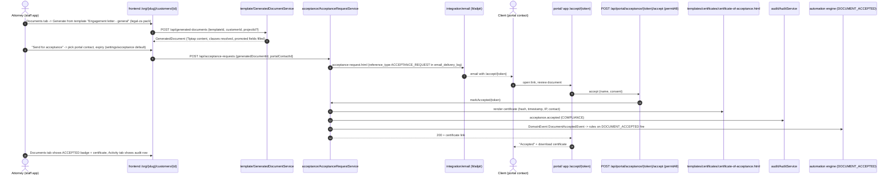
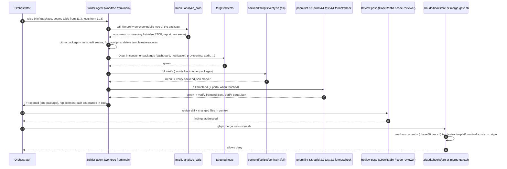

> Merge into ARCHITECTURE.md as **Section 11**.

# 11. Phase 86 — Subtraction: Legal-Only Kazi, Archive the Horizontal Platform, Squash Migrations

> **Standalone phase architecture document** (per-phase file convention; `architecture/ARCHITECTURE.md` holds the core platform sections). Derived from [`requirements/claude-code-prompt-phase86.md`](../requirements/claude-code-prompt-phase86.md) (founder decisions 2026-10-15) and the scouting inventory `.arch-context.md` (HEAD `c2b72208e`). ADRs: [ADR-330](../adr/ADR-330-archive-tag-not-fork.md) … [ADR-336](../adr/ADR-336-engagement-letter-document-plus-acceptance.md). Tenant migration after this phase: **`V1__baseline.sql`** (global and tenant); the next feature migration — Phase 84 take-on — is **V2**. This is a *subtraction* phase: every section below describes what leaves, which seam it leaves through, and what proves the surviving legal flows still work.

## 11.1 Overview

Kazi shipped 83 phases as a horizontal practice-management platform with vertical *profiles* layered on top. The product being sold is one of those profiles — South African law firms — and nothing else has a customer. Every horizontal module still compiles, migrates, seeds, runs in the full `./mvnw verify`, and pulls the legal UI toward generic vocabulary. Phase 86 removes it. Not gates it, not deprecates it: deletes the packages, routes, packs, scenarios, tests, compose services and CI jobs that exist only for accounting firms, agencies, the generic platform story, or a superseded implementation — and then collapses 158 Flyway migrations into two clean baselines.

The phase is possible because of a one-time fact: **there are zero production tenants.** No trust ledger, no fee note, no client record exists anywhere outside developer volumes. That makes every removal a true deletion (drop the entity, drop the table) and makes the migration series squashable with no data migration. The day the first design-partner firm's data lands (Phase 84 take-on), the window closes permanently: every later removal is a data migration and the baseline becomes immutable. Sequencing is therefore fixed — **86 (this) → 87 (legal-native shell + API vocabulary) → 84 (take-on)** — so that Phase 87 renames the wire on a small codebase and Phase 84 lands its tables as `V2` on a clean `V1`.

Three things happen, in order:

1. **Archive.** `main` is tagged `horizontal-platform-final` and mirrored to a read-only archive repository. Nothing is forked or maintained ([ADR-330](../adr/ADR-330-archive-tag-not-fork.md)). The tag is a precondition the first slice verifies before any deletion PR merges.
2. **Subtract, one package per PR**, in dependency order `crm → proposal → retainer → capacity → schedule → assistant (provider re-homed first) → PayFast platform billing → dev harness + docs site → non-legal profiles/packs/seeders + regulatory deadlines + automation builder`. Each PR cuts the exact consumer seams enumerated in §11.3, ships its own throwaway forward migration that drops the slice's tables, columns and migration-seeded rows so the live schema matches the code at every gate (§11.7(a)), fixes the count-pinning tests in §11.8, and passes the full verify.
3. **Squash.** With the post-removal schema stable (the old series plus slices 2–10's drop migrations), provision a fresh tenant, dump the schema, hand-clean it into deterministic DDL, and replace the entire `db/migration/{tenant,global}` series — old files and throwaway drop files alike — with one `V1__baseline.sql` each ([ADR-331](../adr/ADR-331-migration-squash-at-zero-tenants.md)). All local/dev/e2e Postgres volumes are wiped.

### Before / After

| Surface | Before (main `c2b72208e`) | After Phase 86 |
|---|---|---|
| Backend top-level packages | 69 | **61** — `assistant`, `capacity`, `crm`, `deadline`, `dev`, `proposal`, `retainer`, `schedule` deleted; `billing`, `demo`, `packs`, `seeder` trimmed |
| Backend main Java | 1,628 files / 176,320 lines | ≈ 1,330 files / ≈ 146k lines (removal packages ≈ 300 files / 31k lines, plus seam trims; recount at closure) |
| `@Entity` classes | 121 | **103** — 18 deleted (see §11.2; the inventory's "20" includes `Subscription` and `PackInstall`, which survive) |
| Tenant migrations | 133 files, high-water `V135` | +≈7 throwaway drop migrations during slices 2–7 and 10 (`V136`…`V142`, §11.7(a)) → **1** (`V1__baseline.sql`) after slice 11; next free `V2` |
| Global migrations | 25 files (`V1`–`V25`) | +≈3 throwaway drop migrations during slices 3, 4 and 8 (`V26`…`V28`) → **1** (`V1__baseline.sql`) after slice 11; next free `V2` |
| Vertical profiles | 4 (`accounting-za`, `consulting-generic`, `consulting-za`, `legal-za`) | **1** (`legal-za`); mechanism retained ([ADR-332](../adr/ADR-332-single-vertical-profile-mechanism-retained.md)) |
| `VerticalModuleRegistry` modules | 12 (8 VERTICAL / 4 HORIZONTAL) | **8** (6 VERTICAL / 2 HORIZONTAL) — `regulatory_deadlines`, `resource_planning`, `retainer_agreements`, `automation_builder` removed |
| Audit event-type catalogue | 41 entries | **28** (−`proposal.*`, −5 `deal.*`, −7 `ai.specialist.*`) |
| `Capability` constants | 33 | **27** (−`RESOURCE_PLANNING`, −`AI_ASSISTANT_USE`, −`VIEW_DEALS`/`MANAGE_DEALS`/`CLOSE_DEALS`/`MANAGE_PIPELINE`) |
| Notification types (free strings) | ~75 in `NotificationService` catalogue | −17 (schedule 4, retainer 5, proposal 4, deal 1, capacity 3) |
| REST path families | see §11.4 | −17 families (`/api/deals`, `/api/pipeline`, `/api/proposals`, `/portal/api/proposals`, `/api/retainers`, `/api/capacity`, `/api/resource-allocations`, `/api/leave`, `/api/utilization`, `/api/schedules`, `/api/assistant/**`, `/internal/assistant/**`, `/api/deadlines`, `/api/filing-statuses`, `/api/billing/{subscribe,cancel,payments}`, `/api/webhooks/subscription`, `/portal/dev/**`, `/portal/retainer*`) |
| AI surfaces | 3 — in-app chat assistant (Phase 52), specialist assistants (Phase 70), AI skills + gates + MCP (72/74/78/81/82) | **1 conversational surface (MCP)** + the in-app skills/reviews/gates ([ADR-333](../adr/ADR-333-mcp-sole-conversational-ai-surface.md)) |
| Tenant billing models | `BillingMethod` {PAYFAST, DEBIT_ORDER, PILOT, COMPLIMENTARY, MANUAL} + PayFast recurring checkout/ITN | `BillingMethod` {DEBIT_ORDER, PILOT, COMPLIMENTARY, MANUAL} (PAYFAST removed; `SubscriptionStatus` lifecycle TRIALING…LOCKED unchanged) ([ADR-335](../adr/ADR-335-manual-firm-level-billing-only.md)) |
| Portals | 3 — `portal/` app, stale `frontend/app/portal/**` copy (10 pages), Thymeleaf `/portal/dev` harness | **1** (`portal/`) |
| Frontend `page.tsx` routes | 126 | **100** (−16 staff routes per §11.6.1, −10 legacy portal pages) |
| Portal `page.tsx` routes | 22 | **18** (−`proposals`×2, −`retainer`×2) |
| Docs site | `docs/` Nextra workspace + image + Caddy vhost | removed |
| QA demo scenarios | 7 | 5 (−`accounting-za-90day-keycloak-v2`, −`consulting-agency-90day-keycloak`) |
| Playwright configs | 4 | 3 (−`playwright.consulting-lifecycle.config.ts`) |

### The zero-tenant window argument

Every decision in this phase that would be reckless with data in the database is safe without it, and the safety expires on a known date. Concretely:

- **Deleting an entity means dropping its table.** No `deprecated_at`, no "keep the table for a release". The owning slice's throwaway migration drops it and the squashed baseline never contains it.
- **Squashing means regenerating, not rewriting.** The baseline is a dump of what Flyway actually produces on a fresh tenant once the old series plus slices 2–10's drop migrations have run — not a hand-merged 133-file edit. The comparison harness in §11.7 proves equality to the pre-squash schema.
- **`flyway_schema_history` can be discarded.** Existing volumes hold up to ~142 applied tenant versions (135 plus the throwaway drops); the new series has one. Rather than teach Flyway to reconcile, all volumes are wiped (`dev-down.sh --clean`, `e2e-down.sh`) and documented as such.
- **Irreversibility rule.** `backend/db/BASELINE.md` records: once the first production tenant exists, the baseline is immutable and every change is `V2+`. The rule is enforced by convention and by the PR template, not by code — there is nothing to enforce it against until Phase 84.

### Sequencing 86 → 87 → 84

Phase 87 renames the wire (`Project → Matter`, `Customer → Client`, legal-native shell and settings IA) and deletes the terminology-map mechanism. Doing that on the full horizontal codebase means renaming through packages that are about to be deleted. Phase 84 (take-on/migration) adds its tables as the first feature migration after the baseline. If 84 ran first, its tables would sit at `V136` and the squash would have to carry take-on data. Hence 86 first, 87 on the small codebase, 84 as `V2`. Phase 85 (`/legal` marketing page) is frontend-only and unsequenced.

### Out of scope (restated and sharpened)

- Phase 87's renames (API, TypeScript, shell, settings consolidation, terminology-map mechanism). Phase 86 deletes only the `accounting-za`/`consulting-za` *entries* and `PORTAL_TERMINOLOGY_OVERRIDES`.
- Renaming JPA entities or tables.
- Removing the gateway BFF, Keycloak, Phase 75 job queue / shard registry (global `V24`/`V25` content survives into the baseline), Phase 13 dedicated-schema model.
- Removing anything on the keep list: Xero, invoice pay-now (`integration/payment` incl. `PayFastPaymentGateway` and `MockPaymentController`), acceptance, clauses, budgets, expenses, packs catalogue, custom fields, tags, saved views, information requests, bulk billing, collections, the portal `deadlines` module (custom-field-date driven), project templates, the automation *engine*, `demo` provisioning.
- Any new feature, including a replacement trigger for the two `PROPOSAL_SENT` automation rules (see §11.3.2 — they are deleted, and a future `ACCEPTANCE_REQUEST_SENT` trigger is noted for Phase 87+).
- Touching `mcp/` or the `kazi-legal-za` plugin contract. The MCP tool names/schemas (`get_matter`, `list_correspondence`, `propose_task`, …) and `McpReadOnlyRegistryTest` allowlists are unchanged by every slice.
- Fixing dead code exposed in surviving packages (reported in the closure for Phase 87).

## 11.2 Domain Model (removal map)

### 11.2.1 Entities deleted

| Entity | Package | Table (tenant unless noted) | Created by |
|---|---|---|---|
| `Deal` | `crm` | `deals` | V130 |
| `DealCounter` | `crm` | `deal_counters` | V130 |
| `PipelineStage` | `crm` | `pipeline_stages` | V130 |
| `Proposal` | `proposal` | `proposals` (incl. the bare `deal_id` column from V130, dropped with the table in slice 3) | V51 |
| `ProposalCounter` | `proposal` | `proposal_counters` | V51 |
| `ProposalMilestone` | `proposal` | `proposal_milestones` | V51 |
| `ProposalTeamMember` | `proposal` | `proposal_team_members` | V51 |
| `RetainerAgreement` | `retainer` | `retainer_agreements` | V31 |
| `RetainerPeriod` | `retainer` | `retainer_periods` | V31 |
| `LeaveBlock` | `capacity` | `leave_blocks` | V62 |
| `MemberCapacity` | `capacity` | `member_capacities` | V62 |
| `ResourceAllocation` | `capacity` | `resource_allocations` | V62 |
| `RecurringSchedule` | `schedule` | `recurring_schedules` | V30 |
| `ScheduleExecution` | `schedule` | `schedule_executions` | V30 |
| `AiLlmCall` | `assistant/invocation` | `ai_llm_calls` | V120 |
| `AiSpecialistInvocation` | `assistant/invocation` | `ai_specialist_invocations` | V120 |
| `SubscriptionPayment` | `billing` | `subscription_payments` (**global**) | global V17 |
| `FilingStatus` | `deadline` | `filing_statuses` | V81 |

**Survive despite appearing on the inventory's removal-package list:** `Subscription` (`billing`, global `subscriptions` — the billing-method + status model; note the requirements' "TRIAL/MANUAL/MANAGED" wording was loose: `BillingMethod` is {PAYFAST, DEBIT_ORDER, PILOT, COMPLIMENTARY, MANUAL} and TRIALING is a `SubscriptionStatus`) and `PackInstall` (`packs`, `pack_installs` — the Phase 65 install pipeline for legal content). Portal read-model tables without `@Entity` classes that also go: global `portal.portal_proposals` (V12), `portal.portal_retainer_summary` and `portal.portal_retainer_consumption_entry` (V20).

### 11.2.2 Surviving entities whose shape changes

Every FK column into a deleted table was located by grepping the tenant/global series for `retainer_id|deal_id|proposal_id|schedule_id|…`; the only hits outside the removal migrations themselves are listed here (the `tariff_items.schedule_id` hit refers to `tariff_schedules`, a legal table, and is untouched).

| Entity / table | Change | Why |
|---|---|---|
| `InvoiceLine` / `invoice_lines` | Drop column `retainer_period_id` (V31:65) and field `retainerPeriodId` (`InvoiceLine.java:34-35,186`); drop `RETAINER` from `InvoiceLineType` and from `invoice_lines_line_type_check` (final shape from V104: `TIME, EXPENSE, MANUAL, FIXED_FEE, TARIFF, DISBURSEMENT`) | Only `retainer/RetainerPeriodService.java:234,248` ever set it. `FIXED_FEE` (V52, born from the proposal fee model) **stays** — it is a generic invoice line type used by fee-note flows |
| `BillingRun` / `billing_runs` | Drop column `include_retainers` (V63:16), field `includeRetainers` (`BillingRun.java:43-44,81,88,157`), DTO fields (`BillingRunDtos.java:32,42,62`), `RetainerPeriodPreview`/`RetainerGenerateRequest` (`:212-225`) | Retainer leg of billing runs removed; time/expense/disbursement runs intact |
| `OrgSettings` / `org_settings` | Drop `default_weekly_capacity_hours` (V62:76; the whole `CapacitySettings` embeddable, `OrgSettings.java:176-180`), `deal_pipeline_pack_status` (V130:70) and `schedule_pack_status` (V81:51) from `PackStatusSettings`, `portal_retainer_member_display` (V105) from `PortalSettings` (`PortalSettings.java:40`) plus `settings/PortalRetainerMemberDisplay.java` and `dto/UpdatePortalRetainerMemberDisplayRequest.java` | `OrgSettingsSchemaSnapshotTest` pin shrinks by five columns (these four + `rate_pack_status`, V81, slice 10) — five authorised pin updates, each in the same PR as the slice's drop migration (§11.7(f)) |
| `Subscription` / global `subscriptions` | Drop `payfast_token`, `payfast_payment_id`, `monthly_amount_cents`, `last_payment_at`, `next_billing_at` (global V17:5-13); keep `subscription_status`, `trial_ends_at`, `grace_ends_at`, `billing_method`, `admin_note` (V18) | PayFast recurring path removed; the `SubscriptionStatus` lifecycle keeps its columns. Verify at build time that `currency` is unused once `monthly_amount_cents` goes |
| `ProjectTemplate` / `project_templates` | Drop column `post_create_actions` (V81:43) — **only if** no legal pack or `projecttemplate` code reads it (grep shows readers only in `schedule/*` and `seeder/SchedulePack*`; `project-template-packs/legal-za.json` has 0 occurrences) | Post-schedule "engagement kickoff" actions were accounting-za's |
| `AutomationRule` / `automation_rules` | `last_run_at` (V120:61) **stays** — verified: it is a field on `automation/AutomationRule.java:70` (engine), not on the specialist executor | Engine survives |
| `EmailDeliveryLog` / `email_delivery_log` | `chk_email_delivery_reference_type` loses `PORTAL_RETAINER`, `PORTAL_NEW_PROPOSAL`, `PORTAL_PROPOSAL_EXPIRED` (see §11.7(d) for the surviving union) | Those reference types were only written by the removed portal sync/email handlers |
| `FieldGroup` / `field_groups` | `applicable_entity_values` (V131:11) **stays**; the commented-out `ck_field_groups_applicable_entity` CHECK is not resurrected | Column is the custom-field mechanism, not CRM |
| `SavedView` / `EntityTag` | `ViewFilterService.java:26` allowed tables drop `"deals"`; `SearchFilterHandler.java:33` drops the `"DEAL"` title-column branch | DEAL entity type gone |
| `Comment` / `comments` | `chk_comment_entity_type` — verified: final shape (V37:6) is `('TASK','DOCUMENT','PROJECT')`; no proposal/deal values, no change | — |

### 11.2.3 Surviving tenant-schema entities (ER view)

Grouped by bounded context; legal trust sub-entities collapsed. FK lines show the relations that matter for the removal: nothing below points at a deleted table after §11.2.2 is applied.

```mermaid
erDiagram
    %% ---- Matters & people ----
    Project ||--o{ Task : has
    Project ||--o{ ProjectMember : staffed_by
    Project ||--o{ TimeEntry : logs
    Project ||--o{ Expense : incurs
    Project ||--o| ProjectBudget : budgeted
    Project ||--o{ CustomerProject : links
    Customer ||--o{ CustomerProject : links
    Customer ||--o{ PortalContact : has
    Customer ||--o{ Correspondence : files
    Customer ||--o{ ChecklistInstance : onboarding
    Member ||--o{ TimeEntry : records
    Member ||--o{ ProjectMember : is
    Task ||--o{ TaskItem : items
    ProjectTemplate ||--o{ TemplateTask : defines
    TemplateTask ||--o{ TemplateTaskItem : defines

    %% ---- Documents ----
    DocumentTemplate ||--o{ GeneratedDocument : renders
    DocumentTemplate ||--o{ TemplateClause : includes
    Clause ||--o{ TemplateClause : used_in
    GeneratedDocument ||--o| AcceptanceRequest : "sent for acceptance (engagement letter path)"
    Document }o--|| Project : scoped_to

    %% ---- Finance ----
    Invoice ||--o{ InvoiceLine : lines
    Invoice ||--o{ PaymentEvent : payments
    Invoice ||--o{ CollectionActivity : chased_by
    InvoiceCounter ||--|| Invoice : numbers
    BillingRun ||--o{ BillingRunItem : produces
    BillingRun ||--o{ BillingRunEntrySelection : selects
    BillingRate }o--|| Member : for
    CostRate }o--|| Member : for
    TaxRate ||--o{ Invoice : applied

    %% ---- Legal vertical ----
    TrustAccount ||--o{ TrustTransaction : ledger
    TrustAccount ||--o{ TrustReconciliation : reconciled
    TrustReconciliation ||--o{ BankStatement : against
    BankStatement ||--o{ BankStatementLine : lines
    ClientLedgerCard }o--|| Customer : per_client
    InterestRun ||--o{ InterestAllocation : allocates
    TrustInvestment }o--|| Customer : s86_4
    LpffRate ||--o{ InterestRun : rate
    CourtDate }o--|| Project : hearing
    PrescriptionTracker }o--|| Project : tracks
    ConflictCheck ||--o{ AdversePartyLink : links
    AdverseParty ||--o{ AdversePartyLink : links
    TariffSchedule ||--o{ TariffItem : items
    LegalDisbursement }o--|| Project : on_matter
    MatterClosureLog }o--|| Project : closes

    %% ---- Configuration, compliance, AI ----
    OrgSettings ||--|| OrgRole : roles
    FieldDefinition }o--|| FieldGroup : grouped
    FieldGroup ||--o{ FieldGroupMember : members
    Tag ||--o{ EntityTag : applied
    SavedView }o--|| Member : owned
    ChecklistTemplate ||--o{ ChecklistTemplateItem : items
    ChecklistInstance ||--o{ ChecklistInstanceItem : items
    RequestTemplate ||--o{ RequestTemplateItem : items
    InformationRequest ||--o{ RequestItem : items
    RequestCounter ||--|| InformationRequest : numbers
    AutomationRule ||--o{ AutomationAction : actions
    AutomationRule ||--o{ AutomationExecution : runs
    AutomationExecution ||--o{ ActionExecution : steps
    FieldDateNotificationLog }o--|| FieldDefinition : dedupes
    AiFirmProfile ||--o{ AiExecution : context
    AiExecution ||--o{ AiExecutionGate : proposes
    ComplianceAuditReport ||--o{ ComplianceAuditFinding : findings
    DataSubjectRequest }o--|| Customer : subject
    ProcessingActivity ||--o{ DataSubjectRequest : scope
    RetentionPolicy ||--o{ Project : governs
    OrgIntegration ||--o| AccountingXeroConnection : xero
    AccountingSyncEntry }o--|| Invoice : synced
    AccountingTaxCodeMapping }o--|| TaxRate : maps
    OrgSecret }o--|| OrgIntegration : keys
    EmailDeliveryLog }o--|| Notification : delivers
    Notification }o--|| Member : for
    NotificationPreference }o--|| Member : for
    PortalNotificationPreference }o--|| PortalContact : for
    MagicLinkToken }o--|| PortalContact : for
    McpEgressConsent }o--|| Member : granted
    PackInstall ||--|| OrgSettings : installed
    ReportDefinition ||--|| OrgSettings : seeded
    AuditEvent }o--|| Member : actor
    Comment }o--|| Member : author
    PendingInvitation }o--|| Member : invited_by
```



**Unchanged:** every legal vertical entity (`verticals/legal/**`, 20 entities), the trust CHECK constraints (`chk_trust_txn_type`, `chk_trust_txn_status`, `chk_client_ledger_*`, `chk_interest_*`, `chk_bank_*`, `chk_lpff_*`), the global entities `OrgSchemaMapping`, `ShardConfig`, `JobQueue`, `AccessRequest`, `Organization`, `Subscription` (trimmed), and every `integration/**`, `mcp/**`, `collections`, `correspondence`, `compliance`, `datarequest`, `retention` entity. The portal read-model tables `portal.portal_deadline_view` (V21), `portal.portal_trust_*` (V19), `portal.portal_notification_preference` (V22) survive; V22's Java preference catalogue loses its proposal/retainer types but the table shape does not change.

## 11.3 Removal Flows and Backend Behaviour

Conventions: `$B` = `backend/src/main/java/io/b2mash/b2b/b2bstrawman/`, `$T` = `backend/src/test/java/io/b2mash/b2b/b2bstrawman/`, `$R` = `backend/src/main/resources/`. "Delete" means `git rm` the whole directory including its `dto/`, `event/` sub-packages and the package's test directory under `$T`. Line numbers are as of the inventory snapshot; re-confirm with IntelliJ `analyze_calls` before editing — the requirement is that no undocumented consumer exists, and the compiler is the final arbiter.

**Every removal slice ships its own forward drop migration** (the `Migration` row in each table below; tenant `V136`…, global `V26`…, numbered in merge order — re-verify the high-water mark at build time). It drops the slice's tables (FK-dependency order), columns, migration-seeded rows (`DELETE FROM org_role_capabilities WHERE capability IN (…)`) and re-defines any CHECK constraint whose value list loses a member. No *existing* migration file is ever edited. The rule exists because deleting an entity without dropping its seeded data breaks the running system: V67 seeds `'RESOURCE_PLANNING'` into `org_role_capabilities` for owner/admin, `OrgRole.capabilities` is `@Enumerated(STRING) Set<Capability>`, and deleting the constant without the `DELETE` makes every owner/admin role load throw on every request via `MemberFilter`. It also lets the `OrgSettingsSchemaSnapshotTest` pin shrink in the same PR as the column drop, and makes the parity snapshot captured at the end of slice 10 (§11.7(e)) the true post-removal schema. The drop migrations are **throwaway** — they live for at most nine PRs and vanish with the rest of the series in slice 11 (§11.7). This overrides the requirements' "no migration edits per slice" (§11.3.10(j)).

### 11.3.1 `crm` (Phase 80) — slice 2

| What | Detail |
|---|---|
| Deleted | `$B/crm/**` (35 files), `$T/crm/**` (12 tests), `$B/seeder/DealPipelinePackSeeder.java` + `DealPipelinePackDefinition.java`, `$T/seeder/DealPipelinePackSeederTest.java` (if present outside `crm/`), `$R/deal-pipeline-packs/*` (4), `$B/dashboard/dto/PipelineSummaryResponse.java`, `$R/templates/email/notification-deal-won.html` |
| Seams | `dashboard/DashboardService.java:9,81` (drop `PipelineSummaryService` injection + `getPipelineSummary`), `dashboard/DashboardController.java:7,138-155` (drop `GET /api/dashboard/pipeline-summary`); `provisioning/TenantProvisioningService.java:74-126` and `provisioning/PackReconciliationRunner.java:46-71` (drop `DealPipelinePackSeeder` wiring); `settings/PackStatusSettings` (drop `dealPipelinePackStatus`); `view/ViewFilterService.java:26` (drop `"deals"`), `view/SearchFilterHandler.java:33` (drop `"DEAL"`); `vertical-profiles/legal-za.json` `packs.deal_pipeline` key removed (and the `deal_pipeline` pack type from `VerticalProfileReconciliationSeeder`); `audit/AuditEventGroup.java:25` `SALES` removed (only `deal.*` used it; verify no frontend audit-group filter lists it) |
| Migration | tenant `V136__drop_crm.sql` (throwaway): `DROP TABLE deals, deal_counters, pipeline_stages` (`proposals.deal_id` is **not** touched here: V130:65 adds it as a bare `UUID` column with no `REFERENCES`, and `proposal/Proposal.java:109-110`, `ProposalRepository.java:22-28` (`existsByDealId`/`findByDealId`) and `ProposalService.java:237-239` (`linkToDeal`) still map it until slice 3 deletes the package; the column and `idx_proposals_deal` go with `DROP TABLE proposals` in V137. The `deal_id` values become dangling UUIDs for one slice, which nothing reads once `crm/` is gone) (V130; `deals` before `pipeline_stages` because of `fk_deal_stage`); `ALTER TABLE org_settings DROP COLUMN deal_pipeline_pack_status` (V130:70). No `org_role_capabilities` rows to delete — V130 seeds none for the four deal capabilities (§11.9). `OrgSettingsSchemaSnapshotTest` pin −1 in this PR |
| Audit | `AuditEventTypeRegistry.java:113-126`: remove `deal.created`, `deal.stage_changed`, `deal.won`, `deal.lost`, `deal.reopened` → `AuditEventTypeRegistryTest` `hasSize(41)` → **36** (lines 81, 121, 122) and drop `"deal.won"` from the `contains(...)` at line 90 |
| Notifications | `DEAL_WON`: `NotificationService.java:220`, `EmailNotificationChannel.java:225,338` |
| Capabilities | `Capability.java:71-77` `VIEW_DEALS`, `MANAGE_DEALS`, `CLOSE_DEALS`, `MANAGE_PIPELINE`; `frontend/lib/capabilities.tsx:21-24,90-105` |
| Module registry | none (CRM was capability-gated, not module-gated) |
| Frontend | §11.6 |
| Replacement test | **`DashboardWithoutPipelineTest`** (backend, MockMvc): `GET /api/dashboard/*` for an owner on a fresh legal-za tenant returns 200 and the response contains no `pipeline` key; frontend `dashboard/page.tsx` renders without `PipelineSummaryWidget` (vitest snapshot of the widget grid) |

Why first: five of `proposal`'s six main importers are in `crm/`; deleting `crm` first leaves `proposal` with one external consumer (`audit/DatabaseAuditService`).

### 11.3.2 `proposal` (Phase 32) — slice 3

| What | Detail |
|---|---|
| Deleted | `$B/proposal/**` (34 files, incl. `PortalProposalController`, `PortalProposalService`, `ProposalPortalSync*`, `ProposalSentEmailHandler`, `ProposalExpiredEventHandler`, `ProposalContentSeeder`), `$T/proposal/**` (12), `$B/event/ProposalSentEvent.java`, `$R/templates/email/notification-proposal.html`, `portal-new-proposal.html`, `portal-proposal-expired.html` |
| Seams | `audit/DatabaseAuditService.java:15-16,59,71,81,319-349` (drop the proposal id fan-out in the customer audit query); `event/DomainEvent.java:50` (remove from `permits`); `automation/TriggerType.java:12` `PROPOSAL_SENT`, `automation/TriggerTypeMapping.java:15,44`, `automation/AutomationContext.java` (ProposalSent branch), `automation/AutomationEventListener.java`; `notification/NotificationEventHandler.java` and `portal/notification/PortalEmailNotificationChannel.java` (ProposalSent listeners); `notification/template/EmailTerminology.java:28-31` + `EmailContextBuilder.java:97-104` (`proposalTerm*` keys); `prerequisite/PrerequisiteContext.java:7` `PROPOSAL_SEND("Proposal Sending")` **is an enum value** → delete it, the `case PROPOSAL_SEND` branch in `PrerequisiteService.java:199-230`, `PROPOSAL_SEND_FIELDS` + the map entry + the portal-contact override in `StructuralPrerequisiteCheck.java:54-55,91,110-130`, and their tests (do NOT add an acceptance-send context in this phase — verify at build time whether acceptance already has one; if not, it is a Phase 87+ feature); `template/TemplateCategory.java:9` `PROPOSAL` **is an enum value** but no template pack uses it (`ENGAGEMENT_LETTER` at `:4` is the legal category) → delete the constant and its frontend mirror in the template category select/labels (`frontend/components/templates/*` — grep `PROPOSAL`); documents already categorised `PROPOSAL` do not exist (zero tenants), and slice 3's drop migration re-defines `chk_dt_category` without it; `architecture/TenantScopeBindingTest.java:199-202` (four proposal handler FQNs removed from the exemption list); **e2e seed**: delete `compose/seed/lib/proposals.sh` and the `/api/proposals`, `/api/proposals/{id}/send`, `/api/proposals/stats`, `/api/proposals/summary` calls in `compose/seed/lifecycle-test.sh` (≈:559-585, :1290-1292) — the `CLAUDE.md` "Agent UI Navigation" mock-auth stack and `e2e-reseed.sh` depend on this seed, and the slice-11 volume wipe needs it working |
| Migration | tenant `V137__drop_proposals.sql` (throwaway): `DROP TABLE proposal_team_members, proposal_milestones, proposals, proposal_counters` (V51; children first); re-define `chk_dt_category` (V102) without `'PROPOSAL'` — surviving list in §11.7(d); re-define `chk_email_delivery_reference_type` (final shape V135) without `'PORTAL_NEW_PROPOSAL'`, `'PORTAL_PROPOSAL_EXPIRED'`. global `V26__drop_portal_proposals.sql`: `DROP TABLE portal.portal_proposals` (V12) |
| Automation templates | `$R/automation-templates/legal-za.json` rule "Engagement Letter Follow-up" (`triggerType: PROPOSAL_SENT`, lines 30-36) and the one `PROPOSAL_SENT` rule in `common.json` are **deleted** — there is no acceptance-request-sent trigger, and adding one is a new feature. `$T/packs/LegalZaAutomationPackTest.java:102,109` `EXPECTED_SLUGS` loses the slug; the `hasSize(64)` at :109 is a recount. Noted for Phase 87+: an `ACCEPTANCE_REQUEST_SENT` trigger would restore the follow-up task on the engagement-letter path |
| Audit | `AuditEventTypeRegistry.java:112` `proposal.*` → count **35** |
| Notifications | `PROPOSAL_SENT/ACCEPTED/DECLINED/EXPIRED`: `NotificationService.java:190-193`, `EmailNotificationChannel.java:222,331` |
| Portal read-model | global V12 table dropped by this slice's global migration; `portal/notification/PortalNotificationPreference*` lose the proposal preference types; `portal/PortalActivityEventTypes` — verified: declares no `PROPOSAL`/`RETAINER` constants; no edit; `portal/notification/PortalDigestContentAssembler` loses the proposal section |
| Portal app + legacy copy | `portal/app/(authenticated)/proposals/**`, `portal/components/proposal-status-badge.tsx`, proposal rows in `portal/lib/api/notification-preferences.ts`, `portal/lib/types.ts`, `portal/lib/nav-items.ts:84-88,127`; **entire `frontend/app/portal/**`** (10 pages — the stale in-staff-app copy, its only live import being `@/lib/api/portal-proposals`) and `frontend/lib/api/portal-proposals.ts` |
| Capabilities | none dedicated (gated by `INVOICING`) |
| Replacement test | **`EngagementLetterWithoutProposalIntegrationTest`** (backend, `@SpringBootTest`): on a legal-za tenant, generate a document from the `legal-za/engagement-letter-general` `DocumentTemplate` for a customer; create an `AcceptanceRequest` for the `GeneratedDocument` addressed to a `PortalContact`; call `POST /api/portal/acceptance/{token}/accept`; assert the certificate (`templates/certificates/certificate-of-acceptance.html`) is rendered and stored, the `DOCUMENT_ACCEPTED` automation trigger fires, and an `acceptance.*` audit event exists — with `proposal/**` absent from the classpath. The Playwright counterpart lives in `legal-lifecycle/day-01-03-onboarding.spec.ts` (amended to remove proposal steps) |

Why the engagement letter survives without an entity: Phase 28 acceptance predates proposals and works on any `GeneratedDocument`; the legal-za template pack already ships three engagement-letter templates; the terminology map's `Proposal → Engagement Letter` was a label over a generic pipeline object. [ADR-336](../adr/ADR-336-engagement-letter-document-plus-acceptance.md).

### 11.3.3 `retainer` (Phase 17) — slice 4

| What | Detail |
|---|---|
| Deleted | `$B/retainer/**` (25), `$T/retainer/**` (11, incl. `V31MigrationTest`), `$B/billingrun/RetainerBillingService.java`, `$T/billingrun/BillingRunRetainerTest.java`, `$B/customerbackend/{controller/PortalRetainerController, dto/PortalRetainerSummaryResponse, dto/PortalRetainerConsumptionEntryResponse, model/PortalRetainerSummaryView, model/PortalRetainerConsumptionEntryView, repository/PortalRetainerSummaryRepository, repository/PortalRetainerConsumptionEntryRepository, service/PortalRetainerService, service/RetainerPortalSyncService, service/PortalRetainerMemberDisplayResolver}`, `$T/customerbackend/controller/PortalRetainerControllerIntegrationTest`, `$T/customerbackend/service/RetainerPortalSyncServiceTest`, `$B/settings/PortalRetainerMemberDisplay.java`, `$B/settings/dto/UpdatePortalRetainerMemberDisplayRequest.java`, `$R/templates/email/notification-retainer.html`, `portal-retainer-period-closed.html`, — **not** `$R/template-packs/consulting-za/monthly-retainer-report.json`: `template-packs/consulting-za/pack.json:39-43` lists it as a `contentFile` and `ConsultingZaTemplatePackTest:57,281` pins the key, so it is deleted with the whole consulting-za pack in slice 10 |
| Seams | `billingrun/BillingRunService.java:12-13,37,44,49,171-184`, `BillingRunController.java:12-13,161-173` (`/{id}/retainer-preview`, `/{id}/retainer-generate`), `BillingRunLifecycleService.java:80`, `BillingRun.java:43-44,81,88,157`, `dto/BillingRunDtos.java:32,42,62,212-225`; `customer/CustomerService.java:26,56,71,84,509-511` (drop the retainer `DeleteGuard` clause); `portal/notification/PortalEmailNotificationChannel.java:9,47,183,358,475` (`RetainerPeriodRolloverEvent` listener + `portal-retainer-period-closed`); `$T/portal/notification/PortalEmailNotificationChannelIntegrationTest` (drop the rollover case); `invoice/InvoiceLine.java:34-35,186` + `InvoiceLineType.java:7`; `settings/PortalSettings.java:40` + `OrgSettingsController`/`OrgSettingsService`/`dto/SettingsResponse` for `portalRetainerMemberDisplay`; `customerbackend` `PortalContextController` response field for retainer module (verify); `verticals/VerticalModuleRegistry.java:220-230` (`retainer_agreements`); **e2e seed**: delete `compose/seed/lib/retainers.sh` and the `/api/retainers` calls in `compose/seed/lifecycle-test.sh` (≈:616-623, :697-700) |
| Migration | tenant `V138__drop_retainers.sql` (throwaway): `DROP INDEX idx_invoice_lines_retainer_period_id` + `ALTER TABLE invoice_lines DROP COLUMN retainer_period_id` (V31:65-68); re-define `invoice_lines_line_type_check` (final shape V104) without `'RETAINER'`; `DROP TABLE retainer_periods, retainer_agreements` (V31; `retainer_agreements.schedule_id` → `recurring_schedules` is why retainer precedes schedule); `ALTER TABLE billing_runs DROP COLUMN include_retainers` (V63:16); `ALTER TABLE org_settings DROP COLUMN portal_retainer_member_display` (V105 — its inline CHECK goes with the column); re-define `chk_email_delivery_reference_type` without `'PORTAL_RETAINER'`. global `V27__drop_portal_retainers.sql`: `DROP TABLE portal.portal_retainer_consumption_entry, portal.portal_retainer_summary` (V20) |
| Audit | none dedicated |
| Notifications | `RETAINER_PERIOD_READY_TO_CLOSE`, `RETAINER_PERIOD_CLOSED`, `RETAINER_APPROACHING_CAPACITY`, `RETAINER_FULLY_CONSUMED`, `RETAINER_TERMINATED`: `NotificationService.java:178-182`, `EmailNotificationChannel.java:216-220,317-326` |
| Portal read-model | global V20 tables dropped by this slice's global migration; `PortalReadModelOrgScopingGuardTest` scan shrinks (no edit) |
| Module registry | `retainer_agreements` removed → `VerticalModuleRegistryTest.java:22` **11**, `:192` vertical **7**; `VerticalProfileModuleSlugValidationTest.java:93-94` `KNOWN_UNSEEDED_DEFAULTS` → `Set.of()` |
| Schema pin | `OrgSettingsSchemaSnapshotTest` drops `portal_retainer_member_display` (authorised, same PR as the column drop) |
| Portal app | `portal/app/(authenticated)/retainer/**`, `portal/components/retainer/**` (+ 3 tests), `portal/lib/api/retainer.ts` (+ test), retainer rows in `notification-preferences.ts`/`types.ts`, `portal/lib/nav-items.ts:61-68,123`, `portal/components/ui/sticky-action-bar.tsx` mention |
| Replacement test | **`BillingRunWithoutRetainersIntegrationTest`**: create a billing run on a legal-za tenant with unbilled time + a legal disbursement; preview, generate, approve; assert items for `TIME` and `DISBURSEMENT` lines, no `include_retainers` in the request/response DTOs, and `BillingRunSelectionService` compiles (its V100 comment at :722 is stale but harmless) |

Terminology note: `Retainer → Mandate` in the legal-za map stays as a *word*; after this slice nothing renders it. Phase 87 decides where "mandate" lands (engagement letter / acceptance) when it deletes the mechanism.

### 11.3.4 `capacity` (Phase 38) — slice 5

| What | Detail |
|---|---|
| Deleted | `$B/capacity/**` (23), `$T/capacity/**` (9), `$B/settings/CapacitySettings.java`, `$B/settings/dto/UpdateCapacitySettingsRequest.java`, and the allocation-driven profitability projections (`ReportController.ProjectionData`, the `includeProjections` request params, `ReportService.compute{Project,Customer,Org}Projections`/`aggregateProjections`). **Kept (decision D3, 2026-10-16):** the time-based `GET /api/reports/utilization` (`ReportController.{MemberUtilizationRecord,UtilizationResponse}`, `ReportService.getUtilization`, `ReportRepository.getMemberUtilization`, `MemberUtilizationProjection`, `UtilizationReportTest`) — it reads time entries only and feeds the kept profitability page |
| Seams | `report/ReportService.java` (drop the `ResourceAllocationRepository` dependency and the projection path; `getUtilization` kept per D3) + `assistant/tool/read/GetProfitabilityTool.java:80,98` (5-arg call sites); `settings/OrgSettings.java:176-180` (`@Embedded CapacitySettings`) + `OrgSettingsService`/`OrgSettingsController`/`dto/SettingsResponse` capacity fields; `verticals/VerticalModuleRegistry.java:147-159` (`resource_planning`); `backend/CLAUDE.md:159` (`getCapacity()` listed among the 10 embeddables → 9) |
| Migration | tenant `V140__drop_capacity.sql` (throwaway; V139 was taken by Epic 598): `DROP TABLE resource_allocations, leave_blocks, member_capacities` (V62); `ALTER TABLE org_settings DROP COLUMN default_weekly_capacity_hours` (V62:76); **`DELETE FROM org_role_capabilities WHERE capability = 'RESOURCE_PLANNING'`** (V67:57,66 seed it for owner and admin — without this row deletion, `OrgRole.capabilities` (`@Enumerated(STRING)`) throws on load for every owner/admin and `MemberFilter` fails every request); + defensive `enabled_modules - 'resource_planning'` (V97) |
| Notifications | `ALLOCATION_CHANGED`, `MEMBER_OVER_ALLOCATED`, `LEAVE_CREATED` (catalogue lines ~199-201; no `NotificationEventHandler` listener exists — `MemberOverAllocatedEvent` was consumed only inside `capacity/`, per the 595B seam audit) |
| Capabilities | `Capability.java:14` `RESOURCE_PLANNING` (only `capacity/*Controller` use it); `frontend/lib/capabilities.tsx:15,60` |
| Module registry | `resource_planning` → `VerticalModuleRegistryTest` **10**, horizontal **3** (`:98`) |
| Schema pin | drop `default_weekly_capacity_hours` (authorised) |
| Replacement test | **`DashboardWithoutCapacityTest`**: `dashboard/page.tsx` renders without `TeamCapacityWidget`, `MyScheduleWidget`, `TeamUtilizationWidget`, `MetricsStrip`'s capacity grid (vitest); backend `GET /api/dashboard/*` 200 with no `capacity`/`utilization` keys; `reports/` page lists no `utilization` report (`StandardReportPackSeeder` — verify whether a utilization report definition is code-defined there and remove it) |

### 11.3.5 `schedule` (Phase 16/30) — slice 6

The package holds two unrelated things: recurring project schedules (removed) and the **time-reminder** scheduler (`TimeReminderScheduler`, `TimeReminderHandler` — the Settings → Time Tracking feature, a `JobHandler` on the Phase 75 queue). The time reminder imports `timeentry`, `notification`, `settings`, `member` and nothing from `schedule`; it is **re-homed to `$B/timeentry/`** before the package is deleted (with `$T/schedule/TimeReminderSchedulerTest` → `$T/timeentry/`). `timeentry/TimeEntryRepository` references the class (javadoc or query — verify) and needs its import updated.

| What | Detail |
|---|---|
| Deleted | `$B/schedule/**` minus the two re-homed classes (16 files), `$T/schedule/**` minus the moved test (3), `$B/seeder/SchedulePackSeeder.java` + `SchedulePackDefinition.java`, `$T/seeder/SchedulePackSeederTest.java`, `$R/schedule-packs/accounting-za.json`, `$T/projecttemplate/V30MigrationTest.java` (schedule half; the project-template assertions move to the baseline schema test in §11.7(e)), `$R/templates/email/notification-schedule.html` |
| Seams | `projecttemplate/PeriodCalculator.java:3,41-65` (drop `recalculateNextExecutionOnResume`; keep `calculateNextPeriod` — verify nothing else in `projecttemplate` needs the schedule type), `projecttemplate/ProjectTemplateService.java:44,83,108,131,285-288` (drop the "active recurring schedules" delete guard), `$T/projecttemplate/{PeriodCalculatorTest,ProjectTemplateControllerTest,ProjectTemplatePrerequisiteTest,ProjectTemplateServiceTest}` (drop schedule fixtures); `notification/NotificationEventHandler.java:325-361` and `NotificationService.java:677-745` (schedule event handlers); `provisioning/TenantProvisioningService.java:74-126`, `provisioning/PackReconciliationRunner.java:46-71`, `$T/provisioning/PackReconciliationRunnerTest` (drop `SchedulePackSeeder`/`RecurringScheduleRepository`); `settings/PackStatusSettings` (`schedulePackStatus`); `projecttemplate/ProjectTemplate` `postCreateActions` (if present — see §11.2.2) |
| Migration | tenant `V141__drop_schedules.sql` (throwaway): `DROP TABLE schedule_executions, recurring_schedules` (V30:56-93; child first); `ALTER TABLE org_settings DROP COLUMN schedule_pack_status` (V81:51); `ALTER TABLE project_templates DROP COLUMN post_create_actions` (V81:43) only if §11.2.2's no-legal-reader condition holds |
| Notifications | `RECURRING_PROJECT_CREATED`, `SCHEDULE_SKIPPED`, `SCHEDULE_COMPLETED` (`NotificationService.java:175-177,702,731,762`; `EmailNotificationChannel.java:214,299-310`), `POST_CREATE_ACTION_FAILED` (catalogue ~line 208 — belongs to schedule post-create actions; verify) |
| Schema pin | drop `schedule_pack_status` (authorised) |
| Replacement test | **`NotificationCatalogueWithoutSchedulesTest`**: `NotificationEventHandler` and `NotificationService` compile; the catalogue returned by `GET /api/notifications/preferences` for a legal-za owner still contains every legal type (`COURT_DATE_REMINDER`, `PRESCRIPTION_WARNING`, `TRUST_*`, `MATTER_CLOSED/REOPENED`, `TIME_REMINDER`, `BILLING_RUN_*`, `INFORMATION_REQUEST_*`) and none of the 17 removed types; `TimeReminderSchedulerTest` green from its new package |

### 11.3.6 `assistant` (Phases 45/52/70) with `provider` re-homed — slice 7

The AI consolidation is the one removal that must *move* something before it deletes. `assistant/provider` (10 classes: `ChatMessage`, `ChatRequest`, `LlmChatProvider`, `LlmChatProviderRegistry`, `ModelInfo`, `StreamEvent`, `ToolDefinition`, `ToolResult`, `VisionContentBlock`, `anthropic/AnthropicLlmProvider`) is the Phase 45 chat-provider abstraction. Its only out-of-package consumers are `integration/IntegrationService.java:3-4,38,46,249-253` (`getAiModels()`) and `integration/AiSettingsController.java:3,22-25` (`GET …/models`) — the Settings → AI model list. `integration/ai` (Phase 72 `AiProvider` port, `AnthropicAiProvider`, cost/gate/skill sub-packages) imports **nothing** from `assistant`, and `mcp/` imports **nothing** from `assistant` or `automation` (inventory §7/§10). MCP tool contracts are therefore untouched by construction.

Decision ([ADR-333](../adr/ADR-333-mcp-sole-conversational-ai-surface.md)): move the provider package wholesale to `$B/integration/ai/provider/` (package rename only, no API change — `git mv` + import rewrite), because the model-list endpoint and the BYOAK key settings are foundation; collapsing `LlmChatProviderRegistry` into `AiProvider` is a Phase 87+ refactor that would widen this PR. The streaming/tool-use members of `LlmChatProvider` become dead after the chat surface goes; they are reported, not pruned.

| Step | Detail |
|---|---|
| 1. Re-home | `git mv $B/assistant/provider $B/integration/ai/provider`; update `IntegrationService.java:3-4`, `AiSettingsController.java:3`; move `$T/assistant/provider/{LlmChatProviderRegistryTest,StreamEventTest,anthropic/AnthropicLlmProviderTest}` → `$T/integration/ai/provider/`; `LlmChatProviderRegistryTest.java:120` `hasSize(2)` — recount after the move (expected unchanged) |
| 2. Delete | `$B/assistant/**` remainder (74 files: `AssistantController`, `AssistantService`, `ChatContext`, `invocation/**` incl. `applier/*`, `payload/*`, `AiSpecialistInvocationController`, expiry/reaper jobs; `specialist/**` incl. `SpecialistController`, `SpecialistDevController`, `SpecialistRegistry`, `NonInteractiveSpecialistRunner`, three `*SpecialistConfig`; `tool/**` incl. 17 read tools and 12 write tools), `$T/assistant/**` remainder (22 tests incl. `V120MigrationTest`, `SpecialistRegistryIntegrationTest` (`hasSize(3)` at :131), `IntakeSpecialistIntegrationTest` (`:177`)); `$B/automation/executor/InvokeAiSpecialistActionExecutor.java`, `$B/automation/config/InvokeAiSpecialistActionConfig.java`, `$T/automation/{AiSpecialistAutomationPackValidityTest (hasSize(6) at :65), executor/InvokeAiSpecialistActionExecutorIntegrationTest}`; `$R/automation-templates/ai-specialist-{common,consulting-za,legal-za}.json`; `$R/assistant/specialists/{billing-za,inbox-za,intake-za}.md` + `assistant/system-guide.md` |
| 3. Seams | `automation/ActionType.java` (drop `INVOKE_AI_SPECIALIST`), `automation/config/ActionConfig.java:3-10` (drop from `permits`), `automation/config/AutomationConfigDeserializer.java:46`, `automation/AutomationActionExecutor` (executor registry), `automation/AutomationContext.java:104` (comment), `automation/template/AutomationTemplateSeeder` (no longer loads `ai-specialist-*.json`); `$T/automation/AutomationSchedulerScheduledTriggerIntegrationTest` (drop the `OutputApplier`/`InboxSummaryPayload`/`NonInteractiveSpecialistRunner` fixture — the scheduled-trigger assertions stay, re-fixtured on `SEND_NOTIFICATION`); `billing/SubscriptionStatusCache` loses its `AssistantService` consumer (keep — `demo` uses it); `project/ProjectUpcomingDeadlinesService` loses its `GetMatterActivityWindowTool` consumer (keep — `ProjectController` uses it); `architecture/TenantScopeBindingTest.java:132` (drop the `AssistantController` exemption) |
| 4. Migration | tenant `V142__drop_assistant.sql` (throwaway): `DROP TABLE ai_llm_calls, ai_specialist_invocations` (V120; `ai_llm_calls` first — it FKs the invocation with `ON DELETE CASCADE`). No `org_role_capabilities` rows for `AI_ASSISTANT_USE` — no tenant migration seeds it (V122 seeds only `AI_MANAGE`/`AI_EXECUTE`/`AI_REVIEW`; confirm with a grep at build time) |
| Audit | `AuditEventTypeRegistry.java:127-160`: seven `ai.specialist.*` entries → count **28**; the comment at :165-166 ("mirroring ai.specialist.approved") is rewritten; `ai.gate.*` stays |
| Capabilities | `Capability.java:39-40` `AI_ASSISTANT_USE` (all 7 users are inside `assistant/`); `frontend/lib/capabilities.tsx:17,70`; `AI_MANAGE/AI_EXECUTE/AI_REVIEW` (:43-47) stay — they gate `integration/ai` |
| Frontend | `components/assistant/**`, `lib/api/{assistant-specialists,ai-invocations}.ts`, `lib/actions/ai-invocations.ts`, `lib/constants/ai-queue-strings.ts`, `settings/automations/ai-queue/**`; mounts in `org/[slug]/layout.tsx:20-22,134,174-176`; specialist launcher buttons in `customers/[id]/page.tsx`, `projects/[id]/page.tsx`, `invoices/[id]/page.tsx`, `information-requests/[id]/page.tsx`, `components/{comments/comment-item,customers/create-customer-dialog,invoices/invoice-detail-client,invoices/invoice-generation-dialog,settings/settings-sidebar}.tsx`; `SETTINGS_ITEMS` "AI Review Queue" (`nav-items.ts:507-512`); e2e `specialists/` |
| QA | `qa/testplan/demos/ai-core-verification-keycloak.md` trimmed of assistant/specialist steps (authorised amendment: deleted feature) and re-run in the capstone |
| Replacement test | **`AiFoundationWithoutAssistantTest`** (backend, `@SpringBootTest`): on a legal-za tenant with a BYOAK key configured and the `NoOpAiProvider`, (a) `GET /api/integrations/ai/models` returns the model list from `integration.ai.provider.LlmChatProviderRegistry`; (b) `POST /api/ai/skills/contract-review/execute` creates an `AiExecution` and a PENDING `AiExecutionGate`; (c) `GET /api/ai/gates` lists it and approval executes via `GateActionExecutor`; (d) `AiCostService` reports the execution; (e) `McpReadOnlyRegistryTest` and the Phase 78 `kazi_ping` probe pass unchanged. Frontend: `settings/ai`, `settings/ai/history`, `ai/reviews`, `settings/integrations/mcp` render (vitest) |

### 11.3.7 PayFast platform subscription billing (Phase 57) — slice 8

PayFast exists at two levels and only one goes. **Platform subscription billing** (`billing/payfast/*`, `heykazi.billing.payfast.*`) charged *tenants* a monthly fee by card; it contradicts the pilot's firm-level manual pricing ([ADR-335](../adr/ADR-335-manual-firm-level-billing-only.md)). **Tenant invoice pay-now** (`integration/payment/PayFastPaymentGateway`, `payfast.sandbox` at `application.yml:112-113`, `components/integrations/PaymentIntegrationCard.tsx`, `components/invoices/PaymentEventHistory.tsx`, `MockPaymentController` + `templates/portal/mock-payment.html`) lets a *client* pay a fee note online — a legal feature, kept.

| What | Detail |
|---|---|
| Deleted | `$B/billing/payfast/**` (3), `$B/billing/{SubscriptionItnController,SubscriptionItnService,SubscriptionPayment,SubscriptionPaymentRepository,SubscribeResponse,PaymentResponse}.java`, `$T/billing/{SubscriptionItnIntegrationTest,payfast/PlatformPayFastServiceTest}`, `$T/billing/BillingPropertiesTest` PayFast cases |
| Trimmed | `billing/BillingController.java`: keep `GET /api/billing/subscription` (:23-26), delete `POST /subscribe` (:28-32), `POST /cancel` (:34-38), `GET /payments` (:40-44); `billing/SubscriptionService.java:3,26,30,35,39,42,46,84-106,128-139,166` (drop `initiateSubscribe`, PayFast cancel, payment history); `billing/Subscription.java` PayFast columns (§11.2.2); `billing/BillingProperties.java:13-15,25-27` (`notifyUrl`, `returnUrl`, `cancelUrl`, `itemName`, `currency` — keep trial/grace day settings); `billing/BillingConfig` if it only bound PayFast properties |
| Config | `application.yml:179-193` (`heykazi.billing.{return-url,cancel-url,notify-url,payfast.*}`), `application-local.yml:110-117`; `compose/.env.prod.example:48-54`, `compose/docker-compose.prod.yml:135-138` (`PAYFAST_*` env); `DEPLOY-VPS.md` PayFast env rows (verify — inventory found none) |
| Security | `security/SecurityConfig.java:140-141` `.requestMatchers("/api/webhooks/subscription").permitAll()` removed. `SubscriptionGuardFilter` **unchanged** (`:75` `/api/billing/` exemption, `:101-103`, read-only enforcement on expired subscriptions) and still wired at `:195-196` |
| Migration | global `V28__drop_payfast_subscription.sql` (throwaway; a parallel slice takes the next free global number when it rebases): `DROP TABLE subscription_payments` (global V17); `ALTER TABLE subscriptions DROP COLUMN payfast_token, payfast_payment_id, monthly_amount_cents, last_payment_at, next_billing_at` (V17:5-13), plus `currency` if the build-time check proves it orphaned |
| Trimmed (`BillingMethod` semantics) | `billing/BillingMethod.java:8` `PAYFAST` constant deleted; `:21-27` `isTrialAutoExpiring()` becomes `this == MANUAL` (DEBIT_ORDER, PILOT, COMPLIMENTARY continue **not** to auto-expire trials — unchanged behaviour for them); `:17-19` `isAdminManaged()` becomes constant-true — delete it; its one caller `billing/BillingResponse.java:51` and the `adminManaged` response field go with it (frontend `lib/types/settings.ts` and `settings/billing/page.tsx` drop the field; verify no other reader at build); `billing/BillingResponse.java:35-36` `subscribable`/`cancellable` flags **removed** (no self-serve path remains; frontend `lib/types/settings.ts` mirrors); `billing/SubscriptionExpiryJob.java:85` filter `List.of(PAYFAST, MANUAL)` → `List.of(MANUAL)`; `billing/AdminBillingService.java:130-134` loses the "cannot set PAYFAST without token" branch. `SubscriptionLifecycleTest` pins the new `isTrialAutoExpiring` truth table (MANUAL true; DEBIT_ORDER/PILOT/COMPLIMENTARY false) |
| Kept | `BillingMethod` {DEBIT_ORDER, PILOT, COMPLIMENTARY, MANUAL} (`SubscriptionStatus` lifecycle TRIALING…LOCKED unchanged), `SubscriptionGuardFilter`, `SubscriptionExpiryJob` (filter trimmed as above), `TrialExpiryHandler`, `GraceExpiryHandler`, `CancellationEndHandler`, `SubscriptionStatusCache`, `AdminBillingController` (`/internal/billing/{set-plan,extend-trial,activate}`), `PlatformBillingController` (`/api/platform-admin/billing/tenants/**`), `AdminBillingService` (PAYFAST branch removed), `BillingResponse` (flags removed), `demo/*` consumers (`DemoCleanupService`, `DemoProvisionService`), `member/MemberSyncService` (`BillingProperties`) |
| Frontend | `components/billing/{subscribe-button(.test),payfast-result-poller(.test),payment-history,method-badge(PayFast variant)}.tsx`; `settings/billing/page.tsx` keeps method/status display, drops subscribe/cancel/payment-history; `settings/billing/actions.ts` + `lib/internal-api.ts` lose subscribe/cancel/payments; `components/billing/subscription-banner(.test).tsx` keeps the TRIAL/expired banner, drops the "Subscribe now" CTA; `platform-admin/billing/**` keeps the tenant table + method override; `components/marketing/integrations-section.tsx` PayFast *subscription* mention (keep the pay-now mention); `lib/types/settings.ts` PayFast fields |
| Replacement test | **`SubscriptionGuardWithoutPayFastTest`** — `SubscriptionGuardFilterTest` unchanged and green; `SubscriptionLifecycleTest` extended with the `isTrialAutoExpiring` truth table; `BillingControllerIntegrationTest` reduced to `GET /subscription`; `AdminBillingEndpointTest` green |

### 11.3.8 Thymeleaf dev harness (Phase 7) + docs site (Phase 59) — slice 9

Both are orphaned surfaces with no backend consumers and no shared files with slices 2–8, so they ship as one "dead-surface" PR (same-class cluster, explicitly authorised here).

| What | Detail |
|---|---|
| Dev harness deleted | `$B/dev/DevPortalController.java`, `$R/templates/portal/{dashboard,generate-link,project-detail}.html` (**keep** `mock-payment.html`); `portal/CustomerAuthFilter.java:35-38` javadoc + `:132-136` `/portal/dev/` allow-through (and the dev-profile set constant if now unused); `security/SecurityConfig.java:112` comment; `architecture/TenantScopeBindingTest.java:128` `.resideOutsideOfPackage("..dev..")`; `backend/CLAUDE.md:155` mention of the harness (keep the `MockPaymentController` exemption text) |
| Docs site deleted | `docs/**` (76 files incl. `Dockerfile`, `Caddyfile.static`); `pnpm-workspace.yaml:2`; `pnpm-lock.yaml` `importers.docs` (regenerate with `pnpm install`); `.github/workflows/deploy-vps.yml:76-82` "Build & push docs"; `compose/docker-compose.prod.yml:216-229` `docs:` service + `:247` caddy `depends_on`; `compose/caddy/Caddyfile:29-31` `docs.heykazi.com` vhost; `DEPLOY-VPS.md:107-114,225 ("five images" → four),296-297,618-620,736`; `frontend/.env.local.example` `NEXT_PUBLIC_DOCS_URL` |
| Frontend link policy | **Delete `frontend/lib/docs.ts` and every `docsLink` call site** (16: `lib/nav-items.ts:34,363` Help item; `secondaryLink` props in `customers/page.tsx:297`, `invoices/page.tsx:226`, `projects/page.tsx:255`, `reports/page.tsx:49` (+ `resources`/`proposals` pages which are deleted anyway); `components/help-tip.tsx:35` (component stays, `docsPath` prop removed), `tasks/time-entry-list.tsx:88`, `tasks/task-list-panel.tsx:317`, `information-requests/request-list.tsx:22`, `marketing/nav-bar.tsx:27`, `marketing/footer.tsx:10`, `automations/rule-list.tsx:147`, `documents/documents-panel.tsx:409`, `assistant/empty-state.tsx` (deleted in slice 7)); delete `frontend/__tests__/docs-integration.test.tsx`. Why: the site documents a dead domain under a dead brand; a link to nothing is worse than no link; help content returns with pilot onboarding (GTM plan), not as a generic docs site |
| Migration | none — neither surface owns schema |
| CI | `.github/workflows/ci.yml` has no docs job — nothing to change |

### 11.3.9 Non-legal profiles, packs, seeders, demo seeders, `deadline/`, automation builder — slice 10

| What | Detail |
|---|---|
| Profiles | delete `$R/vertical-profiles/{accounting-za,consulting-generic,consulting-za}.json`; `legal-za.json` is the only profile. `VerticalProfileRegistry` loads one entry; `ProvisioningController` (`:35,55`) and `provisioning/OrgProvisioningService` default `verticalProfile` to `legal-za` and reject any other id (400 — not silent fallback); `accessrequest/AccessRequestApprovalService.java:31-34` `INDUSTRY_TO_PROFILE` → every industry maps to `legal-za` (the request-access form's industry list is trimmed to legal — verify the form's options at build time); `demo/DemoProvisionService.java:107-122` validates against the one-entry registry; `frontend/lib/schemas/demo-provision.ts:9` enum → `["legal-za"]`, `platform-admin/demo/demo-provision-form.tsx:23-38,53` picker collapses to a fixed value (no picker); `frontend/lib/hooks/useProfile.ts`, `lib/constants/promoted-field-slugs.ts`, `components/terminology-text.tsx` profile branches |
| Packs & seeders | delete `$R/field-packs/{accounting-za-customer-trust,accounting-za-customer,accounting-za-project,consulting-za-customer,consulting-za-project}.json`, `$R/clause-packs/{accounting-za-clauses,consulting-za-clauses}/`, `$R/project-template-packs/{accounting-za,consulting-za}.json`, `$R/rate-packs/*` (**verified: only `accounting-za.json`, `consulting-generic.json`, `consulting-za.json` exist — no legal pack; delete all three**, `seeder/RatePackSeeder` + `RatePackDefinition` + `$T/seeder/RatePackSeederTest` + `$T/**/MemberRateSeedingIntegrationTest`, the `ratePackSeeder` field/ctor-arg/call in `provisioning/TenantProvisioningService.java:81,105,127,244`, its use in `provisioning/PackReconciliationRunner`, the `rate_pack_status` accessors in `settings/OrgSettingsService` — the `org_settings.rate_pack_status` column is dropped by this slice's migration and `OrgSettingsSchemaSnapshotTest` is re-pinned in the same PR), `$R/request-packs/{consulting-za-creative-brief,year-end-info-request-za,annual-audit,company-registration,monthly-bookkeeping,tax-return}.json`, `$R/template-packs/{accounting-za,consulting-za}/`, `$R/automation-templates/{accounting-za,consulting-za}.json`, `$R/compliance-packs/generic-onboarding/` (only consulting-za references it — verify); `$B/demo/seed/{AccountingDemoDataSeeder,GenericDemoDataSeeder}.java` + tests; `demo/seed/DemoDataSeeder.java:44-46` dispatch → legal only; `template/GeneratedDocumentService.java:444-472` accounting-za `invoice-za` fallback branch; `notification/template/EmailTerminology.java:32-33`; `invoice/InvoiceEmailEventListener.java:63` comment; `template/PromotedFieldSlugs.java:37`, `fielddefinition/{FieldGroupService:378,FieldPackSeeder:103}` comments; `MockPaymentIntegrationSeeder` **stays** (tenant-level, used by invoice pay-now e2e) |
| Migration | tenant `V143__drop_deadlines_rate_packs.sql` (throwaway): `DROP TABLE filing_statuses` (V81, with `chk_filing_status_status` + `uq_filing_status_customer_deadline_period`); `ALTER TABLE org_settings DROP COLUMN rate_pack_status` (V81). `OrgSettingsSchemaSnapshotTest` pin −1 in this PR. No global migration |
| e2e seed default | `compose/docker-compose.e2e.yml:148` and `compose/seed/seed.sh:39` default `VERTICAL_PROFILE=accounting-za` → **`legal-za`** (after this slice the backend rejects any other id with 400, so an unchanged default would break `e2e-up.sh`/`e2e-reseed.sh` and the `CLAUDE.md` "Agent UI Navigation" stack); `compose/seed/lifecycle-test.sh` accounting-specific fixtures (the "Kgosi Construction"/"Vukani" bookkeeping objects) are re-fixtured on legal-za matters or removed — proposal/retainer calls were already removed in slices 3/4 |
| Tests deleted | `$T/packs/ConsultingZa*Test` (7), `$T/automation/AccountingAutomationTemplatePackTest`, `$T/clause/AccountingClausePackSeederTest`, `$T/fielddefinition/AccountingFieldPackTest`, `$T/informationrequest/YearEndRequestPackTest`, `$T/seeder/{AccountingProfileManifestTest,VerticalProfileFilteringTest (rewrite for one profile)}`, `$T/template/{AccountingTemplatePackJsonValidationTest,AccountingTemplatePackSeederTest,InvoiceZaTemplateRenderTest,VerticalTemplateSelectionTest (rewrite)}`, `$T/verticals/MultiVerticalCoexistenceTest`, `$T/verticals/legal/trustaccounting/TrustCoexistenceTest` (rewrite: trust tables exist in every tenant — now trivially true), `$T/fielddefinition/FieldGroupAutoApplyEntityValueIntegrationTest` (re-fixture on legal field groups) |
| `deadline/` deleted | `$B/deadline/**` (6: `DeadlineCalculationService`, `DeadlineController` (`/api/deadlines/**`, `/api/filing-statuses`, `/api/customers/{id}/deadlines`), `DeadlineTypeRegistry` (8 SARS types: `sars_provisional_1/2`, `sars_annual_return`, `sars_vat_return`, CIPC, PAYE/EMP…), `FilingStatus`, `FilingStatusRepository`, `FilingStatusService`), `$T/deadline/**` (4, incl. `DeadlineTypeRegistryTest` `hasSize(8)` — deleted, not recounted); seam `project/ProjectUpcomingDeadlinesService.java:3-5,47,55,61,67,82-…` → court dates only (its javadoc already says a legal-only org surfaces only court dates), `$T/project/ProjectUpcomingDeadlinesServiceTest` re-written without the `DeadlineCalculationService` mock; `verticals/VerticalModuleRegistry.java:123-132` `regulatory_deadlines`; frontend `(app)/org/[slug]/deadlines/**`, `components/deadlines/**`, `lib/deadline-utils.ts` (verify sole consumer), nav item `nav-items.ts:177-184`. **Kept:** portal `deadlines` module id in `legal-za.json`, `customerbackend/{controller/PortalDeadlineController, service/PortalDeadlineService, service/DeadlinePortalSyncService}`, global V21 `portal_deadline_view`, `portal/app/(authenticated)/deadlines`, `portal/lib/nav-items.ts:69-76` (profiles → `["legal-za"]`) — the portal deadline feed is fed by `FieldDateApproachingEvent` (custom-field dates), not by `deadline/` |
| Automation builder | ([ADR-334](../adr/ADR-334-automation-engine-without-builder.md)) delete `settings/automations/{new,[id]}/**` and the rule-editor components under `components/automations/` — verified names: `rule-form.tsx`, `trigger-config-form.tsx`, `condition-builder.tsx`, `action-form.tsx`, `action-list.tsx`, `variable-inserter.tsx`, `template-gallery.tsx`; keep `rule-list.tsx`, `execution-log.tsx`, `execution-detail.tsx`, `execution-status-badge.tsx`, `trigger-type-badge.tsx`, `automations-widget.tsx`, keep `settings/automations/page.tsx` (list + enable/disable toggle) and `settings/automations/executions`; backend — verified mappings: delete `AutomationRuleController` `POST /api/automation-rules` (:40), `PUT /{id}` (:55), `DELETE /{id}` (:62), `POST /{id}/duplicate` (:75), `POST /{id}/test` (:83) and the whole `AutomationActionController` (`/api/automation-rules/{ruleId}/actions` POST/PUT/DELETE/reorder, :29-55); keep `GET /api/automation-rules` (:32), `GET /{id}` (:49), `POST /{id}/toggle` (:69) and all of `AutomationExecutionController` (:24-41); remove the `automation_builder` module from `VerticalModuleRegistry.java:173-183` and the `requiredModule: "automation_builder"` from `SETTINGS_ITEMS` "Automations" (`nav-items.ts:504`) — the page becomes an always-on admin settings page; `AutomationPackInstaller`/`packs` stay as the install path for `legal-za.json` rules |
| Module registry after slice | 8 modules: VERTICAL `trust_accounting, court_calendar, conflict_check, lssa_tariff, disbursements, matter_closure`; HORIZONTAL `bulk_billing, information_requests` → `VerticalModuleRegistryTest` **8** / horizontal **2** / vertical **6**; `information_requests.defaultEnabledFor` → `List.of("legal-za")`. **`deadlines` is not a registry module and never was**: it is `customerbackend/service/PortalDeadlineService.MODULE_ID` (`"deadlines"`), deliberately unregistered (`settings/OrgSettingsService.java:475-476`, LZKC-026), so `legal-za.json` keeping `"deadlines"` in `enabledModules` alongside an 8-entry registry is the existing, passing state — `VerticalProfileModuleSlugValidationTest` validates registry → profile, not the reverse |
| Registry tests | `VerticalProfileRegistryTest` rewritten for `legal-za` (`getProfile("legal-za")`, `enabledModules` `containsExactlyInAnyOrder("court_calendar","conflict_check","lssa_tariff","trust_accounting","disbursements","matter_closure","deadlines","information_requests","bulk_billing")`, `terminologyNamespace "en-ZA-legal"`; drop the `rateCardDefaults` `hasSize(3)` cases at :121,138,160-161); `VerticalProfileIntegrationTest:75,87` (provisions `consulting-generic`/`accounting-za` — rewrite to assert the 400 on an unknown profile) |
| Terminology | `packages/shared/src/terminology-map.ts`: delete `"consulting-za"` (L16-34), `"accounting-za"` (L35-59), the doc comment (L112-125) and `PORTAL_TERMINOLOGY_OVERRIDES` (L126-131); `PORTAL_TERMINOLOGY` (L143-147) becomes an alias of `TERMINOLOGY`; `frontend/__tests__/{terminology,terminology-integration}.test.tsx`, `portal/components/__tests__/portal-sidebar.test.tsx` ("Engagements" case), `portal/lib/terminology.tsx` |
| e2e / QA | delete `frontend/e2e/tests/{consulting-lifecycle,verticals}/`, `playwright.consulting-lifecycle.config.ts`, `frontend/__tests__/{trust-coexistence,verticals/multi-vertical-coexistence,demo-provision,dashboard/team-utilization-widget}.test.tsx`; `qa/testplan/demos/{accounting-za-90day-keycloak-v2,consulting-agency-90day-keycloak}.md`; `portal/e2e/tests/portal-client-90day/day-*.spec.ts` lose their accounting/consulting branches |

### 11.3.10 Corrections to the requirements discovered during scouting

| # | Requirements said | Inventory shows | Decision |
|---|---|---|---|
| (a) | three profiles (`legal-za`, `accounting-za`, `consulting-za`) | **four** — `consulting-generic.json` also exists (empty modules, `deal-pipeline-default` pack, used by `VerticalProfileIntegrationTest:75` and as the demo form default) | All three non-legal profiles are deleted; `legal-za` is the sole entry |
| (b) | module registry VERTICAL list "`trust_accounting, court_calendar, conflict_check, regulatory_deadlines, lssa_tariff, …`" | also contains **`retainer_agreements`** (`legal-za` + `consulting-za`), `disbursements`, `matter_closure` | `retainer_agreements` removed in slice 4; `disbursements`/`matter_closure` stay |
| (c) | "drop the accounting-only `regulatory_deadlines` flavour and `FilingStatus` if nothing legal uses it (verify)" | `deadline/` is a top-level package; all 8 `DeadlineTypeRegistry` types are SARS/CIPC (`tax`, `vat`, `corporate`, `payroll`); `FilingStatus` is only referenced by `DeadlineController`/`FilingStatusService`; the portal `deadlines` module is driven by `FieldDateApproachingEvent` in `customerbackend/`, not by `deadline/` | **Delete the whole `deadline/` package, `filing_statuses`, the `regulatory_deadlines` module and the staff `/deadlines` route. Keep the portal `deadlines` module and `customerbackend` deadline classes.** `DeadlineTypeRegistryTest` is deleted (nothing left to count) |
| (d) | "Remove PayFast recurring tenant billing" | PayFast is also the Phase 25 **invoice pay-now gateway** (`integration/payment/PayFastPaymentGateway`, `payfast.sandbox` key, `PaymentIntegrationCard`, `PaymentEventHistory`) | Platform subscription path removed (slice 8); tenant payment gateway kept and re-verified by the legal lifecycle's pay-now step |
| (e) | `docs/` site removal | frontend couples to it through `lib/docs.ts`, 16 `docsLink` call sites and `__tests__/docs-integration.test.tsx` | Link policy: delete `docs.ts`, every call site and the test; help content returns with pilot onboarding, not a docs site |
| (f) | "legal-za automation templates use only `SEND_NOTIFICATION` (4) and `CREATE_TASK` (1)" | `legal-za.json` has 1 rule on `PROPOSAL_SENT` ("Engagement Letter Follow-up"); `common.json` has another; `LegalZaAutomationPackTest` pins the slug set | Both rules deleted with `proposal`; `ACCEPTANCE_REQUEST_SENT` trigger noted for Phase 87+ |
| (g) | "20 entities" in removal packages | `Subscription` and `PackInstall` are among the 20 and survive | **18** entities deleted (§11.2.1) |
| (h) | `schedule` package = recurring schedules | also hosts `TimeReminderScheduler`/`TimeReminderHandler` (Settings → Time Tracking, a surviving legal feature) | Re-homed to `timeentry/` in slice 6 before deletion |
| (i) | "`automation_builder` module gates the rule-editor UI" | `legal-za.json` does **not** enable it, so legal firms today cannot see or disable any rule | Module removed; rules list + enable/disable becomes an always-on admin page (ADR-334) |
| (j) | "No migration edits per slice — the squash deletes the tables" | Deferring every DROP to slice 11 breaks slices 5–10: tenant `V67__create_org_role_tables.sql:57,66` seeds `'RESOURCE_PLANNING'` into `org_role_capabilities`, `OrgRole.capabilities` is `@Enumerated(STRING) Set<Capability>`, so deleting `Capability.RESOURCE_PLANNING` in slice 5 without a row deletion makes every owner/admin role load throw on every request via `MemberFilter`. It also leaves `OrgSettingsSchemaSnapshotTest` (reads `information_schema` from a Flyway-provisioned tenant) unable to shrink per slice, and makes `BaselineSchemaParityTest` compare a snapshot that still contains the dead tables | **Architecture overrides:** every removal slice (2–10) ships its own throwaway forward drop migration (tenant `V136`…, global `V26`…) for its tables, columns, seeded rows and CHECK re-definitions (§11.3 intro, per-slice `Migration` rows, §11.7(a)); no existing migration file is edited; slice 11 squashes the whole series (old + drops) into `V1__baseline.sql` (ADR-331) |

## 11.4 API Surface (removed)

All removed paths live behind the `/api/**` `.authenticated()` catch-all plus controller-level `@RequiresCapability` checks; there are **no** path-level `SecurityConfig` rules for them, so the only security edits are the two listed at the end. The gateway (`gateway/src/main/resources/application.yml:50` `Path=/api/**`; `GatewaySecurityConfig.java:61,87,92`) is coarse and needs **no** change.

| Path family | Controller | Slice |
|---|---|---|
| `/api/deals`, `/api/deals/intake`, `/api/deals/{id}`, `/api/deals/{id}/proposals[/{proposalId}/link]`, `/api/deals/{id}/transition` | `crm/DealController` | 2 |
| `/api/pipeline/stages`, `/reorder`, `/{id}`, `/{id}/archive` | `crm/PipelineStageController` | 2 |
| `GET /api/dashboard/pipeline-summary` | `dashboard/DashboardController:148` | 2 |
| `/api/proposals`, `/stats`, `/summary`, `/{id}`, `/{id}/milestones`, `/{id}/send`, `/{id}/team`, `/{id}/withdraw`, `/api/customers/{customerId}/proposals` | `proposal/ProposalController` | 3 |
| `/portal/api/proposals` | `proposal/PortalProposalController` | 3 |
| `/api/retainers/**` (agreements + periods), retainer summary sub-route under `/api/customers` | `retainer/{RetainerAgreementController,RetainerPeriodController,RetainerSummaryController}` | 4 |
| `GET /api/billing-runs/{id}/retainer-preview`, `POST …/retainer-generate` | `billingrun/BillingRunController:161-173` | 4 |
| `/portal/retainer*` (portal read-model) | `customerbackend/controller/PortalRetainerController` | 4 |
| `/api/capacity/members/{memberId}`, `/projects/{projectId}`, `/team`; `/api/members/{memberId}/capacity`; `/api/resource-allocations[/bulk,/{id}]`; `/api/leave`, `/api/members/{memberId}/leave[/{id}]`; `/api/utilization/members/{memberId}`, `/team` | `capacity/*Controller` | 5 |
| `includeProjections` query param on `/api/projects/{id}/profitability`, `/api/customers/{id}/profitability`, `/api/reports/profitability` (the endpoints stay; `GET /api/reports/utilization` is **kept** per D3) | `report/ReportController` | 5 |
| `/api/schedules/**` | `schedule/RecurringScheduleController` | 6 |
| `/api/assistant` (chat SSE), `/api/assistant/invocations/**`, `/api/assistant/specialists/**`, `/internal/assistant/specialists` | `assistant/*Controller` | 7 |
| `POST /api/billing/subscribe`, `POST /api/billing/cancel`, `GET /api/billing/payments` | `billing/BillingController:28-44` | 8 |
| `POST /api/webhooks/subscription` (PayFast ITN, permitAll) | `billing/SubscriptionItnController:32-34` | 8 |
| `/portal/dev/**` (Thymeleaf harness) | `dev/DevPortalController` | 9 |
| `/api/deadlines`, `/api/deadlines/filing-status`, `/api/deadlines/summary`, `/api/filing-statuses`, `/api/customers/{id}/deadlines` | `deadline/DeadlineController` | 10 |
| `POST /api/automation-rules` (:40), `PUT /api/automation-rules/{id}` (:55), `DELETE /api/automation-rules/{id}` (:62), `POST /api/automation-rules/{id}/duplicate` (:75), `POST /api/automation-rules/{id}/test` (:83) — builder writes | `automation/AutomationRuleController` | 10 |
| `/api/automation-rules/{ruleId}/actions` (POST/PUT/DELETE/reorder, :29-55) | `automation/AutomationActionController` (whole controller) | 10 |

**Security edits (the only two):** `security/SecurityConfig.java:140-141` — remove the `/api/webhooks/subscription` `permitAll` (slice 8); `portal/CustomerAuthFilter.java:132-136` — remove the `/portal/dev/` allow-through (slice 9). `SecurityConfig` keeps `SubscriptionGuardFilter` at `:4,44,68,195-196`.

**Not removed:** `/api/webhooks/payment/**` (invoice pay-now PSP webhooks, permitAll), `/api/portal/acceptance/**` (the engagement-letter acceptance path), `GET /api/billing/subscription`, `/internal/billing/**`, `/api/platform-admin/billing/**`, `/api/platform-admin/demo/**`, `/api/packs/**`, `/api/integrations/ai/models` (now served from `integration.ai.provider`), `/api/ai/**` (skills, gates, executions, firm profile), `/mcp` and `/.well-known/oauth-protected-resource`, `GET /api/automation-rules`, `GET /api/automation-rules/{id}`, `POST /api/automation-rules/{id}/toggle` and all of `AutomationExecutionController`, `/portal/deadlines*`, `/api/projects/{id}/upcoming-deadlines` (court dates only).

## 11.5 Sequence Diagrams

### 11.5.1 Migration squash, end to end (slice 11)

```mermaid
sequenceDiagram
    autonumber
    participant Dev as Builder (slice 11)
    participant Main as main (post slice 10)
    participant Stack as Keycloak dev stack (dev-up.sh)
    participant PG as Postgres (tenant schema + public)
    participant Repo as backend/src/main/resources/db/migration
    participant Suite as ./mvnw verify (backend/scripts/verify.sh)
    participant PW as Playwright (legal configs)

    Dev->>Main: git pull, confirm slices 2-10 merged, verify marker current
    Dev->>Stack: bash compose/scripts/dev-down.sh --clean && dev-up.sh, then svc.sh start backend
    Stack->>PG: FlywayConfig.globalFlyway migrate (old V1..V25 + slices 3/4/8 drop migrations V26..V28)
    Dev->>Stack: POST /api/provisioning (verticalProfile=legal-za) -> fresh tenant schema
    Stack->>PG: TenantProvisioningService: CREATE SCHEMA + Flyway tenant old V1..V135 + slices 2-7/10 drop migrations V136..V142 + seeders
    Note over PG: schema is already code-consistent - every dead table/column/row was dropped by its slice
    Dev->>PG: pg_dump --schema-only --no-owner --no-privileges --schema=<tenant>, then the same for public (+ portal)
    Dev->>PG: pg_dump --data-only for migration-seeded tables (org_role_capabilities, counters singleton rows, shedlock, shard_config); org_roles NOT dumped as literal UUIDs (see 11.7(a) step 4)
    Dev->>Dev: hand-clean: strip SET/search_path/OWNER/COMMENT noise, replace schema-qualified names with unqualified, order CREATE TABLE by FK dependency, keep every chk_/uq_/idx_/fk_ name verbatim, re-add JSONB defaults (V117 allowlist literal), add header block
    Dev->>Repo: git rm tenant/V*.sql global/V*.sql (old series AND the throwaway drop migrations), then add tenant/V1__baseline.sql global/V1__baseline.sql
    Dev->>Repo: FlywayConfig + TenantMigrationRunner + TenantProvisioningService: baselineOnMigrate(false)
    Dev->>Suite: BaselineSchemaParityTest: provision tenant on embedded PG, dump information_schema, compare to committed pre-squash snapshot (byte-equal)
    Suite-->>Dev: parity green, flyway_schema_history has exactly 1 row per schema
    Dev->>Suite: full verify (all contexts provision tenants through the new V1)
    Suite-->>Dev: clean -> write .claude/markers/verify-backend.json
    Dev->>Stack: dev-down.sh --clean && dev-up.sh (volumes wiped), then svc.sh start all
    Dev->>PW: playwright.legal-lifecycle.config.ts then playwright.legal-depth-ii.config.ts against :3000/:8080
    PW-->>Dev: green (observed), artefacts under frontend/e2e/test-results
    Dev->>Main: PR "Phase 86 slice 11: squash to V1 baselines" + backend/db/BASELINE.md + CLAUDE.md quick-start note
```

Why the parity snapshot is captured **before** the squash (end of slice 10) and compared **after**: because slices 2–10 each dropped their own tables, the end-of-slice-10 schema *is* the post-removal schema, and the only thing the squash is allowed to change is the number of files. A byte-equal `information_schema` dump (tables, columns with type/length/precision/nullability/default, constraints by name and definition, indexes by name and definition) is the proof; `OrgSettingsSchemaSnapshotTest` is the same idea for one table and stays as a second guard.

### 11.5.2 Engagement letter without a `Proposal` entity (slice 3 acceptance path)



Nothing in this flow reads `proposals`, `proposal_milestones`, `portal.portal_proposals` or `PORTAL_NEW_PROPOSAL` emails. The fee basis an engagement letter describes (hourly, tariff, contingency, fixed) is template content and, where billable, an invoice line type (`TIME`/`TARIFF`/`FIXED_FEE`) — not a `FeeModel` on a pipeline entity.

### 11.5.3 Per-package removal PR flow with the full-verify gate (slices 2–10)



## 11.6 Frontend, Portal, Docs, CI & QA Surface Removals

### 11.6.1 Frontend routes deleted (`frontend/app/`)

| Route | Slice |
|---|---|
| `(app)/org/[slug]/pipeline`, `pipeline/[id]`, `settings/pipeline` (+ `actions.ts` files) | 2 |
| `(app)/org/[slug]/proposals`, `proposals/[id]` | 3 |
| `portal/**` — the legacy copy: `portal/page.tsx`, `portal/(authenticated)/{acceptances,documents,profile,projects,projects/[id],proposals,proposals/[id],requests,requests/[id]}` (10 pages) | 3 |
| `(app)/org/[slug]/retainers`, `retainers/[id]` | 4 |
| `(app)/org/[slug]/resources`, `resources/utilization`, `settings/capacity` | 5 |
| `(app)/org/[slug]/schedules`, `schedules/[id]` | 6 |
| `(app)/org/[slug]/settings/automations/ai-queue` | 7 |
| `(app)/org/[slug]/deadlines`, `settings/automations/new`, `settings/automations/[id]` | 10 |
| **Kept (trimmed):** `settings/billing` (method/status only), `platform-admin/billing`, `platform-admin/demo` (legal-only, no picker), `settings/packs`, `settings/automations` (list + toggle), `settings/automations/executions` | 8/10 |

### 11.6.2 Component directories and files

| Delete | Slice |
|---|---|
| `components/pipeline/**` (incl. `CustomerDealsTab.tsx`), `components/settings/{StageConfigList,StageEditDialog,StageReorder}.tsx`, `components/dashboard/pipeline-summary-widget.tsx`, `lib/actions/pipeline-summary.ts`, `lib/schemas/{deal,deal-proposal}.ts`, `lib/dashboard-types.ts` crm import | 2 |
| `components/proposals/**`, `lib/schemas/proposal.ts`, `lib/types/proposal.ts`, `components/projects/overflow-actions-menu.tsx` proposal entry | 3 |
| `components/retainers/**`, `components/customers/customer-retainer-tab.tsx`, `lib/retainer-constants.ts`, `lib/types/invoice.ts` retainer import, `lib/api/billing-runs.ts` retainer DTOs, billing-run create form `includeRetainers` | 4 |
| `components/capacity/**` (incl. `project-staffing-tab.tsx`), `components/dashboard/{team-capacity-widget,my-schedule-widget,team-utilization-widget}.tsx`, `metrics-strip.tsx` capacity grid, `lib/actions/utilization.ts` | 5 |
| `components/schedules/**`, `lib/schedule-constants.ts` | 6 |
| `components/assistant/**`, `lib/constants/ai-queue-strings.ts` | 7 |
| `components/billing/{subscribe-button,payfast-result-poller,payment-history}.tsx` (+ tests), `lib/billing-utils.ts` (verify sole use), `lib/subscription-context.tsx` subscribe actions (keep the TRIAL banner context) | 8 |
| `components/deadlines/**`, `lib/deadline-utils.ts`, automation rule-editor components | 10 |

### 11.6.3 `lib/api` modules

Delete `crm.ts` (2), `portal-proposals.ts` (3), `retainers.ts` (4), `capacity.ts` (5), `schedules.ts` (6), `assistant-specialists.ts` + `ai-invocations.ts` (7), deadline API functions (10, verify file). `packs.ts` **stays**. Update the barrels `lib/api/index.ts`, `lib/schemas/index.ts`, `lib/types/index.ts`, and `lib/api/client.ts`, `lib/error-handler.ts`, `lib/name-token-resolver.ts`, `lib/compliance-api.ts`, `lib/api/automations.ts` (AI specialist action type) where they mention removed modules.

### 11.6.4 Navigation (`frontend/lib/nav-items.ts`, 552 lines) and command palette

| Entry | Lines | Slice |
|---|---|---|
| `NAV_GROUPS.clients` "Pipeline" (`VIEW_DEALS`) | 153-158 | 2 |
| `SETTINGS_ITEMS` "Pipeline" | 487-492 | 2 |
| `NAV_GROUPS.clients` "Proposals" | 159-164 | 3 |
| `NAV_GROUPS.clients` "Retainers" | 165-170 | 4 |
| `NAV_GROUPS.team` "Resources", "Utilization" (`resource_planning`) | 316-331 | 5 |
| `SETTINGS_ITEMS` "Capacity" | 482-486 | 5 |
| `NAV_GROUPS.projects` "Recurring Schedules" | 134-139 | 6 |
| `SETTINGS_ITEMS` "AI Review Queue" | 506-512 | 7 |
| `SETTINGS_ITEMS` "Billing" description → "View your billing method and status" | 389-393 | 8 |
| `UTILITY_ITEMS` "Help" (`docsLink`) + import at :34 | 376-381 | 9 |
| `NAV_GROUPS.clients` "Deadlines" (`regulatory_deadlines`) | 177-184 | 10 |
| `SETTINGS_ITEMS` "Automations" `requiredModule` removed | 499-505 | 10 |
| Comment at :339 (V122 reference) — reword to "role grant in the baseline" | 339 | 11 |

`components/command-palette-dialog.tsx:13,30,34` derives purely from `NAV_GROUPS`/`UTILITY_ITEMS`/`SETTINGS_ITEMS` — no edit. `lib/__tests__/nav-items.test.ts` pins the structure and is updated per slice. `components/desktop-sidebar.tsx` → `nav-zone.tsx` need no edit unless the `team` group empties (it keeps "Team").

### 11.6.5 Shell mounts and page-level imports

| File | Edit | Slice |
|---|---|---|
| `app/(app)/org/[slug]/layout.tsx` | drop `AssistantProvider`/`AssistantPanel`/`AssistantTrigger` (`:20-22,134,174-176`) | 7 |
| same | keep `SubscriptionProvider`/`SubscriptionBanner` (`:9,15,164`); drop the PayFast result handling and `BillingResponse` PayFast fields (`:23`) | 8 |
| `dashboard/page.tsx:16,28` | drop `PipelineSummaryWidget` (2), `getTeamCapacityGrid` (5) | 2, 5 |
| `customers/[id]/page.tsx` | drop intake launcher (7), `CustomerDealsTab` (2), `customer-retainer-tab` (4); `lib/constants/customer-tab-groups.ts` | 2, 4, 7 |
| `projects/[id]/page.tsx`, `projects/page.tsx` | drop assistant (7), retainers (4), staffing tab (5); `lib/constants/project-tab-groups.ts` | 4, 5, 7 |
| `invoices/[id]/page.tsx`, `components/invoices/{invoice-detail-client,invoice-generation-dialog}.tsx` | drop billing-specialist launcher | 7 |
| `information-requests/[id]/page.tsx`, `components/comments/comment-item.tsx` | drop assistant | 7 |
| `components/customers/create-customer-dialog.tsx`, `components/projects/create-project-dialog.tsx` | drop intake launcher (7); keep subscription-context read-only guard (8) | 7, 8 |
| `components/settings/settings-sidebar.tsx` | drop `assistant-specialists` import | 7 |
| `lib/terminology.tsx`, `lib/capabilities.tsx` | profile/capability entries | 7, 10 |

### 11.6.6 Portal app (`portal/`)

| Delete / edit | Slice |
|---|---|
| `app/(authenticated)/proposals/**`, `components/proposal-status-badge.tsx`, proposal entries in `lib/api/notification-preferences.ts`, `lib/types.ts`, `app/(authenticated)/settings/notifications/page.tsx` (+ test), `lib/nav-items.ts:83-88,127` | 3 |
| `app/(authenticated)/retainer/**`, `components/retainer/**` (+ 3 tests), `components/ui/sticky-action-bar.tsx` mention, `lib/api/retainer.ts` (+ test), retainer prefs, `lib/nav-items.ts:61-68,123`, `app/(authenticated)/projects/[id]/__tests__/page.test.tsx` mentions | 4 |
| `lib/nav-items.ts:69-76` deadlines `profiles` → `["legal-za"]`; `lib/terminology.tsx` non-legal branches; `components/__tests__/portal-sidebar.test.tsx` accounting case; `lib/__tests__/nav-items.test.ts`; `e2e/tests/portal-client-90day/day-*.spec.ts` non-legal branches | 10 |
| **Kept:** `home, projects, projects/[id], trust, trust/[matterId], deadlines, invoices/**, requests/**, acceptance (via `/accept/[token]`), activity, profile, settings/notifications, login, auth/exchange` (18 pages) | — |

### 11.6.7 Terminology map (`packages/shared/src/terminology-map.ts`)

Delete L16-34 (`consulting-za`), L35-59 (`accounting-za`), L112-125 (overrides doc comment), L126-131 (`PORTAL_TERMINOLOGY_OVERRIDES`); simplify L143-147 so `PORTAL_TERMINOLOGY === TERMINOLOGY`. The 27 frontend/portal/packages files referencing the two profile ids (inventory §17) are each either deleted in an earlier slice (`team-utilization-widget`, `demo-provision*`, `packs-page.test`, `trust-coexistence`, `multi-vertical-coexistence`, e2e `verticals/`, `consulting-lifecycle/`, `admin-audit-30day/fixtures.ts` branches) or edited in slice 10 (`terminology*.test.tsx`, `terminology-text.tsx`, `promoted-field-slugs.ts`, `useProfile.ts`, portal sidebar/nav/terminology files, portal 90-day specs). Mechanism (`TerminologyProvider`, `useTerminology`, `t()`, `terminology-heading.tsx`, `terminology-text.tsx`) stays for Phase 87.

### 11.6.8 Docs site, CI, compose, Caddy, ops

| File | Edit | Slice |
|---|---|---|
| `pnpm-workspace.yaml:2`, `pnpm-lock.yaml` (`importers.docs`) | remove `docs` | 9 |
| `.github/workflows/deploy-vps.yml:76-82` | remove "Build & push docs" | 9 |
| `compose/docker-compose.prod.yml:216-229,247` | remove `docs:` service + caddy `depends_on` | 9 |
| `compose/caddy/Caddyfile:29-31` | remove `docs.heykazi.com` vhost | 9 |
| `DEPLOY-VPS.md:107-114,225,296-297,618-620,736` | remove docs DNS/image/smoke/env mentions; "five images" → four | 9 |
| `compose/.env.prod.example:48-54`, `compose/docker-compose.prod.yml:135-138` | remove `PAYFAST_*` platform-billing env (keep any tenant-gateway `payfast.sandbox` wiring — verify it is driven by `OrgIntegration` config, not env) | 8 |
| `frontend/.env.local.example` | remove `NEXT_PUBLIC_DOCS_URL` | 9 |
| `.github/workflows/ci.yml` | no change (no docs job; path filters unaffected) | — |

### 11.6.9 e2e, QA demos, acceptance index

| Item | Action | Slice |
|---|---|---|
| `frontend/e2e/tests/{pipeline}` | delete | 2 |
| `frontend/e2e/tests/{proposals}`, `portal/portal-proposal-acceptance.spec.ts`; proposal steps in `legal-lifecycle/day-01-03-onboarding.spec.ts`, `lifecycle*.spec.ts`, `demo-full-90day.spec.ts` | delete / amend (deleted-feature steps only) | 3 |
| `frontend/e2e/tests/{retainers}`; retainer steps in `legal-lifecycle/day-30-billing.spec.ts`, `invoices/billing-runs.spec.ts`, `legal-depth-ii/day-75-85-closure.spec.ts`, `portal/portal-navigation.spec.ts` | delete / amend | 4 |
| `frontend/e2e/tests/{resources}`; `admin-audit-30day/fixtures.ts`, `projects/project-time.spec.ts` capacity steps | delete / amend | 5 |
| `frontend/e2e/tests/{schedules}` | delete | 6 |
| `frontend/e2e/tests/{specialists}`; `keycloak/member-invite-rbac.spec.ts` AI_ASSISTANT_USE rows | delete / amend | 7 |
| `frontend/e2e/tests/{consulting-lifecycle,verticals}`, `playwright.consulting-lifecycle.config.ts`, `settings/packs.spec.ts` non-legal packs, `navigation/sidebar-navigation.spec.ts` removed items | delete / amend | 10 |
| `qa/testplan/demos/{accounting-za-90day-keycloak-v2,consulting-agency-90day-keycloak}.md` | delete | 10 |
| `qa/testplan/demos/{legal-za-90day-keycloak,legal-za-full-lifecycle-keycloak,portal-client-90day-keycloak,admin-audit-30day-keycloak,ai-core-verification-keycloak}.md` | amend: remove retainer/proposal/schedule/specialist/pipeline steps **only** (authorised by the requirements' "Style & Boundaries"); any other change is flagged | per slice |
| `qa/testplan/portal-experience-proposal-acceptance.md` | delete (superseded by the engagement-letter acceptance path) | 3 |
| `qa/acceptance/INDEX.md` rows | delete: 32 `tenant-subscriptions`, 51 `project-schedules`, 90 `retainers`, 102-109 Domain 9 (`proposal-crud`, `proposal-lifecycle`, `proposal-to-project`; keep `prerequisites` re-described), 129 `portal-proposals`, 133 `portal-retainer-usage`, 158-163 Domain 14, 203-209 Domain 19, 219-225 Domain 21; edit: 69 `time-reminders` (lives in `timeentry` now), 134 `portal-deadlines` (legal-za only), 181 `packs-catalog` (legal content only), 216 `admin-billing` (no PayFast), 217 `admin-demo` (legal only); dependency-order lists 266-267, 290-309 | 12 |
| `qa/testplan/MIGRATION-NOTES.md` | append the Phase 86 removal note (which demo plans were deleted and why) | 12 |

## 11.7 Database Migrations — the squash

[ADR-331](../adr/ADR-331-migration-squash-at-zero-tenants.md). Runs as slice 11, only after slices 2–10 are merged and the full verify is clean on `main`.

**Method in one line: per-slice throwaway drop migrations, then squash.** Slices 2–10 each add a forward migration (tenant `V136`…`V142`, global `V26`…`V28`; nominal numbers — take the next free one in merge order, parallel slice 8 renumbers at rebase) that drops that slice's tables, columns, migration-seeded rows and re-defines any shrunken CHECK. The live schema is therefore code-consistent at every slice gate; slice 11 collapses the whole series — 133 + 7 tenant files, 25 + 3 global files — into one `V1__baseline.sql` each, generated from a schema that already matches the code. The drop migrations are throwaway by design (≤ 9 PRs of life) and are deleted with the rest of the series.

### (a) Baseline generation method

1. Wipe and start the Keycloak dev stack (`compose/scripts/dev-down.sh --clean && dev-up.sh`; `svc.sh start backend`). The global `public` schema is migrated by `FlywayConfig.globalFlyway` on boot (old `V1`–`V25` plus the slice 3/4/8 drop migrations).
2. Provision one fresh tenant through the real path (`ProvisioningController`, `verticalProfile=legal-za`) so `TenantProvisioningService:276-282` runs the old tenant series **plus slices 2–7/10's drop migrations** and every seeder. Confirm with `SELECT version FROM flyway_schema_history ORDER BY installed_rank DESC LIMIT 1` that the high-water is the last drop migration, and that `information_schema.tables` lists none of the §11.7(g) tables.
3. Dump schema only, per schema: `pg_dump --schema-only --no-owner --no-privileges --no-comments --schema=<tenant_schema>`; `--schema=public`; `--schema=portal`.
4. Dump data only for the tables whose rows are created **by migrations, not seeders** — verify the list at build time by diffing a tenant provisioned with seeders disabled; the diff **must include `org_roles`**: expected `org_roles` (V67 system roles) + `org_role_capabilities` (V67/V77/V78/V83/V85/V100/V122/V125 grants, minus the `RESOURCE_PLANNING` rows slice 5 deleted), counter singleton rows (`invoice_counters`, `request_counters`), global `shedlock`, `shard_config` (V25). **`org_roles` system rows are NOT frozen as literal UUIDs**: V67 creates them with `gen_random_uuid()`, so the baseline keeps V67's `INSERT INTO org_roles (id, …) VALUES (gen_random_uuid(), …)` followed by the `INSERT INTO org_role_capabilities … SELECT id, cap FROM org_roles, unnest(ARRAY[…]) WHERE slug = '<role>'` pattern — a literal-UUID dump would give every tenant the same role ids. Rows written by `*Seeder` classes (packs, templates, checklists, tariffs, reports) are **not** in the baseline — the seeders still run on every provision.
5. Hand-clean into deterministic DDL: remove `SET …`, `SELECT pg_catalog.set_config`, `search_path`, `OWNER TO`, `COMMENT ON`; strip the schema qualifier (Flyway sets `schemas(schemaName)` so unqualified names are correct, exactly as the old files were written); order `CREATE TABLE` by FK dependency, each table with its own `CONSTRAINT`s inline, then `CREATE INDEX`, then `INSERT`s; preserve **every** `chk_*`, `uq_*`, `idx_*`, `fk_*` name and definition verbatim (Phase 84 references them by name); keep JSONB column defaults as the literals the old migrations used (e.g. V117's `portal_notification_doc_types` default allowlist — `PortalDocumentNotificationHandlerIntegrationTest:86` depends on it); `CREATE EXTENSION IF NOT EXISTS pg_trgm` stays in the global baseline (V16).
6. Add the header block (below) to both files.
7. Replace the series and run the parity test (§11.7(e)).

Why dump-and-clean rather than hand-merge ~168 files: the removal PRs' drop migrations already changed what the series produces; the live schema is the only authoritative source, and the parity test makes the hand-cleaning verifiable.

### (b) File layout

```
backend/src/main/resources/db/migration/
├── global/
│   └── V1__baseline.sql        # public + portal schemas (org_schema_mapping, organizations, subscriptions,
│                               #   processed_webhooks, access_requests, shedlock, job_queue, shard_config,
│                               #   portal.* read-model tables, pg_trgm)
└── tenant/
    └── V1__baseline.sql        # every surviving tenant table (~95), constraints, indexes, migration-seeded rows
backend/db/BASELINE.md          # the squash record + the rule
```

Every other `V*.sql` is deleted (`git rm`). The next feature migration — Phase 84 take-on — is `V2__…` in whichever series it touches.

### (c) `flyway_schema_history` and `baselineOnMigrate`

All three call sites (`config/FlywayConfig.globalFlyway`, `provisioning/TenantMigrationRunner.migrateSchema`, `provisioning/TenantProvisioningService:276-282`) configure `.baselineOnMigrate(true)` with no `baselineVersion` (default `1`). After the squash that combination is a latent hazard: Flyway baselines a **non-empty schema that has no history table** at version 1 — which now equals the baseline file's version — and silently skips `V1__baseline.sql`, leaving a schema with no Kazi tables and a history row claiming otherwise. Under the old series the same event would only have skipped `V1__create_projects.sql` and failed loudly at `V2`.

**Recommendation: `.baselineOnMigrate(false)` at all three sites.** Kazi never migrates a pre-existing schema: `TenantProvisioningService` creates each schema empty, `TenantMigrationRunner` re-runs the series on schemas Flyway already owns, and the global `public` schema on a fresh database holds nothing before `globalFlyway` runs. A non-empty schema without a history table is therefore always an operator error and must fail fast (`FlywayException: Found non-empty schema(s) … without schema history table`), not be papered over. If a managed Postgres host is later found to pre-populate `public`, the fallback is `.baselineOnMigrate(true).baselineVersion("0")` on the **global** site only — still applies `V1`, still fails on tenant schemas. This is the one `FlywayConfig`/`TenantMigrationRunner` change the requirements allowed "if the baseline requires it": it does.

Existing volumes: every local (`compose/docker-compose.yml`), e2e (`docker-compose.e2e.yml`) and `spring-boot:test-run` embedded-Postgres volume carries up to 142 applied tenant versions and 28 global ones (the old series plus the throwaway drops). Against the new series Flyway's validate step reports *"Detected applied migration not resolved locally"* for V2…V142 and refuses to run. (Volumes that pre-date a slice's drop migration need no wipe during slices 2–10 **provided each throwaway migration also removes or rewrites persisted rows whose string value maps to a deleted enum constant** — forward migrations apply normally; the e2e seed must keep working throughout, see §11.3.2/§11.3.3/§11.3.9. The known cases: V137 `DELETE FROM automation_actions WHERE rule_id IN (SELECT id FROM automation_rules WHERE trigger_type = 'PROPOSAL_SENT'); DELETE FROM automation_rules WHERE trigger_type = 'PROPOSAL_SENT'` (seeded by `legal-za.json`/`common.json`); V141 the same pattern for `automation_actions.action_type = 'INVOKE_AI_SPECIALIST'` and any rule left with no actions; V28 `UPDATE subscriptions SET billing_method = 'MANUAL' WHERE billing_method = 'PAYFAST'` **before** the column drops (global V18:9-10 backfilled `'PAYFAST'`); V136 `DELETE FROM pack_installs WHERE pack_type = 'deal_pipeline'` (verify the column/enum name at build time). Slice 1's seam list must grep every `@Enumerated(STRING)` field whose enum loses a constant in slices 2–10 and add the matching row rewrite to that slice's migration.) There is no reconciliation path and none is wanted: **`bash compose/scripts/dev-down.sh --clean` and `bash compose/scripts/e2e-down.sh` are mandatory after pulling the squash commit.** The root `CLAUDE.md` quick start gains the line "After 2026-xx-xx (Phase 86 squash) wipe volumes once: `dev-down.sh --clean`"; the PR description says the same. Test suite: embedded Postgres is fresh per JVM — nothing to do.

### (d) CHECK constraints preserved by name

Trust (`V85`, unchanged): `chk_trust_txn_type` = `transaction_type IN ('DEPOSIT','PAYMENT','TRANSFER_IN','TRANSFER_OUT','FEE_TRANSFER','REFUND','INTEREST_CREDIT','INTEREST_LPFF','REVERSAL')`; `chk_trust_txn_status`, `chk_trust_txn_amount_positive`, `chk_client_ledger_*` (5), `chk_interest_run_*` (5), `chk_interest_alloc_*` (4), `chk_bank_stmt_*` (4), `chk_bank_line_*` (2), `chk_lpff_*` (2), `chk_investment_basis` (V87), plus every other `chk_*` in the inventory's list (billing rates, budgets, invoices, documents, templates, comments, correspondence, automation delay, visibility, provenance).

`chk_email_delivery_reference_type` — the union of V41/V46/V58/V109/V117/V119/V134/V135 as of V135, **minus** the three removed values:

```sql
CONSTRAINT chk_email_delivery_reference_type CHECK (reference_type IN (
    'NOTIFICATION', 'INVOICE', 'MAGIC_LINK', 'TEST', 'ACCEPTANCE_REQUEST',
    'INFORMATION_REQUEST', 'PORTAL_DIGEST', 'PORTAL_TRUST_ACTIVITY',
    'PORTAL_DEADLINE', 'PORTAL_DOCUMENT_READY', 'COLLECTION_REMINDER', 'CASH_DIGEST'
))
-- removed: 'PORTAL_RETAINER', 'PORTAL_NEW_PROPOSAL', 'PORTAL_PROPOSAL_EXPIRED'
```

`invoice_lines_line_type_check` — final V104 shape minus `RETAINER` (re-defined by slice 4's drop migration): `('TIME','EXPENSE','MANUAL','FIXED_FEE','TARIFF','DISBURSEMENT')`.

`chk_dt_category` (V102, on `document_templates`) — re-defined by slice 3's drop migration minus `'PROPOSAL'` (verified against V102: `'OTHER'` is in the list):

```sql
CONSTRAINT chk_dt_category CHECK (category IN (
    'ENGAGEMENT_LETTER', 'STATEMENT_OF_WORK', 'COVER_LETTER', 'PROJECT_SUMMARY',
    'NDA', 'REPORT', 'COMPLIANCE', 'CLOSURE', 'OTHER'
))
-- removed: 'PROPOSAL'
```

`chk_dt_entity_type` and `chk_gd_entity_type` (V27/V80) are **unchanged** — they enumerate CUSTOMER/PROJECT entity types, not categories.

Dropped entirely with their tables (by the owning slice's migration): `chk_period_status` (V31), `chk_proposal_counter_positive/singleton` (V51), `chk_deal_counter_positive/singleton` (V130), `chk_filing_status_status` + `uq_filing_status_customer_deadline_period` (V81), `chk_end_after_start`/`chk_lead_time_non_negative`/`uq_execution_schedule_period` (V30 schedule tables), `portal_retainer_summary` CHECKs (global V20), the `portal_retainer_member_display` inline CHECK (V105). `chk_comment_entity_type` (V13) — verify at build time whether it enumerates removed entity types.

### (e) Migration-pinned tests

| Test (`$T/…`) | Action |
|---|---|
| `assistant/invocation/V120MigrationTest` | deleted in slice 7 |
| `retainer/V31MigrationTest` | deleted in slice 4 |
| `projecttemplate/V30MigrationTest` | schedule assertions deleted in slice 6; project-template assertions fold into `BaselineSchemaParityTest` |
| `proposal/ProposalExpiredEmailIntegrationTest` (`flyway_schema_history WHERE version='119'` at :131) | deleted in slice 3 |
| `customer/V89MigrationTest`, `reporting/V35MigrationTest`, `task/V50TaskRecurrenceMigrationTest`, `template/V48MigrationTest`, `verticals/legal/LegalMigrationTest`, `verticals/legal/trustaccounting/{TrustAccountingMigrationTest,V87MigrationTest}`, `multitenancy/ShardConfigMigrationTest` | **rename** to `*SchemaTest` (drop the V-number from the class name and javadoc where one exists — `V89`, `V35`, `V50`, `V48`, `V87`; `LegalMigrationTest`, `TrustAccountingMigrationTest` and `ShardConfigMigrationTest` carry none and are renamed only to stop implying a migration file), keep their behavioural assertions (they provision a tenant and inspect `information_schema`/entity behaviour, not file names) |
| `provisioning/ShardAwareFlywayTest`, `multitenancy/ShardIsolationTest:104-108`, `infrastructure/jobqueue/EndToEndMultiShardTest:115-119,286` | location-based, no version pins; **but** the two test-only Flyway builders at `ShardIsolationTest:108` and `EndToEndMultiShardTest:119` currently use `.baselineOnMigrate(true)` and are **aligned to `.baselineOnMigrate(false)` in slice 11** so the tests mirror production (§11.7(c)) — they run on fresh secondary schemas, so nothing else changes; `EndToEndMultiShardTest:100` still needs `pg_trgm` on the secondary — now created by global `V1` |
| `settings/OrgSettingsSchemaSnapshotTest` | pin shrinks in slices 2/4/5/6/10, each in the same PR as the column drop (§11.7(f)); slice 11 re-pins it **once more only if** the baseline's `org_settings` column order differs from the accreted order (`information_schema.columns.ordinal_position` follows `CREATE TABLE` order, and the hand-cleaned baseline may group columns differently from 20 `ALTER TABLE … ADD COLUMN`s) — an authorised, commented pin update that must change **only ordering**, never the column set or types |
| **new** `provisioning/BaselineSchemaParityTest` | provisions a tenant on embedded Postgres, dumps `information_schema.{tables,columns,table_constraints,check_constraints,key_column_usage}` + `pg_indexes` for the tenant schema and for `public`/`portal`, normalises ordering (sorted by object name; `ordinal_position`/`attnum` are **excluded** — dropped columns leave gaps that a fresh baseline will not reproduce), compares byte-equal to `backend/src/test/resources/schema/{tenant,global}-baseline.snapshot` — generated and committed as **slice 11's first commit** from the post-slice-10 tree, before the old series is replaced (the snapshot files are slice 11 deliverables, §11.8.1 row 11); asserts `flyway_schema_history` has exactly one row (`version = '1'`, `success = true`) per schema. This is the "Hibernate schema validation" the requirements ask for, made concrete: Hibernate `ddl-auto` stays `none` in the test profile (it cannot validate per-tenant schemas), so the parity snapshot plus the suite's entity usage are the validation |

Main-code comments that cite migration numbers (`settings/PortalSettings.java:65,142` V117, `settings/CollectionsSettings.java:14` V133, `settings/OrgSettings.java:25` V117, `billingrun/BillingRunSelectionService.java:722` V100, `frontend/lib/nav-items.ts:333` V122) are reworded to "the baseline" in slice 11.

### (f) `OrgSettingsSchemaSnapshotTest`

The pin is reduced by one column in each of slices 2 (`deal_pipeline_pack_status`), 4 (`portal_retainer_member_display`), 5 (`default_weekly_capacity_hours`), 6 (`schedule_pack_status`) and 10 (`rate_pack_status`) — **in the same PR as the slice's drop migration**, because the test reads `information_schema` from a Flyway-provisioned tenant and would fail the moment the column is dropped — each an authorised, commented pin update like the V133 precedent at `:60-61`. Slice 11 leaves the column **set** untouched: if the squash adds or removes a column, the baseline is wrong. Slice 11 may re-pin **ordering only** if the baseline's `CREATE TABLE org_settings` column order differs from the accreted `ALTER TABLE` order (§11.7(e)); prefer writing the baseline in accreted order so no re-pin is needed.

### (g) Tables already dropped by slices 2–10 — the squash merely omits them

Each table/column below is dropped by the owning slice's throwaway migration (the `Migration` rows in §11.3); the baseline simply never contains them. Tenant: `deals`, `pipeline_stages`, `deal_counters` (V130, slice 2); `proposals`, `proposal_counters`, `proposal_milestones`, `proposal_team_members` (V51, slice 3); `retainer_agreements`, `retainer_periods` (V31, slice 4); `member_capacities`, `resource_allocations`, `leave_blocks` (V62, slice 5); `recurring_schedules`, `schedule_executions` (V30, slice 6); `ai_specialist_invocations`, `ai_llm_calls` (V120, slice 7); `filing_statuses` (V81, slice 10). Columns: `proposals.deal_id` (3 — dropped with its table, see §11.3.1), `invoice_lines.retainer_period_id` (4), `billing_runs.include_retainers` (4), `org_settings.{deal_pipeline_pack_status (2), portal_retainer_member_display (4), default_weekly_capacity_hours (5), schedule_pack_status (6), rate_pack_status (10)}`, `project_templates.post_create_actions` (6, verify). Seeded rows: `org_role_capabilities` `RESOURCE_PLANNING` (5). No join tables exist for the removed entities beyond those listed (`proposal_team_members` is the only one).
Global: `subscription_payments` (V17) and the five PayFast columns on `subscriptions` (slice 8); `portal.portal_proposals` (V12, slice 3); `portal.portal_retainer_summary`, `portal.portal_retainer_consumption_entry` (V20, slice 4). Data-only migrations with no surviving effect (`V95` pack-install backfill, `V96`/`V97` consulting-za, `V92`/`V93` legacy-template deactivation, `V115`, `V118`) vanish — **verify at build time that the `compliance-packs` JSON no longer contains the "legacy legal client onboarding" variants V92/V93 deactivated, otherwise the seeder would re-activate them on fresh tenants**.

### (h) `backend/db/BASELINE.md` outline and the header block

`BASELINE.md`: (1) what happened — 133 tenant + 25 global migrations, plus the ~10 throwaway Phase 86 drop migrations, squashed into one each in Phase 86, commit `<sha>`, generated from a `legal-za` tenant on `<date>`; (2) where the history is — `git tag horizontal-platform-final` and the archive repo URL, with `git show horizontal-platform-final:backend/src/main/resources/db/migration/tenant/V85__create_trust_accounting_tables.sql` as the example of how to read an old file; (3) how it was generated (the §11.7(a) steps) and how it was verified (`BaselineSchemaParityTest`); (4) **the rule** — "The baseline is immutable. After the first production tenant exists (Phase 84 take-on), never squash again; every schema change is a new `V<n>__` file. Do not edit `V1__baseline.sql`"; (5) how to add a migration (`V2__…`, naming, the parity snapshot is *not* updated by feature migrations — only the squash touches it); (6) the volume-wipe instruction for developers.

Header block carried by both baseline files:

```sql
-- =====================================================================
-- V1__baseline.sql — Kazi <tenant|global> schema baseline
-- Phase 86 squash. Generated from a fresh legal-za tenant provisioned on the
-- Keycloak dev stack at commit <sha> (main, <YYYY-MM-DD>), post-removal.
-- Supersedes <tenant V1..V142 (133 files + 7 Phase 86 drop migrations) | global V1..V28 (25 files + 3 Phase 86 drop migrations)>,
-- archived at git tag `horizontal-platform-final`.
-- RULE: this file is immutable once the first production tenant exists.
--       Never squash again; add V2+ feature migrations. See backend/db/BASELINE.md.
-- Hand-cleaned: no pg_dump noise, deterministic order, all chk_/uq_/idx_/fk_ names preserved.
-- =====================================================================
```

### (i) Phase 84 becomes V2

Phase 84's architecture (still to be written) references constraint names from this baseline and adds its take-on tables as `tenant/V2__take_on_<…>.sql` (and `global/V2__…` if it needs global state). Its migration tests are ordinary feature-migration tests, not baseline tests.

## 11.8 Implementation Guidance

### 11.8.1 Backend changes by slice

| Slice | File | Change |
|---|---|---|
| 1 | `.claude/hooks/pre-pr-merge-gate.sh` | add tag-existence check (§11.8.5) |
| 1 | `tasks/phase86-subtraction.md` | baseline metrics snapshot (lines/files/tests, migration counts, full-verify wall time) + the **confirmed seam list per slice** (file:line from IntelliJ call hierarchy) that slices 2–10 build from (§11.10) |
| 2 | `$B/crm/**`, `seeder/DealPipelinePack*`, `$R/deal-pipeline-packs/` | delete |
| 2 | `$R/db/migration/tenant/V136__drop_crm.sql` | new throwaway drop migration (§11.3.1) |
| 2 | `dashboard/{DashboardService,DashboardController,dto/PipelineSummaryResponse}` | drop pipeline summary |
| 2 | `provisioning/{TenantProvisioningService,PackReconciliationRunner}`, `settings/PackStatusSettings`, `verticals/VerticalProfileReconciliationSeeder`, `$R/vertical-profiles/legal-za.json` | drop `deal_pipeline` pack type |
| 2 | `view/{ViewFilterService,SearchFilterHandler}`, `audit/{AuditEventTypeRegistry,AuditEventGroup}`, `notification/{NotificationService,channel/EmailNotificationChannel}`, `orgrole/Capability` | drop DEAL/`deal.*`/`DEAL_WON`/4 capabilities |
| 3 | `$B/proposal/**`, `event/ProposalSentEvent`, 3 email templates, `compose/seed/lib/proposals.sh` (+ proposal calls in `compose/seed/lifecycle-test.sh`) | delete |
| 3 | `$R/db/migration/tenant/V137__drop_proposals.sql`, `$R/db/migration/global/V26__drop_portal_proposals.sql` | new throwaway drop migrations (§11.3.2) |
| 3 | `audit/DatabaseAuditService`, `event/DomainEvent`, `automation/{TriggerType,TriggerTypeMapping,AutomationContext,AutomationEventListener}`, `notification/*`, `portal/notification/*`, `notification/template/{EmailTerminology,EmailContextBuilder}`, `prerequisite/*`, `template/TemplateCategory`, `$R/automation-templates/{legal-za,common}.json`, `$T/architecture/TenantScopeBindingTest:199-202` | cut seams |
| 4 | `$B/retainer/**`, `billingrun/RetainerBillingService`, `customerbackend` retainer classes (10), `settings/PortalRetainerMemberDisplay`, 2 email templates, `compose/seed/lib/retainers.sh` (+ retainer calls in `lifecycle-test.sh`) | delete |
| 4 | `$R/db/migration/tenant/V138__drop_retainers.sql`, `$R/db/migration/global/V27__drop_portal_retainers.sql` | new throwaway drop migrations (§11.3.3) |
| 4 | `billingrun/{BillingRun,BillingRunService,BillingRunController,BillingRunLifecycleService,dto/BillingRunDtos}`, `customer/CustomerService`, `portal/notification/PortalEmailNotificationChannel`, `invoice/{InvoiceLine,InvoiceLineType}`, `settings/{PortalSettings,OrgSettingsService,OrgSettingsController,dto/*}`, `verticals/VerticalModuleRegistry`, `notification/*` | cut seams |
| 5 | `$B/capacity/**`, `settings/CapacitySettings`, `settings/dto/UpdateCapacitySettingsRequest` | delete |
| 5 | `$R/db/migration/tenant/V140__drop_capacity.sql` | new throwaway drop migration incl. `DELETE FROM org_role_capabilities WHERE capability = 'RESOURCE_PLANNING'` (§11.3.4) |
| 5 | `report/{ReportService,ReportController}`, `settings/{OrgSettings,OrgSettingsService,OrgSettingsController,dto/SettingsResponse}`, `verticals/VerticalModuleRegistry`, `orgrole/Capability`, `notification/*`, `reporting/StandardReportPackSeeder` (utilization report, verify) | cut seams |
| 6 | `schedule/{TimeReminderScheduler,TimeReminderHandler}` → `timeentry/` | `git mv` first |
| 6 | `$B/schedule/**` rest, `seeder/SchedulePack*`, `$R/schedule-packs/`, 1 email template | delete |
| 6 | `$R/db/migration/tenant/V141__drop_schedules.sql` | new throwaway drop migration (§11.3.5) |
| 6 | `projecttemplate/{PeriodCalculator,ProjectTemplateService,ProjectTemplate}`, `notification/{NotificationEventHandler,NotificationService}`, `provisioning/*`, `settings/PackStatusSettings`, `timeentry/TimeEntryRepository` | cut seams |
| 7 | `assistant/provider` → `integration/ai/provider` | `git mv` first; `integration/{IntegrationService,AiSettingsController}` imports |
| 7 | `$B/assistant/**` rest, `automation/{executor/InvokeAiSpecialistActionExecutor,config/InvokeAiSpecialistActionConfig}`, `$R/automation-templates/ai-specialist-*.json`, `$R/assistant/**` | delete |
| 7 | `$R/db/migration/tenant/V142__drop_assistant.sql` | new throwaway drop migration (§11.3.6) |
| 7 | `automation/{ActionType,config/ActionConfig,config/AutomationConfigDeserializer,AutomationActionExecutor,AutomationContext,template/AutomationTemplateSeeder}`, `audit/AuditEventTypeRegistry`, `orgrole/Capability`, `$T/architecture/TenantScopeBindingTest:132` | cut seams |
| 8 | `billing/payfast/**`, `billing/{SubscriptionItnController,SubscriptionItnService,SubscriptionPayment,SubscriptionPaymentRepository,SubscribeResponse,PaymentResponse}` | delete |
| 8 | `billing/{BillingController,SubscriptionService,Subscription,BillingProperties,BillingConfig,BillingMethod,BillingResponse,SubscriptionExpiryJob,AdminBillingService}`, `security/SecurityConfig:140-141`, `application.yml:179-193`, `application-local.yml:110-117` | trim (`BillingMethod` semantics per §11.3.7) |
| 8 | `$R/db/migration/global/V28__drop_payfast_subscription.sql` | new throwaway drop migration (§11.3.7; renumber at rebase) |
| 9 | `dev/DevPortalController`, 3 Thymeleaf templates | delete |
| 9 | `portal/CustomerAuthFilter:35-38,132-136`, `security/SecurityConfig:112`, `$T/architecture/TenantScopeBindingTest:128` | trim |
| 10 | 3 profile JSONs, non-legal packs (field/clause/project-template/rate/request/template/automation/compliance), `demo/seed/{Accounting,Generic}DemoDataSeeder`, `$B/deadline/**` | delete |
| 10 | `verticals/{VerticalProfileRegistry,VerticalModuleRegistry,VerticalProfileReconciliationSeeder}`, `provisioning/{ProvisioningController,OrgProvisioningService}`, `accessrequest/AccessRequestApprovalService`, `demo/{DemoProvisionService,seed/DemoDataSeeder}`, `template/GeneratedDocumentService`, `notification/template/EmailTerminology`, `project/ProjectUpcomingDeadlinesService`, `automation/{AutomationRuleController,AutomationActionController}`, `seeder/RatePack*` (verify) | cut seams |
| 10 | `$R/db/migration/tenant/V143__drop_deadlines_rate_packs.sql` | new throwaway drop migration (§11.3.9) |
| 10 | `compose/docker-compose.e2e.yml:148`, `compose/seed/seed.sh:39` | default `VERTICAL_PROFILE` → `legal-za`; `lifecycle-test.sh` re-fixtured |
| 11 | `backend/src/test/resources/schema/{tenant,global}-baseline.snapshot` (first commit, from the post-slice-10 tree); `db/migration/{tenant,global}/V*` (old series + the throwaway drops) → `V1__baseline.sql`; `config/FlywayConfig`, `provisioning/{TenantMigrationRunner,TenantProvisioningService}` + test-only `ShardIsolationTest:108`, `EndToEndMultiShardTest:119` `baselineOnMigrate(false)`; `backend/db/BASELINE.md`; `$T/provisioning/BaselineSchemaParityTest`; 8 `V<NN>MigrationTest` renames (§11.7(e)); 5 stale comments | squash |
| 12 | `TASKS.md`, `architecture/ARCHITECTURE.md`, root/`backend/`/`frontend/` `CLAUDE.md`, `.claude/skills/init-qa-phase/SKILL.md:22-28`, `DEPLOY-VPS.md`, `compose/scripts/README.md`, `qa/acceptance/INDEX.md`, `qa/testplan/MIGRATION-NOTES.md`, `tasks/phase86-subtraction.md` closure | documentation sweep |

### 11.8.2 Frontend / portal changes by slice

See §11.6; per slice the builder runs `pnpm lint && pnpm build && pnpm test && pnpm format:check` for `frontend/` and, when `portal/` or `packages/` are touched (slices 3, 4, 10), for `portal/` as well. `packages/shared` changes (slice 10) trigger both CI path filters.

The e2e seed (`compose/seed/**`, driven by `docker-compose.e2e.yml`) is owned by the same slices as the APIs it calls: slice 3 deletes `lib/proposals.sh` and the proposal calls in `lifecycle-test.sh`; slice 4 deletes `lib/retainers.sh` and the retainer calls; slice 10 switches the default `VERTICAL_PROFILE` to `legal-za` in `docker-compose.e2e.yml:148` and `seed.sh:39`. Each of those slices runs `bash compose/scripts/e2e-up.sh` (or `e2e-reseed.sh`) once and observes a clean seed — the mock-auth stack in `CLAUDE.md` "Agent UI Navigation" is how later slices drive Playwright, and slice 11's volume wipe re-provisions through it.

### 11.8.3 Test strategy

| Test | Scope / new expected value |
|---|---|
| `audit/AuditEventTypeRegistryTest:81,121,122` | 41 → 36 (slice 2) → 35 (3) → **28** (7); `:90` drop `"deal.won"` |
| `verticals/VerticalModuleRegistryTest:22,25-35,98,192` | 12 → 11 (4) → 10, horizontal 4→3 (5) → **8**, horizontal **2**, vertical 8→7→**6** (10); per-module `navItems` sizes for removed modules deleted |
| `verticals/VerticalProfileModuleSlugValidationTest:93-94` | `KNOWN_UNSEEDED_DEFAULTS = Set.of()` (4) |
| `verticals/VerticalProfileRegistryTest` | rewritten for `legal-za` (10) |
| `verticals/VerticalProfileIntegrationTest:75,87` | unknown profile → 400 (10) |
| `verticals/TrustAccountingModuleRegistrationTest:25` | unchanged (7) |
| `deadline/DeadlineTypeRegistryTest:15` | deleted (10) |
| `assistant/specialist/{SpecialistRegistryIntegrationTest:131,IntakeSpecialistIntegrationTest:177}`, `automation/AiSpecialistAutomationPackValidityTest:65` | deleted (7) |
| `integration/ai/provider/LlmChatProviderRegistryTest:120` (moved) | recount after move; expected 2 |
| `packs/LegalZaAutomationPackTest:102,109` | `EXPECTED_SLUGS` minus the engagement-letter follow-up; `hasSize(64)` recount (3) |
| `mcp/McpReadOnlyRegistryTest:84-143` | **untouched**; must stay green in every slice |
| `mcp/Phase81BoundaryTest` | untouched (path-based) |
| `architecture/TenantScopeBindingTest` | remove L128 (`..dev..`, slice 9), L132 (`AssistantController`, 7), L199-202 (proposal handlers, 3); keep L195 (`packs.PackInstallService`) |
| `architecture/PortalReadModelOrgScopingGuardTest` | no edit; scan shrinks (4) |
| `settings/OrgSettingsSchemaSnapshotTest:60-140` | −1 column each in slices 2, 4, 5, 6, 10 — same PR as the drop migration (§11.7(f)); in 11, column set untouched, ordering-only re-pin permitted if the baseline's column order differs (§11.7(e)) |
| `billing/SubscriptionLifecycleTest` | extended: `isTrialAutoExpiring` truth table — MANUAL true; DEBIT_ORDER/PILOT/COMPLIMENTARY false (8) |
| per-slice drop migration | applied by every `@SpringBootTest` context's tenant provisioning from the slice's PR onward; the slice's replacement-path test plus the full verify are the proof it is complete (a missed `DELETE`/`DROP` surfaces as an entity-load or `information_schema` failure, not silently) |
| `settings/OrgSettingsEmbeddableNullReloadTest` | drop the `CapacitySettings` case (5) |
| `proposal/ProposalExpiredEmailIntegrationTest:131` | deleted (3) |
| `portal/PortalDocumentNotificationHandlerIntegrationTest:86` | unchanged; baseline must carry the V117 default literal (11) |
| `demo/DemoProvisionServiceTest:119,121` | unchanged FQNs (`billing.Subscription`, `BillingMethod.PILOT` survive); profile fixtures → `legal-za` (10) |
| `provisioning/{PackReconciliationRunnerTest,TenantProvisioningServiceTest}` | drop schedule/deal seeder stubs (2, 6) |
| `automation/AutomationSchedulerScheduledTriggerIntegrationTest` | re-fixture without specialist classes (7); keep the count-bleed-safe assertions |
| the 11 `*MigrationTest` classes | per §11.7(e): 3 deleted (`V120` in 7, `V31` in 4, `V30` schedule half in 6, remainder folded into the parity test) + **8 renamed** to `*SchemaTest` in 11 |
| **new** `BaselineSchemaParityTest` | §11.7(e) |
| **new replacement-path tests** | `DashboardWithoutPipelineTest` (2), `EngagementLetterWithoutProposalIntegrationTest` (3), `BillingRunWithoutRetainersIntegrationTest` (4), `DashboardWithoutCapacityTest` (5), `NotificationCatalogueWithoutSchedulesTest` (6), `AiFoundationWithoutAssistantTest` (7), `SubscriptionGuardWithoutPayFastTest` (8) |
| Frontend | `lib/__tests__/nav-items.test.ts` per slice; `__tests__/docs-integration.test.tsx` deleted (9); profile/terminology tests (10); full vitest + `format:check` every slice |
| Tenant-isolation tests | `DealTenantIsolationTest` goes with `crm`; every other `*TenantIsolationTest`/`*IsolationTest` stays and must pass unchanged |

Gate per slice: targeted tests in the deleted package's consumer packages **and** the full `backend/scripts/verify.sh` (the counts above live in `audit/`, `verticals/`, `architecture/`, `settings/` — never in the deleted package); full frontend/portal; review pass; merge-gate hook.

### 11.8.4 Count-bleed and ordering caveats

Removing a seeder changes what every `@SpringBootTest` context seeds; tests that assert exact counts over shared-tenant state (the pattern `backend/CLAUDE.md:373` forbids) may surface as the suite shrinks. Fix them by id-scoping, not by re-pinning. Slices 2–7 each touch `TenantProvisioningService`/`PackReconciliationRunner`/`OrgSettingsSchemaSnapshotTest` — rebase before opening each PR. The per-slice drop migrations add one more rebase hazard: two open PRs can claim the same `V<n>` number, and Flyway refuses duplicate versions — on rebase, re-check `ls db/migration/{tenant,global} | sort -V | tail -1` and renumber (the parallel slice 8 global migration is the likely collision).

### 11.8.5 Archive-tag precondition and the merge-gate hook

Slice 1 verifies, and records in `tasks/phase86-subtraction.md`:

```bash
git fetch --tags origin
git tag -l horizontal-platform-final                       # local
git ls-remote --tags origin refs/tags/horizontal-platform-final   # pushed
git rev-parse horizontal-platform-final^{commit}           # must be an ancestor of the slice-2 base
git ls-remote <archive-repo-url> HEAD                      # mirror exists; record URL
```

**Recommendation: add the check to `.claude/hooks/pre-pr-merge-gate.sh`**, scoped to Phase 86 branches so it costs nothing elsewhere. After the existing `HEAD_BRANCH` resolution:

```bash
# Phase 86 (subtraction) precondition: the horizontal platform must be archived
# before any deletion PR lands. Scoped to phase86/* branches (CLAUDE.md §10).
if [[ "$HEAD_BRANCH" == phase86/* || "$HEAD_BRANCH" == epic/86-* ]]; then
  if ! git -C "$REPO_ROOT" ls-remote --tags origin refs/tags/horizontal-platform-final | grep -q horizontal-platform-final; then
    printf '{"hookSpecificOutput":{"hookEventName":"PreToolUse","permissionDecision":"deny","permissionDecisionReason":"pre-pr-merge-gate: tag horizontal-platform-final is not on origin. Phase 86 deletions require the archive tag (ADR-330)."}}\n'
    exit 0
  fi
fi
```

Why in the hook and not only in slice 1: the tag is the only thing that makes "delete, don't gate" reversible, and the hook is the one place every merge passes through. The branch-name convention (`phase86/<slice>`) is fixed here so `/breakdown` uses it.

## 11.9 Permission Model Summary

`Capability` (`$B/orgrole/Capability.java`, 33 constants) is the source of truth; `frontend/lib/capabilities.tsx` mirrors it; default grants per role are seeded into `org_role_capabilities` by migration (V67, V77/V78, V83, V85, V100, V122, V125) and therefore by the baseline after the squash. Of the six removed constants **only `RESOURCE_PLANNING` has migration-seeded grants** (V67:57,66, owner + admin); V130 seeds no `org_role_capabilities` rows, and `VIEW_DEALS`/`MANAGE_DEALS`/`CLOSE_DEALS`/`MANAGE_PIPELINE`/`AI_ASSISTANT_USE` appear in no tenant migration — they were granted only through the role editor at runtime, so their removal needs no row deletion (confirm at build time with `grep -l org_role_capabilities $R/db/migration/tenant/*.sql | xargs grep -l '<CONSTANT>'`). No test pins `Capability.values().length`.

| Capability | Status | Slice | Why |
|---|---|---|---|
| `VIEW_DEALS`, `MANAGE_DEALS`, `CLOSE_DEALS`, `MANAGE_PIPELINE` (L71-77) | **removed** | 2 | only `crm/*Controller` and the Pipeline nav item use them |
| `RESOURCE_PLANNING` (L14) | **removed** | 5 | only `capacity/{MemberCapacityController,ResourceAllocationController}` |
| `AI_ASSISTANT_USE` (L40) | **removed** | 7 | all 7 users are inside `assistant/`; MCP uses `MCP_ACCESS`, skills use `AI_EXECUTE`, gates use `AI_REVIEW` |
| `AI_MANAGE`, `AI_EXECUTE`, `AI_REVIEW` (L43-47) | kept | — | gate `integration/ai` and Settings → AI |
| `MCP_ACCESS` and the Phase 81 write-back capability | kept, untouched | — | MCP contract |
| `INVOICING`, `FINANCIAL_VISIBILITY`, `CUSTOMER_MANAGEMENT`, `PROJECT_MANAGEMENT`, `TEAM_OVERSIGHT`, `VIEW_TRUST`/trust approvals, `MANAGE_COMPLIANCE*`, remaining 20 | kept | — | gate surviving features (proposals/retainers were gated by `INVOICING`, which stays) |

After Phase 86: **27** capabilities. The only migration-seeded rows for a removed constant (`RESOURCE_PLANNING`) are deleted by slice 5's drop migration in the same PR that deletes the enum constant (§11.3.4) — the two must land together, or `OrgRole.capabilities` (`@Enumerated(STRING)`) fails to load for every owner/admin; the baseline's data section is dumped after that deletion and so never contains them. `orgrole/OrgRoleService` capability validation (unknown capability → 400) needs no change; `frontend/lib/capabilities.tsx` role-editor groups lose the "Sales" and "Resource planning" sections.

`SubscriptionGuardFilter` semantics are **unchanged**: it keys on `SubscriptionStatus` (TRIALING full access until `trial_ends_at`; ACTIVE full access; GRACE_PERIOD/EXPIRED/LOCKED per the existing read-only rules), never on `BillingMethod`, so removing the PAYFAST method changes nothing in the filter; `/api/billing/`, `/internal/`, `/actuator/`, `/portal/` exempt. The only change in `billing` is that nothing can transition a subscription via PayFast any more — `AdminBillingController` (`/internal/billing/{set-plan,extend-trial,activate}`) and `PlatformBillingController` are the only writers.

Portal: `CustomerAuthFilter` keeps `/portal/branding` and `/portal/auth/**` as the unauthenticated paths; `/portal/dev/**` is gone. Module gating (`VerticalModuleGuard`) continues to govern the six VERTICAL modules (all default-on for `legal-za`) and the two HORIZONTAL toggles in Settings → Features (`bulk_billing`, `information_requests`).

## 11.10 Capability Slices

Twelve slices, one PR each, in dependency order. Branch naming `phase86/<nn>-<slug>`. Every slice's gate is: IntelliJ call-hierarchy confirmation → targeted tests in consumer packages → full `backend/scripts/verify.sh` → full frontend (+ portal when touched) incl. `format:check` → review pass → merge-gate hook. Replacement-path tests are named in §11.3 and must be *observed* green, not inferred.

| # | Slice | Scope & deliverables | Consumer seams | Tests deleted / adjusted | Parallel? |
|---|---|---|---|---|---|
| 1 | **Archive precondition + baseline metrics** | verify `horizontal-platform-final` exists locally and on origin and the archive mirror resolves (§11.8.5); record both URLs in `tasks/phase86-subtraction.md` and `.claude/ideas/phase86-87-ideation-2026-10-15.md`; snapshot metrics (backend/frontend/portal lines, files, test counts, 133/25 migrations, full-verify wall time); add the tag check to the merge-gate hook; per-removal dependency confirmation via `analyze_calls` — any consumer not in §11.3 is added to the slice plan before slice 2 starts; **emit a confirmed seam list per slice (file:line, from IntelliJ call hierarchy) into `tasks/phase86-subtraction.md`** — builders of slices 2–10 use it instead of this doc's "verify sole consumer" hedges, which slice 1 must resolve: `frontend/lib/deadline-utils.ts` (sole consumer?), `lib/billing-utils.ts` (sole use?), whether `StandardReportPackSeeder` defines a utilization report, `project_templates.post_create_actions` readers, the `rate_pack_status` accessors in `OrgSettingsService`, and the exact `docsLink` call-site list (§11.3.8 says 16, its table enumerates ~14 — slice 1 produces the exact list) | hook only | none | no — everything waits on it |
| 2 | **`crm`** | §11.3.1 + tenant `V136` drop migration | dashboard, seeder, provisioning, settings, view, audit, notification, capabilities, legal-za.json, frontend pipeline | `crm/**` (12), audit count 36, nav test, snapshot −1 (same PR), `DashboardWithoutPipelineTest` | no (first in the chain) |
| 3 | **`proposal`** + legacy `frontend/app/portal` | §11.3.2 + tenant `V137` / global `V26` drop migrations (incl. `chk_dt_category`, `chk_email_delivery_reference_type` re-definitions) + e2e seed `proposals.sh` | audit, event, automation (trigger + 2 template rules), notification, portal notification, terminology, prerequisite, TenantScopeBindingTest, portal app, QA plan, `compose/seed` | `proposal/**` (12), audit 35, `LegalZaAutomationPackTest`, `EngagementLetterWithoutProposalIntegrationTest`, e2e proposals | after 2 |
| 4 | **`retainer`** | §11.3.3 + tenant `V138` / global `V27` drop migrations (incl. `invoice_lines_line_type_check` re-definition) + e2e seed `retainers.sh` | billingrun, customer, customerbackend (10 files), portal notification, invoice line, settings/portal, module registry, portal app, `compose/seed` | `retainer/**` (11), `BillingRunRetainerTest`, `RetainerPortalSyncServiceTest`, `PortalRetainerControllerIntegrationTest`, registry 11/7, slug-validation set, snapshot −1 (same PR), `BillingRunWithoutRetainersIntegrationTest` | after 3 |
| 5 | **`capacity`** | §11.3.4 + tenant `V139` drop migration **with the `RESOURCE_PLANNING` row deletion** | report, settings (embeddable), module registry, capability, notification, dashboard | `capacity/**` (9), registry 10/3, snapshot −1 (same PR), null-reload test, `DashboardWithoutCapacityTest` | after 4 (snapshot/registry conflicts with 4) |
| 6 | **`schedule`** (time reminder re-homed) | §11.3.5 + tenant `V140` drop migration | projecttemplate, notification, seeder, provisioning, settings, timeentry | `schedule/**` (3 after move), `SchedulePackSeederTest`, `V30MigrationTest` schedule half, projecttemplate fixtures, snapshot −1 (same PR), `NotificationCatalogueWithoutSchedulesTest` | after 5 |
| 7 | **`assistant`** (provider re-homed) + AI consolidation | §11.3.6 + tenant `V141` drop migration | integration (2 files), automation (6 files), audit, capability, TenantScopeBindingTest, frontend shell + 9 pages/components, ai-queue, QA plan | `assistant/**` (22), 2 automation tests, audit 28, `AiFoundationWithoutAssistantTest`, provider tests moved | after 6 |
| 8 | **PayFast platform subscription path** | §11.3.7 + global `V28` drop migration (renumber at rebase) + `BillingMethod` semantics trim | SecurityConfig permitAll, config yml, compose env, `billing/{BillingMethod,BillingResponse,SubscriptionExpiryJob,AdminBillingService}`, frontend billing components | `SubscriptionItnIntegrationTest`, `PlatformPayFastServiceTest`, `BillingPropertiesTest` cases, `BillingControllerIntegrationTest` trimmed, `SubscriptionLifecycleTest` truth table, `SubscriptionGuardWithoutPayFastTest` | **yes** — independent of 2–7 (touches only `billing/`, `SecurityConfig:140-141`, yml, `components/billing`, one global migration); run in a parallel worktree |
| 9 | **Dev harness + docs site** | §11.3.8 | CustomerAuthFilter, SecurityConfig comment, TenantScopeBindingTest:128, workspace/CI/compose/Caddy/DEPLOY-VPS, 16 `docsLink` sites, nav Help | `docs-integration.test.tsx`, nav test | **yes** — independent of 2–8 (no backend package overlap; `SecurityConfig` touch is a comment line — rebase on 8) |
| 10 | **Profiles, packs, seeders, demo, `deadline/`, automation builder, terminology entries, e2e verticals, QA demos** | §11.3.9 + tenant `V142` drop migration (`filing_statuses`, `rate_pack_status`) + e2e seed default `VERTICAL_PROFILE=legal-za` (`docker-compose.e2e.yml:148`, `seed.sh:39`) | verticals (3), provisioning, accessrequest, demo, template, notification template, project, automation controllers (2), seeder, packages/shared, frontend/portal profile files, `compose/seed` | ~20 non-legal pack tests, `deadline/**` (4), `MultiVerticalCoexistenceTest`, `TrustCoexistenceTest` rewrite, `VerticalProfile*Test` rewrites, registry 8/2/6, `ProjectUpcomingDeadlinesServiceTest` rewrite, terminology tests, portal sidebar test | after 7 (module registry + provisioning conflicts) |
| 11 | **Migration squash** | §11.7 — first commit: generate + commit the parity snapshots from the post-slice-10 tree (the schema is already post-removal thanks to slices 2–10's drop migrations); then regenerate `V1` baselines from it, `git rm` the old series **and** the throwaway drops, `baselineOnMigrate(false)` (3 production sites + 2 test-only sites), `BASELINE.md`, `CLAUDE.md` wipe note, stale-comment sweep | FlywayConfig, TenantMigrationRunner, TenantProvisioningService, `ShardIsolationTest:108`, `EndToEndMultiShardTest:119` | 8 `V<NN>MigrationTest` renames (§11.7(e)), **new** `BaselineSchemaParityTest`; `OrgSettingsSchemaSnapshotTest` column set must not change (ordering-only re-pin permitted, §11.7(f)) | after 2–10 all merged and `main` verify clean; wipes every volume |
| 12 | **Documentation sweep + capstone** | `TASKS.md` rows for Phases 16/17/32/38/45/47/51/52/57(PayFast)/59/66/70/80 marked "Removed in Phase 86 — archived at `horizontal-platform-final`" (rows kept); `ARCHITECTURE.md` section index annotated; root/`backend/`/`frontend/` `CLAUDE.md`; `.claude/skills/init-qa-phase/SKILL.md`; `DEPLOY-VPS.md`; `compose/scripts/README.md`; `qa/acceptance/INDEX.md`; `qa/testplan/MIGRATION-NOTES.md`; ADR-070/071/072–075/124–129/150–153/173–176/200–204/219–226(PayFast)/227–229/265–270/313–318/197–199 marked Superseded by ADR-330; closure report in `tasks/phase86-subtraction.md` with before/after metrics, archived-phase list, tag + archive URLs, full-verify log path, Playwright artefacts; **capstone: both `playwright.legal-lifecycle.config.ts` and `playwright.legal-depth-ii.config.ts` green on the Keycloak dev stack against the squashed baseline, plus `ai-core-verification-keycloak.md` re-run** | docs only | none | after 11 |

**Merge-conflict hotspots** (why 2–7 and 10 are serial): `provisioning/TenantProvisioningService` (slices 2, 6, 10), `provisioning/PackReconciliationRunner` (2, 6), `settings/OrgSettings*` + `OrgSettingsSchemaSnapshotTest` (2, 4, 5, 6, 10), `verticals/VerticalModuleRegistry` + its test (4, 5, 10), `notification/NotificationService` + `EmailNotificationChannel` (2, 3, 4, 5, 6), `orgrole/Capability` + `frontend/lib/capabilities.tsx` (2, 5, 7), `audit/AuditEventTypeRegistry` + test (2, 3, 7), `frontend/lib/nav-items.ts` + test (every slice but 1 and 11), `app/(app)/org/[slug]/{layout,dashboard/page,customers/[id]/page,projects/[id]/page}.tsx` (2, 4, 5, 7, 8). Slices 8 and 9 avoid all of these except one `SecurityConfig` line each and `nav-items.ts` (9), so they are the only candidates for parallel worktrees; run them alongside 2–7 and rebase before merge.

### Out of scope for the slices

No slice may: rename a surviving package, entity or route (Phase 87); add a trigger, endpoint or page (even to replace a deleted one — the engagement-letter path uses existing acceptance endpoints); edit a `qa/testplan/demos/legal-za-*.md` step for any reason other than removing a deleted feature; touch `mcp/`; delete an isolation test because its neighbour was removed; edit an **existing** migration file (slices 2–10 add new forward drop migrations only; slice 11 replaces the series).

## 11.11 ADR Index

| ADR | File | Title | Decision (one line) | Related existing ADRs |
|---|---|---|---|---|
| ADR-330 | [`adr/ADR-330-archive-tag-not-fork.md`](../adr/ADR-330-archive-tag-not-fork.md) | Archive tag + mirrored repo instead of a maintained fork | Tag `horizontal-platform-final` on `main`, mirror to a read-only archive repo, never maintain it; resurrection = branch from the tag with hindsight; the tag is a merge-gate precondition for every deletion PR | ADR-181..185/189 (vertical profiles, Phase 49), ADR-240..243 (packs catalogue, Phase 65) |
| ADR-331 | [`adr/ADR-331-migration-squash-at-zero-tenants.md`](../adr/ADR-331-migration-squash-at-zero-tenants.md) | Migration squash at zero tenants: policy, generation method, irreversibility | Every removal slice ships a throwaway forward drop migration (tenant `V136`…, global `V26`…) so the live schema matches the code at every gate; then the tenant and global series — old files plus drops — are regenerated as `V1__baseline.sql` from a dump of a freshly provisioned post-removal tenant, hand-cleaned, parity-tested byte-equal to the end-of-slice-10 schema; `baselineOnMigrate(false)` at all three Flyway sites (and the two test-only builders); all volumes wiped; after the first production tenant the baseline is immutable and nothing is ever squashed again; Phase 84 is `V2` | Phase 13 dedicated-schema model (`phase13-dedicated-schema-only.md`), Phase 75 shard-aware migration runner (ADRs in `phase75-scalability-job-queue-sharding.md`) |
| ADR-332 | [`adr/ADR-332-single-vertical-profile-mechanism-retained.md`](../adr/ADR-332-single-vertical-profile-mechanism-retained.md) | Single-vertical stance: keep the profile mechanism with one profile | Keep `vertical-profiles/legal-za.json`, `VerticalProfileRegistry`, `VerticalModuleRegistry` and module gating; delete the three non-legal profiles, every pack only they enable, the UI profile pickers (demo form, access-request industry map → `legal-za`), and the four modules nothing legal uses (`regulatory_deadlines`, `resource_planning`, `retainer_agreements`, `automation_builder`); 8 modules remain, only `bulk_billing` and `information_requests` toggleable; collapsing the mechanism is Phase 87's call once the shell is legal-native | ADR-181..185/189 (Phase 49), ADR-239 (horizontal vs vertical module gating, Phase 62), ADR-197..199 (deadlines/filing status, Phase 51) |
| ADR-333 | [`adr/ADR-333-mcp-sole-conversational-ai-surface.md`](../adr/ADR-333-mcp-sole-conversational-ai-surface.md) | MCP as the sole conversational AI surface; `assistant/provider` re-homed | Delete the in-app chat assistant, its parallel tool registry, specialist assistants and the AI review queue; keep AI skills, reviews, gates, cost metering, BYOAK settings and the MCP server; move `assistant/provider` to `integration/ai/provider` unchanged so Settings → AI model listing survives; MCP tool contracts untouched | ADR-173..176, ADR-200..204 (assistant), ADR-265..270 (specialists), Phase 72/74 AI foundation ADRs (280–285), Phase 78 MCP read-only registry ADRs (incl. ADR-303) |
| ADR-334 | [`adr/ADR-334-automation-engine-without-builder.md`](../adr/ADR-334-automation-engine-without-builder.md) | Automation engine without a builder | Keep the engine and the legal-za pack rules; delete the rule editor (`new`, `[id]`) and the `automation_builder` module; Settings → Automations becomes an always-on admin list with enable/disable + executions; the two `PROPOSAL_SENT` rules are deleted and an `ACCEPTANCE_REQUEST_SENT` trigger is deferred | Phase 37 automation ADRs, ADR-244 (template definition gaps), ADR-239 |
| ADR-335 | [`adr/ADR-335-manual-firm-level-billing-only.md`](../adr/ADR-335-manual-firm-level-billing-only.md) | Manual firm-level billing as the only tenant billing model; PSP recurring removed | Keep `BillingMethod` {DEBIT_ORDER, PILOT, COMPLIMENTARY, MANUAL} (PAYFAST removed; `SubscriptionStatus` lifecycle TRIALING…LOCKED unchanged), `SubscriptionGuardFilter`, expiry handlers and admin overrides; delete the PayFast subscription path (ITN webhook, checkout, payment history, `subscription_payments`, PayFast columns, env); tenant invoice pay-now (`integration/payment`) is unaffected; `BillingMethod.isTrialAutoExpiring()` becomes `this == MANUAL`, `BillingResponse` loses `subscribable`/`cancellable`, `SubscriptionExpiryJob` filters on `MANUAL` only; re-adding recurring billing = a new `billing/psp` package behind a new `BillingMethod` value (alongside `MANUAL`/`PILOT`/`COMPLIMENTARY`/`DEBIT_ORDER`) with its own webhook permit, restored from the tag | ADR-219..226 (Phase 57/58), Phase 25 online payment ADRs |
| ADR-336 | [`adr/ADR-336-engagement-letter-document-plus-acceptance.md`](../adr/ADR-336-engagement-letter-document-plus-acceptance.md) | Engagement letter = generated document + acceptance (proposal/retainer removed) | An engagement letter is a `GeneratedDocument` from a legal-za `DocumentTemplate` sent through Phase 28 acceptance; no pipeline entity, fee model, milestones, or hour bank; "mandate" wording attaches to this flow (Phase 87 decides the label); proven by `EngagementLetterWithoutProposalIntegrationTest` and the amended legal lifecycle spec | ADR-124..129 (proposals, Phase 32), ADR-072..075 (retainers, Phase 17), Phase 28 acceptance ADRs, Phase 31 document system |

Existing ADRs the documentation sweep (slice 12) marks **Superseded** (history preserved, files not deleted) — by the specific replacement ADR where one exists: proposals and retainers → ADR-336; assistant/specialists → ADR-333; PayFast subscription billing → ADR-335; schedules, capacity, CRM, non-legal profiles and the docs site → ADR-330 (archived, no replacement): ADR-070/071 (schedules), ADR-072..075 (retainers), ADR-124..129 (proposals), ADR-150..153 (capacity), ADR-173..176 and ADR-200..204 (assistant), ADR-219..226 (PayFast subscriptions/demo — PayFast parts only), ADR-227..229 (docs site), ADR-265..270 (specialists), ADR-313..318 (CRM), ADR-197..199 (regulatory deadlines / filing status), and the accounting-za/consulting-za-specific parts of ADR-181..185/189.

### 11.3.11 Open questions resolved by the orchestrator after writing (2026-10-15)

| # | Question the writer left open | Verified answer | Effect on the doc |
|---|---|---|---|
| 1 | `prerequisite/*` and `TemplateCategory` — enum values or javadoc? | Enum values (`PROPOSAL_SEND` context, `PROPOSAL` category); no template pack uses `PROPOSAL`; `ENGAGEMENT_LETTER` already exists | §11.3.2 seams updated; delete both constants and the `PROPOSAL_SEND` prerequisite branch; no acceptance-send context added in 86 |
| 2 | `chk_comment_entity_type` values | `('TASK','DOCUMENT','PROJECT')` after V37 | No change; §11.2.2 updated |
| 3 | Rate packs — any legal use? | None: only accounting-za / consulting-generic / consulting-za packs exist | Delete rate packs, `RatePackSeeder`, `MemberRateSeedingIntegrationTest`, provisioning/reconciliation seams, `rate_pack_status` column (slice 10's drop migration) — §11.3.9 updated |
| 4 | `AutomationRuleController` write mappings; rule-editor component names | Listed in §11.3.9 (verified against source) | §11.3.9 updated |
| 5 | Migration-vs-seeder seed rows for the baseline | Build-time: run provisioning with seeders disabled and diff | Unchanged — slice 11 step |
| 6 | Legacy `legal-za-client-onboarding` pack re-activation after squash | The slug exists only as a guard in `compliance/ChecklistInstantiationService`, not in any `compliance-packs/*` directory (`fica-kyc-za, generic-onboarding, legal-za-individual-onboarding, legal-za-trust-onboarding, sa-fica-company, sa-fica-individual`) | No re-activation risk; V92/V93 need no baseline equivalent; the stale guard may be removed in slice 10 (optional, note in PR) |
| 7 | `automation_rules.last_run_at` owner | `AutomationRule.java:70` (engine) | Stays; §11.2.2 updated |
| 8 | "Migration high-water" line in `TASKS.md` | None exists; only phase docs carry `Tenant migration: V<n>` blockquotes | Slice 12 sweep updates the phase docs' blockquotes and adds one line to `TASKS.md` pointing at `backend/db/BASELINE.md` |
| 9 | `PortalActivityEventTypes` proposal/retainer constants | None declared | No edit; §11.3.2 updated |
| 10 | Does removing `PAYFAST_*` env break the kept invoice gateway? | No. Platform billing reads `billing.payfast.{merchant-id,merchant-key,passphrase,sandbox}` from `PAYFAST_*` env (`application.yml:189-193`, removed in slice 8). The tenant pay-now gateway reads `integration.payment.payfast.sandbox: true` (`application.yml:112-113`, hard-coded) with per-tenant merchant credentials stored in integration settings | Slice 8 deletes `PAYFAST_*` from `compose/.env.prod.example:48-54` and `docker-compose.prod.yml:135-138`; `integration.payment.payfast.sandbox` stays |
