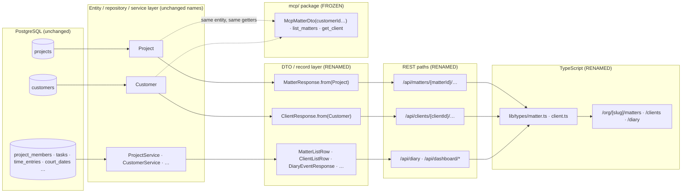

> Merge into ARCHITECTURE.md as **Section 12**.

# 12. Phase 87 — Legal-Native Shell: Matter/Client Vocabulary on the Wire, One Diary, Settings Consolidation

> **Standalone phase architecture document** (per-phase file convention; `architecture/ARCHITECTURE.md` holds the core platform sections). Derived from [`requirements/claude-code-prompt-phase87.md`](../requirements/claude-code-prompt-phase87.md) (founder decisions 2026-10-15) and the two scouting inventories `.arch-context.md` (backend) and `.arch-context-frontend.md` (frontend/portal/packages), both at HEAD `41cb211fb` (2026-10-18, Phase 86 fully merged). ADRs: [ADR-337](../adr/ADR-337-wire-rename-two-nouns-entities-stay.md) … [ADR-344](../adr/ADR-344-qa-scenario-amendment-authorisation-phase87.md). Tenant migration high-water at start: **`V3`** (`V1__baseline.sql`, `V2__add_project_template_work_type.sql`, `V3__normalise_work_types.sql`); global high-water `V1`. **Phase 87 adds no migration; next free tenant number is V4 (reserved for whoever needs it next — Phase 84 take-on as things stand).** This is a *re-shelling* phase: the data model is untouched, the presentation contract (REST vocabulary, navigation, home, lists, settings tree) is rebuilt for one audience — a South African law firm.

## 12.1 Overview

After Phase 86 Kazi is a legal-only product with a generic skeleton underneath. The backend serves `/api/projects` and `/api/customers`; the TypeScript types are `Project` and `Customer`; the sidebar reads Work / Projects / Clients / Finance / Team / AI; there are two calendars (`/calendar`, `/court-calendar`) that an attorney has to consult separately; the list pages are an agency-style card grid and a hand-rolled table; and 44 settings pages sit in seven groups that mirror how the code was built, not how a bookkeeper thinks. Over all of this a runtime terminology layer (`packages/shared/src/terminology-map.ts` → `TerminologyProvider`/`useTerminology`/`t()`) paints "Matter", "Client", "Fee Note" at render time — 262 call sites in 82 files. The founder's judgement, recorded in the requirements: *"we can design a better UI without having a generic structure that fits everything."* A managing partner evaluating a pilot should see software built for an attorney, not an agency tool wearing legal labels.

Phase 87 does four things, in a fixed order so that no PR mixes a rename with an information-architecture change. **First**, it renames exactly two nouns on the wire — `project → matter`, `customer → client` — in REST paths, DTO records and fields, JSON properties, TypeScript types, API client modules, server actions, route segments and portal paths, while leaving every JPA entity, repository, service, table and column named `project`/`customer` indefinitely ([ADR-337](../adr/ADR-337-wire-rename-two-nouns-entities-stay.md)). The static `ProjectResponse.from(Project)` factories are the seam: the entity name goes in, the matter name comes out. **Second**, it deletes the terminology layer and writes the legal word into the copy ([ADR-338](../adr/ADR-338-terminology-layer-removal-single-vocabulary.md)). **Third**, it re-shells the app around an attorney's week: six navigation zones (Today · Matters · Clients · Fees · Trust · Firm), one Diary backed by one aggregated read, a legal-native home page keyed off capabilities, dense list pages with code-defined default views, re-labelled detail tabs, and five settings families ([ADR-339](../adr/ADR-339-attorney-week-navigation-and-one-diary.md), [ADR-340](../adr/ADR-340-disbursement-is-the-face-of-matter-costs.md), [ADR-341](../adr/ADR-341-settings-taxonomy-five-families-controls-stay-pages-go.md)). **Fourth**, it pins what must not move — audit and EntityTag strings, the MCP tool contract — with tests, and re-runs the legal-za 90-day lifecycle through the new shell with scenario amendments authorised for URL/label/nav changes only ([ADR-342](../adr/ADR-342-audit-and-entity-tag-strings-stable-under-renamed-wire.md), [ADR-343](../adr/ADR-343-mcp-contract-pinning-test.md), [ADR-344](../adr/ADR-344-qa-scenario-amendment-authorisation-phase87.md)).

Nothing here is a rewrite of a page that works. The Phase 73 matter detail, the Phase 77 client detail, the trust pages, the fee-note pages and the `@b2mash/ui` design system are reused; the phase changes what they are called, where they sit, and what the shell around them says.

### What changes

| Surface | Existing (HEAD `41cb211fb`) | After Phase 87 |
|---|---|---|
| Wire vocabulary (REST paths) | 32 controllers carry `/projects` or `/customers` (`/api/projects/**`, `/api/customers/**`, `/portal/projects/**`); legal-era exceptions already say `/api/matters/{projectId}/closure`, `/api/matters/{projectId}/statements`, `/portal/trust/matters/{matterId}` | `/api/matters/**`, `/api/clients/**`, `/portal/matters/**`; path variables `{matterId}`/`{clientId}` everywhere; `/mcp` untouched; `WireVocabularyContractTest` enforces it |
| Wire vocabulary (DTOs / JSON) | 45 `Project*`/`Customer*`/`Matter*`/`Client*` records; 251 `projectId` + 192 `customerId` occurrences in the DTO/controller bucket; JSON names = record component names (no `@JsonProperty`, no naming strategy) | `Matter*`/`Client*` records; `matterId`/`clientId`/`matterName`/`clientName` JSON; `mcp/dto/*` keeps `customerId`/`projectId` (plugin contract) |
| Entities, repositories, services, tables, columns | `Project`, `Customer`, `projects`, `customers`, `project_id`, `customer_id` | **unchanged** — the `from(Project)` factories are the seam |
| Terminology layer | `terminology-map.ts` (92 lines), `TerminologyProvider`, `useTerminology`, `TerminologyHeading`, `TerminologyText`, `withIndefiniteArticle`, `auditTabLabel`, `PORTAL_TERMINOLOGY`; 262 call sites / 82 files; `Task → Action Item` | **deleted**; legal words literal in copy; ESLint restricted-import + vitest remnant scan; `frontend/CLAUDE.md` rule; "Tasks" are Tasks |
| Navigation | 6 zones / 25 items (Work, Projects, Clients, Finance, Team, AI); palette ignores `requiredModule` | 6 zones / 28 items (Today, Matters, Clients, Fees, Trust, Firm — 3 + 5 + 3 + 6 + 7 + 4); Profitability under Firm → Reports; AI has no zone; palette + mobile re-indexed from `NAV_GROUPS`; palette honours `requiredModule` |
| Calendars | `/calendar` (tasks + matter due dates) and `/court-calendar` (court dates + prescription), separate pages, separate actions, no shared model | one `/diary` page over one aggregated read `GET /api/diary`; old pages redirect; `todays-agenda` consumes the same DTO for one day |
| Home | `dashboard` = KPI strip, project health, team workload, sensitive events, recent activity, admin stats column | legal-native widget matrix keyed off `GET /api/me/capabilities`: today's diary, unbilled WIP, debtors, trust position, FICA outstanding, my tasks, recent activity; `team-workload` dropped |
| Lists | Matters = 3-column card grid with per-card N+1 (`/budget/status`, `/customers`); Clients = hand-rolled table (Name · Email · Phone · Lifecycle · Status · Completeness · Created); no default views | dense tables on `MatterListRow` / `ClientListRow` (batched aggregates: unbilled value, trust balance, next diary date, FICA status, outstanding fee notes); code-defined system views merged ahead of user views |
| Detail tabs | `project-tab-groups.ts` 7 groups / 22 tabs (its own "23" comment is stale; Expenses **and** Disbursements); `customer-tab-groups.ts` 6 / 14; orphaned `members` panel in `ProjectTabs` | `matter-tab-groups.ts` relabelled, one Disbursements tab (Expenses tab removed, generic `expense` endpoints retained); `client-tab-groups.ts` relabelled; orphan removed |
| Settings | 44 `page.tsx` (43 leaf + index) in 7 sidebar groups; `SETTINGS_ITEMS` (28) and `SETTINGS_NAV_GROUPS` (7/28) hand-maintained in parallel | 5 families → **17** `page.tsx` (16 leaf + index), tabs addressed by `?tab=`; one `SETTINGS_FAMILIES` source feeds sidebar and palette; every old URL permanently redirected |
| Portal | nav `home, projects, trust, deadlines, invoices, requests, acceptance (no page), activity`; `/portal/projects*`; `PortalProject*` types; `PORTAL_TERMINOLOGY` | labels Home · Matters · Trust statement · Diary dates · Fee notes · Documents & requests · Activity; `/portal/matters*`; `PortalMatter*`; no terminology provider; `acceptance` item dropped; **no visual change** |
| Migrations | tenant `V1`–`V3`, global `V1` | **none added** |

### Out of scope

- Renaming JPA entities, repositories, services, tables, columns, Flyway baselines, audit `entityType` strings (`"project"` ×10, `"customer"` ×10), EntityTag/SavedView entity-type strings (`"PROJECT"`, `"CUSTOMER"`).
- Any change to MCP tool names, input schemas, resource URIs, `mcp/dto/*`, or the `kazi-legal-za` plugin.
- Renaming `invoice`, `expense`, `timeEntry`, `rateCard`, `budget` on the wire — label-level only ("Fee notes", "Disbursements", "Time recording", "Tariffs", "Fee estimate").
- Portal visual redesign (Phase 68 just did one); marketing site (`/legal` is Phase 85); brand refresh; new colour tokens.
- New features: take-on is Phase 84; bank CSV upload for reconciliation (`day-45-recon-prescription:41`), an `ACCEPTANCE_REQUEST_SENT` automation trigger (ADR-334), and switching profitability's cost leg from `Expense` to `LegalDisbursement` (§12.14) are follow-ups.
- Backend behaviour changes beyond DTO/path renames, the one aggregated diary read, the three dashboard reads and the two list-row aggregates described here.
- Removing the gateway, changing auth, touching `integration/ai` skills or trust-accounting domain logic.
- Fixing the seven pre-existing failing Playwright spec locations (five spec files) inherited from Epic 606C by editing specs — they are carried as pre-existing, one fix per PR (§12.14 #7).

### Baseline statement

Phase 86 is fully merged (Epics 595–606, PRs #1564–#1578) plus three capstone bug-fix PRs (#1579 breadcrumb pageless prefixes, #1580 template work type = tenant `V2`, #1581 work-type normaliser = tenant `V3`). The tree has 62 backend top-level packages, 121 `@RestController`s, 103 `@Entity` classes, a 29-entry audit catalogue, 27 `Capability` constants, 8 vertical modules, one profile (`legal-za`), 100 frontend `page.tsx` (86 under `org/[slug]`, 44 under `settings/`), 18 portal pages, and a full backend verify of ≈12.5 minutes. Every number in this document is the post-86 "before" that the closure report measures against.

## 12.2 Domain Model

**There are no new entities and no schema change in this phase.** The 103 `@Entity` classes, their tables and columns are exactly what `V1__baseline.sql` + `V2` + `V3` produce today. What this section models instead is the **wire contract** — the layer between the entity and the browser — because that is the thing being renamed, plus six new *read-model* records that compose existing data for the Diary, the home page and the two list pages.

### 12.2.1 The seam



The rule the diagram encodes: a rename is legal only on the right-hand side of a `from(...)` factory. `Project project` stays the parameter name; `MatterResponse` is the return type. The MCP branch reads the same entities through its own `mcp/dto/*` records and keeps `customerId`/`projectId` on its wire, because the `kazi-legal-za` plugin's tool input schemas are a published contract ([ADR-343](../adr/ADR-343-mcp-contract-pinning-test.md)). **Entity leak check:** the inventory found no controller returning `ResponseEntity<Project|Customer>` or `List<Project|Customer>` — the only hit is a local `List<Customer> filtered` in `CustomerController.java:102` that maps to `CustomerResponse` before returning. No new DTO is needed to close a leak; the existing factories are the seam.

### 12.2.2 DTO record rename table

Grouped by rename batch (= bounded context = one PR, §12.3.1). "Fields" lists the JSON components renamed inside the record; every record also loses the `Project`/`Customer` prefix.

**Batch 1 — Matters core** (`project/`, `member/`, `projecttemplate/`, `setupstatus/`, `dashboard/dto`, `activity/`, `comment/`, `budget/`, `task/`, `document/`)

| Today | After | Fields renamed inside |
|---|---|---|
| `project/ProjectController.ProjectResponse` | `MatterResponse` (extract to `project/dto/MatterResponse.java` while renaming — the nested-record pattern made the controller 500+ lines) | `customerId → clientId`, `projectRole → matterRole` |
| `member/ProjectMemberController.ProjectMemberResponse` | `MatterMemberResponse` | `projectId → matterId`, `projectRole → matterRole` |
| `projecttemplate/dto/ProjectTemplateResponse` | `MatterTemplateResponse` | — (`workType` stays) |
| `setupstatus/ProjectSetupStatus` | `MatterSetupStatus` | `projectId → matterId` |
| `setupstatus/ProjectUnbilledBreakdown` | `MatterUnbilledBreakdown` | `projectId → matterId`, `projectName → matterName` |
| `setupstatus/UnbilledTimeSummary.byProject` | — | `byProject → byMatter` |
| `project/ProjectUpcomingDeadline` | `MatterUpcomingDeadline` | — |
| `project/ProjectWithRole` | `MatterWithRole` (internal; rename for consistency, not required by the contract test) | `projectRole → matterRole` |
| `dashboard/dto/ProjectHealth`, `ProjectHealthDetail`, `ProjectHealthMetrics` | `MatterHealth`, `MatterHealthDetail`, `MatterHealthMetrics` | `projectId → matterId`, `projectName → matterName`, `customerName → clientName` |
| `dashboard/dto/ProjectBreakdownEntry`, `ProjectHoursEntry` | `MatterBreakdownEntry`, `MatterHoursEntry` | `projectId → matterId`, `projectName → matterName` |
| `dashboard/dto/CrossProjectActivityItem` | `CrossMatterActivityItem` | `projectId → matterId`, `projectName → matterName` |
| `dashboard/dto/KpiResponse` | (name stays) | `activeProjectCount → activeMatterCount` |
| `dashboard/dto/PersonalDashboard` | (name stays) | `projectBreakdown → matterBreakdown`; nested `UpcomingDeadline.projectName → matterName` |
| `dashboard/dto/TeamWorkloadEntry` | deleted with the widget and `GET /api/dashboard/team-workload` (§12.4) | — |
| `mywork/MyWorkTaskItem` (+ `MyWorkProjectTimeSummaryProjection` naming) | (name stays) | `projectId → matterId`, `projectName → matterName` |
| `calendar/CalendarService.CalendarItemDto` | (name stays; endpoint retained one release, §12.4) | `projectId → matterId`, `projectName → matterName`; `itemType "PROJECT" → "MATTER"` |
| Task, document, comment, activity, budget DTOs that carry `projectId` | (names stay) | `projectId → matterId` |

**Batch 2 — Clients core** (`customer/`, `informationrequest/`, `checklist/`, `datarequest/`, `correspondence/`)

| Today | After | Fields renamed inside |
|---|---|---|
| `customer/dto/CustomerDtos.CustomerResponse` | `ClientResponse` (file → `ClientDtos.java`) | `customerType → clientType` |
| `CustomerDtos.CustomerProjectResponse`, `LinkedProjectResponse` | `ClientMatterResponse`, `LinkedMatterResponse` | `customerId → clientId`, `projectId → matterId` |
| `CustomerDtos.Create/UpdateCustomerRequest` | `Create/UpdateClientRequest` | `customerType → clientType` |
| `setupstatus/CustomerReadiness` | `ClientReadiness` | `customerId → clientId` |
| `informationrequest/dto/InformationRequestDtos.FicaStatusResponse` | (name stays) | `customerId → clientId` |
| `customer/*/AggregatedCompletenessResponse`, completeness map | (names stay) | query param `customerIds → clientIds` |
| Correspondence, information-request, checklist-instance, data-export, anonymisation DTOs carrying `customerId`/`projectId` | (names stay) | `customerId → clientId`, `projectId → matterId` |

**Batch 3 — Finance** (`timeentry/`, `invoice/`, `billingrun/`, `expense/`, `budget/`, `billingrate/`, `report/`, `collections/`)

| Today | After | Fields renamed inside |
|---|---|---|
| `timeentry/ProjectTimeSummaryController.ProjectTimeSummaryResponse` | `MatterTimeSummaryResponse` | `projectId → matterId` |
| `report/ReportController.ProjectProfitabilityResponse`, `ProjectProfitabilitySummary` | `MatterProfitabilityResponse`, `MatterProfitabilitySummary` | `projectId → matterId`, `projectName → matterName`, `customerName → clientName` |
| `report/ReportController.CustomerProfitabilityResponse` | `ClientProfitabilityResponse` | `customerId → clientId`, `customerName → clientName` |
| `report/UtilizationResponse`, `MemberUtilizationRecord`, `MemberValueBreakdown` | (names stay — no noun) | — |
| `billingrun/dto/BillingRunDtos.CustomerUnbilledSummary` | `ClientUnbilledSummary` | `customerId → clientId`, `customerName → clientName`, `customerEmail → clientEmail` |
| `billingrun/BillingRunSelectionService.CustomerDiscoveryRow` | (internal, not wire — stays) | — |
| `collections/CollectionsReadService.DebtorResponse`, `DebtorDetailResponse` | (names stay) | `customerId → clientId`, `customerName → clientName` |
| `invoice/*` response records with `customerId/customerName/customerEmail/customerAddress/projectId` | (names stay — `invoice` stays on the wire) | `customerId → clientId`, `customerName → clientName`, `customerEmail → clientEmail`, `customerAddress → clientAddress`, `projectId → matterId` |
| `expense/*` response records | (names stay) | `projectId → matterId` |
| `billingrate/*` (7 `projectId` / 5 `customerId` params) | (names stay) | `projectId → matterId`, `customerId → clientId` |

**Batch 4 — Legal verticals + integrations** (`verticals/legal/**`, `integration/accounting/**`, `integration/ai/skill`)

| Today | After | Fields renamed inside |
|---|---|---|
| `verticals/legal/courtcalendar/CourtCalendarService.CourtDateResponse`, `UpcomingCourtDateItem`, `UpcomingPrescriptionWarningItem`, `PrescriptionTrackerResponse` | (names stay) | `projectId → matterId`, `projectName → matterName`, `customerId → clientId`, `customerName → clientName` |
| `verticals/legal/disbursement/*` response/request records | (names stay) | `projectId → matterId`, `customerId → clientId` |
| `verticals/legal/trustaccounting/ledger/ClientLedgerService.ClientLedgerCardResponse` | (name stays — already legal) | `customerId → clientId` |
| `verticals/legal/statement/dto/StatementResponse.MatterRef`, `closure/MatterClosureReport` | (names stay) | any `customerId → clientId` component |
| `verticals/legal/conflictcheck/*` adverse-party DTOs | (names stay) | `projectId → matterId` |
| `integration/accounting/CustomerSyncRequest`, `xero/CustomerImportSummary` | `ClientSyncRequest`, `ClientImportSummary` | `customerId → clientId` |
| `integration/ai/skill/AiSkillController.MatterIntakeRequest`, `intake/MatterIntakeOutput`, `MatterClassification` | (already legal — unchanged) | — |

**Batch 5 — Portal API** (`portal/`, `customerbackend/`)

| Today | After | Fields renamed inside |
|---|---|---|
| Every record under `portal/` and `customerbackend/` whose simple name contains `Project` (response records of `PortalProjectController`, `PortalSummaryController`, `PortalCommentController`, `PortalDocumentController`; exact names to be confirmed at build time — the inventory counts paths, not portal record names) | `PortalMatter*` | `projectId → matterId`, `projectName → matterName` |
| `customerbackend/service/PortalResyncService.ProjectionData` | (internal — stays) | — |

### 12.2.3 Path rename table

Every controller path from the inventory's §3.1 census. Staff API first, then portal, then the already-legal-native paths whose only change is the variable name.

| Controller | Today | After |
|---|---|---|
| `project/ProjectController` | `/api/projects`, `/{id}`, `/{id}/archive`, `/{id}/complete`, `/{id}/reopen`, `/{id}/field-groups`, `/{id}/tags`, `/{id}/setup-status`, `/{id}/unbilled-summary`, `/{id}/upcoming-deadlines` | `/api/matters` + same sub-paths with `{matterId}` |
| `customer/CustomerController` | `/api/customers`, `/{id}`, `/lifecycle-summary`, `/completeness-summary[/aggregated]`, `/dormancy-check`, `/{id}/collections-exemption`, `/{id}/fica-status`, `/{id}/field-groups`, `/{id}/lifecycle`, `/{id}/portal-contacts`, `/{id}/projects[/{projectId}]`, `/{id}/readiness`, `/{id}/tags`, `/{id}/transition`, `/{id}/unarchive`, `/{id}/unbilled-summary` | `/api/clients` + same, with `/{clientId}/matters[/{matterId}]` and `/{clientId}/unbilled-summary` |
| `customer/ProjectCustomerController` | `/api/projects/{projectId}/customers[/{customerId}]` | `/api/matters/{matterId}/clients[/{clientId}]` |
| `activity/ActivityController` | `/api/projects/{projectId}/activity` | `/api/matters/{matterId}/activity` |
| `budget/ProjectBudgetController` | `/api/projects/{projectId}/budget[/status]` | `/api/matters/{matterId}/budget[/status]` |
| `comment/CommentController` | `/api/projects/{projectId}/comments[/{commentId}]` | `/api/matters/{matterId}/comments[/{commentId}]` |
| `member/ProjectMemberController` | `/api/projects/{projectId}/members[/{memberId}[/role]]` | `/api/matters/{matterId}/members[/{memberId}[/role]]` |
| `task/TaskController` | `/api/projects/{projectId}/tasks` (+ `/api/tasks/{id}/**`) | `/api/matters/{matterId}/tasks` (+ `/api/tasks/**` unchanged) |
| `document/DocumentController` | `/api/projects/{projectId}/documents[/upload-init]`, `/api/customers/{customerId}/documents/upload-init` (+ `/api/documents/**`) | `/api/matters/{matterId}/documents[/upload-init]`, `/api/clients/{clientId}/documents/upload-init` |
| `expense/ExpenseController` | `/api/projects/{projectId}/expenses[/{id}[/write-off\|/restore]]`, `/api/expenses/mine` | `/api/matters/{matterId}/expenses[…]` (retained, no UI entry point — [ADR-340](../adr/ADR-340-disbursement-is-the-face-of-matter-costs.md)) |
| `timeentry/TimeEntryController` | `/api/projects/{projectId}/time-entries/{id}/billable` (+ `/api/tasks/{taskId}/time-entries`, `/api/time-entries/**`) | `/api/matters/{matterId}/time-entries/{id}/billable` |
| `timeentry/ProjectTimeSummaryController` | `/api/projects/{id}/time-summary[/by-member\|/by-task]` | `/api/matters/{matterId}/time-summary[…]` |
| `dashboard/DashboardController` | `/api/projects/{projectId}/{health,member-hours,task-summary}`; `/api/dashboard/{kpis,project-health,team-workload,activity,personal}` | `/api/matters/{matterId}/{…}`; `/api/dashboard/{kpis,matter-health,activity,personal}` (`team-workload` deleted) |
| `correspondence/CorrespondenceController` | `/api/projects/{projectId}/correspondence`, `/api/customers/{customerId}/correspondence` | `/api/matters/{matterId}/correspondence`, `/api/clients/{clientId}/correspondence` |
| `informationrequest/InformationRequestController` | `/api/projects/{projectId}/information-requests`, `/api/customers/{customerId}/information-requests` | `/api/matters/{matterId}/…`, `/api/clients/{clientId}/…` |
| `checklist/ChecklistInstanceController` | `/api/customers/{customerId}/checklists` | `/api/clients/{clientId}/checklists` |
| `datarequest/AnonymizationController`, `DataExportController` | `/api/customers/{customerId}/anonymize[/preview]`, `/api/customers/{customerId}/data-export` | `/api/clients/{clientId}/…` |
| `report/ReportController` | `/api/projects/{projectId}/profitability`, `/api/customers/{customerId}/profitability`, `/api/reports/{profitability,utilization}` | `/api/matters/{matterId}/profitability`, `/api/clients/{clientId}/profitability`, `/api/reports/*` unchanged |
| `collections/CollectionsController` | `/api/collections/debtors[/{customerId}]`, `/activities` | `/api/collections/debtors[/{clientId}]` |
| `projecttemplate/ProjectTemplateController` | `/api/project-templates`, `/from-project/{projectId}`, `/{id}/{duplicate,instantiate,prerequisite-check,required-customer-fields}` | `/api/matter-templates`, `/from-matter/{matterId}`, `/{id}/{…,required-client-fields}` |
| `integration/accounting/xero/XeroIntegrationController` | `/api/integrations/xero/import-customers` | `/api/integrations/xero/import-clients` |
| `verticals/legal/conflictcheck/AdversePartyController` | `/api/projects/{id}/adverse-parties` (+ `/api/adverse-parties/**`, `/api/adverse-party-links/{linkId}`) | `/api/matters/{matterId}/adverse-parties` |
| `verticals/legal/trustaccounting/ledger/ClientLedgerController` | `/api/trust-accounts/{accountId}/client-ledgers[/{customerId}[/history\|/statement]]`, `/total-balance` | `…/client-ledgers[/{clientId}[…]]` |
| Param-only controllers (7): `BillingRateController`, `CalendarController`, `InvoiceController`, `MyWorkController`, `CourtCalendarController`, `PrescriptionTrackerController`, `DisbursementController` | `?projectId=&customerId=` | `?matterId=&clientId=` (path unchanged) |
| `portal/PortalProjectController` | `/portal/projects`, `/{id}`, `/{projectId}/tasks` | `/portal/matters`, `/{matterId}`, `/{matterId}/tasks` |
| `portal/PortalDocumentController` | `/portal/projects/{projectId}/documents` (+ `/portal/documents/**`) | `/portal/matters/{matterId}/documents` |
| `customerbackend/controller/PortalCommentController`, `PortalSummaryController` | `/portal/projects/{projectId}/{comments,summary}` | `/portal/matters/{matterId}/{comments,summary}` |
| **Already legal-native — variable rename only** | `/api/matters/{projectId}/closure/{evaluate,close,reopen,log}`, `/api/matters/{projectId}/statements[/{id}]`, `/portal/trust/matters/{matterId}/{transactions,statement-documents}` | `{projectId} → {matterId}` on the first two; the portal trust path is already correct |
| **Unchanged** | `/api/invoices/**`, `/api/billing-runs/**`, `/api/time-entries/**`, `/api/tasks/**`, `/api/documents/**`, `/api/legal/**`, `/api/trust-accounts/**` (except the ledger variable), `/api/court-dates/**`, `/api/prescription-trackers/**`, `/api/views`, `/api/me/capabilities`, `/api/profiles`, `/api/modules`, `/api/integrations/mcp/**`, `/mcp/**`, `/internal/**`, `/portal/{trust,invoices,requests,deadlines,auth,branding,activity,me,notification-preferences,acceptance-requests}/**`, `/api/portal/acceptance/**` | — |

### 12.2.4 JSON field rename table

| Today | After | Where it appears (from the inventory) |
|---|---|---|
| `projectId` | `matterId` | 251 DTO-bucket occurrences; every record in §12.2.2; query params on the 7 param-only controllers (saved-view filter keys and `entity_type` strings are untouched — [ADR-342](../adr/ADR-342-audit-and-entity-tag-strings-stable-under-renamed-wire.md)) |
| `customerId` | `clientId` | 192 DTO-bucket occurrences; `DebtorResponse`, `FicaStatusResponse`, `ClientLedgerCardResponse`, `CourtDateResponse`, `PrescriptionTrackerResponse`, invoice DTOs |
| `projectName` | `matterName` | `CalendarItemDto`, `CrossProjectActivityItem`, `ProjectHealth`, `MyWorkTaskItem`, `UpcomingDeadline`, `CourtDateResponse`, `PrescriptionTrackerResponse`, `UpcomingCourtDateItem`, `ProjectUnbilledBreakdown` |
| `customerName` | `clientName` | `CustomerUnbilledSummary`, `DebtorResponse`, `ProjectHealth`, `CourtDateResponse`, `PrescriptionTrackerResponse`, invoice DTOs, `CustomerProfitabilityResponse` |
| `customerEmail`, `customerAddress` | `clientEmail`, `clientAddress` | `CustomerUnbilledSummary`, invoice DTOs |
| `customerType` | `clientType` | `CustomerResponse`, create/update requests |
| `projectRole` | `matterRole` | `ProjectResponse`, `ProjectMemberResponse`, `McpMatterDto` (**MCP copy stays `projectRole`**) |
| `activeProjectCount` | `activeMatterCount` | `KpiResponse` |
| `projectBreakdown`, `byProject` | `matterBreakdown`, `byMatter` | `PersonalDashboard`, `UnbilledTimeSummary` |
| `customerIds` (query) | `clientIds` | `/completeness-summary` |
| `itemType: "PROJECT"` (value) | `"MATTER"` | `CalendarItemDto` only; **not** `SavedView.entity_type` / `EntityTag.entity_type`, which stay `"PROJECT"` ([ADR-342](../adr/ADR-342-audit-and-entity-tag-strings-stable-under-renamed-wire.md)) |
| `type: "COURT" \| "REGULATORY"` | unchanged | `ProjectUpcomingDeadline` |

Anything else found at build time that carries one of the two nouns in a record component name is renamed by the same rule; the reflection scan in §12.3.1 is the arbiter, not this table.

### 12.2.5 Exclusion table — what the rename does **not** touch

| Layer | Examples | Why |
|---|---|---|
| `mcp/` package — tools, `mcp/dto/*`, resources | `McpMatterDto(… customerId … projectRole)`, `McpInvoiceDto(customerId, customerName)`, `McpTrustBalanceDto(trustAccountId, customerId)`, tool params `projectId`/`customerId` (39/54 occurrences), `kazi://client/{id}` | Published plugin contract; pinned by `McpToolContractTest` ([ADR-343](../adr/ADR-343-mcp-contract-pinning-test.md)) |
| Audit `entityType` strings | `"project"` ×10, `"customer"` ×10 (plus `"invoice"` 22, `"task"` 11, …); `AuditEventTypeRegistryTest` `hasSize(29)` | Stored in `audit_events`; renaming buys nothing visible and risks the silent activity-tab breakage recorded in memory `backend_audit_entitytype_casing` ([ADR-342](../adr/ADR-342-audit-and-entity-tag-strings-stable-under-renamed-wire.md)) |
| EntityTag / SavedView plane | `"PROJECT"` 10, `"CUSTOMER"` 12, `"TASK"` 16, `"INVOICE"` 2 in `tag/*`, `view/*`, `ProjectController`, `CustomerController`, `TaskController`; frontend `EntityType = "PROJECT" \| "TASK" \| "CUSTOMER" \| "INVOICE"` | Stored in `saved_views.entity_type` and `entity_tags`; `ViewFilterHelper` maps `PROJECT → projects` table — the string is a storage key, not copy |
| Field-definition plane | `field_definitions.entity_type` (`"PROJECT"`, `"CUSTOMER"`, `"TASK"`, `"INVOICE"`) read by `fielddefinition/*` and `getFieldDefinitions("PROJECT")` in the frontend | Same storage-key reasoning as EntityTag/SavedView; pinned by `EntityTypeLiteralStabilityTest` ([ADR-342](../adr/ADR-342-audit-and-entity-tag-strings-stable-under-renamed-wire.md)) |
| Entities, repositories, services, events, seeders, queries | `Project`, `Customer`, `ProjectRepository`, `ProjectService`, `ProjectArchivedEvent`, `CustomerStatusChangedEvent`, `LegalDemoDataSeeder.ProjectSpec`, 1,537 `projectId` / 1,429 `customerId` non-DTO occurrences | The entity layer is the stable floor ([ADR-337](../adr/ADR-337-wire-rename-two-nouns-entities-stay.md)); 74 `Project*`/`Customer*` files are out of scope |
| Internal records | `member/{ProjectMemberInfo, ProjectAccess}`, `dashboard/{ProjectHealthInput, ProjectHealthResult}`, `BillingRunSelectionService.CustomerDiscoveryRow`, `PortalResyncService.ProjectionData` | Never serialised; renaming them is churn without a contract benefit |
| Tables and columns | `projects`, `customers`, `project_id`, `customer_id`, `project_members.project_role`, `project_templates` | No migration in this phase; the baseline is immutable |
| Gateway and `SecurityConfig` | `gateway/…/application.yml` `Path=/api/**`; `GatewaySecurityConfig` and `SecurityConfig` match `/api/**`, `/portal/**`, `/mcp/**`, `/internal/**` | No noun literal exists in either ("verify no path literal" is still a checklist line in §12.10) |
| `legal-za.json`, `VerticalModuleRegistry`, module ids | `trust_accounting`, `court_calendar`, … | Gate ids are not wire vocabulary |

### 12.2.6 New read-model DTOs

Six records, all composed from existing tenant-filtered repositories; none owns a table. "Source of truth" names the entity/column each field is derived from so the build does not re-derive it.

**`diary/DiaryEventResponse`** — one row per diary event; returned as `List<DiaryEventResponse>` by `GET /api/diary`.

| Field | Type | Nullable | Source of truth |
|---|---|---|---|
| `id` | `UUID` | no | `tasks.id` / `projects.id` / `court_dates.id` / `prescription_trackers.id` |
| `kind` | `String` enum-like: `TASK_DUE`, `MATTER_DUE`, `COURT_DATE`, `PRESCRIPTION` | no | which source produced the row |
| `date` | `LocalDate` | no | `tasks.due_date` / `projects.due_date` / `court_dates.scheduled_date` / `prescription_trackers.prescription_date` |
| `time` | `LocalTime` | yes | `court_dates.scheduled_time` only |
| `title` | `String` | no | `tasks.title` / `projects.name` / `court_dates.court_name` + `description` / `prescription_type` |
| `subtype` | `String` | yes | `court_dates.date_type` (`HEARING`, `TRIAL`, …) for `COURT_DATE`; `prescription_type` for `PRESCRIPTION`; null otherwise |
| `status` | `String` | no | `tasks.status` / `projects.status` / `court_dates.status` / `prescription_trackers.status` |
| `matterId` | `UUID` | no | `projects.id` (tasks via `tasks.project_id`) |
| `matterName` | `String` | no | `projects.name` |
| `matterReference` | `String` | yes | `projects.reference_number` |
| `clientId` | `UUID` | yes | `projects.customer_id` |
| `clientName` | `String` | yes | `customers.name` |
| `feeEarnerId` | `UUID` | yes | `tasks.assignee_id` for tasks; otherwise the matter's `project_members` row with `project_role = 'lead'` (null if no lead — court dates and prescriptions carry no assignee today) |
| `feeEarnerName` | `String` | yes | `members.name` for `feeEarnerId` |
| `overdue` | `boolean` | no | `date < today` and status not terminal (`DONE`, `CANCELLED`, `HEARD`) |
| `href` | `String` | no | computed: `/matters/{matterId}?taskId=` / `/matters/{matterId}` / `/matters/{matterId}?tab=court-dates&courtDateId=` / `/matters/{matterId}?tab=court-dates&prescriptionId=` — relative to `/org/{slug}` |

**`project/dto/MatterListRow`** — returned as `List<MatterListRow>` by `GET /api/matters` (replaces `List<ProjectResponse>` for the list; the detail endpoint keeps the full `MatterResponse`).

| Field | Type | Nullable | Source of truth |
|---|---|---|---|
| `id`, `name`, `referenceNumber`, `status`, `workType`, `priority`, `dueDate`, `createdAt` | as `MatterResponse` | per entity | `projects.*` |
| `clientId`, `clientName` | `UUID`, `String` | yes | `projects.customer_id` → `customers.name` (one batched `IN` lookup) |
| `feeEarnerId`, `feeEarnerName` | `UUID`, `String` | yes | `project_members` where `project_role = 'lead'` (first by `created_at`), → `members.name` |
| `matterRole` | `String` | yes | caller's `project_members.project_role` on this matter |
| `unbilledMinutes`, `unbilledValue`, `currency` | `int`, `BigDecimal`, `String` | value nullable when redacted | `time_entries` with `billable = true AND invoice_id IS NULL` joined via `tasks.project_id`; value = `SUM(duration_minutes / 60.0 × billing_rate_snapshot)` (+ approved unbilled `legal_disbursements.amount`) |
| `trustBalance` | `BigDecimal` | yes | `SUM(client_ledger_cards.balance)` for the matter's client (client-level — ledger cards are per client per trust account; a per-matter balance via `trust_transactions.project_id` is to be confirmed at build time) |
| `nextDiaryDate`, `nextDiaryKind` | `LocalDate`, `String` | yes | `MIN(date)` ≥ today across the three Diary sources for this matter |
| `openTaskCount` | `int` | no | `tasks` where status not in (`DONE`,`CANCELLED`) |
| `tags` | `List<TagResponse>` | no | `entity_tags` (`"PROJECT"`) — batched as today |
| `customFields` | `Map<String,Object>` | no | `projects.custom_fields` |

**`customer/dto/ClientListRow`** — returned by `GET /api/clients`.

| Field | Type | Nullable | Source of truth |
|---|---|---|---|
| `id`, `name`, `email`, `phone`, `clientType`, `lifecycleStatus`, `status`, `createdAt` | as `ClientResponse` | per entity | `customers.*` |
| `ficaStatus` | `String`: `NOT_STARTED`, `IN_PROGRESS`, `DONE` | no | `InformationRequestService.getFicaStatus` logic batched: information requests whose `request_template_id` is in the FICA pack's templates (`FICA_ONBOARDING_PACK_ID`), excluding `CANCELLED`; `DONE` only if every item is `ACCEPTED` |
| `ficaLastVerifiedAt` | `Instant` | yes | the completed FICA request's `completed_at` |
| `outstandingFeeNoteTotal`, `outstandingFeeNoteCount`, `currency` | `BigDecimal`, `int`, `String` | nullable when redacted | `invoices` where `status = 'SENT'` grouped by `customer_id` (same definition as `CollectionsReadService`'s debtor book) |
| `trustBalance` | `BigDecimal` | yes | `SUM(client_ledger_cards.balance)` by `customer_id` (`ClientLedgerCardRepository.sumBalancesForCustomer` generalised to a batch) |
| `openMatterCount` | `int` | no | `projects` where `customer_id = …` and `status = 'ACTIVE'` |
| `completenessPercent` | `Integer` | yes | existing completeness map (`/completeness-summary`) folded into the row |
| `tags`, `customFields` | as today | — | `entity_tags` (`"CUSTOMER"`), `customers.custom_fields` |

**`dashboard/dto/UnbilledWipResponse`** — `GET /api/dashboard/unbilled-wip`.

| Field | Type | Nullable | Source of truth |
|---|---|---|---|
| `asOf` | `LocalDate` | no | server date |
| `currency` | `String` | no | org default currency (`OrgSettings`) |
| `totalMinutes`, `totalValue` | `int`, `BigDecimal` | value null when `redacted` | sum of rows |
| `unbilledDisbursementTotal` | `BigDecimal` | null when redacted | `legal_disbursements` approved and unbilled (billing status column — enum value to be confirmed at build time) |
| `byFeeEarner` | `List<FeeEarnerWip(memberId, memberName, minutes, value, oldestEntryDate)>` | no | `time_entries` grouped by `member_id`, `billable = true AND invoice_id IS NULL`; `members.name` |
| `redacted` | `boolean` | no | `true` when the caller lacks `FINANCIAL_VISIBILITY`: `byFeeEarner` holds only the caller's row and all value fields are null (mirrors `KpiResponse.withFinancialsRedacted()`) |

**`dashboard/dto/FicaOutstandingResponse`** — `GET /api/dashboard/fica-outstanding`.

| Field | Type | Nullable | Source of truth |
|---|---|---|---|
| `outstandingCount`, `totalActiveClients` | `int` | no | clients with `lifecycle_status IN ('ONBOARDING','ACTIVE')` whose batched FICA status ≠ `DONE` |
| `clients` | `List<FicaOutstandingClient(clientId, clientName, lifecycleStatus, ficaStatus, requestId, openedAt, daysOutstanding)>` | no | same batch as `ClientListRow.ficaStatus`; `daysOutstanding` = today − `customers.lifecycle_status_changed_at` (or `created_at`) |
| `limit` | `int` | no | echo of `?limit` (default 10; widget shows top-N, list page shows all via the Clients "FICA outstanding" view) |

**`dashboard/dto/TrustPositionResponse`** — `GET /api/dashboard/trust-position`.

| Field | Type | Nullable | Source of truth |
|---|---|---|---|
| `trustAccountId`, `accountName`, `bankName` | `UUID`, `String`, `String` | no | `trust_accounts` — the primary account (`is_primary`) or `?accountId=` |
| `cashbookBalance` | `BigDecimal` | no | same computation as `GET /api/trust-accounts/{id}/cashbook-balance` (`TrustTransactionService`) |
| `clientLedgerTotal` | `BigDecimal` | no | `ClientLedgerCardRepository.calculateTotalTrustBalance(accountId)` (same as `/total-balance`) |
| `difference` | `BigDecimal` | no | `cashbookBalance − clientLedgerTotal` |
| `lastReconciliationPeriodEnd`, `lastReconciliationStatus` (`DRAFT`/`COMPLETED`), `lastReconciliationBalanced` | `LocalDate`, `String`, `Boolean` | yes (no reconciliation yet) | latest `trust_reconciliations` by `period_end` |
| `daysSinceReconciliation` | `Integer` | yes | today − `lastReconciliationPeriodEnd` |
| `pendingApprovalCount` | `int` | no | same query as `/pending-approvals` |
| `accounts` | `List<TrustAccountRef(id, accountName, isPrimary)>` | no | lets the widget offer an account switcher when a firm has more than one trust account |

---

## 12.3 Core Flows and Backend Behaviour

### 12.3.1 (a) Rename mechanics and contract tests

**IDE rename procedure.** Java symbols are renamed with IntelliJ's `rename_refactoring` (MCP `idea` server), **one symbol per call**, in this order inside each batch: record type → record components (which renames accessor usages and the JSON name in one move) → controller `@PathVariable`/`@RequestParam` names → `@RequestMapping`/`@*Mapping` path literals (explicit edit — the IDE does not refactor string contents) → test class names and REST-Docs snippet identifiers. After each batch: `./mvnw spotless:apply`, IDE build (`build_project`), then the **full** `backend/scripts/verify.sh`. Text replace is never used on a Java symbol: `projectId` appears 1,788 times in main Java and 1,537 of them are entity/service/query code that must not change.

**Batch order and why.** Bounded contexts have one-way dependencies — finance reads matters and clients, legal verticals read all three, portal read-models read everything — so renaming inward-out means each batch's compile errors are confined to its own package plus the tests of its direct consumers: (1) matters core, (2) clients core, (3) finance, (4) legal verticals + integrations, (5) portal API. The wire contract is one unit of change, so **each backend batch PR also carries, for its bounded context, everything the wire change forces on the callers** (honest cost, no adapter shim): the `/api/…` path literals (`lib/api/*.ts`, colocated `actions.ts`, `portal/lib/api/*`, `portal/lib/api-client.ts` call sites), the JSON **field** renames in `lib/types/*.ts` / `portal/lib/types.ts` **and every property access those force** (`task.projectId` → `task.matterId`, request bodies that send `customerId`, …) across frontend and portal, plus the external callers that hit the wire directly — `compose/seed/lib/{customers,projects,tasks,documents,comments,rates-budgets,common}.sh` + `compose/seed/seed.sh`, `scripts/regression-test.sh` (27 `/api/projects|customers` hits) and the Playwright specs/fixtures that call the API directly (`admin-audit-30day/fixtures.ts`, `projects/project-crud.spec.ts`, `customers/customer-lifecycle.spec.ts`, `invoices/*.spec.ts`, …) — API-calling test code only, no UI locators or page URLs. **No TypeScript type or module renames and no route-segment changes** in a batch PR, so page URLs and Playwright locators are untouched and there is never a red window between batches. There is no dual-path period on the backend (old paths 404 the moment the batch merges). S4 then shrinks to the TS **type and module names** (`Project` → `Matter` interfaces, `lib/types/{project,customer}.ts` → `{matter,client}.ts`, `lib/api` module names), route segments, redirects, breadcrumbs, recent items, setup status and the Playwright **URL** amendments; the 254/217-file identifier blast radius is therefore spread over S1–S4, not landed in one PR. `WireVocabularyContractTest` lands in S1 scoped to Batch 1's packages, widens to Batch 2 in S2, and becomes "no `/projects`/`/customers` anywhere outside `mcp/`" in S3. Each batch PR runs the full backend verify **and** the frontend + portal gates (`CLAUDE.md` §1), and **no batch PR touches navigation, pages or settings** (§7 scope discipline, restated per slice in §12.12).

**`@JsonProperty` policy.** Not used. The inventory confirms JSON names are record component names (no `@JsonNaming`, no `PropertyNamingStrategy`; `@JsonProperty` exists in only two Anthropic request/response classes). Renaming the component *is* the wire rename; an annotation would leave two names in the code for one field and defeat the reflection scan. The only permitted exception is a component whose Java name must differ from its JSON name for a language reason (a reserved word), and none is expected.

**`WireVocabularyContractTest`** (`src/test/java/…/project/` — born with Batch 1; **not** `architecture/`, which is ArchUnit-only per `backend/CLAUDE.md`; greenfield — no route-enumeration test exists today). Two assertions in one class annotated exactly as `McpHandshakeIntegrationTest` is (`@SpringBootTest`, `@AutoConfigureMockMvc`, `@Import(TestcontainersConfiguration.class)`, `@ActiveProfiles("test")`) so it **reuses that existing context-cache key** rather than adding one:

1. *Route enumeration.* Inject `RequestMappingHandlerMapping`, iterate `getHandlerMethods()`, collect every `PathPatternsRequestCondition.getPatternValues()`. For each pattern whose handler bean's package does **not** start with `io.b2mash.b2b.b2bstrawman.mcp`, assert: pattern does not match `(^|/)(projects|customers|project-templates)(/|$)`, does not contain `{projectId}`, `{customerId}` or `{id}` directly under `/api/matters/` or `/api/clients/` (the variable must be `{matterId}`/`{clientId}` — this is what makes the already-legal-native closure/statement paths conform), and does not contain `import-customers`. Failure message prints the offending handler method.
2. *DTO reflection scan.* `ClassPathScanningCandidateComponentProvider(false)` with `AssignableTypeFilter(Record.class)` over the base package, excluding `.mcp.`, `.event.`, `.demo.`, `.seeder.` and any class whose simple name ends in `Projection` or `Spec`; keep records whose package contains `.dto` **or** whose simple name ends with `Controller$…`, `Request`, `Response`, `Dtos$…`, `Summary`, `Row`, `Item`, `Entry`. For each, assert the simple name does not start with `Project` or `Customer`, and no `getRecordComponents()` name is in `{projectId, projectIds, projectName, projectRole, customerId, customerIds, customerName, customerEmail, customerAddress, customerType, activeProjectCount, projectBreakdown, byProject}`. The forbidden set is a `static final Set<String>`; adding to it is a one-line change when the build finds a new carrier.

A **separate `EntityTypeLiteralStabilityTest`** protects [ADR-342](../adr/ADR-342-audit-and-entity-tag-strings-stable-under-renamed-wire.md) (ADR wins: it is not folded into the wire test). It is a plain JUnit source scan with no Spring context, in `src/test/java/…/audit/` beside `AuditEventTypeRegistryTest`: it reads `src/main/java` as text and asserts that `ProjectController`, `CustomerController`, `TaskController`, `EntityTagService`, `ViewFilterHelper` and the `fielddefinition/` package still contain the literals `"PROJECT"`/`"CUSTOMER"` and never `"MATTER"`/`"CLIENT"`, and that `ProjectService`/`CustomerService` still emit audit `entityType` `"project"`/`"customer"` — so a future "fix" that renames a storage key fails loudly with the ADR number in the message.

**`McpToolContractTest`** (`src/test/java/…/mcp/`, same four annotations as `McpHandshakeIntegrationTest` so it shares its context-cache key, [ADR-343](../adr/ADR-343-mcp-contract-pinning-test.md)). Runs `initialize` + `tools/list` + `resources/list` the way `McpHandshakeIntegrationTest` already does, serialises `[{name, description, inputSchema}]` for all 21 tools and the 3 resource URIs with stable key ordering, and compares to `src/test/resources/mcp/tool-contract.json`. On mismatch it prints a unified diff and fails; the snapshot is regenerated only by running with `-Dmcp.contract.update=true`, and the PR that does so must cite an ADR. It lands in S1 so that every later batch — especially Batch 4, which renames fields inside DTOs the MCP tools map *from* — is checked against it.

### 12.3.2 (b) Diary aggregation

**Why one read, not three.** The client-side merge alternative (keep `/api/calendar`, `/api/court-dates`, `/api/prescription-trackers` and union in the browser) was rejected because three paginated reads with three filter grammars cannot produce a correct "next 14 days, this fee earner" view without over-fetching, the fee-earner fallback to the matter lead needs `project_members`, and the home page's today's-agenda would re-implement the same merge. One server-side composition gives one filter grammar, one ordering, and one DTO for the page, the widget and the matter sidebar ([ADR-339](../adr/ADR-339-attorney-week-navigation-and-one-diary.md)).

**Package and ownership.** New `diary/` package: `DiaryController` (`GET /api/diary`), `DiaryService`, `DiaryEventResponse`, `DiaryQuery` (parsed params). The service **reads** `TaskRepository`, `ProjectRepository`, `CourtDateRepository`, `PrescriptionTrackerRepository`, `ProjectMemberRepository`, `CustomerRepository` and `MemberRepository` — all tenant-scoped through the existing `ScopedValue` tenant context — and owns no table. Writes stay where they are: court-date CRUD on `CourtCalendarController`, tasks on `TaskController`, prescription trackers on `PrescriptionTrackerController`. `CalendarService` is left in place for one release (§12.4). The matter sidebar's `ProjectUpcomingDeadlinesService` is **left untouched** in Phase 87 (only its DTO and path are renamed in S1); folding its union into `DiaryService` is a follow-up (§12.14 #14).

Conceptual signatures:

```java
// diary/DiaryService.java
public List<DiaryEventResponse> getEvents(ActorContext actor, DiaryQuery q);

public record DiaryQuery(
    LocalDate from, LocalDate to,                 // required; to - from <= 92 days
    Set<DiaryKind> types,                         // default: all four (the `types=` query param)
    UUID feeEarnerId,                             // null = everyone the caller may see
    UUID matterId,                                // null = all accessible matters
    boolean includeOverdue) {}                    // default true: open items dated < from are appended

public enum DiaryKind { TASK_DUE, MATTER_DUE, COURT_DATE, PRESCRIPTION }
```

**Per-source queries.** Accessible-matter scoping reuses whatever `CalendarService` uses today (it builds its queries over `EntityManager` against the caller's accessible project ids — the exact helper is confirmed at build time; the rule is "no new access path"). With `:ids` = accessible matter ids:

```sql
-- (a) task due dates
SELECT t.id, t.title, t.due_date, t.status, t.priority, t.assignee_id, t.project_id
FROM tasks t
WHERE t.project_id IN (:ids)
  AND t.due_date BETWEEN :from AND :to
  AND t.status NOT IN ('DONE', 'CANCELLED');

-- (b) matter due / target dates
SELECT p.id, p.name, p.reference_number, p.due_date, p.status, p.customer_id
FROM projects p
WHERE p.id IN (:ids) AND p.due_date BETWEEN :from AND :to AND p.status = 'ACTIVE';

-- (c) court dates — existing finder CourtDateRepository.findByStatusInAndScheduledDateBetween
--     (SCHEDULED, POSTPONED), post-filtered to :ids
-- (c') prescription warnings — PrescriptionTrackerRepository finder on prescription_date
--     BETWEEN :from AND :to with a non-terminal status (finder name confirmed at build time;
--     CourtCalendarService.getUpcoming already derives the same warning list)

-- fee-earner fallback: one batched lead lookup for every matter id in the result set
SELECT pm.project_id, pm.member_id
FROM project_members pm
WHERE pm.project_id IN (:resultMatterIds) AND pm.project_role = 'lead';
```

(d) *Schedule / recurring items:* the `schedule` package and `/api/schedules` were deleted in Phase 86; `frontend/lib/recurrence.ts` survived with no backend. There is no fourth source. If a live consumer of `recurrence.ts` is found at build time it is deleted with the calendar page; otherwise it is deleted in S6b regardless.

**Filter semantics.**
- `types` — subset of the four; court dates and prescriptions are only included when the `court_calendar` module is enabled for the org and the caller passes the same gate `CourtCalendarController` applies today (module `court_calendar`; capability to be confirmed at build time — the Diary never widens access). Otherwise they are silently omitted and the response header `X-Diary-Types` lists the kinds actually served, so the page can hide the filter chips it cannot honour.
- `feeEarnerId` — matches `tasks.assignee_id` for `TASK_DUE`; for the other three types matches the matter's lead member (fallback). An event with neither assignee nor lead is returned only when `feeEarnerId` is absent. Why fallback rather than exclusion: court dates have no assignee column, and the question an attorney asks the Diary is "what is on *my* matters", which the lead role answers.
- `matterId` — all types filtered to one matter.
- `includeOverdue` — open events dated before `from` are appended with `overdue = true` so the page's "Overdue" band and the `/api/calendar` `overdueCount` semantics survive.

**Ordering.** `date ASC, time ASC NULLS LAST, kindRank ASC (COURT_DATE, PRESCRIPTION, MATTER_DUE, TASK_DUE), title ASC`. Court dates sort first within a day because they are the immovable items; tasks last because they are the most numerous and most movable.

**Paging decision: date window, not page.** The read is bounded by `to − from ≤ 92 days` (one quarter) and returns the whole window unpaged. A diary is consumed by date range — week, month, "next 14 days" — and a page cursor over a date-sorted union would either split a day across pages or require a `(date, kind, id)` keyset that every consumer must thread. The 92-day cap bounds the worst case (a firm with thousands of open tasks in a quarter is a filtering problem, not a paging one); the Diary page requests one visible range at a time and the agenda widget requests one day.

**Tenant boundary.** Every query runs in the caller's tenant schema through the repositories listed above; the service adds no native SQL that bypasses `ScopedValue` scoping, and `TenantScopeBindingTest` (ArchUnit) covers the new package automatically because it lives under the same base package.

**Permission.** `GET /api/calendar` has **no** `@RequiresCapability` today — any authenticated member sees items for matters they can access. `GET /api/diary` keeps exactly that: no capability annotation, matter-level access scoping, court/prescription kinds additionally gated as above. The Diary nav item therefore has no `requiredCapability`.

### 12.3.3 (c) Home reads

Three new reads live in the existing `dashboard/` package (`DashboardController` gains three `@GetMapping`s, `DashboardService` three methods, `dashboard/dto/` three records) because they are dashboard compositions over other packages' repositories, exactly like `getKpis` today. Everything else the home page needs already exists: debtors (`GET /api/collections/debtors`, `INVOICING`), my tasks (`GET /api/my-work/tasks`), recent activity (`GET /api/dashboard/activity`), today's diary (`GET /api/diary?from=today&to=today`), per-fee-earner billable value (`GET /api/reports/utilization`, the Phase 86 survivor).

**`GET /api/dashboard/unbilled-wip`.** The billed/unbilled state of a time entry is derived, not stored: `timeentry/BillingStatus` documents `UNBILLED = billable = true AND invoiceId IS NULL`, `BILLED = invoiceId IS NOT NULL`, `NON_BILLABLE = billable = false` — `time_entries.billable` and `time_entries.invoice_id` are the two columns. Time entries hang off tasks (`time_entries.task_id`; there is no `project_id` column on the entity), so the matter join goes through `tasks`. Value uses the per-entry `billing_rate_snapshot` (the rate at recording time, which is what a fee note would bill), never a live rate lookup.

```sql
SELECT te.member_id,
       SUM(te.duration_minutes)                                                AS minutes,
       SUM(te.duration_minutes / 60.0 * COALESCE(te.billing_rate_snapshot, 0)) AS value,
       MIN(te.date)                                                            AS oldest_entry_date,
       te.billing_rate_currency                                                AS currency
FROM time_entries te
WHERE te.billable = true AND te.invoice_id IS NULL
GROUP BY te.member_id, te.billing_rate_currency
ORDER BY value DESC;
```

The disbursement leg reuses the query behind `GET /api/legal/disbursements/unbilled` (approved, unbilled) summed once. Capability: no annotation on the endpoint; `DashboardService.getUnbilledWip(actor)` returns the full list for callers with `FINANCIAL_VISIBILITY` (or admin/owner, matching `isAdminOrOwner(orgRole)` in `getKpis`), otherwise `withFinancialsRedacted()` — the caller's own row with minutes but null values, `redacted = true`. Why one endpoint with redaction rather than two: the widget is the same component for a fee earner and a partner, and `KpiResponse.withFinancialsRedacted()` is the precedent the frontend already understands.

**`GET /api/dashboard/fica-outstanding`.** FICA status is projected from information requests, not from a column: `InformationRequestService.getFicaStatus(customerId)` finds requests whose template belongs to `FICA_ONBOARDING_PACK_ID`, ignores `CANCELLED`, and returns `DONE` only when the latest `COMPLETED` request has every item `ACCEPTED`, else `IN_PROGRESS`/`NOT_STARTED`. Today it is per-client (one call per row — the compliance page already pays that). The dashboard read batches it: one query for the FICA template ids, one for all non-cancelled requests against those templates across clients, one for their items; then the same decision rule per client in Java, extracted into `FicaStatusProjector.project(requests, items)` so the single-client method and the batch share one rule and one test. Scope: clients with `lifecycle_status IN ('ONBOARDING','ACTIVE')` (prospects have no FICA obligation yet; offboarded clients are done). Capability: `@RequiresCapability("CUSTOMER_MANAGEMENT")` — the same gate as the Clients list and the compliance page, because the response names clients.

**`GET /api/dashboard/trust-position`.** Composes three existing computations without new SQL: cashbook balance (`TrustTransactionService`, the method behind `/cashbook-balance`), client-ledger total (`ClientLedgerCardRepository.calculateTotalTrustBalance`), and the latest reconciliation (`TrustReconciliationRepository`, newest `period_end`; `ReconciliationStatus` is `DRAFT`/`COMPLETED`; `is_balanced` on the row), plus the pending-approval count. Account selection: `?accountId=` or the primary account. Capability: `@RequiresCapability("VIEW_TRUST")` and the `trust_accounting` module guard — identical to the three reads it composes, so the composite reveals nothing the parts do not. The widget's headline is `difference`: a bookkeeper's first question is "does the bank agree with the ledgers", and the number that answers it is the one the three separate pages today make you compute by hand.

**Financial redaction summary.** `withFinancialsRedacted()` applies to `kpis` (today) and `unbilled-wip` (new). `trust-position`, `debtors` and `fica-outstanding` are capability-gated and simply absent from the widget matrix for callers without the capability (§12.6.3, §12.11) — there is no half-redacted trust position.

### 12.3.4 (d) List aggregates and code-defined default views

**The N+1 being removed.** `projects/page.tsx` renders a card grid from `GET /api/projects` and then, per card, calls `GET /api/projects/{id}/budget/status` and `GET /api/projects/{id}/customers` — 2N requests through the gateway for an N-matter list, plus `/api/customers` and `/api/members` for name lookups. The Clients page does one extra call (`/completeness-summary?customerIds=…`) but still has no FICA, fee-note or trust columns. The fix is a server-side row projection: `ProjectService.listMatterRows(…)` runs the existing view-filtered base query, collects the ids, then runs **one batched query per aggregate** with `project_id IN (:ids)` and merges maps in Java. For a 200-row page that is 6 queries instead of 400+ HTTP round trips.

```sql
-- base: existing ProjectService.listProjects view-filter query → ids (unchanged)

-- client names (one IN lookup via CustomerRepository.findByIdIn — already exists)

-- lead fee earner
SELECT pm.project_id, pm.member_id, m.name
FROM project_members pm JOIN members m ON m.id = pm.member_id
WHERE pm.project_role = 'lead' AND pm.project_id IN (:ids);

-- unbilled value per matter (time via tasks; disbursements direct)
SELECT t.project_id,
       SUM(te.duration_minutes) AS minutes,
       SUM(te.duration_minutes / 60.0 * COALESCE(te.billing_rate_snapshot, 0)) AS value
FROM time_entries te JOIN tasks t ON t.id = te.task_id
WHERE te.billable = true AND te.invoice_id IS NULL AND t.project_id IN (:ids)
GROUP BY t.project_id;

-- trust balance (client-level, see §12.2.6)
SELECT c.customer_id, SUM(c.balance) FROM client_ledger_cards c
WHERE c.customer_id IN (:clientIds) GROUP BY c.customer_id;

-- next diary date per matter
SELECT project_id, MIN(d) AS next_date, (array_agg(kind ORDER BY d))[1] AS kind FROM (
  SELECT t.project_id, t.due_date AS d, 'TASK_DUE' AS kind FROM tasks t
    WHERE t.project_id IN (:ids) AND t.due_date >= :today AND t.status NOT IN ('DONE','CANCELLED')
  UNION ALL
  SELECT p.id, p.due_date, 'MATTER_DUE' FROM projects p WHERE p.id IN (:ids) AND p.due_date >= :today
  UNION ALL
  SELECT cd.project_id, cd.scheduled_date, 'COURT_DATE' FROM court_dates cd
    WHERE cd.project_id IN (:ids) AND cd.scheduled_date >= :today AND cd.status IN ('SCHEDULED','POSTPONED')
) u GROUP BY project_id;

-- outstanding fee notes per client (ClientListRow)
SELECT i.customer_id, i.currency, SUM(i.total) AS outstanding, COUNT(*) AS n
FROM invoices i WHERE i.status = 'SENT' AND i.customer_id IN (:clientIds)
GROUP BY i.customer_id, i.currency;
```

Financial columns (`unbilledValue`, `trustBalance`, `outstandingFeeNoteTotal`) follow the same redaction rule as the home reads: null unless the caller has `FINANCIAL_VISIBILITY` (trust balance: `VIEW_TRUST`). Minutes and counts are never redacted.

**New list query params** (so the system views below are plain URLs, not DB rows): `GET /api/matters` gains `mine=true` (caller is a `project_members` row), `hasUnbilled=true` (unbilled minutes > 0), `inactiveSince=<date>` (no activity/time/task change after the date — uses the existing `updated_at` on `projects` plus the last `time_entries.date`; exact predicate confirmed at build time); `GET /api/clients` gains `ficaStatus=OUTSTANDING|DONE` and `hasTrustBalance=true`. All are applied in SQL after the view filter, in `ProjectService`/`CustomerService`, never in the controller (`CustomerController.listCustomers`'s in-controller filtering is moved into the service as part of this change).

**Code-defined system views.** Saved views are DB rows (`saved_views`, `entity_type` `"PROJECT"`/`"CUSTOMER"`) executed server-side by id (`ViewFilterHelper.applyViewFilter(viewId, …)`, [ADR-055](../adr/ADR-055-saved-view-filter-execution.md)). Default views cannot be DB rows here because this phase adds no migration and pack seeders do not backfill (`BASELINE.md`), and because a seeded row would become per-tenant mutable data that every tenant could rename out of existence. They are therefore **code-defined** in the frontend and translated to list query params:

```ts
// frontend/lib/constants/system-views.ts
export interface SystemView {
  id: `system:${string}`;          // never a UUID — distinguishes it from SavedViewResponse.id
  entityType: "PROJECT" | "CUSTOMER";   // storage-plane string, unchanged (ADR-342)
  name: string;
  params: Record<string, string>;  // appended to GET /api/matters | /api/clients
  system: true;
}
export const MATTER_SYSTEM_VIEWS: SystemView[] = [
  { id: "system:my-matters",        entityType: "PROJECT",  name: "My matters",        params: { mine: "true", status: "ACTIVE" }, system: true },
  { id: "system:open-matters",      entityType: "PROJECT",  name: "Open matters",      params: { status: "ACTIVE" }, system: true },
  { id: "system:awaiting-fee-note", entityType: "PROJECT",  name: "Awaiting fee note", params: { status: "ACTIVE", hasUnbilled: "true" }, system: true },
  { id: "system:dormant",           entityType: "PROJECT",  name: "Dormant",           params: { status: "ACTIVE", inactiveSince: "-90d" }, system: true },
];
export const CLIENT_SYSTEM_VIEWS: SystemView[] = [
  { id: "system:active",             entityType: "CUSTOMER", name: "Active",             params: { lifecycleStatus: "ACTIVE" }, system: true },
  { id: "system:fica-outstanding",   entityType: "CUSTOMER", name: "FICA outstanding",   params: { ficaStatus: "OUTSTANDING" }, system: true },
  { id: "system:with-trust-balance", entityType: "CUSTOMER", name: "With trust balance", params: { hasTrustBalance: "true" }, system: true },
];
```

Merge order in `ViewSelectorClient`: system views first (fixed order above), a separator, then the user's `SavedViewResponse[]` from `GET /api/views?entityType=` sorted as today. A system view is not editable or deletable (the menu hides those actions when `system === true`); "Save as view" from a system view creates a normal saved view pre-filled with its params. `-90d` is resolved to a date in the server action at request time so the URL stays bookmarkable. The default selection on first visit is "Open matters" / "Active".

### 12.3.5 (e) Disbursements resolution

`LegalDisbursement` (`verticals/legal/disbursement`, Phase 67) is the only cost concept a matter shows. It has what a law firm's cost needs: VAT treatment, trust-vs-office payment source with a `trust_transaction_id` link, submit/approve/reject, write-off, receipt upload, statement-of-account inclusion and three matter-closure gates. The generic `Expense` (`expense/`) has markup, task and member links, and is what profitability reads — and nothing else legal.

**Hidden:** the matter-detail *Expenses* tab (`expensesPanel`, `components/expenses/*` mount), the standalone `projects/[id]/expenses/page.tsx`, the "Log expense" entry points, `lib/actions/expense-actions.ts#getMyExpenses` on My Work. The terminology map's `Expense → Disbursement` entry, which made the two tabs read identically, dies with the layer.

**Retained:** the `Expense` entity, `ExpenseRepository`, `ExpenseService`, `ExpenseController` at the renamed `/api/matters/{matterId}/expenses[/…]` and `/api/expenses/mine`, `InvoiceLineType.EXPENSE` and `DISBURSEMENT` (both), the billing-run unbilled-expenses leg, `lib/types/expense.ts`. Why retain rather than delete: deleting the entity is a migration (`expenses` table) and this phase adds none; the invoice-generation and billing-run legs that read expenses are exercised by `BillingRunWithoutRetainersIntegrationTest` and friends and would need re-specifying; and existing dev/e2e data may hold expense rows that profitability still reports. The endpoints are reachable by API and by profitability only — there is no UI to create an expense from a matter after this phase ([ADR-340](../adr/ADR-340-disbursement-is-the-face-of-matter-costs.md)).

**The honest consequence.** Profitability's cost leg (`report/ReportRepository` `FROM expenses e`, `ExpenseProfitabilityProjection`, `reporting/ProjectProfitabilityReportQuery`) still reads `Expense`. For every matter opened after this phase the cost leg will be **zero** and margin will read as fee revenue minus time cost only; disbursements billed on a fee note appear as revenue lines (`DISBURSEMENT` line type) with no matching cost. Switching the cost leg to `legal_disbursements` is a behaviour change to a financial report — it changes numbers a partner may have seen — and is **deferred to a follow-up** (§12.14), not folded into a shell phase. The profitability page carries a one-line note ("Costs reflect logged expenses only; disbursements are shown as fee-note lines") until that follow-up lands.

### 12.3.6 (f) Terminology removal mechanics

**Deletion list.** `packages/shared/src/terminology-map.ts` (and its export from `packages/shared/src/index.ts`), `frontend/lib/terminology.tsx` (`TerminologyProvider`, `useTerminology`, `withIndefiniteArticle`), `frontend/components/terminology-heading.tsx`, `frontend/components/terminology-text.tsx`, `portal/lib/terminology.tsx` (`PORTAL_TERMINOLOGY` import), `auditTabLabel`, the two `TerminologyProvider` mounts (`frontend/app/(app)/org/[slug]/layout.tsx:119`, `portal/app/(authenticated)/layout.tsx:38`), `components/settings/vertical-profile-section.tsx` + its "Apply Profile" mount on `settings/general` (closure F-B3; `OrgSettings.verticalProfile`, `VerticalProfileController` and `useOrgProfile().isModuleEnabled` stay — [ADR-332](../adr/ADR-332-single-vertical-profile-mechanism-retained.md)), and the mechanism tests `frontend/__tests__/{terminology,terminology-integration,lzkc-terminology-cluster,lzkc-031-terminology-residuals}.test.tsx`, `portal/lib/__tests__/terminology-provider.test.tsx`. `portal/hooks/use-profile` is kept only if a non-terminology consumer remains (confirmed at build time).

**Call-site rewrite approach.** 262 real usages in 82 files (frontend 72, portal 10), by kind: `t("Word")` 133 + placeholder/`audit.tab` keys 8, `useTerminology(` 55, `<TerminologyText` 48, `<TerminologyHeading` 12, `withIndefiniteArticle(` 3, `auditTabLabel(` 3. The 53 `createMessages().t("ns.key")` i18n calls are a different `t` and are untouched. Rewrite is **per file, by hand, to literal legal copy** — not a codemod — because the right word depends on the sentence: `t("Project")` in a heading is "Matter", in `withIndefiniteArticle(t("project"))` it is "a matter", in an empty-state template `{projects}` it is a rewritten sentence ("No matters yet. Open your first matter to start recording time."). The map's own values are the dictionary: Project→Matter, Customer→Client, Invoice→Fee note, Expense→Disbursement, Budget→Fee estimate, Time Entry→Time recording, Rate Card→Tariff schedule, placeholders "e.g. Dlamini v Road Accident Fund" / "e.g. RAF-2026-001", `audit.tab`→"Audit trail". Two entries are **not** carried: `Task → Action Item` (tasks are "Tasks" — every legal PM tool says so) and `Retainer → Mandate` (no entity; the word is used once, as the acceptance badge "Mandate accepted" on an accepted engagement letter in the Documents tab — [ADR-336](../adr/ADR-336-engagement-letter-document-plus-acceptance.md) B1 resolved). Sentence case throughout ("Fee notes", not "Fee Notes") — see §12.6.6.

**Enforcement.** (1) ESLint `no-restricted-imports` in `frontend/eslint.config.*` and `portal/` for `@/lib/terminology`, `@/components/terminology-heading`, `@/components/terminology-text`, `@b2mash/shared/terminology-map` with the message "Phase 87: write the legal word; no runtime vocabulary layer (ADR-338)". (2) A vitest `frontend/__tests__/no-terminology-remnants.test.ts` that walks `frontend/{app,components,lib}` — with a portal twin `portal/__tests__/no-terminology-remnants.test.ts` walking `portal/{app,components,lib}` — (excluding tests) and asserts zero matches for `/useTerminology|TerminologyText|TerminologyHeading|terminology-map|withIndefiniteArticle|auditTabLabel|PORTAL_TERMINOLOGY/`; it also asserts zero matches for `/\b(Projects?|Customers?)\b/` in JSX text nodes of `app/(app)/org/**` — a heuristic with an allow-list file for the few legitimate uses (e.g. "project" inside a Xero field name). (3) A paragraph in `frontend/CLAUDE.md`: *"Single vocabulary: write the legal word (matter, client, fee note, disbursement, tariff, time recording). There is no runtime substitution layer; do not add one."*

**`help.json` and copy pass.** `frontend/lib/messages/en/help.json` (15 namespaces / 56 keys) and `empty-states.json` (templates with `{projects}`/`{customers}` tokens) are rewritten in the same slice: tokens removed, sentences rewritten in legal terms, examples changed ("INV-001" → "FN-2026-001"; "charge your clients" stays — it is already legal English). `getting-started.json` steps are re-ordered to the attorney's first week (open a matter, record time, issue a fee note, receipt into trust).

**Portal mirror.** `portal/lib/terminology.tsx` deleted; `portal/components/portal-sidebar.tsx:70` `t(PORTAL_NAV_LABELS[labelKey])` becomes a direct label lookup; the 10 portal files (34 usages) rewritten with today's labels as literals. **S5 deletes the portal mechanism only** (`PORTAL_TERMINOLOGY`, `portal/lib/terminology.tsx`, the provider mount, the `t()` sites); the new nav labels and the `/projects` → `/matters` route segments are **S10** (§12.8), where `portal-sidebar.test.tsx` asserts them.

---

## 12.4 API Surface

All paths are relative to the gateway (`/api/**` JWT; `/portal/**` portal JWT). "Auth" is the `@RequiresCapability` on the method today, carried over unchanged unless stated; "—" means authenticated member, scoped by matter access. Only renamed and new endpoints are listed; the "Unchanged" row of §12.2.3 covers the rest.

### 12.4.1 Matters core

| Method | Path | Description | Auth | R/W |
|---|---|---|---|---|
| GET | `/api/matters` | List → `List<MatterListRow>` from S8 (`List<MatterResponse>` until then); params `view`, `status`, `dueBefore`, `clientId`, `mine`, `hasUnbilled`, `inactiveSince`, custom-field params | — | R |
| POST | `/api/matters` | Create → `MatterResponse` | `PROJECT_MANAGEMENT` | W |
| GET / PUT / DELETE | `/api/matters/{matterId}` | Detail (`MatterResponse` with `retentionEndsOn`) / update / delete | — / `PROJECT_MANAGEMENT` | R/W |
| POST | `/api/matters/{matterId}/{archive,complete,reopen}` | Lifecycle | `PROJECT_MANAGEMENT` | W |
| GET / PUT | `/api/matters/{matterId}/{field-groups,tags}` | Field groups, tags (`"PROJECT"` plane unchanged) | — | R/W |
| GET | `/api/matters/{matterId}/{setup-status,unbilled-summary,upcoming-deadlines}` | `MatterSetupStatus`, `UnbilledTimeSummary`, `List<MatterUpcomingDeadline>` (service untouched; DTO/path rename only) | `PROJECT_MANAGEMENT` for unbilled-summary | R |
| GET / POST / … | `/api/matters/{matterId}/{tasks,documents,comments,activity,members,budget,time-entries,time-summary,correspondence,information-requests,clients,adverse-parties,profitability,expenses,health,task-summary,member-hours}` | Nested resources, unchanged behaviour | as today | R/W |
| GET / POST / … | `/api/matter-templates`, `/from-matter/{matterId}`, `/{id}/{duplicate,instantiate,prerequisite-check,required-client-fields}` | Matter templates (`workType` since #1580) | as today | R/W |
| GET | `/api/calendar` | **Retained one release**, `CalendarItemDto` with renamed fields; no frontend caller after S6b | — | R |

### 12.4.2 Clients core

| Method | Path | Description | Auth | R/W |
|---|---|---|---|---|
| GET | `/api/clients` | List → `List<ClientListRow>`; params `view`, `lifecycleStatus`, `ficaStatus`, `hasTrustBalance`, `showIncomplete` | — (ungated, exactly as `GET /api/customers` today; financial columns redacted per §12.3.4; the Clients **page** keeps its `CUSTOMER_MANAGEMENT` gate) | R |
| POST | `/api/clients` | Create → `ClientResponse` | `CUSTOMER_MANAGEMENT` | W |
| GET / PUT / DELETE | `/api/clients/{clientId}` | Detail / update / delete | as today | R/W |
| GET | `/api/clients/{clientId}/{fica-status,readiness,portal-contacts,matters[/{matterId}],checklists,correspondence,information-requests,unbilled-summary}` | Nested reads (`unbilled-summary` was `/api/customers/{id}/unbilled-summary`) | as today | R |
| POST / PUT | `/api/clients/{clientId}/{lifecycle,transition,unarchive,collections-exemption,field-groups,tags,anonymize[/preview],data-export,documents/upload-init}` | Nested writes | as today (`MANAGE_COMPLIANCE_DESTRUCTIVE` for anonymise) | W |
| GET | `/api/clients/{lifecycle-summary,completeness-summary[/aggregated],dormancy-check}` | Firm-wide client summaries; `completeness-summary?clientIds=` | as today | R |

### 12.4.3 Finance (paths unchanged, variables renamed)

| Method | Path | Description | Auth | R/W |
|---|---|---|---|---|
| GET | `/api/invoices?clientId=&matterId=` | Fee-note list; response fields `clientId`, `clientName`, `matterId` | `INVOICING` | R |
| GET | `/api/invoices/unbilled-summary?periodFrom&periodTo&currency` | `List<ClientUnbilledSummary>` — feeds the new **Unbilled work** page | `INVOICING` | R |
| GET | `/api/billing-rates?matterId=&clientId=` | Tariffs/rates | as today | R |
| GET | `/api/collections/debtors[/{clientId}]`, `/activities` | Debtor book (`DebtorResponse.clientId/clientName`) | `INVOICING` | R |
| GET | `/api/reports/profitability`, `/api/reports/utilization?from&to[&memberId]` | Unchanged | `FINANCIAL_VISIBILITY` | R |
| GET | `/api/matters/{matterId}/profitability`, `/api/clients/{clientId}/profitability` | `MatterProfitabilityResponse`, `ClientProfitabilityResponse` | `FINANCIAL_VISIBILITY` | R |
| GET | `/api/dashboard/kpis` | `KpiResponse.activeMatterCount`; redaction unchanged | — | R |
| GET | `/api/dashboard/matter-health` | was `project-health` | — | R |
| ~~GET~~ | ~~`/api/dashboard/team-workload`~~ | **Deleted** with `team-workload-widget` and `TeamWorkloadEntry` (founder lean; no legal consumer) | — | — |

### 12.4.4 Legal verticals

| Method | Path | Description | Auth | R/W |
|---|---|---|---|---|
| GET | `/api/court-dates?dateFrom&dateTo&dateType&status&clientId&matterId`, `/upcoming`, `/{id}` | Court dates (writes `POST`, `PUT`, `/{id}/{postpone,cancel,outcome}` unchanged) | module `court_calendar` (+ capability as today) | R/W |
| GET / POST | `/api/prescription-trackers?status&clientId&matterId`, `/{id}/interrupt` | Prescription | as today | R/W |
| GET / POST / PATCH | `/api/legal/disbursements?matterId=`, `/{id}`, `/unbilled`, `/{id}/{submit,approve,reject,write-off,receipt}` | Disbursements — **the** matter cost surface | `MANAGE_/APPROVE_/WRITE_OFF_DISBURSEMENTS`; module `disbursements` | R/W |
| GET / POST | `/api/matters/{matterId}/closure/{evaluate,close,reopen,log}` | Closure (variable rename only) | `CLOSE_MATTER` / `OVERRIDE_MATTER_CLOSURE` | R/W |
| GET / POST | `/api/matters/{matterId}/statements[/{id}]` | Statement of account (variable rename only) | `GENERATE_STATEMENT_OF_ACCOUNT` | R/W |
| GET | `/api/trust-accounts/{accountId}/client-ledgers[/{clientId}[/history\|/statement]]`, `/total-balance`, `/cashbook-balance`, `/reconciliations`, `/pending-approvals` | Trust reads (variable rename only) | `VIEW_TRUST`; module `trust_accounting` | R |
| GET / POST | `/api/matters/{matterId}/adverse-parties`, `/api/adverse-parties/**`, `/api/adverse-party-links/{linkId}` | Conflicts | module `conflict_check` | R/W |
| POST | `/api/integrations/xero/import-clients` | was `import-customers` → `ClientImportSummary` | `INTEGRATION_MANAGE` | W |

### 12.4.5 Portal

| Method | Path | Description | Auth | R/W |
|---|---|---|---|---|
| GET | `/portal/matters`, `/portal/matters/{matterId}`, `/portal/matters/{matterId}/{tasks,documents,comments,summary}` | `PortalMatter*` DTOs | portal JWT | R/W (comments) |
| GET | `/portal/trust/{summary,movements}`, `/portal/trust/matters/{matterId}/{transactions,statement-documents}` | Unchanged (already matter-vocabulary) | portal JWT; module `trust_accounting` | R |
| GET | `/portal/deadlines/{sourceEntity}/{id}`, `/portal/invoices/**`, `/portal/requests/**`, `/portal/acceptance-requests/pending`, `/portal/activity`, `/portal/me`, `/portal/branding`, `/portal/notification-preferences` | Unchanged | portal JWT | R/W |

### 12.4.6 New — Diary and dashboard reads

| Method | Path | Description | Auth | R/W |
|---|---|---|---|---|
| GET | `/api/diary` | `List<DiaryEventResponse>` for a date window | — (court/prescription types gated as `court_calendar` today) | R |
| GET | `/api/dashboard/unbilled-wip` | `UnbilledWipResponse`; redacted without `FINANCIAL_VISIBILITY` | — | R |
| GET | `/api/dashboard/fica-outstanding?limit=` | `FicaOutstandingResponse` | `CUSTOMER_MANAGEMENT` | R |
| GET | `/api/dashboard/trust-position?accountId=` | `TrustPositionResponse` | `VIEW_TRUST`; module `trust_accounting` | R |

**Query parameters — `GET /api/diary`**

| Param | Type | Required | Default | Notes |
|---|---|---|---|---|
| `from`, `to` | ISO date | yes | — | inclusive; `to − from ≤ 92` days else `400` (problem detail `diary.window-too-large`) |
| `types` | CSV of `TASK_DUE,MATTER_DUE,COURT_DATE,PRESCRIPTION` | no | all | unknown value → `400` |
| `feeEarnerId` | UUID | no | — | assignee for tasks; matter lead fallback for the rest |
| `matterId` | UUID | no | — | `404` if not accessible (same as matter detail) |
| `includeOverdue` | boolean | no | `true` | appends open events dated `< from` with `overdue = true` |

**Deleted endpoints.** None besides renames, except `GET /api/dashboard/team-workload`. **`/api/calendar` decision:** retained for exactly one release as a legacy read with renamed fields, un-called by the frontend after S6b, deleted in the first phase after 87 (recorded in §12.14). Why not delete now: it costs nothing to keep, the rename batch (S1) already touches it, and deleting a read in the same phase that introduces its replacement removes the fallback a QA re-run might need. Why not keep indefinitely: two reads with overlapping semantics is the exact condition this phase exists to remove. `/court-calendar` and `/calendar` **pages** are deleted and redirected to `/diary` in S6b; the court-date **endpoints** stay because they are the write path.

### 12.4.7 Request / response examples

`GET /api/diary?from=2026-10-19&to=2026-10-25&feeEarnerId=7c1e…`

```json
[
  {
    "id": "a3f0…", "kind": "COURT_DATE", "date": "2026-10-20", "time": "09:30:00",
    "title": "Johannesburg High Court — Rule 43 application", "subtype": "MOTION", "status": "SCHEDULED",
    "matterId": "0b2d…", "matterName": "Dlamini v Road Accident Fund", "matterReference": "RAF-2026-001",
    "clientId": "9e4a…", "clientName": "T. Dlamini",
    "feeEarnerId": "7c1e…", "feeEarnerName": "Naledi Mokoena", "overdue": false,
    "href": "/matters/0b2d…?tab=court-dates&courtDateId=a3f0…"
  },
  {
    "id": "c77b…", "kind": "TASK_DUE", "date": "2026-10-21", "time": null,
    "title": "File heads of argument", "subtype": null, "status": "IN_PROGRESS",
    "matterId": "0b2d…", "matterName": "Dlamini v Road Accident Fund", "matterReference": "RAF-2026-001",
    "clientId": "9e4a…", "clientName": "T. Dlamini",
    "feeEarnerId": "7c1e…", "feeEarnerName": "Naledi Mokoena", "overdue": false,
    "href": "/matters/0b2d…?taskId=c77b…"
  },
  {
    "id": "e019…", "kind": "PRESCRIPTION", "date": "2026-10-24", "time": null,
    "title": "Prescription — 3 years (ordinary debt)", "subtype": "ORDINARY", "status": "ACTIVE",
    "matterId": "51aa…", "matterName": "Khumalo / Nkosi estate claim", "matterReference": "EST-2026-014",
    "clientId": "2d0c…", "clientName": "B. Khumalo",
    "feeEarnerId": "7c1e…", "feeEarnerName": "Naledi Mokoena", "overdue": false,
    "href": "/matters/51aa…?tab=court-dates&prescriptionId=e019…"
  }
]
```

`GET /api/matters?view=&status=ACTIVE&mine=true` — one row:

```json
{
  "id": "0b2d…", "name": "Dlamini v Road Accident Fund", "referenceNumber": "RAF-2026-001",
  "status": "ACTIVE", "workType": "PERSONAL_INJURY", "priority": "HIGH", "dueDate": "2027-03-31", "createdAt": "2026-07-02T08:14:00Z",
  "clientId": "9e4a…", "clientName": "T. Dlamini",
  "feeEarnerId": "7c1e…", "feeEarnerName": "Naledi Mokoena", "matterRole": "lead",
  "unbilledMinutes": 1260, "unbilledValue": 42000.00, "currency": "ZAR",
  "trustBalance": 15000.00,
  "nextDiaryDate": "2026-10-20", "nextDiaryKind": "COURT_DATE",
  "openTaskCount": 4,
  "tags": [{ "id": "…", "name": "RAF", "color": "teal" }],
  "customFields": { "court_case_number": "2026/12345" }
}
```

`GET /api/dashboard/unbilled-wip` (caller has `FINANCIAL_VISIBILITY`):

```json
{
  "asOf": "2026-10-18", "currency": "ZAR",
  "totalMinutes": 8460, "totalValue": 281500.00, "unbilledDisbursementTotal": 12340.50,
  "byFeeEarner": [
    { "memberId": "7c1e…", "memberName": "Naledi Mokoena", "minutes": 3120, "value": 104000.00, "oldestEntryDate": "2026-08-11" },
    { "memberId": "4f88…", "memberName": "Sipho Ndlovu",   "minutes": 2700, "value": 90000.00,  "oldestEntryDate": "2026-09-02" }
  ],
  "redacted": false
}
```

`GET /api/dashboard/trust-position`:

```json
{
  "trustAccountId": "aa10…", "accountName": "Trust — FNB 62…", "bankName": "FNB",
  "cashbookBalance": 1250400.00, "clientLedgerTotal": 1250400.00, "difference": 0.00,
  "lastReconciliationPeriodEnd": "2026-09-30", "lastReconciliationStatus": "COMPLETED", "lastReconciliationBalanced": true,
  "daysSinceReconciliation": 18, "pendingApprovalCount": 2,
  "accounts": [{ "id": "aa10…", "accountName": "Trust — FNB 62…", "isPrimary": true }]
}
```

`GET /api/dashboard/fica-outstanding?limit=5`:

```json
{
  "outstandingCount": 3, "totalActiveClients": 41, "limit": 5,
  "clients": [
    { "clientId": "2d0c…", "clientName": "B. Khumalo", "lifecycleStatus": "ONBOARDING", "ficaStatus": "IN_PROGRESS", "requestId": "77c2…", "openedAt": "2026-10-01T09:00:00Z", "daysOutstanding": 17 },
    { "clientId": "b31f…", "clientName": "Mzansi Logistics (Pty) Ltd", "lifecycleStatus": "ACTIVE", "ficaStatus": "NOT_STARTED", "requestId": null, "openedAt": "2026-09-12T11:20:00Z", "daysOutstanding": 36 }
  ]
}
```

A legacy client calling `GET /api/projects/123` after S1 receives **`404`** from Spring (no handler), not a redirect: the backend has no other consumers than this frontend, the portal and the MCP server (whose paths do not change), and a `301` on an API would have to be understood by every client that follows redirects differently on `POST`. The frontend and backend ship together through the e2e stack and the gateway's single `Path=/api/**` route needs no change.

---

## 12.5 Sequence Diagrams

### 12.5.1 Diary page load

```mermaid
sequenceDiagram
  autonumber
  participant B as Browser (/org/acme/diary?view=week)
  participant N as Next.js server (diary/page.tsx + diary-actions.ts)
  participant G as Gateway (/api/**)
  participant C as DiaryController
  participant S as DiaryService
  participant R1 as TaskRepository
  participant R2 as ProjectRepository
  participant R3 as CourtDateRepository / PrescriptionTrackerRepository
  participant R4 as ProjectMemberRepository / MemberRepository / CustomerRepository

  B->>N: GET /org/acme/diary?view=week&from=2026-10-19
  N->>G: GET /api/diary?from=2026-10-19&to=2026-10-25 (SESSION cookie → JWT)
  G->>C: forward
  C->>S: getEvents(actor, DiaryQuery)
  S->>S: accessible matter ids (existing access path)
  par three sources
    S->>R1: tasks due in window, open, project_id IN ids
    S->>R2: matters due in window, ACTIVE
    S->>R3: court dates SCHEDULED/POSTPONED in window; prescription dates in window (if court_calendar enabled)
  end
  S->>R4: lead per matter (project_role='lead'), member names, client names — one IN query each
  S->>S: map → DiaryEventResponse, feeEarner fallback, overdue flag, sort (date, time, kindRank, title)
  S-->>C: List<DiaryEventResponse> (+ X-Diary-Types header)
  C-->>N: 200 JSON
  N-->>B: RSC payload: DiaryPageClient events, typesServed, members, range
  B->>B: client-side filter chips (kind, fee earner, matter) re-filter the loaded window; range change = new server action call
```

### 12.5.2 Old-URL redirect and the renamed detail read

```mermaid
sequenceDiagram
  autonumber
  participant B as Browser
  participant NC as next.config.ts redirects()
  participant N as Next.js server (matters/[id]/page.tsx)
  participant G as Gateway
  participant M as MatterController (/api/matters)
  participant L as Legacy client (curl / old build)

  B->>NC: GET /org/acme/projects/123?tab=time
  NC-->>B: 308 Location: /org/acme/matters/123?tab=time (permanent; :path* keeps query)
  B->>N: GET /org/acme/matters/123?tab=time
  N->>G: GET /api/matters/123
  G->>M: forward (route Path=/api/** unchanged)
  M-->>N: 200 MatterResponse { id, name, clientId, matterRole, … }
  N-->>B: matter detail (Phase 73 layout, relabelled tabs)

  L->>G: GET /api/projects/123
  G->>M: forward
  M-->>L: 404 (no handler; no backend redirect — single first-party consumer set, API 301s are unsafe on POST)
```

### 12.5.3 Home page — capability-aware widget fan-out

```mermaid
sequenceDiagram
  autonumber
  participant B as Browser (/org/acme/dashboard)
  participant N as Next.js server (dashboard/page.tsx)
  participant G as Gateway
  participant CAP as CapabilityController
  participant D as DashboardController / DiaryController / MyWorkController / CollectionsController

  B->>N: GET /org/acme/dashboard
  N->>G: GET /api/me/capabilities
  G->>CAP: forward
  CAP-->>N: { capabilities: [...], role, isAdmin, isOwner }
  N->>N: pick widget matrix row (§12.6.3) from capabilities
  par fan-out (Promise.all; each call only if its gate passes)
    N->>D: GET /api/diary?from=today&to=today
    N->>D: GET /api/my-work/tasks
    N->>D: GET /api/dashboard/unbilled-wip
    N->>D: GET /api/dashboard/trust-position   (VIEW_TRUST + trust_accounting)
    N->>D: GET /api/dashboard/fica-outstanding?limit=5   (CUSTOMER_MANAGEMENT)
    N->>D: GET /api/collections/debtors?size=5   (INVOICING)
    N->>D: GET /api/dashboard/activity?limit=15
  end
  alt caller lacks FINANCIAL_VISIBILITY
    D-->>N: unbilled-wip { redacted: true, byFeeEarner: [own row], totalValue: null }
    N->>N: render "My unbilled time" (hours only), no firm total, no debtors/trust widgets
  else partner / bookkeeper
    D-->>N: full unbilled-wip, trust-position, debtors
    N->>N: render firm rows
  end
  N-->>B: home page
```

---

## 12.6 Navigation IA, Diary Page, Home Page, Lists, Detail Tabs

### 12.6.1 Six zones — final `NAV_GROUPS` content

The zone system is Phase 44's (`NAV_GROUPS` → `desktop-sidebar.tsx` → `nav-zone.tsx`; `mobile-sidebar.tsx`; `command-palette-dialog.tsx`; [ADR-170](../adr/ADR-170-sidebar-zone-structure.md), [ADR-171](../adr/ADR-171-command-palette-scope.md)). Only the content is re-authored. The **depth rule** is unchanged and now explicit in a test: `NavItem` has no children, a zone is the only grouping, and `nav-items.test.ts` asserts each zone has ≤ 6 items except `trust`, which may have 7. Labels are sentence case (one capital), which the `frontend-design` skill flags as the difference between an interface and a template; today's title-cased "Court Calendar"/"Billing Runs" go.

| Zone (id / label / default expanded) | Item label | `href` (under `/org/[slug]`) | Gate | Icon (lucide) |
|---|---|---|---|---|
| `today` / **Today** / true | Home | `/dashboard` (exact) | — | `house` |
| | My work | `/my-work` (exact) | — | `list-checks` |
| | Diary | `/diary` (S6b; in S6a the Today zone carries the current Calendar `/calendar` and Court calendar `/court-calendar` items as interim entries, replaced by this one item in S6b) | — | `calendar-days` |
| `matters` / **Matters** / true | Matters | `/matters` | — | `scale` |
| | New matter | `/matters/new` (exact) | `PROJECT_MANAGEMENT` (AI intake inside self-gates on `AI_EXECUTE`) | `plus` |
| | Conflict check | `/conflict-check` (exact) | module `conflict_check` | `search-check` |
| | Adverse parties | `/legal/adverse-parties` (exact) | module `conflict_check` | `users` |
| | AI reviews | `/ai/reviews` (exact) | `AI_REVIEW` | `sparkles` |
| `clients` / **Clients** / true | Clients | `/clients` | `CUSTOMER_MANAGEMENT` | `contact` |
| | FICA & compliance | `/compliance` (exact) | `CUSTOMER_MANAGEMENT` | `shield-check` |
| | Information requests | `/compliance/requests` | `CUSTOMER_MANAGEMENT`; module `information_requests` | `inbox` |
| `fees` / **Fees** / false | Unbilled work | `/invoices/unbilled` (new page over `GET /api/invoices/unbilled-summary`, reusing `components/invoices/unbilled-summary.tsx`) | `INVOICING` | `hourglass` |
| | Fee notes | `/invoices` (exact) | `INVOICING` | `receipt` |
| | Fee runs | `/invoices/billing-runs` | `INVOICING`; module `bulk_billing` | `layers` |
| | Debtors | `/invoices/collections` (exact) | `INVOICING` | `banknote` |
| | Disbursements | `/legal/disbursements` | module `disbursements` | `wallet` |
| | Tariffs | `/legal/tariffs` (exact) | module `lssa_tariff` | `book-open` |
| `trust` / **Trust** / false | Overview | `/trust-accounting` (exact) | `VIEW_TRUST`; module `trust_accounting` (all 7) | `landmark` |
| | Transactions | `/trust-accounting/transactions` | | `arrow-left-right` |
| | Client ledgers | `/trust-accounting/client-ledgers` | | `book` |
| | Reconciliation | `/trust-accounting/reconciliation` | | `check-check` |
| | Interest | `/trust-accounting/interest` (exact) | | `percent` |
| | Investments | `/trust-accounting/investments` (exact) | | `piggy-bank` |
| | Trust reports | `/trust-accounting/reports` (exact) | | `file-bar-chart` |
| `firm` / **Firm** / false | Team | `/team` (exact) | — | `users-round` |
| | Reports (single entry for profitability — `/reports/profitability`; the standalone `/profitability` route redirects there) | `/reports` | `FINANCIAL_VISIBILITY` | `bar-chart-3` |
| | Audit trail | `/settings/audit-log` in S6a (interim, current route) → `/settings/firm?tab=audit-trail` from S9 | admin (`isAdmin`) | `scroll-text` |
| | Settings | `/settings/general` in S6a (interim, current index target) → `/settings/firm` from S9 | — | `settings` |

**28 items / 6 zones** (3 + 5 + 3 + 6 + 7 + 4); Trust is the only seven-item zone (`nav-items.test.ts`: ≤ 6 per zone, `trust` ≤ 7). Profitability is **not** a Fees item: it lives under Firm → Reports (`/reports/profitability` is the single entry; the standalone `/profitability` route gains a permanent redirect to it), which is what keeps Fees at six — Unbilled work, Fee notes, Fee runs, Debtors, Disbursements, Tariffs. One addition to the pinned list, accepted by the orchestrator: **AI reviews** is the fifth Matters item because `/ai/reviews` is a surviving page (the gate review queue) with no other way to reach it once the AI zone is gone; a page reachable only by URL is a regression, not a simplification.

**Where AI surfaces live.** AI intake = the "New matter" page (`/matters/new`, the Phase 72 `matter-intake` skill); AI document reviews = the matter's Documents tab plus the **AI reviews** queue above; MCP connection = Settings → Connections → MCP; AI configuration and BYOAK key = Settings → Connections → AI. No "AI" word appears in a zone label.

**Unbilled work page** (`/invoices/unbilled`, S6a) renders the existing `GET /api/invoices/unbilled-summary?periodFrom&periodTo&currency` (`List<ClientUnbilledSummary>`) through the existing `components/invoices/unbilled-summary.tsx`. Defaults: `periodFrom` = today − 24 months, `periodTo` = today, `currency` = the org default from `OrgSettings`; all three are user-adjustable (`DateRangeFilter` + a currency `Select`). Whether the endpoint can accept an open-ended period is confirmed at build time (§12.14 #15).

**`UTILITY_ITEMS`**: Notifications `/notifications` (exact) **only** — Settings lives in the Firm zone and nowhere else ([ADR-339](../adr/ADR-339-attorney-week-navigation-and-one-diary.md)). The sidebar footer and mobile sheet keep their markup; the mobile sheet stops duplicating the utility footer by importing the same `SidebarUtilityFooter` component (the inventory notes the duplication — `mobile-sidebar.tsx:166 l` copies the desktop footer).

**Command palette and mobile re-index.** Both already consume `NAV_GROUPS`; the palette (`command-palette-dialog.tsx:30-38`) filters pages by capability only and **ignores `requiredModule`** — an inconsistency with the sidebar that would, after this phase, surface "Disbursements" or "Trust reports" to an org with those modules off. The fix is three lines: the palette's page list applies `isModuleEnabled(item.requiredModule)` from `useOrgProfile()` exactly as `nav-zone.tsx` does, with a test. In S6a the palette keeps `SETTINGS_ITEMS` for its settings entries (pointing at the current settings routes); S9 replaces them with `SETTINGS_FAMILIES` (§12.7) flattened to `family › tab` labels with `href?tab=` and deletes `SETTINGS_ITEMS`. S6a and S9 are therefore independent: S6a never links to a route S9 creates. "Recent" (`useRecentItems()`) is unchanged except for the regex (§12.6.5).

### 12.6.2 Diary page

Route `app/(app)/org/[slug]/diary/{page.tsx, diary-page-client.tsx, diary-actions.ts, diary-types.ts}`; `/calendar` and `/court-calendar` directories are deleted and redirected (`?tab=prescription` on the old court calendar maps to `/diary?types=PRESCRIPTION&view=list`). `components/legal/{court-calendar-view,court-date-list-view,prescription-tab}.tsx` are deleted; the court-date **dialogs** (`create/edit-court-date-dialog`, `postpone-dialog`, `cancel-court-date-dialog`, `outcome-dialog`, `create-prescription-dialog`) are kept and mounted from the Diary's row actions and from the matter's Court dates tab — writes keep their existing endpoints.

**Views.** `Tabs` (Shadcn, from `components/ui`) with four values, URL-addressed by `?view=`: **Day** (one date, grouped by kind, court dates first), **Week** (Mon–Sun columns, the default — an attorney plans a week), **Month** (grid; a day cell shows up to three events as single-line chips and "+n"; clicking a day switches to Day), **List** (the overdue band, then date-grouped rows — the `calendar-list-view.tsx` pattern). Range navigation is previous / today / next plus a native date input; the server action is called once per visible range, and `?from=` is the only range param persisted so a shared link opens the same week.

**Filters.** A single filter row: kind chips (`COURT_DATE`, `PRESCRIPTION`, `MATTER_DUE`, `TASK_DUE` — hidden when `X-Diary-Types` omits them), fee-earner `Select` (members list, "Mine" preselected for non-admins), matter `Combobox` (the `/api/matters?mine=true` short list, searchable). Filters are client-side within the loaded window except the fee earner on ranges > 31 days, where the server param is used to keep the payload bounded.

**Event type visual encoding.** Structure carries the information, not decoration: each kind has one fixed left-edge marker and one icon — court date: solid 3-px `teal-600` rail + `gavel`; prescription: `destructive` rail + `alarm-clock` (a prescription date is a loss-of-right deadline and is the one place a red accent is earned); matter due: dashed `slate-400` rail + `flag`; task: no rail, `circle-check` icon, `text-muted-foreground`. Overdue rows get the existing `Badge` `destructive` variant text "Overdue" rather than a colour wash. No new tokens: slate and teal plus the semantic `destructive` already in `packages/ui/styles/globals.css`. Time renders in `font-mono` (`--font-jetbrains`) so columns align; everything else `text-sm`.

**Row actions.** A row is a link to `href`; court-date rows carry a `DropdownMenu` with Postpone / Record outcome / Cancel (opening the retained dialogs); task rows have Mark done. "New court date" and "New prescription tracker" `Button`s sit in the page header, module-gated.

**Empty states** (`components/empty-state.tsx`): no events in range → "Nothing in the diary for this week." + "Add a court date" button when the module is on; filters exclude everything → "No events match these filters." + "Clear filters"; court module off → the kind chip is absent and no message (nothing to explain). Loading: `Skeleton` rows in the chosen view's shape, not a spinner.

**Primitives used.** `@b2mash/ui`: `Button`, `Badge`, `Card` (day/month cells), `Skeleton`, `Separator`; `components/ui`: `Tabs`, `Select`, `Command`/`Popover` (matter combobox), `DropdownMenu`, `Dialog`, `Table` (list view). Nothing new is added to `packages/ui`.

### 12.6.3 Home page — widget matrix by capability

Audiences are not roles (roles are only `owner`/`admin`/`member`, §12.11); they are capability bundles. The page fetches `GET /api/me/capabilities` once (it already does, in the layout's `CapabilityProvider`) and renders rows top-down. A widget is present or absent, never greyed.

| Widget | Source | Fee earner (member, no financial caps) | Bookkeeper / admin (`INVOICING`, `VIEW_TRUST`, `FINANCIAL_VISIBILITY`, `CUSTOMER_MANAGEMENT`) | Managing partner (owner) |
|---|---|---|---|---|
| Today's diary (`todays-agenda`, rebuilt on `DiaryEventResponse`) | `GET /api/diary?from=today&to=today` (+ `feeEarnerId=me` for members) | **row 1**, full width | row 2 | row 1, half |
| My tasks | `GET /api/my-work/tasks` | row 2 | — | — |
| My unbilled time (hours only) | `unbilled-wip` redacted | row 2 | — | — |
| Unbilled WIP by fee earner (hours + value) | `unbilled-wip` | — | **row 1** | row 1, half |
| Debtors (top 5, aging buckets) | `GET /api/collections/debtors?size=5` (`INVOICING`) | — | row 1 | row 2 |
| Trust position (bank vs ledgers, last reconciliation, pending approvals) | `trust-position` (`VIEW_TRUST` + module) | — | **row 1** | row 2 |
| FICA outstanding (top 5) | `fica-outstanding` (`CUSTOMER_MANAGEMENT`) | — | row 2 | row 3 |
| Matter health (`matter-health-widget`, ex `project-health`) | `GET /api/dashboard/matter-health` | row 3 | — | row 3 |
| Recent activity | `GET /api/dashboard/activity` | row 3 | row 3 | row 3 |
| Sensitive events | audit facets (`TEAM_OVERSIGHT` or admin) | — | row 3 | row 3 |
| Getting started card | `useOnboardingProgress` | until first matter | until first matter | until first matter |
| ~~Team workload~~, ~~KPI metrics strip~~, ~~admin stats column~~, ~~my-week column~~ | — | **removed** (`team-workload-widget`, `metrics-strip`/`kpi-card-row` KPIs fold into the widgets above — `activeMatterCount` becomes the Matters list header count; `admin-stats-column`'s incomplete-profiles and information-requests widgets move to the FICA widget's footer links) |

A bookkeeper's first row answers "what is unbilled, who owes us, is the trust position clean"; a fee earner's first row answers "what needs me today". Widgets are `Card`s in a 12-column grid at the compact density; numbers use `font-mono` tabular figures; each `Card` has one headline figure and one link to the page that owns it (Unbilled WIP → `/invoices/unbilled`, Trust position → `/trust-accounting/reconciliation`, Debtors → `/invoices/collections`, FICA → `/clients?view=system:fica-outstanding`). The `@b2mash/ui` package has no chart primitive; the existing `components/dashboard/{sparkline,donut-chart,horizontal-bar-chart,micro-stacked-bar,radial-gauge}` primitives are reused where a figure needs shape (aging buckets = `micro-stacked-bar`; trust difference = plain number with a `Badge` "Balanced"/"Difference R x").

### 12.6.4 Matters and Clients lists

Both become **dense tables** over the Shadcn `Table` primitive in `components/ui/table.tsx` (no TanStack — the inventory confirms none exists and the page already filters by URL params; sorting is a server param). Each page = header (title, count, primary `Button` "New matter"/"New client" opening the existing dialogs), a toolbar (`ViewSelectorClient` with system views, `SearchInput`, status pills, `TagFilter`, `CustomFieldFilter`), the table, and a footer count. Row click navigates; a trailing `DropdownMenu` carries the row actions the card grid's overflow menu has today. Financial columns render "—" when null (redacted), not "0".

**Matters** (`MatterListRow`), default column order; `columns` from a saved view is honoured for the first time (today it is stored and never rendered):

| Column | Field | Render | Sortable |
|---|---|---|---|
| Reference | `referenceNumber` | `font-mono`, links to detail | yes |
| Matter | `name` (+ `tags` chips) | primary text | yes |
| Client | `clientName` | link to `/clients/{clientId}` | yes |
| Work type | `workType` | humanised (`PERSONAL_INJURY` → "Personal injury") | yes |
| Fee earner | `feeEarnerName` | avatar initials + name; "—" if no lead | yes |
| Status | `status` | semantic `Badge` | yes |
| Opened | `createdAt` | date | yes (default for Dormant view: asc) |
| Unbilled | `unbilledMinutes` + `unbilledValue` | "21h · R 42 000" (value redacted → hours only) | yes |
| Trust | `trustBalance` | currency; empty when module off | yes |
| Next in diary | `nextDiaryDate` + kind icon | date + kind marker from §12.6.2 | yes (default sort for My/Open views: asc, nulls last) |

Default views: My matters · Open matters · Awaiting fee note · Dormant (§12.3.4). Status pills (`ACTIVE | COMPLETED | ARCHIVED | CLOSED`) remain as a quick filter beside the view selector.

**Clients** (`ClientListRow`):

| Column | Field | Render | Sortable |
|---|---|---|---|
| Client | `name` (+ `clientType` as muted suffix: Individual / Company / Trust) | link | yes |
| Lifecycle | `lifecycleStatus` | `LifecycleStatusBadge` (existing) | yes |
| FICA | `ficaStatus` (+ `ficaLastVerifiedAt`) | `Badge`: Done (default) / In progress (outline) / Not started (destructive text) | yes |
| Open matters | `openMatterCount` | number | yes |
| Outstanding fee notes | `outstandingFeeNoteTotal` (+ count) | "R 18 400 · 2" | yes |
| Trust balance | `trustBalance` | currency | yes |
| Completeness | `completenessPercent` | `CompletenessBadge` (existing) | yes (keeps `sortBy=completeness`) |
| Created | `createdAt` | date | yes |
| Contact | `email`, `phone` | muted, truncated | no |

Default views: Active · FICA outstanding · With trust balance. The `showIncomplete` URL param survives as a toolbar toggle because `incomplete-profiles-widget` links to it.

### 12.6.5 Detail tabs, orphan removal, breadcrumbs, recents, setup status

`lib/constants/project-tab-groups.ts` → `matter-tab-groups.ts` (export `MATTER_TAB_GROUPS`); `customer-tab-groups.ts` → `client-tab-groups.ts` (`CLIENT_TAB_GROUPS`). Tab **ids** are kept where a `?tab=` deep link exists in a scenario or spec (`court-dates`, `disbursements`, `statements`, `trust`, `time`, `documents`). The two noun-bearing ids are renamed — `customers` → `clients` on the matter page, `projects` → `matters` on the client page — **and** `MatterTabs`/`ClientGroupedTabs` carry a client-side alias map (`LEGACY_TAB_IDS = { customers: "clients", projects: "matters", expenses: "disbursements" }`) applied inside `resolveTabFromUrl`, so old `?tab=` deep links still resolve while specs assert the new ids ([ADR-344](../adr/ADR-344-qa-scenario-amendment-authorisation-phase87.md)). Otherwise only labels and group labels change. Mechanism unchanged ([ADR-287](../adr/ADR-287-grouped-tabs-dense-navigation.md), [ADR-298](../adr/ADR-298-shared-grouped-tab-bar.md), `GroupedTabBar`).

**Matter detail** — before → after:

| Group (before) | Tabs (before) | Group (after) | Tabs (after) |
|---|---|---|---|
| Details | details, fields | Details | Details, Custom fields |
| Overview | overview | Overview | Overview |
| Work | tasks, documents, correspondence, generated "Generated Docs" | Work | Tasks, Documents, Correspondence, Generated documents |
| Finance | time, **expenses "Expenses"**, disbursements "Disbursements", budget, rates, financials, statements, trust | Fees | Time recording, **Disbursements** (one tab; `expenses` removed), Fee estimate (ex Budget), Tariffs (ex Rates), Financials, Statements of account, Trust |
| Client | customers "Customers", requests, customer-comments "Client Comments", adverse-parties | Client | Clients (id `customers` → `clients`, alias kept), Information requests, Client comments, Adverse parties |
| Schedule | court-dates "Court Dates" | Diary | Court dates (and prescription trackers, moved here from the deleted court-calendar page's Prescription tab) |
| Activity | activity, audit "Audit" | Activity | Activity, Audit trail |

7 groups / **21** tabs (22 − `expenses`; the file's own "23" comment is stale). `ProjectTabs` (`components/projects/project-tabs.tsx`) → `MatterTabs`: the orphaned `membersPanel` prop, the `"members"` tab-id union member and the `<TabsPrimitive.Content value="members">` (lines 19, 45, 252) are deleted — the `staffing` tab left in Phase 86 and this content is unreachable except by a stale URL that `resolveTabFromUrl` already maps to Overview. `projects/[id]/page.tsx:502` `disbursementsEnabled={false} // TODO` is replaced by `isModuleEnabled("disbursements")`.

**Client detail** — before → after:

| Group (before) | Tabs (before) | Group (after) | Tabs (after) |
|---|---|---|---|
| Details | details, fields, tags | Details | Details, Custom fields, Tags |
| Overview | overview | Overview | Overview |
| Work | projects "Projects", documents, generated | Matters | Matters (id `projects` → `matters`, alias kept), Documents, Generated documents |
| Finance | invoices "Invoices", rates, financials, trust | Fees | Fee notes, Tariffs, Financials, Trust |
| Compliance | onboarding, requests | FICA & compliance | FICA onboarding, Information requests |
| Activity | audit | Activity | Audit trail |

6 groups / 14 tabs, unchanged count. If either page needs more than relabelling and the orphan removal, the slice stops and re-specs (decisions file; S8 PR rule).

**Breadcrumbs** (`components/breadcrumbs.tsx`): `SEGMENT_LABELS` gains `matters`, `clients`, `diary`, `calendar`→(removed), `compliance`, `legal`, `adverse-parties`, `disbursements`, `tariffs`, `profitability`, `reports`, `ai`, `reviews`, `notifications`, `timesheet`, `information-requests`, `unbilled`, and the five settings families; `PARENT_SEGMENT_FALLBACKS` `projects → "Project"` becomes `matters → "Matter"`, `customers → "Customer"` → `clients → "Client"`; `NON_ROUTABLE_PREFIXES` is re-derived against the new filesystem and `breadcrumbs-routes.test.ts` (#1579) is the proof — it fails on any pageless prefix left unlisted. The `t()` prefix rewrite is deleted with the layer.

**Recent items** (`recent-items-provider.tsx`): regex `^\/org\/[^/]+\/(projects|customers)\/([^/]+)$` → `(matters|clients)`; the label becomes the page's `document.title` segment instead of the title-cased UUID the inventory flags as ugly. **Setup status** (`lib/api/setup-status.ts`, `components/projects/*setup*`): links to `/matters/{id}?tab=…` and `/clients/{id}`. The BFF route handler `app/api/customers/route.ts` → `app/api/clients/route.ts` proxying `/api/clients`.

### 12.6.6 Applied design guidance

From `frontend-design`: the subject is a South African law firm's working week, so the memorable element is the **Diary's week view with its kind rails** — one place where structure carries meaning — and everything else stays quiet. Labels are sentence case, no tracked-out all-caps eyebrows, no middle-dot meta strings, no "→" on links; words name what the user manages (a matter, a fee note, a trust ledger), not the system (`project`, `invoice line type`). Empty states say what to do next. The red accent is spent once, on prescription dates. From `vercel:shadcn` and `frontend/CLAUDE.md`: `new-york` composites from `components/ui`, base primitives from `@b2mash/ui` only; compact density system page-wide (`text-sm`, `gap-4`/`p-4`), Lucide at `h-4 w-4`; tables over cards for lists (`Table` + `DropdownMenu` + `Sheet` for mobile filters), `Tabs` + `Card` for settings, `Command` + `Dialog` for the palette, `Sheet` for mobile nav, `AlertDialog` (never `Dialog`) for destructive confirmations, `Skeleton` rows for loading; theme tokens only (`bg-card`, `text-muted-foreground`, `border-border`), slate + teal, no new colour tokens, `--radius` untouched. Accessibility per Phase 36: every tab and view is URL-addressable and keyboard reachable; kind markers are never colour-only (icon + text); tables have `<th scope="col">` and a visually hidden caption; the diary's day/week grid is a `role="grid"` with arrow-key navigation; focus is visible on the dark sidebar (`ring-ring` on `slate-950`); `prefers-reduced-motion` disables the Motion sidebar indicator.

---

## 12.7 Settings Consolidation

**Rule: controls stay, pages go** ([ADR-341](../adr/ADR-341-settings-taxonomy-five-families-controls-stay-pages-go.md)). Every form, table and toggle on the 43 leaf pages survives; a single-purpose page becomes a `Tabs` value inside its family page, addressed by `?tab=` so deep links, scenario steps and the command palette can target it. Editors that need their own URL — a template editor, a checklist builder, a request-template form, the Xero sync log — stay routes under their family. Settings keeps its own left rail (`settings/layout.tsx` + `SettingsSidebar`) listing the five families and, under the active family, its tabs — the rail and the tab strip are two views of one data source.

### 12.7.1 Five families — family → page → tabs

| Family (route) | Tabs (`?tab=` id → former page) | Sub-routes kept |
|---|---|---|
| **Firm** `settings/firm` | `general` ← general (minus the profile picker) · `roles` ← roles · `audit-trail` ← audit-log · `data-protection` ← data-protection · `data-requests` ← data-protection/requests · `compliance` ← compliance (retention policies, compliance packs) · `features` ← features · `subscription` ← billing | — |
| **Matters** `settings/matters` | `templates` ← project-templates · `naming` ← project-naming · `custom-fields` ← custom-fields · `tags` ← tags · `checklists` ← checklists · `request-templates` ← request-templates · `request-settings` ← request-settings | `settings/matters/templates/[id]`; `settings/matters/checklists/{new,[id],[id]/edit}`; `settings/matters/request-templates/{new,[id]}` |
| **Documents** `settings/documents` | `templates` ← templates · `clauses` ← clauses · `acceptance` ← acceptance · `email` ← email | `settings/documents/templates/{new,[id]/edit}` |
| **Fees & Trust** `settings/fees` | `tariffs` ← rates · `tax` ← tax · `time-recording` ← time-tracking · `fee-runs` ← batch-billing · `collections` ← collections · `trust-accounting` ← trust-accounting | — |
| **Connections** `settings/connections` | `xero` ← integrations + integrations/xero · `mcp` ← integrations/mcp · `ai` ← ai · `notifications` ← notifications · `packs` ← packs · `automations` ← automations | `settings/connections/xero/sync-log`; `settings/connections/ai/history`; `settings/connections/automations/executions` |

Two placements deviate from or extend the decisions file, both recorded in the closing report: **(1)** `settings/billing` is the firm's *Kazi subscription* status (manual firm-level billing, [ADR-335](../adr/ADR-335-manual-firm-level-billing-only.md)), not fee billing — a bookkeeper looking for "what we pay for Kazi" looks under Firm, so it is the Firm → **Subscription** tab rather than a Fees & Trust tab; **(2)** `settings/compliance` (retention policies, compliance settings form, compliance packs) is not placed by the decisions file; it sits beside Data protection under Firm because both are POPIA/FICA regulatory controls for the firm as a whole. `Security` (`comingSoon`, `href "#"`) is dropped from navigation — there is no page.

### 12.7.2 Before → after route table (all 44 current `page.tsx`)

| # | Today (`settings/…`) | After | Kind |
|---|---|---|---|
| 1 | `page.tsx` (index → `general`) | `page.tsx` (index → `firm`) | index, kept |
| 2 | `general` | `firm?tab=general` | tab |
| 3 | `features` | `firm?tab=features` | tab |
| 4 | `roles` | `firm?tab=roles` | tab |
| 5 | `audit-log` | `firm?tab=audit-trail` | tab |
| 6 | `data-protection` | `firm?tab=data-protection` | tab |
| 7 | `data-protection/requests` | `firm?tab=data-requests` | tab |
| 8 | `compliance` | `firm?tab=compliance` | tab |
| 9 | `billing` | `firm?tab=subscription` | tab |
| 10 | `checklists` | `matters?tab=checklists` | tab |
| 11 | `checklists/new` | `matters/checklists/new` | route |
| 12 | `checklists/[id]` | `matters/checklists/[id]` | route |
| 13 | `checklists/[id]/edit` | `matters/checklists/[id]/edit` | route |
| 14 | `custom-fields` | `matters?tab=custom-fields` | tab |
| 15 | `tags` | `matters?tab=tags` | tab |
| 16 | `project-naming` | `matters?tab=naming` | tab |
| 17 | `project-templates` | `matters?tab=templates` | tab |
| 18 | `project-templates/[id]` | `matters/templates/[id]` | route |
| 19 | `request-templates` | `matters?tab=request-templates` | tab |
| 20 | `request-templates/new` | `matters/request-templates/new` | route |
| 21 | `request-templates/[id]` | `matters/request-templates/[id]` | route |
| 22 | `request-settings` | `matters?tab=request-settings` | tab |
| 23 | `templates` | `documents?tab=templates` | tab |
| 24 | `templates/new` | `documents/templates/new` | route |
| 25 | `templates/[id]/edit` | `documents/templates/[id]/edit` | route |
| 26 | `clauses` | `documents?tab=clauses` | tab |
| 27 | `acceptance` | `documents?tab=acceptance` | tab |
| 28 | `email` | `documents?tab=email` | tab |
| 29 | `rates` | `fees?tab=tariffs` | tab |
| 30 | `tax` | `fees?tab=tax` | tab |
| 31 | `time-tracking` | `fees?tab=time-recording` | tab |
| 32 | `batch-billing` | `fees?tab=fee-runs` | tab |
| 33 | `collections` | `fees?tab=collections` | tab |
| 34 | `trust-accounting` | `fees?tab=trust-accounting` | tab |
| 35 | `integrations` | `connections` (default tab `xero`) | tab |
| 36 | `integrations/xero` | `connections?tab=xero` | tab |
| 37 | `integrations/xero/sync-log` | `connections/xero/sync-log` | route |
| 38 | `integrations/mcp` | `connections?tab=mcp` | tab |
| 39 | `ai` | `connections?tab=ai` | tab |
| 40 | `ai/history` | `connections/ai/history` | route |
| 41 | `notifications` | `connections?tab=notifications` | tab |
| 42 | `packs` | `connections?tab=packs` | tab |
| 43 | `automations` | `connections?tab=automations` | tab |
| 44 | `automations/executions` | `connections/automations/executions` | route |

**Route count.** Before: **44** `page.tsx` (43 leaf + index). After: 5 family pages + 11 kept sub-routes (`matters/templates/[id]`, `matters/checklists/{new,[id],[id]/edit}`, `matters/request-templates/{new,[id]}`, `documents/templates/{new,[id]/edit}`, `connections/xero/sync-log`, `connections/ai/history`, `connections/automations/executions`) + index = **17** `page.tsx` (16 leaf + index) — **≤ 25** with headroom for Phase 84's take-on page. Tabs: Firm 8, Matters 7, Documents 4, Fees & Trust 6, Connections 6 = **31 distinct tabs**. Redirect entries: **43** — 32 tab-kind rows (`integrations` and `integrations/xero` both land on `connections?tab=xero`) + 11 route-kind rows. (Firm's eight tabs are the densest strip; it scrolls horizontally on narrow widths via the existing mobile pill row and is still one page a bookkeeper can learn in an afternoon.)

### 12.7.3 One navigation source

`SETTINGS_ITEMS` (`lib/nav-items.ts`, 28 entries, palette) and `SETTINGS_NAV_GROUPS` (`components/settings/settings-nav-groups.ts`, 7 groups / 28 items, sidebar) are **both deleted** and replaced by one file:

```ts
// frontend/lib/settings-nav.ts
export interface SettingsTab {
  id: string;                 // ?tab= value — stable, used by redirects, palette and specs
  label: string;              // sentence case
  description?: string;       // palette subtitle
  adminOnly?: boolean;
  requiredModule?: string;    // e.g. "trust_accounting", "bulk_billing"
  requiredCapability?: string;
  keywords?: string[];
}
export interface SettingsFamily {
  id: "firm" | "matters" | "documents" | "fees" | "connections";
  label: string;
  href: (slug: string) => string;   // `/org/${slug}/settings/${id}`
  icon: LucideIcon;
  tabs: SettingsTab[];
}
export const SETTINGS_FAMILIES: SettingsFamily[] = [ /* §12.7.1 content */ ];
export function settingsHref(slug: string, family: SettingsFamily["id"], tab?: string): string;
```

Consumers: `SettingsSidebar` renders families and the active family's tabs (filtered by `adminOnly`/`requiredModule`/`requiredCapability` exactly as `nav-zone.tsx` filters `NavItem`s — one filtering helper shared by both); each family `page.tsx` renders `<Tabs value={tab}>` from the same array so a tab cannot exist in the rail and not on the page; the command palette flattens `families × tabs` into "Settings › Fees & Trust › Tariffs" entries. `settings-sidebar.tsx`'s `translateNavLabel()` and its `useTerminology` import go. Tests: `lib/__tests__/settings-nav.test.ts` asserts every tab id is unique within a family, every family page exists on the filesystem, and every **settings** row of `legacy-redirects.ts` (sources under `/org/:slug/settings/`) resolves to a listed `family`+`tab` or kept route (so the redirect table and the nav source cannot drift). It is scoped to the settings rows only, so the route/nav/calendar/expenses rows S4–S8 append cannot fail it.

### 12.7.4 Redirect table policy and tab addressing

Every row of §12.7.2 marked *tab* or *route* becomes one `permanent: true` entry in `frontend/next.config.ts` `redirects()`, following the existing `/org/:slug/settings/team → /org/:slug/team` precedent; the list is a committed table (`frontend/lib/legacy-redirects.ts` exported for both `next.config.ts` and the test) so the Playwright/QA amendments reference one artefact. Entries are kept for **one release** after Phase 87 ships and removed in the release after (§12.14). Dynamic segments use `:id` and `:path*`; query strings are preserved by Next.js on `:path*` sources. Old `?tab=` values on the old pages are not translated (none of the 43 settings pages used `?tab=` today).

**Tab URL addressing.** `?tab=<id>`; a missing or unknown value selects the family's first permitted tab (never a 404 — the user asked for a family, not a tab). Changing tabs uses `router.replace` with `scroll: false`; the page's `generateMetadata` sets the title to "Family — Tab · Settings" so browser history and the recent-items label are meaningful. Server components read `searchParams.tab` and load only that tab's data (each former page's loader becomes the tab's loader — no family page fetches all tabs' data).

**Accessibility.** Shadcn `Tabs` provides `role="tablist"`/`tab`/`tabpanel`, arrow-key movement and `aria-selected`; the rail link to a family is `aria-current="page"` when active; each tab panel starts with its former page's `<h2>` so headings still outline the page; the first focusable control in a panel receives focus only on user-initiated tab change, not on load; admin-only tabs are absent, not disabled, for non-admins (a disabled tab invites a question the UI cannot answer).

---

## 12.8 Portal

Vocabulary and navigation only ([ADR-252](../adr/ADR-252-portal-slim-left-rail-nav.md) layout untouched, Phase 68 visuals untouched). The portal has no `TerminologyProvider` after S5; labels are literals in `portal/lib/nav-items.ts`.

| Item id | Today (label / href) | After (label / href) | Gate (unchanged) |
|---|---|---|---|
| `home` | Home / `/home` | Home / `/home` | — |
| `projects` → `matters` | Matters (via `labelKey portal.nav.matters`) / `/projects` | Matters / `/matters` | — |
| `trust` | Trust / `/trust` | Trust statement / `/trust` | module `trust_accounting` (`profiles: ["legal-za"]` dead code removed) |
| `deadlines` | Deadlines / `/deadlines` | Diary dates / `/deadlines` (path kept — `deadline` is not one of the two nouns; the backend `PortalDeadlineService.MODULE_ID = "deadlines"` and `/portal/deadlines/**` stay) | module `deadlines` |
| `invoices` | Invoices / `/invoices` | Fee notes / `/invoices` | — |
| `requests` | Requests / `/requests` | Documents & requests / `/requests` | module `information_requests` |
| `acceptance` | Acceptance / `/acceptance` (**no page exists**) | **dropped** | — |
| `activity` | Activity / `/activity` | Activity / `/activity` | — |

**The `/acceptance` gap.** `portal/lib/nav-items.ts` and `home/page.tsx:124` link to `/acceptance`, but the only acceptance page is the public `app/accept/[token]`; the authenticated list of pending acceptances already renders on Home (`pending-acceptances-list.tsx` over `/portal/acceptance-requests/pending`). Decision: **drop the nav item** and make each pending-acceptance row on Home link to its own `/accept/{token}`. Why not build an `/acceptance` page: it would be a new portal page in a no-new-features phase, duplicating the Home list; the engagement letter is a document the client accepts once, not a section they browse. "Engagement letters" therefore appears in the portal as the heading of that Home list, which is where the "Mandate" wording from [ADR-336](../adr/ADR-336-engagement-letter-document-plus-acceptance.md) lands on the client side ("Engagement letter — mandate accepted on 3 Oct 2026").

**Route segments, types, API.** `app/(authenticated)/projects/{page,[id]/page}.tsx` → `matters/…` and `portal/next.config.ts` gains its first `redirects()` block (`/projects/:path*` → `/matters/:path*`, permanent) — both in S10 with the nav labels; the API path literals move with backend batch 5 (S3) and the TS types in S4. `portal/lib/types.ts`: `PortalProject` → `PortalMatter`, `PortalProjectDetail` → `PortalMatterDetail`, `PortalProjectSummary{projectId…}` → `PortalMatterSummary{matterId…}`; `project-card.tsx` → `matter-card.tsx`. API calls: `/portal/projects*` (15 occurrences) → `/portal/matters*`; `/portal/trust/matters/{matterId}/…` already correct. `PORTAL_TERMINOLOGY` deleted with the map; `portal/lib/terminology.tsx` deleted; `portal-sidebar.tsx:70` reads `PORTAL_NAV_LABELS` directly. The 10 portal terminology files (34 usages) are rewritten with the literal words in the table above; page headings: "Your matters", "Fee notes", "Trust statement", "Diary dates", "Documents & requests". Tests: `lib/__tests__/nav-items.test.ts`, `components/__tests__/portal-sidebar.test.tsx` assert the new labels and the absence of `acceptance`; `portal/e2e/tests/portal-client-90day/*.spec.ts` (5 files) and `qa/testplan/demos/portal-client-90day-keycloak.md` are amended for `/matters` and labels under [ADR-344](../adr/ADR-344-qa-scenario-amendment-authorisation-phase87.md). **No visual change**: same rail, same cards, same spacing.

---

## 12.9 Database Migrations

**None.** Every rename target in this phase is a DTO, a path, a JSON name or a TypeScript symbol — never a table or column — and the only new backend code (the Diary service, three dashboard reads, two list projections) composes existing tables through existing repositories. Default saved views are code-defined precisely so that no `saved_views` rows need seeding ([ADR-055](../adr/ADR-055-saved-view-filter-execution.md) execution path untouched); audit `entityType`, EntityTag and SavedView strings are stable by decision ([ADR-342](../adr/ADR-342-audit-and-entity-tag-strings-stable-under-renamed-wire.md)), so `audit_events`, `entity_tags` and `saved_views` contents are untouched. V-series state at the end of the phase is what it is at the start: tenant `V1__baseline.sql`, `V2__add_project_template_work_type.sql`, `V3__normalise_work_types.sql`; global `V1__baseline.sql`; next free tenant number **V4**, global **V2**. `BaselineSchemaParityTest` (`backend/db/BASELINE.md` §5, converted to `.target("1")` in #1580) continues to pass unchanged — this phase is the first after the squash to add zero migrations, which is the cheapest possible proof that the wire and the schema are independent. The stale "next free V2" notes in `TASKS.md:5`, `BASELINE.md` §5 and `requirements/claude-code-prompt-phase84.md:14` are corrected to V4 in S1's documentation commit (§12.14).

---

## 12.10 Implementation Guidance

### 12.10.1 Backend changes

| File / package (`$B` = `backend/src/main/java/io/b2mash/b2b/b2bstrawman`) | Change | Slice |
|---|---|---|
| **Batch 1 — matters core** | | S1 |
| `project/ProjectController` | `@RequestMapping("/api/matters")`; `{id}` → `{matterId}`; nested `ProjectResponse` → `project/dto/MatterResponse` (extracted); list method keeps `List<MatterResponse>` through S1–S7; `MatterListRow` replaces it in S8 | S1 / S8 |
| `project/ProjectService.listProjects` | → `listMatterRows(...)`; new params `mine`, `hasUnbilled`, `inactiveSince`; batched aggregate queries (§12.3.4) | S8 |
| `project/{ProjectUpcomingDeadline, ProjectUpcomingDeadlinesService}` | `MatterUpcomingDeadline` (DTO and path rename only; the service is untouched in Phase 87) | S1 |
| `member/ProjectMemberController`, `ProjectMemberResponse` | path `/api/matters/{matterId}/members`; `MatterMemberResponse{matterId, matterRole}` | S1 |
| `projecttemplate/ProjectTemplateController`, `dto/ProjectTemplateResponse` | `/api/matter-templates`, `/from-matter/{matterId}`, `/required-client-fields`; `MatterTemplateResponse` | S1 |
| `setupstatus/{ProjectSetupStatus, ProjectUnbilledBreakdown, UnbilledTimeSummary}` | `MatterSetupStatus`, `MatterUnbilledBreakdown`, `byMatter` | S1 |
| `dashboard/DashboardController`, `dashboard/dto/*` | `/api/matters/{matterId}/{health,task-summary,member-hours}`; `/api/dashboard/matter-health`; `Project*` dto renames; `activeMatterCount` (`/team-workload` is untouched here — deleted in S7) | S1 |
| `activity/`, `comment/`, `budget/`, `task/`, `document/` controllers | path variable and DTO field renames | S1 |
| `mywork/MyWorkController`, `MyWorkTaskItem`, `timeentry/MyWorkProjectTimeSummaryProjection` | `matterId`, `matterName` | S1 |
| `calendar/CalendarService.CalendarItemDto` | `matterId`, `matterName`, `itemType "MATTER"`; endpoint retained | S1 |
| `src/test/java/…/project/WireVocabularyContractTest` | **new** (§12.3.1) — scoped to Batch 1 packages in S1, widened to Batch 2 in S2, everything outside `mcp/` in S3 | S1 |
| `src/test/java/…/mcp/McpToolContractTest` + `src/test/resources/mcp/tool-contract.json` | **new** snapshot pin (§12.3.1); same annotations as `McpHandshakeIntegrationTest` | S1 |
| REST-Docs snippets, `*ControllerTest` / `*IntegrationTest` under the same packages | path + JSON field assertions updated; test class names renamed where they carry the noun | S1 |
| **Batch 2 — clients core** | | S2 |
| `customer/CustomerController`, `customer/dto/CustomerDtos` → `ClientDtos` | `/api/clients`; `{id}` → `{clientId}`; `/{clientId}/matters[/{matterId}]`; `ClientResponse`, `ClientMatterResponse`, `LinkedMatterResponse`, `Create/UpdateClientRequest` | S2 |
| `customer/ProjectCustomerController` | `/api/matters/{matterId}/clients[/{clientId}]` | S2 |
| `setupstatus/CustomerReadiness` | `ClientReadiness` | S2 |
| `informationrequest/`, `checklist/ChecklistInstanceController`, `datarequest/{AnonymizationController, DataExportController}`, `correspondence/CorrespondenceController` | `/api/clients/{clientId}/…`, `/api/matters/{matterId}/…`; `clientId` fields; `FicaStatusResponse.clientId` | S2 |
| **Batch 3 — finance** | | S3 |
| `timeentry/{TimeEntryController, ProjectTimeSummaryController}` | `/api/matters/{matterId}/time-entries/{id}/billable`, `/api/matters/{matterId}/time-summary[…]`; `MatterTimeSummaryResponse` | S3 |
| `invoice/InvoiceController` + invoice DTOs | `?clientId&matterId`; `clientId/clientName/clientEmail/clientAddress/matterId` fields | S3 |
| `billingrun/dto/BillingRunDtos.CustomerUnbilledSummary` | `ClientUnbilledSummary` | S3 |
| `expense/ExpenseController` | `/api/matters/{matterId}/expenses[…]`; `matterId` | S3 |
| `billingrate/BillingRateController`, `budget/ProjectBudgetController` | params/paths | S3 |
| `report/ReportController` | `/api/matters/{matterId}/profitability`, `/api/clients/{clientId}/profitability`; `Matter/ClientProfitability*` records | S3 |
| `collections/CollectionsController`, `CollectionsReadService.DebtorResponse` | `/debtors/{clientId}`; `clientId`, `clientName` | S3 |
| **Batch 4 — legal verticals + integrations** | | S3 |
| `verticals/legal/closure/MatterClosureController`, `statement/StatementController` | `{projectId}` → `{matterId}` (path variable only) | S3 |
| `verticals/legal/courtcalendar/*`, `disbursement/*`, `conflictcheck/AdversePartyController`, `trustaccounting/ledger/ClientLedgerController` + `ClientLedgerCardResponse` | params, `/api/matters/{matterId}/adverse-parties`, `client-ledgers/{clientId}`, DTO fields | S3 |
| `integration/accounting/{CustomerSyncRequest, xero/CustomerImportSummary, xero/XeroIntegrationController}` | `ClientSyncRequest`, `ClientImportSummary`, `/import-clients` | S3 |
| **Batch 5 — portal API** | | S3 |
| `portal/{PortalProjectController, PortalDocumentController}`, `customerbackend/controller/{PortalCommentController, PortalSummaryController}` + their response records | `/portal/matters/**`; `PortalMatter*`; `matterId` | S3 |
| `WireVocabularyContractTest` scope | widened to every non-`mcp` handler and wire record | S3 |
| **New — Diary** | | S6b |
| `diary/{DiaryController, DiaryService, DiaryQuery, DiaryKind, DiaryEventResponse}` | **new** package (§12.3.2); `DiaryServiceTest` (unit, repositories mocked), `DiaryControllerIntegrationTest` (MockMvc + REST Docs: window cap, types gate, fee-earner fallback, overdue band) | S6b |
| **New — dashboard reads** | | S7 |
| `dashboard/DashboardController` (+3, −1), `DashboardService` (+3, −1), `dashboard/dto/{UnbilledWipResponse, FicaOutstandingResponse, TrustPositionResponse}` | **new** (§12.3.3); **delete** `GET /api/dashboard/team-workload` + `TeamWorkloadEntry` + `timeentry/TeamWorkloadProjection` with the widget; `informationrequest/FicaStatusProjector` extracted from `getFicaStatus`; `timeentry/TimeEntryRepository` gains the by-member unbilled aggregate; `TrustReconciliationRepository` gains `findTopByTrustAccountIdOrderByPeriodEndDesc` (or equivalent) | S7 |
| **Lists** | | S8 |
| `project/dto/MatterListRow`, `customer/dto/ClientListRow`; aggregate queries in `TimeEntryRepository`, `ProjectMemberRepository`, `ClientLedgerCardRepository` (batch variants), `InvoiceRepository` (outstanding by client), a native "next diary date" query in `diary/` | **new** (§12.2.6, §12.3.4); `MatterListRowIntegrationTest` asserts query count ≤ 7 for a 50-matter page (Hibernate statistics) | S8 |
| **Stability pins** | | S1 |
| `src/test/java/…/audit/EntityTypeLiteralStabilityTest` **new** (plain JUnit source scan, no Spring context); comment convention `// ADR-342: storage key, do not rename` on each `"project"`/`"customer"`/`"PROJECT"`/`"CUSTOMER"` literal site (20 + 22) | per [ADR-342](../adr/ADR-342-audit-and-entity-tag-strings-stable-under-renamed-wire.md) | S1 |
| **Verify-no-literal checklist** (no edit expected) | `gateway/src/main/resources/application.yml`, `gateway/…/GatewaySecurityConfig`, `$B/security/SecurityConfig`, `$B/portal/CustomerAuthFilter` — grep for `projects`/`customers` must return nothing | S1 |
| External wire callers — `compose/seed/lib/{customers,projects,tasks,documents,comments,rates-budgets,common}.sh`, `compose/seed/seed.sh`, `scripts/regression-test.sh` (27 hits) | `/api/…` paths and JSON fields updated per bounded context with the backend batch; the API regression script runs green on every batch PR | S1, S2, S3 |
| Docs | `TASKS.md:5`, `backend/db/BASELINE.md` §5, `requirements/claude-code-prompt-phase84.md:14` "next free V2" → V4 | S1 |

### 12.10.2 Frontend changes

| File / area | Change | Slice |
|---|---|---|
| `lib/api/*.ts`, colocated `actions.ts`, `lib/types/*.ts` (JSON field names + every property access they force), `portal/lib/api/*`, `portal/lib/api-client.ts` call sites, `portal/lib/types.ts` — per bounded context | `/api/…` path literals, JSON field renames and the property accesses they force (`task.projectId` → `task.matterId`, request bodies) updated with the matching backend batch; **no TS type/module renames, no route changes** (§12.3.1) | S1, S2, S3 |
| `frontend/e2e/**` API-calling fixtures and specs (`admin-audit-30day/fixtures.ts`, `projects/project-crud.spec.ts`, `customers/customer-lifecycle.spec.ts`, `invoices/*.spec.ts`, …) | `/api/…` paths and JSON fields in **API-calling test code only** — no UI locators, no page URLs | S1, S2, S3 |
| `lib/types/project.ts` → `matter.ts`, `customer.ts` → `client.ts`; every `Project*`/`Customer*` interface (`Project`→`Matter`, `ProjectStatus`→`MatterStatus`, `ProjectRole`→`MatterRole`, `MyWorkProjectSummary`, `CustomerProject`→`ClientMatter`, `CustomerReadiness`, `ProjectSetupStatus`, `ProjectUnbilledBreakdown`, …); `lib/types/index.ts` barrel; `lib/dashboard-types.ts` (121 lines, entirely `project*`) | rename + field renames (`projectId`→`matterId` 822 non-test occurrences, `customerId`→`clientId` 659) | S4 |
| **New** `lib/api/matters.ts`, `lib/api/clients.ts` | the inventory finds **no** `projects.ts`/`customers.ts` module — reads are inline `api.get("/api/projects…")` across 163 files. S4 introduces the two modules and routes every literal through them, so the 74 + 57 `/api/projects|customers` literals become ~0 and a future path change is one file | S4 |
| `app/(app)/org/[slug]/projects/**` → `matters/**`, `customers/**` → `clients/**`; colocated `*-actions.ts` (14 under matters, 3 under clients); `trust-accounting/client-ledgers/[customerId]` → `[clientId]` | route segments; `revalidatePath` strings; `redirect()` in `projects/actions.ts` | S4 |
| `app/api/customers/route.ts` → `app/api/clients/route.ts` | BFF proxy path | S4 |
| `next.config.ts` `redirects()` | `/org/:slug/projects/:path*` → `/matters/:path*`; `/customers/:path*` → `/clients/:path*` | S4 |
| `next.config.ts` `redirects()` — `/matters/:id/expenses` → `/matters/:id?tab=disbursements` (old `/projects/:id/expenses` chains through the S4 `/projects` rule) | added when the expenses page is deleted | S8 |
| `components/breadcrumbs.tsx` + `breadcrumbs-routes.test.ts`, `recent-items-provider.tsx`, `lib/api/setup-status.ts`, `command-palette-dialog.tsx` | §12.6.5 updates | S4 |
| 463 hard-coded `/projects|/customers` hrefs in 163 files (top: `projects/[id]/page.tsx` 27, `projects/actions.ts` 18, `customers/[id]/page.tsx` 16, …) | rewritten; a vitest scan (`no-legacy-hrefs.test.ts`) asserts zero `/org/…/(projects|customers)` literals remain | S4 |
| `lib/terminology.tsx`, `components/terminology-{heading,text}.tsx`, `TerminologyProvider` mount in `org/[slug]/layout.tsx:119`, `components/settings/vertical-profile-section.tsx` + `settings/general` mount, 72 call-site files, `lib/messages/en/{help,empty-states,getting-started}.json`, 4 mechanism tests, 17 word-assertion tests made plain | delete / rewrite (§12.3.6); ESLint `no-restricted-imports`; `__tests__/no-terminology-remnants.test.ts`; `frontend/CLAUDE.md` rule | S5 |
| `lib/nav-items.ts` (`NAV_GROUPS` re-authored — Firm zone links to the **current** settings routes and the Today zone carries interim Calendar/Court calendar items until S6b/S9; `SETTINGS_ITEMS` kept until S9; `NAV_ITEMS` flat legacy export kept only if a consumer remains), `nav-zone.tsx` (drop `t()`), `mobile-sidebar.tsx` (shared utility footer), `command-palette-dialog.tsx` (`requiredModule` fix; settings from `SETTINGS_FAMILIES`), `lib/__tests__/nav-items.test.ts` (zone size rule), `components/__tests__/{desktop-sidebar,mobile-sidebar,nav-zone,command-palette-dialog}.test.tsx` | §12.6.1 | S6a |
| `app/(app)/org/[slug]/diary/**` **new**; `calendar/**`, `court-calendar/**` deleted; `components/legal/{court-calendar-view,court-date-list-view,prescription-tab}.tsx` deleted; dialogs retained; `components/dashboard/todays-agenda.tsx` rebuilt on `DiaryEventResponse`; `lib/recurrence.ts` deleted if unconsumed; `next.config.ts` redirects for `/calendar`, `/court-calendar` | §12.6.2 | S6b |
| `app/(app)/org/[slug]/dashboard/page.tsx`, `lib/actions/dashboard.ts`, `components/dashboard/{unbilled-wip-widget, trust-position-widget, fica-outstanding-widget, debtors-widget}.tsx` **new**; `team-workload-widget.tsx`, `metrics-strip.tsx`, `kpi-card-row.tsx`, `admin-stats-column.tsx`, `my-week-column.tsx` deleted; `project-health-widget` → `matter-health-widget` | §12.6.3 | S7 |
| `app/(app)/org/[slug]/invoices/unbilled/page.tsx` **new** (reuses `components/invoices/unbilled-summary.tsx`) | Fees › Unbilled work (§12.6.1 defaults) | S6a |
| `matters/page.tsx`, `clients/page.tsx` → `Table`-based; `lib/constants/system-views.ts` **new**; `components/views/{ViewSelectorClient, SavedViewSelector, constants}.tsx` (system-view merge, `columns` rendering); per-card N+1 fetches removed | §12.6.4 | S8 |
| `lib/constants/project-tab-groups.ts` → `matter-tab-groups.ts`, `customer-tab-groups.ts` → `client-tab-groups.ts`; `components/projects/project-tabs.tsx` → `components/matters/matter-tabs.tsx` (orphan `members` removed; `expenses` panel removed); `projects/[id]/expenses/page.tsx` deleted (redirect to the matter's Disbursements tab); `lib/actions/expense-actions.ts#getMyExpenses` mount on My Work removed | §12.6.5, [ADR-340](../adr/ADR-340-disbursement-is-the-face-of-matter-costs.md) | S8 |
| `settings/**` → five family pages + 11 sub-routes; `lib/settings-nav.ts` **new**; `components/settings/settings-nav-groups.ts` deleted; `settings-sidebar.tsx` rewritten; `lib/legacy-redirects.ts` **new** + `next.config.ts` entries; `lib/__tests__/settings-nav.test.ts`; `components/__tests__/settings-sidebar.test.tsx` | §12.7 | S9 |
| `e2e/tests/{legal-lifecycle,legal-depth-ii,navigation,projects,customers,settings}/**` | URL/label amendments in the same PR as the surface they break (`/projects` 32, `/customers` 12, `/settings/` 16, `/court-calendar` 3 literals; S5 = label locators — headings, `getByRole("link", { name })`) | S4, S5, S6a, S6b, S8, S9 |

### 12.10.3 Portal changes

| File / area | Change | Slice |
|---|---|---|
| `portal/lib/nav-items.ts`, `components/portal-sidebar.tsx`, `lib/__tests__/nav-items.test.ts`, `components/__tests__/portal-sidebar.test.tsx` | §12.8 table; `profiles` dead code removed; `acceptance` dropped | S10 |
| `app/(authenticated)/projects/**` → `matters/**`; `portal/next.config.ts` `redirects()` **new** | route rename + redirect (portal route segments are S10, with the nav labels) | S10 |
| `lib/api-client.ts` call-site path literals + JSON field names (`/portal/matters*`, `matterId`) | with the matching backend batch (S3 for the portal API) | S3 |
| `lib/types.ts` (`PortalMatter*`), `components/project-card.tsx` → `matter-card.tsx` | TS type/identifier renames | S4 |
| `lib/terminology.tsx`, `app/(authenticated)/layout.tsx:38` provider mount, 10 call-site files, `lib/__tests__/terminology-provider.test.tsx` | delete / rewrite | S5 |
| `app/(authenticated)/home/page.tsx:124` | link pending acceptances to `/accept/{token}`; heading "Engagement letters" | S10 |
| `portal/e2e/tests/portal-client-90day/*.spec.ts` (5), `responsive/portal-pages.spec.ts` | `/matters`, labels | S10 |

### 12.10.4 Shared packages

`packages/shared`: delete `src/terminology-map.ts` and its `index.ts` export (`format.ts` stays — `formatCurrency` and friends are used by both apps). `packages/ui` (`@b2mash/ui`): **untouched** — the seven primitives + `cn` + `styles/globals.css` are sufficient; no new primitive, token or component is added (the `Table`, `Tabs`, `Command`, `Sheet` composites live in `frontend/components/ui` as today).

### 12.10.5 Code patterns

**Renamed DTO — the seam.** The parameter keeps the entity's name; only the record and its JSON components change.

```java
// backend/src/main/java/io/b2mash/b2b/b2bstrawman/project/dto/MatterResponse.java
public record MatterResponse(
    UUID id,
    String name,
    String description,
    String status,
    UUID clientId,                       // was customerId — JSON name follows the component (no @JsonProperty)
    LocalDate dueDate,
    UUID createdBy, String createdByName,
    Instant createdAt, Instant updatedAt,
    Instant completedAt, UUID completedBy, String completedByName,
    Instant archivedAt, Instant retentionClockStartedAt, LocalDate retentionEndsOn,
    String matterRole,                   // was projectRole
    Map<String, Object> customFields,
    List<UUID> appliedFieldGroups,
    List<TagResponse> tags,
    String referenceNumber,
    ProjectPriority priority,            // enum type name unchanged — it is not wire vocabulary (its values are)
    String workType) {

  /** Entity in, matter out. {@code Project} is the JPA entity and keeps its name (ADR-337). */
  public static MatterResponse from(Project project, String matterRole, List<TagResponse> tags,
                                    Map<UUID, String> memberNames, LocalDate retentionEndsOn) {
    return new MatterResponse(
        project.getId(), project.getName(), project.getDescription(), project.getStatus().name(),
        project.getCustomerId(),           // entity getter name stays; the component is clientId
        project.getDueDate(),
        project.getCreatedBy(), name(memberNames, project.getCreatedBy()),
        project.getCreatedAt(), project.getUpdatedAt(),
        project.getCompletedAt(), project.getCompletedBy(), name(memberNames, project.getCompletedBy()),
        project.getArchivedAt(), project.getRetentionClockStartedAt(), retentionEndsOn,
        matterRole, project.getCustomFields(), project.getAppliedFieldGroups(), tags,
        project.getReferenceNumber(), project.getPriority(), project.getWorkType());
  }
  // the three shorter overloads delegate here exactly as today
}
```

**`DiaryEventResponse`.**

```java
// backend/src/main/java/io/b2mash/b2b/b2bstrawman/diary/DiaryEventResponse.java
@JsonInclude(JsonInclude.Include.NON_NULL)
public record DiaryEventResponse(
    UUID id, DiaryKind kind, LocalDate date, LocalTime time,
    String title, String subtype, String status,
    UUID matterId, String matterName, String matterReference,
    UUID clientId, String clientName,
    UUID feeEarnerId, String feeEarnerName,
    boolean overdue, String href) {

  static DiaryEventResponse fromTask(Task t, MatterRef m, FeeEarnerRef fe, LocalDate today) { /* … */ }
  static DiaryEventResponse fromMatterDue(Project p, FeeEarnerRef lead, LocalDate today) { /* … */ }
  static DiaryEventResponse fromCourtDate(CourtDate cd, MatterRef m, FeeEarnerRef lead, LocalDate today) { /* … */ }
  static DiaryEventResponse fromPrescription(PrescriptionTracker pt, MatterRef m, FeeEarnerRef lead, LocalDate today) { /* … */ }
}
```

**`WireVocabularyContractTest` skeleton (conceptual).**

```java
// src/test/java/io/b2mash/b2b/b2bstrawman/project/WireVocabularyContractTest.java
@SpringBootTest
@AutoConfigureMockMvc
@Import(TestcontainersConfiguration.class)
@ActiveProfiles("test")   // identical to McpHandshakeIntegrationTest → same context-cache key
class WireVocabularyContractTest {
  private static final Pattern LEGACY_SEGMENT = Pattern.compile("(^|/)(projects|customers|project-templates)(/|$)");
  private static final Set<String> FORBIDDEN_COMPONENTS = Set.of(
      "projectId", "projectIds", "projectName", "projectRole",
      "customerId", "customerIds", "customerName", "customerEmail", "customerAddress", "customerType",
      "activeProjectCount", "projectBreakdown", "byProject");

  @Autowired RequestMappingHandlerMapping mapping;

  @Test void noLegacyNounOnAnyNonMcpRoute() {
    var offenders = mapping.getHandlerMethods().entrySet().stream()
        .filter(e -> !e.getValue().getBeanType().getPackageName().startsWith("io.b2mash.b2b.b2bstrawman.mcp"))
        .flatMap(e -> e.getKey().getPathPatternsCondition().getPatternValues().stream()
            .filter(p -> LEGACY_SEGMENT.matcher(p).find()
                      || p.contains("{projectId}") || p.contains("{customerId}")
                      || p.matches(".*/api/(matters|clients)/\\{id}.*"))
            .map(p -> p + "  ← " + e.getValue()))
        .toList();
    assertThat(offenders).as("ADR-337: legacy nouns on the wire").isEmpty();
  }

  @Test void noLegacyNounInWireRecords() throws Exception {
    var scanner = new ClassPathScanningCandidateComponentProvider(false);
    scanner.addIncludeFilter(new AssignableTypeFilter(Record.class));
    var offenders = new ArrayList<String>();
    for (var bd : scanner.findCandidateComponents("io.b2mash.b2b.b2bstrawman")) {
      var c = Class.forName(bd.getBeanClassName());
      if (!isWireRecord(c)) continue;                       // package/name heuristics of §12.3.1
      if (c.getSimpleName().matches("^(Project|Customer).*")) offenders.add(c.getName());
      for (var rc : c.getRecordComponents())
        if (FORBIDDEN_COMPONENTS.contains(rc.getName())) offenders.add(c.getName() + "#" + rc.getName());
    }
    assertThat(offenders).as("ADR-337: legacy nouns in DTO components").isEmpty();
  }

  // ADR-342 literal stability is NOT here — see EntityTypeLiteralStabilityTest (plain JUnit source scan, audit/ package).
}
```

**`McpToolContractTest` snapshot approach.** Reuse `McpHandshakeIntegrationTest`'s client; call `tools/list` and `resources/list`; map each tool to `{name, description, inputSchema}` with `ObjectMapper` configured `ORDER_MAP_ENTRIES_BY_KEYS` + pretty print; compare the string to `src/test/resources/mcp/tool-contract.json`; on mismatch write the actual to `target/mcp/tool-contract.actual.json` and fail with a `diff`-style message. The 21 names pinned today: `attach_document, file_correspondence, get_audit_events, get_client, get_correspondence, get_document_url, get_invoice, get_matter, get_matter_activity, get_trust_balance, get_unbilled_time, kazi_ping, list_clients, list_compliance_gaps, list_correspondence, list_invoices, list_matters, list_trust_transactions, propose_task, resolve_matter_by_email, search_documents`; resources `kazi://matter/{id}`, `kazi://client/{id}`, `kazi://firm-profile`.

**Vitest terminology-remnant scan.**

```ts
// frontend/__tests__/no-terminology-remnants.test.ts
import { globSync } from "node:fs";            // Node 22+; else fast-glob already in devDeps — confirm at build
const ROOTS = ["app", "components", "lib"];   // portal twin: portal/__tests__/no-terminology-remnants.test.ts with the same body
const BANNED = /useTerminology|TerminologyText|TerminologyHeading|terminology-map|withIndefiniteArticle|auditTabLabel|PORTAL_TERMINOLOGY/;
test("no runtime terminology layer remains (ADR-338)", () => {
  const hits = ROOTS.flatMap((r) => globSync(`${r}/**/*.{ts,tsx}`, { exclude: (p) => /__tests__|\.test\.|\/e2e\//.test(p) }))
    .filter((f) => BANNED.test(readFileSync(f, "utf8")));
  expect(hits).toEqual([]);
});
```

**`next.config.ts` redirects shape.**

```ts
// frontend/lib/legacy-redirects.ts — one committed table, consumed by next.config.ts (and, for its settings rows only, settings-nav.test.ts).
// Each slice appends its own rows: S4 routes (/projects, /customers), S6a nav (/profitability), S6b calendars, S8 expenses, S9 settings.
export const LEGACY_REDIRECTS = [
  { source: "/org/:slug/settings/team",            destination: "/org/:slug/team",                 permanent: true }, // GAP-Doc-Drift-26 (existing)
  { source: "/org/:slug/projects/:path*",          destination: "/org/:slug/matters/:path*",       permanent: true },
  { source: "/org/:slug/customers/:path*",         destination: "/org/:slug/clients/:path*",       permanent: true },
  { source: "/org/:slug/calendar",                 destination: "/org/:slug/diary",                permanent: true },
  { source: "/org/:slug/matters/:id/expenses",     destination: "/org/:slug/matters/:id?tab=disbursements", permanent: true }, // S8; /projects/:id/expenses chains via the S4 /projects rule
  { source: "/org/:slug/court-calendar", has: [{ type: "query", key: "tab", value: "prescription" }],
    destination: "/org/:slug/diary?types=PRESCRIPTION&view=list", permanent: true },          // old Prescription tab deep link; must precede the plain rule
  { source: "/org/:slug/court-calendar",           destination: "/org/:slug/diary?types=COURT_DATE,PRESCRIPTION", permanent: true },
  { source: "/org/:slug/profitability",            destination: "/org/:slug/reports/profitability", permanent: true },
  { source: "/org/:slug/settings/general",         destination: "/org/:slug/settings/firm?tab=general", permanent: true },
  { source: "/org/:slug/settings/project-templates/:id", destination: "/org/:slug/settings/matters/templates/:id", permanent: true },
  // … one row per line of §12.7.2
] as const;
// next.config.ts:  async redirects() { return [...LEGACY_REDIRECTS]; }
```

The code-defined system-view shape is in §12.3.4.

### 12.10.6 Testing strategy

| Test | Scope | Slice |
|---|---|---|
| `WireVocabularyContractTest` (route enumeration, DTO scan; `project/` package, `McpHandshakeIntegrationTest` annotations) | backend, every non-`mcp` handler and wire record | S1 (Batch 1 scope), S2 (+ Batch 2), S3 (everything outside `mcp/`) |
| `EntityTypeLiteralStabilityTest` (plain JUnit source scan, `audit/` package; ADR-342) | audit / EntityTag / SavedView / field-definition literals | S1 |
| `McpToolContractTest` + `tool-contract.json` | 21 tools, 3 resources | S1 |
| Existing `*ControllerTest` / REST-Docs tests per package | path + field renames; snippet ids | S1–S3 |
| `AuditEventTypeRegistryTest` `hasSize(29)`, `McpReadOnlyRegistryTest`, `LayerDependencyRulesTest`, `TenantScopeBindingTest`, `BaselineSchemaParityTest` | must pass **unchanged** — any edit to them is a scope violation | all |
| `DiaryServiceTest` (unit), `DiaryControllerIntegrationTest` (window cap `400`, types gate, fee-earner fallback, overdue band, ordering) | `diary/` | S6b |
| `DashboardServiceUnbilledWipTest` (redaction), `FicaStatusProjectorTest` (shared rule, batch = single), `TrustPositionIntegrationTest` (composite equals the three reads) | `dashboard/` | S7 |
| `MatterListRowIntegrationTest` (query-count cap, redaction, new params), `ClientListRowIntegrationTest` | lists | S8 |
| Frontend vitest: `nav-items.test.ts` (zone size rule), `command-palette-dialog.test.tsx` (`requiredModule`), `breadcrumbs-routes.test.ts`, `no-terminology-remnants.test.ts` (+ portal twin), `no-legacy-hrefs.test.ts`, `settings-nav.test.ts`, `system-views.test.ts`, diary view tests, widget tests per capability row, list table tests | frontend | S4–S9 |
| Portal vitest: `nav-items.test.ts`, `portal-sidebar.test.tsx` | portal | S5, S10 |
| Playwright `legal-lifecycle` (8 specs), `legal-depth-ii` (4), `navigation/sidebar-navigation.spec.ts`, `projects/`, `customers/`, `settings/`, `portal/` | amended **in the same PR** as the IA change that breaks them; run on the :3001 mock stack with `E2E_AUTH_MODE=mock` | S4, S5, S6a, S6b, S8, S9, S10 |
| Capstone: `legal-za-90day-keycloak.md` walked on the Keycloak stack through the new shell; screenshot set committed to `marketing/decks/` and referenced from `exec-deck.html` | observed, not inferred (CLAUDE.md §3) | S10 |

### 12.10.7 Verify commands per slice

- **Backend slices (S1, S2, S3, S6b, S7, S8 backend halves):** `cd backend && ./mvnw spotless:apply && bash scripts/verify.sh`; **S1–S3 additionally run the full frontend and portal gates below and `scripts/regression-test.sh` against the e2e stack** (the API regression script and seed scripts are wire callers and change in the same PR) (preflight + `caffeinate -is ./mvnw verify`; ≈12.5 min; run detached with a marker file per memory `background_bash_timeout_full_verify`). Targeted `-Dtest=` runs are inner-loop only; the merge bar is the full verify. Gateway: `cd gateway && ./mvnw spotless:check && ./mvnw test` on S1 (no edit expected — proves it).
- **Frontend slices (S4, S5, S6a, S9 and the TS halves of S1–S3, S6b, S7, S8 — for S1–S3 this is mandatory, not optional):** `cd frontend && SHELL=/bin/bash NODE_OPTIONS="" pnpm lint && pnpm format:check && pnpm test && pnpm build` — all four; `format:check` is a separate CI step (memory `feedback_frontend_verify_includes_prettier`).
- **Portal slices:** `cd portal && pnpm lint && pnpm test && pnpm build` — **portal has no `format:check` script**; run `pnpm exec prettier --check .` manually until one is added (S4 adds it to `portal/package.json`, matching frontend).
- **IA slices additionally:** `bash compose/scripts/e2e-up.sh` then `E2E_AUTH_MODE=mock PLAYWRIGHT_BASE_URL=http://localhost:3001 pnpm test:e2e:legal-lifecycle` (and `:legal-depth-ii`) — never merged red; the seven inherited pre-existing failing Playwright spec locations in five spec files (§12.14 #7) are listed by name in the PR as carried.
- **Capstone (S10):** `compose/scripts/svc.sh start all` (Keycloak mode) and the scenario walked with Playwright MCP (memory `feedback_qa_use_playwright_not_chrome_ext`).

### 12.10.8 IDE rename procedure

1. Open the batch's first symbol in IntelliJ; call `rename_refactoring` for **one symbol** (type, then each component, then each `@PathVariable` parameter) — never a batch, never a regex.
2. After each call, `build_project`; fix the handful of string-literal sites the IDE cannot see (`@RequestMapping` values, REST-Docs snippet names, JSON in test fixtures) by hand.
3. `./mvnw spotless:apply`; `git diff --stat` must touch only the batch's packages, their tests, and the matching `lib/api`/`lib/types`/portal path-literal and JSON-field edits for that context (no TS identifier renames).
4. `bash backend/scripts/verify.sh` clean, then PR; CodeRabbit review; merge; the next batch starts from `main`.
5. Never text-replace a Java symbol: 1,537 of the 1,788 `projectId` occurrences are entity/service/query code that must survive.

---

## 12.11 Permission Model Summary

Roles are **only `owner`, `admin`, `member`** (`OrgRole` system slugs; admin = all capabilities minus `OWNER_ONLY`; member = the granted set). There are no legal role names in code or in `legal-za.json`, and this phase adds none: "fee earner", "bookkeeper" and "managing partner" are *audiences* described by capability bundles, never strings the backend knows. Everything below keys off `GET /api/me/capabilities` → `{capabilities, role, isAdmin, isOwner}` and `GET /api/modules`.

### 12.11.1 Navigation zones and items

| Zone / item | Visible when |
|---|---|
| Today: Home, My work, Diary | any member |
| Matters: Matters | any member (matter-level access scopes the rows) |
| Matters: New matter | `PROJECT_MANAGEMENT` |
| Matters: Conflict check, Adverse parties | module `conflict_check` |
| Matters: AI reviews | `AI_REVIEW` |
| Clients: Clients, FICA & compliance | `CUSTOMER_MANAGEMENT` |
| Clients: Information requests | `CUSTOMER_MANAGEMENT` + module `information_requests` |
| Fees: Unbilled work, Fee notes, Debtors | `INVOICING` |
| Fees: Fee runs | `INVOICING` + module `bulk_billing` |
| Fees: Disbursements | module `disbursements` (page actions further gated by `MANAGE_/APPROVE_/WRITE_OFF_DISBURSEMENTS`) |
| Fees: Tariffs | module `lssa_tariff` |
| Firm: Reports (incl. Profitability at `/reports/profitability`) | `FINANCIAL_VISIBILITY` |
| Trust: all seven | `VIEW_TRUST` + module `trust_accounting` (writes `MANAGE_TRUST`, `APPROVE_TRUST_PAYMENT`, `FINANCIAL_RECONCILE` on the pages) |
| Firm: Team, Settings | any member (settings families filter their own tabs) |
| Firm: Audit trail | `isAdmin` |
| Command palette | same filters as the sidebar, now including `requiredModule` |

### 12.11.2 Home widgets

| Widget | Gate | Financial redaction |
|---|---|---|
| Today's diary, My tasks, Recent activity, Getting started | any member | none |
| My unbilled time | any member | hours only (`unbilled-wip.redacted = true`) |
| Unbilled WIP by fee earner | `FINANCIAL_VISIBILITY` or admin/owner | values shown |
| Debtors | `INVOICING` | n/a (endpoint-gated) |
| Trust position | `VIEW_TRUST` + module `trust_accounting` | n/a |
| FICA outstanding | `CUSTOMER_MANAGEMENT` | n/a |
| Matter health | any member | `budgetConsumedPercent` hidden without `FINANCIAL_VISIBILITY` (as today) |
| Sensitive events | `TEAM_OVERSIGHT` or admin | n/a |

### 12.11.3 Diary, dashboard reads and lists

| Read | Gate | Row scoping |
|---|---|---|
| `GET /api/diary` | authenticated (as `/api/calendar` today); `COURT_DATE`/`PRESCRIPTION` types only with module `court_calendar` and the court-calendar gate | accessible matters only; `feeEarnerId` is a plain filter — the Diary keeps `/api/calendar`'s visibility semantics exactly (§12.3.2) |
| `GET /api/dashboard/unbilled-wip` | authenticated | full list with `FINANCIAL_VISIBILITY`/admin/owner; own row otherwise |
| `GET /api/dashboard/trust-position` | `VIEW_TRUST` + module | firm-wide |
| `GET /api/dashboard/fica-outstanding` | `CUSTOMER_MANAGEMENT` | firm-wide |
| `GET /api/matters` (`MatterListRow`) | authenticated | accessible matters; `unbilledValue` needs `FINANCIAL_VISIBILITY`, `trustBalance` needs `VIEW_TRUST` (else null) |
| `GET /api/clients` (`ClientListRow`) | authenticated — ungated, exactly as `GET /api/customers` today (the Clients page keeps its `CUSTOMER_MANAGEMENT` page gate) | `outstandingFeeNoteTotal` needs `FINANCIAL_VISIBILITY`, `trustBalance` needs `VIEW_TRUST` (else null) |

### 12.11.4 Settings families

| Family | Member sees | Admin / owner additionally |
|---|---|---|
| Firm | General (read-only form) | Roles, Audit trail, Data protection, Data requests, Compliance, Features, Subscription |
| Matters | Templates, Naming, Custom fields, Tags, Checklists, Request templates, Request settings | — (same; writes gated by the forms as today) |
| Documents | Templates, Clauses, Acceptance | Email |
| Fees & Trust | Tariffs, Tax, Time recording | Fee runs (module `bulk_billing`), Collections, Trust accounting (module `trust_accounting`) |
| Connections | Xero (status), Notifications | MCP, AI, Packs, Automations (+ sync log, AI history, executions) |

The `adminOnly`/`requiredModule` flags on each `SettingsTab` reproduce today's `SettingsItem`/`SettingsNavItem` flags one-to-one; no tab becomes more or less visible than its former page.

---

## 12.12 Capability Slices

Eleven slices. The **PR rule** for every slice: one PR per slice (S1–S3 may split by batch but never merge two batches in one PR; each carries the frontend/portal field-rename and external-caller edits for its context so `main` is green at every merge); full `backend/scripts/verify.sh` for any slice touching Java; frontend `lint && format:check && test && build` and portal `lint && test && build` for any slice touching TS; **never mix a rename with an IA change in one PR**; any Playwright spec the slice breaks is amended in the **same PR** under [ADR-344](../adr/ADR-344-qa-scenario-amendment-authorisation-phase87.md) (URL/label/nav only — behaviour steps untouched); CodeRabbit review before merge; the seven inherited pre-existing failing Playwright spec locations in five spec files (§12.14 #7) are named as carried, never fixed by spec edit.

| Slice | Scope | Key deliverables | Depends on | Tests expected | Backend / frontend |
|---|---|---|---|---|---|
| **S1** Backend rename — matters core + contract tests (+ caller edits for this context) | Batch 1 (§12.2.2); `WireVocabularyContractTest` (Batch 1 scope); `EntityTypeLiteralStabilityTest`; `McpToolContractTest` + snapshot; ADR-342 comment convention; gateway/security "verify no literal"; stale V2 → V4 doc fixes; **frontend/portal: `/api/matters…` path literals, JSON field renames and the property accesses they force, for Batch 1 only** (no TS type/module renames, no route changes); **external callers for Batch 1**: `compose/seed/lib/{projects,tasks,documents,comments,rates-budgets,common}.sh`, `scripts/regression-test.sh`, API-calling Playwright fixtures/specs | `/api/matters/**`, `/api/matter-templates/**`, `/api/dashboard/matter-health`, `MatterResponse` et al.; `tool-contract.json` | Phase 86 merged (done) | contract tests green; REST-Docs updated; full backend verify + frontend/portal gates + `scripts/regression-test.sh` green; Playwright API fixtures for this context updated; UI locators and URLs untouched | both (backend rename + caller edits) |
| **S2** Backend rename — clients core (+ caller edits for this context) | Batch 2; `WireVocabularyContractTest` widened to Batch 2; **frontend/portal: `/api/clients…` path literals, JSON field renames and forced property accesses for Batch 2 only**; external callers: `compose/seed/lib/customers.sh` (+ `common.sh`/`seed.sh` hits), `scripts/regression-test.sh`, `customers/*.spec.ts` API calls | `/api/clients/**`, `ClientDtos`, `ClientReadiness`, `FicaStatusResponse.clientId` | S1 | full backend verify + frontend/portal gates + regression script green; Playwright API fixtures for this context updated; UI locators and URLs untouched | both |
| **S3** Backend rename — finance + legal verticals + portal API (+ caller edits for these contexts) | Batches 3, 4, 5; `WireVocabularyContractTest` = "nothing outside `mcp/`"; **frontend/portal: path literals, JSON field renames and forced property accesses for Batches 3–5 only** (incl. `portal/lib/api-client.ts` `/portal/matters*`); external callers: `compose/seed/lib/{invoices,time-entries}.sh` hits, `scripts/regression-test.sh`, `invoices/*.spec.ts` + portal e2e API calls | `/api/matters/{matterId}/{time-summary,expenses,profitability,adverse-parties,closure,statements}`, `/api/clients/{clientId}/profitability`, `client-ledgers/{clientId}`, `/import-clients`, `/portal/matters/**`, invoice/debtor/court-date field renames | S2 | full backend verify + frontend/portal gates + regression script green; `WireVocabularyContractTest` with no exemptions; `McpToolContractTest` unchanged snapshot; Playwright API fixtures updated, UI locators and URLs untouched | both (may ship as 3 PRs: finance / legal / portal) |
| **S4** Frontend + portal TS type/module names, routes, redirects | TS **type and module names** only — `Project`→`Matter` / `Customer`→`Client` interfaces, `lib/types/{project,customer}.ts` → `{matter,client}.ts`, `lib/api` module names, new `lib/api/{matters,clients}.ts` (field accesses were already renamed in S1–S3); route segments `/matters`, `/clients`, `[clientId]`; `next.config.ts` route redirects (frontend); breadcrumbs, recents, setup-status, BFF route, palette hrefs; portal `PortalMatter*` types; `no-legacy-hrefs` scan; portal `format:check` script; untrack `frontend/test-results/` | every page compiles against the S3 backend; old URLs 308 to new | S3 | full frontend + portal gates; Playwright `projects/`, `customers/`, `legal-*` amended for **URLs** (API fixtures were done in S1–S3); e2e stack green | frontend + portal only (no Java) |
| **S5** Terminology removal + lint | Deletion list §12.3.6 (frontend and portal mechanism — `PORTAL_TERMINOLOGY`, `portal/lib/terminology.tsx`, provider mounts, every `t()` site); 82 call-site files rewritten; `help.json`/`empty-states.json`/`getting-started.json` copy pass; `vertical-profile-section` removed; ESLint rule; remnant scan (+ portal twin); `frontend/CLAUDE.md` rule; "Mandate accepted" badge | zero `useTerminology` imports; literal legal copy everywhere | S4 | remnant scans green; 17 word-assertion tests made plain; **Playwright label locators amended in the same PR** (labels are locators); full gates | frontend + portal |
| **S6a** Navigation IA + palette + Unbilled work page | `NAV_GROUPS` six zones (Fees = six items; Profitability under Firm → Reports with a `/profitability` → `/reports/profitability` redirect; Firm → Audit trail/Settings link to the **current** settings routes until S9; Today zone carries Calendar + Court calendar as interim items until S6b); palette `requiredModule` fix (settings entries still from `SETTINGS_ITEMS`); mobile footer dedupe; `UTILITY_ITEMS` = Notifications only; `/invoices/unbilled` page; nav redirects | attorney-week sidebar | S5 | frontend gates; `nav-items.test.ts` zone-size rule; `navigation/sidebar-navigation.spec.ts` + legal specs amended for labels; scenario steps 0.23/0.24/0.59/90.3 amended | frontend only |
| **S6b** Diary read + Diary page | `diary/` backend package (`GET /api/diary`); `/diary` page (4 views, filters, type encoding, row actions); Today zone's interim Calendar/Court calendar items replaced by Diary; `/calendar` + `/court-calendar` deleted + redirected (incl. the `?tab=prescription` `has` rule); `todays-agenda` on `DiaryEventResponse` | one Diary | S6a | backend full verify (`DiaryControllerIntegrationTest`); frontend gates; legal specs amended for `/diary` | both |
| **S7** Home page (new reads) | `unbilled-wip`, `fica-outstanding`, `trust-position` reads + `FicaStatusProjector`; widget matrix §12.6.3; agency widgets deleted; **`GET /api/dashboard/team-workload` + `TeamWorkloadEntry` + `TeamWorkloadProjection` deleted with the widget** | capability-aware home | S6b | backend full verify; widget tests per audience row; `day-90-review` amended if it asserts dashboard copy | both |
| **S8** Lists + tab groups + Disbursements | `MatterListRow`/`ClientListRow` + batched aggregates + new list params (`CustomerController.listCustomers` in-controller filtering moves into `CustomerService` here, not in S2); dense tables; system views; `columns` rendering; `matter-tab-groups.ts`/`client-tab-groups.ts` relabel + `LEGACY_TAB_IDS` alias map; `MatterTabs` orphan + Expenses tab removal; `projects/[id]/expenses` page deleted; profitability note | N+1 gone; legal columns; default views; one Disbursements tab | S7 | `MatterListRowIntegrationTest` query cap; list/table tests; `matter-tab-groups` test pins 7 groups / 21 tabs; `day-05-disbursements`, `day-30-billing` amended for tab labels only; **stop and re-spec** if a detail page needs more than relabelling | both |
| **S9** Settings consolidation | Five family pages + 11 sub-routes; `lib/settings-nav.ts` (`SETTINGS_FAMILIES`); `SETTINGS_ITEMS`/`SETTINGS_NAV_GROUPS` deleted; Firm zone Audit trail/Settings and palette settings entries switched to `/settings/firm` + `?tab=`; `legacy-redirects.ts` (43 settings entries: 32 tab-kind + 11 route-kind); `?tab=` addressing; a11y per §12.7.4 | 44 → 17 routes | S8 | `settings-nav.test.ts`, `settings-sidebar.test.tsx`, `breadcrumbs-routes.test.ts`; Playwright `settings/` + `day-00-firm-setup` amended for `/settings/<family>?tab=` | frontend only |
| **S10** Portal vocabulary + QA capstone + screenshots | Portal nav table §12.8 (labels **and** `/projects` → `/matters` route segments + `portal/next.config.ts` redirects; `portal-sidebar.test.tsx`); `acceptance` dropped, Home links to `/accept/{token}`; both legal-za scenario docs + `portal-client-90day` amended (incl. the 12 stale "Pipeline" refs); 90-day lifecycle walked on the Keycloak stack through the new shell; screenshot set added to `marketing/decks/` and referenced from `exec-deck.html`; closure report with route/settings/terminology deltas | observed capstone; evidence paths | S9 | portal gates; Playwright `portal/` amended; capstone **observed** (PASS only when run end-to-end — CLAUDE.md §3); the seven pre-existing failing spec locations reported as carried with file:line | portal + QA |

Backend contract tests and the MCP pin land in **S1** so every later slice is checked against them. S1–S3 are **both** (backend rename + the caller edits for that context that keep `main` green); S4, S5, S6a, S9 are frontend/portal-only; S6b, S7, S8 are both; S10 is portal + QA.

---

## 12.13 ADR Index

| ADR | Title | Decision (one line) |
|---|---|---|
| [ADR-337](../adr/ADR-337-wire-rename-two-nouns-entities-stay.md) | Wire Rename: Two Nouns on the Wire, Entities Stay | `project→matter`, `customer→client` on paths, DTOs, JSON, TS, routes; `invoice`/`expense`/`timeEntry`/`rateCard`/`budget` stay; JPA/tables/columns never renamed; `from(Project)` factories are the seam; rename stops at `mcp/`; `WireVocabularyContractTest` enforces. |
| [ADR-338](../adr/ADR-338-terminology-layer-removal-single-vocabulary.md) | Terminology Layer Removal — Single Vocabulary | Delete the map, provider, hook, components and all 262 call sites; legal words literal; "Tasks" not "Action Items"; "Mandate" on the accepted engagement letter; ESLint + vitest + CLAUDE.md enforcement. |
| [ADR-339](../adr/ADR-339-attorney-week-navigation-and-one-diary.md) | Attorney's-Week Navigation and One Diary | Six zones (Today · Matters · Clients · Fees · Trust · Firm), one level deep, AI has no zone; one `/diary` page over one aggregated `GET /api/diary` read composed server-side; date-window not paged; fee-earner falls back to matter lead; `/api/calendar` retained one release. |
| [ADR-340](../adr/ADR-340-disbursement-is-the-face-of-matter-costs.md) | Disbursement Is the Face of Matter Costs | `LegalDisbursement` is the only cost concept a matter shows; Expenses tab removed; generic `Expense` entity/endpoints retained without UI entry; profitability cost-leg switch deferred. |
| [ADR-341](../adr/ADR-341-settings-taxonomy-five-families-controls-stay-pages-go.md) | Settings Taxonomy: Five Families, Controls Stay, Pages Go | Firm · Matters · Documents · Fees & Trust · Connections; pages become `?tab=`s; 44 → 17 routes; one `SETTINGS_FAMILIES` source; every old URL permanently redirected for one release. |
| [ADR-342](../adr/ADR-342-audit-and-entity-tag-strings-stable-under-renamed-wire.md) | Audit and EntityTag Strings Stable Under a Renamed Wire | `"project"`/`"customer"` audit strings, `"PROJECT"`/`"CUSTOMER"` EntityTag/SavedView strings stay; comment convention + inverse test pin; activity-tab breakage risk documented. |
| [ADR-343](../adr/ADR-343-mcp-contract-pinning-test.md) | MCP Contract Pinning Test | `McpToolContractTest` snapshots 21 tool names + input schemas + descriptions and 3 resources to `tool-contract.json`; fails on diff; complements `McpReadOnlyRegistryTest`. |
| [ADR-344](../adr/ADR-344-qa-scenario-amendment-authorisation-phase87.md) | QA Scenario Amendment Authorisation — Phase 87 | Authorises URL/label/nav amendments to the two legal-za scenarios, `portal-client-90day`, and the `legal-lifecycle`/`legal-depth-ii` configs; behaviour steps unchanged; inherited 606C DEFERRED items carried, not disposed of. |

Referenced existing ADRs: [ADR-055](../adr/ADR-055-saved-view-filter-execution.md) (saved-view execution — untouched; system views are code-defined), [ADR-170](../adr/ADR-170-sidebar-zone-structure.md) and [ADR-171](../adr/ADR-171-command-palette-scope.md) (zone system and palette — content re-authored, mechanism reused), [ADR-182](../adr/ADR-182-terminology-override-mechanism.md) and [ADR-185](../adr/ADR-185-terminology-switching-approach.md) (the terminology mechanism — superseded by ADR-338), [ADR-252](../adr/ADR-252-portal-slim-left-rail-nav.md) (portal rail — untouched), [ADR-256](../adr/ADR-256-polymorphic-portal-deadline-view.md) (portal deadline view behind "Diary dates"), [ADR-286](../adr/ADR-286-sidebar-layout-entity-detail.md), [ADR-287](../adr/ADR-287-grouped-tabs-dense-navigation.md) and [ADR-298](../adr/ADR-298-shared-grouped-tab-bar.md) (detail-page layout and grouped tabs — relabelled only), [ADR-330](../adr/ADR-330-archive-tag-not-fork.md), [ADR-331](../adr/ADR-331-migration-squash-at-zero-tenants.md) (no migration here; V4 next), [ADR-332](../adr/ADR-332-single-vertical-profile-mechanism-retained.md) (profile mechanism stays; picker removed here), [ADR-333](../adr/ADR-333-mcp-sole-conversational-ai-surface.md) (MCP is the AI surface — hence "AI has no zone"), [ADR-335](../adr/ADR-335-manual-firm-level-billing-only.md) (why `settings/billing` is "Subscription" under Firm), [ADR-336](../adr/ADR-336-engagement-letter-document-plus-acceptance.md) ("Mandate" wording resolved here).

---

## 12.14 Open Questions / Follow-ups

| # | Item | Recommendation / owner |
|---|---|---|
| 1 | **Profitability cost leg** still reads `Expense`; new matters show zero cost and disbursement revenue with no matching cost (§12.3.5) | Follow-up phase: switch `ReportRepository`/`ProjectProfitabilityReportQuery` to `legal_disbursements` (office-paid, approved) and define how trust-paid disbursements are treated; a financial-report behaviour change with its own scenario — not a shell change. |
| 2 | **`/api/calendar` retirement** — retained one release, un-called after S6b | Delete `calendar/` package in the first phase after 87 ships (candidate: Phase 84's first backend slice); `WireVocabularyContractTest` does not forbid it, so add a dated `@Deprecated` with the target phase. |
| 3 | **Phase 84 take-on settings placement** — Firm vs Matters family | Recommend **Matters → `take-on` tab** (`settings/matters?tab=take-on`): take-on is the intake of matters and their clients into the system, configured by the same people who maintain matter templates and naming; Firm stays for identity, access and regulatory controls. Route count stays 17 (a tab, not a page) unless the mapping editor needs its own route (then 18). |
| 4 | **Stale "next free V2" notes** in `TASKS.md:5`, `backend/db/BASELINE.md` §5, `requirements/claude-code-prompt-phase84.md:14` | Fixed in S1's docs commit: next free tenant **V4**, global **V2**. |
| 5 | **Portal `/acceptance` gap** — nav item and `home/page.tsx:124` link to a page that does not exist | Resolved here by dropping the item and linking pending acceptances to `/accept/{token}` (§12.8); revisit only if a client ever needs a history of accepted letters (a read-model query, not a new page). |
| 6 | **`legal-za.json` orphan `"deadlines"` module id** — not in `VerticalModuleRegistry`; gates only `PortalDeadlineService` (`MODULE_ID = "deadlines"`); `OrgSettingsService:460` preserves unknown ids (LZKC-026) | Leave as is in 87 (portal "Diary dates" depends on it); follow-up: register `deadlines` as a HORIZONTAL module or fold the portal gate into `court_calendar`, and delete the dead `DeadlinePortalSyncService` `FILING_SCHEDULE` source + portal `FILING` type at the same time. |
| 7 | **Inherited 606C DEFERRED items** (Phase 86 closure `tasks/phase86-subtraction.md` §7.4/§7.8) — **seven failing spec locations in five files**, used as the one count everywhere in this doc and ADR-344: lifecycle `day-00-firm-setup.spec.ts:326` (trust-settings locator hits a Card div), `day-30-billing.spec.ts:32` and `:159` (spec expects an inline fee-note dialog; real UI is a client-picker popover), `day-45-recon-prescription.spec.ts:41` (bank CSV upload not implemented), `day-90-review.spec.ts:61` (knock-on) and `:177` (profitability strict multi-match); depth-ii `day-05-disbursements.spec.ts:51` (its own pre-existing issue after #1579 cleared `:33`). Also DEFERRED: the AI-core walk (needs a human-entered funded Anthropic key, ≈R10–R30); screenshot baselines never committed; `frontend/test-results/` still tracked (9 files) | Each is a product decision and its own PR (reproduce-before-fix, CLAUDE.md §4); S10's capstone lists all seven as carried with file:line. `day-00:326` and `day-30:32` are likely resolved as side-effects of S9 (settings relabel) and S6a/S8 (fee-note entry point moves to Fees › Unbilled work) — confirm by running, not by inference. Untrack `frontend/test-results/` in S4. |
| 8 | **Fees zone width** — resolved by the orchestrator: Fees is six items (Unbilled work, Fee notes, Fee runs, Debtors, Disbursements, Tariffs); Profitability lives under Firm → Reports (`/reports/profitability`); nav test rule "≤ 6 per zone except Trust (7)". | Closed. |
| 9 | **AI reviews added to the Matters zone** (fifth item) | Accepted by the orchestrator: the only alternative is an unreachable page. |
| 10 | **`settings/billing` → Firm › Subscription**, `settings/compliance` → Firm › Compliance | Accepted by the orchestrator; reasons in §12.7.1; ADR-341 aligned. |
| 11 | **Legacy `legal/` route prefix** (`/legal/adverse-parties`, `/legal/disbursements`, `/legal/tariffs`) survives — a pageless prefix in a legal-only product | Out of the two-noun rule; left unchanged to limit blast radius (breadcrumb `NON_ROUTABLE_PREFIXES` already handles it since #1579). Candidate for a later tidy-up with its own redirects. |
| 12 | **Per-matter trust balance** on `MatterListRow` is client-level (ledger cards are per client per account) | Confirm at build whether `trust_transactions.project_id` exists and is populated; if so, offer a per-matter figure in a follow-up — the column label says "Client trust" until then. |
| 13 | Remaining Phase 86 deferrals not taken here: ≈86 stale `V<n>` code comments, dead code list (closure §7.8), `billing-tenants-table.tsx` `PROFILE_FILTER_OPTIONS` bug, `built-for-africa.tsx` SARS copy, `ACCEPTANCE_REQUEST_SENT` trigger | Unchanged; tracked in `tasks/phase86-subtraction.md` §7.8. |
| 14 | **`ProjectUpcomingDeadlinesService`** keeps its own union (court dates + matter due date) beside `DiaryService` | Fold it into `DiaryService` (one union, one test) in the phase that deletes `/api/calendar` (#2); untouched here to keep S1 a pure rename and S6b additive. |
| 15 | **Unbilled work page period** — `GET /api/invoices/unbilled-summary` takes `periodFrom`/`periodTo`; the page defaults to a 24-month window | Confirm at build time whether the endpoint can accept an open-ended period (no `periodFrom`); if not, keep the 24-month default and say so in the page's helper text. |
