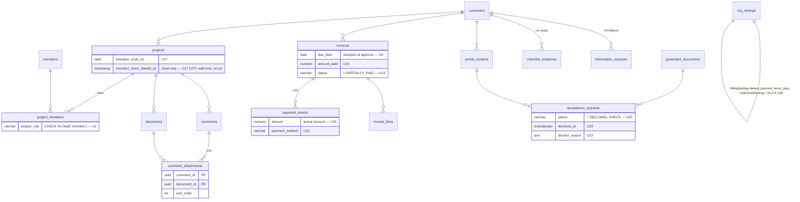
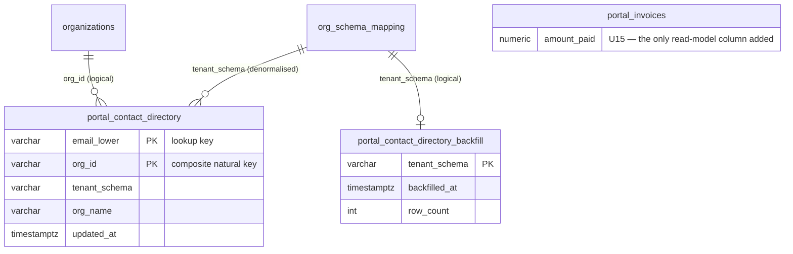
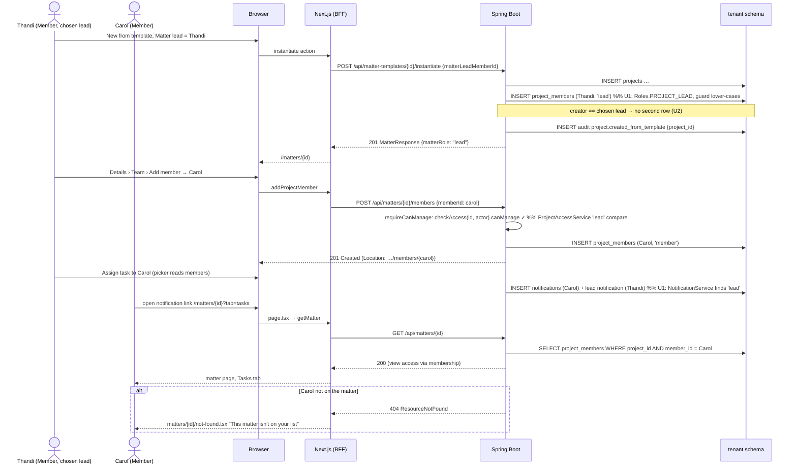
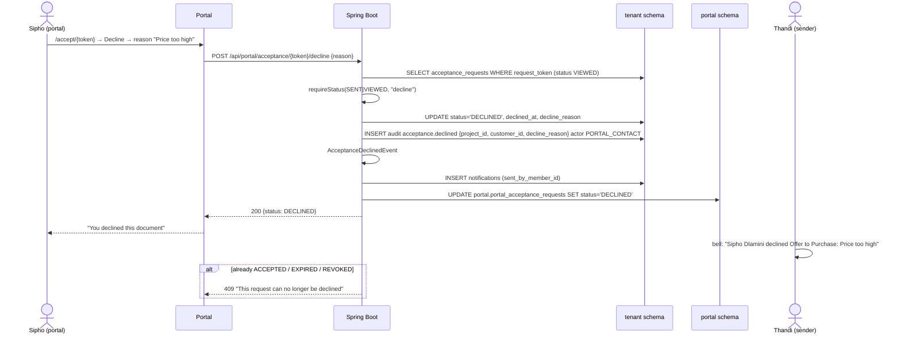

# Phase 88 — Demo-Ready: Root-Cause Closure of the Phase 87 Capstone Gaps

> Merge into ARCHITECTURE.md as **Section 13** (linked from the note lines at the top of ARCHITECTURE.md like Phases 86 and 87).

> Inputs: `requirements/claude-code-prompt-phase88.md` (24 units, decisions D1–D13), `tasks/phase88-gap-register.md` (vetted register, §2 units, §3 ordering, §4 decisions, §5 scenario amendments), dossiers `tasks/phase88-research/R1…R10`, `.arch-context.md` (code at `main` `50b88ed5c`). ADRs 345–357 are written alongside this document and referenced by number; their titles are fixed in §13.11.

## 13.1 Overview

The Phase 87 capstone walked the legal-za 90-day story end to end on the real Keycloak stack and found 59 gaps, 53 failed steps and 5 of 11 exit checkpoints failing — 52 of the 59 gaps older than Phase 87. None of them is a hole in the data model and none is a shell regression; they are the defects that only appear when rows are created through the real UI path. Template instantiation writes `"LEAD"` while thirteen readers expect `"lead"`; the FICA projector reads a store the onboarding flow never writes; six publisher families (acceptance sent, acceptance accepted, trust transaction recorded, trust transaction approved/rejected, fee note created, fee note approved — the sites [ADR-349](../adr/ADR-349-activity-feed-correlation-key.md) lists) omit the `project_id` key the matter feed joins on; the fee-note lifecycle has no step that assigns a due date, so the debtor book — which is a function of `due_date` — is empty on every surface Phase 87 put it on; the engagement letter never references the logo the fee note prints; the portal cannot find the firm from an email because `portal_contacts` is per-tenant and nine of eleven email links carry no org. Ten read-only research agents traced the 59 symptoms to **24 root-cause units**, each of which closes every symptom that shares its cause ([register §2](../tasks/phase88-gap-register.md)).

Phase 88 fixes those 24 units at the source, in the register's order, with one tenant migration series starting at **V4** (V5+ once V4 has been applied to a persistent stack, §13.7) and one global migration (**V2**), and re-walks the 90-day scenario twice — once after the fee-note units land (Days 1–7, 36–47, 61–75) and once at the end (all 90 days) — so that the exit is *observed*, not inferred: zero HIGH, zero FAIL outside the authorised scenario amendments, E.1/E.2/E.3/E.8/E.9 PASS, legal + default + portal Playwright green on a fresh stack. Three units are feature-grade by founder decision rather than fixes (firm letterhead and banking settings, a portal email→firm directory, payment method on Record Payment) and three product-decision gaps are built rather than amended (Decline on the acceptance page, full part payments, comment attachments). The phase introduces no new page family, no new navigation zone, no new capability and no change to the `matter`/`client` wire vocabulary or the pinned audit literals ([ADR-342](../adr/ADR-342-audit-and-entity-tag-strings-stable-under-renamed-wire.md)).

The design principle throughout is the one the capstone taught: **a test that never drives the real write path proves nothing about the read path.** Every unit that fixes a projection or a join (U1, U3, U4, U5, U6) is accompanied by an integration test that creates its rows through the same service the UI calls — template instantiation, checklist completion, `approve → send` — and the Playwright suites replace the strict-mode-defeating `isVisible().catch(() => false)` pattern with assertions that fail loudly (U22).

### What changes

| Surface | Existing (HEAD `50b88ed5c`) | After Phase 88 |
|---|---|---|
| `project_members.project_role` | free `varchar(50)`; `"lead"` from `ProjectService`, `"LEAD"` from `ProjectTemplateService`, `"CONTRIBUTOR"` from the demo seeder; 13 lowercase readers, 4 uppercase | one source (`Roles.PROJECT_LEAD`/`PROJECT_MEMBER`), `@PrePersist/@PreUpdate` lower-casing guard, V4 normalisation + `CHECK (project_role IN ('lead','member'))` ([ADR-345](../adr/ADR-345-canonical-project-role-values.md)) |
| Matter team | panel, dialogs, actions and `/api/matters/{id}/members` all exist, mounted nowhere; instantiation adds nobody; `POST …/members` ungated; `transferLead` lead-only | **Team** sub-tab under Details (22 tabs); creator auto-added on instantiate; add/remove/transfer gated to Owner/Admin/current lead ([ADR-346](../adr/ADR-346-matter-visibility-and-team-management.md)) |
| Fee-note due date | written only by batch send (`applyDefaults`); no payment-terms setting; "Total Outstanding" is a client-side sum | `BillingSettings.defaultPaymentTermsDays` (V4, default 30); `approve` stamps `dueDate`; V4 backfill; `GET /api/invoices/outstanding-summary` with the debtor-book definition ([ADR-347](../adr/ADR-347-fee-note-due-date-and-balance-model.md)) |
| Payments | `RecordPaymentRequest(paymentReference)`; amount always `invoice.total`; statuses DRAFT/APPROVED/SENT/PAID/VOID | `amount` + `paymentMethod` per payment; `invoices.amount_paid` + derived `balanceDue`; `PARTIALLY_PAID`; debtor book, aging, cash digest, Collections, Home, Fee notes summary and portal read the balance; trust/webhook/Xero post their real amount ([ADR-347](../adr/ADR-347-fee-note-due-date-and-balance-model.md)) |
| FICA status | `FicaStatusProjector` reads `information_requests` on `fica-onboarding-pack` only | checklist instances first (templates with `auto_instantiate = true`), information-request rule as fallback; response carries `checklistInstanceId` ([ADR-348](../adr/ADR-348-fica-status-source-of-truth.md)) |
| Matter activity feed | `findByProjectId` matches `details->>'project_id'` only; acceptance, trust and invoice created/approved publishers omit it; ~40 keys hit the raw "performed x on y" fallback; Home has a second formatter | every publisher writes `project_id` (and `customer_id`); `findByProjectId` ORs the `entity_type='project'` branch; one formatter with legal templates + a legal generic default; Home delegates ([ADR-349](../adr/ADR-349-activity-feed-correlation-key.md)) |
| Audit trail | free-text filters against storage keys committed on blur; raw literals in the Entity column; registry label `"Invoice"`; client Activity tab cannot see checklist events | actor/entity/event Selects fed by the facet endpoints; 68-literal legal-word map; `"Fee note"`; `titleCase` legal-cases `project`/`customer`; client tab joins checklist children |
| Client emails | SoA and closure letter born `PORTAL` and emailed on generation; `portalNotificationDocTypes` allowlist with no UI; link builders: 2 of 11 carry org context; `/projects/` in the document-ready mail | `notifyClient` + `shareWithClient` intent on both dialogs (default off); SoA saved INTERNAL until shared; allowlist removed; one `PortalLinkBuilder` used by all 11 builders ([ADR-350](../adr/ADR-350-client-emails-explicit-intent.md)) |
| Portal sign-in | `POST /portal/auth/request-link` requires `orgId`; bare `/login` short-circuits | global `portal.portal_contact_directory` (global V2); email-only request resolves 1..N orgs and sends one branded link per org; `?orgId=` kept as fast path ([ADR-351](../adr/ADR-351-portal-contact-directory.md)) |
| Acceptance PDF framing | Spring default `X-Frame-Options: DENY` on the main chain; iframe refused in both prod topologies | request-matcher-scoped `Content-Security-Policy: frame-ancestors <portal>` on `/api/portal/acceptance/*/pdf` only; everything else `DENY` ([ADR-352](../adr/ADR-352-acceptance-pdf-frame-ancestors.md)) |
| Acceptance | PENDING/SENT/VIEWED/ACCEPTED/EXPIRED/REVOKED | + `DECLINED` (`declined_at`, `decline_reason`, V4), portal decline endpoint, firm notification, read-model sync, badge |
| Letterhead / PDFs | `OrgSettings` has no address, phone, email, bank or signatory field; `--brand-color` undefined; engagement letters omit the logo; draft preview is a second (Thymeleaf) renderer | `LetterheadSettings` embeddable (V4, 16 columns) under Firm › General; `buildOrgContext` exposes `org.address/phone/email/website/bankingDetails/signatory`; `TiptapRenderer` injects the brand colour as concrete CSS; packs reconciled; Thymeleaf preview retired ([ADR-353](../adr/ADR-353-firm-letterhead-settings.md)) |
| Retention | `legal_matter_retention_years` NULL on insert, no setter caller, no UI; end date computed into the closure response only; `complete()` starts the clock | years seeded 5 and editable under Firm › Compliance; `projects.retention_ends_on` (tenant V8) stamped at close, reset on re-close, cleared on reopen; `complete()` no longer starts the clock ([ADR-354](../adr/ADR-354-persisted-retention-end-date.md)) |
| Owner-only capabilities | `hasCapability` short-circuits admin/owner and ignores `Capability.OWNER_ONLY`; `matter-closure-actions.ts` same | `OWNER_ONLY_CAPABILITIES` mirrored in `lib/capabilities.tsx`; admins denied the three; server action fixed ([ADR-355](../adr/ADR-355-owner-only-capabilities-client-side.md)) |
| Pack content for existing tenants | packs seed once per tenant; JSON edits reach fresh tenants only | pack `version` bump + idempotent `reconcileExistingPack` re-applying names, descriptions, associations, rule flags ([ADR-356](../adr/ADR-356-pack-content-reconciliation.md)) |
| Terminology | ≈589 user-visible `Project`/`Customer`/`Invoice` sites (261 FE/portal, 24 pack, 26 registry, 278 backend messages); breadcrumb map incomplete; shell column lacks `min-w-0` | census rewritten; remnant guard extended to JSX literals, pack JSON and backend messages with an allow-list; `min-w-0` on the shell column and `<main>` ([ADR-357](../adr/ADR-357-terminology-guard-extension.md)) |
| Comments | body + visibility only | `comment_attachments(comment_id, document_id)` (V4); files uploaded through the presign flow with the comment's scope and visibility |
| Migrations | tenant V1–V3, global V1 | tenant **V4** (sections per unit; V5+ once V4 has been applied to a persistent stack, §13.7), global **V2** (`portal_contact_directory` + backfill marker + `portal_invoices.amount_paid`; `BaselineSchemaParityTest` global comparison re-pinned to target `"1"` first) |

### The 24 units

Severity is the highest of the gaps the unit closes. Order is the build order (§13.10): HIGH and Phase-87-introduced first.

| # | Unit | Sev | Closes | Layer | Migration | ADR |
|---|---|---|---|---|---|---|
| U12 | Acceptance PDF framing | HIGH | G-B7, wow 2 | BE | — | 352 |
| U18 | Owner-only capabilities | MED | G-D7 | FE | — | 355 |
| U1 | Project-role casing | MED | G-D11 a, G-D13, N-1, half of G-B13 | BE | V4 §1 | 345 |
| U2 | Matter team | HIGH | G-B3, N-3, 8 FAILs + 2 DEFERREDs ("Carol can't") | BE+FE | — | 346 |
| U3 | Fee-note due date + payment terms | MED | G-D11 b, G-D21 Debtors, G-C7 c | BE+FE | V4 §2 | 347 |
| U4 | FICA status source | MED | G-D11 c, G-D21 FICA, G-B10 | BE+FE | — | 348 |
| U14 | Disbursement actions | HIGH | G-C9, G-B11, G-B12, 45.x DEFERREDs, N-8 | FE (+BE restore) | — | — |
| U15 | Fee-note lines, payments, pre-check | HIGH | G-C10, G-C11, G-C6, N-5 | BE+FE+portal | V4 §3 | 347 |
| U11 | Portal firm resolution | HIGH | G-D1, 68.x DEFERREDs | BE+portal | global V2 | 351 |
| U5 | Matter feed correlation + formatter | MED | G-B8, G-D9, G-D10 (feed), G-D8 | BE | — | 349 |
| U6 | Audit trail usability | MED | G-D6, G-B2, G-D10 (labels), E.9 | BE+FE | — | — |
| U7 | Automation "Document accepted" | LOW | G-B13 | BE pack | reconcile | 356 |
| U8 | Firm letterhead + brand in PDFs | MED | G-B5, G-C7 a–c, wow 6 | BE+FE+packs | V4 §4; reconcile | 353, 356 |
| U9 | Money formatting + draft preview | MED | G-C7 d/e, G-D14 amounts, N-4, G-C12 | BE+FE | — | — |
| U10 | Document generation polish | MED | G-B6, G-B16, G-B18, G-C4 | BE+FE+pack | reconcile | 356 |
| U13 | Client notification intent | MED | G-C5, G-D14 (emails), G-D19 | BE+FE+portal | — | 350 |
| U16 | Matter detail | MED | G-B9, G-B14, G-A6, G-D2 | FE | — | — |
| U17 | Retention model | MED | G-D3 | BE+FE | V8 §5 | 354 |
| U19 | Export helper (BFF) — *KC-only* | MED | G-D4, N-2 | FE (+BE CSV) | — | — |
| U20 | Small behaviour fixes | MED | G-C2, G-D5, G-D12, G-C1 | FE | — | — |
| U23 | Decline on acceptance | feature | G-B19 | BE+portal+FE | V4 §6 | 349 (event) |
| U24 | Comment attachments | feature | G-B15 | BE+FE+portal | V4 §7 | — |
| U21 | Terminology census + shell | LOW | G-A2/A3/A4/A5/A7, B1, B4, C3, C12, D10, D15–D18, D20, E.8 | FE+BE+packs | reconcile | 357, 356 |
| U22 | Playwright suites + seed | — | carried six, PACK-01, PROJ-02/03, CUST-01/02, portal seed ×3, P-1 | e2e | — | — |

### Out of scope

- Phase 84 take-on; the Phase 87 C.12 (c) items (`/api/calendar` deletion, profitability cost leg, redirect-table removal, `/legal/*` prefix).
- A pack-declared "header field" flag (D9 takes a hard-coded legal-za list); an inline conflict check with an opposing-party input; a `GOVERNMENT` party type beyond a frontend enum value.
- A settings UI for `portalNotificationDocTypes` (D7 removes the allowlist); a real document-acceptance automation trigger (D4 renames and disables the upload rule).
- A `DISBURSEMENT_PAYMENT` trust transaction type (the ledger CHECK and `DisbursementService` agree on `PAYMENT`; the dialog was wrong).
- Any change to entity, table or column names, audit `entity_type`/event-key literals, MCP tool names, or the portal visual design. No tier/plan UI (memory: no plan subscriptions). No horizontal feature ([ADR-330](../adr/ADR-330-archive-tag-not-fork.md)).
- The AI-core walk (needs a funded key).

### Baseline statement

Phase 87 is fully merged (Epics 607–617, PRs #1605–#1642). The tree has 103 `@Entity` classes, 27 `Capability` constants (frontend `CAPABILITIES` lists 10 of them), tenant migrations V1–V3 and global V1 (Phase 86 squash, immutable, `BaselineSchemaParityTest` pinned to target `"1"` for the tenant series and to the live schema for the global series), 57 `page.tsx` under `org/[slug]`, 18 portal pages, and a full backend verify of ≈12.5 minutes. The capstone evidence lives in `qa_cycle/evidence/phase87-capstone/` and `tasks/phase87-capstone-findings.md`; the re-walks of this phase write to `qa_cycle/evidence/phase88-rewalk/`.

## 13.2 Domain Model

No entity is renamed and no table is dropped. Phase 88 adds columns to five tenant tables (`project_members` gains only a CHECK), one tenant child table, one global table plus a backfill marker table and one new column on `portal.portal_invoices`, one embeddable, two enum values and one status value. Everything below follows the `.arch-context.md` §7 patterns: plain-String role columns guarded by a CHECK, `@Embedded` + `@AttributeOverride` settings groups with lazy-init getters, `@Enumerated(STRING)` statuses backed by a DB CHECK.

### 13.2.1 `ProjectMember` — role normalisation (U1)

| Field | Type | Constraints | Notes |
|---|---|---|---|
| `projectRole` | `String` → `project_role varchar(50)` | NOT NULL; **new** `chk_project_members_role CHECK (project_role IN ('lead','member'))` | values are `Roles.PROJECT_LEAD = "lead"` / `Roles.PROJECT_MEMBER = "member"` only. Constructor and `setProjectRole` route through `Roles.normaliseProjectRole(String)` (lower-cases, maps unknown → `member`); `@PrePersist`/`@PreUpdate` call it again as the last line of defence; `Roles.PROJECT_ROLES` is the two-value set. |

**Why normalise + CHECK rather than case-insensitive compare ([ADR-345](../adr/ADR-345-canonical-project-role-values.md)).** R1 §2 counts 13 lowercase and 4 uppercase readers across Java `equals`, Spring Data derived queries, JPQL literals, native SQL and the partial unique index `idx_project_members_unique_lead … WHERE project_role = 'lead'`. Tolerant comparison would touch all 17 and still leave the one-lead invariant unenforced for `'LEAD'` rows; a canonical value with a CHECK makes the invariant self-enforcing in the one place the data lives. The entity guard exists so that a future writer that forgets the constant cannot violate the CHECK at flush time with a confusing error — it is normalised before Hibernate sees it. A `ProjectRole` enum was rejected: the column stores lowercase and every reader compares the raw string; an `@Enumerated(STRING)` enum would need an `AttributeConverter` for zero gain.

### 13.2.2 `BillingSettings.defaultPaymentTermsDays` (U3)

| Field | Type | Constraints | Notes |
|---|---|---|---|
| `defaultPaymentTermsDays` | `Integer` → `org_settings.default_payment_terms_days integer` | NOT NULL DEFAULT 30; `CHECK (default_payment_terms_days BETWEEN 0 AND 365)` | field initialiser `= 30` so a fresh embeddable persists 30 (same reason `billingBatchAsyncThreshold = 50` does). Exposed on Settings › Fees › Fee runs ("Billing") as "Default payment terms (days)". |

`OrgSettingsSchemaSnapshotTest.EXPECTED_SNAPSHOT` is updated deliberately in the same PR (one new NOT NULL column).

### 13.2.3 `Invoice` — balance model and `PARTIALLY_PAID` (U3, U15)

| Field | Type | Constraints | Notes |
|---|---|---|---|
| `dueDate` | `LocalDate` → `due_date date` | unchanged | **now stamped by `approve()`**: `if (dueDate == null) dueDate = issueDate.plusDays(terms)`. `applyDefaults` (batch send) keeps working and is a no-op when already set. |
| `amountPaid` | `BigDecimal` → `amount_paid numeric(14,2)` | NOT NULL DEFAULT 0; `CHECK (amount_paid >= 0 AND amount_paid <= total)` | denormalised `LEAST(total, SUM(payment_events.amount) WHERE status = 'COMPLETED')`, recomputed from the remaining events by `InvoiceTransitionService` on every event write and reversal (never incremented or decremented in place, so an overpaid external event followed by a reversal cannot drive it negative or above `total`). Stored, not computed, because five native-SQL read sites (debtor book, aging, cash digest, scan, client list) need it in a predicate without a correlated subquery. |
| `balanceDue` | derived, not stored | — | `total − amountPaid`; exposed on `InvoiceResponse.balanceDue`, the portal invoice read model and `MatterListRow`/`ClientListRow` aggregates. *(622D errata: `MatterListRow` has no fee-note aggregate, so it carries no balance; `ClientListRow` keeps its `outstanding` field name, whose value is now the balance.)* |
| `status` | `InvoiceStatus` | `chk_invoice_status` **swapped** to `IN ('DRAFT','APPROVED','SENT','PARTIALLY_PAID','PAID','VOID')` | `PARTIALLY_PAID` sits between SENT and PAID. |
| `paidAt` | `Instant` | unchanged | set when the balance reaches zero; cleared when a reversal reopens the balance. |
| `paymentReference` | `String(255)` | unchanged | last reference recorded; per-payment references live on `payment_events`. |

Transitions after U15 (the entity keeps the guard-and-throw style of `.arch-context.md` §7.3):

```
DRAFT ──approve──► APPROVED ──send──► SENT ──recordPayment(amount < balance)──► PARTIALLY_PAID ──recordPayment(amount == balance)──► PAID
                                      │                                              │                                                │
                                      └──recordPayment(amount == balance)───────────► PAID                                             │
                                      ◄──reversePayment (no COMPLETED events left)──┘◄──reversePayment (events remain)────────────────┘
APPROVED | SENT ──void──► VOID        (PARTIALLY_PAID cannot be voided: money has been received; reverse first)
```

Design decisions: (a) **overpayment on the manual path is rejected** — EFT/CASH/OTHER amounts above the balance get a 409 (`InvalidStateException("Payment exceeds balance due")`); a credit note is a different artefact and out of scope. For CARD (pay-now webhook), XERO and TRUST_TRANSFER sources an amount exceeding the balance is still recorded as a payment event, the fee note is capped at PAID (`amount_paid = total`), and the excess is written to the audit trail as `invoice.payment_excess` (NOTICE) for reconciliation — money that has already moved cannot be refused by the fee note; (b) **payment reversal stays an internal service operation** with no REST endpoint: `InvoiceTransitionService.reversePayment`, called from the trust reversal path (`TrustTransactionService:1140`), now also accepts PARTIALLY_PAID; it deletes the payment event row (current behaviour) and recomputes `amount_paid` as `LEAST(total, SUM(remaining COMPLETED events))`; status becomes SENT at zero, else PARTIALLY_PAID; `paidAt` clears. The audit literals `invoice.payment_reversed` and `invoice.payment_partially_reversed` are unchanged (portal activity depends on them); (c) the webhook overload stays idempotent on replay by `session_id`, not on status.

### 13.2.4 `PaymentEvent` — method and amount (U15)

| Field | Type | Constraints | Notes |
|---|---|---|---|
| `amount` | `BigDecimal(14,2)` | unchanged, NOT NULL | now the **actual** amount posted (manual form amount, trust fee-transfer amount, gateway amount, Xero payment amount) — never `invoice.total` by default. |
| `paymentMethod` | `PaymentMethod` enum → `payment_method varchar(20)` | NULL allowed for pre-existing rows; `CHECK (payment_method IS NULL OR payment_method IN ('EFT','CARD','CASH','TRUST_TRANSFER','XERO','OTHER'))` | manual form: user-chosen (default EFT); trust fee transfer: `TRUST_TRANSFER`; pay-now webhook: `CARD`; Xero sync: `XERO`. |

### 13.2.5 `LetterheadSettings` embeddable (U8, D5)

New `settings/LetterheadSettings.java`, `@Embedded` on `OrgSettings` as `letterhead` with per-field `@AttributeOverride`; all columns nullable (extend `OrgSettingsEmbeddableNullReloadTest`).

| Field | Column | Type | Notes |
|---|---|---|---|
| `addressLine1` | `letterhead_address_line1` | varchar(255) | |
| `addressLine2` | `letterhead_address_line2` | varchar(255) | |
| `addressLine3` | `letterhead_address_line3` | varchar(255) | |
| `city` | `letterhead_city` | varchar(100) | |
| `postalCode` | `letterhead_postal_code` | varchar(20) | |
| `country` | `letterhead_country` | varchar(100) | |
| `phone` | `letterhead_phone` | varchar(50) | |
| `email` | `letterhead_email` | varchar(255) | validated `@Email` on the request DTO |
| `website` | `letterhead_website` | varchar(255) | |
| `bankName` | `letterhead_bank_name` | varchar(100) | |
| `bankBranchCode` | `letterhead_bank_branch_code` | varchar(20) | |
| `bankAccountNumber` | `letterhead_bank_account_number` | varchar(50) | rendered on fee notes only; never on engagement letters |
| `bankAccountType` | `letterhead_bank_account_type` | varchar(30) | free text ("Cheque", "Current") |
| `paymentReferenceNote` | `letterhead_payment_reference_note` | text | e.g. "Use the fee-note number as reference" |
| `signatoryName` | `letterhead_signatory_name` | varchar(255) | backs the dangling `org.principal_attorney` key (renamed `org.signatory.name`) |
| `signatoryDesignation` | `letterhead_signatory_designation` | varchar(255) | "Director", "Partner" |

The VAT number stays on `TaxSettings.taxRegistrationNumber`; brand colour and logo stay on `BrandingSettings`. `buildOrgContext` composes `org.address` (joined non-blank lines), `org.phone`, `org.email`, `org.website`, `org.bankingDetails` (a map: `bankName`, `branchCode`, `accountNumber`, `accountType`, `referenceNote`) and `org.signatory` (`name`, `designation`) from this group ([ADR-353](../adr/ADR-353-firm-letterhead-settings.md)).

### 13.2.6 `Project.retentionEndsOn` (U17, D10)

| Field | Type | Constraints | Notes |
|---|---|---|---|
| `retentionEndsOn` | `LocalDate` → `projects.retention_ends_on date` | nullable; partial index `idx_projects_retention_ends_on … WHERE retention_ends_on IS NOT NULL` | set by `closeMatter(now, years)` to `closedAt.toLocalDate().plusYears(years)`; **cleared** by `reopenMatter`; **re-stamped** on re-close (ADR-249 "fresh anchor"); `complete()` no longer touches `retentionClockStartedAt`. |
| `retentionClockStartedAt` | `Instant` | unchanged | now written by `closeMatter` only (kept for audit continuity; `RetentionClockIntegrationTest` rewritten). |

The firm-wide `retention_policies` MATTER row is **no longer inserted at closure** (`MatterClosureService.ensureMatterRetentionPolicy` is removed); existing rows remain as firm-policy metadata and `RetentionService` / `RetentionPolicyService` continue to read them (the Data protection tab's policy table and the Phase 50 evaluator). The matter's date comes from `retention_ends_on` only; retiring the table is out of scope ([ADR-354](../adr/ADR-354-persisted-retention-end-date.md)).

### 13.2.7 `AcceptanceRequest` — DECLINED (U23)

| Field | Type | Constraints | Notes |
|---|---|---|---|
| `status` | `AcceptanceStatus` | `acceptance_requests` has **no status CHECK** today (`.arch-context.md` §10.3); V4 adds `chk_acceptance_requests_status` over the seven values, scoped to `current_schema()` | `DECLINED` is terminal: added to `TERMINAL_STATUSES`; not in `ACTIVE_STATUSES`, so the partial unique index `idx_acceptance_requests_active_unique` frees the (document, contact) pair and the firm can re-send. |
| `declinedAt` | `Instant` → `declined_at timestamptz` | nullable | |
| `declineReason` | `String` → `decline_reason text` | nullable; request DTO `@Size(max = 2000)` | optional; shown on the generated-document row badge tooltip and in the firm notification. |

Gate semantics: `AllAcceptanceRequestsFinalGate` treats DECLINED as final (the matter can be closed; an engagement declined is a resolved request, not an open one). The engagement-letter gate on matter activation (where present) does **not** treat DECLINED as accepted — it is a distinct terminal outcome.

### 13.2.8 `comment_attachments` (U24)

| Column | Type | Constraints | Notes |
|---|---|---|---|
| `comment_id` | uuid | NOT NULL, FK `comments(id) ON DELETE CASCADE` | deleting the comment detaches; the document row and S3 object survive |
| `document_id` | uuid | NOT NULL, FK `documents(id) ON DELETE CASCADE` | deleting the document (retention / manual) removes the chip |
| `sort_order` | integer | NOT NULL DEFAULT 0 | |
| `created_at` | timestamptz | NOT NULL DEFAULT now() | |
| PK | `(comment_id, document_id)` | | |

Modelled as a child table rather than a `document.comment_id` column because a document already carries `project_id`/`customer_id`/`scope`/`visibility`/`source` and must remain a first-class row in the matter's Documents list; the link is many-to-one in practice but the table keeps the document's lifecycle independent. `Comment.entityType` CHECK (`TASK|DOCUMENT|PROJECT`) is **not** changed — attachments do not widen what can be commented on. Visibility rule: an attachment uploaded through a comment is created with `visibility = comment.visibility == SHARED ? SHARED : INTERNAL` and `source = COMMENT`; at most 5 attachments per comment (request validation).

### 13.2.9 Global `portal.portal_contact_directory` (U11, D6)

| Column | Type | Constraints | Notes |
|---|---|---|---|
| `email_lower` | varchar(255) | NOT NULL; PK part 1 | `lower(trim(email))`; the only lookup key |
| `org_id` | varchar(255) | NOT NULL; PK part 2 | the public org slug / external id (`mathebula-partners`) — already public via `/portal/branding?orgId=` |
| `tenant_schema` | varchar(63) | NOT NULL | resolved once at write time so the login path does not need `org_schema_mapping` |
| `org_name` | varchar(255) | NOT NULL | for the branded email subject only |
| `updated_at` | timestamptz | NOT NULL DEFAULT now() | |
| PK | `(email_lower, org_id)` | composite natural key, no surrogate `id` | one row per (email, firm); intra-firm multiplicity (PRIMARY > BILLING > GENERAL) is resolved inside the tenant exactly as today; the PK's leading column serves the login lookup (`WHERE email_lower = ?`), so no separate index is needed |

A second global table records the per-tenant backfill (§13.7.2), one row per tenant schema:

| Column | Type | Constraints | Notes |
|---|---|---|---|
| `tenant_schema` | varchar(63) | PK | the schema the runner entered |
| `backfilled_at` | timestamptz | NOT NULL DEFAULT now() | |
| `row_count` | integer | NOT NULL | directory rows upserted for that tenant (observability; lets the e2e seed assert the backfill ran) |

What the directory **never** stores: display names, customer ids, portal-contact ids, tokens, matter or financial data. A row exists iff the firm has at least one `ACTIVE` portal contact with that email; `PortalContactService` upserts/deletes on create, update, email change, archive and delete; `PortalContactAutoProvisioner` goes through the same service ([ADR-351](../adr/ADR-351-portal-contact-directory.md)). The global series is pinned: the PR that adds global V2 first re-pins `BaselineSchemaParityTest`'s global comparison to `.target("1")` the way the tenant comparison already is.

### 13.2.10 ER — affected tenant cluster



### 13.2.11 ER — global schema addition



No FK is declared from the directory to `organizations`: the directory is maintained by the application from inside tenant transactions (a tenant-side contact write must not take a lock on a public-schema parent row), and org deletion is a provisioning concern that already fans out to `org_schema_mapping`.

### 13.2.12 Unchanged

`Project`, `Customer`, `Invoice`, `InvoiceLine`, `TimeEntry`, `LegalDisbursement`, `TrustTransaction`, `Document`, `GeneratedDocument`, `Comment`, `ChecklistInstance`, `InformationRequest`, `AuditEvent`, `PortalContact` keep every existing column, name and constraint; the ten existing `OrgSettings` embeddables are untouched except `BillingSettings` (one field). The `trust_transactions` CHECK keeps nine types (no `DISBURSEMENT_PAYMENT`). `comments.entity_type` CHECK is unchanged. The portal read models (`portal.portal_*`) gain exactly one column (`portal_invoices.amount_paid`): `portal_invoices` already carries `total`; `balanceDue` and `amountPaid` are projected into the existing `portal_invoices` row through the `InvoiceSyncEvent` → `PortalReadModelRepository` path, which needs one new column there (`amount_paid`; `balanceDue` is derived) — the **only** read-model change, included in global V2 (`ALTER TABLE portal.portal_invoices ADD COLUMN IF NOT EXISTS amount_paid numeric(14,2) NOT NULL DEFAULT 0`).

## 13.3 Core Flows and Backend Behaviour

One subsection per unit, in build order. Each states what it closes, the root cause with the dossier reference (file:line lives there, not here), the design, RBAC, the observed acceptance and the tests. Conceptual Java is illustrative; exact signatures are confirmed at build time against the files the dossier names.

### 13.3.1 U12 — Acceptance PDF framing

**Closes** G-B7, wow moment 2. **Root cause** (R5 Q3): no `.headers(...)` anywhere in `SecurityConfig`; Spring's default `X-Frame-Options: DENY` applies to `/api/portal/acceptance/{token}/pdf`, which sits on the main `@Order(2)` chain, not the `/portal/**` chain; `DENY` refuses framing even same-origin, so both the VPS (cross-origin `api-dev` ← `portal-dev`) and AWS (same-origin path routing) topologies fail.

**Design.** One request-matcher-scoped header policy on the existing `@Order(2)` chain — not a third chain, so the `permitAll` list stays the single source of truth for public staff-chain paths:

```java
// security/SecurityConfig.java — inside securityFilterChain(http)
var pdfMatcher = PathPatternRequestMatcher.withDefaults()
    .matcher(HttpMethod.GET, "/api/portal/acceptance/*/pdf");
var notPdf = new NegatedRequestMatcher(pdfMatcher);
http.headers(h -> h
    .frameOptions(f -> f.disable())                                   // we write it ourselves below
    .addHeaderWriter(new DelegatingRequestMatcherHeaderWriter(
        notPdf, new XFrameOptionsHeaderWriter(XFrameOptionsMode.DENY)))   // everything else: DENY
    .addHeaderWriter(new DelegatingRequestMatcherHeaderWriter(
        pdfMatcher, new StaticHeadersWriter("Content-Security-Policy",
            "frame-ancestors " + portalOrigin))));                        // the PDF: framed by the portal only
```

`portalOrigin` is the scheme+host(+port) of `docteams.app.portal-base-url` (`PORTAL_BASE_URL`), parsed once at startup; a malformed value fails fast. The `/portal/**` `@Order(1)` chain keeps Spring's default `DENY` untouched. `frame-ancestors` replaces `X-Frame-Options` on that path (browsers honour CSP when both are present; omitting XFO avoids the `SAMEORIGIN` vs cross-origin ambiguity) ([ADR-352](../adr/ADR-352-acceptance-pdf-frame-ancestors.md)). The portal acceptance page additionally renders an "Open in new tab" link beside the iframe (`Content-Disposition` is already `inline`).

**RBAC.** Unchanged: the PDF endpoint is `permitAll`, authenticated by the request token inside `AcceptanceService`.

**Acceptance (observed).** Fresh browser on `:3002/accept/<token>`: the PDF renders inline; Chrome console has no "Refused to display"; `curl -I` on the PDF path shows `Content-Security-Policy: frame-ancestors http://localhost:3002` and no `X-Frame-Options`; `curl -I` on `/api/matters` and on `/api/portal/acceptance/<token>` (JSON) shows `X-Frame-Options: DENY`.

**Tests.** `security/FrameHeadersIntegrationTest` (MockMvc): PDF path → CSP present, XFO absent; sibling JSON path and a staff path → XFO `DENY`; portal chain path → `DENY`. Portal vitest for the new link.

### 13.3.2 U18 — Owner-only capabilities

**Closes** G-D7. **Root cause** (R7 Q6): `lib/capabilities.tsx` `hasCapability = isAdmin || isOwner || capSet.has(cap)` ignores `Capability.OWNER_ONLY` (`MANAGE_COMPLIANCE_DESTRUCTIVE`, `OVERRIDE_MATTER_CLOSURE`, `FINANCIAL_RECONCILE`); `matter-closure-actions.ts` repeats the widening, so an Admin reaches Step 2 of the closure dialog and gets the backend 403 toast.

**Design (R7 option B).** Mirror the set client-side and make the helper owner-aware; keep the admin short-circuit for everything else (it prevents gate flicker before `/api/me/capabilities` resolves):

```ts
// frontend/lib/capabilities.tsx
// Must stay in sync with Capability.OWNER_ONLY (backend orgrole/Capability.java)
export const OWNER_ONLY_CAPABILITIES = new Set([
  "MANAGE_COMPLIANCE_DESTRUCTIVE", "OVERRIDE_MATTER_CLOSURE", "FINANCIAL_RECONCILE",
]);
hasCapability: (cap) =>
  isOwner || (isAdmin && !OWNER_ONLY_CAPABILITIES.has(cap)) || capSet.has(cap),
```

The server action drops `caps.isAdmin` from its override line (`isOwner || capabilities.includes("OVERRIDE_MATTER_CLOSURE")`, the idiom already used for `FINANCIAL_RECONCILE` on the fee-note page). A vitest guard test asserts the three names equal the backend set by reading `Capability.java` at test time (same technique as the Epic 611 remnant scan) so the mirror cannot drift ([ADR-355](../adr/ADR-355-owner-only-capabilities-client-side.md)). The frontend `CAPABILITIES` map (10 of 27) is **not** widened here — it is the role editor's list, and widening it is unrelated to the bug; U21's census touches the same file only for labels.

**RBAC.** Unchanged server-side; the client now agrees with `OrgRoleService.resolveCapabilities` (admin = `ALL_NAMES − OWNER_ONLY`).

**Acceptance (observed).** Bob (Admin) on a matter with a failing gate: Continue lands on Step 3 "Cannot close — resolve gates"; `matter-closure-override-toggle` is absent; no 403 in the backend log. Alice (Owner) still sees the toggle.

**Tests.** `capabilities.test.tsx` gains "admin is denied owner-only capabilities" (the `:92` pin becomes "admin bypasses non-owner-only"); `matter-closure-dialog.test.tsx` admin case; un-`fixme` `day-75-85-closure.spec.ts:319`.

### 13.3.3 U1 — Project-role casing

**Closes** G-D11 a, G-D13, N-1, the double-recipient half of G-B13. **Root cause** (R1 §0–§2): `ProjectTemplateService` writes `"LEAD"` on both instantiation paths; `LegalDemoDataSeeder` writes `"CONTRIBUTOR"`; `Roles.PROJECT_LEAD = "lead"` is what `ProjectAccessService`, `MatterListRowRepository`, `ProjectMemberRepository`, `TimeEntryService` and the partial unique index read; `NotificationService` (×3), `AssignMemberActionExecutor` and `CreateTaskActionExecutor` read `"LEAD"`, so lead notifications and automation `PROJECT_OWNER` recipients never resolve for normally-created matters and fall back to all admins/owners.

**Design ([ADR-345](../adr/ADR-345-canonical-project-role-values.md)).**
1. Writers: both `ProjectTemplateService` sites → `Roles.PROJECT_LEAD`; `LegalDemoDataSeeder` → first member `Roles.PROJECT_LEAD`, the rest `Roles.PROJECT_MEMBER`.
2. Readers: the four uppercase sites → `Roles.PROJECT_LEAD`; `AssignMemberActionExecutor.PROJECT_LEAD_ROLE` constant deleted. `McpMatterDto` javadoc corrected (doc drift only; the value was always passed raw).
3. Entity guard — one normaliser in `security/Roles.java`, used by the `ProjectMember` constructor, `setProjectRole` and `@PrePersist`/`@PreUpdate`:

```java
// security/Roles.java
public static final Set<String> PROJECT_ROLES = Set.of(PROJECT_LEAD, PROJECT_MEMBER);
/** Lower-cases; anything outside PROJECT_ROLES (null, blank, "CONTRIBUTOR") becomes PROJECT_MEMBER. */
public static String normaliseProjectRole(String role) {
  if (role == null || role.isBlank()) return PROJECT_MEMBER;
  var v = role.trim().toLowerCase(Locale.ROOT);
  return PROJECT_ROLES.contains(v) ? v : PROJECT_MEMBER;
}

// member/ProjectMember.java
public ProjectMember(UUID projectId, UUID memberId, String projectRole) { …; this.projectRole = Roles.normaliseProjectRole(projectRole); }
public void setProjectRole(String role) { this.projectRole = Roles.normaliseProjectRole(role); }
@PrePersist @PreUpdate private void guardRole() { this.projectRole = Roles.normaliseProjectRole(this.projectRole); }
```

4. Tenant V4 §1 (full SQL in §13.7), in ADR-345's safe order: (a) map anything whose lower-case is not in `('lead','member')` to `member`; (b) demote duplicate leads per matter to `member` **case-insensitively**, keeping the earliest `(created_at, id)`; (c) only then lower-case every row; (d) add the CHECK. Idempotent (`WHERE project_role <> lower(project_role)` etc.) and guarded by `current_schema()`.

Why this order, and why demote rather than fail: the partial unique index `idx_project_members_unique_lead … WHERE project_role = 'lead'` is lowercase-only, so a matter can hold one `'lead'` (creator via `ProjectService`) and one `'LEAD'` (template) at once — unlikely but possible on a hand-fixed tenant. Lower-casing first would violate the index mid-migration and abort provisioning; demoting first (comparing `upper(project_role)`) means the lower-case step can never collide. The earliest row wins because it is the creator-or-chosen lead; the demoted member is still on the team.

**RBAC.** No change.

**Acceptance (observed).** New from template with Thandi as Matter lead → Matters list "Fee earner" shows Thandi; Thandi (org Member) opens Fees › Time recording per-member breakdown without 403; assigning a task on her matter produces the lead notification in `notifications` and in Mailpit; on the walked tenant the four `LEAD` rows read `lead` after restart (`SELECT project_role, count(*) FROM project_members GROUP BY 1` → two rows only).

**Tests.** `InstantiateTemplateIntegrationTest:277` flips to `Roles.PROJECT_LEAD`; **new** `TemplateCreatedMatterReadPathIntegrationTest` instantiates a template through `ProjectTemplateService` and asserts, against the real row: `MatterListRowRepository` fee earner populated, `ProjectAccessService.canEdit` true for the lead, `NotificationService` lead recipients non-empty on task assignment, `AssignMemberActionExecutor` resolves `PROJECT_OWNER`; `ProjectMemberTest` (entity guard maps `"CONTRIBUTOR"` to `member`, lower-cases `"LEAD"`); `V4ProjectRoleMigrationTest` provisions a scratch schema at target `"3"`, inserts via JDBC a **mixed-case duplicate-lead fixture** — one matter holding an older `'lead'` row and a newer `'LEAD'` row (the shape that violates the partial unique index if lower-cased first), plus a `'CONTRIBUTOR'` row and a plain `'MEMBER'` row — migrates to `"4"`, and asserts the older row is the only `lead`, the newer is `member`, every row is lowercase, and the CHECK exists (`BaselineSchemaParityTest` stays pinned to `"1"` and is unaffected).

### 13.3.4 U2 — Matter team

**Closes** G-B3, N-3, the eight FAILs and two DEFERREDs behind "Carol can't". **Root cause** (R1 §0 RC-2, §4–§6): template instantiation adds nobody unless a lead is chosen (no creator auto-add, unlike `ProjectService.createProject`); the Team panel, dialogs and actions survived Epic 599 but nothing mounts them and `members` is not a tab id; the assignee picker reads matter membership, so a 0-member matter offers only "Unassigned"; an org Member who is not on the matter is `ProjectAccess.DENIED` → 404 → error page. Latent: `POST …/members` has no gate; `transferLead` refuses Owner/Admin callers.

**Design (D1, [ADR-346](../adr/ADR-346-matter-visibility-and-team-management.md)).**

*Backend.*
- `ProjectTemplateService.instantiateTemplate` / `instantiateFromTemplate`: after the optional lead row, add the creator — as `lead` when no lead was chosen, as `member` otherwise (skip when creator == chosen lead). Mirrors `createProject`.
- `ProjectMemberService` gains one gate used by add, remove and transfer:

```java
/** Owner, Admin, or the matter's current lead. Members who are not the lead cannot manage the team. */
private void requireCanManage(UUID projectId, ActorContext actor) {
  ProjectAccess access = projectAccessService.checkAccess(projectId, actor);   // real API: ProjectAccess(canView, canEdit, canManage, isOwner, role); requireViewAccess(…) 404s a non-member first
  if (!access.canManage()) throw new ForbiddenException("Only the matter lead or a firm admin can manage the team");
}
public ProjectMember addMember(UUID projectId, UUID memberId, UUID addedBy);            // signature unchanged — there is no orgRole parameter today; the gate reads the org role from ActorContext
public void removeMember(UUID projectId, UUID memberId, UUID requestedBy, String orgRole); // still refuses to remove the lead; the gate replaces the hand-rolled lead-only check
public void transferLead(UUID projectId, UUID actorId, UUID newLeadId);                 // caller need not be the lead (was: currentLeadId)
```

The controller is unchanged in shape (`ProjectMemberController.java:39-48`): `POST /api/matters/{matterId}/members` with body `{"memberId": "<uuid>"}` returns `201 Created` with a `Location` header and no body; `DELETE …/members/{memberId}` and `PUT …/members/{memberId}/role` (body `TransferLeadRequest(role)`) return `204`. `transferLead` demotes the current lead to `member` and promotes the target in one transaction (the partial unique index enforces one lead; order the writes demote-then-promote). Audit `project_member.added/removed/role_changed` unchanged (ADR-342 literals). A new `project_member.lead_transferred` is **not** added; `role_changed` already carries `from`/`to`.
- Visibility rule recorded, not changed: org Members see only matters they are on; Owner/Admin see all (`ProjectAccessService`). The scenario expects Carol to be *added*, not to see everything.

*Frontend.*
- `matter-tab-groups.ts`: Details group gains `{ id: "team", label: "Team" }` after `fields` → 7 groups / **22** tabs; `validTabIds`/`TabId` updated; `legacy-tab-ids.ts` aliases `members → team`; the Overview setup step "Team members added" links to `?tab=team`.
- `matter-tabs.tsx` gains a `teamPanel` prop; `page.tsx` mounts `ProjectMembersPanel` with `canManage = isOwner || isAdmin || matterRole === "lead"`, the add-member and transfer-lead dialogs, and shows Transfer lead to Owner/Admin as well as the lead.
- `matters/[id]/not-found.tsx` added so a non-member gets "This matter isn't on your list" rather than the `matters/error.tsx` boundary. **Reproduce first**: the walk saw "Something went wrong" where `notFound()` should render a 404; the slice records which boundary rendered it before changing anything (R1 §5 HYPOTHESIS).

**RBAC per operation.** List members: any member with view access. Add / remove / transfer: Owner, Admin, current lead (`canManage`). Task assignment unchanged (edit access). See §13.9.

**Acceptance (observed).** Thandi opens a template-created matter (she is on it as lead); Team tab lists her; she adds Bob and Carol; assigns a task to each; Carol (Member) sees the matter in her Matters list, opens it, logs time, replies to a mention; Carol's notification link lands on the matter. Bob (Admin) transfers lead to Thandi on a matter he is not on → 204.

**Tests.** `ProjectMemberIntegrationTest`: member-not-lead cannot add (403), lead can add, admin can transfer without being lead, remove-lead still 400; `InstantiateTemplateIntegrationTest`: creator auto-added (lead when none chosen, member otherwise); `matter-tab-groups.test.ts` / `matter-tabs.test.tsx` pins 21 → 22; `overview-tab-setup.test.tsx` `?tab=team`; new Playwright `legal-lifecycle/day-01-07` Carol steps un-skipped and a Team-tab spec (add, transfer, remove).

### 13.3.5 U3 — Fee-note due date and payment terms

**Closes** G-D11 b, G-D21 Debtors, G-C7 c ("Due Date:" blank), the Fee notes vs Home disagreement. **Root cause** (R2 §1): no code path computes `due_date` outside batch billing (`Invoice.applyDefaults`, sole caller `BillingRunGenerationService`); no firm payment-terms setting exists; the debtor book is `status = 'SENT' AND due_date IS NOT NULL` at five SQL sites because every aging bucket is a function of `due_date`; the Fee notes page sums APPROVED+SENT client-side with no due-date predicate.

**Design (D2, [ADR-347](../adr/ADR-347-fee-note-due-date-and-balance-model.md)).**
- `BillingSettings.defaultPaymentTermsDays` (§13.2.2), `SettingsResponse.billing.defaultPaymentTermsDays`, `PATCH /api/settings/billing` accepts it; form field on Settings › Fees › Fee runs.
- Stamp at **approve**, the moment the number is allocated and `issueDate` is set, so the PDF, the email, the portal read model and `InvoiceSyncEvent` on send all carry a real date:

```java
// invoice/Invoice.java
public void approve(String invoiceNumber, UUID approvedBy, int defaultTermsDays) {
  requireStatus(DRAFT, "approve");
  this.status = APPROVED; this.invoiceNumber = invoiceNumber; this.approvedBy = approvedBy;
  if (this.issueDate == null) this.issueDate = LocalDate.now();
  if (this.dueDate == null) this.dueDate = this.issueDate.plusDays(defaultTermsDays);   // U3
  this.updatedAt = Instant.now();
}
```

`InvoiceTransitionService.approve` reads `orgSettings.getBilling().getDefaultPaymentTermsDays()`. A due date typed on the draft is never overwritten. `applyDefaults` stays for batch send (no-op when set).
- V4 §2 backfills `APPROVED`/`SENT` rows with NULL `due_date` as `COALESCE(issue_date, created_at::date) + terms` (full SQL §13.7) — this is what makes the walked tenant and demo tenants show a debtor book without re-sending anything.
- The Fee notes page "Total Outstanding"/"Overdue" tiles move to `GET /api/invoices/outstanding-summary` (§13.4), computed by `CollectionsReadService` with the debtor-book predicate (after U15: `status IN ('SENT','PARTIALLY_PAID')`, amount = `total − amount_paid`), so the page, Home and the Clients table cannot disagree. APPROVED-but-unsent fee notes are reported separately as `approvedUnsentTotal` (the page keeps a tile for it, labelled "Approved, not sent").

**RBAC.** Settings write: Owner/Admin (`TEAM_OVERSIGHT`, as the sibling billing settings). Summary read: `FINANCIAL_VISIBILITY` (same as the debtor book).

**Acceptance (observed).** Create → approve → send with no due date typed: Home Debtors lists the client with the amount in the `current` bucket; Clients "Outstanding fee notes" shows it; the fee-note PDF prints "Due Date: 2026-11-21"; Fee notes "Total Outstanding" equals Home's debtor total. On the walked tenant INV-0002/INV-0003 appear after the migration.

**Tests.** `InvoiceLifecycleIntegrationTest.approveWithoutDueDateStampsIssuePlusTerms` (and "typed due date preserved"); **new** debtor-book test in `CollectionsReadApiTest` that creates the fee note through `InvoiceCreationService` + `approve` + `send` (not entity `markSent`) and asserts the row in `/api/collections/debtors`; `ClientListRowIntegrationTest` javadoc updated — its `777` fixture (seeded via entity `markSent`, bypassing approve) stays NULL and documents the legacy guard; `CollectionsReadApiTest:356` non-null pin stays; `OrgSettingsSchemaSnapshotTest` snapshot updated; `V4InvoiceDueDateBackfillTest`.

### 13.3.6 U4 — FICA status source

**Closes** G-D11 c, G-D21 FICA, G-B10. **Root cause** (R2 §2): `FicaStatusProjector` reads `information_requests` on `fica-onboarding-pack` templates, which the firm-driven onboarding path never creates; the product's own lifecycle hook `ChecklistInstanceService.checkLifecycleAdvance` treats "all onboarding checklist instances COMPLETED" as the FICA-done event; every display (Home widget, Clients table + filter + system view, matter card, KPI) reads the projector.

**Design (B1, [ADR-348](../adr/ADR-348-fica-status-source-of-truth.md)).** The projector stays pure and gains a first input:

```java
public record Projection(String status, Instant completedAt, UUID requestId, UUID checklistInstanceId) {}

public static Projection project(
    Collection<ChecklistInstance> onboardingInstances,      // the client's instances whose template is an onboarding template
    Set<UUID> ficaTemplateIds, Collection<InformationRequest> clientRequests,
    Function<UUID, List<RequestItem>> itemsForRequest) {
  var live = onboardingInstances.stream().filter(i -> !"CANCELLED".equals(i.getStatus())).toList();
  if (live.stream().anyMatch(i -> "IN_PROGRESS".equals(i.getStatus())))
    return new Projection(IN_PROGRESS, null, null, newestOf(live, "IN_PROGRESS").getId());   // an open obligation outranks a past completion
  var done = newestOf(live, "COMPLETED");
  if (done != null) return new Projection(DONE, done.getCompletedAt(), null, done.getId());
  return projectFromInformationRequests(ficaTemplateIds, clientRequests, itemsForRequest);  // unchanged rule, fallback
}
```

**Selector decision (beyond D1–D13): an onboarding template is one with `checklist_templates.auto_instantiate = true`.** That is the product's own definition — `ChecklistInstantiationService.instantiateForCustomer` instantiates exactly those on Start Onboarding — and it covers `legal-za-individual-onboarding` and `legal-za-trust-onboarding` (both `autoInstantiate: true`) as well as any firm-authored onboarding checklist. A hard-coded pack-id set was rejected because it would silently ignore a firm's own onboarding template. Note that `checklist_templates.auto_instantiate` defaults to `true` (`V1__baseline.sql:181`), so a firm-authored template created without clearing the flag counts as onboarding — intended: it is also what Start Onboarding will instantiate. Batched: `ChecklistTemplateRepository.findIdsByAutoInstantiateTrue()` (one query, cached per request) + `ChecklistInstanceRepository.findByCustomerIdIn(ids)` (one query); `getFicaStatuses` goes from 3 to 5 statements — `ClientListRowIntegrationTest`'s 10-statement cap and `MatterListRow`'s 7 are re-counted in the PR (the list rows call the batch once).

- `FicaStatusResponse` gains `checklistInstanceId`; `requestId` keeps its info-request meaning. `FicaStatusCard` deep-links to the checklist when present and says "No FICA onboarding started" instead of "No FICA onboarding request yet".

**RBAC.** Unchanged (`CUSTOMER_MANAGEMENT` for the single read; dashboard/list gates as today).

**Acceptance (observed).** Day 2: Start Onboarding → complete 9/9 → matter Overview FICA card "Complete", Clients row "Done", "FICA outstanding" system view excludes the client, Home widget count 0. Moroka trust (12 items) likewise. A client with only a sent portal FICA pack still reads IN_PROGRESS (fallback).

**Tests.** `FicaStatusProjectorTest` + checklist cases (completed wins, in-progress outranks completed, cancelled ignored, fallback, batch/single parity); `FicaOutstandingIntegrationTest` and `CustomerFicaStatusIntegrationTest` + clients onboarded via `TestChecklistHelper.completeChecklistItems` (the real path); `ClientListRowIntegrationTest` FICA fixture extended with a checklist-driven client; `FicaStatusCard.test.tsx` copy.

### 13.3.7 U14 — Disbursement actions

**Closes** G-C9, G-B11, G-B12, the 45.x DEFERREDs, N-8. **Root cause** (R6 §1–§3): the write-off backend (endpoint, DTO, capability, audit, tests) is complete but `writeOffDisbursement` has zero callers and `restore()` has no endpoint; the trust-link dialog filters `DISBURSEMENT_PAYMENT`, which is not a value of the ledger CHECK, while `DisbursementService.EXPECTED_TRUST_TRANSACTION_TYPE = "PAYMENT"`; the unbilled summary endpoint exists and is consumed only by the invoice editor.

**Design.**
- *Write off (UI):* `writeOffDisbursementAction` cloned from `rejectDisbursementAction`; `disbursement-write-off-dialog.tsx` (dialog-owns-button, zod `writeOffDisbursementSchema`), offered when `canWriteOff && billingStatus === "UNBILLED"` on the detail page, the firm list Actions cell and the matter Fees › Disbursements tab (`onWriteOff` prop on `DisbursementListView`); test ids match the depth-ii spec contract (`disbursement-write-off-button/-dialog/-reason-input/-confirm-button`). Offered for any approval state that is UNBILLED (the backend rule), not only APPROVED — the dossier's product question is answered by not inventing a narrower UI rule than the service enforces.
- *Undo write-off (tiny BE):* `POST /api/legal/disbursements/{id}/restore` → `DisbursementService.restore(id)` → `LegalDisbursement.restore()` (WRITTEN_OFF → UNBILLED, reason cleared), `@RequiresCapability("WRITE_OFF_DISBURSEMENTS")`, audit `disbursement.restored` with `project_id`; "Undo write-off" action on WRITTEN_OFF rows.
- *Trust link:* `fetchApprovedTrustDisbursementPayments` filters `transactionType === "PAYMENT"` and the matter, **and hides payments already linked** to another disbursement (`legal_disbursements.trust_transaction_id`) — the backend adds `?excludeLinked=true` to the matter-scoped transaction read so the picker does not offer a used payment; empty copy "No approved trust payments on this matter yet".
- *Unbilled strip:* `UnbilledDisbursementsSummary` component (SWR on `fetchUnbilledDisbursementsAction(matterId)`) renders "Unbilled disbursements R 2 000,00 · VAT R 300,00" (excl. VAT first, VAT separately — the spec's R2 000 is the excl. figure) via `@b2mash/shared` `formatCurrency`; mounted at the top of the matter tab and on the firm list when a matter filter is active; revalidated after approve / write-off / restore.

**RBAC.** Write off and restore: `WRITE_OFF_DISBURSEMENTS` (owner, admin). Link: `MANAGE_DISBURSEMENTS`. Summary: `VIEW_LEGAL`.

**Acceptance (observed).** Day 45: write off the R 750 sheriff fee with a reason → "Written off" badge, "Write-off reason" row, `disbursement.written_off` in the audit trail with the reason, the next fee-note draft excludes it; Undo restores it. Day 5 (after the authorised step reorder — deposit → PAYMENT → approve first): the deeds-office disbursement links to the approved trust payment and approves; the tab reads "Unbilled disbursements R 2 000,00".

**Tests.** Un-`fixme` `day-30-45-soa-writeoff.spec.ts:311,338,360` and `day-05-disbursements.spec.ts:270,323,457`; `disbursement-write-off-dialog.test.tsx`; `trust-transaction-link-dialog.test.tsx` mock type → `PAYMENT`; backend `DisbursementControllerIntegrationTest.restore_*` and `DisbursementServiceTest.restore_*`; `unbilled-disbursements-summary.test.tsx`.

### 13.3.8 U15 — Fee-note lines, payments, pre-check

**Closes** G-C10, G-C11 (full part payments, D8), G-C6, N-5. **Root cause** (R6 §4–§6): `buildTimeEntryDescription` emits `taskTitle -- date -- member` and never reads `time_entries.description`; `RecordPaymentRequest` carries only a reference, the amount is always `invoice.total`, no `amount_paid`/balance/`PARTIALLY_PAID` exists, and the trust fee-transfer, pay-now webhook and Xero paths all mark PAID regardless of amount (N-5); the tax-number pre-check message is severity-blind on both sides although the backend already warns (not blocks) for individuals.

**Design.**

*Line description.* `"{yyyy-MM-dd} · {Fee earner} · {narrative}"`, `narrative = blankToNull(timeEntry.getDescription()) ?? taskTitle`, trimmed at 500 chars with "…". The task title is not appended when a narrative exists (the walk showed it is a category, not a description). One line per time entry is kept (LPC-style itemised account; `invoice_lines.time_entry_id` is the audit link). Carried into preview, PDF and email because all three read `InvoiceLine.description`.

*Payments ([ADR-347](../adr/ADR-347-fee-note-due-date-and-balance-model.md)).*

```java
public record RecordPaymentRequest(
    @NotNull @DecimalMin("0.01") BigDecimal amount,
    @NotNull PaymentMethod paymentMethod,
    @Size(max = 255) String paymentReference) {}

// invoice/InvoiceTransitionService.java — one internal entry point for every payment source
@Transactional
public InvoiceResponse postPayment(UUID invoiceId, PaymentPosting p) {   // p = amount, method, reference, providerSlug, sessionId, destination, actorType/source
  var invoice = load(invoiceId);
  invoice.requireStatus(Set.of(SENT, PARTIALLY_PAID), "record a payment");
  var excess = p.amount().subtract(invoice.getBalanceDue());
  if (excess.signum() > 0 && p.method().isManual())            // EFT / CASH / OTHER: refuse
    throw new InvalidStateException("Payment exceeds balance due", …);                              // 409
  paymentEventRepository.save(PaymentEvent.completed(invoiceId, p));   // the event always records the real amount
  invoice.applyPayment(p.amount(), p.reference());            // amountPaid = min(amountPaid + amount, total); status = balance == 0 ? PAID : PARTIALLY_PAID; paidAt when PAID
  audit("invoice.paid" | "invoice.partially_paid", details: amount, method, balance_due, project_id);
  if (excess.signum() > 0) audit("invoice.payment_excess", NOTICE, details: amount, excess, method, project_id);   // CARD / XERO / TRUST_TRANSFER only; new literal, ADR-342 comment at the emit site
  publish(InvoicePaidEvent / InvoicePartiallyPaidEvent, InvoiceSyncEvent(status, amountPaid));
  return render(invoice);
}
```

Callers: the manual endpoint (form amount, default = balance; method chosen), `TrustTransactionService` fee-transfer approval (`transaction.getAmount()`, `TRUST_TRANSFER`), `PaymentReconciliationService` webhook (gateway amount, `CARD`; idempotent on `session_id`), `AccountingSyncService` Xero payments (`XERO`). **Overpayment rule by source:** for CARD (pay-now webhook), XERO and TRUST_TRANSFER sources an amount exceeding the balance is still recorded as a payment event, the fee note is capped at PAID (`amount_paid = total`), and the excess is written to the audit trail as `invoice.payment_excess` (NOTICE) for reconciliation; only the manual EFT/CASH/OTHER path rejects an excess with a 409. `invoice.payment_excess` is the one new audit literal this unit adds; it is registered in `AuditEventTypeRegistry` with the ADR-342 comment like every other stored key.

**Reversal** stays an internal service operation — no REST endpoint is added: `InvoiceTransitionService.reversePayment`, called from the trust reversal path (`TrustTransactionService:1140`), now also accepts PARTIALLY_PAID; it deletes the payment event row (current behaviour) and recomputes `amount_paid` as `LEAST(total, SUM(remaining COMPLETED events))`; status becomes SENT at zero, else PARTIALLY_PAID; `paidAt` clears. The audit literals `invoice.payment_reversed` and `invoice.payment_partially_reversed` are unchanged (portal activity depends on them).

Reads that switch to the balance (one predicate, one expression, applied at every site R2 §1 lists): debtor book + count + drill-in, `ClientListRowRepository`, `CashDigestService`, `InvoiceAgingReportQuery`, `CollectionsScanService`, `MatterListRow` fee-note aggregate, the U3 summary endpoint, the portal invoice list/detail, Home Debtors, Collections page:

```sql
-- the debtor-book predicate and amount after U3 + U15 (every site uses exactly this)
WHERE i.status IN ('SENT', 'PARTIALLY_PAID') AND i.due_date IS NOT NULL
-- outstanding amount
(i.total - i.amount_paid) AS outstanding
```

*Pre-check copy.* Backend `InvoiceValidationService.checkCustomerTaxNumber` message by severity — WARNING: "Client has no tax number — the fee note will be sent without a client VAT number"; CRITICAL: "A tax number is required before a fee note can be sent to a company or trust". Frontend banner branches on `check.severity` and says fee note / client.

**RBAC.** Record payment: `INVOICING` (unchanged). Reversal has no endpoint; it runs under the trust reversal's own capability check. Part-payment rules apply to every source; no capability is widened.

**Acceptance (observed).** Bob's "Drafting particulars of claim" appears verbatim on INV-0001 (preview, PDF, email); a R 5 000 EFT part payment on a R 42 182 fee note shows `PARTIALLY_PAID`, "Balance due R 37 182,00" on the fee note, the client row, Home Debtors and the aging report; a second payment of R 37 182 marks PAID with `paidAt`; a R 60 000 attempt is refused with "Payment exceeds balance due"; the portal fee note shows the balance; the trust fee transfer of R 12 000 against a R 42 182 fee note leaves it PARTIALLY_PAID (N-5 closed). INDIVIDUAL client without tax number: warning banner, send succeeds.

**Tests.** `InvoiceLifecycleIntegrationTest` part-payment cases (partial → PARTIALLY_PAID, completing → PAID, manual overpayment 409, trust-transfer overpayment capped at PAID + `invoice.payment_excess`, reversal from PARTIALLY_PAID, reversal from PAID with events remaining → PARTIALLY_PAID); `InvoiceLineDescriptionIntegrationTest` (narrative, fallback, truncation) created through `InvoiceCreationService` from a real time entry; `CollectionsReadApiTest` / `ClientListRowIntegrationTest` / `CashDigestServiceTest` / `InvoiceAgingReport*` on balance; `TrustFeeTransfer*`, `PaymentReconciliationServiceIntegrationTest`, `AccountingSyncService*` amount cases; `InvoiceTerminologyLegalZaTest:162,188` re-pinned; `V4InvoiceStatusCheckTest` (PARTIALLY_PAID insertable after the swap); frontend `invoice-detail.test.tsx` payment form (amount default = balance, method select), `invoice-generation-prereq.test.tsx` severity branches; portal `invoices` page balance.

### 13.3.9 U11 — Portal firm resolution

**Closes** G-D1 and the 68.x DEFERREDs. **Root cause** (R5 Q1): `portal_contacts` is per-tenant (`UNIQUE (email, customer_id)`) with no global email index; `POST /portal/auth/request-link` requires `orgId` and the login page short-circuits without it; only the magic-link and information-request emails carry org context, the other nine builders emit bare authenticated paths that bounce to `/login?redirectTo=…` with no `orgId`.

**Design (D6, [ADR-351](../adr/ADR-351-portal-contact-directory.md)).** Directory first; org context in every link second.

*Directory maintenance* — `portal/PortalContactDirectoryService` (global-schema writes, invoked from the tenant-side `PortalContactService` after its own commit via `TransactionSynchronization.afterCommit`, so a rolled-back contact never leaves a directory row):

```java
/** Recompute the (email, org) presence row from the tenant's active contacts. Idempotent. */
public void reconcile(String emailLower, String orgId, String tenantSchema, String orgName) {
  boolean present = portalContactRepository.existsByEmailIgnoreCaseAndStatus(emailLower, ContactStatus.ACTIVE); // tenant-scoped
  if (present) directoryRepository.upsert(emailLower, orgId, tenantSchema, orgName);
  else directoryRepository.deleteByEmailLowerAndOrgId(emailLower, orgId);
}
```

Called on create, update (both old and new email when it changes), archive, delete, and by `PortalContactAutoProvisioner`. **Backfill** is application-side, not SQL: `PortalContactDirectoryBackfillRunner` (`ApplicationRunner`, ShedLock-guarded, runs once per tenant schema until a `portal.portal_contact_directory_backfill(tenant_schema PK, backfilled_at, row_count)` marker exists) iterates `org_schema_mapping` → `RequestScopes.callForTenantOnShard` → `SELECT DISTINCT lower(email) FROM portal_contacts WHERE status = 'ACTIVE'` → `upsert`. Why not in global V2: tenant schema names are dynamic and may live on other shards (`shard_config`); a global Flyway script cannot enumerate them safely.

*Resolution* — `PortalAuthController.MagicLinkRequest.orgId` becomes optional:

```java
public MagicLinkResult requestMagicLink(String email, @Nullable String orgId, String ip) {
  var emailLower = normalise(email);
  rateLimiter.checkEmail(emailLower, ip);                                   // new: per-email cap across orgs (3 / 15 min) in addition to the per-contact cap
  List<DirectoryEntry> targets = orgId != null
      ? directory.find(emailLower, orgId).map(List::of).orElse(List.of())   // fast path
      : directory.findAll(emailLower);                                      // 0..N firms
  for (var t : targets) RequestScopes.callForTenantOnShard(t.tenantSchema(), () -> sendBrandedLink(emailLower, t.orgId()));   // existing per-tenant path, unchanged
  return MagicLinkResult.generic();   // "If an account exists, a link has been sent." — same text for 0, 1 or N
}
```

```sql
-- directory lookup (global schema, one index hit)
SELECT org_id, tenant_schema, org_name FROM portal.portal_contact_directory WHERE email_lower = :email ORDER BY org_name;
```

Each link is the existing `/auth/exchange?token=…&orgId=…`; the token is minted *inside* the target tenant and bound to that contact and org, so an email that is a contact of firms A and B gets two separate links and neither token exchanges against the other firm (isolation proven by test). The `magicLink` body echo stays profile-gated as today.

*Links* — one builder, used by all eleven builders:

```java
// portal/PortalLinkBuilder.java
public URI authenticated(String orgId, String path)   // portalBaseUrl + path + (?|&)orgId=<orgId>
public URI exchange(String orgId, String token)       // /auth/exchange?token=…&orgId=…
public URI acceptance(String token)                   // /accept/{token} — public page, no org
```

`InvoiceEmailService` (×2), `CollectionReminderSendService`, `PaymentLinkService` return URLs, `PortalDocumentNotificationHandler` (→ `/matters/{id}`), `PortalDigestScheduler`, `PortalEmailNotificationChannel` (trust ×2, deadlines) migrate to it; an ArchUnit test forbids string concatenation with `portalBaseUrl` outside the builder. Portal side: `(authenticated)/layout.tsx` forwards `orgId` from the **incoming** URL into `/login?orgId=&redirectTo=`; `/login` drops the short-circuit and keeps `?orgId=` as a branding/fast-path hint.

**RBAC.** `/portal/auth/**` stays `permitAll`; the directory table is readable only by the backend's own datasource role.

**Acceptance (observed, KC stack).** Fresh browser, `:3002/login`, Sipho's email, no org → Mailpit shows one "Mathebula & Partners" link; exchange → `/matters` lists his matters. A second firm with the same email → two links, each landing in its own firm. The fee-note email's link (`/invoices/{id}?orgId=…`) lands on the fee note after exchange without a localStorage hint.

**Tests.** `PortalContactDirectoryIntegrationTest` (create/update/archive/delete/email-change keep the directory in step; backfill runner idempotent); `PortalAuthIntegrationTest` (email-only: 0/1/N firms, generic response, rate limit); **isolation test**: contact exists in tenant A only → request with B's `orgId` sends nothing, and A's token presented with B's `orgId` fails exchange; `PortalLinkBuilderArchTest`; portal `page.test.tsx:179` short-circuit pin replaced; new portal Playwright `login-bare.spec.ts` driving `/login` without a query string via Mailpit.

### 13.3.10 U5 — Matter feed correlation and formatter

**Closes** G-B8, G-D9, G-D10 (feed text), G-D8 (D3). **Root cause** (R3 Q1–Q2, Q5): `AuditEventRepository.findByProjectId` matches only `details->>'project_id'`; `acceptance.*`, `trust_<type>.recorded/approved/rejected/reversed`, `invoice.created/approved/voided` never write it; ~40 reachable keys hit `ActivityMessageFormatter`'s "performed x on y" default; Home uses a second formatter in `DashboardService.buildActivityDescription`; `matter_closure.closed` details omit the override justification.

**Design ([ADR-349](../adr/ADR-349-activity-feed-correlation-key.md)).** The correlation key is a **publisher obligation**: every audit event about a matter-scoped entity writes `project_id` (and `customer_id` where known) into `details`. A small `AuditDetails.matterScoped(projectId, customerId)` helper returns a mutable map so `Map.of` null-rejection cannot bite; `AcceptanceService` resolves the matter via `generated_documents.primary_entity_id` (PROJECT) or the linked `documents.project_id`; `TrustTransactionService` uses `transaction.getProjectId()`; `InvoiceCreationService`/`InvoiceTransitionService` use the lines' `project_id` (first non-null; `""` when the fee note spans no matter, matching `trust_fee_transfer.recorded`'s existing convention). Entity literals untouched.

History backfill through the read side (D-recommended, confirmed): the feed query gains the entity branch that `findMostRecentByProject` already has —

```sql
WHERE ((details ->> 'project_id') = CAST(:projectId AS text)
       OR (entity_type = 'project' AND entity_id = :projectId))        -- idx_audit_entity (entity_type, entity_id)
  AND (:entityType IS NULL OR entity_type = :entityType)
ORDER BY occurred_at DESC
```

Row-count impact: the branch adds only `project`-typed rows whose details lack `project_id` — rows written before the "load-bearing" comment; for rows that have both, the OR is the same row. Both branches are indexed (`idx_audit_project`, `idx_audit_entity`); the planner uses a BitmapOr. Older acceptance/trust/invoice rows remain absent from history (they carry neither key) — accepted; the walked tenant is re-walked, not patched.

Formatter: `ActivityMessageFormatter` gains templates for every key in R3 §2's table ("sent fee note INV-0003", "recorded a trust deposit of R 50 000,00 (Deposit — Dlamini)", "opened the matter from template "Deceased Estate Administration"", "approved a disbursement"), money through `VariableFormatter.formatCurrency`, and a legal generic default built from a verb map + noun map (`project → the matter`, `invoice → a fee note`, `legal_disbursement → a disbursement`, `trust_transaction → a trust transaction`, `customer → the client`) so no future key can print "performed". `DashboardService.buildActivityDescription` is deleted; Home calls the formatter. `MatterClosureService` adds `justification` to `matter_closure.closed` details — the justification text, or the empty string when no override was used (D3; firm-visible only — the portal response never exposes details).

**RBAC.** Unchanged.

**Acceptance (observed).** The estate matter's Activity feed shows the R 50 000 deposit, the R 12 000 payment, engagement letter sent / viewed / accepted (actor Sipho, PORTAL), fee note created / approved / sent, with no "performed" text; Home Recent Activity reads the same sentences; `matter_closure.closed` details show the justification in the audit viewer.

**Tests.** `ActivityMessageFormatterTest` fallback case re-pinned to the legal generic; **new** `MatterFeedIntegrationTest` driving `AcceptanceService.send/accept`, `TrustTransactionService.recordDeposit/approve`, `InvoiceCreationService.createDraft` + `approve` and asserting the feed rows and sentences; `ActivityServiceIntegrationTest` entity-branch case (legacy row without the key appears); `MatterClosureServiceIntegrationTest:823` `containsEntry("justification", …)`; `EntityTypeLiteralStabilityTest` green (new `"project"` sites carry the ADR-342 comment).

### 13.3.11 U6 — Audit trail usability

**Closes** G-D6, G-B2, G-D10 (audit labels), E.9. **Root cause** (R3 Q3–Q4): free-text filters against storage keys committed on blur; facet endpoints (`/api/audit-events/facets/{actors,entity-types,event-types}`) exist and are unused by the filter bar; `EntityCell` prints the raw literal; `AuditEventTypeRegistry.titleCase` synthesises "Project Updated"/"Customer Lifecycle Transitioned" and the one literal label is `"Invoice"`; the client Activity tab uses the strict by-entity query, so checklist item events (which carry no client id) never appear.

**Design.**
- Frontend `audit-log-client.tsx`: Actor → `Select` from `listFacetActors` (includes Portal Contact and System; "Former member" fallback label); Entity type → `Select` from `listFacetEntityTypes` labelled through a new `components/audit/entity-type-labels.ts` (the 68-literal legal-word map from R3 §4, `titleCase` fallback); Event type → `Combobox` from `listFacetEventTypes` (prefix search kept); all text inputs commit on Enter as well as blur; `EntityCell` renders the legal label. The raw entity-type text input is removed.
- Backend `AuditEventTypeRegistry`: `"Invoice"` → `"Fee note"`; `defaultFor` legal-cases the first segment (`project → Matter`, `customer → Client`, `invoice → Fee note`, `legal_disbursement → Disbursement`, `project_member → Matter team member`, `project_budget → Matter budget`) (D12; labels are derived at read time, so history relabels; exports are regenerated on demand). Stored keys untouched.
- Client Activity tab: `GET /api/clients/{id}/activity` on `AuditEventRepository.streamForCustomer`'s three-branch shape — (a) `entity_type='customer' AND entity_id`, (b) `entity_type IN ('checklist_instance','checklist_instance_item','information_request','request_item','portal_contact') AND entity_id = ANY(childIds)` with child ids resolved from the client's instances/items/requests, (c) `details->>'customer_id' = :id` — paged, `TEAM_OVERSIGHT`-gated like the by-entity endpoint; `ChecklistInstanceService` also starts writing `customer_id` into item-event details (publisher obligation, same rule as U5) so future rows match branch (c) without the join.

**RBAC.** Firm audit trail and facets: `TEAM_OVERSIGHT` (unchanged). Client activity: `TEAM_OVERSIGHT`.

**Acceptance (observed).** Firm › Audit trail: Actor "Thandi Mathebula" + Entity "Matter" lists the matter events with "Matter updated", "Matter created from template"; Entity column reads "Fee note INV-0003"; the client's Activity tab shows the nine FICA item completions and "Client lifecycle transitioned (ONBOARDING → ACTIVE)".

**Tests.** `audit-trail.test.tsx:353` pin → Select interaction + Enter commit; `entity-type-labels.test.ts` asserts every literal in `EntityTypeLiteralStabilityTest`'s list has a label; backend `ClientActivityIntegrationTest` (checklist child join through `TestChecklistHelper`); `AuditEventTypeRegistryTest` / `AuditEventMetadataEndpointIntegrationTest` label pins updated.

### 13.3.12 U7 — Automation "Document accepted"

**Closes** G-B13 (D4). **Root cause** (R3 Q6): `TriggerTypeMapping` maps `DocumentUploadedEvent → DOCUMENT_ACCEPTED` by design ("upload is treated as acceptance"); the `document-review-notification` rule seeds enabled with "Document accepted: {{document.name}}" copy; the double recipient is U1's `"lead"`/`"LEAD"` fallback.

**Design.** No behaviour change to the trigger map (a real acceptance trigger is out of scope). `automation-templates/common.json`: rule name "Document uploaded — notify matter lead", notification title "Document uploaded: {{document.name}}", `defaultEnabled: false`; `TriggerType.DOCUMENT_ACCEPTED` display label "Document uploaded" (enum name unchanged — stored in `automation_rules.trigger_type`). Pack `version` bump + a `reconcile` block in `common.json`; `AutomationTemplateSeeder.reconcileExistingPack` (gated on the integer-parsed `pack_install.pack_version` being lower than `pack.version`; E8 extends `pack_install` rows to all five pack types, §13.6.5) re-applies `name`, `description`, action config title and `enabled` under the one rule of §13.6.5 — a field changes only where its current value equals `from` (`enabled`: `true → false`), so a firm that renamed or disabled the rule keeps its edit. U7 is the **first consumer** of the version gate; the gate and the block parser are built in this unit (E8) ([ADR-356](../adr/ADR-356-pack-content-reconciliation.md)).

**Acceptance (observed).** Uploading a document on the walked tenant sends no "Document accepted" notification; Settings › Connections › Automations lists "Document uploaded — notify matter lead" (disabled).

**Tests.** `AutomationEventListenerTest:608-623` label; `AutomationTemplateSeederTest` reconcile case (edited rule keeps its flag); `LegalZaAutomationPackTest`.

### 13.3.13 U8 — Firm letterhead and brand in PDFs

**Closes** G-B5, G-C7 a–c, wow moment 6. **Root cause** (R4 §1–§2): `OrgSettings` has no address/phone/email/bank/signatory field, so `org.bankingDetails` and `org.principal_attorney` are dangling template keys; `document-default.css` references `var(--brand-color)` that nothing defines and OpenHTMLToPDF has no CSS variables; the engagement-letter JSONs never reference `org.logoUrl`; the fee note prints "Banking details are available on request" and omits the client address; pack JSON seeds once per tenant.

**Design (D5, [ADR-353](../adr/ADR-353-firm-letterhead-settings.md)).**
- `LetterheadSettings` (§13.2.5) + `UpdateLetterheadSettingsRequest` + `PATCH /api/settings/letterhead`; `SettingsResponse.letterhead`. One form under Settings › Firm › General beside logo and brand colour (`LetterheadSettingsForm`: address, contact, banking, signatory sections).
- `TemplateContextHelper.buildOrgContext` exposes `org.address` (lines joined with `, `), `org.addressLines[]`, `org.phone`, `org.email`, `org.website`, `org.bankingDetails.{bankName,branchCode,accountNumber,accountType,referenceNote}`, `org.signatory.{name,designation}`; `org.principal_attorney` is kept as an alias of `org.signatory.name` for one release so the closure letter keeps rendering.
- Brand colour injection in `TiptapRenderer.render` — concrete rules, no variables:

```java
String brand = BrandColour.validHexOrDefault(org.brandColor(), "#1a1a2e");   // ^#[0-9a-fA-F]{6}$ or default; never interpolate unvalidated input into CSS
String brandCss = """
  h1, h2, h3 { color: %1$s; }
  hr, .rule { border-color: %1$s; }
  .letterhead { border-bottom: 2px solid %1$s; }
  """.formatted(brand);
html = wrap(defaultCss + brandCss + templateCss, body);
```

The `var(--brand-color)` line in `document-default.css` is deleted. Headings and rule lines only (D5); table headers keep the neutral style.
- Template packs (`legal-za`): the three engagement letters gain a `letterhead` block (`{{org.logoUrl}}`, `{{org.name}}`, address lines, phone · email · website, VAT number) and a signature block `{{org.signatory.name}}, {{org.signatory.designation}}`; `fee-note-za` gains the client address block (`customer.address`), the letterhead, a banking block (`org.bankingDetails.*`) replacing the "on request" literal, and `conditionalBlock isNotEmpty` wrappers around VAT number, matter reference, due date, website and the banking block so unset values hide their labels. `version` bump + `reconcile` entries (`entity: document_template`, `field: content`, `from: sha256:<hash of the previously shipped body>`); `TemplatePackSeeder.reconcileExistingPack` (version-gated, E8 framework) re-applies **content** for SEEDER-sourced templates whose current body hash equals `from`; edited templates and clones are left alone and logged ([ADR-356](../adr/ADR-356-pack-content-reconciliation.md)).

**RBAC.** Letterhead write: Owner/Admin (`TEAM_OVERSIGHT`, as logo/brand colour). Reads flow through the existing template/PDF capabilities.

**Acceptance (observed).** After filling Firm › General on the walked tenant: the engagement letter PDF shows the logo, brand-coloured headings, the firm address block and the signatory; the fee-note PDF shows the firm block, client address, VAT number, due date and the banking block; a tenant with no banking details shows no "Banking details" label at all.

**Tests.** `PdfRenderingServiceTest` / `VisualRegressionTest` golden updates (brand fill present in the PDF text/colour extraction); `TiptapRendererTest` brand-colour injection + invalid hex falls back; `TemplateContextHelperTest` letterhead keys; `TemplatePackSeederTest` reconcile (edited clone untouched, pristine SEEDER template updated); `OrgSettingsSchemaSnapshotTest` + `OrgSettingsEmbeddableNullReloadTest`; `letterhead-settings-form.test.tsx`.

### 13.3.14 U9 — Money formatting and the draft preview

**Closes** G-C7 d/e, G-D14 amounts, N-4, G-C12 (SoA category key), `TrustBalanceZeroGate` raw "R%s". **Root cause** (R4 §3, §7): the draft Preview is a second renderer (Thymeleaf `invoice-preview.html`, `#numbers.formatDecimal`, no logo); tariff dialogs reimplement `R ${toFixed(2)}`; `TrustBalanceZeroGate` prints `"R%s"`; the SoA serialises `DisbursementCategory` raw; `MatterClosureContextBuilder` passes `toPlainString()` with no hint map and double-counts disbursements.

**Design (decision beyond D1–D13: retire the Thymeleaf preview).** `InvoiceService.renderPreview` renders the firm's fee-note document template through `PdfRenderingService` (`InvoiceContextBuilder`, same hints, same logo, same letterhead as the sent PDF): the template is resolved by `packTemplateKey = "fee-note-za"` falling back to the first active `INVOICE`-entity template. If the tenant has no active INVOICE-category template (the pack template was archived), the preview endpoint returns 409 `invoice.preview.no_template` with a message naming Settings › Documents › Templates; the frontend proxy renders that message in the preview pane. The seeded pack template cannot be deleted, only archived. `GET /api/invoices/{id}/preview` keeps its path and `text/html` contract (the frontend proxy route is unchanged); `invoice-preview.html` and the Thymeleaf dependency on the invoice path are deleted. Why retire rather than reformat: one renderer means the preview is the document the client will receive, and the duplicated formatting rules disappear instead of being patched. `InvoicePreviewIntegrationTest` / `InvoicePreviewTaxIntegrationTest` label pins ("Total (ZAR)", "VAT (15.00%)") are re-pinned to the template's labels in the same PR.
- `tariff-line-dialog.tsx` / `tariff-item-browser.tsx` use `@b2mash/shared` `formatCurrency`; the `"R 850.00"` pin moves to `"R 850,00"`.
- `DisbursementCategory.label()` (the humaniser moves out of `InvoiceCreationService`); `DisbursementStatementDto.categoryLabel`; the SoA template column points at it.
- `MatterClosureContextBuilder`: fees = Σ `invoice_lines.amount` excl. VAT where `line_type <> 'DISBURSEMENT'` over SENT/PARTIALLY_PAID/PAID fee notes; VAT a separate line; disbursements counted once; values passed as `BigDecimal` with a closure hint map (`matter.total_fees_billed`, `matter.total_vat`, `matter.total_disbursements` → `currency`), mirroring the SoA's `FORMAT_HINTS` shape.
- `TrustBalanceZeroGate` message through `VariableFormatter.format(balance, "currency", locale)`.

**Acceptance (observed).** Draft Preview shows "R 1 200,00" with the logo and letterhead; the SoA prints "Sheriff fees"; the closure letter prints "Total fees billed R 1 800,00 · VAT R 270,00 · Disbursements R 750,00" and they add up; the gate reads "Trust balance of R 38 000,00 must be zero".

**Tests.** `InvoicePreviewIntegrationTest` re-pinned; `StatementOfAccountContextBuilderTest` label; `MatterClosureServiceIntegrationTest` totals; `TrustBalanceZeroGateTest`; `tariff-invoice.test.tsx:190`.

### 13.3.15 U10 — Document generation polish

**Closes** G-B6, G-B16, G-B18, G-C4. **Root cause** (R4 §4–§6, §8): generation always persists a `generated_documents` row (attachment/audit trail; three tests pin it) and the list cannot tell saved from unsaved; the acceptance subject is a literal "engagement letter"; `conveyancing-za-clauses/pack.json` ships `"templateAssociations": []`; `a4-preview-wrapper` sizes the child from its own padding-inclusive `clientWidth`, which feeds back whenever the host grid item is not a scroll container (HYPOTHESIS for the SoA-only loop).

**Design.** Rows with `documentId == null` are badged "Not saved" and hidden by default behind a "Show unsaved" toggle in `GeneratedDocumentsList` and the matter Documents tab (persistence unchanged). `AcceptanceNotificationService` subject: `docLabel = category == ENGAGEMENT_LETTER ? "engagement letter" : templateName.toLowerCase()` → "Please review offer to purchase for acceptance: …" (GAP-L-51 wording preserved for engagement letters; scenario 4.3b unchanged). Clause pack: one `templateAssociations` entry for `legal-za / offer-to-purchase` with the seven embedded slugs (required: `voetstoots`, `suspensive-bond`, `transfer-duty-liability`, `fica-compliance`) + the three unembedded clauses as optional; `ClausePackSeeder.reconcileExistingPack` (version-gated, E8 framework) upserts the `clause_template_association` entries of the pack's `reconcile` block (`createTemplateAssociations` already skips existing rows). Preview wrapper: read `entry.contentRect.width` in the `ResizeObserver` callback, `min-w-0 overflow-hidden` on the wrapper — **reproduce the SoA-only loop first and record the cause** (the `<form>` grid-item hypothesis) in the PR.

**Acceptance (observed).** OTP preview shows the Conditions of Sale clauses; the SoA dialog preview stays inside the dialog and Download PDF is clickable; Mailpit subject for an OTP request reads "Please review offer to purchase for acceptance"; a download-only generation is hidden until "Show unsaved".

**Tests.** `ClausePackSeederIntegrationTest` conveyancing case + reconcile; `AcceptanceNotificationServiceSubjectTest` OTP case; `a4-preview-wrapper.test.tsx` padded-container case; un-`fixme` `day-14-conveyancing.spec.ts:328` and `day-30-45-soa-writeoff.spec.ts:205`; `GeneratedDocumentsList.test.tsx` badge/toggle.

### 13.3.16 U13 — Client notification intent

**Closes** G-C5, G-D14 (emails), G-D19. **Root cause** (R5 Q6, Q4): `StatementService.generate` always saves the SoA as `Visibility.PORTAL` and the closure letter is born PORTAL; `PortalDocumentNotificationHandler` emails on the `portalNotificationDocTypes` allowlist (no UI) with a `/projects/` link; the portal matter card never renders the `status` the DTO already carries.

**Design (D7, [ADR-350](../adr/ADR-350-client-emails-explicit-intent.md)).** `GenerateStatementRequest` and `ClosureRequest` gain `shareWithClient` (default false → document saved `INTERNAL`) and `notifyClient` (default false; implies share). `DocumentGeneratedEvent.details` carries `notify_client`; the handler fires only when it is `true` and the document is portal-visible; the allowlist and `OrgSettings.DEFAULT_PORTAL_NOTIFICATION_DOC_TYPES` are deleted (`PortalSettings.portalNotificationDocTypes` column stays nullable and unused until a later migration drops it — no V4 change). A "Share with client" action on an INTERNAL generated document flips visibility and (optionally) notifies — the review-before-share path. Dialog copy states exactly what happens: "Save as internal draft" / "Share on the client portal" / "Email the client now". Links go through `PortalLinkBuilder.authenticated(orgId, "/matters/" + id)`. Portal `MatterCard` renders `<StatusBadge status>`; `PortalMatter.status` becomes required.

**RBAC.** SoA: `GENERATE_STATEMENT_OF_ACCOUNT`; closure: `CLOSE_MATTER`; share action: `PROJECT_MANAGEMENT` (document visibility, unchanged).

**Acceptance (observed).** "Preview & Save" sends nothing (Mailpit unchanged) and the SoA is INTERNAL; ticking "Email the client" sends one mail whose link is `/matters/{id}?orgId=…`; a Closed matter reads "Closed" on the portal list.

**Tests.** `StatementServicePortalDocumentTest` (INTERNAL default, PORTAL on share); `PortalDocumentNotificationHandlerIntegrationTest` (fires only on intent); `MatterClosureServiceIntegrationTest` flags; `statement-of-account-dialog.test.tsx`, `matter-closure-dialog.test.tsx`; portal `matter-card.test.tsx`.

### 13.3.17 U16 — Matter detail

**Closes** G-B9, G-B14, G-A6, G-D2. **Root cause** (R7 Q1–Q4): "promotion" means structural columns, no header-pinning exists for pack fields and the header card has no custom-field props; `matter-tabs.tsx` resolves `urlTab ?? userTab` and clicks never write the URL (client tabs already use the URL as the single source); the "Coming Soon" conflict card is an Epic 371A stub; the header guards Close Matter with `=== "ACTIVE"` while the child component and backend allow COMPLETED.

**Design (D9).** `lib/constants/header-field-slugs.ts` — `HEADER_FIELD_SLUGS.PROJECT = ["case_number","court_name","opposing_party"]`, `.CUSTOMER = ["id_passport_number"]` — for the client strip the value is resolved by `clientHeaderFieldValues(customFields, idNumber)`: the structural `customer.idNumber` (what the Edit dialog writes and the conflict check matches) wins over the legacy `id_passport_number` custom field when non-blank (implemented in 627A, PR #1693); `page.tsx` builds `headerFields` from the `customFields` + defs it already loads and the header cards render a `dl` facts strip (`data-testid="matter-header-fields"`, `client-header-fields`). Tabs: port `customer-grouped-tabs`' `router.replace("?tab=")` pattern, drop `userTab` (implemented in 627A (PR #1693) as `window.history.replaceState` — the matter page has `loading.tsx` and ~20 server fetches and never reads `tab` server-side, so `router.replace` would re-run the RSC page per click (ruling R-1)). Create-matter dialog: the card becomes "Run a conflict check first →" linking to `/org/<slug>/conflict-check?checkType=NEW_MATTER&customerId=<id>` (opens in a new tab; the page resolves the client's name and ID number server-side — no personal data in the URL, POPIA); no inline check. Header: drop the outer ACTIVE guard — `MatterClosureAction` self-gates on ACTIVE|COMPLETED. The dead `MatterSidebar`/`MatterDetailLayout` family is deleted in the same slice (its `sidebar-lifecycle-action` testid appears only in scenario prose, amended per §5).

**Acceptance (observed).** Wow moment 4: "Case no. 1234/2026 · Gauteng Local Division · Road Accident Fund" inline under the matter title; clicking Fees › Time recording on `?tab=tasks` switches the panel and the URL; a COMPLETED matter closes without Reopen; the New Matter dialog's link opens the conflict check prefilled.

**Tests.** `matter-header-card.test.tsx` strip + COMPLETED close; `matter-tabs.test.tsx` asserts `window.history.replaceState` with `tab=time`; `create-project-dialog.test.tsx` link; Playwright `legal-lifecycle` Day 5 header assertion.

### 13.3.18 U17 — Retention model

**Closes** G-D3. **Root cause** (R7 Q5): `legal_matter_retention_years` is NULL because the insert bypasses `DEFAULT 5`; `setLegalMatterRetentionYears` has no caller and no UI; `retentionEndsAt` is computed into the closure response only; `complete()` starts the clock contrary to ADR-249; the read side refuses the default so closure and the card disagree.

**Design (D10, [ADR-354](../adr/ADR-354-persisted-retention-end-date.md)).** `DataProtectionSettingsRequest`/`SettingsResponse` expose `legalMatterRetentionYears`; 5 is seeded by the `DataProtectionSettings.legalMatterRetentionYears` field initialiser (every new org-settings row) and tenant V8 backfills existing NULL rows; a "Matter retention period (years)" field on Firm › Compliance. `Project.closeMatter(Instant now, int years)` stamps `retentionClockStartedAt = now` and `retentionEndsOn = now.atZone(ZoneOffset.UTC).toLocalDate().plusYears(years)` **every** close (re-close resets); `reopenMatter` clears `retentionEndsOn` and keeps `retentionClockStartedAt` for audit (the next close overwrites it); `complete()` no longer touches the clock. `MatterResponse.retentionEndsOn` reads the column; the Overview card shows the persisted date, with "(firm default 5 years)" only when the period the matter's own date was stamped with (derived from its close date and `retentionEndsOn`) and the current firm setting are both 5, and "(N-year retention period)" otherwise. The read side has no fallback (one exception: the reopen retention-elapsed guard computes `COALESCE(closedAt, retentionClockStartedAt) + years` for a legacy CLOSED row whose `retention_ends_on` is NULL, ADR-354): already-CLOSED matters are backfilled by the tenant `V8__phase88_retention_comment_attachments.sql` §5 (`closed_at + years`), and a COMPLETED-but-not-closed matter shows no date. The closure-side firm `retention_policies` insert is removed; existing rows stay as policy metadata (§13.2.6).

**Acceptance (observed).** Closing on Day 75 (2026-10-22) shows "Scheduled deletion: 22 Oct 2031 (firm default 5 years)" on the matter (en-ZA date; the note reads "(N-year retention period)" unless the matter's stamped period and the current firm setting are both 5); reopening clears it; re-closing a day later shows 23 Oct 2031; a COMPLETED (not yet closed) matter shows no date; Firm › Compliance shows 5.

**Tests.** `RetentionClockIntegrationTest` rewritten (completion does not start the clock; close stamps; reopen clears; re-close resets); `MatterClosureServiceIntegrationTest:258`; `OrgSettingsSchemaSnapshotTest` (DTO only — no new column: `legal_matter_retention_years` exists); un-`fixme` `day-75-85-closure.spec.ts:313`.

### 13.3.19 U19 — Export helper in BFF mode (*KC-only*)

**Closes** G-D4, N-2. **Root cause** (R9 §2): `lib/api/reports.ts` export functions call `getAuthToken()`, which throws by design in Keycloak/BFF mode, and target `BACKEND_URL` directly; the thrown `NEXT_REDIRECT` is swallowed by the action's generic catch; the trust client-ledger statement download shares the helper.

**Design.** `exportReportCsv/Pdf` rewritten on the `exportAuditPdf` template (`getAuthFetchOptions("GET")` + `API_BASE`, base64/text contract unchanged); `getAuthToken` and the local `BACKEND_URL` removed from the module; the generic catch rethrows `NEXT_REDIRECT` (`isRedirectError`). **Decision beyond D1–D13: the bespoke Profitability page gets its own CSV export** — `GET /api/reports/profitability/export/csv?from&to` on `ReportController`, `FINANCIAL_VISIBILITY`, streaming the same rows `ProfitabilityResponse` returns — rather than re-pointing the scenario at the `project-profitability` report definition, because the page is what the nav links to and what the scenario walks, and the two surfaces compute the cost leg differently (a Phase 87 follow-up).

**Acceptance (observed, KC stack).** Timesheet report Export CSV and PDF download with a backend `export/csv` log line; client-ledger statement PDF downloads; Profitability "Export CSV" downloads.

**Tests.** `reports-api.test.ts` (mocks `getAuthFetchOptions`/`API_BASE`, asserts URL/headers, redirect propagates); `ReportControllerTest` CSV endpoint; observed KC-mode run recorded in the PR.

### 13.3.20 U20 — Small behaviour fixes

**Closes** G-C2, G-D5, G-D12, G-C1. **Root cause** (R9 §1, §3, §4, §6): `adverse-parties/actions.ts` `fetchProjects` returns `.content` of a flat list; My work "Next deadline" is a task-only read model and "Today's diary" is one day; `listInvitationsBff` omits `status=PENDING` and the seat line adds invitations to members; `party_type` is a free string with four frontend lists.

**Design.** `fetchProjects` returns the array (as `conflict-check/actions.ts` does). My work gains an "Upcoming" list from `GET /api/diary?from=today+1&to=today+14&feeEarnerId=me&includeOverdue=false` rendered with `DiaryEventRow`; "Next deadline" becomes `upcoming[0]` (court dates rank first within a day); `PersonalDashboard.upcomingDeadlines` is left in the response for the Tasks widget. Invitations: `?status=PENDING`, seat line "3 members · 0 pending invitations"; a backend reconcile (`InvitationService.listInvitations` marking ACCEPTED when a member with the email exists) ships **only if** the reproduction shows the stored status is still PENDING (§13.12). `GOVERNMENT` ("Government / organ of state") added to the type union, zod enum, dialog options and registry switch/filter.

**Acceptance (observed).** Registry → Link to Matter opens with the matter list; Bob's My work shows the 06 Dec CMC (he is the matter lead); Team shows no phantom pending invites and "3 members · 0 pending invitations"; RAF registers as Government.

**Tests.** `adverse-parties.test.tsx` real-action case; `todays-agenda.test.tsx` / `my-work-dashboard.test.tsx` upcoming; `pending-invitations.test.tsx` ACCEPTED row hidden; `conflict-check.test.tsx` type.

### 13.3.21 U23 — Decline on acceptance (founder: build)

**Closes** G-B19. **Root cause** (R5 Q5): no DECLINED state, column, endpoint, audit event, firm notification, read-model sync or UI exists.

**Design.** §13.2.7 model. `AcceptanceService.declineFromPortal(token, reason, ip, userAgent)` mirrors `acceptFromPortal`: requires SENT|VIEWED, sets DECLINED/`declined_at`/`decline_reason`, audit `acceptance.declined` (`entity_type = acceptance_request`, details with `project_id`, `customer_id`, `decline_reason` — U5 obligation), publishes `AcceptanceDeclinedEvent` → firm notification to `sent_by_member_id` ("Sipho Dlamini declined Offer to Purchase: <reason>") + read-model sync of `portal.portal_acceptance_requests.status`. `POST /api/portal/acceptance/{token}/decline` on the same `permitAll` matcher as accept. Portal `/accept/[token]`: Decline button → reason dialog (optional) → "You declined this document" state. Firm: "Declined" badge with the reason on the generated-document row and the acceptance list; Resend allowed (the active-unique index is free). `AllAcceptanceRequestsFinalGate`: DECLINED is final.

**RBAC.** Portal: token-authenticated. Firm views: as today.

**Acceptance (observed).** Sipho declines the OTP with "Price too high"; Thandi's bell shows the notification; the document row reads "Declined — Price too high"; the matter can still be closed; Thandi can send a new request.

**Tests.** `AcceptanceDeclineIntegrationTest` (state, audit with `project_id`, notification, read model, resend after decline); `AllAcceptanceRequestsFinalGateTest` DECLINED case; `V4AcceptanceStatusCheckTest`; portal `page.test.tsx` decline flow; `GeneratedDocumentsList.test.tsx` badge.

### 13.3.22 U24 — Comment attachments (founder: build)

**Closes** G-B15. **Root cause** (register §2): `comments` has body + visibility only; `documents` already carry matter/client scope, visibility and source — the link is missing.

**Design.** §13.2.8 table. Upload reuses the presign flow (`upload-init` → PUT → `confirm`) with the comment's matter scope; `CreateCommentRequest`/`UpdateCommentRequest` gain `attachmentDocumentIds: List<UUID>` (≤ 5); `CommentService` validates each document is CONFIRMED, belongs to the same `project_id`, and was uploaded by the author (or the author has edit access), then sets `document.visibility = comment.visibility == SHARED ? SHARED : INTERNAL` and `source = COMMENT`. `CommentResponse.attachments[] {documentId, fileName, contentType, size}`; the comment form accepts files (dropzone + chips); attachments render as document chips linking to the document; the portal comment list shows chips for SHARED comments (documents the client may see by the existing visibility rule). Changing a comment's visibility re-applies the rule to its attachments. Deleting the comment cascades the link rows only.

**RBAC.** Same as commenting (edit access to the matter); portal contacts see SHARED only.

**Acceptance (observed).** Thandi comments "Master's appointment received" with the PDF attached; the comment shows the chip; the document appears in the matter's Documents list with source "Comment"; deleting the comment keeps the document.

**Tests.** `CommentAttachmentIntegrationTest` (link, visibility inheritance, cross-matter document rejected, cascade on delete keeps the document, portal visibility); `comment-form.test.tsx`; portal `comments` test; `V4CommentAttachmentsTest`.

### 13.3.23 U21 — Terminology census and shell layout

**Closes** G-A2, A3, A4, A5, A7, B1, B4, C3, C12, D10, D15, D16, D17, D18, D20, E.8. **Root cause** (R8 §0–§7): ≈589 user-visible legacy sites (261 FE/portal, 24 pack JSON/email HTML, 26 backend labels/registries, 278 backend messages: 4 `ResourceNotFoundException` strings × 132 sites + 146 others); breadcrumb map incomplete and no entity name in the last crumb; settings tab "Tariffs" shows rates and "Xero" shows every integration; `org/[slug]/layout.tsx` column and `<main>` lack `min-w-0` (616A/615C/615D worked around it); `diary-event-row` single-line truncate in ~150 px week columns; sidebar org name rendered in the brand colour on a dark rail; tier remnants in `IntegrationCard`; dead `en-ZA-accounting` file; `VerticalModuleRegistry` "Court Calendar" entry.

**Design (D11, D12, [ADR-357](../adr/ADR-357-terminology-guard-extension.md)).** All census rows rewritten per R8's proposed-string tables, in four PR-sized slices (frontend+portal literals and label maps; pack JSON + reconcile; backend labels/registries/report definitions + reconcile; backend messages — the four `ResourceNotFoundException` titles become "Matter"/"Client"/"Fee note"/"Disbursement" via one resolver, the 146 validation messages by table). Breadcrumbs: `SEGMENT_LABELS`/`PARENT_SEGMENT_FALLBACKS` completed for every `org/[slug]/**` segment (R8 §3 list) and a `BreadcrumbLabelProvider` fed by the existing `RecordRecentItem` publishes so the last crumb reads the matter/client/fee-note name; `breadcrumbs-routes.test.ts` keeps its on-disk invariant. Settings: tab "Tariffs" → "Rates" (id kept), "Xero" → "Integrations" (id `xero` kept for redirects); h1s follow nav words ("Fee runs", "Debtors"; crumb `collections: "Debtors"`; the settings tab stays "Collections"). Client header: record-status badge only when not ACTIVE. `IntegrationCard`: `tier` prop, `isStarter`, PRO badge, upsell block and six guards removed; `Badge` `starter`/`pro` variants retired (`custom-fields-content` "Pack" badge moves to `neutral`). `TemplateList` maps `SEEDER → "Pack"`, `FROM_PROJECT → "From matter"`. Shell: `min-w-0` on `layout.tsx:131` and `<main>`; the 616A `@container` and 615C/615D local `min-w-0`/`overflow-x-auto` workarounds retired. Diary week row: `density="compact"` stacks time above a `line-clamp-2` title. Sidebar: org name `text-white/80` with a 3 px brand-colour accent bar. Deletions: `en-ZA-accounting/common.json`, the "Court Calendar" module entry. The Epic 611 remnant guard is extended to scan JSX string literals, `label:` maps, pack JSON and `backend/src/main` message strings with an allow-list (`/api/invoices` paths, `INV-` numbering, statutory "Tax Invoice", ADR-342 literals, Xero-object sentences, MCP descriptions, archived code).

**Acceptance (observed).** E.8 PASS: the Day 90 sweep finds zero Project/Customer/Invoice in sidebar, breadcrumbs, settings, dialogs, audit labels, reports, fee-note pages and pack text; Settings › Documents fits 1440 px (`document.documentElement.scrollWidth === 1440`); Diary week shows full titles; the sidebar org name is legible on the walked tenant's `#1B3A4B`.

**Tests.** The ~70 vitest/Playwright files pinning old strings (R8 §8) updated in the same PRs; `no-terminology-remnants.test.ts` extended; backend `TerminologyRemnantScanTest` (new) over `src/main` messages and pack JSON; `breadcrumbs.test.tsx` entity-name case; `desktop-sidebar.test.tsx`.

### 13.3.24 U22 — Playwright suites and seed

**Closes** the carried six, PACK-01, PROJ-02/03, CUST-01/02, portal 90-day seed ×3, P-1. **Root cause** (R10 §0, §A–§D): `getByText(/re/i).isVisible().catch(() => false)` returns `false` on any 2+ match (strict mode) and ignores `timeout`; the lifecycle specs model flows the product never had; the e2e seed creates no invoices, no trust account and none of the three portal rows; `pnpm test:e2e -- projects` is a path regex that matches every spec.

**Design (D13).** Suite-wide replacement of the pattern with `expect(locator.first()).toBeVisible()` or role-based locators (a lint rule in `e2e/eslint` forbids `.isVisible().catch`); A1 sets the LPFF rate on `/trust-accounting/interest` "Add Rate"; A2/A3 follow the real path (client Fee notes tab → Generate → Fetch unbilled → Create draft → Add line / Add tariff items); A4 drives the five-step wizard; A6 uses `columnheader`; PACK-01/CUST-01 use `exact`/role locators; PROJ-02/03 use `openGroupedTab` lifted to `e2e/helpers/`; CUST-02 uses the header smart action. `compose/seed/seed.sh` gains two invoices (one SENT), a trust account, the Day 3 information request (`POST /api/information-requests` + `/send`), the Day 60 statement (`POST /api/matters/{id}/statements` with `shareWithClient: true` after U13) and `PATCH /api/settings/portal-digest-cadence BIWEEKLY`. `package.json` gains `test:e2e:projects|customers|settings|navigation` with path-anchored filters; the default config `testIgnore`s `legal-lifecycle/**` and `legal-depth-ii/**`; `AUTOMATION-NOTES.md` records the rule.

**Acceptance (observed).** On a fresh `e2e-down && e2e-up`: legal-lifecycle and legal-depth-ii 0 failed (the `fixme`s from U14/U10/U17/U18 un-set), default config 0 failed, portal 90-day 0 failed and 0 soft-skipped.

**Tests.** The suites are the tests; the PR cites the three run logs.

## 13.4 API Surface

Paths keep the Phase 87 wire vocabulary (`/api/matters`, `/api/clients`; `/api/invoices` and `INV-` numbering are allow-listed). "Auth" names the capability or the role rule; Owner/Admin always satisfy a non-owner-only capability. R = read, W = write.

### 13.4.1 Matter team (U2)

| Method | Path | Description | Auth | R/W |
|---|---|---|---|---|
| GET | `/api/matters/{matterId}/members` | List team (unchanged shape; `matterRole` always lowercase after U1) | view access | R |
| POST | `/api/matters/{matterId}/members` | Add as `member`; body `{"memberId": "<uuid>"}`; `201 Created` (Void, `Location: …/members/{memberId}`) — path and body unchanged (`ProjectMemberController.java:39-48`) | **canManage** (Owner, Admin, current lead) — was ungated | W |
| DELETE | `/api/matters/{matterId}/members/{memberId}` | Remove (refuses the lead); `204` | canManage | W |
| PUT | `/api/matters/{matterId}/members/{memberId}/role` | Transfer lead to `{memberId}`; body `TransferLeadRequest(role)` (`{"role": "lead"}`); `204` | canManage — was lead-only | W |

### 13.4.2 Disbursements (U14)

| Method | Path | Description | Auth | R/W |
|---|---|---|---|---|
| POST | `/api/legal/disbursements/{id}/write-off` | (existing) `{reason}`; UNBILLED only | `WRITE_OFF_DISBURSEMENTS` | W |
| POST | `/api/legal/disbursements/{id}/restore` | **new** — WRITTEN_OFF → UNBILLED, reason cleared; audit `disbursement.restored` | `WRITE_OFF_DISBURSEMENTS` | W |
| GET | `/api/legal/disbursements/unbilled?matterId=` | (existing) totals excl. VAT + VAT | `VIEW_LEGAL` | R |
| GET | `/api/trust-accounts/{accountId}/transactions?matterId=&type=PAYMENT&status=APPROVED&excludeLinked=true` | **filters now honoured**; `excludeLinked` hides payments already linked to a disbursement | `VIEW_TRUST` | R |

### 13.4.3 Fee notes and payments (U3, U15)

| Method | Path | Description | Auth | R/W |
|---|---|---|---|---|
| POST | `/api/invoices/{id}/approve` | (existing) now stamps `dueDate` from firm terms when null | `INVOICING` | W |
| POST | `/api/invoices/{id}/payment` | `{amount, paymentMethod, paymentReference?}`; SENT or PARTIALLY_PAID → PARTIALLY_PAID or PAID; amount above balance → 409 (manual path only — reversal has no endpoint, §13.3.8) | `INVOICING` | W |
| GET | `/api/invoices/{id}` | `InvoiceResponse` gains `amountPaid`, `balanceDue`, `payments[] {id, amount, paymentMethod, paymentReference, recordedAt, source}` | as today | R |
| GET | `/api/invoices/outstanding-summary` | **new** — debtor-book definition: `{currency, outstandingTotal, outstandingCount, overdueTotal, overdueCount, approvedUnsentTotal, approvedUnsentCount}` | `FINANCIAL_VISIBILITY` | R |
| GET | `/api/invoices/{id}/preview` | (existing path) now the Tiptap fee-note template render, `text/html` | as today | R |
| GET | `/api/collections/debtors` · `/api/collections/debtors/{clientId}/invoices` · aging report · cash digest | (existing) predicate `status IN (SENT, PARTIALLY_PAID)`, amount `total − amount_paid`; rows gain `balanceDue` *(622D errata: only the per-invoice drill-in row `OutstandingInvoice` gains `balanceDue`; debtor totals, the outstanding summary, the client list and the digest keep their field names and now carry the balance)* | unchanged | R |
| GET/PATCH | `/api/settings/billing` | `defaultPaymentTermsDays` (0–365) | `TEAM_OVERSIGHT` | R/W |

Request / response:

```json
POST /api/invoices/9b1c…/payment
{ "amount": 5000.00, "paymentMethod": "EFT", "paymentReference": "FNB-20261121-001" }

200 { "id": "9b1c…", "invoiceNumber": "INV-0004", "status": "PARTIALLY_PAID",
      "total": 42182.00, "amountPaid": 5000.00, "balanceDue": 37182.00, "dueDate": "2026-11-21",
      "payments": [ { "id": "…", "amount": 5000.00, "paymentMethod": "EFT",
                      "paymentReference": "FNB-20261121-001", "recordedAt": "2026-10-22T14:03:11Z", "source": "MANUAL" } ] }

409 { "title": "Payment exceeds balance due", "detail": "Balance due is R 37 182,00", "status": 409 }
409 { "title": "Invalid status transition", "detail": "Only sent or partially paid fee notes can take a payment" }
```

```json
GET /api/invoices/outstanding-summary
200 { "currency": "ZAR", "outstandingTotal": 37182.00, "outstandingCount": 1,
      "overdueTotal": 0.00, "overdueCount": 0, "approvedUnsentTotal": 12000.00, "approvedUnsentCount": 1 }
```

### 13.4.4 Portal auth and acceptance (U11, U12, U23)

| Method | Path | Description | Auth | R/W |
|---|---|---|---|---|
| POST | `/portal/auth/request-link` | `{email, orgId?}` — `orgId` optional; resolves 0..N firms via the directory; always the generic message | permitAll, rate-limited per email+IP | W |
| POST | `/portal/auth/exchange` | (unchanged) `{token, orgId}` | permitAll | W |
| GET | `/api/portal/acceptance/{token}/pdf` | (unchanged body) headers: `Content-Security-Policy: frame-ancestors <portal>`; no `X-Frame-Options` | permitAll (token) | R |
| POST | `/api/portal/acceptance/{token}/decline` | **new** `{reason?}` (≤ 2000); SENT|VIEWED → DECLINED | permitAll (token) | W |
| GET | `/portal/matters` | (unchanged) `status` already present; portal renders it | portal JWT | R |
| GET | `/portal/invoices` · `/portal/invoices/{id}` | rows gain `amountPaid`, `balanceDue` | portal JWT | R |

```json
POST /portal/auth/request-link
{ "email": "sipho@example.com" }
200 { "message": "If an account exists for that email, a sign-in link has been sent." }   // identical for 0, 1 or N firms

POST /api/portal/acceptance/3f9a…/decline
{ "reason": "Price too high" }
200 { "status": "DECLINED", "declinedAt": "2026-10-22T14:10:02Z" }
409 { "title": "Invalid status transition", "detail": "This request can no longer be declined" }
```

### 13.4.5 Statements, closure and sharing (U13, U17)

| Method | Path | Description | Auth | R/W |
|---|---|---|---|---|
| POST | `/api/matters/{matterId}/statements` | `{periodStart, periodEnd, templateId?, shareWithClient=false, notifyClient=false}` | `GENERATE_STATEMENT_OF_ACCOUNT` | W |
| POST | `/api/matters/{matterId}/closure` | `ClosureRequest` gains `shareWithClient`, `notifyClient` (letter + SoA); response `retentionEndsOn` now persisted | `CLOSE_MATTER` (+ `OVERRIDE_MATTER_CLOSURE` owner-only for override) | W |
| POST | `/api/generated-documents/{id}/share` | **new** `{notifyClient=false}` — INTERNAL → PORTAL, optional document-ready email | `PROJECT_MANAGEMENT` | W |
| PATCH (read via `GET /api/settings`) | `/api/settings/data-protection` | `legalMatterRetentionYears` (1–30) exposed and writable | Owner (shipped in 627B: the existing data-protection PATCH is owner-only; `TEAM_OVERSIGHT` not adopted) | R/W |
| GET | `/api/matters/{id}` | `retentionEndsOn` from the column; `headerFields` not added (frontend composes from `customFields`) | view access | R |

### 13.4.6 Letterhead, comments, audit, diary, invitations, reports (U8, U24, U6, U20, U19)

| Method | Path | Description | Auth | R/W |
|---|---|---|---|---|
| GET/PATCH | `/api/settings/letterhead` | the 16 `LetterheadSettings` fields | `TEAM_OVERSIGHT` | R/W |
| POST | `/api/matters/{matterId}/comments` · PUT `/api/comments/{id}` | `attachmentDocumentIds: UUID[]` (≤ 5, CONFIRMED, same matter) | edit access | W |
| GET | `/api/matters/{matterId}/comments` · `/portal/matters/{id}/comments` | `attachments[] {documentId, fileName, contentType, size}` | as today | R |
| GET | `/api/audit-events/facets/actors` · `/entity-types` · `/event-types` | (existing, now consumed by the filter bar); entity-type labels legal-worded | `TEAM_OVERSIGHT` | R |
| GET | `/api/clients/{clientId}/activity?page&size` | **new** three-branch client feed incl. checklist children | `TEAM_OVERSIGHT` | R |
| GET | `/api/diary?from&to&feeEarnerId=me&includeOverdue=false` | (existing) consumed by My work "Upcoming" | authenticated, matter-scoped | R |
| GET | `/api/invitations?status=PENDING` | (existing param) now sent by the Team page | `TEAM_OVERSIGHT` | R |
| GET | `/api/reports/profitability/export/csv?from&to` | **new** CSV of the bespoke profitability rows | `FINANCIAL_VISIBILITY` | R |
| GET | `/api/report-definitions/{slug}/export/{csv,pdf}` | (unchanged) now reachable from the BFF | `FINANCIAL_VISIBILITY` | R |

```json
PATCH /api/settings/letterhead
{ "addressLine1": "12 Rissik Street", "addressLine2": "Marshalltown", "city": "Johannesburg", "postalCode": "2001", "country": "South Africa",
  "phone": "+27 11 555 0100", "email": "info@mathebula.law", "website": "https://mathebula.law",
  "bankName": "FNB", "bankBranchCode": "250655", "bankAccountNumber": "62012345678", "bankAccountType": "Cheque",
  "paymentReferenceNote": "Use the fee-note number as your reference",
  "signatoryName": "Thandi Mathebula", "signatoryDesignation": "Director" }
200 { …SettingsResponse with "letterhead": { …same fields… } }
```

```json
POST /api/matters/4e2b…/comments
{ "entityType": "PROJECT", "entityId": "4e2b…", "body": "Master's appointment received", "visibility": "INTERNAL",
  "attachmentDocumentIds": ["7c01…"] }
201 { "id": "…", "body": "…", "visibility": "INTERNAL",
      "attachments": [ { "documentId": "7c01…", "fileName": "letters-of-executorship.pdf", "contentType": "application/pdf", "size": 183221 } ] }
422 { "title": "Attachment not allowed", "detail": "Document 7c01… belongs to another matter" }
```

### 13.4.7 Removed or changed contracts

| Contract | Change |
|---|---|
| `RecordPaymentRequest(paymentReference)` | replaced by `(amount, paymentMethod, paymentReference?)` — `amount` required; old one-field bodies are rejected with 400 (the only client is the firm app, updated in the same slice) |
| `PortalAuthController.MagicLinkRequest.orgId @NotBlank` | optional |
| `OrgSettings.portalNotificationDocTypes` / `DEFAULT_PORTAL_NOTIFICATION_DOC_TYPES` | removed from the API and the handler; column left in place |
| `AuditEventTypeRegistry` label `"Invoice"` | `"Fee note"`; `titleCase` legal-cases `project`/`customer`/`invoice`/`legal_disbursement` |
| `FicaStatusResponse` | + `checklistInstanceId` |
| `InvoiceStatus` | + `PARTIALLY_PAID` (clients that switch on status must handle it — grep in the same slice: Xero sync mapping, portal badge map, Collections page) |
| `AcceptanceStatus` | + `DECLINED` |
| `MatterMemberResponse.matterRole` | guaranteed lowercase |

## 13.5 Sequence Diagrams

### 13.5.1 Template instantiation → Team tab → Carol's access (U1, U2)



### 13.5.2 Approve → due date → debtor book → Home (U3, U15)

```mermaid
sequenceDiagram
    actor Alice as Alice (Owner)
    participant B as Browser
    participant N as Next.js
    participant S as Spring Boot
    participant DB as tenant schema

    Alice->>B: Approve INV draft (no due date typed)
    B->>N: approve action
    N->>S: POST /api/invoices/{id}/approve
    S->>DB: SELECT org_settings.default_payment_terms_days → 30
    S->>S: invoice.approve(number, by, 30): issueDate=today, dueDate=today+30
    S->>DB: UPDATE invoices SET status='APPROVED', invoice_number, issue_date, due_date
    S->>DB: INSERT audit invoice.approved {project_id, customer_id}       %% U5
    S-->>B: 200 {dueDate: "2026-11-21"}
    Alice->>B: Send fee note
    N->>S: POST /api/invoices/{id}/send
    S->>S: validate (tax number: WARNING for INDIVIDUAL → continue)
    S->>DB: UPDATE status='SENT'; INSERT audit invoice.sent
    S->>S: InvoiceSyncEvent(dueDate, amountPaid=0) → portal read model, PDF + email with due date
    S-->>B: 200
    Alice->>B: Home
    B->>N: dashboard-home-fetch
    N->>S: GET /api/collections/debtors
    S->>DB: SELECT … WHERE status IN ('SENT','PARTIALLY_PAID') AND due_date IS NOT NULL
    DB-->>S: row (client, total − amount_paid, bucket=current)
    S-->>N: debtors page
    N-->>Alice: Debtors widget lists the client
    N->>S: GET /api/invoices/outstanding-summary   %% Fee notes page uses the same service
    S-->>N: {outstandingTotal} == Home total
```

### 13.5.3 Portal email-only sign-in with multi-firm resolution (U11)

```mermaid
sequenceDiagram
    actor Sipho as Sipho (client of firms A and B)
    participant P as Portal (Next.js)
    participant S as Spring Boot
    participant G as public/portal schema
    participant TA as tenant A schema
    participant TB as tenant B schema
    participant M as Mailpit / SMTP

    Sipho->>P: /login (no orgId), enters email
    P->>S: POST /portal/auth/request-link {email}
    S->>S: rate limit (email, ip)
    S->>G: SELECT org_id, tenant_schema, org_name FROM portal.portal_contact_directory WHERE email_lower=?
    G-->>S: [A, B]
    loop per firm
        S->>TA: callForTenantOnShard(A): findByEmailAndOrgId → contact; generateToken(contact, A)
        TA-->>S: token_A
        S->>M: branded mail "Sign in to Firm A" → /auth/exchange?token=token_A&orgId=A
        S->>TB: same for B
        S->>M: "Sign in to Firm B" → …&orgId=B
    end
    S-->>P: 200 generic message
    P-->>Sipho: "If an account exists, a link has been sent."
    Sipho->>P: clicks Firm A link
    P->>S: POST /portal/auth/exchange {token_A, orgId: A}
    S->>TA: verify token_A (bound to contact in A)
    S-->>P: portal JWT (customerId, orgId A)
    P-->>Sipho: /matters (firm A)
    alt token_A presented with orgId B
        S->>TB: lookup token_A → not found
        S-->>P: 401 invalid or expired link
    end
    alt unknown email
        G-->>S: []
        S-->>P: 200 same generic message (no enumeration)
    end
```

### 13.5.4 Part payment → PARTIALLY_PAID → Collections (U15)

```mermaid
sequenceDiagram
    actor Alice as Alice (Owner)
    participant B as Browser
    participant N as Next.js
    participant S as Spring Boot
    participant DB as tenant schema
    participant X as Xero (async)

    Alice->>B: Record payment: amount 5000, method EFT, ref FNB-…
    B->>N: invoice-payment action
    N->>S: POST /api/invoices/{id}/payment {amount, paymentMethod, paymentReference}
    S->>DB: SELECT invoice (SENT, total 42182, amount_paid 0)
    S->>S: amount ≤ balance ✓
    S->>DB: INSERT payment_events (amount 5000, method EFT, COMPLETED)
    S->>DB: UPDATE invoices SET amount_paid=5000, status='PARTIALLY_PAID'
    S->>DB: INSERT audit invoice.partially_paid {amount, balance_due, project_id}
    S->>S: InvoiceSyncEvent(PARTIALLY_PAID, amountPaid) → portal read model; Xero payment sync (5000)
    S-->>B: 200 {status: PARTIALLY_PAID, balanceDue: 37182}
    Alice->>B: Fees › Debtors
    N->>S: GET /api/collections/debtors
    S->>DB: SELECT … total − amount_paid AS outstanding WHERE status IN ('SENT','PARTIALLY_PAID') …
    S-->>B: client row R 37 182,00
    alt second manual payment of 60 000
        S-->>B: 409 "Payment exceeds balance due"
    end
    alt trust fee transfer of 60 000 (TRUST_TRANSFER)
        S->>DB: INSERT payment_events (60000); UPDATE amount_paid=42182, status='PAID'; INSERT audit invoice.payment_excess {excess: 22818}
    end
    alt second payment of 37 182
        S->>DB: UPDATE amount_paid=42182, status='PAID', paid_at=now()
        S-->>B: 200 PAID
    end
    alt trust reversal of the first event while PAID (internal: InvoiceTransitionService.reversePayment, no endpoint)
        S->>DB: DELETE payment_events (5000); amount_paid −= 5000 → 37182; status PARTIALLY_PAID, paid_at NULL; audit invoice.payment_partially_reversed
    end
```

### 13.5.5 Acceptance decline (U23)



## 13.6 Security, Portal and Rendering Seams

### 13.6.1 Frame-ancestors scoping (U12)

The acceptance PDF is the only response Kazi ever intends to be framed, and only by the portal. The policy lives on the main `@Order(2)` chain because that is where `/api/portal/acceptance/**` is `permitAll` today — moving the endpoint to the `/portal/**` chain would spread the public-path list across two beans. Two `DelegatingRequestMatcherHeaderWriter`s split the chain's responses: not-PDF → `X-Frame-Options: DENY` (exactly the default Spring wrote before), PDF → `Content-Security-Policy: frame-ancestors <portal origin>` and no XFO. The `/portal/**` chain is untouched (default `DENY`). The portal origin is parsed from `docteams.app.portal-base-url` at startup (scheme + host + port; path ignored) and the application fails to start on a malformed value, so a misconfigured deployment cannot silently open the PDF to any framer. `MockMvc` asserts all four combinations ([ADR-352](../adr/ADR-352-acceptance-pdf-frame-ancestors.md)).

### 13.6.2 Owner-only capabilities (U18)

The backend is the authority (`OrgRoleService.resolveCapabilities`: owner = all, admin = all − `OWNER_ONLY`, member = role rows). The client mirror exists only to avoid gate flicker before `/api/me/capabilities` returns; it must never be *wider* than the backend. `OWNER_ONLY_CAPABILITIES` is a three-name set guarded by a test that reads `Capability.java`; server actions use the same helper rather than their own `isAdmin ||` lines; the backend `requireCapability` still rejects a forged request ([ADR-355](../adr/ADR-355-owner-only-capabilities-client-side.md)).

### 13.6.3 Tenant isolation of the directory (U11)

What the directory stores: `(email_lower, org_id, tenant_schema, org_name)`. What it never stores: names, customer ids, contact ids, tokens, roles, matter or financial data. How a contact in tenant A cannot resolve tenant B: (1) a B row exists only if B has an `ACTIVE` contact with that email — written from inside B's own transaction; (2) resolution only *selects which tenants to enter*; the token is generated inside the target tenant by the unchanged `MagicLinkService` and persisted in that tenant's `magic_link_tokens`, bound to that contact and `org_id`; (3) `exchange` requires `orgId` and looks the token up in that tenant only, so a token from A presented with `orgId=B` is "not found"; (4) the response text is identical for 0, 1 or N firms and the per-email rate limit is global, so the endpoint cannot be used to enumerate which firms know an email. The directory never reads tenant data at login time; it is a routing table ([ADR-351](../adr/ADR-351-portal-contact-directory.md)). RLS is not needed: the global table is read only by the backend's datasource role and carries no per-tenant secret.

### 13.6.4 PDF brand-colour injection (U8)

OpenHTMLToPDF implements CSS 2.1 plus selected CSS3 modules; custom properties (`var(--x)`) are not among them, so the only way a per-tenant colour reaches the PDF is a concrete rule string composed at render time. `TiptapRenderer.render` validates the stored hex (`^#[0-9a-fA-F]{6}$`, else the `#1a1a2e` default) **before** interpolation — the value is firm-entered and must not be able to close a `<style>` block or smuggle a `url()`. Rules are limited to headings, `hr`/`.rule` and the `.letterhead` border (D5); table headers keep the neutral palette so dense fee-note tables stay readable on any brand ([ADR-353](../adr/ADR-353-firm-letterhead-settings.md)). The HTML preview in the browser uses the same rendered string, so preview and PDF cannot diverge.

### 13.6.5 Pack reconcile mechanism (U7, U8, U10, U21)

Pack JSON seeds once per tenant (`AbstractPackSeeder.isPackAlreadyApplied` → skip), then calls the existing hook `AbstractPackSeeder.reconcileExistingPack(D pack, String tenantId)` — which today runs on **every** start with no gate and whose default is a no-op. Phase 88 edits pack text on demo surfaces, so the hook gains a **version gate** (new): it runs only when the pack's recorded version is numerically lower than `pack.version`, and writes the new version afterwards. Today only `TemplatePackInstaller` and `AutomationPackInstaller` write `pack_install` (types DOCUMENT_TEMPLATE, AUTOMATION_TEMPLATE); E8 extends `pack_install` writes to all five pack types (CLAUSE, FIELD, REPORT rows are backfilled at the version each tenant has applied, read from the OrgSettings pack-status lists that `recordPackApplication` maintains). `pack_install.pack_version` is `varchar(32)`, so the gate parses it as an integer; a non-numeric value fails the gate closed and logs. `PackReconciliationRunner` (existing) keeps invoking the seeders at startup in pack order (templates before clauses). The mechanism is the same for every seeder — each pack JSON gains a `reconcile` block:

```json
"version": 3,
"reconcile": [
  { "entity": "automation_rule|field_group|document_template|clause_template_association|report_definition",
    "key": "<pack key/slug>", "field": "<column>",
    "from": "<previous shipped value, or sha256:<hash> for Tiptap bodies>", "to": "<new value>" }
]
```

**One rule.** A row field is updated only where its current value equals `from` (string equality, or hash equality for bodies); rows whose current value differs are left alone and logged at INFO (tenant, pack, key); clones are never touched. Boolean flags follow the same rule — the U7 case is `{"entity": "automation_rule", "key": "document-review-notification", "field": "enabled", "from": true, "to": false}`. Limitation, accepted: a firm that deliberately re-enabled the rule after an earlier change is indistinguishable from one that never touched it and is switched off again; the flag is one click to restore. `clause_template_association` entries are upserted, skip-existing (`createTemplateAssociations` already does this), so `from` is unused for them.

| Seeder | `reconcile` entities | Guard |
|---|---|---|
| `TemplatePackSeeder` | `document_template` — `name`, `description`, `content` (Tiptap JSON, `from` = `sha256:` of the previously shipped body), `cssFile`; SEEDER-sourced rows only | current value / body hash equals `from`; edited templates and clones untouched |
| `ClausePackSeeder` | `clause_template_association` | upsert, skip-existing (additive) |
| `AutomationTemplateSeeder` | `automation_rule` — `name`, `description`, action config title, `enabled` | current value equals `from` (U7: `enabled` `true → false`) |
| `FieldPackSeeder` | `field_group` — `name`, `description` (and `field_definitions.name/description` by the same rule) | current string equals `from` |
| `StandardReportPackSeeder` | `report_definition` — `name`, `description`, category label | current string equals `from` |
| `RequestTemplatePackSeeder` | `name`, `description` | current string equals `from` |

Every reconcile is idempotent (re-running at the same version is a no-op because `current == to` matches nothing, and the version gate skips it anyway) and records the new version in `pack_install.pack_version`; `PackInstallBackfillTest`-style tests provision a tenant at the old version, edit one row, bump, and assert the pristine rows changed and the edited one did not ([ADR-356](../adr/ADR-356-pack-content-reconciliation.md)).

**Ownership.** The version gate and the `reconcile`-block parser are built in **E8** (U7 is the first consumer); E9 (U8/U10 pack text + OTP associations) and E11 (U21 pack/report text) depend on E8 (§13.10).

### 13.6.6 Email link builder contract (U11, U13)

Every client-facing link is produced by `PortalLinkBuilder`; the contract is: an authenticated portal path always carries `orgId`, the exchange link always carries `token` + `orgId`, the acceptance link is the public `/accept/{token}`. The portal's `(authenticated)/layout.tsx` forwards `orgId` from the incoming URL to `/login` so a deep link lands branded even in a fresh browser, and `/login` resolves by email when it is absent. An ArchUnit rule (`PortalLinkBuilderArchTest`) fails the build on any `portalBaseUrl` string concatenation outside the builder, which is how the nine-of-eleven drift cannot recur. Firm-app links (`EmailNotificationChannel`, `orgAppUrl`) are not portal links and are out of this contract.

## 13.7 Database Migrations

**Numbering rule.** Next free tenant migration is **V4**, next free global is **V2** (`backend/db/BASELINE.md`; memory: take the next free number at build time, never a planned one). Both V1 baselines are immutable. **One tenant V4 while it is unapplied**: the first unit to merge creates `V4__phase88_demo_ready.sql` with its section and later units append theirs — but **once any persistent stack has applied V4** — the Keycloak dev DB, the E6 re-walk tenant, the VPS — later epics take V5, V6, … (next free number, memory rule). Appending to an applied V4 causes a Flyway checksum mismatch. CI is fresh per run and is not the constraint. Expect V4 to carry E2–E3 (U1, U3 columns; U4 adds none) and V5+ to carry E5, E7, E9, E10; the sections below are shown as one listing for readability and are split across files at that boundary. Every catalog guard is scoped to `current_schema()` (the Phase 86 lesson). Every statement is idempotent. The `BaselineSchemaParityTest` tenant comparison stays pinned to target `"1"` and asserts one history row per migration file; a V4-specific test provisions a scratch schema at `"3"`, seeds the shapes the sections rewrite, migrates to `"4"` and asserts the result.

### 13.7.1 Tenant `V4__phase88_demo_ready.sql`

```sql
-- =====================================================================================
-- Phase 88 — demo-ready root-cause closure. One section per unit.
-- Sections are appended to V4 only while no persistent stack has applied it; after that
-- (Keycloak dev DB, E6 re-walk tenant, VPS) later sections take V5, V6, … (§13.7 rule).
-- Every DDL guard is scoped to current_schema(); every DML is idempotent.
-- =====================================================================================

-- ---------- §1 U1: canonical project roles ------------------------------------------
-- project_role was a free varchar; template instantiation wrote 'LEAD' and the demo seeder
-- 'CONTRIBUTOR' while thirteen readers and the one-lead partial index expect 'lead'/'member'.
-- Order matters (ADR-345 rationale 4): the partial unique index is lowercase-only, so a matter
-- may hold a 'lead' (ProjectService) and a 'LEAD' (template) at once. Lower-casing first would
-- violate the index. So: (a) map strays, (b) demote duplicate leads case-insensitively keeping
-- the earliest (created_at, id) — the creator or chosen lead, (c) only then lower-case, (d) CHECK.

-- (a) anything outside lead/member (e.g. the demo seeder's 'CONTRIBUTOR') becomes member.
UPDATE project_members
SET project_role = 'member'
WHERE lower(project_role) NOT IN ('lead', 'member');

-- (b) demote duplicate leads, comparing case-insensitively, before any row is lower-cased.
UPDATE project_members pm
SET project_role = 'member'
WHERE upper(pm.project_role) = 'LEAD'
  AND EXISTS (
    SELECT 1 FROM project_members o
    WHERE o.project_id = pm.project_id
      AND o.id <> pm.id
      AND upper(o.project_role) = 'LEAD'
      AND (o.created_at, o.id) < (pm.created_at, pm.id));

-- (c) now at most one lead per matter remains in any casing; lower-case cannot collide.
UPDATE project_members
SET project_role = lower(project_role)
WHERE project_role <> lower(project_role);

-- (d) the CHECK.
DO $$
BEGIN
  IF NOT EXISTS (
    SELECT 1 FROM pg_constraint c JOIN pg_namespace n ON n.oid = c.connamespace
    WHERE c.conname = 'chk_project_members_role' AND n.nspname = current_schema()) THEN
    ALTER TABLE project_members
      ADD CONSTRAINT chk_project_members_role CHECK (project_role IN ('lead', 'member'));
  END IF;
END $$;

-- ---------- §2 U3: firm payment terms + due-date backfill ---------------------------
ALTER TABLE org_settings ADD COLUMN IF NOT EXISTS default_payment_terms_days integer NOT NULL DEFAULT 30;
DO $$
BEGIN
  IF NOT EXISTS (SELECT 1 FROM pg_constraint c JOIN pg_namespace n ON n.oid = c.connamespace
                 WHERE c.conname = 'chk_org_settings_payment_terms' AND n.nspname = current_schema()) THEN
    ALTER TABLE org_settings ADD CONSTRAINT chk_org_settings_payment_terms
      CHECK (default_payment_terms_days BETWEEN 0 AND 365);
  END IF;
END $$;

-- Fee notes approved/sent before a due date was ever computed: issue date + firm terms.
-- The debtor book, aging, cash digest and dunning scan all predicate on due_date IS NOT NULL,
-- so without this the walked tenant shows "No client owes fees." for every fee note it sent.
UPDATE invoices i
SET due_date = COALESCE(i.issue_date, (i.created_at AT TIME ZONE 'UTC')::date)
               + (SELECT COALESCE(s.default_payment_terms_days, 30) FROM org_settings s LIMIT 1)
WHERE i.status IN ('APPROVED', 'SENT')
  AND i.due_date IS NULL;

-- ---------- §3 U15: payment balance model --------------------------------------------
ALTER TABLE invoices ADD COLUMN IF NOT EXISTS amount_paid numeric(14,2) NOT NULL DEFAULT 0;

-- Existing PAID rows were always full settlements (the old service posted invoice.total).
UPDATE invoices SET amount_paid = total WHERE status = 'PAID' AND amount_paid = 0;

DO $$
BEGIN
  -- chk_invoice_status is a baseline CHECK over five values; swap it for six (PARTIALLY_PAID).
  IF EXISTS (SELECT 1 FROM pg_constraint c JOIN pg_namespace n ON n.oid = c.connamespace
             WHERE c.conname = 'chk_invoice_status' AND n.nspname = current_schema()
               AND pg_get_constraintdef(c.oid) NOT LIKE '%PARTIALLY_PAID%') THEN
    ALTER TABLE invoices DROP CONSTRAINT chk_invoice_status;
  END IF;
  IF NOT EXISTS (SELECT 1 FROM pg_constraint c JOIN pg_namespace n ON n.oid = c.connamespace
                 WHERE c.conname = 'chk_invoice_status' AND n.nspname = current_schema()) THEN
    ALTER TABLE invoices ADD CONSTRAINT chk_invoice_status
      CHECK (status IN ('DRAFT', 'APPROVED', 'SENT', 'PARTIALLY_PAID', 'PAID', 'VOID'));
  END IF;
  IF NOT EXISTS (SELECT 1 FROM pg_constraint c JOIN pg_namespace n ON n.oid = c.connamespace
                 WHERE c.conname = 'chk_invoices_amount_paid' AND n.nspname = current_schema()) THEN
    ALTER TABLE invoices ADD CONSTRAINT chk_invoices_amount_paid
      CHECK (amount_paid >= 0 AND amount_paid <= total);
  END IF;
END $$;

ALTER TABLE payment_events ADD COLUMN IF NOT EXISTS payment_method varchar(20);
DO $$
BEGIN
  IF NOT EXISTS (SELECT 1 FROM pg_constraint c JOIN pg_namespace n ON n.oid = c.connamespace
                 WHERE c.conname = 'chk_payment_events_method' AND n.nspname = current_schema()) THEN
    ALTER TABLE payment_events ADD CONSTRAINT chk_payment_events_method
      CHECK (payment_method IS NULL OR payment_method IN ('EFT','CARD','CASH','TRUST_TRANSFER','XERO','OTHER'));
  END IF;
END $$;
-- Debtor-book and aging reads filter on (status, due_date) and sum (total - amount_paid);
-- idx_invoices_status + idx_invoices_customer_status already cover the predicate.

-- ---------- §4 U8: firm letterhead -----------------------------------------------------
ALTER TABLE org_settings
  ADD COLUMN IF NOT EXISTS letterhead_address_line1 varchar(255),
  ADD COLUMN IF NOT EXISTS letterhead_address_line2 varchar(255),
  ADD COLUMN IF NOT EXISTS letterhead_address_line3 varchar(255),
  ADD COLUMN IF NOT EXISTS letterhead_city varchar(100),
  ADD COLUMN IF NOT EXISTS letterhead_postal_code varchar(20),
  ADD COLUMN IF NOT EXISTS letterhead_country varchar(100),
  ADD COLUMN IF NOT EXISTS letterhead_phone varchar(50),
  ADD COLUMN IF NOT EXISTS letterhead_email varchar(255),
  ADD COLUMN IF NOT EXISTS letterhead_website varchar(255),
  ADD COLUMN IF NOT EXISTS letterhead_bank_name varchar(100),
  ADD COLUMN IF NOT EXISTS letterhead_bank_branch_code varchar(20),
  ADD COLUMN IF NOT EXISTS letterhead_bank_account_number varchar(50),
  ADD COLUMN IF NOT EXISTS letterhead_bank_account_type varchar(30),
  ADD COLUMN IF NOT EXISTS letterhead_payment_reference_note text,
  ADD COLUMN IF NOT EXISTS letterhead_signatory_name varchar(255),
  ADD COLUMN IF NOT EXISTS letterhead_signatory_designation varchar(255);

-- ---------- §5 U17: per-matter retention end -------------------------------------------
-- Shipped as tenant V8__phase88_retention_comment_attachments.sql §5 (627B, PR #1694) — that
-- file is authoritative. The SQL below matches it: the clock column is timestamp WITHOUT tz
-- (UTC wall time), so it is read AT TIME ZONE 'UTC' before the COALESCE with timestamptz
-- closed_at; the years COALESCE sits outside the scalar subquery (no org_settings row → 5).
-- The data-protection years column is NULL on every tenant because the entity insert bypassed
-- DEFAULT 5; seed it so closure and the read side agree (the setting becomes firm-editable).
UPDATE org_settings SET legal_matter_retention_years = 5 WHERE legal_matter_retention_years IS NULL;

ALTER TABLE projects ADD COLUMN IF NOT EXISTS retention_ends_on date;
-- Backfill CLOSED matters from their anchor + the (now seeded) firm years. ADR-249: anchor = closure.
UPDATE projects p
SET retention_ends_on = (COALESCE(p.closed_at, p.retention_clock_started_at AT TIME ZONE 'UTC') AT TIME ZONE 'UTC')::date
                        + make_interval(years => COALESCE((SELECT s.legal_matter_retention_years FROM org_settings s LIMIT 1), 5))
WHERE p.status = 'CLOSED' AND p.retention_ends_on IS NULL
  AND (p.closed_at IS NOT NULL OR p.retention_clock_started_at IS NOT NULL);
CREATE INDEX IF NOT EXISTS idx_projects_retention_ends_on ON projects (retention_ends_on)
  WHERE retention_ends_on IS NOT NULL;   -- the retention evaluator scans "due for action by date"

-- ---------- §6 U23: acceptance decline -------------------------------------------------
ALTER TABLE acceptance_requests
  ADD COLUMN IF NOT EXISTS declined_at timestamp with time zone,
  ADD COLUMN IF NOT EXISTS decline_reason text;
DO $$
BEGIN
  -- acceptance_requests never had a status CHECK (status was enforced in Java only); add one
  -- now that the vocabulary grows, scoped to this schema.
  IF NOT EXISTS (SELECT 1 FROM pg_constraint c JOIN pg_namespace n ON n.oid = c.connamespace
                 WHERE c.conname = 'chk_acceptance_requests_status' AND n.nspname = current_schema()) THEN
    ALTER TABLE acceptance_requests ADD CONSTRAINT chk_acceptance_requests_status
      CHECK (status IN ('PENDING','SENT','VIEWED','ACCEPTED','DECLINED','EXPIRED','REVOKED'));
  END IF;
END $$;
-- idx_acceptance_requests_active_unique and _expiry are partial on (PENDING, SENT, VIEWED):
-- DECLINED falls outside them by construction, so a declined document can be re-sent.

-- ---------- §7 U24: comment attachments ------------------------------------------------
CREATE TABLE IF NOT EXISTS comment_attachments (
    comment_id  uuid NOT NULL,
    document_id uuid NOT NULL,
    sort_order  integer NOT NULL DEFAULT 0,
    created_at  timestamp with time zone NOT NULL DEFAULT now(),
    CONSTRAINT comment_attachments_pkey PRIMARY KEY (comment_id, document_id),
    CONSTRAINT comment_attachments_comment_id_fkey FOREIGN KEY (comment_id) REFERENCES comments(id) ON DELETE CASCADE,
    CONSTRAINT comment_attachments_document_id_fkey FOREIGN KEY (document_id) REFERENCES documents(id) ON DELETE CASCADE
);
-- Reverse lookup: "which comment is this document attached to" (Documents list chip, delete guard).
CREATE INDEX IF NOT EXISTS idx_comment_attachments_document ON comment_attachments (document_id);
```

**Index rationale.** U1 relies on the existing partial unique lead index (now valid for every row). U3/U15 reads predicate on `(status, due_date)` and `customer_id`, which `idx_invoices_status`, `idx_invoices_customer_status` already serve; `amount_paid` is only summed, never filtered. U5's entity branch uses `idx_audit_entity (entity_type, entity_id)` next to `idx_audit_project`. U17's partial index keeps the evaluator's "due before date" scan off the whole `projects` table. U24's reverse index is the only new one a UI path needs; the PK covers the forward lookup.

### 13.7.2 Global `V2__portal_contact_directory.sql`

```sql
-- Phase 88 U11: email → firm routing table for portal sign-in (ADR-351). A row exists iff the
-- firm has at least one ACTIVE portal contact with that email. Maintained by the application
-- (PortalContactDirectoryService) from inside tenant transactions; backfilled by
-- PortalContactDirectoryBackfillRunner, NOT by SQL here — tenant schemas are dynamically named
-- and may live on other shards, so a global migration cannot enumerate them safely.
CREATE TABLE IF NOT EXISTS portal.portal_contact_directory (
    email_lower   varchar(255) NOT NULL,
    org_id        varchar(255) NOT NULL,
    tenant_schema varchar(63)  NOT NULL,
    org_name      varchar(255) NOT NULL,
    updated_at    timestamp with time zone DEFAULT now() NOT NULL,
    CONSTRAINT portal_contact_directory_pkey PRIMARY KEY (email_lower, org_id)   -- natural key; its leading column is the login lookup
);

-- One row per tenant schema so the backfill runner is idempotent across restarts and shards.
CREATE TABLE IF NOT EXISTS portal.portal_contact_directory_backfill (
    tenant_schema varchar(63) NOT NULL,
    backfilled_at timestamp with time zone DEFAULT now() NOT NULL,
    row_count     integer NOT NULL,
    CONSTRAINT portal_contact_directory_backfill_pkey PRIMARY KEY (tenant_schema)
);

-- U15: the portal fee-note read model shows the balance.
ALTER TABLE portal.portal_invoices
  ADD COLUMN IF NOT EXISTS amount_paid numeric(14,2) NOT NULL DEFAULT 0;
```

**Backfill strategy (application).** `PortalContactDirectoryBackfillRunner` (an `ApplicationRunner`) runs after Flyway on every backend start: for each `org_schema_mapping` row whose `tenant_schema` has no `portal_contact_directory_backfill` marker, enter the tenant via `RequestScopes.callForTenantOnShard`, `SELECT DISTINCT lower(email) FROM portal_contacts WHERE status = 'ACTIVE'`, upsert each `(email, org_id, schema, organizations.name)`, then insert the marker with the `row_count` — all inside one ShedLock lease so two backend instances cannot race. A tenant provisioned later is covered by the normal write path (its first contact write creates its rows). The e2e seed's `POST /internal/portal/resync/{orgId}` also triggers a per-org reconcile.

### 13.7.3 `BaselineSchemaParityTest` pin

The global comparison currently diffs `public`/`portal` **as migrated at startup** against `global-baseline.snapshot`; a global V2 would therefore fail it. The U11 PR first changes the global branch to migrate a scratch database to `.target(MigrationVersion.fromVersion("1"))` and compare that (mirroring the tenant branch), asserts the scratch history is one row, and asserts the live global history has one successful row per file under `db/migration/global`. Snapshots are **not** re-recorded.

### 13.7.4 RLS note

Schema-per-tenant isolation ([ADR-T001](../adr/ADR-T001-schema-per-tenant-over-row-level-isolation.md)) means no tenant row shares a table with another tenant's; every V4 change is inside the tenant schema and needs no policy. The one global table added is a routing index with no tenant secret, read by the backend's single datasource role; the `exchange` step re-enters the tenant to validate the token, so a directory row can never grant access by itself. No RLS is introduced.

## 13.8 Implementation Guidance

Read `backend/CLAUDE.md` and `frontend/CLAUDE.md` before touching either tree. Every slice: reproduce on the :3001 mock stack (or the Keycloak stack for *KC-only* units) → fix → targeted tests → PR on targeted green → full `backend/scripts/verify.sh` and `pnpm lint && pnpm format:check && pnpm build && pnpm test` (frontend and portal) before the marker → observed PASS cited in the PR body with the register unit and dossier section.

### 13.8.1 Backend changes (file → change)

| Unit | File (under `backend/src/main/java/io/b2mash/b2b/b2bstrawman/`) | Change |
|---|---|---|
| U12 | `security/SecurityConfig.java` | `.headers(...)` with the two `DelegatingRequestMatcherHeaderWriter`s; `portalOrigin` parsed from `docteams.app.portal-base-url` |
| U1 | `projecttemplate/ProjectTemplateService.java` (two sites), `demo/seed/LegalDemoDataSeeder.java`, `notification/NotificationService.java` (×3), `automation/executor/AssignMemberActionExecutor.java`, `CreateTaskActionExecutor.java` | `Roles.PROJECT_LEAD` / `PROJECT_MEMBER`; delete the local `"LEAD"` constant |
| U1 | `member/ProjectMember.java`, `security/Roles.java` | `Roles.normaliseProjectRole(String)` (lower-cases, unknown → `member`) + `Roles.PROJECT_ROLES` set; constructor, setter and `@PrePersist/@PreUpdate` route through it |
| U2 | `projecttemplate/ProjectTemplateService.java`, `member/ProjectMemberService.java`, `member/ProjectMemberController.java` | creator auto-add; `requireCanManage(projectId, ActorContext)` on add/remove/transfer via `ProjectAccessService.checkAccess`; controller contract unchanged (`POST …/members {memberId}` → 201) |
| U3 | `settings/BillingSettings.java`, `settings/OrgSettings.java`, `settings/dto/*`, `invoice/Invoice.java`, `invoice/InvoiceTransitionService.java`, `invoice/InvoiceController.java`, `collections/CollectionsReadService.java` | terms field + override; `approve(…, terms)`; `outstanding-summary` |
| U4 | `informationrequest/FicaStatusProjector.java`, `InformationRequestService.java`, `checklist/ChecklistTemplateRepository.java`, `ChecklistInstanceRepository.java`, `dto/FicaStatusResponse` | checklist-first projection; `findIdsByAutoInstantiateTrue`; `checklistInstanceId` |
| U14 | `verticals/legal/disbursement/DisbursementController.java`, `DisbursementService.java`, `trustaccounting/transaction/TrustTransactionController.java`, `TrustTransactionService.java` | `restore` endpoint + audit; honoured `matterId/type/status/excludeLinked` filters |
| U15 | `invoice/InvoiceStatus.java`, `Invoice.java`, `PaymentEvent.java`, `PaymentMethod.java` (new), `dto/RecordPaymentRequest.java`, `InvoiceTransitionService.java` (`postPayment`, `reversePayment`), `InvoiceCreationService.java` (`buildTimeEntryDescription`), `InvoiceValidationService.java`, `PaymentReconciliationService.java`, `verticals/legal/trustaccounting/transaction/TrustTransactionService.java` (fee transfer), `integration/accounting/sync/AccountingSyncService.java`, `collections/*`, `customer/ClientListRowRepository.java`, `project/MatterListRowRepository.java`, `reporting/InvoiceAgingReportQuery.java`, `customerbackend/*` read-model sync | balance model; every read site on the one predicate; severity-aware message |
| U11 | `portal/PortalAuthController.java`, `PortalAuthService.java`, `PortalContactService.java`, `PortalContactAutoProvisioner.java`, `PortalContactDirectoryService.java` (new, global), `PortalContactDirectoryRepository.java` (new), `PortalContactDirectoryBackfillRunner.java` (new), `PortalLinkBuilder.java` (new), the nine builders R5 Q1 lists | optional `orgId`; directory maintenance + backfill; links via the builder |
| U5 | `acceptance/AcceptanceService.java`, `AcceptanceNotificationService.java`, `verticals/legal/trustaccounting/transaction/TrustTransactionService.java`, `invoice/InvoiceCreationService.java`, `InvoiceTransitionService.java`, `audit/AuditEventRepository.java` (`findByProjectId`), `activity/ActivityMessageFormatter.java`, `dashboard/DashboardService.java`, `verticals/legal/closure/MatterClosureService.java`, `audit/AuditDetails.java` (new helper) | `project_id`/`customer_id` in details; entity branch; templates + legal default; Home delegates; `justification` |
| U6 | `audit/AuditEventTypeRegistry.java`, `audit/DatabaseAuditService.java`, `customer/CustomerController.java` + `ClientActivityService.java` (new), `checklist/ChecklistInstanceService.java` | `"Fee note"`, legal `titleCase`; client three-branch feed; `customer_id` in item details |
| U7 | `resources/automation-templates/common.json`, `automation/template/AutomationTemplateSeeder.java`, `automation/TriggerType.java` (label) | rename, `defaultEnabled:false`, reconcile |
| U8 | `settings/LetterheadSettings.java` (new), `OrgSettings.java`, `OrgSettingsService.java`, `OrgSettingsController.java`, `dto/*`, `template/TemplateContextHelper.java`, `template/TiptapRenderer.java`, `resources/document-default.css`, `resources/template-packs/legal-za/{engagement-letter-*,fee-note-za}.json`, `template/TemplatePackSeeder.java` | embeddable + API; context keys; brand CSS; pack content + reconcile |
| U9 | `invoice/InvoiceService.java`, `InvoiceRenderingService.java` (delete `renderPreview` Thymeleaf path + `resources/templates/invoice-preview.html`), `verticals/legal/disbursement/DisbursementCategory.java`, `dto/DisbursementStatementDto.java`, `verticals/legal/closure/MatterClosureContextBuilder.java`, `closure/gates/TrustBalanceZeroGate.java` | Tiptap preview; `label()`; closure totals + hints; formatter |
| U10 | `acceptance/AcceptanceNotificationService.java`, `resources/clause-packs/conveyancing-za-clauses/pack.json`, `clause/ClausePackSeeder.java` | subject label; associations + reconcile |
| U13 | `verticals/legal/statement/StatementService.java`, `dto/GenerateStatementRequest.java`, `verticals/legal/closure/MatterClosureService.java`, `dto/ClosureRequest.java`, `portal/PortalDocumentNotificationHandler.java`, `settings/PortalSettings.java`, `settings/OrgSettings.java`, `template/GeneratedDocumentController.java` (`share`) | intent flags; INTERNAL default; allowlist removed; share action |
| U17 | `project/Project.java`, `project/ProjectService.java`, `ProjectController.java`, `verticals/legal/closure/MatterClosureService.java`, `settings/OrgSettingsService.java`, `settings/dto/DataProtectionSettingsRequest.java`, `SettingsResponse.java` | `retentionEndsOn` column + stamping; seed 5; DTO exposure; `MatterClosureService.ensureMatterRetentionPolicy` removed; `MatterClosureServiceIntegrationTest` seed assertions at `:709/:740` deleted |
| U19 | `report/ReportController.java`, `report/ProfitabilityCsvExporter.java` (new) | CSV endpoint |
| U20 | `invitation/InvitationService.java` (only if the repro shows PENDING) | reconcile by email |
| U23 | `acceptance/AcceptanceStatus.java`, `AcceptanceRequest.java`, `AcceptanceService.java`, `PortalAcceptanceController.java`, `event/AcceptanceDeclinedEvent.java` (new), `customerbackend/AcceptanceReadModelSync*`, `closure/gates/AllAcceptanceRequestsFinalGate.java`, `notification/NotificationService.java` | decline flow |
| U24 | `comment/CommentAttachment.java` (new), `CommentAttachmentRepository.java` (new), `CommentService.java`, `comment/dto/*`, `document/Document.java` (`Source.COMMENT`), `customerbackend/PortalCommentService` | attachments |
| U21 | `audit/AuditEventTypeRegistry.java`, `verticals/VerticalModuleRegistry.java`, `reporting/StandardReportPackSeeder.java`, `template/VariableMetadataRegistry.java`, `exception/ResourceNotFoundException.java` (+ `EntityNoun` resolver), the 146 message sites (R8 §1.5), `resources/field-packs/*`, `template-packs/*`, `request-packs/*`, `automation-templates/*`, `templates/email/*`, every pack seeder's `reconcileExistingPack` | census rewrite + reconcile |

### 13.8.2 Frontend / portal changes (file → change)

| Unit | File | Change |
|---|---|---|
| U18 | `frontend/lib/capabilities.tsx`, `app/(app)/org/[slug]/matters/[id]/matter-closure-actions.ts`, `components/legal/matter-closure-dialog.tsx` | `OWNER_ONLY_CAPABILITIES`; owner-aware helper; Step 3 for admins |
| U2 | `lib/constants/matter-tab-groups.ts`, `lib/constants/legacy-tab-ids.ts`, `components/matters/matter-tabs.tsx`, `app/(app)/org/[slug]/matters/[id]/page.tsx`, `matters/[id]/not-found.tsx` (new), `components/projects/project-members-panel.tsx`, `transfer-lead-dialog.tsx` | Team tab (22), alias, mount, canManage, not-found |
| U3 | `app/(app)/org/[slug]/invoices/page.tsx`, `lib/api/invoices.ts`, `components/settings/batch-billing-settings.tsx` | summary endpoint tiles; terms field |
| U4 | `components/compliance/FicaStatusCard.tsx`, `lib/types/*` | copy + checklist deep link |
| U14 | `app/(app)/org/[slug]/legal/disbursements/actions.ts`, `[id]/page.tsx`, `[id]/detail-client.tsx`, `components/legal/disbursement-write-off-dialog.tsx` (new), `disbursement-list-view.tsx`, `project-disbursements-tab.tsx`, `unbilled-disbursements-summary.tsx` (new), `trust-transaction-link-dialog.tsx`, `lib/schemas/legal.ts` | write-off/restore; strip; PAYMENT filter |
| U15 | `components/invoices/invoice-status-sections.tsx` (payment form), `invoice-payment-actions.ts`, `lib/types/invoice.ts`, `invoice-generation-dialog.tsx` (banner), `invoices/collections/*`, `components/dashboard/debtors-widget.tsx`, portal `app/(authenticated)/invoices/*` | amount + method; balance everywhere; severity copy |
| U11 | portal `app/login/page.tsx`, `app/(authenticated)/layout.tsx`, `lib/auth.ts` | no short-circuit; forward `orgId` from the URL |
| U12 | portal `app/accept/[token]/acceptance-page.tsx` | "Open in new tab" |
| U6 | `app/(app)/org/[slug]/settings/firm/_tabs/audit-log-client.tsx`, `components/audit/entity-type-labels.ts` (new), `entity-cell.tsx`, `app/(app)/org/[slug]/clients/[id]/audit-tab.tsx`, `lib/api/audit-events.ts`, `lib/api/clients.ts` | Selects from facets; label map; client activity endpoint |
| U8 | `components/settings/letterhead-settings-form.tsx` (new), `settings/firm/_tabs/general.tsx`, `lib/api/settings.ts`, `lib/schemas/settings.ts` | form |
| U9 | `components/legal/tariff-line-dialog.tsx`, `tariff-item-browser.tsx` | `formatCurrency` |
| U10 | `components/documents/a4-preview-wrapper.tsx`, `components/templates/GeneratedDocumentsList.tsx`, matter Documents tab | `contentRect.width`; "Not saved" badge + toggle |
| U13 | `components/legal/statement-of-account-dialog.tsx`, `matter-closure-dialog.tsx`, `GeneratedDocumentsList.tsx` (Share action), portal `components/matter-card.tsx`, `lib/types.ts` | intent checkboxes + copy; status badge |
| U16 | `lib/constants/header-field-slugs.ts` (new), `components/projects/matter-header-card.tsx`, `components/customers/client-header-card.tsx`, `matters/[id]/page.tsx`, `clients/[id]/page.tsx`, `components/matters/matter-tabs.tsx`, `components/projects/create-project-dialog.tsx`, `conflict-check/conflict-check-client.tsx`; delete `matter-sidebar.tsx`, `matter-detail-layout.tsx` + tests | facts strip; URL tabs; link-out; COMPLETED close |
| U17 | `components/legal/retention-card.tsx`, `settings/firm/_tabs/compliance.tsx` (years field) | persisted date; setting |
| U19 | `lib/api/reports.ts`, `reports/[reportSlug]/actions.ts`, `reports/profitability/page.tsx` (+ export button), `trust-accounting/client-ledgers/actions.ts` | BFF-safe exports |
| U20 | `legal/adverse-parties/actions.ts`, `my-work/page.tsx`, `components/dashboard/todays-agenda.tsx` (+ `upcoming-diary-list.tsx`), `team/invitation-actions.ts`, `components/team/invite-member-form.tsx`, `lib/types/legal.ts`, `lib/schemas/legal.ts`, `components/legal/adverse-party-dialog.tsx`, `legal/adverse-parties/adverse-party-registry-client.tsx` | four fixes |
| U23 | portal `app/accept/[token]/acceptance-page.tsx`, `lib/api/acceptance.ts`; frontend `GeneratedDocumentsList.tsx`, acceptance list | decline UI + badge |
| U24 | `components/comments/comment-form.tsx`, `comment-item.tsx`, `lib/api/comments.ts`, portal `components/comment-list.tsx` | dropzone, chips |
| U21 | the 129 files in R8 §1.1 (`table-frontend`), `components/breadcrumbs.tsx` + `breadcrumb-label-provider.tsx` (new), `lib/settings-nav.ts`, `lib/nav-items.ts`, `components/integrations/IntegrationCard.tsx`, `settings/connections/_tabs/xero.tsx`, `components/templates/TemplateList.tsx`, `app/(app)/org/[slug]/layout.tsx` (`min-w-0` ×2), `components/settings/settings-family-tabs.tsx` (retire `@container`), `matters/page.tsx` / `clients/page.tsx` (retire wrappers), `components/diary/diary-event-row.tsx`, `diary-week-view.tsx`, `components/desktop-sidebar.tsx`, `mobile-sidebar.tsx`, `@b2mash/ui` Badge variants; delete `lib/messages/en-ZA-accounting/` | census + shell |
| U22 | `e2e/tests/legal-lifecycle/*`, `legal-depth-ii/*`, `settings/packs.spec.ts`, `projects/project-{tasks,time}.spec.ts`, `customers/customer-{crud,lifecycle}.spec.ts`, `e2e/helpers/grouped-tabs.ts` (lifted), `e2e/playwright.config.ts`, `package.json`, `compose/seed/seed.sh` + `lib/*.sh`, portal `e2e/tests/portal-client-90day/*`, `e2e/tests/login-bare.spec.ts` (new) | strict assertions; real flows; seed rows |

### 13.8.3 Entity code pattern (U8 embeddable, following `.arch-context.md` §7.2)

```java
// settings/LetterheadSettings.java
/**
 * Firm letterhead and banking group (Phase 88 U8). Persisted inline on org_settings via @Embedded +
 * @AttributeOverride on OrgSettings; all columns nullable (tenant §4 — shipped as V7, 626A). Setters do NOT bump
 * OrgSettings.updatedAt — Hibernate dirty-checks the embedded columns.
 */
@Embeddable
public class LetterheadSettings {
  @Column(name = "letterhead_address_line1", length = 255) private String addressLine1;
  // … 15 more fields, one per §13.2.5 row …
  protected LetterheadSettings() {}
  /** Non-blank address lines joined for single-line template use; "" (never null) when nothing is set (626A R-8). */
  public String addressJoined() { return String.join(", ", addressLines()); }
  // getters/setters
}

// settings/OrgSettings.java
@Embedded
@AttributeOverride(name = "addressLine1", column = @Column(name = "letterhead_address_line1", length = 255))
// … one override per field — column names pinned so OrgSettingsSchemaSnapshotTest sees exactly §4 (V7) …
private LetterheadSettings letterhead = new LetterheadSettings();

/** Never null (lazy-init like getBranding()). */
public LetterheadSettings getLetterhead() { if (letterhead == null) letterhead = new LetterheadSettings(); return letterhead; }
```

Checklist for any new settings column: embeddable field → `@AttributeOverride` → next-free tenant migration (626A: V7) → `OrgSettingsSchemaSnapshotTest.EXPECTED_SNAPSHOT` updated deliberately → `OrgSettingsEmbeddableNullReloadTest` extended when nullable → DTO + controller + form.

### 13.8.4 Repository JPQL / native patterns

```java
// member/ProjectMemberRepository.java — the only literal is the constant
@Query("select pm from ProjectMember pm where pm.projectId in :ids and pm.projectRole = io.b2mash.b2b.b2bstrawman.security.Roles.PROJECT_LEAD")
List<ProjectMember> findLeadsByProjectIdIn(@Param("ids") Collection<UUID> ids);

// audit/AuditEventRepository.java — U5 entity branch (native; both branches indexed)
@Query(value = """
    SELECT * FROM audit_events e
    WHERE ((e.details ->> 'project_id') = CAST(:projectId AS text)
           OR (e.entity_type = 'project' AND e.entity_id = :projectId))   -- ADR-342: storage key, do not rename
      AND (:entityType IS NULL OR e.entity_type = :entityType)
    ORDER BY e.occurred_at DESC""", nativeQuery = true)
Page<AuditEvent> findByProjectId(@Param("projectId") UUID projectId, @Param("entityType") String entityType, Pageable p);

// checklist/ChecklistTemplateRepository.java — U4 selector
@Query("select t.id from ChecklistTemplate t where t.autoInstantiate = true")
Set<UUID> findIdsByAutoInstantiateTrue();
```

Debtor-book SQL sites share one predicate string constant (`CollectionsSql.OUTSTANDING_PREDICATE = "i.status IN ('SENT','PARTIALLY_PAID') AND i.due_date IS NOT NULL"`, `OUTSTANDING_AMOUNT = "(i.total - i.amount_paid)"`) so the five sites cannot drift again; a unit test asserts every native query that mentions `due_date IS NOT NULL` uses the constant.

### 13.8.5 Formatter and activity-template pattern (U5, U9)

```java
// activity/ActivityMessageFormatter.java — one template per key, money through the canonical formatter
case "trust_deposit.recorded" -> "%s recorded a trust deposit of %s%s".formatted(
    actor, money(details, "amount"), ref(details, "reference"));
case "invoice.sent"          -> "%s sent fee note %s".formatted(actor, str(details, "invoice_number"));
default                      -> "%s %s %s".formatted(actor, Verbs.of(eventType), Nouns.of(entityType)); // "Alice approved a fee note"

private static String money(Map<String, ?> d, String key) {
  var v = d.get(key); return v == null ? "" : VariableFormatter.formatCurrency(new BigDecimal(v.toString()), ZA);
}
```

Rules: never `toFixed(2)` / `toPlainString()` / `"R%s"` for money — backend `VariableFormatter.formatCurrency`, frontend `@b2mash/shared` `formatCurrency`; the three ad-hoc sites (tariff dialogs ×2, `TrustBalanceZeroGate`) are retired in U9 and a vitest remnant rule forbids `toFixed(2)` next to a currency symbol.

### 13.8.6 Testing strategy

| Test | Scope | Unit |
|---|---|---|
| `TemplateCreatedMatterReadPathIntegrationTest` | instantiate through `ProjectTemplateService`; assert `MatterListRow`, `canEdit`, lead recipients, `PROJECT_OWNER` — **real write path** | U1 |
| `V4ProjectRoleMigrationTest`, `V4InvoiceDueDateBackfillTest`, `V4InvoiceStatusCheckTest`, `V4AcceptanceStatusCheckTest`, `V4CommentAttachmentsTest` | scratch schema at target `"3"` → seed → migrate `"4"` → assert | V4 |
| `ProjectMemberIntegrationTest` gate cases; `InstantiateTemplateIntegrationTest` creator auto-add | API-level | U2 |
| `InvoiceLifecycleIntegrationTest` due-date + part-payment cases; `CollectionsReadApiTest` fee note created through `InvoiceCreationService` + `approve` + `send` | real write path into the debtor book | U3, U15 |
| `FicaStatusProjectorTest` (+ checklist), `FicaOutstandingIntegrationTest` / `CustomerFicaStatusIntegrationTest` with `TestChecklistHelper.completeChecklistItems` | real onboarding path | U4 |
| `MatterFeedIntegrationTest` through `AcceptanceService`, `TrustTransactionService`, `InvoiceCreationService` | publisher obligation observed in the feed | U5 |
| `ClientActivityIntegrationTest` | checklist child join | U6 |
| `PortalContactDirectoryIntegrationTest`, `PortalAuthIntegrationTest` (0/1/N), **tenant isolation test** (A's token vs B's org), `PortalLinkBuilderArchTest` | global + tenant | U11 |
| `FrameHeadersIntegrationTest` (MockMvc, both chains) | headers | U12 |
| `PdfRenderingServiceTest` / `VisualRegressionTest` goldens; `TiptapRendererTest` hex guard; `TemplatePackSeederTest` reconcile | rendering + packs | U8, U9, U10 |
| `AcceptanceDeclineIntegrationTest`; `CommentAttachmentIntegrationTest` | features | U23, U24 |
| `TerminologyRemnantScanTest` (backend), `no-terminology-remnants.test.ts` extended | census guard | U21 |
| owner-only cases added to `frontend/__tests__/lib/capabilities.test.tsx` (reads `Capability.java` for the three names) | mirror drift | U18 |
| Playwright: legal-lifecycle, legal-depth-ii, default, portal 90-day on `e2e-down && e2e-up`; **strict-assertion rule**: no `.isVisible().catch(...)`; every soft check is `expect(locator.first()).toBeVisible()` or a role locator; path-anchored filters only | observed | U22 and every UI slice |
| Keycloak re-walks (mid-phase, end) with Playwright MCP in the browser, Mailpit for mail, DB read-only SELECTs for state; evidence under `qa_cycle/evidence/phase88-rewalk/` | exit | §13.10 |

Verify commands per slice: backend `bash backend/scripts/verify.sh` (full); frontend `pnpm lint && pnpm format:check && pnpm build && pnpm test`; portal the same with `--dir portal`; before any Keycloak re-walk `./mvnw -q clean compile -DskipTests` and `docker builder prune -f` before `e2e-up.sh`.

## 13.9 Permission Model Summary

Role hierarchy for non-owner-only capabilities: **Owner > Admin > Matter lead > Member**. Owner and Admin satisfy every capability except the owner-only three; Matter lead is a per-matter role (`project_members.project_role = 'lead'`) that grants `canEdit`/`canManage` on that matter; Member sees only matters they are on. Owner-only capabilities (backend `Capability.OWNER_ONLY`, mirrored client-side by U18): `MANAGE_COMPLIANCE_DESTRUCTIVE`, `OVERRIDE_MATTER_CLOSURE`, `FINANCIAL_RECONCILE`.

### 13.9.1 Team management (U2)

| Operation | Owner | Admin | Matter lead | Member (on matter) | Member (not on matter) |
|---|---|---|---|---|---|
| View team | ✓ | ✓ | ✓ | ✓ | 404 |
| Add member | ✓ | ✓ | ✓ | 403 | 404 |
| Remove member (not lead) | ✓ | ✓ | ✓ | 403 | 404 |
| Transfer lead | ✓ | ✓ | ✓ | 403 | 404 |
| Assign task | ✓ | ✓ | ✓ (canEdit) | 403 | 404 |

### 13.9.2 Disbursement write-off / restore (U14)

| Operation | Capability | Owner | Admin | Member |
|---|---|---|---|---|
| Write off (UNBILLED) | `WRITE_OFF_DISBURSEMENTS` | ✓ | ✓ | ✗ (not seeded) |
| Undo write-off | `WRITE_OFF_DISBURSEMENTS` | ✓ | ✓ | ✗ |
| Link trust payment | `MANAGE_DISBURSEMENTS` | ✓ | ✓ | role rows |
| Unbilled summary | `VIEW_LEGAL` | ✓ | ✓ | role rows |

### 13.9.3 Payments (U15)

| Operation | Capability | Notes |
|---|---|---|
| Record payment (amount, method) | `INVOICING` | manual EFT/CASH/OTHER: overpayment 409; CARD/XERO/TRUST_TRANSFER: capped at PAID + `invoice.payment_excess` |
| Reverse a payment | — (no endpoint) | internal `InvoiceTransitionService.reversePayment` from the trust reversal path; deletes the event and recomputes `amount_paid` from the remaining events |
| Outstanding summary / debtor book | `FINANCIAL_VISIBILITY` | Home Debtors widget shows only with this capability (unchanged matrix) |
| Portal fee-note balance | portal JWT | own client only |

### 13.9.4 Override, decline, settings, attachments

| Operation | Rule |
|---|---|
| Closure override (U18) | `OVERRIDE_MATTER_CLOSURE` — **Owner only**; Admin sees Step 3 "Cannot close" |
| Close a COMPLETED matter (U16) | `CLOSE_MATTER` (Owner, Admin) |
| Decline acceptance (U23) | portal token holder (the addressed contact); firm cannot decline on the client's behalf |
| Letterhead settings (U8) | `TEAM_OVERSIGHT` write; any member reads through rendered documents |
| Retention years (U17) | **Owner only** write: `@RequiresCapability("TEAM_OVERSIGHT")` on `PATCH /api/settings/data-protection`, then `RequestScopes.requireOwner()` in `OrgSettingsService.updateDataProtectionSettings` (Admin gets 403); any member reads via `GET /api/settings` |
| Payment terms (U3) | `TEAM_OVERSIGHT` write |
| Share generated document / notify client (U13) | `PROJECT_MANAGEMENT` (document visibility rule) |
| Comment attachments (U24) | same as commenting: edit access on the matter; portal sees SHARED only; chips visible wherever the comment is |
| Audit facets, client activity (U6) | `TEAM_OVERSIGHT` |
| Portal sign-in by email (U11) | anonymous, rate-limited (per contact: unchanged; per email+IP: 3 / 15 min) |

## 13.10 Capability Slices

Twelve epics for `/breakdown`, respecting register §3 ordering, the "one tenant V4" rule and "one unit per epic" (same-class clusters are called out). Each epic ends with observed PASS evidence and a verify marker per PR.

| Epic | Scope | Key deliverables | Depends on | Test expectation |
|---|---|---|---|---|
| **E1 Security seams** | U12, U18 | scoped frame-ancestors + header test; `OWNER_ONLY_CAPABILITIES` + drift test; portal "Open in new tab"; un-fixme closure spec `:319` | — | `FrameHeadersIntegrationTest`; `capabilities.test.tsx` admin case; observed `curl -I` + Bob Step 3 |
| **E2 Matter team** | U1 → U2 | V4 §1 (creates the file); writers/readers to constants; entity guard; creator auto-add; Team tab (22); `canManage` gates; `not-found.tsx`; Carol steps un-skipped | E1 (hook: V4 file naming agreed) | `TemplateCreatedMatterReadPathIntegrationTest`; `V4ProjectRoleMigrationTest`; `ProjectMemberIntegrationTest` gates; Team-tab Playwright |
| **E3 Fee-note truth** | U3, U4 | §2 appends to V4 if no persistent stack has applied it, else V5; terms setting; approve stamps due date; outstanding summary; checklist-first FICA; re-shoot Home/Matters/Clients deck screenshots | E2 (V4 file exists) | `InvoiceLifecycleIntegrationTest` due date; `CollectionsReadApiTest` real path; `FicaOutstandingIntegrationTest` checklist clients |
| **E4 Disbursements** | U14 | write-off + restore + dialogs; PAYMENT filter + `excludeLinked`; unbilled strip; un-fixme depth-ii ×6 | E3 | `restore` tests; depth-ii Day 5 / Day 45 green |
| **E5 Fee-note lines and payments** | U15 (three slices: lines; payments + V4 §3; pre-check copy) | narrative lines; balance model; `PARTIALLY_PAID`; every read site; trust/webhook/Xero amounts; severity copy; portal balance | E3, E4 | part-payment integration cases; Collections/aging/digest on balance; `V4InvoiceStatusCheckTest` |
| **E6 Mid-phase re-walk** | Days 1–7, 36–47, 61–75 on the Keycloak stack (G-B3 / G-C9 / G-C10 chains) | evidence under `qa_cycle/evidence/phase88-rewalk/mid/`; deck screenshots re-shot ("No client owes fees." / "Fee earner —" gone); gap list for anything new | E5 | observed, browser-only, no substitutions |
| **E7 Portal** | U11 → U13, U23 | global V2 + parity re-pin; directory + backfill; email-only request; `PortalLinkBuilder` sweep (11 builders); intent flags + INTERNAL default + share action + status badge; DECLINED (migration §6 — V4 or V5+ per §13.7). E7 writes the literal `project_id` key directly into `acceptance.declined` details; the `AuditDetails.matterScoped` helper arrives with E8 (U5) and E8 migrates the call | E5 (migration ordering) | directory + isolation tests; `login-bare` Playwright; `AcceptanceDeclineIntegrationTest`; Mailpit-observed links |
| **E8 Feed and audit** | U5, U6, U7 | publisher obligation + entity branch + formatter + Home delegation + justification; facet Selects + label map + client activity; automation rename + reconcile. **Builds the reconcile framework** (version gate on `reconcileExistingPack`, `reconcile`-block parser, §13.6.5) with U7 as the first consumer | E2 (role fix explains G-B13) | `MatterFeedIntegrationTest`; `ClientActivityIntegrationTest`; `AutomationTemplateSeederTest` reconcile (edited rule survives; version gate skips at equal version) |
| **E9 Documents and rendering** | U8 → U9 → U10 | migration §4 (V4 or V5+); `LetterheadSettings` + form; context keys; brand CSS; pack content + reconcile; Thymeleaf preview retired; closure arithmetic; SoA labels; OTP associations; preview wrapper; "Not saved" | E7 (migration ordering), **E8 (reconcile framework)** | goldens; `TemplatePackSeederTest` reconcile; un-fixme `day-14:328`, `day-30-45:205`; observed PDFs on the walked tenant |
| **E10 Matter detail, retention, misc** | U16, U17 (migration §5), U19, U20, U24 (migration §7) | header facts strip; URL tabs; conflict link-out; COMPLETED close; persisted retention + years setting; BFF exports + profitability CSV; four small fixes; comment attachments | E9 (migration ordering) | `RetentionClockIntegrationTest` rewrite; KC-mode export observed; `CommentAttachmentIntegrationTest` |
| **E11 Terminology and suites** | U21 (four slices) → U22 | census rewrite + reconciles + breadcrumb provider + settings labels + shell `min-w-0` + diary row + sidebar + tier removal + guard extension; strict-assertion sweep; real-flow specs; seed rows; per-suite scripts; scenario amendments docs PR (register §5, LZKC-029 style) | E10 (last code units; rebases cheaply), **E8 (reconcile framework)** | `TerminologyRemnantScanTest`; three suites 0 failed on a fresh stack; `scrollWidth === 1440` A/B |
| **E12 End-of-phase re-walk + closure** | full 90-day walk, real Keycloak, browser only | `qa_cycle/evidence/phase88-rewalk/full/`; gap register; closure report (0 HIGH, 0 FAIL outside authorised amendments; E.1/E.2/E.3/E.8/E.9 PASS); ARCHITECTURE.md note line; `TASKS.md` | E11 | observed; verify markers for every PR in the phase |

Migration ownership: E2 creates `V4__phase88_demo_ready.sql` and E3 appends §2 to it. **Once any persistent stack has applied V4** — the Keycloak dev DB, the E6 re-walk tenant, the VPS — later epics take V5, V6, … (next free number, memory rule). Appending to an applied V4 causes a Flyway checksum mismatch. CI is fresh per run and is not the constraint. Expect V4 to carry E2–E3 (U1, U3 columns; U4 adds none) and V5+ to carry E5, E7, E9, E10, each in its own file with the same `current_schema()` guards and idempotent statements; the §-numbers in §13.7.1 name the sections, not the file. `BaselineSchemaParityTest` stays pinned to `"1"` and asserts one history row per file, so the number of files is free. Global V2 is owned by E7 alone. Ordering outside migrations: E8 must land before E9 and E11 (reconcile framework, §13.6.5).

## 13.11 ADR Index

| ADR | Title | Units | Builds on |
|---|---|---|---|
| [ADR-345](../adr/ADR-345-canonical-project-role-values.md) | Canonical Project-Role Values (`lead` / `member`) — Normalise Every Writer, Add a CHECK, Guard at the Entity, Migrate Existing Rows | U1 | — |
| [ADR-346](../adr/ADR-346-matter-visibility-and-team-management.md) | Matter Visibility for Org Members Stays Membership-Only; Owner, Admin or the Current Lead Manage the Team; the Creator Is Auto-Added on Template Instantiation; Team Is a Sub-Tab Under Details | U2 | ADR-T003 (product-layer roles) |
| [ADR-347](../adr/ADR-347-fee-note-due-date-and-balance-model.md) | Fee-Note Due Date Stamped at Approve from Firm Payment Terms; Persisted `amount_paid` Balance Model with `PARTIALLY_PAID`; Every Payment Source Posts Its Actual Amount | U3, U15 | — |
| [ADR-348](../adr/ADR-348-fica-status-source-of-truth.md) | FICA Status Source of Truth — Onboarding Checklist Instances First, Information-Request Projection as Fallback, No Persisted Column | U4 | — |
| [ADR-349](../adr/ADR-349-activity-feed-correlation-key.md) | `project_id` in Audit Details Is a Publisher Obligation for Every Matter-Scoped Event; `findByProjectId` Gains an Entity-Branch Backfill; One Formatter with Legal Templates, Home Delegates | U5, U23 | [ADR-342](../adr/ADR-342-audit-and-entity-tag-strings-stable-under-renamed-wire.md) |
| [ADR-350](../adr/ADR-350-client-emails-explicit-intent.md) | Client-Facing Emails Are Sent Only on Explicit Intent; Generated Documents Are INTERNAL Until Shared; the `portalNotificationDocTypes` Allowlist Is Removed | U13 | [ADR-336](../adr/ADR-336-engagement-letter-document-plus-acceptance.md) |
| [ADR-351](../adr/ADR-351-portal-contact-directory.md) | Global `portal_contact_directory` Keyed by Lower-Cased Email; Email-Only Magic-Link Request; N Firms → N Branded Links; Every Client Email Link Carries Org Context | U11 | ADR-T001, ADR-T005 (magic links) |
| [ADR-352](../adr/ADR-352-acceptance-pdf-frame-ancestors.md) | `frame-ancestors <portal origin>` on `/api/portal/acceptance/*/pdf` Only; Every Other Response Keeps `X-Frame-Options: DENY` | U12 | — |
| [ADR-353](../adr/ADR-353-firm-letterhead-settings.md) | Firm Letterhead Settings as a `LetterheadSettings` Embeddable on `OrgSettings`; Brand Colour Injected as Concrete CSS Rules by the Renderer; Template Packs Reference the Keys and Reconcile | U8, U9 | — |
| [ADR-354](../adr/ADR-354-persisted-retention-end-date.md) | Per-Matter Persisted `retention_ends_on` Stamped at Close; Re-Close Resets It; Completion No Longer Starts the Clock; the Firm Default Is Real and Editable; the Firm-Wide `retention_policies` Row Is No Longer Seeded at Closure | U17 | ADR-249 (retention clock starts on closure) |
| [ADR-355](../adr/ADR-355-owner-only-capabilities-client-side.md) | Owner-Only Capabilities Mirrored Client-Side — `OWNER_ONLY` in `lib/capabilities.tsx`, `hasCapability` Denies Admins, Server Actions Never Widen | U18 | — |
| [ADR-356](../adr/ADR-356-pack-content-reconciliation.md) | Pack Content Reconciliation for Existing Tenants — Version Bump plus an Idempotent `from → to` Re-Apply in the Seeder; User-Edited Rows Are Never Overwritten | U7, U8, U10, U21 | — |
| [ADR-357](../adr/ADR-357-terminology-guard-extension.md) | Terminology Guard Extended to JSX/Prop Literals, Pack JSON and Backend Message Strings — Guard Tests on Both Sides, One Allow-List, the 589-Site Census as the Baseline That Must Reach Zero | U21 | ADR-338, [ADR-342](../adr/ADR-342-audit-and-entity-tag-strings-stable-under-renamed-wire.md) |

Existing ADRs this phase relies on without changing: [ADR-330](../adr/ADR-330-archive-tag-not-fork.md) (no horizontal re-proposal), [ADR-336](../adr/ADR-336-engagement-letter-document-plus-acceptance.md) (acceptance model), [ADR-342](../adr/ADR-342-audit-and-entity-tag-strings-stable-under-renamed-wire.md) (pinned literals), [ADR-344](../adr/ADR-344-qa-scenario-amendment-authorisation-phase87.md) (amendment style; the register §5 list is authorised under CLAUDE.md §6 by the founder decision of 2026-10-22), ADR-249 (retention anchor).

## 13.12 Open Questions

Reproduce-first checks (HYPOTHESIS in the register; resolved in the unit's reproduction step, never by fix-and-pray):

1. **G-C4 grid-item cause (U10).** Hypothesis: the SoA dialog's grid item is a `<form>` (min-content grows) while the Generate dialog's is an `overflow-y-auto` div. Check: on :3001 open the SoA dialog, record `document.documentElement.scrollWidth` over five seconds; then temporarily add `min-w-0` to the `<form>` and re-measure. The `contentRect.width` fix is applied regardless; the PR records which hypothesis held.
2. **G-D12 stored invitation status (U20).** Hypothesis: Bob's and Carol's `pending_invitations` rows are already ACCEPTED (the Admin role could only have come from the invitation lookup). Check: `SELECT email, status, accepted_at FROM pending_invitations` on the walked tenant (read-only). If ACCEPTED → frontend `?status=PENDING` only; if PENDING → also the backend reconcile-by-email and a check of the backend log for "Failed to mark invitation".
3. **N-6 portal Firm-trail whitelist (U5, aside).** Hypothesis: `PortalActivityEventTypes` lists `trust_transaction.approved` but the backend emits `trust_<type>.approved`, so the portal never shows approvals. Check: approve a deposit on :3001 and read `/portal/activity`. If confirmed, file as a gap for E8 (whitelist gains the four `trust_<type>.approved` keys — a read-side change, no literal rename).
4. **"Something went wrong" vs 404 (U2).** Which boundary renders for a non-member: reproduce as Carol before adding `not-found.tsx` and record it.
5. **Demo tenants' due dates (U3).** R2 §1 suspects `LegalDemoDataSeeder.createInvoiceFromTimeEntries` never sets a due date; V4 §2 backfills either way — confirm with one SELECT on a demo tenant so the seeder is also fixed in E3.

Decisions this document made beyond D1–D13 (each stated with its reason where it applies):

| # | Decision | Where | Why |
|---|---|---|---|
| A1 | Onboarding-checklist selector = templates with `auto_instantiate = true` (not a pack-id list) | §13.3.6 | it is the product's own definition of "onboarding"; covers both legal-za packs and firm-authored templates |
| A2 | An IN_PROGRESS onboarding instance outranks an older COMPLETED one; checklist branch outranks the information-request branch entirely | §13.3.6 | an open obligation is the honest status; the portal pack is secondary |
| A3 | `amount_paid` is stored (denormalised), `balanceDue` derived | §13.2.3 | five native SQL predicates need it without a correlated subquery |
| A4 | Manual overpayment rejected (409); external sources (CARD/XERO/TRUST_TRANSFER) capped at PAID with `invoice.payment_excess`; PARTIALLY_PAID cannot be voided; reversal stays internal (no endpoint) | §13.2.3, §13.3.8 | credit notes are out of scope; money that has already moved cannot be refused by the fee note; money received must be reversed, not voided away |
| A5 | Webhook payments are `CARD`, Xero `XERO`, trust `TRUST_TRANSFER` | §13.2.4 | the enum D8 named; one value per source |
| A6 | Retire the Thymeleaf draft preview (render the fee-note template) | §13.3.14 | one renderer, one formatter; the requirement preferred retirement |
| A7 | Profitability page gets its own CSV endpoint rather than re-pointing to the report definition | §13.3.19 | the page is what the nav and scenario walk; the two cost legs differ |
| A8 | Directory backfill is application-side (`ApplicationRunner` + marker table), not SQL in global V2 | §13.7.2 | tenant schemas are dynamic and may be on other shards |
| A9 | Directory rows are `(email, org)` presence only; intra-firm contact choice stays inside the tenant | §13.2.9 | smallest global footprint; no PII beyond the email the user typed |
| A10 | `frame-ancestors` via two `DelegatingRequestMatcherHeaderWriter`s on the existing chain, not a third chain | §13.6.1 | keeps the public-path list in one bean |
| A11 | The firm-wide `retention_policies` MATTER row: existing rows kept, no new seeding at closure; retiring the table is out of scope | §13.2.6 | `RetentionService` / `RetentionPolicyService` and the Data protection table still read existing rows; the matter now carries its own date |
| A12 | DECLINED is terminal for `AllAcceptanceRequestsFinalGate`; the active-unique index frees the pair so re-send works | §13.2.7 | a declined engagement is a resolved request, not an open one |
| A13 | Comment attachments are a child table; ≤ 5 per comment; visibility inherited from the comment; `Source.COMMENT` | §13.2.8 | keeps documents first-class; no change to the comments CHECK |
| A14 | Write-off offered for any UNBILLED row (not APPROVED only); trust-link picker hides already-linked payments | §13.3.7 | mirror the service rule rather than invent a narrower UI rule; prevent double-linking |
| A15 | `portalNotificationDocTypes` column left in place, unused | §13.3.16 | dropping it is a V5 concern; no behaviour depends on it after U13 |
| A16 | Tier/plan Badge variants retired from `@b2mash/ui`; "Pack" badge goes neutral | §13.3.23 | memory: no plan-tier subscriptions |
| A17 | Dead `MatterSidebar`/`MatterDetailLayout` deleted in U16 | §13.3.17 | same orphan family as the members panel; its only testid lives in scenario prose |

Follow-ups outside this phase: a pack-declared header-field flag; an "Approve & send" convenience (G-C8 is a wording amendment); dropping `portal_settings.portal_notification_doc_types`; the Phase 87 §12.14 profitability cost leg; a real document-acceptance automation trigger; "Government" as a backend-validated party type.
