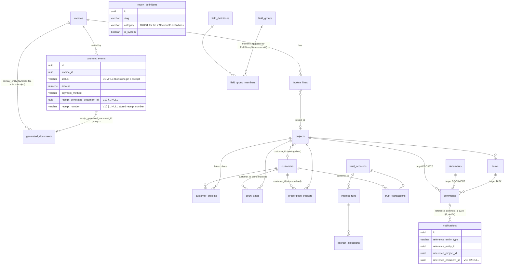
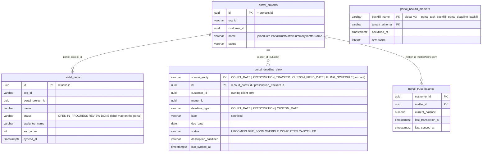
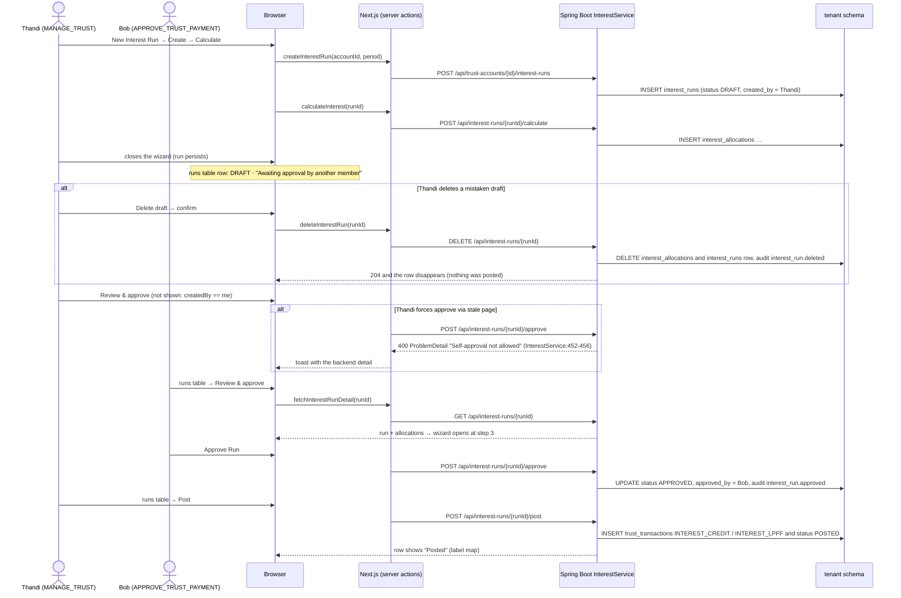
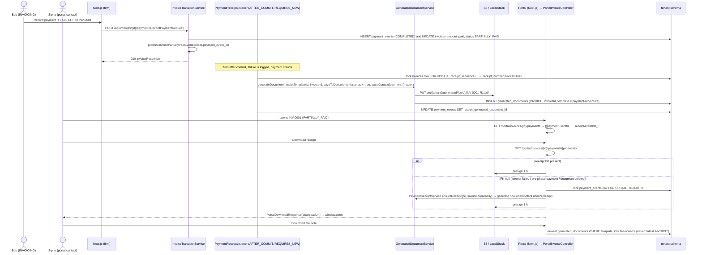
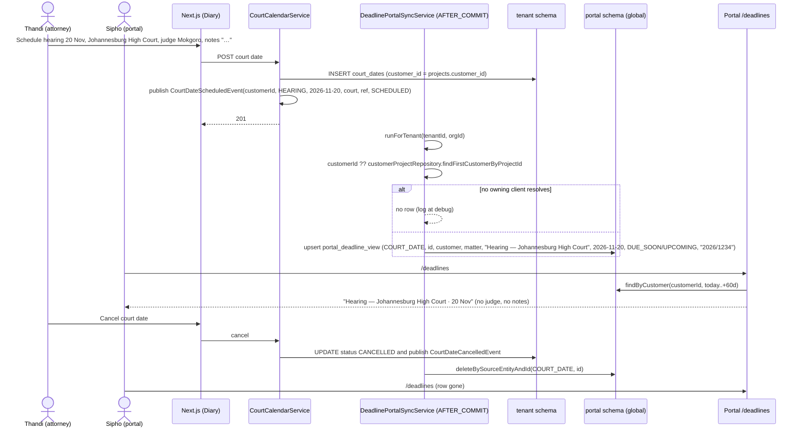
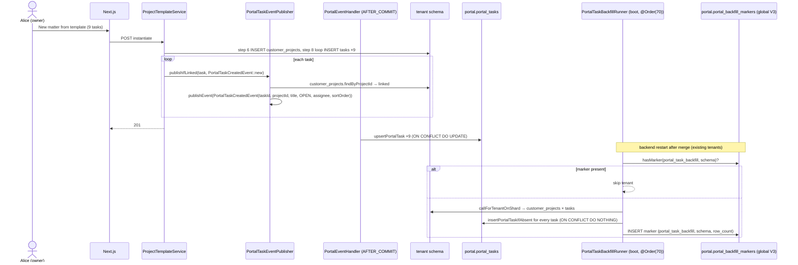
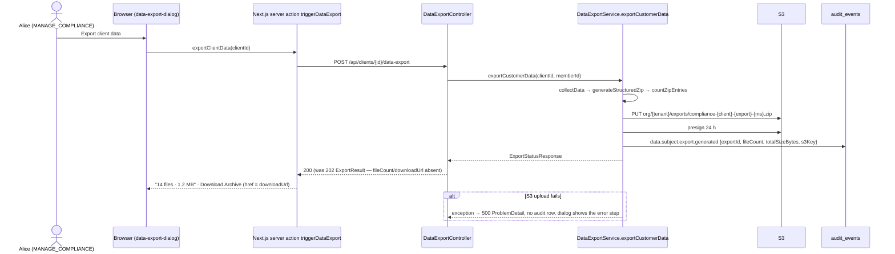

# Phase 89 — Go-Live Readiness: Trust, Compliance, Documents and Portal Correctness

> Merge into ARCHITECTURE.md as **Section 14** (linked from the note lines at the top of ARCHITECTURE.md like Phases 86–88).

> Inputs: `requirements/claude-code-prompt-phase89.md` (founder decisions 1–11, epics E1–E7, out of scope), `.arch-rulings-phase89.md` (binding rulings R-E1a…R-E7, scope table §1, ADR titles §4), `.arch-context-phase89.md` (code facts per gap), `.arch-context-prephase.md` (what PRs #1716–#1721 shipped; follow-up triage sheet), `.arch-context.md` (numbering, entity inventory, event pattern, provisioning + 625E reconcile framework, test patterns). Code verified at `main` HEAD `4a481a35d` (2026-11-04). ADRs 358–365 are written alongside this document and referenced by number; their titles are fixed in §14.11. Line numbers are HEAD and shift when the slice lands — re-grep, never trust the number.

## 14.1 Overview

Phase 88 closed the Phase 87 capstone's 24 root-cause units and then walked the legal-za 90-day story again on the real Keycloak stack. The walk's verdict was **FAIL, not demo-ready**: 63 open gaps (3 HIGH · 15 MEDIUM · 45 LOW) plus one hypothesis (`qa_cycle/evidence/phase88-rewalk/full/gaps.md`). What the 629C re-read of every HIGH/MEDIUM `file:line` showed is a new defect layer under the one Phase 88 fixed. Phase 88's defects were rows written by the real UI path that readers could not see; Phase 89's are the defects that only appear when the product is run **as a firm would run it, on the firm's calendar, with the firm's documents, by more than one member, with a client watching**. Five classes account for every HIGH and MEDIUM: **time-of-day** (a `Clock.systemDefaultZone()` bean in a UTC container dated a 01:30 SAST fee transfer the previous day — G88-F48); **document identity** (storage keys derived from names and dates, so a client downloaded the firm's internal SoA — G88-F33); **seeders and listeners that exist but are never wired** (`TrustReportPackSeeder.seedForTenant` has no caller, so no tenant has a Section 35 report; `DeadlinePortalSyncService` has an `upsertFromDeadline` seam and a TODO where the court-date listeners should be; template instantiation saves tasks through the repository and never publishes `PortalTaskCreatedEvent`); **frontend/backend shape drift** on rarely-walked compliance screens (`POST …/data-export` answers `ExportResult(exportId, status, estimatedFiles)` while the dialog reads `downloadUrl`/`fileCount`/`totalSizeBytes`; the anonymise dialog reads `preview.affectedEntities.*` and `result.summary.*`, neither of which the flat backend records have); and **raw enums and ids on client surfaces** (`OPEN`, `SENT`, `REFUND`, "Matter d42337ad").

The founder's decisions of 2026-11-03 set the order: the three HIGH gaps shipped first as standalone PRs outside the phase, then Phase 89, then Phase 84 take-on. The pre-phase batch is merged (§14.1 "Already shipped"): PR #1716 made `Africa/Johannesburg` the product-wide business clock and banned zone-less `now()` with five ArchUnit rules; #1717 put a random UUID segment in every generated-document key; #1718 made conveyancing parties explicit matter fields; #1719, #1720 and #1721 closed seven more gaps (conflict-check null relationship, audit key display and distinct labels, client Generate Document, `@mention` parsing, tariff line order, `typecheck`). This document records those three decisions as [ADR-358](../adr/ADR-358-product-wide-sa-business-clock.md), [ADR-359](../adr/ADR-359-identity-based-generated-document-keys.md) and [ADR-360](../adr/ADR-360-explicit-contract-party-fields.md) and designs the rest: three trust corrections, two POPIA contract repairs with a pin that fails on the next drift, letterhead on every client-facing document and a payment receipt a client can download, template tasks and court dates and prescriptions on the portal, six firm-side MEDIUMs, the authorised scenario amendments, and an exit gate of **0 HIGH and 0 MEDIUM** observed by a targeted Keycloak re-walk plus the three Playwright suites on a fresh stack (decisions 2–3).

The design rule carried from Phase 88 is unchanged — a test that never drives the real write path proves nothing — and two more are added by this phase's evidence. **Wire shapes are contracts**: every DTO a screen reads is pinned on both sides so a Java record change fails a vitest, not a client ([ADR-365](../adr/ADR-365-wire-shape-contract-pins-compliance.md)). **Wiring reaches existing tenants or it is not done**: every seeder and listener this phase wires ships with a reconcile or a one-time backfill that the walked Keycloak tenant and the demo tenants receive on the next restart — the trust-report pack through the 625E version gate ([ADR-356](../adr/ADR-356-pack-content-reconciliation.md)), the portal task and deadline read models through marker-gated `ApplicationRunner`s ([ADR-363](../adr/ADR-363-portal-deadline-sync-court-dates-prescriptions.md)). The phase adds **no new entity, table, enum value, capability, page family or navigation zone**; it adds two nullable tenant columns, one shared global backfill-marker table, four sealed `DomainEvent` records, one pack template, and additive fields on eleven existing wire records plus two new records (§14.2.6).

### What changes

| Surface | Existing at HEAD `4a481a35d` | After Phase 89 |
|---|---|---|
| Section 35 trust reports (G88-F40) | `TrustReportPackSeeder.seedForTenant` (`verticals/legal/trustaccounting/report/TrustReportPackSeeder.java:38`) has **no caller**; no `PackVersionGate`; no profile gate; the trust reports page (`trust-accounting/reports/page.tsx:67-75`) shows "No trust reports available" on every tenant | wired after `standardReportPackSeeder` in `TenantProvisioningService:237` and `PackReconciliationRunner:140`; gated on `verticalProfile == "legal-za"`; on the 625E shape (`recordIfAbsent` + `backfillAndTryOpen` + empty `RECONCILE`); existing tenants seeded at next boot; page gates on `VIEW_TRUST` **and** `FINANCIAL_VISIBILITY` with a specific empty state |
| Interest-run approval (G88-F39) | wizard holds the DRAFT `runId` in `useState` (`InterestRunWizard.tsx:63-68`) and discards it on close; runs table (`interest/page.tsx:134-187`) has no actions and prints the raw `status`; `InterestService.java:452-456` blocks self-approval → a DRAFT created by one member can never be approved by another | runs table gains an **Actions** column (Continue / Review & approve / Review / Post) opening the wizard on an existing run (`initialRun` prop); `MyCapabilitiesResponse.memberId` hides self-approval; `InterestRunResponse.allocationCount` tells a calculated DRAFT from an empty one; status label map ([ADR-362](../adr/ADR-362-interest-run-draft-approval-surface.md)) |
| Client-ledger running balance (G88-F23) | card page walks the DESC page backwards from `ledgerCard.balance`, treats REFUND as inflow and counts non-posted rows (`client-ledgers/[clientId]/page.tsx:43-45,176-205`); `/history` sorts by date only and ignores the four filter params (`ClientLedgerController.java:41-47`) | `TrustTransactionResponse.runningBalance` computed by a native window-function query in posting order over posted rows; page deletes the walk; `type/status/dateFrom/dateTo` bound ([ADR-361](../adr/ADR-361-client-ledger-running-balance-server-side.md)) |
| `BankStatementParseException` (C5) | extends `RuntimeException`, no handler → 500 "Internal server error" (`GlobalExceptionHandler.java:240-249`) | 422 `ProblemDetail` "Bank statement could not be parsed" |
| POPIA export (G88-F43) | `POST /api/clients/{clientId}/data-export` → 202 `ExportResult(exportId, status, estimatedFiles)` (`DataExportController.java:22-27`); dialog renders "NaN undefined" and a dead "Download Archive" | POST returns **200** `ExportStatusResponse` (the service already builds it at `DataExportService.java:178-245`); `ExportResult` and `triggerCustomerExport` deleted; contract pinned ([ADR-365](../adr/ADR-365-wire-shape-contract-pins-compliance.md)) |
| POPIA anonymise (G88-F44) | TS `AnonymizationPreview.affectedEntities{…}` and `StandaloneAnonymizationResult.summary{…}` (`lib/types/data-protection.ts:100-137`) vs flat backend records → TypeError at `anonymize-customer-dialog.tsx:148-154` and `:284-288` | TS aligned to the flat records; dialog reads flat fields; both records pinned ([ADR-365](../adr/ADR-365-wire-shape-contract-pins-compliance.md)) |
| `compliance/requests/[id]` times (C3) | `formatComplianceDateWithTime` (`packages/shared/src/format.ts:131`) has no `timeZone` → UTC wall clock on the server render | the helper itself pinned to `Africa/Johannesburg` (every caller fixed) |
| Letterhead on SoA / closure letter (G88-F16) | `statement-of-account.json:13-19` unconditional "VAT Reg:" label, `:75-81` unconditional "File reference:"; `matter-closure-letter.json:1-18` no address block; `pack.json` legal-za v10 | all four client-facing templates (`statement-of-account`, `matter-closure-letter`, `client-trust-statement`, `trust-receipt`) adopt the fee-note `conditionalBlock isNotEmpty` letterhead block verbatim; labels inside conditionals; legal-za **v11** with four `reconcile` content entries |
| Payment receipt (G88-F32, build) | paid fee note's only download is the pre-payment PDF; `InvoiceContextBuilder` has no payment keys; `PortalReadModelService.getInvoiceDownloadUrl` (`:167-181`) returns the newest INVOICE-typed generated document regardless of template | `payment_events.receipt_generated_document_id` + stored `receipt_number` and `invoices.receipt_sequence` (V10 §1); pack template `payment-receipt-za` (legal-za v12); generated AFTER_COMMIT on `InvoicePaidEvent` / `InvoicePartiallyPaidEvent` with lazy fallback; portal `GET /portal/invoices/{id}/payments` + `/payments/{paymentEventId}/receipt`; fee-note download filtered to the fee-note template ([ADR-364](../adr/ADR-364-payment-receipt-as-generated-document.md)) |
| Required party fields at generation (C1) | `DocumentTemplate.requiredContextFields` exists (`:83-84`) and `GeneratedDocumentService.java:229-234` warns on it, but no pack can declare it and `TemplateValidationService.validateRequiredFields` reads one level only | pack entries declare `requiredContextFields`; `TemplatePackSeeder.createTemplate` writes it + additive reconcile field; validator resolves dotted paths (`project.customFields.seller_name`); OTP, Deed of Transfer, Bond Cancellation (and the Letter of Demand's `opposing_party`) declare their parties — warn-and-acknowledge, never a block |
| SoA dialog period default (C6) | `defaultPeriodStart = latest generatedAt + 1` (`statement-of-account-dialog.tsx:129-135`) → start after end when a statement was generated today; browser-zone `todayIso()` | `StatementResponse` gains `periodStart`/`periodEnd`; default start = last `periodEnd + 1` clamped ≤ end; end = `todayInSA()` |
| Template tasks on the portal (G88-F19) | `ProjectTemplateService.java:581-612` saves tasks via `projectTaskRepository.save` — no `PortalTaskCreatedEvent`; only tasks later edited through `TaskService` (helper `:1087-1100`) reach `portal.portal_tasks` → "2 of 9" | `PortalTaskEventPublisher` component used by both services; instantiation publishes per task; `PortalTaskBackfillRunner` (marker `portal_task_backfill`) upserts every task of every customer-linked matter once |
| Portal deadlines (§5b row 19, build) | `DeadlinePortalSyncService` wires only `CUSTOM_FIELD_DATE`; `COURT_DATE` / `PRESCRIPTION_TRACKER` documented dormant (TODO `:118-127`); `courtcalendar/*` publishes no domain event | `CourtDateScheduledEvent`, `CourtDateCancelledEvent`, `PrescriptionDeadlineSetEvent`, `PrescriptionDeadlineClearedEvent` in the sealed `DomainEvent` list; four listeners; visibility = the matter's owning client; sanitised copy; `PortalDeadlineBackfillRunner` ([ADR-363](../adr/ADR-363-portal-deadline-sync-court-dates-prescriptions.md)) |
| Portal copy (G88-F20, F29, F30, F31) | `status-badge.tsx:47-49` `replace(/_/g," ")`; `requests/[id]/page.tsx:92-99,189-191` and `requests/page.tsx:93` raw statuses and empty h1; `trust.ts:102-111` `formatMatterLabel` = "Matter " + 8 hex; `transaction-list.tsx:180-182` raw type | `humaniseStatus` + label maps; h1 falls back to `requestNumber`; `PortalTrustMatterSummary.matterName` joined from `portal.portal_projects`; `formatMatterLabel` deleted; a guard test outside the terminology-scanner markers |
| Field-group membership (G88-F3) | FE sends `fieldDefinitionIds` (`FieldGroupDialog.tsx:157-166`), backend records lack it (`UpdateFieldGroupRequest.java:8-13`) → Jackson drops it; settings dialog mounts without `initialFieldIds` (`custom-fields-content.tsx:280-286`) | `fieldDefinitionIds` on both requests; `FieldGroupService.update` diffs membership through the existing add/remove/reorder paths; `FieldGroupResponse.fieldDefinitionIds`; cards list member labels |
| Matter Team tab (G88-M2) | `project-members-panel.tsx:164-169` shows the org role when admin/owner → a lead renders "Owner" | badge = matter role (Lead / Member); org role as muted secondary text |
| Matter Overview tiles (G88-M13) | `kpi-dashboard.tsx:206-221` stubs "--"; `matters/[id]/page.tsx:520` `trustEnabled={false} // TODO`; `outstanding-summary` is firm-wide; `calculateBalanceByProjectId` (`TrustTransactionRepository.java:174`) has no endpoint | `GET /api/invoices/outstanding-summary?matterId=`; `GET /api/matters/{id}/trust-balance` (`VIEW_TRUST`); `trustEnabled` from enabled modules; tiles render values with the existing links |
| Disbursement tables at 1440 (G88-M4) | one 9-column `w-full` table in `overflow-x-auto` (`disbursement-list-view.tsx:127-128`), no column priority; inner scroll at 1440 in both mounts | wrapper is a Tailwind v4 `@container`; Category and Supplier `hidden @xl:table-cell`; Description truncated with a title; Actions and Billing never hidden |
| Comment notification deep link (G88-M6) | `Notification` stores `reference_entity_type/id/project_id`, not the comment id; link = `?tab=tasks` (`notification-item.tsx:30-43`); no DOM anchor on `comment-item` | `notifications.reference_comment_id` (V10 §2) stored by `handleCommentCreated`; `referenceCommentId` on the DTO; links carry `taskId`/`documentId` + `commentId`; task sheet opens on comments; `id="comment-<id>"` + scroll + 2 s highlight |
| Activity feed source marker (G-B8) | `ActivityItem` (`activity/ActivityItem.java:10-19`) drops `actor_type` and `source` though `AuditEvent` stores both | `actorType` + `source` on the DTO and TS type; "Client portal" chip when `source === "PORTAL"` or `actorType === "PORTAL_CONTACT"` |
| `@mention` recipients (C2) | `NotificationService.java:852-863` `memberRepository.findAll()` + name match; no access check | candidates restricted to members who can view the matter (`member/ProjectAccessService.checkAccess`) when the target is on a matter |
| Scenario files and tooling (E6) | 12 mismatches unruled in `qa/testplan/demos/*.md`; §5b rows 19/20; P-E.2b/P-E.10 read committed PNG baselines; `/epic_v2` step 5 instructs a marker commit but nothing checks it | one docs PR in the LZKC-029 annotation style citing "Phase 89 decision 7 / <gap id>"; `scripts/check-verify-markers.sh <pr>` called from the `/epic_v2` bookkeeping step |
| Migrations | tenant V1–V9, global V1–V2 | tenant **V10** (§1 receipt FK + stored number + sequence, §2 comment id; sections split across V10/V11+ per §14.7); global **V3** `portal.portal_backfill_markers` (one shared table for both backfill runners; rulings §5) |

### Already shipped before this phase (do not re-plan)

| PR | Merge sha | Closes | What landed | Recorded as |
|---|---|---|---|---|
| #1716 | `a216f4430` | G88-F48 HIGH, G88-F49 LOW | `KaziTime.ZONE`; `Clock` bean `Clock.system(Africa/Johannesburg)`; 75 `now(clock)` sites; 9 crons `zone = KaziTime.ZONE_ID`; `ZoneAwareTimeArchTest` (5 rules); `@b2mash/shared/date` `todayInSA` / `isoDateInSA` / `daysBetween`; Playwright `timezoneId` SA | [ADR-358](../adr/ADR-358-product-wide-sa-business-clock.md) |
| #1717 | `3501fa899` | G88-F33 HIGH | `S3PresignedUrlService.buildGeneratedKey(tenantId, UUID.randomUUID(), fileName)` → `org/{tenant}/generated/{uuid}/{fileName}`; `StorageKeyPolicy` single presign whitelist; legacy flat keys still presign; no backfill | [ADR-359](../adr/ADR-359-identity-based-generated-document-keys.md) |
| #1718 | `ec1ff1d24` | G88-F12 HIGH | `conveyancing-za-project` v3 (+6 fields); clauses/OTP/Deed bind `purchaser_name`/`seller_name`; Bond Cancellation mortgagor = seller; Letter of Demand → `opposing_party` and a PROJECT template; additive `membership` field reconcile + `primaryEntityType` template reconcile; legal-za v10 | [ADR-360](../adr/ADR-360-explicit-contract-party-fields.md) |
| #1719 | `5ca3dadfe` | G88-F38, G-D10b, G88-F46, G88-F17 | null-relationship copy "Not linked to a matter"; audit combobox hides the key, matches on key and label; `GenerateDocumentDropdown` in `client-header-card.tsx:192`; 49 distinct registry labels | — |
| #1720 | `bb98e78b5` | G88-F36, G88-M10 | `MENTION_PATTERN` with email-local-part lookbehind (`NotificationService.java:827-828`); added fee-note lines sort last (`InvoiceCreationService.java:483-488`) | — |
| #1721 | `36f30f6c8` | G88-F47 | `typecheck` = `next typegen && tsc --noEmit -p .` in frontend and portal + CI step; 143 type errors fixed | — |
| `291e1a082` | docs | G88-F35 | `/epic_v2` step 5 stages `.claude/markers/verify-*.json` with the task files | — |

### Scope at HEAD (rulings §1)

| Epic | Closes (open at HEAD) | Dropped (closed pre-phase) | Triaged-in follow-up candidates (LOW, own slice; `/breakdown` may defer) |
|---|---|---|---|
| E1 Trust | G88-F40, G88-F39, G88-F23 | — | C5 `BankStatementParseException` → 422 |
| E2 POPIA | G88-F43, G88-F44 | G88-F38 (#1719) | C3 `compliance/requests/[id]` UTC times |
| E3 Documents | G88-F16, G88-F32 (build) | G88-M10 (#1720), G88-F46 (#1719) | C1 required-party-field warning; C6 SoA period default |
| E4 Portal | G88-F19, §5b row 19 (build), G88-F20/F29/F30/F31 | — | — |
| E5 Firm | G88-F3, M2, M13, M4, M6, G-B8 | — | C2 `@mention` recipients filtered by matter access |
| E6 Docs/tooling | 12 scenario mismatches (decision 7), §5b rows 19–20, P-E.2b/P-E.10 | G-D10b, G88-F35, G88-F36, G88-F47 | mechanical "one verify marker per code PR" check |
| E7 Exit | targeted re-walk + 3 suites + G89 register + deck re-shoot | — | — |

Backlog, not in this phase (§14.12): C4 audit-label polish (`REPORT_EXPORTED` / "Paia" / "Lpff" / "Matter closure closed" → registry entries, the G88-F17 pattern); C7 respondent-side litigation templates (product call, Phase 84); C8 standalone bond cancellation blank mortgagor (C1's warning surfaces it); the 32 LOW product bugs.

### Out of scope

- The 32 LOW product bugs in `full/gaps.md` (F2, F4, F5, F6, F9, F10, F13, F15, F17, F18, F24, F26, F27, F41, F42, F45, M5, M7, M9, M11, M14, G-D10a, G-D10c, G-D17, G-D20, N-9…N-12) except where a slice already edits the file.
- Portal mark-read for deadlines; portal profile editing; a final / quarterly portal digest; the ten G88-F37 features; a per-firm timezone; non-SA deployments.
- Phase 84 take-on and the 611A.2 Mandate badge; the Phase 87/88 C.12 (c) next-phase items.
- Any new enum value (`TemplateCategory`, `TrustTransactionType`, a court-date status enum), any stored-literal change ([ADR-342](../adr/ADR-342-audit-and-entity-tag-strings-stable-under-renamed-wire.md), [ADR-357](../adr/ADR-357-terminology-guard-extension.md)), committed visual baselines, the AI-core walk, any horizontal feature ([ADR-330](../adr/ADR-330-archive-tag-not-fork.md)), any tier/plan UI.

### Baseline statement

Phase 88 is fully merged (PRs #1643–#1715) and the pre-phase batch #1716–#1721 is on `main` at `4a481a35d`. The tree has 104 `@Entity` classes (7 global), tenant migrations V1–V9 and global V1–V2 (both V1 baselines immutable; `BaselineSchemaParityTest` pinned to target `"1"`), 58 `page.tsx` under `org/[slug]`, 18 portal pages, the sealed `DomainEvent` interface with 43 permitted records, and a full backend verify of 6389 tests / 0 failures (`931ca6a3`). Remaining `test.fixme` markers this phase owns: `frontend/e2e/tests/legal-lifecycle/day-60-interest.spec.ts:160` (F39), `day-90-review.spec.ts:123` (F40), `customers/customer-data-protection.spec.ts:48,76,107` (F43/F44), `portal/e2e/tests/portal-client-90day/day-45-75.spec.ts:166` (§5b row 19). The walk evidence lives in `qa_cycle/evidence/phase88-rewalk/full/`; this phase's targeted re-walk writes to `qa_cycle/evidence/phase89-rewalk/`.

## 14.2 Domain Model

No entity is added, renamed or dropped and no enum gains a value. Phase 89 adds two nullable columns on existing tenant tables, one shared global marker table, four records to the sealed `DomainEvent` interface, one Spring component that extracts an existing private helper, one pack template, and additive fields on eleven existing wire records plus two new records. Everything follows the `.arch-context.md` §7 conventions: plain-`String` status columns, snake_case `@Column`, `Instant` audit columns, records for DTOs, no Lombok.

### 14.2.1 `PaymentEvent.receiptGeneratedDocumentId` (G88-F32)

| Field | Type | Constraints | Notes |
|---|---|---|---|
| `receiptGeneratedDocumentId` | `UUID` → `payment_events.receipt_generated_document_id uuid` | NULL; `FOREIGN KEY → generated_documents(id) ON DELETE SET NULL`; partial index `WHERE receipt_generated_document_id IS NOT NULL` | set once by the receipt listener (or the lazy path) after the `GeneratedDocument` row is committed; never updated afterwards. `PaymentEvent.attachReceipt(UUID documentId, String receiptNumber)` is the only setter and is **idempotent**: a second call with the same document id is a no-op (the listener and the lazy path may race), a different id throws `InvalidStateException`. A reversal (`InvoiceTransitionService.java:646` deletes the payment event) also deletes the receipt `GeneratedDocument` — a void receipt must not stay downloadable. |
| `receiptNumber` | `String` → `payment_events.receipt_number varchar(40)` | NULL | `{invoiceNumber}/R{seq}`, stored at generation before rendering; NULL until a receipt exists; never reused. |
| `Invoice.receiptSequence` | `int` → `invoices.receipt_sequence integer` | NOT NULL DEFAULT 0 | incremented under the invoice row lock (`InvoiceRepository.findByIdForUpdate`) by `PaymentReceiptService` through `Invoice.nextReceiptNumber()`; a reversal never decrements it, so numbers are monotonic per fee note. |

**Why a column on `payment_events` and not a receipt table ([ADR-364](../adr/ADR-364-payment-receipt-as-generated-document.md)).** A receipt is exactly one generated document per completed payment event; the two tables already carry every fact a receipt needs (`payment_events`: amount, method, reference, `created_at`; `generated_documents`: `s3_key`, `file_name`, `context_snapshot`, `generated_by`). A `receipts` table would duplicate `generated_documents` columns for a row that has one consumer; the receipt number needs two small columns (a per-fee-note sequence and the stored number), not a table. The FK direction (payment event → document) is chosen because the lookup the portal needs is "receipt for this payment", and because `generated_documents` already has `primary_entity_type/primary_entity_id = INVOICE/<invoiceId>` pointing the other way for the fee note — reusing that pointer for receipts is what creates the fee-note download trap (`PortalReadModelService.java:167-181` takes the newest INVOICE document). `ON DELETE SET NULL` because `GeneratedDocumentService.delete` (`:529`) exists and must not be blocked by a payment event; the lazy path then regenerates on the next download.

### 14.2.2 `Notification.referenceCommentId` (G88-M6)

| Field | Type | Constraints | Notes |
|---|---|---|---|
| `referenceCommentId` | `UUID` → `notifications.reference_comment_id uuid` | NULL; no FK (comments can be deleted; the link degrades to the entity-level tab) | written by `NotificationService.handleCommentCreated` (`:264-322`) from `CommentCreatedEvent.entityId()` (the comment) alongside the existing `targetEntityType/targetEntityId/projectId`; exposed as `NotificationResponse.referenceCommentId` (`NotificationController.java:72-81` gains one component). Pre-V10 rows stay NULL and keep the entity-level link. |

**Why store the id rather than a URL.** The notification row is read by two surfaces (bell list, `/notifications` page) and the URL grammar is a frontend concern (`notification-item.tsx:30-43` builds it); storing a URL would freeze the matter-tab scheme into tenant data. No FK because a deleted comment must not cascade-delete the notification that mentions it — the link simply opens the tab.

### 14.2.3 `portal.portal_backfill_markers` (global V3, G88-F19 + §5b row 19; rulings §5)

| Column | Type | Constraints | Notes |
|---|---|---|---|
| `backfill_name` | `varchar(64)` | PK part 1 | `portal_task_backfill`, `portal_deadline_backfill` |
| `tenant_schema` | `varchar(63)` | PK part 2 | `org_schema_mapping.schema_name` |
| `backfilled_at` | `timestamptz` | NOT NULL DEFAULT `now()` | storage instant (UTC, exempt from the zone rule) |
| `row_count` | `integer` | NOT NULL | rows upserted by the run; 0 is a valid marker |

**Why one shared global table.** `PortalContactDirectoryBackfillRunner` stores its marker in `portal.portal_contact_directory_backfill(tenant_schema PK, backfilled_at, row_count)` (`global/V2__portal_contact_directory.sql`) — dedicated to that one backfill and keyed by schema name only, so it cannot hold a second backfill's marker without a column. Rather than a third and fourth single-purpose table, Phase 89 adds **one** table keyed by `(backfill_name, tenant_schema)` that both runners share and that any future read-model backfill reuses; the V2 directory table is left untouched (migrating its rows is churn for no behaviour). The marker is global, not tenant-side, for the same reason the directory's is (Phase 88 A8): the runners iterate `org_schema_mapping` from the global side, read "already done?" **before** binding a tenant scope, and tenant schemas may live on other shards. The no-marker alternative (upsert everything on every boot, as `PackReconciliationRunner` does) was rejected for `portal_tasks` because the work grows with every task on every linked matter, and for deadlines because `deriveStatus` re-computation on every boot would silently re-date rows without a firm-side change. One consequence to design around: schema names are a deterministic hash of the org id, so a tenant wiped and re-provisioned under the same org id would find its old markers and skip the backfill; `TenantProvisioningService.provisionTenant` therefore deletes any `portal_backfill_markers` rows for the schema it is about to create (§14.7.2), which makes re-provisioning backfill again — idempotent and correct.

### 14.2.4 Four new sealed `DomainEvent` records ([ADR-363](../adr/ADR-363-portal-deadline-sync-court-dates-prescriptions.md))

All four live in `event/` and are added to the `permits` list of `event/DomainEvent.java:17` — not the trust vertical's standalone-record route — because `DeadlinePortalSyncService` consumes `DomainEvent` records with the standard accessor set (`tenantId()`, `orgId()`, `entityId()`, `projectId()`, `details()`) and the service's own TODO (`:118-127`) names this route; a standalone record would need a second listener shape for no gain. Each carries the standard ten components (`eventType, entityType, entityId, projectId, actorMemberId, actorName, tenantId, orgId, occurredAt, details`) plus the typed components below so the listener never parses `details` for the fields it writes.

| Record | `eventType` | `entityType` | `entityId` | Typed extra components | `details` keys (additive, audit-friendly) |
|---|---|---|---|---|---|
| `CourtDateScheduledEvent` | `court_date.scheduled` | `court_date` | court-date id | `UUID customerId, String dateType, LocalDate scheduledDate, String courtName, String courtReference, String status` (`SCHEDULED` / `POSTPONED` / `HEARD`) | `date_type`, `scheduled_date`, `court_name`, `court_reference`, `status`, `project_id` |
| `CourtDateCancelledEvent` | `court_date.cancelled` | `court_date` | court-date id | `UUID customerId, String reason` | `reason`, `project_id` |
| `PrescriptionDeadlineSetEvent` | `prescription.deadline_set` | `prescription_tracker` | tracker id | `UUID customerId, String prescriptionType, LocalDate prescriptionDate` | `prescription_type`, `prescription_date`, `project_id` |
| `PrescriptionDeadlineClearedEvent` | `prescription.deadline_cleared` | `prescription_tracker` | tracker id | `UUID customerId, String reason` (`INTERRUPTED`) | `reason`, `project_id` |

`actorMemberId`/`actorName` are the acting member (`RequestScopes.requireMemberId()` + `MemberNameResolver`), never `"system"` — these are user actions, unlike `FieldDateApproachingEvent`. The `project_id` key in `details` is the [ADR-349](../adr/ADR-349-activity-feed-correlation-key.md) publisher obligation; the events are published, not audited (the court-calendar audit events `court_date.*` at `CourtCalendarService.java:191-349` stay as they are). `judge_magistrate`, `outcome`, `description`, `interruption_reason` and `cause_of_action_date` are **deliberately absent** from both the typed components and `details` — the sanitised-copy rule (§14.6.1) is enforced by not carrying the data at all.

### 14.2.5 `PortalTaskEventPublisher` (G88-F19)

`task/PortalTaskEventPublisher` (`@Component`) is the private helper `TaskService.publishPortalTaskEventIfLinked` (`TaskService.java:1087-1100`) extracted verbatim: `customerProjectRepository.findByProjectId(projectId)` → if linked, `RequestScopes.requireTenantId()/requireOrgId()`, `memberNameResolver.resolveNameOrNull(assigneeId)`, `eventPublisher.publishEvent(factory.create(…))`. `TaskService` delegates its eight call sites (`:351, :626, :752, :797, :858, :960, :1015, :1078`) to it; `ProjectTemplateService` injects it and calls `publishIfLinked(task, PortalTaskCreatedEvent::new)` inside the step-8 loop (`:581-612`) after `projectTaskRepository.save(task)`. Extraction rather than a second copy because the "is this matter client-linked" rule must have one owner; the alternative — projecting tasks from `PortalEventHandler.onCustomerProjectLinked` (`:129-160`) — was rejected because the link event fires at step 6, before the tasks exist (`.arch-context-phase89.md` E4a).

### 14.2.6 Additive DTO fields

| Record (file) | New component | Type | Source |
|---|---|---|---|
| `MyCapabilitiesResponse` (`orgrole/dto/OrgRoleDtos.java:61`) | `memberId` | `UUID` | `RequestScopes.requireMemberId()` in `OrgRoleService.java:112` |
| `InterestRunResponse` (`interest/InterestService.java:82-96`) | `allocationCount` | `int` | `InterestAllocationRepository.countByInterestRunId` — a calculated DRAFT over a zero balance has `totalInterest == 0` too, so the count is the only honest discriminator |
| `FieldGroupResponse` (`fielddefinition/dto/FieldGroupResponse.java:9`) | `fieldDefinitionIds` | `List<UUID>` (ordered by `field_group_members.sort_order`) | `FieldGroupMemberRepository` |
| `CreateFieldGroupRequest` / `UpdateFieldGroupRequest` | `fieldDefinitionIds` | `List<UUID>` (create: default empty; update: `null` = leave membership unchanged) | client |
| `ActivityItem` (`activity/ActivityItem.java:10`) | `actorType`, `source` | `String`, `String` | `AuditEvent.actor_type` / `source` (`ActivityMessageFormatter.java:69-78` already holds the event) |
| `PortalTrustMatterSummary` (`customerbackend/dto/PortalTrustMatterSummary.java`) | `matterName` | `String` (nullable) | `LEFT JOIN portal.portal_projects p ON p.id = b.matter_id` in `PortalTrustReadModelRepository.findBalancesByCustomer` (`:96-106`) |
| `PaymentEventResponse` (`invoice/dto/PaymentEventResponse.java:10`) | `receiptGeneratedDocumentId`, `receiptNumber` | `UUID` (nullable), `String` (nullable) | `PaymentEvent.receiptGeneratedDocumentId` / `receiptNumber` |
| `TrustTransactionResponse` (`TrustTransactionService.java:132`) | `runningBalance` | `BigDecimal` (nullable) | the window query, §14.3.3; `null` on every other producer of the record |
| `NotificationResponse` (`NotificationController.java:72`) | `referenceCommentId` | `UUID` (nullable) | `Notification.referenceCommentId` |
| `StatementResponse` (`statement/dto/StatementResponse.java:11`) | `periodStart`, `periodEnd` | `LocalDate`, `LocalDate` | the SoA `context_snapshot` keys `statement.period_start` / `statement.period_end` written by `StatementOfAccountContextBuilder.java:346-347` |
| `OutstandingSummaryResponse` (unchanged shape) | — | — | `GET /api/invoices/outstanding-summary` gains an optional `matterId` query parameter (§14.4) |
| new `MatterTrustBalanceResponse` | `matterId`, `balance`, `currency` | `UUID`, `BigDecimal`, `String` | `TrustTransactionRepository.calculateBalanceByProjectId` + the trust account's currency |
| new `PortalInvoicePayment` (`customerbackend/dto`) | `paymentEventId`, `date`, `methodLabel`, `amount`, `reference`, `receiptAvailable` | `UUID, LocalDate, String, BigDecimal, String, boolean` | `payment_events` of the invoice, `status = COMPLETED`, `created_at` → SA date via `KaziTime.ZONE` |

Every addition is a trailing record component (Jackson tolerates it on the client; the FE/portal TS types gain the matching optional-or-required field in the same PR). Nothing is removed from a response record except `ExportResult`, which is deleted outright (§14.4.3).

### 14.2.7 Affected tenant cluster



### 14.2.8 Touched global `portal.*` read-model tables



The only portal DDL is the new marker table (global V3, §14.7.2): `portal_deadline_view`'s `CHECK (source_entity IN ('FILING_SCHEDULE','COURT_DATE','PRESCRIPTION_TRACKER','CUSTOM_FIELD_DATE'))` and `deadline_type IN ('FILING','COURT_DATE','PRESCRIPTION','CUSTOM_DATE')` (`global/V1__baseline.sql:103-118`) already admit the two sources this phase wires. Portal tables have no JPA entity ([ADR-253](../adr/ADR-253-portal-surfaces-as-read-model-extensions.md)); writes go through `PortalReadModelRepository.upsertPortalTask` (`:632`) and `PortalDeadlineViewRepository.upsert` / `deleteBySourceEntityAndId` (`:35`, `:115`) on the portal `JdbcClient` inside `portalTransactionManager`.

### 14.2.9 Unchanged

`InterestRun` (status stays a `String` with `DRAFT`/`APPROVED`/`POSTED`; no cancel state), `TrustTransaction`, `ClientLedgerCard`, `ReportDefinition` (no pack column; ownership = slug + `is_system`), `CourtDate` and `PrescriptionTracker` (no status enum; prescription status still computed at read time), `GeneratedDocument`, `DocumentTemplate` (`requiredContextFields` column already exists), `TemplateCategory` (receipt is `OTHER`), `TemplateEntityType`, `InvoiceStatus`, `PaymentMethod`, `Capability` (no new capability), `OrgSettings` (snapshot-pinned, untouched), `Comment`, `Task`, `FieldGroup`/`FieldGroupMember`, every `portal.*` table definition, both V1 baselines.

## 14.3 Core Flows and Backend Behaviour

Tenant boundary, stated once: every firm-side write runs in the tenant schema bound by `TenantFilter` → `RequestScopes.TENANT_ID`; every portal read-model write runs on the global `portal` schema through the portal `JdbcClient` and `portalTransactionManager`, entered from an `AFTER_COMMIT` listener or a boot-time runner via `RequestScopes.runForTenant(tenantId, orgId, …)` so that tenant repositories remain usable inside the handler. A projection failure is logged and never rolls back the firm transaction ([ADR-253](../adr/ADR-253-portal-surfaces-as-read-model-extensions.md)). Every backend fix below ships an integration test that creates its rows through the service path the UI calls (rulings §3).

### 14.3.1 Section 35 trust reports — seeding and reconcile (R-E1a, G88-F40)

**Wiring.** `trustReportPackSeeder.seedForTenant(schemaName, clerkOrgId)` is inserted immediately after `standardReportPackSeeder.seedForTenant(…)` in both call sites — `TenantProvisioningService.java:237` and `PackReconciliationRunner.java:140` — with constructor injection in both classes. Both sites because the runner is the only path that reaches the walked Keycloak tenant and the demo tenants (no tenant carries `trust-reports` in `reportPackStatus`, so the runner's first pass seeds them fresh) while provisioning is the path every future tenant takes.

**Gate.** Inside `doSeed`, before any upsert: `if (settings == null || !"legal-za".equals(settings.getVerticalProfile())) return;` — the `LegalTariffSeeder.doSeed` precedent (`verticals/legal/tariff/LegalTariffSeeder.java:50-55`). The `trust_accounting` module flag is **not** consulted: the reports page already hides TRUST cards when the module is off (`trust-accounting/reports/page.tsx:21-24`), and gating the seed on a flag the firm can toggle later would leave a firm that enables trust accounting after provisioning with no definitions until the next boot.

**625E shape.** The seeder adopts `StandardReportPackSeeder`'s structure line for line: on first install `settings.getPackStatus().recordReportPackApplication(PACK_ID, PACK_VERSION)` then `packVersionGate.recordIfAbsent(PackType.REPORT, "trust-reports", "1", "trust-reports")`; when already applied, `reconcileAppliedPack(settings, tenantId)` → `PackStatusSettings.highestAppliedVersion(reportPackStatus, PACK_ID)` → `packVersionGate.backfillAndTryOpen(PackType.REPORT, PACK_ID, appliedVersion, "1", PACK_ID, tenantId)` → `reconcileExistingPack` iterating a `RECONCILE` constant that is **empty in this phase**; `resolveReconcileTarget` resolves `report_definition` by slug + `is_system` exactly as `StandardReportPackSeeder.java:195`. `PACK_VERSION` stays `1` — no definition content changes — so the gate never opens in Phase 89; the shape exists so the next edit to a Section 35 definition reaches existing tenants by a version bump, per the `backend/CLAUDE.md` reconcile contract ("fresh tenants only" is a review reject).

```java
// verticals/legal/trustaccounting/report/TrustReportPackSeeder (conceptual, after R-E1a)
public void seedForTenant(String tenantId, String orgId);          // unchanged signature
private void doSeed(String tenantId);                              // profile gate → applied? reconcile : install
private void reconcileAppliedPack(OrgSettings settings, String tenantId);
void reconcileExistingPack(String tenantId);                       // iterates RECONCILE (empty at v1)
Optional<PackReconcileEntry.Target> resolveReconcileTarget(PackReconcileEntry entry);
static final List<Map<String, Object>> RECONCILE = List.of();
```

**Capability mismatch.** `GET /api/report-definitions` is `FINANCIAL_VISIBILITY` (`ReportingController.java`); the page gates on `VIEW_TRUST` (`page.tsx:27-32`), so a member with only `VIEW_TRUST` lands in the generic `fetchError` branch (`:41-43`). The page now requires **both**: without `VIEW_TRUST` it keeps today's redirect; with `VIEW_TRUST` but without `FINANCIAL_VISIBILITY` it renders a specific empty state ("Trust reports need financial visibility. Ask an owner or admin to grant it.") and never calls the API. The controller stays `FINANCIAL_VISIBILITY` — widening a report endpoint for one category is a capability-model change this phase does not make (open question §14.12 #1).

**RBAC.** Seeding is system-side (provisioning / boot). Listing and running: `FINANCIAL_VISIBILITY` (owner, admin, role rows). Page: `VIEW_TRUST` + `FINANCIAL_VISIBILITY`.

**Observation per branch.** Reconcile branch (existing tenants): the boot log line `Trust report pack seeded for tenant {schema}: 7 definitions` **and** the Keycloak tenant's trust reports page listing seven cards after `svc.sh restart backend`. Fresh-tenant branch: `TrustReportPackSeederIntegrationTest` (provision a legal-za tenant → 7 `report_definitions` rows with `category = 'TRUST'`; provision a non-legal profile → 0; second pass → no duplicate, no version write) and `day-90-review.spec.ts:123` un-fixme'd (card `report-card-section-35-data-pack` → `/reports/section-35-data-pack` → combobox "Trust Account" → a rendered result).

### 14.3.2 Interest-run approval surface (R-E1b, G88-F39, [ADR-362](../adr/ADR-362-interest-run-draft-approval-surface.md))

Backend: everything required already exists — DRAFT persisted with `createdBy` (`InterestService.java:118`), `calculateInterest` (`:173`), `approveInterestRun` (`:428`, self-approval block `:452-456`, "Interest run not calculated" `:444-449`), `postInterestRun` (`:477`), detail by id (`:411`), controller gates (`InterestController.java`: create/calculate/post `MANAGE_TRUST`, approve `APPROVE_TRUST_PAYMENT`, reads `VIEW_TRUST`). Two additive fields are the only backend change: `MyCapabilitiesResponse.memberId`, so the client can hide self-approval rather than discover it through the 400, and `InterestRunResponse.allocationCount` (a count query over `interest_allocations`), so the table can tell a calculated DRAFT from one never calculated — `totalInterest == 0` cannot, because a calculated run over a zero balance is also 0. No new state. One new endpoint (founder ruling §9.2, 2026-11-04): `DELETE /api/interest-runs/{runId}` deletes a mistaken DRAFT outright — "Deleting a mistaken draft" below.

Frontend (`trust-accounting/interest/page.tsx` + `InterestPageClient.tsx` + `components/trust/InterestRunWizard.tsx`): the runs table gains an **Actions** column, derived per row from `(run.status, run.allocationCount, capabilities, me)`:

| Row state | Action label | Shown when | Wizard opens at |
|---|---|---|---|
| `DRAFT`, `allocationCount == 0` | Continue | `MANAGE_TRUST` | step 2 Calculate |
| `DRAFT`, `allocationCount > 0` | Review & approve | `APPROVE_TRUST_PAYMENT` and `run.createdBy !== me.memberId` | step 3 Approve |
| `DRAFT`, `allocationCount > 0` | Review | otherwise (creator sees "Awaiting approval by another member" under the button) | step 3, Approve disabled |
| `APPROVED` | Post | `MANAGE_TRUST` | step 4 Post |
| `DRAFT` (either) | Delete draft | `MANAGE_TRUST` (creator or any other manage-trust member) | — (confirmation dialog, then the row disappears) |
| `POSTED` | — | — | — |

`InterestRunWizard` gains an optional `initialRun?: InterestRun` prop: when present it calls `fetchInterestRunDetail(run.id)` on open, seeds `runId/run/allocations`, and jumps to the matching step; `handleOpenChange(false)` still resets local state — the run lives in the database, so nothing is lost. The wizard remains the single UI for the lifecycle (no sibling review dialog) so that step copy, validation and the post confirmation have one owner. The status cell renders a label map `{DRAFT: "Draft", APPROVED: "Approved", POSTED: "Posted"}` — the raw-enum rule applies firm-side too. The backend's "Self-approval not allowed" is still surfaced verbatim as the fallback toast (a stale page, or a member whose `memberId` the page failed to load).

**Deleting a mistaken draft (rulings §9.2).** `InterestService.deleteInterestRun(UUID runId)` (`@Transactional`): `moduleGuard.requireModule(MODULE_ID)`; load the run or `ResourceNotFoundException`; status must be `DRAFT`, otherwise `InvalidStateException("Invalid interest run state", "Only DRAFT interest runs can be deleted")` — the class the approve guard already throws (`:439-441`), which `GlobalExceptionHandler` renders as a **400** ProblemDetail at HEAD (`InvalidStateException.java:12`; the ruling's "409" names the class, not a new status mapping — no new handler, the integration test asserts the ProblemDetail title and that the run and its allocations are intact); then `interestAllocationRepository.deleteAll(interestAllocationRepository.findByInterestRunId(runId))` (the recalculation path already does exactly this, `:215-217`) and `interestRunRepository.delete(run)` — the allocations cascade in the same transaction; audit `interest_run.deleted` (`entityType("interest_run")`, `entityId(runId)`, details `period_start`, `period_end`, `total_interest`, `total_lpff_share`, `total_client_share`, `allocation_count`, `created_by`) in the `interest_run.created` / `.calculated` / `.approved` key style (`:158`, `:370`, `:464`; like its siblings the key is labelled by the registry fallback — C4 backlog, no registry entry). Deleting a draft has **no financial effect**: nothing reaches `trust_transactions` before approval and posting, so there is no reversal, no new status value and no migration. Controller: `@DeleteMapping("/api/interest-runs/{runId}")`, `@RequiresCapability("MANAGE_TRUST")`, 204. Frontend: `deleteInterestRun(runId)` in `trust-accounting/interest/actions.ts` (`api.delete`, the `approveInterestRun` shape at `:38-48`); the Actions column shows **Delete draft** on every `DRAFT` row for any `MANAGE_TRUST` member, creator or not (the two-person rule governs approval, not abandonment), beside Continue / Review; it opens a confirmation dialog (new `components/trust/DeleteInterestRunDialog.tsx`, the `AlertDialog` pattern: "Delete this draft interest run? Its calculated allocations are discarded. Nothing has been posted.") and on success the row disappears (`router.refresh()`); `APPROVED` and `POSTED` rows never show it, and the backend ProblemDetail is surfaced verbatim as the fallback toast.

**Why this and not a review route.** A dedicated `/interest/[runId]` page would duplicate three of the wizard's four steps; the gap is an entry point, not a missing screen. **Why not relax self-approval.** The two-member rule is the trust-accounting control the Legal Practice Act expects an auditor to find; the product must make it usable, not remove it.

### 14.3.3 Client-ledger running balance (R-E1c, G88-F23, [ADR-361](../adr/ADR-361-client-ledger-running-balance-server-side.md))

**Backend is the single source.** `GET /api/trust-accounts/{accountId}/client-ledgers/{clientId}/history` rows gain `runningBalance`, computed by one native query in `TrustTransactionRepository`:

```sql
-- TrustTransactionRepository.findClientHistoryWithRunningBalance (native, Pageable; column names per the
-- TrustTransaction @Column mapping). The window runs over POSTED rows only, in posting order, and is
-- computed BEFORE the UI filters narrow the page: filtering by type or date must never change a balance.
-- MATERIALIZED (630C, PR #1724): result-neutral; stops PG inlining the CTE so the window is evaluated once
-- even on cold planner statistics (fresh tenants), where the inlined plan re-ran it per outer row.
WITH posted AS MATERIALIZED (
  SELECT t.id,
         SUM(CASE WHEN t.transaction_type IN ('DEPOSIT','TRANSFER_IN','INTEREST_CREDIT') THEN  t.amount
                  WHEN t.transaction_type IN ('PAYMENT','TRANSFER_OUT','FEE_TRANSFER','REFUND','INTEREST_LPFF') THEN -t.amount
                  ELSE 0 END)
           OVER (ORDER BY t.transaction_date, t.created_at, t.id
                 ROWS BETWEEN UNBOUNDED PRECEDING AND CURRENT ROW) AS running_balance
    FROM trust_transactions t
   WHERE t.customer_id = :customerId AND t.trust_account_id = :accountId
     AND t.status IN ('RECORDED','APPROVED')
     AND t.transaction_type <> 'REVERSAL'
)
SELECT t.*, p.running_balance                       -- NULL for AWAITING_APPROVAL / REJECTED / REVERSED / REVERSAL rows
  FROM trust_transactions t
  LEFT JOIN posted p ON p.id = t.id
 WHERE t.customer_id = :customerId AND t.trust_account_id = :accountId
   AND (CAST(:type AS varchar)   IS NULL OR t.transaction_type = :type)
   AND (CAST(:status AS varchar) IS NULL OR t.status = :status)
   AND (CAST(:dateFrom AS date)  IS NULL OR t.transaction_date >= :dateFrom)
   AND (CAST(:dateTo AS date)    IS NULL OR t.transaction_date <= :dateTo)
 ORDER BY t.transaction_date DESC, t.created_at DESC, t.id DESC
```

The type sets and the status filter are **identical** to `calculateClientBalanceAsOfDate` (`TrustTransactionRepository.java:135-153`); the ordering is the one `findByProjectIdOrderByTransactionDateAsc` (`:70-77`) and `findForStatement` (`:240-252`) already use. The repository method takes `Pageable` (passed unsorted — the `ORDER BY` lives in the query; Spring Data appends the limit/offset from the `Pageable`) and declares a `countQuery` with the same filters and no window. Non-posted rows (`AWAITING_APPROVAL`, `REJECTED`, `REVERSED`) and `REVERSAL` rows carry `runningBalance = null` and the UI renders "—": they do not move the balance, and showing the prior balance beside a rejected row would read as if it had.

```java
// ledger/ClientLedgerService (after R-E1c)
@Transactional(readOnly = true)
public Page<TrustTransactionResponse> getClientTransactionHistory(
    UUID customerId, UUID trustAccountId, ClientHistoryFilter filter, Pageable pageable);
public record ClientHistoryFilter(String type, String status, LocalDate dateFrom, LocalDate dateTo) {}
// ClientLedgerController: GET …/history?type&status&dateFrom&dateTo&page&size  @RequiresCapability("VIEW_TRUST")
```

**Invariant (integration test `ClientLedgerRunningBalanceIntegrationTest`).** After a deposit, a fee transfer and a refund posted through `TrustTransactionService` (the UI path, including the approval step for the payment-type rows): the first **posted** row of page 0 has `runningBalance == calculateClientBalanceAsOfDate(today)`; the same value equals the last `LedgerStatementLine.runningBalance` of `GET …/statement?startDate=<epoch>&endDate=<today>`; walking the page in reverse reproduces every intermediate balance; a `REJECTED` row and a `REVERSAL` row carry `null`.

**Paging.** The window function scans the client's posted rows once per page (the CTE is not paged); client ledgers are small (hundreds of rows at most) and the existing composite index on `(customer_id, trust_account_id)` serves the CTE. If a ledger ever exceeds ~10k rows the fix is a materialised `running_balance` column, not a frontend walk.

**Frontend.** `client-ledgers/[clientId]/page.tsx` deletes the backward walk (`:176-205`) and renders `tx.runningBalance ?? "—"` on every page, not page 0 only; `isInflowType` drops `REFUND` on both pages (`:43-45`, `transactions/page.tsx:48-50` — colour/arrow only on the transactions page). `client-ledgers/actions.ts:102-105` keeps sending the four params; they are now honoured.

### 14.3.4 `BankStatementParseException` → 422 (R-E1d, C5)

`exception/GlobalExceptionHandler` gains `@ExceptionHandler(BankStatementParseException.class)` → `ResponseEntity.status(422).body(ProblemDetailFactory.create(HttpStatus.UNPROCESSABLE_ENTITY, "Bank statement could not be parsed", ex.getMessage()))` — the same shape as the `PrerequisiteNotMetException` handler (`:114-141`). 422 rather than 400 because the request is well-formed (a file was uploaded) but the content cannot be processed; no stack trace in `detail` (the message is already user-facing at `TrustReconciliationService.java:145,161,169`). The exception class is not moved under `exception/` — it is domain-specific to the parser package. Controller test: upload a malformed CSV through `POST …/reconciliations/import` → 422, `title`, `detail`; the storage double holds no object (the #1717 "upload after parse" property, re-asserted).

### 14.3.5 POPIA export returns the status it already computed (R-E2a, G88-F43, [ADR-365](../adr/ADR-365-wire-shape-contract-pins-compliance.md))

`POST /api/clients/{clientId}/data-export` returns **200** `ExportStatusResponse` straight from `dataExportService.exportCustomerData(clientId, memberId)` (`DataExportService.java:178-245`, which already uploads the ZIP, presigns 24 h and audits). `triggerCustomerExport` (`:172-176`) and `datarequest/ExportResult` are deleted; the controller method is the one-liner `backend/CLAUDE.md` requires. 200 not 202 because the export is synchronous — the 202 was a promise the server never kept (no job, no polling resource). `s3Key` stays on the record (the GET surface returns it; the FE ignores it). The frontend `StandaloneExportResult` (`lib/types/data-protection.ts:116-123`) gains `s3Key: string` (the GET already sends it; the dialog ignores it) so the pin covers all seven components (R6.1); the dialog (`data-export-dialog.tsx:131-139`) needs no other change. The `fileCount` value comes from `countZipEntries`, so "N files · 1.2 MB · Download Archive" renders from real data. RBAC unchanged: `MANAGE_COMPLIANCE`.

### 14.3.6 Anonymise — flat shapes (R-E2b, G88-F44, [ADR-365](../adr/ADR-365-wire-shape-contract-pins-compliance.md))

The API is not extended. TS `AnonymizationPreview` becomes the flat record `AnonymizationPreview.java:11-22` (`clientId, clientName, portalContacts, projects, documents, timeEntries, invoices, comments, customFieldValues, financialRecordsRetained, financialRetentionExpiresAt`); `StandaloneAnonymizationResult` becomes the flat `AnonymizationResult` (`DataAnonymizationService.java:405-410`: `customerAnonymized, documentsDeleted, commentsRedacted, portalContactsAnonymized, invoicesPreserved`) — `status`, `referenceId`, `preExportKey`, `summary` and `customFieldsCleared` are dropped from the TS type because no backend field feeds them. `anonymize-customer-dialog.tsx` reads flat fields at `:148-154` (preview counts) and `:284-288` (completion panel). Why align TS to Java and not the reverse: the Java records are the audited, tested behaviour (`DataAnonymizationService` tests pin the counts); the TS types were written against a design that never shipped.

### 14.3.7 Contract pins (R-E2, [ADR-365](../adr/ADR-365-wire-shape-contract-pins-compliance.md))

- **Backend** `datarequest/DataProtectionWireContractTest` (pattern `mcp/McpToolContractTest`): reflection snapshot of component names **and generic types**, in declaration order, of `ExportStatusResponse`, `AnonymizationPreview`, `AnonymizationResult` and `conflictcheck/ConflictCheckService.ConflictDetail` (the third drift of this class — #1719 fixed its null handling but nothing pins its shape) into `backend/src/test/resources/wire/data-protection-contract.json`; actual written to `target/wire/data-protection-contract.actual.json`; regenerate only with `-Ddataprotection.contract.update=true` (`WireVocabularyContractTest` keeps its own, separate flag) and a PR body that says why.
- **Frontend** `frontend/__tests__/customers/data-protection-wire-shapes.test.ts`: imports that JSON statically by relative path (`../../../backend/src/test/resources/wire/data-protection-contract.json` — monorepo checkout, CI runs both trees; a missing file fails the build, which is the point of the pin), builds one hand-written literal per record typed `Required<StandaloneExportResult>` / `Required<AnonymizationPreview>` / `Required<StandaloneAnonymizationResult>` / `Required<ConflictMatch>` (the compiler fails on a missing or extra key — `typecheck` runs over tests since #1721), and asserts `Object.keys(literal)` equals the JSON component list (runtime fails on a stale literal). Field **types** are pinned on the backend side only; a TS literal typed `Required<T>` pins the TS type's own field types against the literal, which is sufficient — a backend type change shows up in the JSON diff.

Why two tests and not one shared schema: there is no runtime schema layer (no zod response parsing, no OpenAPI — `.arch-context-phase89.md` E2d), and introducing one for four records is the over-engineering the requirements warn against. Two cheap pins, one JSON file, one regeneration flag.

### 14.3.8 Compliance date formatter (R-E2c, C3)

`formatComplianceDateWithTime` in `packages/shared/src/format.ts:131` gains `timeZone: "Africa/Johannesburg"` and switches to `toLocaleString` (the same reasons `formatDateTime` at `:159-172` documents). Fixing the helper fixes every caller — `compliance/requests/[id]/page.tsx:8,84,93` and whichever others `grep` finds — rather than swapping one call site as #1719 did for the audit trail. Vitest runs the helper under `TZ=UTC` and `TZ=Pacific/Kiritimati` and expects `04 Nov 2026, 01:30` for `2026-11-03T23:30Z` in both. No per-firm timezone ([ADR-358](../adr/ADR-358-product-wide-sa-business-clock.md)).

### 14.3.9 Letterhead on the SoA and closure letter (R-E3a, G88-F16)

Template JSON only; no Java. All four client-facing legal-za templates — `statement-of-account.json`, `matter-closure-letter.json`, `client-trust-statement.json` and `trust-receipt.json` — replace their headers (`:1-30` and `:1-18` for the first two; the bare `h1[org.name]` for the trust pair) with the fee-note letterhead block verbatim (`fee-note-za.json:1-90`: `conditionalBlock isNotEmpty` per `org.logoUrl`, `org.address`, `org.phone`, `org.email`, `org.website`, `org.taxRegistrationNumber`, then `horizontalRule`); "VAT Reg:" (`:13-19`) and "File reference:" (`:75-81`) move inside `conditionalBlock`s keyed on `org.taxRegistrationNumber` and `matter.file_reference`. The closure SoA is the same SoA template rendered at closure, so it needs nothing of its own. `TiptapRenderer.java:216,445-452` already supports the node and the `isNotEmpty` operator; `TemplateContextHelper.buildOrgContext` already puts every letterhead key (`taxRegistrationNumber :113`, `putLetterheadKeys :116`) and both builders already call it (`StatementOfAccountContextBuilder.java:235`, `MatterClosureContextBuilder` via `ProjectContextBuilder`). `org.address` is `""` when no letterhead exists, which `isNotEmpty` treats as empty — correct.

`pack.json` legal-za **v10 → v11** with four `reconcile` content entries (`entity: document_template, key: statement-of-account | matter-closure-letter | client-trust-statement | trust-receipt, field: content, from: sha256:<v10 body>, to: sha256:<v11 body>`), following the 626D entries at `:5-31`; pristine rows are refreshed by `TemplatePackInstaller.reconcile`, edited rows are LEFT_ALONE. **Scope note** (listed in the PR body): `client-trust-statement.json` and `trust-receipt.json` bind only `org.name` (three and four nodes respectively) and have no blank-label defect, but the objective is *every* client-facing document on the letterhead, so they are in (R6.5); every other legal-za template was checked by #1718's party audit and 626D's letterhead pass. Rendering test: a `TiptapRenderer` unit test proves an empty `org.taxRegistrationNumber` emits no "VAT Reg" text and a set one emits it once; the PDFs are observed in a browser on the Keycloak tenant (Phase 88 lesson: PDF output needs a real observer).

### 14.3.10 Payment receipt (R-E3b, G88-F32, [ADR-364](../adr/ADR-364-payment-receipt-as-generated-document.md))

**Template.** New legal-za pack entry `payment-receipt-za` (`primaryEntityType INVOICE`, `category OTHER`, `sortOrder` after `fee-note-za`, `acceptanceEligible false`; legal-za **v12** — 632B, next free at build time; a new template needs no `reconcile` entry because `TemplatePackInstaller.reconcile` creates missing pack templates on the version bump), resolved by key like the fee note — `documentTemplateRepository.findPackSeeded("legal-za", "payment-receipt-za")` in a new `GeneratedDocumentService.resolveReceiptTemplate()` beside `resolveDefaultInvoiceTemplate` (`:555-575`), never a fallback. Letterhead block as the fee note; body: "Receipt {payment.number}" heading, fee-note number, client, matter (when the invoice's lines resolve one), a `loopTable` over `invoice.payments[]` (date · method · reference · amount · balance after), the receipt's own payment emphasised, closing "Balance due: {invoice.balanceDue}". No new `TemplateCategory` — a `RECEIPT` value would touch the enum, the FE type, the templates settings filter and the pack installer for one template nothing filters on.

**Context.** `InvoiceContextBuilder` gains `invoice.amountPaid`, `invoice.balanceDue`, `invoice.paidAt` (SA date via `KaziTime.ZONE`) and `invoice.payments[]` = the invoice's `COMPLETED` payment events ascending by `created_at`, each `{date, methodLabel, amount, reference, balanceAfter}` where `balanceAfter = total − Σ amounts up to and including this event`. The receipt's own payment goes in `extraContext` (`generateDocument(…, Map<String,Object> extraContext, …)` `:195`) as `payment.{id, number, date, methodLabel, amount, reference, balanceAfter}`. Receipt number = `{invoiceNumber}/R{seq}` — **stored, not derived** (R6.2): `PaymentReceiptService` locks the invoice row (`InvoiceRepository.findByIdForUpdate`, `SELECT … FOR UPDATE`), increments `invoices.receipt_sequence` through `Invoice.nextReceiptNumber()`, stores the number on `payment_events.receipt_number`, then renders; numbers are monotonic per fee note and never reused. A derived ordinal was rejected because a reversal **deletes** the payment event (`InvoiceTransitionService.java:646`), which would renumber every later receipt. **Reversal** therefore also deletes the receipt `GeneratedDocument` (a void receipt must not stay downloadable — the row and its S3 object go; the sequence does not decrement) and the reversal's audit row records the receipt number. `methodLabel`: `EFT → "EFT"`, `CARD → "Card"`, `CASH → "Cash"`, `TRUST_TRANSFER → "Trust transfer"`, `XERO → "Xero"`, `OTHER → "Other"`, `null → "Payment"` (pre-U15 events).

**Trigger.** `invoice/PaymentReceiptListener` — `@TransactionalEventListener(phase = AFTER_COMMIT)` on `InvoicePaidEvent` and `InvoicePartiallyPaidEvent`, `@Transactional(propagation = REQUIRES_NEW)` through a self-injected or separate `PaymentReceiptService.generateForPaymentEvent(UUID paymentEventId, UUID actorMemberId)`; both events gain the additive `payment_event_id` key in `details` — `InvoiceTransitionService.java:394-396` currently discards the return of `paymentEventRepository.save(...)`, so the publisher captures `var saved = …` and puts `saved.getId()` into `details` at `:456,481`; the listener resolves the matter from the invoice's lines, because `InvoicePaidEvent` publishes `projectId = null` (`:459`). Actor = `event.actorMemberId()`, else `event.createdByMemberId()` (provider-posted payments have no member; `generated_documents.generated_by` is `NOT NULL` — `V1__baseline.sql:1627` — and the fee-note creator is the same fallback the invoice email path carries the field for; open question §14.12 #4). `saveToDocuments = false`, `acknowledgeWarnings = true`, `intendedVisibility = INTERNAL` ([ADR-350](../adr/ADR-350-client-emails-explicit-intent.md): no client email on generation). On success `paymentEvent.attachReceipt(generatedDocument.getId())`. Failure is logged at ERROR with invoice and payment-event ids and never fails the payment — exactly the fee-note PDF's contract (`InvoiceEmailEventListener.java:69-105`).

**Lazy fallback.** Both download endpoints (`portal` and firm) call `PaymentReceiptService.ensureReceipt(paymentEventId, actorMemberId)`: it locks the payment-event row (`SELECT … FOR UPDATE`), re-reads the FK and returns the existing document when set; only when null — the listener failed, the document was deleted, or the event predates this phase — does it generate in the request transaction, then presign. `attachReceipt` is idempotent, so a listener and a lazy call racing on the same event cannot throw (R6.3). The portal has no member, so the lazy path uses `invoice.createdBy` as actor. This is what makes "every COMPLETED payment has a receipt" true for pre-existing payments without a backfill.

```java
// invoice/PaymentReceiptService (new)
public UUID ensureReceipt(UUID paymentEventId, UUID actorMemberId);   // returns the GeneratedDocument id; generates if missing
public UUID generateForPaymentEvent(UUID paymentEventId, UUID actorMemberId);   // REQUIRES_NEW; throws on template-missing
// invoice/Invoice (changed)
public String nextReceiptNumber();   // ++receipt_sequence under the row lock → "{invoiceNumber}/R{seq}"; stored on payment_events.receipt_number
// customerbackend/service/PortalReadModelService (changed)
public List<PortalInvoicePayment> listInvoicePayments(UUID invoiceId, UUID customerId, String orgId);
public String getReceiptDownloadUrl(UUID invoiceId, UUID paymentEventId, UUID customerId, String orgId);   // presigned URL; the controller wraps it in its nested PortalDownloadResponse
public String getInvoiceDownloadUrl(UUID invoiceId, UUID customerId, String orgId);   // returns the presigned URL as today; now filters to the fee-note template id
```

**Fee-note download fix.** `getInvoiceDownloadUrl` (`PortalReadModelService.java:167-181`) resolves the fee-note template id (`resolveDefaultInvoiceTemplate`) and takes the newest `generated_documents` row for `(INVOICE, invoiceId, template_id = feeNoteTemplateId)` — never "latest INVOICE document". Without this, the first receipt generated would replace the client's fee-note download. Integration test: generate the fee note, record a part payment (receipt generated), download the fee note → the fee-note document's bytes, not the receipt's.

**Portal.** `GET /portal/invoices/{id}/payments` → `[PortalInvoicePayment]` (COMPLETED events only, ascending); `GET /portal/invoices/{id}/payments/{paymentEventId}/receipt` → `PortalDownloadResponse(downloadUrl)` presigned 1 h, 404 unless the payment event belongs to an invoice of the contact's client (`PortalInvoiceController` already scopes by `customerId`). The detail page lists payments with a "Download receipt" button per row on PAID and PARTIALLY_PAID (`portal/app/(authenticated)/invoices/[id]/page.tsx:93,134`). **Firm.** `PaymentEventResponse.receiptGeneratedDocumentId` and `receiptNumber`; the invoice page's payments section renders "Receipt INV-0001/R1" → `GET /api/generated-documents/{id}/download` (existing); when null the row shows "Generate receipt" which calls `POST /api/invoices/{id}/payment-events/{paymentEventId}/receipt` (`INVOICING`) → the lazy path → returns the id.

**Isolation.** The receipt's `primary_entity_id` is the invoice, but its download is reached only through the payment event FK and the portal's customer scoping; `GeneratedDocumentService.listByEntity` (`:447`) will list receipts under the invoice in the firm's Generated Documents panel, which is desired; a reversed payment's receipt is deleted with the event (R6.2), so the panel never shows a void receipt.

### 14.3.11 Generation-time warning for required party fields (R-E3c, C1)

Pack template entries may declare `"requiredContextFields": [{"entity": "project", "field": "customFields.seller_name"}, …]`; the `TemplatePackTemplate` record gains the component and `TemplatePackSeeder.createTemplate` (`:343-350`) writes it to `DocumentTemplate.requiredContextFields` (`:83-84`) on install (`TemplatePackInstaller` only orchestrates), and a new additive template reconcile field `requiredContextFields` re-applies it to pristine rows (the `primaryEntityType` precedent from #1718 — `TemplatePackSeeder.java:40,209`; `to` = the pack's list, applied only while the row body is the shipped body). `TemplateValidationService.validateRequiredFields` (`:26-60`) resolves dotted `field` paths segment by segment through nested maps (`project.customFields.seller_name`), treating a missing map, `null` or blank string as absent. OTP, Deed of Transfer (`deed-of-transfer`) and Bond Cancellation declare `seller_name`, `purchaser_name` (and the Bond Cancellation only `seller_name`) — the Letter of Demand declares `opposing_party`. Behaviour is the **existing** warn-and-acknowledge flow: `GeneratedDocumentService.java:229-234` throws `ValidationWarningException` unless `acknowledgeWarnings`, the generate dialog shows its warnings step, the member acknowledges and generates. Never a hard block — a bond cancellation without a sale legitimately has no seller (C8), and the attorney decides. The declarations ship as legal-za **v13** (632D; next free at build time — the number a slice takes is whatever is current when it merges, R6.6).

### 14.3.12 SoA dialog period default (R-E3d, C6)

`StatementResponse` gains `periodStart`/`periodEnd` (§14.2.6). `statement-of-account-dialog.tsx:129-135` computes `defaultPeriodStart = max(periodEnd) + 1 day` over `priorStatements.content`, clamped to `≤ periodEnd`; `periodEnd` default = `todayInSA()` from `@b2mash/shared/date` (replacing the browser-zone `todayIso()` / `firstOfCurrentMonth()` — one of the four #1716 follow-ups). Why `periodEnd` and not `generatedAt`: a statement generated today for last month must leave next period's start at the first of this month, not tomorrow. Vitest under `TZ=Pacific/Kiritimati` with a prior statement whose `periodEnd` is today → start == end, no inverted range.

### 14.3.13 Template tasks reach the portal (R-E4a, G88-F19)

`ProjectTemplateService` step 8 (`:581-612`) calls `portalTaskEventPublisher.publishIfLinked(task, PortalTaskCreatedEvent::new)` after each `projectTaskRepository.save(task)`; the `customer_projects` row exists from step 6 (`:560-571`), so the link check succeeds and `PortalEventHandler.onTaskCreated` (`:501-521`) upserts `portal.portal_tasks` after commit. `sortOrder` is the template task's `sort_order` (today `TaskService` passes `0`; the template loop passes the template task's `sortOrder` (`TemplateTask`, the order `findByTemplateIdOrderBySortOrder` returns) so the portal lists the nine tasks in template order — an improvement the portal page already sorts by).

**Backfill.** `customerbackend/service/PortalTaskBackfillRunner` (`@Component @Order(70) ApplicationRunner`, `@SchedulerLock(name = "portal_task_backfill", lockAtMostFor = "30m")`): for every `org_schema_mapping` row without a `(portal_task_backfill, schema)` marker, the runner delegates to `PortalTaskBackfillService.backfillTenant(orgId, schema, shardId)` (the shape `PortalContactDirectoryBackfillRunner` → `PortalContactDirectoryService.backfillTenant` uses), which runs `RequestScopes.callForTenantOnShard(schema, orgId, shardId, …)` → for every `customer_projects` row, for every task of that project, `readModelRepo.insertPortalTaskIfAbsent(taskId, orgId, projectId, title, status.name(), assigneeName, 0)` — a new `INSERT … ON CONFLICT (id) DO NOTHING` beside `upsertPortalTask` (`PortalReadModelRepository.java:632-647`), so a row the live listener already wrote is never overwritten; `Task` has no sort order, so backfilled rows take 0 and sort by the portal's secondary order (R7.2); record the marker with the row count; never fails startup; per-tenant failures logged and retried next boot. `@Order(70)` because `TenantMigrationRunner` is `@Order(50)` and the directory runner `@Order(60)`, and `PackReconciliationRunner` at `@Order(100)` may create tasks of its own for demo tenants — the backfill should not race it. Observed: boot log `Portal task backfill: N tenants scanned, M skipped (already marked), 0 failed, R rows upserted`; the walked tenant's portal matter shows 9 of 9.

### 14.3.14 Portal deadline sync — events, listeners, visibility, copy, backfill (R-E4b, §5b row 19, [ADR-363](../adr/ADR-363-portal-deadline-sync-court-dates-prescriptions.md))

**Publishers.** `CourtCalendarService` and `PrescriptionTrackerService` gain `ApplicationEventPublisher`; each publishes **after** the entity save, inside the firm transaction, so the AFTER_COMMIT listener sees committed rows:

| Service method (HEAD line) | Publishes |
|---|---|
| `createCourtDate` (`:160`) | `CourtDateScheduledEvent(status=SCHEDULED)` |
| `updateCourtDate` (`:206`) | `CourtDateScheduledEvent` when `scheduledDate`, `dateType` or `courtName` changed (label or due date would differ); otherwise nothing |
| `postponeCourtDate` (`:247`) | `CourtDateCancelledEvent` for the **original** row (now `POSTPONED`) and `CourtDateScheduledEvent` for the **new** `SCHEDULED` row (`:264-275`) — one portal row per live court date, keyed by the firm-side id |
| `cancelCourtDate` (`:301`) | `CourtDateCancelledEvent` |
| `recordOutcome` (`:331`) | `CourtDateScheduledEvent(status=HEARD)` → portal `COMPLETED` — only when the row is `SCHEDULED`; a `POSTPONED` original has no portal row (deleted at postpone) and publishes nothing (R6.4) |
| `PrescriptionTrackerService.create` (`:98`) / `update` (`:144`) | `PrescriptionDeadlineSetEvent(prescriptionDate)` |
| `interrupt` (`:184`) | `PrescriptionDeadlineClearedEvent(reason=INTERRUPTED)` |

**Listeners** in `DeadlinePortalSyncService` (replacing the TODO at `:118-127`), each `@TransactionalEventListener(AFTER_COMMIT)` + `RequestScopes.runForTenant` + try/catch/log, mirroring `onFieldDateApproaching` (`:98-116`):

```java
public void onCourtDateScheduled(CourtDateScheduledEvent e)          // → upsertFromDeadline(DeadlineSource("COURT_DATE","COURT_DATE", e.entityId(), customer, e.projectId(), label, e.scheduledDate(), "HEARD".equals(e.status()) ? "COMPLETED" : null, e.courtReference(), label))
public void onCourtDateCancelled(CourtDateCancelledEvent e)          // → deadlineRepo.deleteBySourceEntityAndId("COURT_DATE", e.entityId())
public void onPrescriptionDeadlineSet(PrescriptionDeadlineSetEvent e) // → upsertFromDeadline(DeadlineSource("PRESCRIPTION_TRACKER","PRESCRIPTION", e.entityId(), customer, e.projectId(), "Prescription deadline", e.prescriptionDate(), null, humanise(e.prescriptionType()), "Prescription deadline"))
public void onPrescriptionDeadlineCleared(PrescriptionDeadlineClearedEvent e) // → deleteBySourceEntityAndId("PRESCRIPTION_TRACKER", e.entityId())
```

Row id = the firm-side entity id (the `(source_entity, id)` PK was designed for exactly this — [ADR-256](../adr/ADR-256-polymorphic-portal-deadline-view.md)); the custom-field source keeps its derived id. Cancel **deletes** rather than upserting `CANCELLED`: a cancelled hearing is not a deadline the client should still see, and the `status` CHECK keeps `CANCELLED` for a future source that wants it. `upsertFromDeadline` stays package-private; the backfill runner lives in the same package.

**Visibility rule.** Every portal contact of the client that **owns** the matter sees every court date and prescription on it. Owner = the entity's denormalised `customer_id` (`CourtDate.customerId` / `PrescriptionTracker.customerId`, both set from `projects.customer_id` at `CourtCalendarService.java:160` and `PrescriptionTrackerService.java:98`), the fallback `customerProjectRepository.findFirstCustomerByProjectId(projectId)` (`:42`) is defensive only — `customer_id` is `NOT NULL` on both entities (R7.7) — and no row is written when neither resolves. Co-clients on a multi-client matter do **not** see them — one row per deadline, and the PK admits one `customer_id`. Why the owning client and not every linked client: a court date is confidential litigation information; the owner is the client the firm acts for; fan-out to co-clients needs a product decision on confidentiality (open question §14.12 #5). Why no opt-in flag like `portalVisibleDeadline` ([ADR-257](../adr/ADR-257-custom-field-portal-visibility-opt-in.md)): a hearing date and a prescription date are the two deadlines a client most needs; decision 6 builds them as visible by default, and the copy rule below removes what must not leak.

**Copy rule (sanitised).** Court date: `label = humanise(dateType) + " — " + courtName` ("Hearing — Johannesburg High Court"; `courtName` blank → just the type), `descriptionRaw = courtReference` only; **never** `judgeMagistrate`, `outcome` or the free-text `description`. Prescription: `label = "Prescription deadline"`, `descriptionRaw = humanise(prescriptionType)` ("General 3 years", "Debt 6 years", "Mortgage 30 years", "Custom"); never the cause of action or the interruption reason. `PortalTrustDescriptionSanitiser.sanitise` runs on top as today. `humanise` = the `date_type` literal lower-cased, `_` → space, first letter upper-cased (`PRE_TRIAL` → "Pre trial"); the values are the `CourtCalendarService.java:37-42` list.

**Backfill.** `customerbackend/service/PortalDeadlineBackfillRunner` (`@Order(80)`, lock `portal_deadline_backfill`, marker `(portal_deadline_backfill, schema)`): per tenant, `court_dates` with `status = 'SCHEDULED' AND scheduled_date >= today(SA)` (never `POSTPONED`: the live path deletes the original's row at postpone and the new SCHEDULED row carries the date — R6.4) and `prescription_trackers` with `status NOT IN ('INTERRUPTED','EXPIRED') AND prescription_date >= today(SA)` (`LocalDate.now(clock)`; the `CourtDateReminderJob.java:163` query shapes), mapped through the same `DeadlineSource` builders the listeners use and written via `upsertFromDeadline`. Past rows are not backfilled — they would all render `OVERDUE` for things that already happened. `FILING_SCHEDULE` stays dormant ([ADR-330](../adr/ADR-330-archive-tag-not-fork.md)). No mark-read (decision 7). Portal `/deadlines` already renders all four sources (`portal/lib/api/deadlines.ts:14-31`).

**Status.** `deriveStatus(dueDate, today)` at sync time as today (`UPCOMING` / `DUE_SOON` ≤ 7 days / `OVERDUE`); `HEARD` → `COMPLETED`. Nothing re-derives later ([ADR-253](../adr/ADR-253-portal-surfaces-as-read-model-extensions.md) note in `.arch-context.md` §8.2) — the portal page computes its grouping from `dueDate`, so a row synced `UPCOMING` three weeks out still appears under "This week" when the week arrives.

**RBAC.** Publishing follows the court-calendar endpoints' existing gates; portal reads are scoped by the contact's `customer_id` in `PortalDeadlineViewRepository.findByCustomer` (`:72`).

### 14.3.15 Portal copy — label maps and the guard (R-E4c, G88-F20/F29/F30/F31)

One slice, frontend-portal plus one DTO field. `status-badge.tsx:47-49` `formatStatus` → `humaniseStatus` (`portal/lib/utils.ts:31-34`) for `variant="task"`; request statuses (`DRAFT/SENT/IN_PROGRESS/SUBMITTED/COMPLETED/CANCELLED`) and item statuses (`PENDING/SUBMITTED/ACCEPTED/REJECTED`) get label maps in `portal/lib/labels.ts` (new: `REQUEST_STATUS_LABELS`, `REQUEST_ITEM_STATUS_LABELS`, `TRUST_TRANSACTION_TYPE_LABELS`); `requests/[id]/page.tsx:92-94` h1 = `detail.matterName ?? \`Request ${detail.requestNumber}\`` ("Request IR-0007"); `requests/page.tsx:93` uses the map. Trust: `PortalTrustMatterSummary.matterName` (§14.2.6) replaces `formatMatterLabel` (`trust.ts:102-111`, deleted) in `balance-card.tsx:30` with fallback "Matter" when null; `transaction-list.tsx:180-182` maps `DEPOSIT → Deposit`, `PAYMENT → Payment`, `REFUND → Refund`, `FEE_TRANSFER → Fee transfer`, `INTEREST_CREDIT → Interest credited`, `INTEREST_LPFF → Interest to LPFF`, `TRANSFER_IN → Transfer in`, `TRANSFER_OUT → Transfer out`, `REVERSAL → Reversal`.

**Guard.** `portal/__tests__/no-raw-enum-copy.test.ts` — a new assertion **outside** the `<terminology-scanner>` markers of `no-terminology-remnants.test.ts` (the classifier block must stay byte-identical to the frontend's). Using the same TS AST walk it fails on any JSX expression container whose expression is a bare property access ending in `.status`, `.transactionType` or `.sourceEntity`, or a `replace(/_/g, " ")` call applied to one; `portal/__tests__/raw-enum-allow-list.json` lists the badge components that map first (`status-badge.tsx`), with a reason per entry.

### 14.3.16 Field-group membership (R-E5a, G88-F3)

`CreateFieldGroupRequest` and `UpdateFieldGroupRequest` gain `List<UUID> fieldDefinitionIds` (update: `null` = leave membership unchanged, so callers that never knew the field keep working). `FieldGroupService.update` (`:110-140`) diffs in one transaction: `current = memberRepo.findByFieldGroupIdOrderBySortOrder`; removed → `removeFieldFromGroup` (`:213`); added → `addFieldToGroup(id, fieldId, index)` (`:170`); then `reorderFields(id, requested)` (`:233`) so order = list order; one `field_group.updated` audit with `added`/`removed` counts in details. Create does the same against an empty set. `FieldGroupResponse.fieldDefinitionIds` is populated by every producer. Why diff through the existing paths rather than replace-all: those paths carry the validation (same `entityType`, no duplicate membership, pack-group rules) and the audit; a `deleteAll + insertAll` would bypass both. The granular endpoints stay (entity pages use `getGroupMembers`). Frontend: `custom-fields-content.tsx:280-286` passes `initialFieldIds={group.fieldDefinitionIds}`; the group card lists member labels resolved from `allFields`. Pack-seeded groups are editable the same way: the 625E `membership` reconcile ([ADR-356](../adr/ADR-356-pack-content-reconciliation.md)) is additive and never removes a firm's choice — a consequence recorded in §14.11's ADR-356 line, not a new ADR. Integration test `FieldGroupMembershipIntegrationTest`: PUT with `[a, b]` → members `[a, b]`; PUT with `[b, c]` → `[b, c]` in that order; PUT without the field → unchanged.

### 14.3.17 Team badge (R-E5b, G88-M2)

`project-members-panel.tsx:164-169`: `badge = ROLE_BADGE[member.matterRole]` ("Lead" / "Member"); `member.orgRole` rendered as muted secondary text ("Owner", "Admin") when admin/owner. Frontend only; `MatterMemberResponse` already carries both (`ProjectMemberController.java:71-91`). Vitest `project-members-panel.test.tsx` gains "owner who is lead shows Lead".

### 14.3.18 Overview tiles (R-E5c, G88-M13)

`GET /api/invoices/outstanding-summary` gains optional `matterId` (`InvoiceController.java:105-109` → `collectionsReadService.outstandingSummary(Optional<UUID> matterId)`): the same debtor-book predicate (`CollectionsSql`, `OUTSTANDING_STATUSES`, balance due, `:today`) with `AND EXISTS (SELECT 1 FROM invoice_lines l WHERE l.invoice_id = i.id AND l.project_id = :matterId)` — `invoices` has no `project_id`; linkage is through lines (`InvoiceRepository.java:33-45`). Named `matterId` on the wire, not `projectId`, because the invoice list already filters by `matterId` (`InvoiceController.java:116`) and [ADR-337](../adr/ADR-337-wire-rename-two-nouns-entities-stay.md) fixes the client-facing noun (deviation from the ruling's literal `projectId`, same semantics). New `GET /api/matters/{id}/trust-balance` (`VIEW_TRUST`) → `MatterTrustBalanceResponse` from `calculateBalanceByProjectId` (`TrustTransactionRepository.java:174`, RECORDED/APPROVED, same sign rules) in a new `TrustAccountService.matterBalance(projectId)`; 404 when the matter is not visible to the member (`ProjectAccessService.requireViewAccess`). `matters/[id]/page.tsx:520` derives `trustEnabled` from `enabledModules.includes("trust_accounting")` (deleting the TODO). `kpi-dashboard.tsx:206-221` renders the two values with the existing `linkTab`s; the invoices tile is visible when the matter has any fee-note line, not only when disbursements are enabled.

### 14.3.19 Disbursement tables (R-E5d, G88-M4)

`disbursement-list-view.tsx:127-128`: wrapper `className="@container"`; the Category and Supplier `<th>`/`<td>` pairs `hidden @xl:table-cell`; Description `max-w-[28ch] truncate` with `title={description}`; Actions and Billing never hidden; `overflow-x-auto` retained only as a fallback below `@md`. A container query rather than a viewport breakpoint because the same component renders in the firm list (1249 px wide at 1440) and the matter tab (narrower); the container width is what decides. Measured: `scrollWidth === clientWidth` on the wrapper at 1024 and 1440 in both mounts, recorded in the PR.

### 14.3.20 Comment notification deep link (R-E5e, G88-M6)

Backend §14.2.2. Links (`notification-item.tsx:30-43`): TASK → `${base}?tab=tasks&taskId=<referenceEntityId>&commentId=<referenceCommentId>`; DOCUMENT → `${base}?tab=documents&documentId=<referenceEntityId>&commentId=<c>`; PROJECT → `${base}?tab=comments&commentId=<c>` (founder ruling §9.5, 2026-11-04: the matter comments panel below renders the same anchor + highlight as the task sheet and the documents panel; built by §14.10 634H — task-file slice 634E — after the link slice; between the two merges the unknown tab id falls through to the default tab, which is today's behaviour). `task-list-panel.tsx:81-107` opens the sheet on `taskId` as today; `task-detail-sheet.tsx:345-366` selects the comments tab when `commentId` is present; `documents-panel.tsx:177` seeds `expandedDocId` from `documentId`; `comment-item.tsx` renders `id={\`comment-${comment.id}\`}` and, when its id matches `commentId`, `scrollIntoView({block: "center"})` on mount and a `ring-2` highlight removed after ~2 s. Playwright: mention Bob on a task comment as Alice → Bob's bell → click → sheet open on Comments with the comment in view.

**Matter comments panel (rulings §9.5; §14.10 634H, task-file 634E — frontend only).** *What exists at HEAD.* The PROJECT-target comment API is complete and is reused unchanged: `GET /api/matters/{matterId}/comments?entityType=PROJECT` (`CommentController.java:54-65` → `CommentService.listComments` `:517-531` → `findProjectLevelComments`; `entityId` is optional for PROJECT), `POST /api/matters/{matterId}/comments` with `{entityType: "PROJECT", entityId: <matterId>, body, visibility: "SHARED", attachmentDocumentIds}` (`:35-52` → `createComment` `:181-213`: `requireViewAccess`, not-archived guard, `entityId` must equal the matter id), `PUT` / `DELETE …/comments/{commentId}` (`:67-91`); the portal reads the same rows (`listByProjectAndWindow` `:509-514`). **No endpoint is new, so 634C gains no backend work.** Frontend: `lib/actions/comments.ts` already exposes `fetchComments(projectId, entityType, entityId)` and `createComment(...)` (the generic path `CommentSectionClient` / `AddCommentForm` use) plus `fetchProjectComments` / `createProjectComment` (`:38-76`, used only by `ProjectCommentsSection`). The matter page already mounts a weaker surface: `components/projects/project-comments-section.tsx` (plain textarea, SHARED only, no attachments, no @mention, no `comment-item` anchor) as `customerCommentsPanel` (`matters/[id]/page.tsx:623-626`) under tab id `customer-comments`, label "Client comments", Client group (`lib/constants/matter-tab-groups.ts:70`; `components/matters/matter-tabs.tsx:53,78,153,273`; the 22 ids are pinned by `__tests__/components/matters/matter-tabs.test.tsx` and `__tests__/lib/constants/matter-tab-groups.test.ts`). *What is missing.* `CommentSectionClient`'s `entityType` prop is `"TASK" | "DOCUMENT"` (`comment-section-client.tsx:14`); no tab id `comments` (free); `AddCommentForm` defaults to `INTERNAL` and sends `undefined` unless `canManageVisibility` (`add-comment-form.tsx:20,74`), which `CommentService.java:187-193` rejects for PROJECT targets ("PROJECT-level comments must have SHARED visibility"); no anchor target for `?commentId=` on a PROJECT comment. *Design (634E).* Rename the tab id `customer-comments` → **`comments`** (label "Comments", same group and position; `lib/constants/legacy-tab-ids.ts` gains `"customer-comments": "comments"` so bookmarks and the scenario note still resolve; both pinned tests updated — still 22 ids); mount `<CommentSectionClient projectId={id} entityType="PROJECT" entityId={id} orgSlug={slug} currentMemberId={currentMemberId ?? ""} canManageVisibility={canManage} />` as the `commentsPanel` (the props the task sheet passes, `task-detail-sheet.tsx:366-373`; `currentMemberId` and `canManage` are already computed at `page.tsx:118,304-312`); widen the prop union to `"TASK" | "DOCUMENT" | "PROJECT"`; in `AddCommentForm` a `PROJECT` target hides the visibility select, renders a fixed "Shared with client" badge and always sends `visibility: "SHARED"` — the one behaviour that differs from task and document comments, dictated by the backend rule above; attachments (`validateAttachments` `:541-600`, SHARED-document rule), @mention (#1720, filtered by 634G), edit and delete are the component's existing behaviour; `ProjectCommentsSection`, `fetchProjectComments`, `createProjectComment` and `project-comments-section.test.tsx` are deleted. Because the panel renders inside the tab, the `comment-item` anchor + 2 s highlight from the link slice applies unchanged when `?tab=comments&commentId=` opens the page. Playwright (`projects/project-tasks.spec.ts`, new case): Alice posts a matter comment mentioning Bob → Bob's bell → click → Comments tab open with the comment highlighted and in the viewport; observed at 1024 and 1440.

### 14.3.21 Activity feed source marker (R-E5f, G-B8)

`ActivityMessageFormatter.java:69-78` copies `event.getActorType()` and `event.getSource()` into the two new `ActivityItem` components; `lib/types/activity.ts` mirrors; `components/activity/activity-item.tsx:44-49` (the row renderer `activity-feed-client.tsx:30-50` mounts) renders a "Client portal" chip when `source === "PORTAL" || actorType === "PORTAL_CONTACT"` (the acceptance writes at `AcceptanceService.java:338,407-425,554` and `PortalQueryService.java:200-201` set both). Vitest on the feed with a PORTAL row and a USER row.

### 14.3.22 `@mention` recipients filtered by matter access (R-E5g, C2)

`NotificationService.resolveMentionedMemberIds` (`:842-880`) takes the comment's target: when `projectId != null` (TASK, DOCUMENT and PROJECT targets all resolve one), candidates = `memberRepository.findAll()` filtered by `projectAccessService.checkAccess(projectId, new ActorContext(member.getId(), member.getOrgRole())).canView()` before the name match; otherwise all members. A member who cannot view the matter is never notified, even when named — the notification title carries the task title / document name, which is itself confidential ([ADR-346](../adr/ADR-346-matter-visibility-and-team-management.md) membership-only visibility). Integration test `CommentMentionAccessIntegrationTest` (beside #1720's `CommentMentionNotificationIntegrationTest`): Carol (member, not on the matter) mentioned on a restricted matter → no `COMMENT_ADDED` row; Bob (admin) → notified.

### 14.3.23 Scenario amendments and the marker check (R-E6)

One docs PR edits `qa/testplan/demos/legal-za-90day-keycloak.md` and `portal-client-90day-keycloak.md` in the LZKC-029 annotation style, each amended step citing "Phase 89 decision 7 / <gap id>": G88-F1 (27 rows), F7, F11, F14, F21 (second-member approval of the 72.1 PAYMENT), F22 (template tasks resolved before 75.1), F25 (court date inside the 14-day window), F37 (10 rows amended), F34 (digest dropped), F28 (information-request step added), §5b row 20 (portal profile read-only), §5b row 19 (mark-read dropped; deadline steps kept — now built), P-E.2b/P-E.10 (walker reviews captured frames; no committed baselines). F32 and §5b row 19 steps stay as written because the product now does them. The authorisation is founder decision 7 of 2026-11-03 under root `CLAUDE.md` §6 ([ADR-344](../adr/ADR-344-qa-scenario-amendment-authorisation-phase87.md) style). Tooling: `scripts/check-verify-markers.sh <pr-number>` exits non-zero when `git log --format=%H -- .claude/markers` since the PR's merge commit contains no commit whose marker `commit` field is an ancestor of the merged head for every area the PR touched; `/epic_v2` step 5 calls it before the bookkeeping commit and fails the step on non-zero.

### 14.3.24 Exit gate (R-E7)

After E1–E6: the three suites (E2E-LEGAL lifecycle + depth-ii, default, portal) on a fresh stack (`e2e-down && docker builder prune -f && e2e-up`), outside 00:00–02:00 SAST; a targeted Keycloak re-walk of the step ids against every gap closed by #1716–#1721 and E1–E5 plus every step amended in E6, in day order on a fresh tenant, G-D5 re-observed with a court date inside 14 days; register `qa_cycle/evidence/phase89-rewalk/gaps.md` with ids `G89-F1…`; deck re-shoot on a production build at 1440×900. Exit: 0 HIGH, 0 MEDIUM open; every mismatch ruled; suites at or above their current-main (post-#1720) baselines (lifecycle 102/0/2, default 160/0/17, depth-ii 39/0/4, portal 256 vitest + the day specs) with the un-fixme'd specs passing; a verify marker committed for every code PR.

## 14.4 API Surface

Every endpoint is tenant-scoped by JWT (`TenantFilter`) or portal token; R/W is the HTTP effect. "unchanged" = exists at HEAD and is listed for the field addition only.

### 14.4.1 Trust

| Method | Path | Description | Capability | R/W |
|---|---|---|---|---|
| GET | `/api/trust-accounts/{accountId}/client-ledgers/{clientId}/history?type&status&dateFrom&dateTo&page&size` | page of `TrustTransactionResponse` **with `runningBalance`**; filters now bound | `VIEW_TRUST` | R |
| GET | `/api/trust-accounts/{accountId}/client-ledgers/{clientId}/statement?startDate&endDate` | unchanged (the invariant's reference) | `VIEW_TRUST` | R |
| GET | `/api/matters/{id}/trust-balance` | **new** `MatterTrustBalanceResponse` | `VIEW_TRUST` (+ matter visibility) | R |
| GET | `/api/report-definitions` | unchanged; now lists the 7 TRUST definitions on legal-za tenants | `FINANCIAL_VISIBILITY` | R |
| POST | `/api/trust-accounts/{accountId}/reconciliations/import` (bank statement) | unchanged; parse failure → **422** | existing gate | W |

### 14.4.2 Interest runs (one new endpoint — `DELETE`; `allocationCount` on the run record, `memberId` on capabilities)

| Method | Path | Description | Capability | R/W |
|---|---|---|---|---|
| POST | `/api/trust-accounts/{accountId}/interest-runs` | create DRAFT | `MANAGE_TRUST` | W |
| GET | `/api/trust-accounts/{accountId}/interest-runs` | list — `InterestRunResponse` **+ `allocationCount`** | `VIEW_TRUST` | R |
| GET | `/api/interest-runs/{runId}` | detail (run + allocations) — the "Review" load | `VIEW_TRUST` | R |
| POST | `/api/interest-runs/{runId}/calculate` | allocations | `MANAGE_TRUST` | W |
| POST | `/api/interest-runs/{runId}/approve` | second-member approval; 400 "Self-approval not allowed" | `APPROVE_TRUST_PAYMENT` | W |
| POST | `/api/interest-runs/{runId}/post` | post INTEREST_CREDIT / INTEREST_LPFF | `MANAGE_TRUST` | W |
| DELETE | `/api/interest-runs/{runId}` | **new (rulings §9.2)** — delete a DRAFT run and its allocations; 204; non-DRAFT → `InvalidStateException` ProblemDetail (400 at HEAD); audit `interest_run.deleted` | `MANAGE_TRUST` | W |
| GET | `/api/me/capabilities` | `MyCapabilitiesResponse` **+ `memberId`** | any member | R |

### 14.4.3 POPIA

| Method | Path | Description | Capability | R/W |
|---|---|---|---|---|
| POST | `/api/clients/{clientId}/data-export` | **200** `ExportStatusResponse` (was 202 `ExportResult`) | `MANAGE_COMPLIANCE` | W |
| GET | `/api/data-exports/{exportId}` / `/api/data-exports` | unchanged | `MANAGE_COMPLIANCE` | R |
| GET | `/api/clients/{clientId}/anonymize/preview` | `AnonymizationPreview` (flat, unchanged server-side) | `MANAGE_COMPLIANCE` | R |
| POST | `/api/clients/{clientId}/anonymize` | `AnonymizationResult` (flat, unchanged server-side) | `MANAGE_COMPLIANCE_DESTRUCTIVE` (owner only) | W |

```json
// ExportStatusResponse (POST and GET)
{ "exportId": "…", "status": "COMPLETED", "downloadUrl": "https://…presigned…", "expiresAt": "2026-11-05T09:12:00Z",
  "fileCount": 14, "totalSizeBytes": 1283774, "s3Key": "org/tenant_…/exports/compliance-<client>-<export>-<ms>.zip" }
// AnonymizationPreview
{ "clientId": "…", "clientName": "Moroka Holdings", "portalContacts": 2, "projects": 3, "documents": 11, "timeEntries": 40,
  "invoices": 4, "comments": 7, "customFieldValues": 9, "financialRecordsRetained": 4, "financialRetentionExpiresAt": "2031-11-04" }
// AnonymizationResult
{ "customerAnonymized": true, "documentsDeleted": 11, "commentsRedacted": 7, "portalContactsAnonymized": 2, "invoicesPreserved": 4 }
```

### 14.4.4 Fee notes and payments

| Method | Path | Description | Capability | R/W |
|---|---|---|---|---|
| GET | `/api/invoices/outstanding-summary?matterId=` | optional matter filter (debtor-book predicate through `invoice_lines.project_id`) | `FINANCIAL_VISIBILITY` | R |
| GET | `/api/invoices/{id}/payment-events` | `PaymentEventResponse` **+ `receiptGeneratedDocumentId`, `receiptNumber`** | existing (`INVOICING` read) | R |
| POST | `/api/invoices/{id}/payment-events/{paymentEventId}/receipt` | **new** lazy generation; returns `{ "generatedDocumentId": "…" }` | `INVOICING` | W |
| GET | `/api/generated-documents/{id}/download` | unchanged; serves receipts too | existing gate | R |
| GET | `/api/matters/{matterId}/statements` | `StatementResponse` **+ `periodStart`, `periodEnd`** | `VIEW_LEGAL` | R |

### 14.4.5 Portal (portal token; scoped to the contact's client)

| Method | Path | Description | R/W |
|---|---|---|---|
| GET | `/portal/invoices/{id}/payments` | **new** `[PortalInvoicePayment]` | R |
| GET | `/portal/invoices/{id}/payments/{paymentEventId}/receipt` | **new** `PortalDownloadResponse` (1 h presign; lazy generation) | R |
| GET | `/portal/invoices/{id}/download` | fee-note PDF, now filtered to the fee-note template | R |
| GET | `/portal/trust/summary` | `PortalTrustMatterSummary` **+ `matterName`** | R |
| GET | `/portal/deadlines?from&to&status`, `/portal/deadlines/{sourceEntity}/{id}` | unchanged; now carries `COURT_DATE` and `PRESCRIPTION_TRACKER` rows | R |
| GET | `/portal/matters/{id}` tasks | unchanged; now complete after instantiation + backfill | R |

```json
// PortalInvoicePayment
{ "paymentEventId": "…", "date": "2026-11-04", "methodLabel": "EFT", "amount": 8500.00, "reference": "INV-0001 part", "receiptAvailable": true }
```

### 14.4.6 Field groups, notifications, activity

| Method | Path | Description | Capability | R/W |
|---|---|---|---|---|
| POST | `/api/field-groups` | `CreateFieldGroupRequest` **+ `fieldDefinitionIds`** | `TEAM_OVERSIGHT` | W |
| PUT | `/api/field-groups/{id}` | `UpdateFieldGroupRequest` **+ `fieldDefinitionIds`** (null = unchanged) | `TEAM_OVERSIGHT` | W |
| GET | `/api/field-groups` / `/{id}` | `FieldGroupResponse` **+ `fieldDefinitionIds`** | existing | R |
| GET | `/api/notifications` | `NotificationResponse` **+ `referenceCommentId`** | any member | R |
| GET | `/api/matters/{id}/activity`, Home feed | `ActivityItem` **+ `actorType`, `source`** | existing | R |

```json
// FieldGroupResponse
{ "id": "…", "entityType": "PROJECT", "name": "Conveyancing", "slug": "conveyancing_za_matter", "description": null, "packId": "conveyancing-za-project",
  "sortOrder": 10, "active": true, "autoApply": false, "dependsOn": [], "fieldDefinitionIds": ["…seller_name", "…purchaser_name"], "createdAt": "…", "updatedAt": "…" }
// TrustTransactionResponse (history) — runningBalance null on non-posted rows
{ "id": "…", "transactionType": "REFUND", "amount": 1000.00, "status": "APPROVED", "transactionDate": "2026-11-02", "runningBalance": 240500.00, "…": "unchanged fields" }
// DomainEvent details — CourtDateScheduledEvent / CourtDateCancelledEvent / PrescriptionDeadlineSetEvent / PrescriptionDeadlineClearedEvent
{ "date_type": "HEARING", "scheduled_date": "2026-11-20", "court_name": "Johannesburg High Court", "court_reference": "2026/1234", "status": "SCHEDULED", "project_id": "…" }
{ "reason": "Settled", "project_id": "…" }
{ "prescription_type": "GENERAL_3Y", "prescription_date": "2029-03-01", "project_id": "…" }
{ "reason": "INTERRUPTED", "project_id": "…" }
```

### 14.4.7 Removed or changed contracts

| Contract | Before | After | Why |
|---|---|---|---|
| `datarequest/ExportResult` | record with `exportId, status, estimatedFiles` | **deleted** | no consumer once the POST returns the status |
| `POST /api/clients/{id}/data-export` | 202 | 200 | synchronous export; the FE already reads the 200 shape |
| TS `AnonymizationPreview.affectedEntities` | nested object | flat fields | backend record is flat |
| TS `StandaloneAnonymizationResult.{status, referenceId, preExportKey, summary}` | present | removed | no backend source |
| `portal/lib/api/trust.ts formatMatterLabel` | exported helper | **deleted** | DTO carries `matterName` |
| `DataExportService.triggerCustomerExport` | public method | deleted | see `ExportResult` |
| `/history` filter params | accepted and ignored | honoured | same query carries the window |
| `InvoicePaidEvent` / `InvoicePartiallyPaidEvent.details` | — | `+ payment_event_id` | additive key, receipt trigger |

## 14.5 Sequence Diagrams

### 14.5.1 Day-60 interest run — create, calculate, second-member approve, post (or delete the draft) ([ADR-362](../adr/ADR-362-interest-run-draft-approval-surface.md))



### 14.5.2 Part payment → receipt → portal download ([ADR-364](../adr/ADR-364-payment-receipt-as-generated-document.md))



### 14.5.3 Court date scheduled → portal deadline; cancel deletes ([ADR-363](../adr/ADR-363-portal-deadline-sync-court-dates-prescriptions.md))



### 14.5.4 Template instantiation → portal tasks; boot-time backfill



### 14.5.5 POPIA export — one POST, one ZIP, one presigned link ([ADR-365](../adr/ADR-365-wire-shape-contract-pins-compliance.md))



## 14.6 Portal, Security and Rendering Seams

### 14.6.1 Deadline visibility and the sanitised-copy rule

The portal sees a deadline only when a row exists for the contact's `customer_id`; rows are written only for the matter's owning client (§14.3.14), and only from the four event listeners and the backfill — no portal endpoint reads tenant tables. The copy rule is enforced **by construction**: the event records do not carry `judge_magistrate`, `outcome`, `description`, `cause_of_action_date` or `interruption_reason`, so the listener cannot leak them; `PortalTrustDescriptionSanitiser` then trims and strips what remains. A `DeadlineCopyRuleTest` asserts, by reflection over the four records and by string inspection of the listener's `DeadlineSource` construction, that none of the banned fields reaches `label`, `descriptionRaw` or `sourceReference`. Co-clients see nothing (one row, one customer).

### 14.6.2 Receipt download isolation

A receipt is reachable on the portal only through `GET /portal/invoices/{id}/payments/{paymentEventId}/receipt`, which (1) resolves the invoice under the contact's `customer_id` as the fee-note download does, (2) resolves the payment event **by `invoice_id` and id** so a payment event of another invoice 404s, (3) follows `receipt_generated_document_id` (or generates once, under the payment-event row lock), (4) presigns the stored key for 1 h. Nothing lists generated documents to the portal. The firm-side fee-note download and the portal fee-note download both filter on the fee-note template id, so adding a receipt (or any future INVOICE-typed document) can never change which file "Download fee note" serves. Storage keys are per-upload UUIDs ([ADR-359](../adr/ADR-359-identity-based-generated-document-keys.md)), so a receipt regenerated by the lazy path never overwrites an earlier one.

### 14.6.3 `@mention` filter as a confidentiality control

The notification a mention produces carries the task title or document file name. Filtering candidates by `ProjectAccessService.checkAccess(...).canView()` (§14.3.22) keeps membership-only matter visibility ([ADR-346](../adr/ADR-346-matter-visibility-and-team-management.md)) intact for the one path that could bypass it; owners and admins pass `checkAccess` for every matter, so partners can always be mentioned.

### 14.6.4 Letterhead conditional blocks

Rendering omission lives in the template (`conditionalBlock isNotEmpty`), not in the renderer or the builder: `buildOrgContext` keeps emitting every key (blank-to-`""`/`null`), the template decides what to print. The same block is pasted into every client-facing template rather than referenced from a shared fragment because the Tiptap document model has no include mechanism; the pack `reconcile` is what keeps the copies in step on existing tenants ([ADR-353](../adr/ADR-353-firm-letterhead-settings.md), [ADR-356](../adr/ADR-356-pack-content-reconciliation.md)).

### 14.6.5 Portal raw-enum guard

The guard test (§14.3.15) is a build-time seam, not a runtime one: it fails `pnpm test` on the portal when a JSX expression renders a bare `.status` / `.transactionType` / `.sourceEntity`. The allow-list carries a reason per entry and is reviewed like the terminology allow-list ([ADR-357](../adr/ADR-357-terminology-guard-extension.md)).

### 14.6.6 Capability gates on the trust reports page

`VIEW_TRUST` gates the page, `FINANCIAL_VISIBILITY` gates the data; a member with the first and not the second sees the specific empty state and no request is made, so no 403 is logged as an access-denied security event for an expected condition. The `/api/report-definitions` gate is unchanged (§14.12 #1).

### 14.6.7 Contract pins as a security seam

The pins exist because the POPIA screens are the ones a regulator exercises; a TypeError on "Anonymise" is a compliance failure, not a UI bug. The backend JSON is regenerated only with an explicit flag and a reviewed diff ([ADR-365](../adr/ADR-365-wire-shape-contract-pins-compliance.md)).

## 14.7 Database Migrations and Backfills

**Numbering rule.** Next free tenant migration is **V10**, next free global is **V3** (`backend/db/BASELINE.md:68-75`; memory: take the next free number at build time, never a planned one). Both V1 baselines are immutable. **The first Phase 89 slice to merge with a tenant DDL takes V10; every later slice takes the next free number at build time** — the Phase 88 lesson: V4 was appended to after the Keycloak dev DB had applied it and Flyway rejected the checksum. The §-numbers below name the sections, not the file; expect V10 = §1 (632B receipt FK), V11 = §2 (634E comment id) unless both land before any persistent stack applies V10. Every catalog guard is scoped to `current_schema()`; every statement is idempotent; `BaselineSchemaParityTest` stays pinned to target `"1"` and asserts one history row per file, so the number of files is free. Each migration gets its own targeted test (`V10PaymentReceiptColumnsTest`, `V11NotificationCommentIdTest`, `GlobalV3BackfillMarkersTest`) that provisions a scratch schema at the previous version and migrates forward.

### 14.7.1 Tenant `V10__phase89_go_live.sql` (sections; split per the rule above)

```sql
-- =====================================================================================
-- Phase 89 — go-live readiness. One section per slice. The first slice to merge creates this
-- file with its section; once any persistent stack (Keycloak dev DB, re-walk tenant, VPS) has
-- applied it, later sections take V11, V12, … (§14.7 rule). Every DDL guard is scoped to
-- current_schema(); every statement is idempotent; no data is rewritten.
-- =====================================================================================

-- ---------- §1 632B: payment receipt as a generated document ([ADR-364](../adr/ADR-364-payment-receipt-as-generated-document.md)) ----
-- One nullable pointer from the completed payment event to its receipt row. ON DELETE SET NULL:
-- GeneratedDocumentService.delete must not be blocked; the lazy download path regenerates.
ALTER TABLE payment_events
  ADD COLUMN IF NOT EXISTS receipt_generated_document_id uuid;
DO $$
BEGIN
  IF NOT EXISTS (
    SELECT 1 FROM pg_constraint c JOIN pg_namespace n ON n.oid = c.connamespace
    WHERE c.conname = 'payment_events_receipt_generated_document_id_fkey'
      AND n.nspname = current_schema()) THEN
    ALTER TABLE payment_events
      ADD CONSTRAINT payment_events_receipt_generated_document_id_fkey
      FOREIGN KEY (receipt_generated_document_id) REFERENCES generated_documents(id) ON DELETE SET NULL;
  END IF;
END $$;
-- Partial index: the only lookup is "payment events that have a receipt" (reverse lookup from a
-- GeneratedDocument delete) — most rows stay NULL, so a full index would be wasted.
CREATE INDEX IF NOT EXISTS idx_payment_events_receipt_doc
  ON payment_events (receipt_generated_document_id)
  WHERE receipt_generated_document_id IS NOT NULL;
-- Stored receipt number (R6.2): {invoiceNumber}/R{seq}, written under the invoice row lock before rendering.
-- Stored, not derived, because a reversal DELETES the payment event (InvoiceTransitionService.java:646) and a
-- derived ordinal would renumber every later receipt. The sequence is never decremented, so numbers are never reused.
ALTER TABLE payment_events
  ADD COLUMN IF NOT EXISTS receipt_number varchar(40);
ALTER TABLE invoices
  ADD COLUMN IF NOT EXISTS receipt_sequence integer NOT NULL DEFAULT 0;

-- ---------- §2 634E: comment notification deep link (G88-M6) -----------------------------
-- No FK: a deleted comment must not cascade to the notification; the link degrades to the tab.
ALTER TABLE notifications
  ADD COLUMN IF NOT EXISTS reference_comment_id uuid;
-- No index: the column is read, never searched.
```

### 14.7.2 Global `V3__portal_backfill_markers.sql` (rulings §5)

```sql
-- Phase 89 E4: one shared marker table for the portal read-model backfill runners
-- (PortalTaskBackfillRunner 'portal_task_backfill', PortalDeadlineBackfillRunner
-- 'portal_deadline_backfill'). The V2 portal_contact_directory_backfill table is keyed by
-- tenant_schema only and is left untouched. Markers are global because the runners iterate
-- org_schema_mapping and decide "already done?" before binding a tenant scope (Phase 88 A8).
-- Owned by 633A (633C depends on it); next free global number at build time (R6.11).
CREATE TABLE IF NOT EXISTS portal.portal_backfill_markers (
    backfill_name  varchar(64) NOT NULL,
    tenant_schema  varchar(63) NOT NULL,
    backfilled_at  timestamp with time zone DEFAULT now() NOT NULL,
    row_count      integer NOT NULL,
    CONSTRAINT portal_backfill_markers_pkey PRIMARY KEY (backfill_name, tenant_schema)
);
-- No secondary index: the only reads are the PK lookup and a per-name scan at boot.
```

`BaselineSchemaParityTest` needs no change: it migrates the global series to target `"1"` and compares against `global-baseline.snapshot`, which feature migrations never re-record (`BASELINE.md:74`); `globalHistoryHasOneSuccessfulRowPerMigrationFile` picks the new file up (R7.1). **Re-provisioning rule:** `TenantProvisioningService.provisionTenant` deletes `portal.portal_backfill_markers` rows for the schema it is about to create (one `DELETE … WHERE tenant_schema = :schema` through `PortalBackfillMarkerRepository`, before `createSchema`) so a tenant wiped and re-created under the same org id — schema names are a deterministic hash — is backfilled again instead of skipped on a stale marker. `DemoCleanupService` does the same when it drops a demo schema.

### 14.7.3 Backfill runners

| Runner | Order / lock | Marker | Per tenant | Idempotent write | How observed |
|---|---|---|---|---|---|
| `PortalTaskBackfillRunner` (`customerbackend/service`) | `@Order(70)`, `@SchedulerLock(name="portal_task_backfill", lockAtMostFor="30m")` | `(portal_task_backfill, schema)` | every `customer_projects` row → every task of the project | `PortalReadModelRepository.insertPortalTaskIfAbsent` (`ON CONFLICT (id) DO NOTHING`, `sort_order = 0`; never overwrites a row the live listener wrote) | boot log line with scanned/skipped/failed/rows; Keycloak tenant's portal matter shows 9 of 9; `PortalTaskBackfillRunnerTest` (provision, instantiate a template through the service with the publisher temporarily absent, run, assert rows; second run skipped) |
| `PortalDeadlineBackfillRunner` (`customerbackend/service`) | `@Order(80)`, lock `portal_deadline_backfill` | `(portal_deadline_backfill, schema)` | `court_dates` SCHEDULED only (never POSTPONED, R6.4) with `scheduled_date >= today(SA)`; trackers not INTERRUPTED/EXPIRED with `prescription_date >= today(SA)` | `DeadlinePortalSyncService.upsertFromDeadline` (`ON CONFLICT (source_entity, id) DO UPDATE`) | boot log; portal `/deadlines` on the walked tenant shows the Day-14 court date and the prescription; `PortalDeadlineBackfillRunnerTest` with a fixed clock (a past court date is **not** written) |

Both follow `PortalContactDirectoryBackfillRunner` exactly: `try { backfillAll() } catch → log.error`, per-tenant try/catch, `-1` for "already marked", never fail startup, tenants provisioned later are covered by the normal event path. Both delegate per tenant to a service method — `PortalTaskBackfillService.backfillTenant(orgId, schema, shardId)` / `PortalDeadlineBackfillService.backfillTenant(…)`, the shape the directory runner uses with `PortalContactDirectoryService.backfillTenant` — which runs `RequestScopes.callForTenantOnShard(…)` and returns the row count, so tenant repositories resolve on the right shard.

### 14.7.4 Pack reconciles (no SQL; [ADR-356](../adr/ADR-356-pack-content-reconciliation.md))

| Pack | Version | Entries | Gate | How observed per branch |
|---|---|---|---|---|
| `template-packs/legal-za/pack.json` | 10 → **11** (632A) → **12** (632B) → **13** (632D) — each next free at build time; the number a slice takes is whatever is current when it merges (R6.6) | v11: four `document_template` `content` entries (`statement-of-account`, `matter-closure-letter`, `client-trust-statement`, `trust-receipt`); v12: new `payment-receipt-za` entry (a **new** template needs no `reconcile` entry: `TemplatePackInstaller.reconcile` creates missing pack templates on the version bump); v13: `requiredContextFields` entries for OTP / Deed of Transfer / Bond Cancellation / LoD | `TemplatePackInstaller.reconcile` → `tryOpen(DOCUMENT_TEMPLATE, legal-za, <n>)` per bump | **reconcile branch:** boot log `Reconciled pack legal-za 10 → 11` on the Keycloak tenant + the SoA PDF observed with the letterhead + `payment-receipt-za` listed under Settings › Documents; `LegalZaTemplateReconcileIntegrationTest` gains one case per bump (v10→v11, v11→v12, v12→v13) (pristine SoA refreshed; a tenant-edited SoA LEFT_ALONE; equal version no-op). **fresh branch:** `ConveyancingTemplatePackTest.EXPECTED_LEGAL_ZA_TEMPLATE_COUNT` +1 |
| `trust-reports` (Java-defined, `TrustReportPackSeeder`) | stays **1** | `RECONCILE = List.of()` | `recordIfAbsent` on first install; `backfillAndTryOpen(REPORT, trust-reports, applied, "1")` thereafter (never opens at v1) | **reconcile branch** = first-install branch for every existing tenant (none has the pack): boot log + 7 cards on the Keycloak tenant; `TrustReportPackSeederIntegrationTest` (fresh legal-za → 7; non-legal → 0; second pass no-op; `pack_install` row `(REPORT, trust-reports, "1")`) |

### 14.7.5 Section 35 seeding of existing tenants at boot

Because `PackReconciliationRunner.reconcilePacksForTenant` (`:136-151`) runs the full seeder list for every `org_schema_mapping` row on every start, adding `trustReportPackSeeder.seedForTenant` at `:140` seeds every existing legal-za tenant on the first restart after merge — no migration, no manual SQL, the "no SQL shortcuts" rule honoured. The seed is one transaction per tenant (`tenantTransactionHelper.executeInTenantTransaction`); a failure on one tenant is logged by the runner and retried next boot; a success writes `reportPackStatus` and the `pack_install` ledger row so the second boot is a no-op. This is the same path Phase 88's letterhead reconcile took to the walked tenant.

## 14.8 Implementation Guidance

Read `backend/CLAUDE.md` and `frontend/CLAUDE.md` before touching either tree. Every slice: reproduce on the :3001 mock stack (or the Keycloak stack for PDF / reconcile observation) → fix → targeted tests (the failing test's package **and** every package that imports the changed class) → PR on targeted green → full `backend/scripts/verify.sh` and `pnpm lint && pnpm typecheck && pnpm format:check && pnpm build && pnpm test` (frontend and portal) before the marker → observed PASS cited in the PR body with the gap id and the reproduction evidence. Every slice that un-fixmes a spec removes the fixme in the same PR. Every slice whose output is a PDF, a badge map or a layout gets a real-browser observation at 1024 and 1440. New backend code injects `Clock` and uses `LocalDate.now(clock)` ([ADR-358](../adr/ADR-358-product-wide-sa-business-clock.md); `ZoneAwareTimeArchTest` has no exemptions for new classes).

### 14.8.1 Backend changes (file → change)

| Epic | File (under `backend/src/main/java/io/b2mash/b2b/b2bstrawman/`) | Change |
|---|---|---|
| E1 | `verticals/legal/trustaccounting/report/TrustReportPackSeeder.java` | legal-za profile gate; `PackVersionGate` injection; `recordIfAbsent` / `backfillAndTryOpen` / empty `RECONCILE` / `resolveReconcileTarget` on the `StandardReportPackSeeder` shape |
| E1 | `provisioning/TenantProvisioningService.java:237`, `provisioning/PackReconciliationRunner.java:140` | inject + call `trustReportPackSeeder.seedForTenant` after the standard report seeder |
| E1 | `orgrole/OrgRoleService.java:112`, `orgrole/dto/OrgRoleDtos.java:61`; `verticals/legal/trustaccounting/interest/InterestService.java:82-96` + `InterestAllocationRepository`; `interest/InterestController.java` | `MyCapabilitiesResponse.memberId`; `InterestRunResponse.allocationCount` (count query); `deleteInterestRun` (DRAFT only, allocations cascade, audit `interest_run.deleted`) + `@DeleteMapping("/api/interest-runs/{runId}")` `MANAGE_TRUST` (rulings §9.2) |
| E1 | `verticals/legal/trustaccounting/transaction/TrustTransactionRepository.java` | `findClientHistoryWithRunningBalance` native window query + count query |
| E1 | `verticals/legal/trustaccounting/ledger/ClientLedgerService.java:151-160`, `ClientLedgerController.java:41-47`, `transaction/TrustTransactionService.java:132` (`TrustTransactionResponse`) | filter record; `runningBalance` component (`null` on every other producer) |
| E1 | `exception/GlobalExceptionHandler.java` | `@ExceptionHandler(BankStatementParseException.class)` → 422 |
| E2 | `datarequest/DataExportController.java:22-27`, `DataExportService.java:172-176`, delete `datarequest/ExportResult.java` | POST → 200 `ExportStatusResponse` |
| E2 | `src/test/java/…/datarequest/DataProtectionWireContractTest.java` (new), `src/test/resources/wire/data-protection-contract.json` (new) | reflection pin |
| E3 | `resources/template-packs/legal-za/{statement-of-account,matter-closure-letter,client-trust-statement,trust-receipt}.json`, `pack.json` (v11 + reconcile) | letterhead blocks; conditional labels |
| E3 | `resources/template-packs/legal-za/payment-receipt-za.json` (new), `pack.json` entry | receipt template |
| E3 | `invoice/PaymentEvent.java` (`receiptGeneratedDocumentId`, `receiptNumber`, idempotent `attachReceipt`), `invoice/Invoice.java` (`receiptSequence`, `nextReceiptNumber()`), `invoice/InvoiceRepository.java` (`findByIdForUpdate`), `invoice/PaymentEventRepository.java`, `invoice/dto/PaymentEventResponse.java:10` | FK + stored number + sequence; DTO |
| E3 | `invoice/PaymentReceiptService.java` (new), `invoice/PaymentReceiptListener.java` (new), `invoice/InvoiceTransitionService.java:394-396,456,481` (capture `var saved`; `payment_event_id` in details) and `:646` (reversal deletes the receipt document), `invoice/InvoiceController.java` (lazy POST) | generation, trigger, lazy path |
| E3 | `template/InvoiceContextBuilder.java`, `template/GeneratedDocumentService.java:555-575` (`resolveReceiptTemplate`) | payment keys; template resolver |
| E3 | `customerbackend/controller/PortalInvoiceController.java`, `customerbackend/service/PortalReadModelService.java:167-181`, `customerbackend/dto/PortalInvoicePayment.java` (new) | payments list, receipt download, fee-note template filter |
| E3 | `template/TemplatePackSeeder.java` (`createTemplate :343-350` writes the column + `requiredContextFields` reconcile field), `template/TemplatePackTemplate` (new component), `template/TemplateValidationService.java:26-60` (dotted paths), pack entries for OTP / Deed / Bond Cancellation / LoD | C1 |
| E3 | `verticals/legal/statement/dto/StatementResponse.java:11`, `StatementService.java` (list mapping from `context_snapshot`) | `periodStart` / `periodEnd` |
| E4 | `task/PortalTaskEventPublisher.java` (new), `task/TaskService.java:351,626,752,797,858,960,1015,1078,1087-1100`, `projecttemplate/ProjectTemplateService.java:581-612` | extraction + instantiation publish |
| E4 | `customerbackend/service/PortalTaskBackfillRunner.java` + `PortalTaskBackfillService.java` (new), `PortalDeadlineBackfillRunner.java` + `PortalDeadlineBackfillService.java` (new), `customerbackend/repository/PortalReadModelRepository.java` (`insertPortalTaskIfAbsent`), `customerbackend/repository/PortalBackfillMarkerRepository.java` (new, portal `JdbcClient`), `provisioning/TenantProvisioningService.java` (marker delete), `demo/DemoCleanupService.java` | backfills + markers |
| E4 | `event/DomainEvent.java:17` (permits), `event/CourtDateScheduledEvent.java`, `CourtDateCancelledEvent.java`, `PrescriptionDeadlineSetEvent.java`, `PrescriptionDeadlineClearedEvent.java` (new) | events |
| E4 | `verticals/legal/courtcalendar/CourtCalendarService.java:160,206,247,301,331`, `PrescriptionTrackerService.java:98,144,184` | `ApplicationEventPublisher` + publish sites |
| E4 | `customerbackend/service/DeadlinePortalSyncService.java:118-127` | four listeners; `humanise`; `DeadlineSource` builders |
| E4 | `customerbackend/dto/PortalTrustMatterSummary.java`, `customerbackend/repository/PortalTrustReadModelRepository.java:96-106` | `matterName` join |
| E5 | `fielddefinition/dto/{CreateFieldGroupRequest,UpdateFieldGroupRequest,FieldGroupResponse}.java`, `fielddefinition/FieldGroupService.java:110-140` | membership diff |
| E5 | `collections/CollectionsReadService.java:243`, `collections/CollectionsSql.java`, `invoice/InvoiceController.java:105-109` | `matterId` filter |
| E5 | `verticals/legal/trustaccounting/TrustAccountService.java` (`matterBalance`), new `MatterTrustBalanceResponse`, `project/ProjectController.java` (`GET /api/matters/{id}/trust-balance`) | matter trust balance |
| E5 | `notification/Notification.java`, `NotificationService.java:264-322`, `NotificationController.java:72-81` | `referenceCommentId` |
| E5 | `activity/ActivityItem.java:10-19`, `activity/ActivityMessageFormatter.java:69-78` | `actorType`, `source` |
| E5 | `notification/NotificationService.java:842-880` | access-filtered mention candidates |
| E6 | `scripts/check-verify-markers.sh` (new), `.claude/skills/epic_v2/SKILL.md` step 5 | marker check |

### 14.8.2 Frontend / portal changes (file → change)

| Epic | File | Change |
|---|---|---|
| E1 | `frontend/app/(app)/org/[slug]/trust-accounting/reports/page.tsx:27-43` | `FINANCIAL_VISIBILITY` empty state |
| E1 | `trust-accounting/interest/page.tsx:134-187`, `interest/InterestPageClient.tsx`, `interest/actions.ts` (`deleteInterestRun`), `components/trust/InterestRunWizard.tsx` (`initialRun`), new `components/trust/DeleteInterestRunDialog.tsx`, `lib/types/trust.ts:280-297` (`INTEREST_RUN_STATUS_LABELS`), `lib/api/capabilities.ts:7-12` (`memberId`) | Actions column incl. Delete draft + confirmation; wizard on existing run; label map |
| E1 | `trust-accounting/client-ledgers/[clientId]/page.tsx:43-45,176-205`, `transactions/page.tsx:48-50`, `lib/types/trust.ts` (`runningBalance`) | delete the walk; REFUND outflow |
| E2 | `lib/types/data-protection.ts:100-137`, `components/customers/anonymize-customer-dialog.tsx:148-154,284-288`, `__tests__/customers/data-protection-wire-shapes.test.ts` (new) | flat shapes + pin |
| E2 | `packages/shared/src/format.ts:131` + `__tests__/lib/format-compliance-date.test.ts` | SA-pinned formatter |
| E3 | `components/legal/statement-of-account-dialog.tsx:129-142,171-172`, `lib/api/statement-of-account.ts:36` (statement type gains `periodStart`/`periodEnd`) | period default |
| E3 | `app/(app)/org/[slug]/invoices/[id]/page.tsx` payments section, `lib/types/invoice.ts` (`receiptGeneratedDocumentId`, `receiptNumber`), `app/(app)/org/[slug]/invoices/invoice-payment-actions.ts` (lazy receipt action) | firm receipt link |
| E3 | portal `app/(authenticated)/invoices/[id]/page.tsx:93,134`, `lib/api/invoices.ts` (new: `listPayments`, `receiptDownload`), `lib/types.ts` (`PortalInvoicePayment`) | Download receipt per payment |
| E4 | portal `components/status-badge.tsx:47-49,65-67`, `lib/labels.ts` (new), `app/(authenticated)/requests/[id]/page.tsx:92-99,189-191`, `requests/page.tsx:93`, `lib/api/trust.ts:102-111` (delete), `components/trust/balance-card.tsx:30`, `transaction-list.tsx:180-182`, `__tests__/no-raw-enum-copy.test.ts` + `raw-enum-allow-list.json` (new) | copy cluster + guard |
| E4 | portal `e2e/tests/portal-client-90day/day-45-75.spec.ts:166` | un-fixme (deadline visible; mark-read expectation removed) |
| E5 | `components/field-definitions/FieldGroupDialog.tsx:74,157-166`, `settings/matters/_tabs/custom-fields-content.tsx:280-286`, `lib/types/field.ts:99,109` | `initialFieldIds`; member labels on cards |
| E5 | `components/projects/project-members-panel.tsx:164-169` + test | matter-role badge |
| E5 | `components/projects/kpi-dashboard.tsx:206-221`, `app/(app)/org/[slug]/matters/[id]/page.tsx:520`, `app/(app)/org/[slug]/invoices/invoice-crud-actions.ts:89` (outstanding-summary fetch gains `matterId`), `app/(app)/org/[slug]/trust-accounting/*/actions.ts` (`fetchMatterTrustBalance`) | real tiles |
| E5 | `components/legal/disbursement-list-view.tsx:127-128` | `@container` + column priority |
| E5 | `components/notifications/notification-item.tsx:30-43`, `components/tasks/task-list-panel.tsx:81-107`, `task-detail-sheet.tsx:345-366`, `components/documents/documents-panel.tsx:177`, `components/comments/comment-item.tsx`, `lib/actions/notifications.ts` (`Notification` type gains `referenceCommentId`) | deep link + anchor + highlight |
| E5 | `components/activity/activity-item.tsx:44-49` (chip render site), `activity-feed-client.tsx:30-50`, `lib/types/activity.ts` | "Client portal" chip |
| E5 | `app/(app)/org/[slug]/matters/[id]/page.tsx:623-626` (mount), `components/matters/matter-tabs.tsx:53,78,153,273` (tab id `comments`), `lib/constants/matter-tab-groups.ts:70` (label), `lib/constants/legacy-tab-ids.ts` (`customer-comments` → `comments`), `components/comments/comment-section-client.tsx:14` (`PROJECT` in the union), `components/comments/add-comment-form.tsx:20,74,115-126` (SHARED locked for PROJECT), delete `components/projects/project-comments-section.tsx` + `__tests__/comments/project-comments-section.test.tsx` + the two actions in `lib/actions/comments.ts:54-76`, `__tests__/components/matters/matter-tabs.test.tsx`, `__tests__/lib/constants/matter-tab-groups.test.ts`, new `__tests__/comments/matter-comments-tab.test.tsx`, `e2e/tests/projects/project-tasks.spec.ts` | matter comments panel (634H / task-file 634E, rulings §9.5) |
| E6 | `qa/testplan/demos/legal-za-90day-keycloak.md`, `portal-client-90day-keycloak.md` | decision 7 amendments |
| E7 | `frontend/e2e/tests/legal-lifecycle/day-60-interest.spec.ts:160`, `day-90-review.spec.ts:123`, `customers/customer-data-protection.spec.ts:48,76,107` | un-fixme'd by their slices; verified green on a fresh stack in E7 |

### 14.8.3 A sealed `DomainEvent` record and its publisher

```java
// event/CourtDateScheduledEvent.java — added to DomainEvent.permits. Typed components beside the
// standard ten so the listener never parses details(). Deliberately NO judge, outcome or description.
public record CourtDateScheduledEvent(
    String eventType, String entityType, UUID entityId, UUID projectId, UUID actorMemberId, String actorName,
    String tenantId, String orgId, Instant occurredAt, Map<String, Object> details,
    UUID customerId, String dateType, LocalDate scheduledDate, String courtName, String courtReference, String status)
    implements DomainEvent {}

// verticals/legal/courtcalendar/CourtCalendarService (publish after save, inside the firm transaction)
var saved = courtDateRepository.save(courtDate);
eventPublisher.publishEvent(new CourtDateScheduledEvent(
    "court_date.scheduled", "court_date", saved.getId(), saved.getProjectId(), memberId, memberNameResolver.resolveNameOrNull(memberId),
    RequestScopes.requireTenantId(), RequestScopes.requireOrgId(), Instant.now(),
    Map.of("date_type", saved.getDateType(), "scheduled_date", saved.getScheduledDate().toString(),
           "court_name", nullToEmpty(saved.getCourtName()), "court_reference", nullToEmpty(saved.getCourtReference()),
           "status", saved.getStatus(), "project_id", saved.getProjectId().toString()),   // ADR-349 obligation
    saved.getCustomerId(), saved.getDateType(), saved.getScheduledDate(), saved.getCourtName(), saved.getCourtReference(), saved.getStatus()));
```

### 14.8.4 A marker-gated backfill `ApplicationRunner`

```java
@Component @Order(70)
public class PortalTaskBackfillRunner implements ApplicationRunner {
  static final String NAME = "portal_task_backfill";
  @Override @SchedulerLock(name = NAME, lockAtMostFor = "30m")
  public void run(ApplicationArguments args) {
    try { backfillAll(); } catch (Exception e) { log.error("Portal task backfill aborted", e); }   // never block startup
  }
  int backfillTenant(OrgSchemaMapping m) {                                   // package-private for the test
    if (markerRepo.hasMarker(NAME, m.getSchemaName())) return -1;
    int rows = backfillService.backfillTenant(m.getExternalOrgId(), m.getSchemaName(), m.getShardId());   // directory-runner shape
    markerRepo.insertMarker(NAME, m.getSchemaName(), rows);
    return rows;
  }
}

@Service
public class PortalTaskBackfillService {
  public int backfillTenant(String orgId, String schema, String shardId) {
    return RequestScopes.callForTenantOnShard(schema, orgId, shardId, () -> {    // callForTenantOnShard returns a value
      int n = 0;
      for (var link : customerProjectRepository.findAll()) {
        for (var task : taskRepository.findByProjectId(link.getProjectId())) {
          // insert-if-absent (ON CONFLICT (id) DO NOTHING): never overwrite a row the live listener wrote;
          // Task has no sort order, so backfilled rows take 0 (R7.2)
          readModelRepo.insertPortalTaskIfAbsent(task.getId(), orgId, task.getProjectId(), task.getTitle(),
              task.getStatus().name(), memberNameResolver.resolveNameOrNull(task.getAssigneeId()), 0);
          n++;
        }
      }
      return n;
    });
  }
}
```

### 14.8.5 The running-balance query as a repository method

```java
@Query(value = """ … the §14.3.3 SQL … """, countQuery = """ SELECT COUNT(*) FROM trust_transactions t WHERE … same filters … """, nativeQuery = true)
Page<ClientHistoryRow> findClientHistoryWithRunningBalance(@Param("customerId") UUID customerId, @Param("accountId") UUID accountId,
    @Param("type") String type, @Param("status") String status, @Param("dateFrom") LocalDate dateFrom, @Param("dateTo") LocalDate dateTo, Pageable pageable);
// ClientHistoryRow: an interface projection (id, transactionType, amount, … , runningBalance BigDecimal) mapped to TrustTransactionResponse in the service.
// `CAST(:type AS varchar) IS NULL` — Postgres needs the cast to type a null bind parameter in a predicate.
// Pageable is passed unsorted and the SQL carries no LIMIT/OFFSET: the ORDER BY lives in the query and Spring Data appends the page window (R6.7).
```

### 14.8.6 A `conditionalBlock` letterhead fragment (pasted into each client-facing template)

```json
{ "type": "conditionalBlock", "attrs": { "fieldKey": "org.taxRegistrationNumber", "operator": "isNotEmpty" },
  "content": [ { "type": "paragraph", "content": [
      { "type": "text", "marks": [ { "type": "bold" } ], "text": "VAT Registration No:" },
      { "type": "text", "text": " " },
      { "type": "variable", "attrs": { "key": "org.taxRegistrationNumber" } } ] } ] }
```

### 14.8.7 The contract-pin pair

```java
// backend: datarequest/DataProtectionWireContractTest (pattern McpToolContractTest)
static final List<Class<?>> PINNED = List.of(ExportStatusResponse.class, AnonymizationPreview.class,
    DataAnonymizationService.AnonymizationResult.class, ConflictCheckService.ConflictDetail.class);
// snapshot = { "ExportStatusResponse": [ {"name":"exportId","type":"java.util.UUID"}, … ], … } written to target/wire/…actual.json,
// compared byte-for-byte to src/test/resources/wire/data-protection-contract.json; -Ddataprotection.contract.update=true rewrites it
// (WireVocabularyContractTest keeps its own, separate flag — R7.6).
```

```ts
// frontend/__tests__/customers/data-protection-wire-shapes.test.ts
import contract from "../../../backend/src/test/resources/wire/data-protection-contract.json";
const preview: Required<AnonymizationPreview> = { clientId: "", clientName: "", portalContacts: 0, projects: 0, documents: 0,
  timeEntries: 0, invoices: 0, comments: 0, customFieldValues: 0, financialRecordsRetained: 0, financialRetentionExpiresAt: null };
// Required<T> fails `pnpm typecheck` on a missing or extra key; the runtime assertion fails on a stale literal:
expect(Object.keys(preview)).toEqual(contract.AnonymizationPreview.map((c) => c.name));
```

### 14.8.8 Container-query table classes

```tsx
<div className="@container relative" data-testid="disbursement-list">
  <table className="w-full">
    <th className="hidden @xl:table-cell">Category</th> …  <td className="hidden @xl:table-cell">{row.category}</td>
    <td className="max-w-[28ch] truncate" title={row.description}>{row.description}</td>
    <th className="hidden @xl:table-cell">Supplier</th> …  {/* Billing and Actions: no responsive class */}
```

### 14.8.9 Testing strategy

| Test | Scope |
|---|---|
| `TrustReportPackSeederIntegrationTest` (new) | fresh legal-za → 7 TRUST definitions + `pack_install` row; non-legal → 0; second pass no-op; runner path seeds an "existing" tenant |
| `InterestRunDeleteIntegrationTest` (new) | create + calculate a DRAFT through `InterestService`, delete it → `interest_runs` row and its `interest_allocations` gone, audit `interest_run.deleted` carries period + totals + `allocation_count`; delete an APPROVED run → `InvalidStateException` ProblemDetail, run and allocations intact; controller `DELETE` refused without `MANAGE_TRUST` |
| `ClientLedgerRunningBalanceIntegrationTest` (new) | deposit + fee transfer + refund via `TrustTransactionService`; first-row invariant vs `calculateClientBalanceAsOfDate` and `/statement`; nulls on REJECTED/REVERSAL; filters narrow without changing balances |
| `BankStatementImportErrorIntegrationTest` (new, controller) | malformed CSV → 422 ProblemDetail; no stored object |
| `DataExportControllerTest` (changed), `DataProtectionWireContractTest` (new) | POST 200 shape; reflection pin |
| `TiptapRendererConditionalLabelTest` (new) | empty `org.taxRegistrationNumber` → no "VAT Registration No" text; set → once |
| `LegalZaTemplateReconcileIntegrationTest` (v10 → v11 case) | pristine SoA refreshed; edited LEFT_ALONE; `payment-receipt-za` created on bump; equal version no-op |
| `PaymentReceiptIntegrationTest` (new) | full and part payment through `POST /api/invoices/{id}/payment` → receipt row + FK; `R1`/`R2` stored numbering; reversal deletes the receipt document and the next receipt is `R3` (never reused); fee-note download still serves the fee note; lazy path on a pre-existing payment, idempotent under a concurrent listener; listener failure leaves the payment PAID |
| `RequiredContextFieldsIntegrationTest` (new) | OTP with blank `seller_name` → `ValidationWarningException`; acknowledged → generated; reconcile re-applies the list to a pristine row |
| `TemplateTaskPortalProjectionIntegrationTest` (new) | instantiate a 9-task template through `ProjectTemplateService` → 9 `portal_tasks` rows in template order |
| `PortalTaskBackfillRunnerTest`, `PortalDeadlineBackfillRunnerTest` (new) | marker gating; idempotent second run; fixed clock excludes past court dates; re-provision clears markers |
| `DeadlinePortalSyncIntegrationTest` (new) | create/update/postpone/cancel/outcome court date and create/update/interrupt tracker through the services → expected rows/deletes; co-client sees nothing; `DeadlineCopyRuleTest` for the banned fields |
| `FieldGroupMembershipIntegrationTest` (new) | PUT diff semantics; null = unchanged; pack-seeded group editable |
| `OutstandingSummaryMatterFilterTest`, `MatterTrustBalanceEndpointTest` (new) | filter through `invoice_lines.project_id`; 404 for non-member |
| `CommentMentionAccessIntegrationTest` (new) | non-member not notified; admin notified |
| `NotificationCommentIdIntegrationTest` (new) | `referenceCommentId` stored and returned |
| `V10PaymentReceiptColumnsTest`, `V11NotificationCommentIdTest`, `GlobalV3BackfillMarkersTest` (new) | migration shape; no snapshot change — `BaselineSchemaParityTest` compares the global series against `global-baseline.snapshot`, which feature migrations never re-record (`BASELINE.md:74`), and `globalHistoryHasOneSuccessfulRowPerMigrationFile` picks V3 up (R7.1) |
| vitest: `interest-runs-table.test.tsx` (actions matrix incl. Delete draft on DRAFT rows only + confirm → row removed), `interest-run-wizard.test.tsx` (initialRun), `matter-tabs.test.tsx` (`comments` id, `customer-comments` alias, still 22), `matter-comments-tab.test.tsx` (mounts `CommentSectionClient` with `PROJECT`, visibility locked to SHARED, highlight on `commentId`), `client-ledger-page.test.tsx`, `data-protection-wire-shapes.test.ts`, `format-compliance-date.test.ts` (TZ=UTC + Kiritimati), `statement-of-account-dialog.test.tsx` (period default under Kiritimati), `kpi-dashboard.test.tsx`, `project-members-panel.test.tsx`, `activity-feed-client.test.tsx`, `notification-item.test.tsx`, `comment-item.test.tsx`, `disbursement-list-view.test.tsx` | frontend units |
| portal vitest: `status-badge.test.tsx`, `requests/__tests__/*.test.tsx`, `trust/__tests__/balance-card.test.tsx`, `invoices/__tests__/page.test.tsx` (receipt rows), `no-raw-enum-copy.test.ts` (guard) | portal units + guard |
| Playwright un-fixme: `day-60-interest.spec.ts:160`, `day-90-review.spec.ts:123`, `customer-data-protection.spec.ts:48,76,107`, `portal/e2e/…/day-45-75.spec.ts:166`; new: notification deep link (`projects/project-tasks.spec.ts`), matter-comment deep link — post a PROJECT comment, open its notification, land on `?tab=comments` highlighted (same spec, 634H / task-file 634E), portal receipt download (`day-14-30.spec.ts`) | end-to-end on the :3001 stack; re-run in E7 on a fresh stack |
| Observation (not a test) | Keycloak tenant after restart: 7 trust report cards; SoA + closure letter PDFs with letterhead; receipt PDF; portal 9/9 tasks and the Day-14 court date; disbursement `scrollWidth` at 1024/1440 |

## 14.9 Permission Model Summary

Role hierarchy for non-owner-only capabilities: **Owner > Admin > Matter lead > Member**. Owner and Admin satisfy every capability except the owner-only three (`MANAGE_COMPLIANCE_DESTRUCTIVE`, `OVERRIDE_MATTER_CLOSURE`, `FINANCIAL_RECONCILE` — [ADR-355](../adr/ADR-355-owner-only-capabilities-client-side.md)); Matter lead is per-matter; Member sees only matters they are on ([ADR-346](../adr/ADR-346-matter-visibility-and-team-management.md)). No capability is added or renamed.

### 14.9.1 Trust (E1)

| Operation | Capability | Owner | Admin | Member (role rows) | Notes |
|---|---|---|---|---|---|
| List / run Section 35 reports | `FINANCIAL_VISIBILITY` | ✓ | ✓ | if granted | page additionally requires `VIEW_TRUST`; `VIEW_TRUST` alone → specific empty state |
| Create / calculate / post interest run | `MANAGE_TRUST` | ✓ | ✓ | if granted | Post also requires status `APPROVED` |
| Approve interest run | `APPROVE_TRUST_PAYMENT` | ✓ | ✓ | if granted | **never the creator** (400, hidden client-side via `memberId`) |
| Delete a DRAFT interest run | `MANAGE_TRUST` | ✓ | ✓ | if granted | DRAFT only — creator or any other manage-trust member; APPROVED / POSTED → `InvalidStateException` ProblemDetail; allocations deleted with the run; audit `interest_run.deleted` (rulings §9.2) |
| Client-ledger history with running balance | `VIEW_TRUST` | ✓ | ✓ | if granted | unchanged gate |
| Matter trust balance tile | `VIEW_TRUST` + matter visibility | ✓ | ✓ | on the matter | 404 off-matter |
| Bank statement import (422 path) | existing reconciliation gate | ✓ | ✓ | if granted | — |

### 14.9.2 POPIA (E2)

| Operation | Capability | Owner | Admin | Member |
|---|---|---|---|---|
| Data export (POST 200) | `MANAGE_COMPLIANCE` | ✓ | ✓ | ✗ |
| Anonymise preview | `MANAGE_COMPLIANCE` | ✓ | ✓ | ✗ |
| Anonymise execute | `MANAGE_COMPLIANCE_DESTRUCTIVE` | ✓ | **✗** | ✗ |

### 14.9.3 Documents and receipts (E3)

| Operation | Rule |
|---|---|
| Generate SoA / closure letter / OTP with warnings | existing generate gates; required-field warning is acknowledge-able by whoever may generate |
| Receipt generated by listener | system path, actor = posting member or `invoice.createdBy` |
| Firm "Generate receipt" (lazy) | `INVOICING` |
| Firm receipt download | existing `GET /api/generated-documents/{id}/download` gate |
| Portal payments list + receipt download | portal contact of the invoice's client only; 404 otherwise |

### 14.9.4 Portal (E4)

| Operation | Rule |
|---|---|
| See a court date / prescription | portal contact of the matter's **owning** client; co-clients excluded; cancelled / interrupted rows deleted |
| See template tasks | portal contact of any linked client (unchanged `customer_projects` rule) |
| Mark deadline read | not built (decision 7) |

### 14.9.5 Firm-side (E5)

| Operation | Capability | Notes |
|---|---|---|
| Edit field-group membership | `TEAM_OVERSIGHT` | pack-seeded groups editable; reconcile is additive |
| Outstanding summary (matter filter) | `FINANCIAL_VISIBILITY` | tile hidden otherwise |
| Comment notification deep link | recipient only (own notifications) | target visibility re-checked by the matter page |
| Read / post matter (PROJECT-target) comments | matter view access (`ProjectAccessService.requireViewAccess`, `CommentService.java:181,519`) | mirrors task comments: any member who can view the matter reads and posts; matter comments are always `SHARED` (`:187-193`), so the lead/admin-only SHARED gate is skipped for PROJECT (`:207`); edit / delete per the existing author-or-lead rule; visible to the client's portal contacts (rulings §9.5) |
| `@mention` recipient | must `canView` the matter | owners/admins always pass |
| Activity feed source chip | existing feed gate | read-only marker |
| Team badge | existing `GET /api/matters/{id}/members` gate | display only |

## 14.10 Capability Slices

> **Breakdown note (2026-11-04):** the task file [`tasks/phase89-go-live-readiness.md`](../tasks/phase89-go-live-readiness.md) keeps epics 630–636 but re-cuts the 29 slices below into 21 PR-sized slices (backend + frontend together per gap; same-epic gaps grouped so only 11 PRs need a full backend verify; 634H is the frontend-only task-file slice 634E added by rulings §9.5 — founder authorisation 2026-11-04, rulings §8). Its "Architecture slice → task-file slice(s)" table maps every id used in this section and in §14.12.

Seven epics (630–636) and 29 slices for `/breakdown`, in build order: E1, E2 (go-live blockers), E3, E4, E5, E6 (the docs PR may run in parallel once E3/E4 settle which steps are built), E7. One fix per PR; the two authorised same-class clusters are 633D (portal copy) and 635A (scenario amendments). Register bookkeeping: G88-F32 is closed by 632C and §5b row 19 by 633C — the last slice of each chain is the register's single closer; 635A only amends the scenario text. Each slice ends with observed PASS evidence in the PR body and a verify marker per touched area committed in the bookkeeping step. **Obs** = needs a real-browser observer (PDF / badge map / layout, at 1024 and 1440); **Mig** = carries a migration (next free number at build time).

| Slice | Title | Closes | Scope | Deliverables | Depends on | Tests | Obs | Mig |
|---|---|---|---|---|---|---|---|---|
| **630A** | Wire the Section 35 report pack | G88-F40 | BE + FE | seeder on both call sites; legal-za gate; 625E shape; page `FINANCIAL_VISIBILITY` empty state; un-fixme `day-90-review.spec.ts:123` | — | `TrustReportPackSeederIntegrationTest`; runner path; Playwright | ✓ (7 cards on the KC tenant after restart) | — |
| **630B** | Interest-run approval surface + draft delete | G88-F39, §14.12 #2 | BE (2 fields + 1 endpoint) + FE | `MyCapabilitiesResponse.memberId` + `InterestRunResponse.allocationCount`; `DELETE /api/interest-runs/{runId}` → `deleteInterestRun` (DRAFT only, allocations cascade, audit `interest_run.deleted`); Actions column incl. Delete draft + confirmation dialog; `InterestRunWizard.initialRun`; status label map; un-fixme `day-60-interest.spec.ts:160` | — | capabilities test; `InterestRunDeleteIntegrationTest`; wizard + table vitest (delete confirm); Playwright Thandi→Bob | ✓ (badge map) | — |
| **630C** | Client-ledger running balance server-side | G88-F23 (+ `/history` filters) | BE + FE | window query; filter binding; `runningBalance`; delete the walk; REFUND outflow on both pages | — | `ClientLedgerRunningBalanceIntegrationTest`; page vitest | ✓ (ledger page) | — |
| **630D** | `BankStatementParseException` → 422 | C5 | BE | handler + controller test | — | `BankStatementImportErrorIntegrationTest` | — | — |
| **631A** | Export POST returns `ExportStatusResponse` | G88-F43 | BE + FE | 200 + record; delete `ExportResult`/`triggerCustomerExport`; un-fixme `customer-data-protection.spec.ts:48` | — | `DataExportControllerTest`; Playwright | — | — |
| **631B** | Anonymise flat shapes + contract pins | G88-F44 | BE test + FE | TS types flat; dialog reads; `DataProtectionWireContractTest` + JSON; `data-protection-wire-shapes.test.ts`; un-fixme `:76,107` | 631A (pins cover the export record) | pins both sides; Playwright | — | — |
| **631C** | SA-pinned compliance formatter | C3 | shared + FE | `formatComplianceDateWithTime` `timeZone`; vitest under two zones | — | `format-compliance-date.test.ts` | — | — |
| **632A** | Letterhead on SoA, closure letter, trust statement, trust receipt | G88-F16 | packs | conditional blocks on all four templates; legal-za v11 + four reconcile entries | — | `TiptapRendererConditionalLabelTest`; `LegalZaTemplateReconcileIntegrationTest` v11 | ✓ (PDFs on the KC tenant) | — (reconcile) |
| **632B** | Payment receipt — backend | G88-F32 | BE + pack | V10 §1 (FK + `receipt_number` + `invoices.receipt_sequence`); `payment-receipt-za` (legal-za v12); context keys; `PaymentReceiptService` + listener + lazy POST; fee-note download filter; `PaymentEventResponse.receiptGeneratedDocumentId` | 632A (pack version chain) | `PaymentReceiptIntegrationTest`; `V10PaymentReceiptColumnsTest` | — | **V10 §1** |
| **632C** | Payment receipt — portal and firm UI | G88-F32 | portal + FE | `/portal/invoices/{id}/payments` + receipt endpoint; Download receipt rows; firm Receipt link + Generate receipt | 632B | portal page vitest; Playwright `day-14-30.spec.ts` receipt | ✓ (receipt PDF; portal rows) | — |
| **632D** | Required-party-field generation warning | C1 | BE + packs | pack `requiredContextFields` (seeder `createTemplate` + reconcile field; legal-za v13); dotted-path validator; OTP / Deed of Transfer / Bond / LoD declarations | 632A (next pack version) | `RequiredContextFieldsIntegrationTest` | ✓ (warnings step) | — (reconcile) |
| **632E** | SoA dialog period default | C6 | BE (DTO) + FE | `StatementResponse.periodStart/periodEnd`; default = last `periodEnd + 1` clamped; `todayInSA()` | — | dialog vitest under Kiritimati | — | — |
| **633A** | Template tasks reach the portal + task backfill | G88-F19 | BE | `PortalTaskEventPublisher`; instantiation publish; `PortalTaskBackfillRunner` (insert-if-absent); global V3 markers table + repository; provisioning marker delete | — | `TemplateTaskPortalProjectionIntegrationTest`; `PortalTaskBackfillRunnerTest`; `GlobalV3BackfillMarkersTest` | ✓ (portal 9/9 on the KC tenant) | **global V3** |
| **633B** | Court-date and prescription events + sync listeners | §5b row 19 | BE | four sealed records; publishers; four listeners; visibility + copy rule | — | `DeadlinePortalSyncIntegrationTest`; `DeadlineCopyRuleTest` | — | — |
| **633C** | Deadline backfill + portal observation | §5b row 19 | BE + portal | `PortalDeadlineBackfillRunner` (SCHEDULED only); un-fixme `day-45-75.spec.ts:166` (mark-read removed) | 633A (markers table), 633B | `PortalDeadlineBackfillRunnerTest`; portal Playwright | ✓ (`/deadlines` on the KC tenant) | — (uses V3) |
| **633D** | Portal copy cluster + raw-enum guard | G88-F20, F29, F30, F31 | portal + BE (1 field) | `humaniseStatus`; label maps; request h1 fallback; `PortalTrustMatterSummary.matterName`; delete `formatMatterLabel`; guard test + allow-list | — | portal vitest; guard | ✓ (badge maps at 1024/1440) | — |
| **634A** | Field-group membership on the PUT | G88-F3 | BE + FE | request/response fields; diff in `FieldGroupService.update`; `initialFieldIds`; member labels | — | `FieldGroupMembershipIntegrationTest`; dialog vitest | ✓ | — |
| **634B** | Team tab matter-role badge | G88-M2 | FE | badge = matter role; org role secondary | — | `project-members-panel.test.tsx` | ✓ | — |
| **634C** | Overview tiles from real sources | G88-M13 | BE + FE | `outstanding-summary?matterId`; `GET /api/matters/{id}/trust-balance`; `trustEnabled` from modules; tiles | — | `OutstandingSummaryMatterFilterTest`; `MatterTrustBalanceEndpointTest`; `kpi-dashboard.test.tsx` | ✓ | — |
| **634D** | Disbursement tables as a container | G88-M4 | FE | `@container` + column priority; `scrollWidth` measured in both mounts | — | `disbursement-list-view.test.tsx`; measured A/B in PR | ✓ (1024 + 1440, both mounts) | — |
| **634E** | Comment notification deep link | G88-M6 | BE + FE | V10 §2 (or next free); `referenceCommentId`; links; sheet/panel params; anchor + highlight | — | `NotificationCommentIdIntegrationTest`; `V11NotificationCommentIdTest`; Playwright deep link | ✓ | **V10 §2 / V11** |
| **634F** | Activity feed "Client portal" chip | G-B8 | BE + FE | `ActivityItem.actorType/source`; chip | — | formatter test; `activity-feed-client.test.tsx` | ✓ | — |
| **634G** | `@mention` recipients filtered by matter access | C2 | BE | `ProjectAccessService` filter in `resolveMentionedMemberIds` | — | `CommentMentionAccessIntegrationTest` | — | — |
| **634H** | Matter comments panel (task-file slice 634E; rulings §9.5) | §14.12 #6 / B7 | FE (no verify) | tab id `comments` (label "Comments"; `customer-comments` legacy alias; 22 ids pinned); `CommentSectionClient` mounted with `entityType="PROJECT"`; visibility locked to SHARED for PROJECT; `ProjectCommentsSection` deleted; PROJECT deep link lands highlighted | 634E (link + anchor) | `matter-tabs.test.tsx`; `matter-comments-tab.test.tsx`; Playwright matter-comment deep link | ✓ (1024 + 1440) | — |
| **635A** | Scenario amendments docs PR | decision 7, §5b rows 19–20, P-E.2b/P-E.10 | docs | both demo files annotated LZKC-029 style citing "Phase 89 decision 7 / <gap id>" | 632C, 633C (which steps are built) | consistency read: no step references a removed control | — | — |
| **635B** | Verify-marker check | tooling | scripts + skill | `scripts/check-verify-markers.sh`; `/epic_v2` step 5 call | — | run against the last three merged PRs (pass) and a synthetic PR without a marker (fail) | — | — |
| **636A** | Three suites on a fresh stack | exit | e2e | `e2e-down && docker builder prune -f && e2e-up`; lifecycle + depth-ii, default, portal; outside 00:00–02:00 SAST | all code slices | at or above current-main (post-#1720) baselines; un-fixme'd specs green | — | — |
| **636B** | Targeted Keycloak re-walk + G89 register | exit | QA | step ids of every closed gap + every amended step, day order, fresh tenant; G-D5 with a court date inside 14 days; `qa_cycle/evidence/phase89-rewalk/gaps.md` | 636A | observed, browser-only; 0 HIGH + 0 MEDIUM | ✓ (the whole slice) | — |
| **636C** | Deck re-shoot + closure | exit | docs | production build 1440×900; deck lines 84–86, 95, 96 + wow frames; `exec-deck.html` `` re-check; ARCHITECTURE.md note line; `TASKS.md`; closure report | 636B | every `` resolves | ✓ | — |

Migration ownership: the first slice to merge with tenant DDL creates `V10__phase89_go_live.sql` (expected 632B); 634E appends §2 only if no persistent stack has applied V10, else takes V11. Global V3 is owned by 633A (633C depends on it); no snapshot change (R7.1). Ordering outside migrations: 632A before 632B and 632D (pack version chain, cumulative `reconcile` entries); 633B before 633C; 631A before 631B.

## 14.11 ADR Index

| ADR | Title | Rulings / slices | Builds on |
|---|---|---|---|
| [ADR-358](../adr/ADR-358-product-wide-sa-business-clock.md) | Product-wide `Africa/Johannesburg` business clock and the ban on zone-less `now()` — records PR #1716 (2026-11-04) | pre-phase P1; every new Phase 89 class injects `Clock` | — |
| [ADR-359](../adr/ADR-359-identity-based-generated-document-keys.md) | Identity-based storage keys for generated documents — records PR #1717 | pre-phase P2; receipts and regenerated receipts never collide | — |
| [ADR-360](../adr/ADR-360-explicit-contract-party-fields.md) | Contract parties are explicit matter fields, never `org.*` / `customer.*` — records PR #1718 | pre-phase P3; 632D warns when they are blank | [ADR-356](../adr/ADR-356-pack-content-reconciliation.md) |
| [ADR-361](../adr/ADR-361-client-ledger-running-balance-server-side.md) | Client-ledger running balance is computed server-side in posting order | R-E1c / 630C | — |
| [ADR-362](../adr/ADR-362-interest-run-draft-approval-surface.md) | Interest runs are persisted drafts with a second-member approval surface | R-E1b / 630B | — |
| [ADR-363](../adr/ADR-363-portal-deadline-sync-court-dates-prescriptions.md) | Portal deadline sync for court dates and prescriptions: visibility rule, events and backfill (extends ADR-256) | R-E4b / 633B, 633C (+ markers table, 633A) | [ADR-256](../adr/ADR-256-polymorphic-portal-deadline-view.md), [ADR-253](../adr/ADR-253-portal-surfaces-as-read-model-extensions.md) |
| [ADR-364](../adr/ADR-364-payment-receipt-as-generated-document.md) | Payment receipts are generated documents keyed to payment events | R-E3b / 632B, 632C | [ADR-347](../adr/ADR-347-fee-note-due-date-and-balance-model.md), [ADR-350](../adr/ADR-350-client-emails-explicit-intent.md), [ADR-359](../adr/ADR-359-identity-based-generated-document-keys.md) |
| [ADR-365](../adr/ADR-365-wire-shape-contract-pins-compliance.md) | Wire-shape contract pins for compliance screens | R-E2 pins / 631A, 631B | — |

Existing ADRs this phase relies on without changing: [ADR-256](../adr/ADR-256-polymorphic-portal-deadline-view.md) (polymorphic `portal_deadline_view`; the `(source_entity, id)` key the new sources use), [ADR-330](../adr/ADR-330-archive-tag-not-fork.md) (`FILING_SCHEDULE` stays dormant; no horizontal re-proposal), [ADR-337](../adr/ADR-337-wire-rename-two-nouns-entities-stay.md) (`matterId` on the wire for the outstanding-summary filter), [ADR-342](../adr/ADR-342-audit-and-entity-tag-strings-stable-under-renamed-wire.md) (no stored-literal change; new event keys are new keys, not renames), [ADR-345](../adr/ADR-345-canonical-project-role-values.md) (`lead`/`member` on the Team badge), [ADR-346](../adr/ADR-346-matter-visibility-and-team-management.md) (membership-only visibility, now also enforced for mentions), [ADR-347](../adr/ADR-347-fee-note-due-date-and-balance-model.md) (`PARTIALLY_PAID`, `amount_paid`, payment events — the receipt's source of truth), [ADR-349](../adr/ADR-349-activity-feed-correlation-key.md) (`project_id` in the four new events' details), [ADR-350](../adr/ADR-350-client-emails-explicit-intent.md) (receipts are INTERNAL on generation; no email), [ADR-353](../adr/ADR-353-firm-letterhead-settings.md) (letterhead keys the SoA and closure letter now print), [ADR-356](../adr/ADR-356-pack-content-reconciliation.md) (legal-za v11, trust-reports gate; consequence recorded here: the additive `membership` reconcile never removes a firm's field-group choice, so pack-seeded groups are safely editable through 634A), [ADR-357](../adr/ADR-357-terminology-guard-extension.md) (the portal raw-enum guard is a sibling of the terminology guard).

## 14.12 Open Questions and Backlog Triage

Open questions (answered by the founder or at `/breakdown`; none blocks a slice as designed). Founder rulings §9 (2026-11-04) decided #1, #2, #4, #5 and #6; #3 and #7 remain open:

1. **Trust-report capability.** Should TRUST-category report definitions accept `VIEW_TRUST` alone on `/api/report-definitions` and `/execute`? This phase keeps `FINANCIAL_VISIBILITY` on the controller and renders a specific empty state (§14.3.1). A per-category gate is a capability-model change. **Decided 2026-11-04 (rulings §9.1) — keep `FINANCIAL_VISIBILITY` on the API with 630A's specific empty state; revisit at Phase 84.**
2. **Interest-run draft.** **Decided 2026-11-04 (rulings §9.2) — delete endpoint, built in 630B:** `DELETE /api/interest-runs/{id}` (`MANAGE_TRUST`, DRAFT only, allocations cascade, audit `interest_run.deleted` with period + totals), no new status value; "Delete draft" row action with a confirmation dialog (§14.3.2, §14.4.2, [ADR-362](../adr/ADR-362-interest-run-draft-approval-surface.md)).
3. **Running-balance scale.** The window CTE scans a client's posted rows per page (§14.3.3). If a design-partner ledger exceeds ~10k rows, materialise `running_balance` on `trust_transactions` (a V-migration + recompute on every post/reverse). Not needed for any known tenant.
4. **Receipt actor for provider-posted payments.** The rule is decided (`event.actorMemberId()`, else `invoice.createdBy` — §14.3.10); the open part is whether the audit trail needs a distinct attribution. Alternatives: a per-tenant system member, or making `generated_documents.generated_by` nullable (a baseline-era column; a migration plus every reader checked). **Decided 2026-11-04 (rulings §9.3) — `invoice.createdBy` with the `actor_source = invoice_creator` audit detail (632B); the per-tenant system member stays a Phase 84 candidate.**
5. **Multi-client matter deadline visibility.** Co-clients see no court dates or prescriptions (one row per deadline, owning client only — §14.3.14). If a firm acts for joint clients on one matter, fan-out needs either N rows (PK change) or a per-matter visibility rule; a product/confidentiality call. **Decided 2026-11-04 (rulings §9.4) — owning client only, as designed; 633B pins "co-client sees nothing".**
6. **PROJECT-target comment link surface.** **Decided 2026-11-04 (rulings §9.5) — build the panel (634H, task-file 634E):** a Comments tab on the matter page mounting `CommentSectionClient` with `entityType="PROJECT"` (replacing the weaker `ProjectCommentsSection` under `customer-comments`), deep link `?tab=comments&commentId=` with the task/document anchor + highlight; the PROJECT-target comment API at HEAD is reused unchanged, so 634C gains no backend work (§14.3.20).
7. **`fieldDefinitionIds` on create for pack installers.** `FieldPackSeeder` writes membership directly (`:207`), not through `CreateFieldGroupRequest`; the new request field is for the API only. Confirm `/breakdown` does not route seeders through the DTO.

Known limitation (decided, not open): the deadline backfill writes future `SCHEDULED` rows only (§14.3.14); a court date heard before the slice merges is not shown as COMPLETED on the portal — the listener covers every outcome recorded from then on.

Decisions this document made beyond the rulings (each with its reason):

| # | Decision | Where | Why |
|---|---|---|---|
| B1 | Outstanding-summary matter filter is `?matterId=` on the wire, not `?projectId=` | §14.3.18, §14.4.4 | `InvoiceController.java:116` already filters by `matterId`; [ADR-337](../adr/ADR-337-wire-rename-two-nouns-entities-stay.md) fixes the client-facing noun; the ruling's intent (an optional matter filter through `invoice_lines.project_id`) is unchanged — ratified by the orchestrator (R6.9); R-E5c amended |
| B2 | Receipt actor fallback = `invoice.createdBy` (`createdByMemberId` on both events) | §14.3.10 | `generated_by` is `NOT NULL` (`V1__baseline.sql:1627`); the events already carry the creator for the email path |
| B3 | Provisioning (and demo cleanup) delete `portal_backfill_markers` rows for the schema being created / dropped | §14.7.2 | schema names are deterministic; a stale global marker would skip the backfill on a re-provisioned tenant |
| B4 | Cancel / interrupt **delete** the portal row rather than upserting `CANCELLED` | §14.3.14 | a cancelled hearing is not a deadline the client should see; the status value is kept for a future source |
| B5 | The live instantiation loop passes the template task's `sortOrder` to the portal event; the backfill inserts missing rows at 0 and never overwrites | §14.3.13 | the portal already sorts by it; `TaskService` keeps passing 0 for ad-hoc tasks; `Task` has no sort order, so the backfill cannot (R7.2) |
| B6 | Receipt number is **stored** (`invoices.receipt_sequence` + `payment_events.receipt_number`), never derived; a reversal deletes the receipt document | §14.3.10, §14.7.1 | a reversal deletes the payment event (`InvoiceTransitionService.java:646`), so a derived ordinal would renumber later receipts; R6.2 reverses this document's first draft, which derived the ordinal |
| B7 | PROJECT-target notification links land on `?tab=comments&commentId=<c>` — the matter comments panel (634H / task-file 634E) renders the same anchor + highlight as tasks and documents | §14.3.20, §14.10 | founder ruling §9.5 (2026-11-04) replaced this document's first draft (`?tab=activity`, no highlight); the panel reuses the PROJECT-target comment API at HEAD (`CommentController.java:35-91`), so the link slice gains no backend work |
| B8 | `payment-receipt-za` is `category OTHER` | §14.3.10 | no new enum values this phase (rulings §3) |
| B9 | Portal raw-enum guard is a separate test file with its own allow-list | §14.3.15 | the terminology scanner block must stay byte-identical to the frontend's |
| B10 | Deadline events carry typed components and omit the confidential fields entirely | §14.2.4, §14.6.1 | the copy rule is enforced by construction, not by a filter that could regress |
| B11 | Firm-side `POST /api/invoices/{id}/payment-events/{paymentEventId}/receipt` (`INVOICING`) + a "Generate receipt" button when the FK is null | §14.3.10, §14.4.4 | the same lazy path the portal download uses, reachable by the firm without waiting for a client click (R6.13) |
| B12 | The Letter of Demand declares `requiredContextFields: [opposing_party]` alongside OTP / Deed of Transfer / Bond Cancellation | §14.3.11 | it is the fourth template #1718 re-bound to an explicit party; a blank addressee is the same defect class (R6.13) |

Follow-up triage of the eight pre-phase candidates (`.arch-context-prephase.md` §9):

| # | Candidate | Code at HEAD (file:line) | Ruling |
|---|---|---|---|
| 1 | Generation-time warning for unset required party fields | `template/GeneratedDocumentService.java:229-234`, `TemplateValidationService.java:26-60`, no pack declares `requiredContextFields` | **in** — C1, slice 632D |
| 2 | `@mention` recipients not filtered by matter access | `notification/NotificationService.java:852-863` | **in** — C2, slice 634G |
| 3 | `compliance/requests/[id]` UTC times | `compliance/requests/[id]/page.tsx:8,84,93`; `packages/shared/src/format.ts:131` | **in** — C3, slice 631C |
| 4 | Audit-label polish (`REPORT_EXPORTED`, "Paia", "Lpff", "Matter closure closed") | fallback labeller (`legalLabel`/`spaced`, `audit/AuditEventTypeRegistry.java:447-466`); publishers `ReportExportService.java:118,167`, `PaiaManualGenerationService.java:147`, `TrustAccountService.java:299` | **backlog** — C4; registry entries in the G88-F17 pattern, stored keys unchanged |
| 5 | `BankStatementParseException` → 500 | `reconciliation/parser/BankStatementParseException.java:4`; `GlobalExceptionHandler.java:240-249` | **in** — C5, slice 630D |
| 6 | SoA dialog next period start after the end | `components/legal/statement-of-account-dialog.tsx:129-135,141-142` | **in** — C6, slice 632E |
| 7 | Respondent-side litigation templates | `template-packs/legal-za/notice-of-motion.json:44,57,64,83`, `founding-affidavit.json:44,57,64,88` | **backlog** — C7; product call, Phase 84 |
| 8 | Standalone bond cancellation renders a blank mortgagor | `template-packs/legal-za/bond-cancellation-instruction.json:60,64-74` | **backlog** — C8; 632D's warning surfaces it; a `mortgagor_name` fallback is a product call |

LOW backlog note: the 32 LOW product bugs in `full/gaps.md` and the other PR-recorded follow-ups (`DisbursementService.java:480` receipt key outside `StorageKeyPolicy`; dead `StatementResponse.pdfUrl` — note 632E touches that record and may delete the field in passing if the reviewer agrees; `DemoCleanupService.java:250` prefix; retention/anonymisation delete of shared legacy keys; `matchTypeBadge` lacking `ALIAS_MATCH`; G-D10a row key; the four browser-zone frontend components beyond the SoA dialog; hyphen/apostrophe mentions) are filed, not blocking, and are picked up only where a Phase 89 slice already edits the file. New findings from the re-walk take ids `G89-F1…` in `qa_cycle/evidence/phase89-rewalk/gaps.md`.
