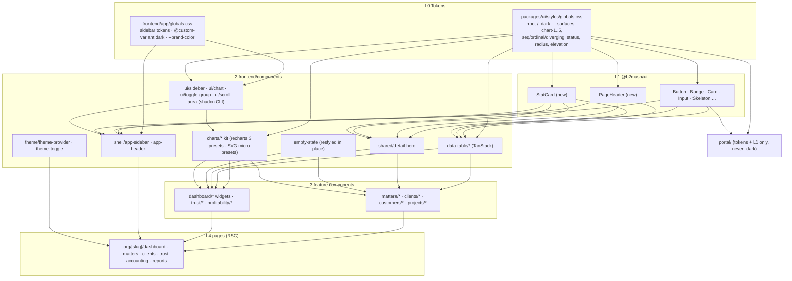
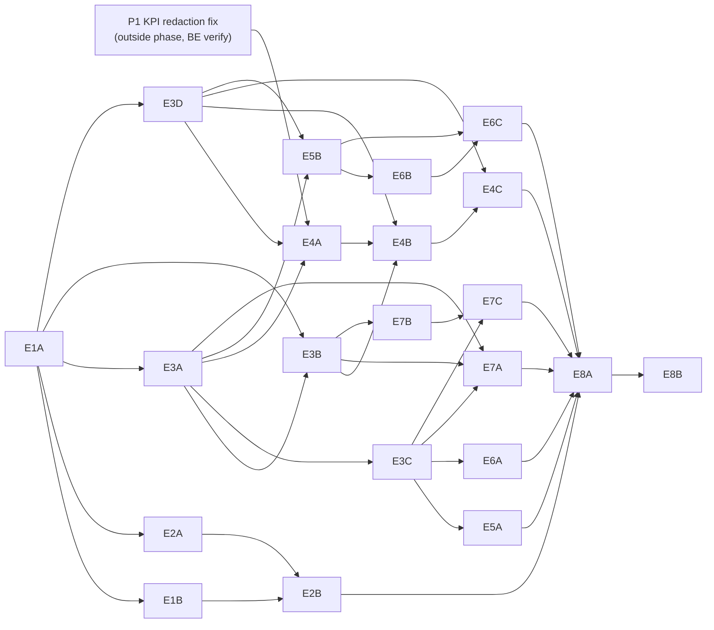

# Phase 90 — Kazi UI Modernization: Design-System Primitives, App Shell, Dashboards and Hero Surfaces

> Merge into ARCHITECTURE.md as **Section 15** (linked from the note lines at the top of ARCHITECTURE.md like Phases 86–89).

> Inputs: `.arch-rulings-phase90.md` (**binding**: numbering §1, founder rulings R1–R4 §2, thirteen corrections to the scouting note §3, ADR titles §4, the two endpoints §5, behaviour notes §6, slicing §7), `requirements/claude-code-prompt-phase90.md` (founder decisions 1–7, Sections 1–8, out of scope), `.arch-context.md` (numbering, file inventory and line counts, list URL state, test and selector coupling, helpers and gates, Batch F tooling, phase-doc conventions), `.arch-context-phase90-data.md` (data source, DTO and gate per visual; endpoint and integration-test patterns). Code verified at `main` HEAD `1bf85f0b1` (2026-11-11; includes G89 Batch E #1752 and Batch F #1753). ADRs 367–373 are written alongside this document and referenced by number; their titles are fixed in §15.11. Line numbers are HEAD and shift when a slice lands — re-grep, never trust the number. Where the rulings and the requirements differ, the rulings win and this document follows them silently unless it says otherwise.

## Prerequisite P1 — KPI previous-period redaction (rulings R2; outside the phase)

`GET /api/dashboard/kpis` redacts financial fields for anyone who is not admin/owner by role (`DashboardService.java:261` → `KpiResponse.withFinancialsRedacted()`). The redaction nulls `billablePercent` and `averageMarginPercent` on the current period but passes `previousPeriod` through untouched (`dashboard/dto/KpiResponse.java`, the record body), so a member can read the previous window's billable %. No frontend calls the endpoint today, so nothing leaks in practice yet — but the Phase 90 KPI row is the first caller, and it must not ship on top of a leak.

| Item | Ruling |
|---|---|
| Branch / PR | `fix/kpi-previous-period-redaction`, its own PR, merged **before** slice E4A starts |
| Red test first | `DashboardCompanyIntegrationTest` gains `kpisRedactPreviousPeriodFinancialsForMember`: a member calls `/api/dashboard/kpis?from&to` and asserts `$.billablePercent`, `$.averageMarginPercent`, `$.previousPeriod.billablePercent`, `$.previousPeriod.averageMarginPercent` are all empty; the owner sees a number on both `billablePercent` fields. It fails on HEAD (`previousPeriod.billablePercent` is a number for the member). |
| Fix | `KpiValues.withFinancialsRedacted()` (new, returns the record with both `Double` fields null); `KpiResponse.withFinancialsRedacted()` passes `previousPeriod == null ? null : previousPeriod.withFinancialsRedacted()`. The cached record stays the unredacted one (`orgCache` key `tenantId:kpis:from_to`) and redaction stays after retrieval — no cache change. |
| Gate | full `backend/scripts/verify.sh`; verify marker committed |
| Not in P1 | redaction by role rather than by `FINANCIAL_VISIBILITY` (a custom role holding the capability still gets nulls). That is consistent with `/api/reports/utilization` and is recorded as a known inconsistency in §15.12, not changed. |

## 15.1 Overview

Phases 87–89 fixed Kazi's information architecture and then its correctness; the data model and API are sound, and Phase 89's exit work proved the trust engine end to end. The presentation layer was never designed as a system. Every in-scope page hand-builds its own header (94 inline `font-display text-3xl` h1s), its own table (48 files import `ui/table`, ≈53 contain a raw `<table`), its own cards (≈217 hand-rolled `rounded-* border` divs) and — almost nowhere — its own charts: three live chart usages, five dead chart components, and a `lib/chart-theme.ts` whose comments contradict its values. A `.dark` token block and ≈3,850 lines of `dark:` classes exist, but nothing has ever applied `.dark`, so none of it has been observed. To a managing partner in a design-partner demo, an app that looks assembled reads as a risky small vendor before they see the trust ledger.

This phase builds a thin design-system layer on shadcn/ui (new-york, Radix — founder decision 3: the admincn template's code is **translated**, never moved to Base UI) and moves the surfaces a firm sees first onto it: the app shell, the firm dashboard, matters and clients (list and detail), the trust dashboard and reports/profitability. It is a **visual phase**. Labels, tab names, routes, IA and `data-testid`s do not change; the matter and client lists keep every behaviour they have; capability-gated money stays gated and a redacted value renders as an intentional "—", never 0. The only behaviour changes are named and bounded: the additive DataTable capabilities (column visibility, CSV of visible rows, opt-in page size), two read-only aggregate endpoints for the two time series the backend does not serve (trust balance per month, fees billed vs collected per month — [ADR-372](../adr/ADR-372-read-only-chart-series-endpoints.md)), and one declared side-effect fix: the trust dashboard's reconciliation card stops reading a hard-coded `null` (`trust-accounting/actions.ts:126-127`) because it is re-sourced from `/api/dashboard/trust-position` (rulings §6).

Three design rules carry the phase. **Layering**: tokens live in `@b2mash/ui/styles/globals.css`; framework-agnostic presentational primitives (PageHeader, StatCard) live in `@b2mash/ui`; anything that knows about Next.js routing, URL state, capabilities, saved views or recharts lives in `frontend/components/` ([ADR-367](../adr/ADR-367-design-system-layering.md)). **Charts are honest**: one categorical palette validated for colour-vision deficiency in both themes, status colours reserved and always paired with an icon or label, every chart carrying an accessible name and a text alternative, every money chart filtered to and labelled with the firm's default currency ([ADR-370](../adr/ADR-370-chart-kit-and-palette.md)). **Dark mode is opt-in and observed**: light by default, a Light / Dark / System choice in the user menu, semantic tokens in place of `dark:` pairs on the surfaces this phase touches, and a written debt list for the long tail ([ADR-371](../adr/ADR-371-dark-mode-light-default.md)).

### What's new

| Surface | Existing at HEAD `1bf85f0b1` | After Phase 90 |
|---|---|---|
| Tokens | `packages/ui/styles/globals.css` (163): background `oklch(94% …)`, card near-white; stock shadcn `chart-1..5` whose hue changes per theme; no status, elevation or sidebar tokens in the shared file; `frontend/app/globals.css` sidebar = slate-950 in both modes | background lightened, border/elevation steps, Kazi categorical `chart-1..5` + sequential, ordinal, diverging and status tokens with **selected** light and dark values validated by the dataviz checks (§15.2.5); `lib/chart-theme.ts` reads the variables and its comments are true |
| Dark mode | `.dark` block + `@custom-variant dark` exist; nothing applies `.dark`; no provider; `<html>` has no `suppressHydrationWarning` | `next-themes` `ThemeProvider` inside `<body>` (AuthProvider wraps `<html>`), class strategy, `defaultTheme="light"`, `enableSystem`; Light/Dark/System toggle in **both** user menus; light forced on every route outside `/org/`; portal never dark |
| App shell | `desktop-sidebar.tsx` (138), `mobile-sidebar.tsx` (128), `nav-zone.tsx` (131); inline sticky `h-14` header in `O/layout.tsx` (173) | shadcn `sidebar` (`SidebarProvider` + cookie, icon-collapse, ⌘/Ctrl+B, built-in mobile Sheet) composed in `components/shell/app-sidebar.tsx`; floating `components/shell/app-header.tsx`; `NAV_GROUPS` content and order unchanged; `#main-content` and `navigation "Main navigation"` preserved |
| Primitives | none shared beyond button/badge/card/input/label/separator/skeleton; `EmptyState` (59 lines, 48 importers) | `@b2mash/ui`: `PageHeader`, `StatCard`; `frontend/components`: `DataTable` (TanStack, client mode), chart kit (recharts presets on shadcn `chart` + dependency-free SVG micro presets), `DetailHero`, `ThemeToggle`; `EmptyState` restyled **in place** |
| Firm dashboard | audience-driven rows (`lib/dashboard-home.ts` `AUDIENCE_ROWS`), cards and plain lists; `/api/dashboard/kpis` has no caller | firm and owner audiences open on a 4-tile KPI row (active matters, hours logged + sparkline + delta, billable % + delta, overdue tasks); rows re-ordered today → money → risk → activity; widgets on Card + EmptyState + kit (WIP-by-fee-earner bar, aged-debtor bars) |
| Matters / clients lists | Server-Component tables on `ui/table`, URL sort links, no pagination | DataTable (client component fed server rows), same URL params (`sort`/`dir`; `sortBy`/`sortDir`), same server-side sort/search, saved views in the toolbar slot, pagination **off**; additive column visibility + CSV of visible rows |
| Matter / client detail | `MatterHeaderCard` (129) / `ClientHeaderCard` (221) + `GroupedTabBar`; pages 680 / 756 lines | `DetailHero` (identifier, title h1, status, actions, facts strip, 4-tile KPI strip) composed by the same two header components; `GroupedTabBar` restyled once for both; pages shortened by extracting the hero data loaders; tab panels untouched |
| Trust dashboard | ≈25 Cards; local `formatCurrency`/`formatDate`; reconciliation card always "never reconciled" | StatCard row with the four existing labels re-sourced from `trust-position` (reconciliation fixed — declared side effect); trust-balance trend chart (new endpoint); transactions table on DataTable; `@/lib/format` |
| Reports / profitability | tables only | fees billed vs collected (new endpoint), utilization by fee earner, matter-profitability ranking; tables on DataTable; CSV export unchanged |
| Dead code | 5 dead chart files + 2 dead widgets + their tests | deleted after a repo-wide re-grep; `chart-components.test.tsx` **edited** (it also covers the live donut and stacked bar) |
| Backend | — | `GET /api/dashboard/trust-balance-trend`, `GET /api/reports/billing-trend`; no entity, table, migration, cache or write |

### Scope at HEAD (rulings §1, §3)

- **Numbering.** Section 15; ADRs 367–373; no Flyway migration (next free stays tenant V15 / global V6); no template-pack bump.
- **In scope.** Sections 1–8 of the requirements as corrected by rulings §3: the dashboard is audience-driven (§3.1); the KPI endpoint needs `from`/`to`, has an hours-only trend and point-in-time counts (§3.2); lists are fetch-all with URL sort (§3.3); saved views get a slot, not a rewrite (§3.4); one `GroupedTabBar` restyle covers both detail pages (§3.5); `EmptyState` is restyled in place (§3.6); the `TrustBalanceCard` "duplicate" is a 5-line re-export to delete (§3.7); seven dead files go (§3.8); there are no nav badges to render (§3.9); no committed visual baselines exist (§3.10); the toggle lands in two hand-rolled menus (§3.11); portal changes are limited to token retunes (§3.12); chart tokens are re-derived (§3.13).
- **Margin tile hidden** (R1). `averageMarginPercent` is hard-coded null in `computeKpiValues`; the KPI row ships four tiles and the backend field is left untouched.

### Out of scope

Client portal restyle (it inherits token retunes only, never dark mode); theme customizer, presets and per-user density/radius; Base UI or shadcn `base-vega`; the other ≈45 pages under `org/[slug]` (tokens and shell only — they adopt primitives when next touched); renaming `components/projects`→`matters` or `components/customers`→`clients`; any copy, label, tab-name, route or IA change; new features, bulk actions, write endpoints, entities or migrations; nav count badges (rulings §3.9); populating `averageMarginPercent` (R1); unifying the two tab-bar URL mechanics (rulings §3.5); DataTable server-paginated mode (designed in ADR-369, not built); the activity timeline primitive (deferred — no slice already touches the Activity tabs); marketing-site redesign; kanban/calendar/mail/chat from the template.

### Baseline statement

Before E1A starts, the slice owner records on `main`: FE-GATE green; legal-lifecycle and legal-depth-ii pass counts on a fresh stack; and the before-metrics of §15.8.7 (inline h1 count, ad-hoc `<table` count on in-scope surfaces, raw-hex count, dead-chart-file count, chart-usage count). The exit gate (E8) compares against these numbers, not against memory.

## 15.2 Component and Data Model

**No new entity, table, column, enum value, capability, Flyway migration or cache.** Tenant migrations stay at V14 (next free V15) and global at V5 (next free V6); `global-baseline.snapshot` is untouched. The two new endpoints read `trust_transactions`, `invoices`, `payment_events` and `org_settings` through native read-only queries (§15.3.7–15.3.8). Everything else in this section is the frontend design-system model.

### 15.2.1 Design-system layer map ([ADR-367](../adr/ADR-367-design-system-layering.md))

| Layer | Lives in | Contains | Rule |
|---|---|---|---|
| L0 Tokens | `packages/ui/styles/globals.css` (shared), `frontend/app/globals.css` (app-only: sidebar tokens, `@custom-variant dark`, `--brand-color`) | colour (OKLCH), chart/status palettes, radius, elevation, density | the only place a colour value is written; components reference tokens, never hex or raw `slate-*` for surfaces |
| L1 Shared primitives | `packages/ui/src/*` (`@b2mash/ui`) | existing button, badge, card, input, label, separator, skeleton, `cn`; **new** `page-header`, `stat-card` | no Next.js imports, no hooks that read routing or capabilities, no recharts, no lucide; server-safe (no `"use client"` unless interactive); every file gets an `exports` entry + `src/index.ts` re-export |
| L2 App primitives | `frontend/components/{ui,data-table,charts,shell,shared,theme}` | shadcn CLI output (`ui/sidebar`, `ui/chart`, `ui/toggle-group`, `ui/scroll-area`, `ui/breadcrumb`), `DataTable`, chart kit, `DetailHero`, `ThemeToggle`, `EmptyState` (in place), `AppSidebar`, `AppHeader` | may use Next.js routing, URL state, `useCapabilities`, recharts; composes L1 |
| L3 Feature components | `frontend/components/{matters,clients,customers,projects,dashboard,trust,profitability}` | column definitions, widgets, header compositions, hero data mapping | compose L1/L2; no new visual vocabulary |
| L4 Pages | `frontend/app/(app)/org/[slug]/**` | data fetching (RSC), gating, composition | **"new page" rule**: a new or next-touched page uses `PageHeader` + `DataTable`/`Card` + the kit — no inline `font-display` h1, no raw `<table>`, no hex |

Why `EmptyState` stays at L2 in place: it has 48 importers and takes `icon` as a component reference that RSC callers pass server-side; moving it to `@b2mash/ui` would need every importer edited in one slice and a lucide dependency in the package (rulings §3.6). ADR-367 records the move as a later, mechanical PR when the portal wants it.

Why `StatCard` is in `@b2mash/ui` but its sparkline is not: the portal will want a balance tile later, and the tile itself is pure presentation. The sparkline belongs to the chart kit — `SparklineTrend` is one of its dependency-free SVG micro presets, held to the kit's token and accessibility contract ([ADR-370](../adr/ADR-370-chart-kit-and-palette.md)) — so `StatCard` takes `sparkline?: ReactNode` and the frontend passes `<SparklineTrend>`; `@b2mash/ui` gains no chart code and the portal bundle is unchanged.



### 15.2.2 `PageHeader` (`@b2mash/ui/page-header`)

Server-safe; replaces the inline h1 pattern on in-scope pages (dashboard, matters, clients, trust-accounting, reports index, profitability).

| Prop | Type | Default | Notes |
|---|---|---|---|
| `title` | `ReactNode` | required | rendered inside the page's **single** `<h1>` (`font-display text-2xl font-semibold tracking-tight`); e2e helpers wait on `getByRole("heading", { level: 1, name })` |
| `description` | `ReactNode` | — | `text-sm text-muted-foreground`, max one line at 1440 |
| `eyebrow` | `ReactNode` | — | above the title (e.g. a module label); never a second heading |
| `breadcrumb` | `ReactNode` | — | slot only; the shell already renders `Breadcrumbs`, so in-scope pages leave it empty |
| `actions` | `ReactNode` | — | right-aligned; primary first, overflow `DropdownMenu` last; wraps below the title under 768px |
| `children` | `ReactNode` | — | a toolbar row under the title (filters, view selector) |
| `className`, `data-testid` | | `"page-header"` | existing page-level testids (e.g. `home-page`) stay on their current elements |

### 15.2.3 `StatCard` (`@b2mash/ui/stat-card`)

Adapts admincn `statistics-card-03` and the sparkline KPI cards (ADR-368 credit header).

| Prop | Type | Default | Notes |
|---|---|---|---|
| `label` | `string` | required | `text-sm text-muted-foreground`; the tile's accessible name (`aria-labelledby`) |
| `value` | `ReactNode \| null` | required | `font-mono tabular` figures; the **caller formats** (`formatCurrency`, hours, %); `null` → "—" with `sr-only` "Not available" |
| `state` | `"ready" \| "loading" \| "redacted" \| "error"` | `"ready"` | loading → `Skeleton` value + delta; redacted → "—" + `hint` "Visible to admins and owners" (caller-supplied copy); error → "—" + `role="status"` "Couldn't load" |
| `delta` | `{ change: number \| null; unit: "percent" \| "points"; polarity: "up-is-good" \| "down-is-good" \| "neutral"; comparisonLabel: string } \| undefined` | — | absent → no delta row (point-in-time tiles); `change === null` → no delta row; renders an inline-SVG chevron + signed figure in `--success`/`--danger` per polarity (`neutral` → muted) **and** `sr-only` text "Up 12.5% vs previous 30 days" — colour is never the only signal |
| `sparkline` | `ReactNode` | — | slot (the frontend passes `<SparklineTrend>`); `aria-hidden` wrapper because the value + delta already carry the meaning |
| `icon` | `ReactNode` | — | decorative, `aria-hidden` |
| `hint` | `ReactNode` | — | one muted line under the value (e.g. "Kazi Trust cashbook balance") |
| `footer` | `ReactNode` | — | link slot (caller passes `next/link`) |
| `variant` | `"default" \| "compact"` | `"default"` | compact = DetailHero strip: `p-3`, `text-lg` value, no sparkline |
| `data-testid` | `string` | — | passthrough |

`computeDelta(current, previous, unit)` lives in `frontend/lib/kpi.ts`, not in the package: percent change returns `null` when `previous` is null or 0 (no "∞%"); points returns `current − previous` when both are non-null.

### 15.2.4 Other primitives

**`DataTable<T>`** (`frontend/components/data-table/data-table.tsx`, `"use client"`; [ADR-369](../adr/ADR-369-datatable-tanstack-client-mode.md)):

| Prop | Type | Default | Notes |
|---|---|---|---|
| `columns` | `ColumnDef<T>[]` via `defineColumns<T>()` | required | `meta: { label; priority?: "high" \| "low"; align?: "start" \| "end"; sortKey?: string; csv?: (row: T) => string \| number \| null; headerClassName?; cellClassName? }`; `priority: "low"` → the container-query classes the tables use today (`hidden @min-[67rem]:table-cell` etc.) |
| `data` | `T[]` | required | rows already searched, filtered and **sorted by the RSC** |
| `getRowId` | `(row: T) => string` | required | |
| `sort` | `{ key: string \| null; dir: "asc" \| "desc"; hrefFor: (sortKey: string) => string }` | — | header renders a `next/link` built by the page's existing `buildSortHref` (param names stay `sort`/`dir` for matters, `sortBy`/`sortDir` for clients); `aria-sort` on the active `columnheader`; TanStack runs `manualSorting: true` |
| `toolbar` | `{ search?; filters?; views?; actions? }` (all `ReactNode`) | — | the saved-views slot receives today's `ViewSelectorClient` unchanged |
| `columnVisibility` | `boolean` | `true` | "Columns" `DropdownMenu` of checkbox items; state is local and resets on navigation (a saved view's `columns` still decides the default set server-side) |
| `rowHref` | `(row: T) => string` | — | click-to-open semantics of `matter-table-row.tsx` (ignore clicks on links, buttons, menus); the name cell stays a real `<Link>` so `getByRole("row").filter({ has: getByRole("link", { name }) })` works |
| `rowTestId` | `string` | — | `"matter-row"`, `"client-row"` |
| `pageSize` | `number \| null` | `null` | `null` = every row rendered (today's behaviour); a number enables `getPaginationRowModel` + page-size `Select` |
| `selectable` | `boolean` | `false` | checkbox column; selection only feeds CSV export — **no bulk actions** |
| `exportCsv` | `{ filename: string }` | — | client-side CSV of visible columns × (selected or all rendered) rows, from `meta.csv`; RFC 4180 quoting; never a server round-trip |
| `empty` | `ReactNode` | required | the page passes its two existing variants (filtered → "No matters match this view." + "Clear filters"; unfiltered → `EmptyState`) |
| `loading` | `boolean` | `false` | 8 skeleton rows |
| `footer` | `ReactNode` | — | keeps `matters-footer` "Showing N matters" |
| `stickyHeader` | `boolean` | `true` | `thead` sticky at `top-[var(--app-header-height)]` |
| `caption` | `string` | — | `sr-only` `<caption>` |
| `tableTestId` | `string` | — | forwarded to the `<table>` element (keeps `transactions-table` on the trust dashboard) |

Markup stays a semantic `<table>` (`ui/table`), so `table`/`row`/`columnheader`/`cell` roles are unchanged; never `role="grid"`. Mobile: horizontal scroll inside the container plus column priority — a card-list mode was rejected because it duplicates markup and breaks the `row` selectors ([ADR-369](../adr/ADR-369-datatable-tanstack-client-mode.md)).

**Chart kit** (`frontend/components/charts/*`; [ADR-370](../adr/ADR-370-chart-kit-and-palette.md)) has two kinds of preset that share the tokens of §15.2.5 and one accessibility contract.

*Recharts presets* — `"use client"`, on shadcn `ui/chart` + recharts 3 (slice E3B):

| Preset | Props (beyond `data`, `config: ChartConfig`, `title`, `description`) | Used by |
|---|---|---|
| `TrendAreaChart` | `xKey`, `series: {key, label}[]` (≤ 5), `format: "currency" \| "hours" \| "percent" \| "count"`, `currency?`, `partialLastPoint?` | trust balance trend (2 series), billed vs collected (2 series) |
| `BarChartPreset` | `orientation: "vertical" \| "horizontal"`, `layout: "single" \| "grouped" \| "stacked"`, `categoryKey`, `series`, `format`, `diverging?: boolean`, `maxBars?` (default 10, rest folded into "Other") | WIP by fee earner, utilization, profitability ranking |
| `DonutChart` | `segments`, `centerLabel?`, `format` | My Work time breakdown (rebuilt on the kit) |

*Micro presets* — dependency-free inline SVG, no recharts, no `"use client"` (server-safe), no import from the E3B helpers or `lib/chart-format.ts`: the caller formats any text they show, as it does for `StatCard` (slice E3D):

| Preset | Props | Used by |
|---|---|---|
| `SparklineTrend` | `values: number[]`, `label` (accessible name), `summary` (caller-formatted sr sentence) | KPI hours tile |
| `ProgressRadial` | `value` (0–100), `label`, `tone?: status` | matter Overview strip (replaces `MiniProgressRing`) |
| `StackedMeter` | `segments: {key, label, value, valueText}[]` (`valueText` caller-formatted), `palette: "ordinal-aging" \| "categorical"` | aged-debtor bars (replaces `MicroStackedBar`); WeeklyTimeSummary billable vs non-billable |

Micro presets carry an accessible name (`role="img"` + `aria-label`) and an `sr-only` summary that states every value they draw (the sparkline's caller-built `summary` with its first, last and peak points; the ring's percentage; each meter segment's label and `valueText`). They have **no "View as table" toggle**: each draws at most a handful of values that its summary already states in full, and each sits beside the figure it decorates (the tile value, the debtor row), so a table would repeat the summary. Because no micro preset imports recharts, Home's KPI row and the matter Overview strip load no recharts.

Every recharts preset renders: `ChartContainer` with `accessibilityLayer`; a figure wrapper `role="figure"` + `aria-label={title}`; an `sr-only` one-sentence summary generated from the data (e.g. "Trust cashbook balance, 12 months to 11 Nov 2026: from R 120 000,00 to R 184 500,00, peak R 210 000,00 in Aug 2026"); a "View as table" toggle that **mounts** a `<table>` only on demand (pages with strict `getByRole("table")` selectors keep exactly one table by default — `finance/reports.spec.ts`, `day-90-review.spec.ts:136`); loading (`Skeleton` at chart height) and empty (`EmptyState variant="compact"`) states; formatters from §15.2.6.

**`EmptyState`** (`frontend/components/empty-state.tsx`, restyled in place; adapts admincn `empty-state-v2`): props unchanged (`icon, title, description, action?, actionLabel?, actionHref?, onAction?, secondaryLink?`) plus additive `variant?: "default" | "compact" | "inline"`. Default: icon in a `bg-muted` 48px rounded tile, `font-display` title, max-width description, actions row. Compact: for widgets and chart cards. Inline: one line for table bodies. No importer changes.

**`DetailHero`** (`frontend/components/shared/detail-hero.tsx`; [ADR-373](../adr/ADR-373-detail-hero-kpi-strip.md)):

| Prop | Type | Notes |
|---|---|---|
| `identifier` | `ReactNode` | mono chip (matter reference / client number); omitted when absent |
| `title` | `string` | the page's single `<h1>`; `titleTestId` passthrough (`"matter-name"`, `"client-name"`) |
| `subtitle` | `ReactNode` | client · fee earner · opened date (matter); contact line (client) — composed from the existing header fields, no new copy |
| `status` | `ReactNode` | the existing badges (`project-status-badge`, `customer-status-badge`, `lifecycle-badge`) passed in unchanged |
| `actions` | `ReactNode` | the existing `header-lifecycle-actions` / `client-header-actions` / `smart-primary-action` |
| `facts` | `ReactNode` | the existing `HeaderFactsStrip` (keeps `matter-header-fields` → `matter-header-field-<slug>` → `dt`, asserted by `day-01-03-onboarding.spec.ts:259-284`) |
| `tiles` | `HeroTile[]` (0–4) | `{ id; label; value: ReactNode \| null; hint?; href?; state: "ready" \| "redacted" \| "error" }`; a tile whose gate fails is **omitted**, not rendered as "—"; rendered as `StatCard variant="compact"` in a `grid-cols-2 @3xl:grid-cols-4` container (2×2 at 1024 inside the content column, 4×1 at 1440) |
| `data-testid` | `string` | `"matter-header-card"`, `"client-header-card"` stay on the hero root |

**`ThemeToggle`** (`frontend/components/theme/theme-toggle.tsx`, `"use client"`): `variant: "segmented"` (Radix `ToggleGroup type="single"`, `aria-label="Theme"`, three items with icon + visible label "Light" / "Dark" / "System", `aria-pressed`); reads and writes `useTheme()`; renders a fixed-width placeholder until mounted (next-themes' resolved value is unknown on the server) so the menus never shift or warn.

### 15.2.5 Token model ([ADR-370](../adr/ADR-370-chart-kit-and-palette.md), [ADR-371](../adr/ADR-371-dark-mode-light-default.md))

Kept: the OKLCH form, the slate scale at hue 260 (`--slate-50…950`), `--teal-500`/`--teal-600`, the three font families, `--radius: 0.5rem` and its scale (pill buttons stay — identity). Every value below is defined once in `:root` and once in `.dark`; the `@theme inline` block maps each to a `--color-*` utility. Values marked † are the slice's starting point and must pass the E1A checks before merge (AA text contrast via `contrast()`; non-text ≥ 3:1; the dataviz validator for chart slots).

**Surfaces**

| Token | `:root` (light) | `.dark` | Why |
|---|---|---|---|
| `--background` | `oklch(97.2% 0.004 260)` † (was 94%) | `var(--slate-950)` (13.5%) | the 94% grey is what makes Kazi read "heavy"; the template's cleaner feel is a near-white canvas with cards separated by border + a faint shadow |
| `--card` | `oklch(99.6% 0.002 260)` | `var(--slate-900)` (20.5%) | one surface step above the background in both themes |
| `--popover` | `oklch(100% 0 0)` | `oklch(23.5% 0.012 260)` † | menus sit one step above cards in dark, where shadows don't read |
| `--muted` / `--secondary` | `var(--slate-100)` | `var(--slate-800)` | unchanged roles; dark `--muted` moves from slate-900 to slate-800 so muted fills are visible on dark cards |
| `--muted-foreground` | `var(--slate-600)` | `var(--slate-400)` | ≥ 4.5:1 on background and card in both themes (E1A asserts) |
| `--border` / `--input` | `oklch(91.5% 0.008 260)` | `oklch(28.5% 0.014 260)` † | carries elevation in dark mode |
| `--ring` | `var(--teal-600)` | `var(--teal-500)` | focus rings in the accent, ≥ 3:1 against card and background in both themes (was slate-500, too close to borders on the new canvas) |
| `--accent` / `--primary` / `--destructive` | unchanged | unchanged | identity |
| `--shadow-card` (new) | `0 1px 2px oklch(13.5% 0.006 258 / 0.05), 0 1px 3px oklch(13.5% 0.006 258 / 0.04)` | `none` | dark elevation = surface step + border, never shadow |
| `--shadow-overlay` (new) | `0 8px 24px oklch(13.5% 0.006 258 / 0.12)` | `0 8px 24px oklch(0% 0 0 / 0.5)` | popovers, floating header |
| `--app-header-height` (new) | `3.5rem` | same | sticky table headers and anchor offsets |

**Sidebar** (`frontend/app/globals.css`). Light keeps the slate-950 sidebar **deliberately**: it is Signal Deck's strongest identity mark, matches the marketing site, and carries the org `--brand-color` accent bar; the admincn borrow is structure (groups, collapse, floating header), not a white rail. Dark moves the sidebar *off* the background so the two do not merge: `--sidebar: oklch(16.5% 0.008 260)` †, `--sidebar-border: oklch(100% 0 0 / 8%)`; `--sidebar-foreground` white/`--sidebar-accent` white 6% and `--sidebar-ring: var(--teal-500)` in both. `--sidebar-primary` = `var(--teal-500)` (active item indicator). The hard-coded `bg-slate-950`/`text-white/*` classes in `desktop-sidebar.tsx` disappear with the file; the new sidebar reads only `--sidebar-*`.

**Categorical chart slots.** Method: the dataviz form → colour → validate procedure, with Kazi's teal as slot 1 and four hues chosen for distance from it; order chosen by enumerating permutations and keeping the one with the best worst-adjacent CVD separation. Validated with the skill's `validate_palette.js` against Kazi's chart surface (the card: light `#fdfdff`, dark `#14171c`) on 2026-11-11:

| Slot | Hue | Light | Dark |
|---|---|---|---|
| `--chart-1` | teal | `oklch(60% 0.12 183)` `#009787` | `oklch(66% 0.12 183)` `#00aa99` |
| `--chart-2` | orange | `oklch(65% 0.17 45)` `#e06623` | `oklch(66% 0.16 45)` `#df6c32` |
| `--chart-3` | blue | `oklch(53% 0.17 255)` `#096acb` | `oklch(62% 0.16 255)` `#3986e4` |
| `--chart-4` | amber | `oklch(66% 0.14 70)` `#c8800d` | `oklch(66.5% 0.13 80)` `#bd891c` |
| `--chart-5` | violet | `oklch(56% 0.20 300)` `#894ed6` | `oklch(64% 0.17 300)` `#9d6fe3` |

Results: lightness band and chroma floor pass in both modes; worst adjacent CVD ΔE 12.3 light (orange↔teal, protan) / 13.6 dark (target ≥ 8); worst adjacent normal-vision ΔE 26.4 / 26.0 (floor ≥ 15); every slot ≥ 3:1 on its surface in both modes; the first three slots also pass `--pairs all` (CVD 12.3 / 13.6, normal 18.9 / 17.5). Consequences, written into ADR-370: line/bar/stack charts carry ≤ 5 series (a sixth folds into "Other"); scatter-like forms carry ≤ 3; series keep their slot when a filter removes others (colour follows the entity); a series means the same slot in both themes — the light/dark columns are one hue stepped for each surface, not two palettes. `--chart-4` (amber) sits near the warning status hue, so the collision rule applies: a chart uses categorical **or** status colours, never both.

**Sequential** (one hue, teal; magnitude, light → dark; anchor flips in dark): `--seq-100…500` light `oklch(93% .04 183)`, `(85% .08 183)`, `(75% .11 183)`, `(64% .12 183)`, `(52% .10 183)`; dark `oklch(30% .05 183)`, `(40% .08 183)`, `(52% .11 183)`, `(64% .12 183)`, `(78% .11 183)`. Validated monotone, ΔL ≥ 0.06, single hue. For ordinal use the light end must clear 2:1, which light steps 100–200 do not — ordinal charts use the ramp below.

**Ordinal — aged debtors** (`--aging-current`, `--aging-d30`, `--aging-d60`, `--aging-d90plus`; one hue, orange, the next categorical hue per the dataviz rule): light `oklch(76% .12 50)` `#ee9a69`, `(67% .15 46)` `#de733c`, `(58% .17 41)` `#c94d13`, `(49% .15 37)` `#a33714`; dark `oklch(48% .12 40)` `#944123`, `(59% .15 43)` `#c45928`, `(70% .14 47)` `#e4804c`, `(81% .10 52)` `#f5af84`. Both pass `--ordinal` (monotone, ΔL ≥ 0.06, light end 2.18:1 light / ≥ 2:1 dark). Buckets are ordered, so they take one hue — not the categorical slots and not status colours ("current" is not "good").

**Diverging** (profitability ranking, margin above/below zero): `--div-pos: var(--chart-3)` (blue), `--div-neg: oklch(58% 0.19 27)` light / `oklch(66% 0.17 25)` dark, midpoint = `--border`. Blue ↔ red reads as opposite; never a hue at the midpoint.

**Status** (fixed, never themed; badges, reconciliation state, KPI delta direction; always icon + label):

| Token | Light | Contrast on card | Dark | Contrast on card |
|---|---|---|---|---|
| `--success` | `oklch(60% 0.15 150)` `#25984d` | 3.64 | `oklch(70% 0.15 150)` `#4cb86a` | 7.16 |
| `--warning` | `oklch(75% 0.15 75)` `#e49e22` | 2.24 (icon + label mitigate, by design) | `oklch(80% 0.14 80)` `#edb345` | 9.52 |
| `--danger` | `oklch(58% 0.21 27)` `#db2c2b` | 4.69 | `oklch(68% 0.18 25)` `#f3625d` | 5.74 |
| `--info` | `oklch(58% 0.14 240)` `#0083c4` | 4.10 | `oklch(70% 0.12 240)` `#4fa8e1` | 6.86 |

Each status also gets `--{status}-soft` (badge fill: `color-mix(in oklch, var(--{status}) 14%, var(--card))`) and `--{status}-foreground` (badge text, same hue, light L ≈ 42–45%, dark L ≈ 85%) †, which E1A must prove ≥ 4.5:1 on the soft fill in both themes. `--destructive` stays the action colour (buttons); `--danger` is the state colour.

**Density.** Table rows `h-10` (body) / `h-9` (header) with `text-sm`; card padding `p-5` (default) and `p-3` (compact); page vertical rhythm `gap-6`. One density per page; no per-user density (out of scope).

**`lib/chart-theme.ts`** is rewritten to reference variables only — `categorical: ["var(--chart-1)", …]`, `grid: "var(--border)"`, `axis: "var(--muted-foreground)"`, `tooltip: { background: "var(--popover)", text: "var(--popover-foreground)" }` — with no hex fallbacks and comments naming the hue each slot holds. Its last consumers (`chart-tooltip`, `donut-chart`) move onto the kit in E3B; the file then serves the kit's defaults only.

**Raw hex.** The raw hex colours (≈50 lines across `frontend/{components,app,lib}` `.ts/.tsx` at HEAD, many in files this phase deletes or rebuilds; the requirements' "37" is superseded by the §15.8.7 baseline measured before E1A) are replaced by tokens where they sit on in-scope surfaces (E1A lists the file:line of each it changes and leaves the rest in the long-tail backlog).

### 15.2.6 Formatters

No shared hours/percent formatter exists today (`.arch-context.md` §10: local `formatHours` in `matter-health-widget.tsx:50`, `formatUnbilled` in `lib/matters-list.ts:167`, `formatOutstanding` in `lib/clients-list.ts:223`). `frontend/lib/chart-format.ts` (new) exports `formatChartValue(value, kind, currency?)` and `formatAxisTick(value, kind, currency?)` where `kind ∈ currency | hours | percent | points | count`: currency delegates to `formatCurrency` (en-ZA, via `@/lib/format`, which loads the intl polyfill — never `@b2mash/shared/format` directly in the frontend) and the axis variant abbreviates (`R 1,2 m`); hours = one decimal + "h"; percent = one decimal + "%"; points = signed one decimal + " pp". The three local helpers are left alone (not in-scope surfaces except where a slice already edits the file).

### 15.2.7 DTOs for the two new endpoints (conceptual records)

```java
// dashboard/dto/TrustBalanceTrendResponse.java
public record TrustBalanceTrendResponse(
    UUID trustAccountId,
    String accountName,
    String currency,                     // org default currency (trust accounts carry none)
    LocalDate asOf,                      // LocalDate.now(clock), SA business date
    BigDecimal openingCashbookBalance,   // everything dated before the first month of the window
    BigDecimal openingClientLedgerTotal,
    List<TrustBalanceTrendPoint> months, // oldest → newest, exactly `months` entries, zero-filled
    List<TrustAccountRef> accounts) {}   // same shape as TrustPositionResponse.accounts, for the selector

public record TrustBalanceTrendPoint(
    String month,                        // "2026-06"
    LocalDate periodEnd,                 // last day of the month, or asOf for the current month
    BigDecimal cashbookBalance,          // month-end running balance, cashbook rule
    BigDecimal clientLedgerTotal,        // month-end running balance, client-ledger rule
    boolean partial) {}                  // true only for the current month

// report/dto/BillingTrendResponse.java
public record BillingTrendResponse(
    String currency,                     // org default currency; other currencies excluded
    String from,                         // "2025-12"
    String to,                           // "2026-11"
    LocalDate asOf,
    List<BillingTrendPoint> months) {}

public record BillingTrendPoint(
    String month,
    BigDecimal billed,                   // Σ invoices.total (VAT-inclusive) by issue month
    int billedCount,
    BigDecimal collected,                // Σ completed payment_events.amount by SA payment month
    int collectedCount,
    boolean partial) {}
```

Both are new records next to their siblings (`dashboard/dto/`, `report/dto/` — create the `report/dto` package only if the build finds none; otherwise follow where `OrgProfitabilityResponse` lives; verify at build). The frontend mirrors them in `lib/dashboard-types.ts` and `lib/types/reports.ts` (verify the latter's name at build; reuse the file `reports-api.test.ts` covers).

## 15.3 Core Flows

### 15.3.1 App shell render and sidebar collapse ([ADR-367](../adr/ADR-367-design-system-layering.md), [ADR-368](../adr/ADR-368-admincn-template-adoption.md))

`O/layout.tsx` stays the RSC org shell: auth/org-slug redirect, `Promise.allSettled` for capabilities, settings, user info and billing, and the provider stack Capability → OrgProfile → RecentItems → BreadcrumbLabel → CommandPalette. What changes is the chrome inside it:

1. The layout reads `cookies().get("sidebar_state")` (the shadcn sidebar's cookie name; `SIDEBAR_COOKIE_MAX_AGE` 7 days) and renders `<SidebarProvider defaultOpen={value !== "false"}>` — the server knows the collapsed state, so first paint has the right width and no layout shift.
2. `<AppSidebar>` (client; `components/shell/app-sidebar.tsx`) composes `ui/sidebar`: `SidebarHeader` (logo/wordmark, org name, `org-brand-accent` bar, the ⌘K search pill that calls the command-palette provider's `setOpen`), `SidebarContent` wrapped in **`<nav aria-label="Main navigation">`** containing only the six `NAV_GROUPS` zones, `SidebarFooter` (Platform Admin link when applicable, `UTILITY_ITEMS`, the display-only user footer). It imports `NAV_GROUPS` directly (`href` is a function and cannot cross the RSC boundary). Gating is the current one: `requiredCapability`, `requiredModule`, `adminOnly` through `useCapabilities()` and `useOrgProfile()`.
3. Each zone is a `Collapsible` whose trigger is `SidebarGroupLabel asChild` → `<button aria-expanded>` with the zone label, so `nav.locator("button[aria-expanded]")` still yields the zone labels in order. Zone open state moves from local `useState` to the same default (`defaultExpanded`) and is not persisted — persisting it would be new behaviour.
4. Items are `SidebarMenuButton asChild isActive={longestMatch}` → `<Link>`; the active item gets `data-active` and `aria-current="page"`, with the `--sidebar-primary` indicator bar (no Motion `layoutId` — the shadcn data-attribute styling replaces it, and Motion leaves the sidebar). Nothing but the zone triggers and item links lives inside the `nav`, because `sidebar-navigation.spec.ts` asserts the exact ordered link list.
5. `collapsible="icon"`: collapsed width shows item icons with `Tooltip` labels; zone headers become separators; the link text stays in the DOM as `sr-only` so the accessible names do not change. ⌘/Ctrl+B toggles (the shadcn default `SIDEBAR_KEYBOARD_SHORTCUT = "b"`; it does not collide with the ⌘K palette or any existing Kazi shortcut — verify at build with a repo grep for `key === "b"`).
6. Below 768px the same component renders as a `Sheet` (`useIsMobile`, added by the CLI to `frontend/hooks/use-mobile.ts`). The mobile `SidebarTrigger` keeps the accessible name **"Toggle menu"** (overriding the shadcn default "Toggle Sidebar") because that is the name `mobile-sidebar.tsx` exposes today. SSR renders the desktop variant (`useIsMobile` is `false` until mounted), which is today's behaviour too.
7. `<SidebarInset>` holds `<AppHeader>` and `<main id="main-content">` (id and element unchanged — 30 e2e hits) → SubscriptionBanner → content container → ErrorBoundary. The content container keeps `mx-auto max-w-7xl` but drops the extra `lg:px-10` in favour of `px-4 md:px-6` to give tables back width at 1024 with an expanded sidebar.
8. `<AppHeader>` (`components/shell/app-header.tsx`, client): a floating bar — `sticky top-2 mx-2 md:mx-4 rounded-xl border bg-card/90 backdrop-blur shadow-[var(--shadow-overlay)] h-[var(--app-header-height)]` — holding `SidebarTrigger`, `Breadcrumbs` (unchanged component and label provider), a command-palette trigger button "Search" with a `⌘K` `<kbd>` hint, `NotificationBell`, and `AuthHeaderControls` (which hosts both user menus and therefore the theme toggle). No new copy beyond the existing "Search" pill label.
9. `org/[slug]/template.tsx` keeps its CSS-only entrance (`fade-in slide-in-from-bottom-[2px] duration-100`, `motion-reduce:animate-none`). It is 100ms, layout-neutral and pinned by `org-template.test.tsx`; the new shell lives in the layout, not the template, so they don't conflict. Decision recorded; no change.
10. The command palette dialog is restyled (tokens, `rounded-xl`, group headings, `<kbd>` hints); its indexing (`NAV_GROUPS` keywords, recent items) and behaviour are unchanged.

### 15.3.2 Theme resolution without a flash ([ADR-371](../adr/ADR-371-dark-mode-light-default.md))

`frontend/app/layout.tsx` today renders `<AuthProvider><html lang="en"><body …>`. Changes:

- `<html lang="en" suppressHydrationWarning>` — next-themes' inline script sets `class="dark"` (or nothing) and `style="color-scheme: …"` on `<html>` before React hydrates, so the server-rendered attribute differs from the client's by design.
- Inside `<body>`, first child: `<KaziThemeProvider>` (`components/theme/theme-provider.tsx`, client) wrapping the skip link, `{children}` and the `Toaster`. It renders next-themes' `ThemeProvider` with `attribute="class"`, `defaultTheme="light"`, `enableSystem`, `storageKey="kazi-theme"`, `disableTransitionOnChange`, and `forcedTheme={isAppRoute ? undefined : "light"}` where `isAppRoute` is `usePathname().startsWith("/org/")`. Every other route — the pre-org `(app)` routes `/dashboard`, `/create-org` and `/platform-admin`, the marketing site, auth pages, mock login, `accept*` and `request-access` — always paints light. Why `/org/` only: those routes are outside the surface this phase restyles and audits in dark (§15.6.5 covers pages under `org/[slug]`), so forcing light keeps the dark-mode debt list bounded to the audited surface instead of adding unobserved pages to it.
- next-themes injects a blocking inline script as the provider's first child; it runs before the body paints, reads `localStorage["kazi-theme"]` (absent → light; `system` → `prefers-color-scheme`), and applies the class. No FOUC, no hydration warning.
- `Toaster` gets `theme={resolvedTheme}` through a tiny client wrapper so toasts follow the theme.
- Persistence is per browser (localStorage), as decided by the founder; no server preference, no cookie.
- The portal has no provider and never receives `.dark` (rulings §3.12). Its own `@custom-variant dark` stays dormant.

### 15.3.3 DataTable in client mode with URL-preserved state ([ADR-369](../adr/ADR-369-datatable-tanstack-client-mode.md); rulings §3.3–3.4)

```
RSC page (matters/page.tsx)                     Client (MattersDataTable)
─────────────────────────────                   ─────────────────────────
read URL: view, status, tags, search,           receives rows (already final order),
          sort, dir, new, customerId              sort {key, dir, hrefFor}, toolbar slots
resolveViewSelection(...)                       useReactTable({ data, columns,
listMatterRows(buildMatterListParams)             manualSorting: true,
searchMatterRows → sortMatterRows                 getCoreRowModel,
resolveMatterColumns(view.columns)                getPaginationRowModel only if pageSize })
render <MattersDataTable rows=… />              header click = <Link href={hrefFor(key)}>
                                                 → RSC re-renders with the new sort
```

- **Who owns state.** The URL owns everything it owns today: view, filters, search, sort and direction. TanStack owns only what is new and ephemeral — column visibility, row selection, page index when a page opts into pagination. Nothing new is written to the URL, so saved views, `clearOnSavedView` (`["tags"]` matters; `["tags","lifecycleStatus"]` clients) and every bookmarked link behave exactly as before.
- **Sorting.** `sortMatterRows`/`sortClientRows` stay in the RSC. Column headers are `<Link>`s from the page's existing `buildSortHref`, carrying the full `query` so filters survive; the param names stay as they are (`sort`/`dir` vs `sortBy`/`sortDir` — unifying them would break bookmarks and is out of scope).
- **Search and filters.** `matter-search.tsx`, `matter-filters-sheet.tsx`, `ProjectStatusFilter` (`data-testid="project-status-filter"`, links), `client-search`, `client-filters-sheet`, `client-lifecycle-filter` are passed into the toolbar slots unchanged.
- **Saved views.** `ViewSelectorClient` goes into `toolbar.views` with the same props; the RSC still resolves `?view=` and still derives visible columns from the view. The column-visibility menu starts from that set and changes only the current render.
- **Pagination.** Off (`pageSize: null`) on both lists: every row renders, so `openMatter`/`openClient` find their link on the first screen. The footer keeps "Showing N matters".
- **Server-paginated mode** (`manualPagination`, `pageCount`, `page`/`size` URL params, backend `Pageable`) is specified in ADR-369 and not built: no in-scope list needs it, and the list endpoints return plain arrays.
- **Row click.** `rowHref` reproduces `MatterTableRow`/`ClientTableRow` (row click opens the entity unless the click lands on a link, button or menu; `data-testid` on the `<tr>`); the two row components are deleted once the DataTable carries the behaviour, after a grep for other importers.
- **CSV.** "Export CSV" in `toolbar.actions` exports the columns currently visible and the rows currently rendered (or the selected ones), formatted with `meta.csv`. It is client-side over data the user already sees, so it opens no new authorization path.

### 15.3.4 Dashboard KPI row per audience (rulings §3.1–3.2, R1, P1)

`lib/dashboard-home.ts` keeps `buildHomePlan(caps, enabledModules)`, `resolveHomeAudience` and the per-widget gates. It gains one widget id, `kpis`, and new `AUDIENCE_ROWS`:

| Audience (selection unchanged) | HEAD rows | Phase 90 rows (today → money → risk → activity) |
|---|---|---|
| `feeEarner` | `[diary] [tasks, unbilledWip] [matterHealth, activity]` | **unchanged** — already in hierarchy order; **no KPI row** |
| `firm` (admin, or `FINANCIAL_VISIBILITY`) | `[unbilledWip, debtors, trustPosition] [diary, ficaOutstanding] [activity, sensitive]` | `[kpis] [diary] [unbilledWip, debtors, trustPosition] [ficaOutstanding, sensitive] [activity]` |
| `owner` | `[diary, unbilledWip] [debtors, trustPosition] [ficaOutstanding, matterHealth, activity, sensitive]` | `[kpis] [diary] [unbilledWip, debtors, trustPosition] [ficaOutstanding, matterHealth, sensitive] [activity]` |

`kpis` is present for `firm` and `owner` and absent for `feeEarner`; `withoutAbsent` and `rowSpanClass` work unchanged (a one-widget row spans 12 columns; the diary widget lays its agenda out in two columns above a `@4xl` container width so a full-width row does not read as a stretched list). The cell carries `data-testid="home-cell-kpis"`; `day-90-review.spec.ts`'s `[data-testid^="home-cell-"]` count only grows. `home-matrix.test.tsx` and `dashboard-home.test.ts` are updated to pin the new rows.

**Why no KPI row for fee earners.** `/api/dashboard/kpis` is firm-wide for every caller (`totalHoursLogged` and `billablePercent` come from `findOrgHoursSummary(from, to)`); a fee earner's tile labelled "Hours logged" would show the firm's hours, which is wrong, and a personal-hours tile needs `/api/dashboard/personal`, a second source and a second period rule on Home. Personal time already lives on My Work with its own range selector. Showing nothing is honest; showing the firm's hours to a fee earner is not.

**Period: the last 30 days vs the 30 days before** (`from = todayInSA() − 29 days`, `to = todayInSA()`), labelled "Last 30 days" beside the row, **no selector**. Why: the endpoint's `previousPeriod` is always the equal-length window immediately before `from`, so "this month vs last month" is not what it computes — on 11 November a month-to-date window compares 1–11 November with 21–31 October, and on the 1st it compares one day with one day. A rolling 30 days compares like with like every day, and its span (≤ 90 days) selects **weekly** trend granularity, so the hours sparkline shows six ISO weeks — a readable shape — where month-to-date early in a month would show six days. `date-range-selector.tsx` stays on My Work: `dashboard-header.tsx` says nothing on Home is date-ranged, and a selector would add a client refetch path to Home.

| Tile | Value | Delta | Sparkline | Null / redaction |
|---|---|---|---|---|
| Active matters | `activeMatterCount` (count) | none — point-in-time (rulings §3.2) | none | never null |
| Hours logged | `totalHoursLogged` (hours) | `% change` vs `previousPeriod.totalHoursLogged`, polarity up-is-good; `null` when previous is 0 | `trend` zero-filled to 6 weekly points | never null |
| Billable % | `billablePercent` (percent) | **points** vs `previousPeriod.billablePercent`, up-is-good | none | `null` and caller not admin/owner → `state="redacted"` ("—" + hint "Visible to admins and owners"); `null` for an admin/owner (no hours in the window) → "—", no hint; after P1 the previous value is also null for the redacted caller, so no delta can leak |
| Overdue tasks | `overdueTaskCount` (count) | none — point-in-time | none | never null |

The margin tile is not rendered (R1). Zero-fill: `trend` is sparse (`TrendPoint(period, value)` with `period` = `IYYY-"W"IW`); `lib/kpi.ts` builds the six ISO-week keys ending at the week containing `to` (SA date, Monday-start, matching Postgres `date_trunc('week')`) and fills missing keys with 0. 2026 is a 53-week ISO year, so the test fixes a `to` in early January 2027 and expects `2026-W53` in the series.

Rendering: `KpiRow` is a Server Component that maps the response into four `StatCard`s; the hours tile's `SparklineTrend` is a dependency-free SVG micro preset (§15.2.4) rendered on the server at a fixed 40px height, so the KPI row loads no recharts, needs no `next/dynamic` and cannot shift layout. Error (`WidgetResult.error`) → four tiles in `state="error"`; the rest of Home renders.

### 15.3.5 Matter and client hero tile sourcing ([ADR-373](../adr/ADR-373-detail-hero-kpi-strip.md))

`MatterHeaderCard` and `ClientHeaderCard` keep their names, files, props and testids and are re-implemented as compositions of `DetailHero` (so their tests and the e2e selectors keep working). The tile values are computed in two new server-only loaders — `app/(app)/org/[slug]/matters/[id]/hero-tiles.ts` and `clients/[id]/hero-tiles.ts` — that take the page's already-settled `WidgetResult`s plus at most two extra reads. Extracting these loaders (and moving the hero's composition into the header components) is how the pages shrink; the tab panels are not touched.

**Matter hero**

| Tile | Endpoint | Already fetched at HEAD? | Gate | Null / absent rendering |
|---|---|---|---|---|
| Unbilled WIP | `GET /api/matters/{id}/unbilled-summary` → `UnbilledTimeSummary(totalHours, totalAmount, currency, entryCount)` via `getMatterUnbilledSummary` (`lib/api/matters.ts:218`, unused today) | **No** — one extra read | fetch only when `PROJECT_MANAGEMENT` **and** (admin ∨ owner ∨ `FINANCIAL_VISIBILITY`) — the endpoint itself does no financial redaction, so the gate is the frontend's | omitted when the gate fails; value `formatCurrency(totalAmount, currency)`, hint "`totalHours` h · `entryCount` entries"; error → `state="error"` |
| Trust balance | `GET /api/matters/{id}/trust-balance` (`fetchMatterTrustBalance`) | **Yes** — `matterTrustBalance` WidgetResult (page:272-279) | `VIEW_TRUST` + `trust_accounting` module (server idiom `hasCapability` + `isModuleEnabledServer`) | `absent` → omitted |
| Outstanding | `GET /api/invoices/outstanding-summary?matterId=` (`fetchOutstandingSummaryAction`) | **Yes** — `outstandingSummary` WidgetResult (page:274) | `FINANCIAL_VISIBILITY` | `absent` → omitted; value `outstandingTotal` (default currency), hint "`overdueCount` overdue" with a `--danger` icon when > 0 |
| Next court date | `GET /api/matters/{id}/upcoming-deadlines` (`getMatterUpcomingDeadlines`, `lib/api/matters.ts:223`) | **No** at page level — only inside `KPIDashboard` (`kpi-dashboard.tsx:52-58`) | matter view access; empty when `court_calendar` is off | the read is **lifted** to the page and passed down to `KPIDashboard` as a prop (one fetch instead of two); empty list → "—" + hint "None scheduled"; module off → omitted |

While extracting, `getMatterBudget` (fetched at page:302 **and** inside `KPIDashboard`) is passed down the same way — a visual-only de-duplication (`.arch-context-phase90-data.md` note 7). The Overview tab's metric strip (`overview-metrics-strip.tsx`) has its ring swapped to `ProgressRadial` in E3D; E5B then moves the strip onto `StatCard`; its data does not change.

**Client hero**

| Tile | Endpoint | Already fetched at HEAD? | Gate | Null / absent rendering |
|---|---|---|---|---|
| Open matters | `GET /api/clients/{id}/matters` (`listClientMatters`) → count `status === "ACTIVE"` | **Yes** — `linkedProjects` (page:126) | matter visibility (the list is already filtered) | never omitted; 0 is a real value |
| Trust balance | `GET /api/trust-accounts` → primary → `GET /api/trust-accounts/{primary}/client-ledgers/{clientId}` → `balance` | **No** server-side — only the client-side `TrustBalanceCard` fetches it | `VIEW_TRUST` + `trust_accounting` module | one extra server read pair through a server wrapper in `trust-accounting/actions.ts` (reuse one if present — verify at build); no ledger card (404) → `formatCurrency(0)`; gate fails → omitted; hint = account name. `TrustBalanceCard` itself is not changed |
| Outstanding | `getDebtorDetail(id)` → `outstandingInvoices[].balanceDue` | **Yes** (page:111) when admin/owner/`INVOICING` | `INVOICING` (the existing page gate) | omitted when not fetched; sums **only** rows in the org default currency (from `/api/settings`, page:141); when other currencies exist, hint "Excludes `n` fee notes in other currencies" — no silent cross-currency sum (rulings §6) |
| FICA | `GET /api/clients/{id}/fica-status` (`getClientFicaStatus`, `lib/api/clients.ts:165`) | **No** — one extra read | ungated | label and icon from the existing FICA label map used by `FicaCell` in the clients table (verify the map's location at build); error → `state="error"` |

The redaction rule for both heroes (ADR-373): a tile whose gate fails is **omitted** (the strip reflows to 3 or 2 tiles), because "—" on a detail page invites "why is my trust balance blank?"; a tile whose gate passes but whose read failed renders `state="error"`. On the dashboard, by contrast, a redacted KPI renders "—" with a hint, because the row's shape is the same for every firm-audience user and a missing tile would look like a bug.

### 15.3.6 Trust dashboard re-sourcing (declared side effect, rulings §6)

`trust-accounting/page.tsx` (426) today calls `fetchDashboardData(primary.id)`, which hard-codes `lastReconciliationDate: null` and `lastReconciliationBalanced: null` (`actions.ts:126-127`, "Reconciliation module not yet implemented" — stale), so the Reconciliation card always shows the never-reconciled state.

After E7A the page also calls a new `fetchTrustPosition(accountId)` server action (`GET /api/dashboard/trust-position?accountId=`, the same endpoint Home's trust widget reads) and `fetchTrustBalanceTrend(accountId, 12)`. The StatCard row keeps the **four existing labels** (`summary-cards` testid; `day-07-14-work-trust.spec.ts:329` asserts "Trust Balance", "`<account>` cashbook balance", "Active Clients"):

| Tile (label unchanged) | Source after E7A | Requirements item it carries |
|---|---|---|
| Trust Balance | `position.cashbookBalance`; hint "`accountName` cashbook balance" (unchanged text) + second line "Client ledgers `clientLedgerTotal`" with a `--success` check or `--danger` alert icon + "Difference `difference`" when non-zero | trust bank balance, client ledger total |
| Active Clients | `fetchDashboardData` (unchanged — trust-position has no client count) | — |
| Pending Approvals | `position.pendingApprovalCount` | — |
| Reconciliation | `lastReconciliationStatus` + `lastReconciliationBalanced` (icon + label: Balanced / Not balanced / Never reconciled) and "Last reconciled `formatDate(lastReconciliationPeriodEnd)` · `daysSinceReconciliation` days ago" | reconciliation status, last reconciled date — **the fix** |

The requirement's four tiles are carried inside the four existing labels instead of replacing them, because labels do not change this phase. `fetchDashboardData` loses the two dead fields (its type and `__tests__/trust-dashboard.test.tsx` follow); recent transactions and alerts still come from it. The local `formatCurrency`/`formatDate` at page:31,38 are replaced by `@/lib/format`. The recent-transactions table moves onto `DataTable` with `data-testid="transactions-table"` forwarded to the `<table>` element. The PR names the side effect in its title line, adds a vitest case (a reconciled position renders "Balanced" and the period-end date; a null position renders "Never reconciled"), and records a real-browser observation on a tenant with one balanced reconciliation.

### 15.3.7 `GET /api/dashboard/trust-balance-trend` ([ADR-372](../adr/ADR-372-read-only-chart-series-endpoints.md))

```java
// DashboardController — beside getTrustPosition (:137-142)
@GetMapping("/api/dashboard/trust-balance-trend")
@RequiresCapability("VIEW_TRUST")
public ResponseEntity<TrustBalanceTrendResponse> getTrustBalanceTrend(
    @RequestParam(required = false) UUID accountId,
    @RequestParam(defaultValue = "12") int months) {
  return ResponseEntity.ok(dashboardService.getTrustBalanceTrend(accountId, months));
}

// DashboardService — beside getTrustPosition (:501)
@Transactional(readOnly = true)
public TrustBalanceTrendResponse getTrustBalanceTrend(UUID accountId, int months)
```

1. `moduleGuard.requireModule("trust_accounting")` → 403 when off. `months` outside 1–24 → 400 ProblemDetail through the same exception path as `requireValidDateRange` (`DashboardService:983`; verify the type at build).
2. Account resolution is the `getTrustPosition` rule — requested id (`getTrustAccount` → 404 when unknown), else primary, else first, else 404 "No trust account". The slice extracts it into a private `resolveTrustAccount(accountId, accounts)` used by both methods (pure refactor, covered by the existing `TrustPositionIntegrationTest`).
3. `today = LocalDate.now(clock)` (the injected `Clock.system(KaziTime.ZONE)`, ADR-358); `current = YearMonth.from(today)`; `first = current.minusMonths(months − 1)`; `windowStart = first.atDay(1)`. `transaction_date` is already a business `LocalDate` (G88-F48 made posting dates SA), so month boundaries need no zone conversion.
4. One native read-only query in `TrustTransactionRepository`, whose two `CASE` expressions are copied **verbatim** from the two existing balance queries — the cashbook rule of `calculateCashbookBalance` (DEPOSIT, INTEREST_CREDIT +; PAYMENT, FEE_TRANSFER, REFUND, INTEREST_LPFF −; TRANSFER_IN/OUT neutral) and the client-ledger rule of `calculateClientBalanceAsOfDate` (adds TRANSFER_IN +, TRANSFER_OUT −), both over `status IN ('RECORDED','APPROVED')` with REVERSAL excluded:

```sql
SELECT CASE WHEN t.transaction_date < :windowStart THEN NULL
            ELSE CAST(date_trunc('month', t.transaction_date) AS date) END        AS month_start,
       COALESCE(SUM(CASE
         WHEN t.transaction_type IN ('DEPOSIT','INTEREST_CREDIT') THEN t.amount
         WHEN t.transaction_type IN ('PAYMENT','FEE_TRANSFER','REFUND','INTEREST_LPFF') THEN -t.amount
         ELSE 0 END), 0)                                                         AS cashbook_net,
       COALESCE(SUM(CASE
         WHEN t.customer_id IS NULL THEN 0            -- only INTEREST_LPFF (chk_trust_txn_customer_required)
         WHEN t.transaction_type IN ('DEPOSIT','TRANSFER_IN','INTEREST_CREDIT') THEN t.amount
         WHEN t.transaction_type IN ('PAYMENT','TRANSFER_OUT','FEE_TRANSFER','REFUND','INTEREST_LPFF') THEN -t.amount
         ELSE 0 END), 0)                                                         AS ledger_net
FROM trust_transactions t
WHERE t.trust_account_id = :trustAccountId
  AND t.status IN ('RECORDED', 'APPROVED')
  AND t.transaction_date <= :today
GROUP BY 1
ORDER BY 1 NULLS FIRST
```

5. Java folds it: the `NULL` row is the opening balance (0 when absent); for each `YearMonth` from `first` to `current`, `running += net(month)` (absent month → 0) and a point is emitted with `periodEnd = month == current ? today : month.atEndOfMonth()` and `partial = month == current`. Currency = the org default (trust accounts carry none — as `MatterTrustBalanceResponse` does).
6. Semantics, stated in ADR-372: the series replays the **currently effective** rows as of each date — the same semantics as `calculateClientBalanceAsOfDate` and the Section 35 reports. A payment approved in June but dated in May lands in May; a reversed debit drops out of every month because the original row is itself marked REVERSED (the G89-F13 comment in `TrustTransactionRepository`). Rows dated after today are excluded, so the last point equals `/cashbook-balance` and `/total-balance` exactly when no future-dated row exists — the integration test asserts that invariant.
7. No cache (like `trust-position`, there is no invalidation hook on trust writes), no write, no new index (the predicate is the account id the existing balance query already filters on; the slice runs `EXPLAIN` on the seeded tenant and records it in the PR).

### 15.3.8 `GET /api/reports/billing-trend` ([ADR-372](../adr/ADR-372-read-only-chart-series-endpoints.md), R3)

```java
// ReportController — beside getOrgProfitability
@GetMapping("/api/reports/billing-trend")
@RequiresCapability("FINANCIAL_VISIBILITY")
public ResponseEntity<BillingTrendResponse> getBillingTrend(
    @RequestParam(defaultValue = "12") int months) {
  return ResponseEntity.ok(billingTrendService.getBillingTrend(months));
}

// report/BillingTrendService (new; ReportService has no Clock and is already large)
@Transactional(readOnly = true)
public BillingTrendResponse getBillingTrend(int months)
```

Window: `today = LocalDate.now(clock)`; `first = YearMonth.from(today).minusMonths(months − 1)`; `fromDate = first.atDay(1)`; instant bounds `fromInstant = fromDate.atStartOfDay(KaziTime.ZONE).toInstant()` and `toInstantExclusive = today.plusDays(1).atStartOfDay(KaziTime.ZONE).toInstant()` — never `CURRENT_DATE` or `now()` in SQL (the DB and JVM run in UTC in production). Currency = `orgSettingsRepository.findForCurrentTenant().map(OrgSettings::getDefaultCurrency).orElse(OrgSettingsService.DEFAULT_CURRENCY)`, the `outstandingSummary` idiom (`CollectionsReadService.java:270-292`).

**Billed** — the `InvoiceStatus` enum is `DRAFT, APPROVED, SENT, PARTIALLY_PAID, PAID, VOID`; R3's "approved/sent/paid, not draft, not voided" is therefore `APPROVED, SENT, PARTIALLY_PAID, PAID`. `issue_date` is assigned when a fee note is approved (`Invoice.approve`, `Invoice.java:229-243`), so an approved-unsent fee note is issued and numbered and counts as billed:

```sql
SELECT CAST(date_trunc('month', i.issue_date) AS date) AS month_start,
       COALESCE(SUM(i.total), 0) AS billed, COUNT(*) AS billed_count
FROM invoices i
WHERE i.currency = :currency
  AND i.status IN ('APPROVED', 'SENT', 'PARTIALLY_PAID', 'PAID')
  AND i.issue_date >= :fromDate AND i.issue_date <= :today
GROUP BY 1
```

**Collected** — completed payment events, bucketed by the SA calendar month of `created_at` (`timestamptz`; `payment_events` has no business-date column). Part payments and `trust_fee_transfer` events are included; a reversal deletes its payment event, so a reversed payment drops out of its month:

```sql
SELECT CAST(date_trunc('month', pe.created_at AT TIME ZONE 'Africa/Johannesburg') AS date) AS month_start,
       COALESCE(SUM(pe.amount), 0) AS collected, COUNT(*) AS collected_count
FROM payment_events pe
WHERE pe.status = 'COMPLETED'
  AND pe.currency = :currency
  AND pe.created_at >= :fromInstant AND pe.created_at < :toInstantExclusive
GROUP BY 1
```

Java zero-fills `months` points, oldest first, `partial` on the current month. Differences from `CashDigestService.BILLED_COLLECTED_SQL`, recorded in ADR-372: the digest counts billed from SENT (not APPROVED) and collected from `invoices.paid_at` on PAID fee notes only, which misses part payments (622D D-3); the trend follows R3. `billed` is VAT-inclusive (`total`) and the chart caption says so. The rejected alternative (`paid_at`) is in the ADR. No cache, no write, no migration.

### 15.3.9 Profitability charts (rulings §6)

`reports/profitability/page.tsx` (86) adds `/api/reports/billing-trend?months=12` to its existing parallel reads. The three existing cards keep their titles (`finance/profitability.spec.ts` selects `[data-slot="card"]` by `[data-slot="card-title"]` "Team Utilization", "Matter Profitability", "Client Profitability"); charts go **inside** them, above their tables:

| Chart | Data | Form | Edge rules |
|---|---|---|---|
| Fees billed vs collected (new card "Fees Billed vs Collected", top of page) | `billing-trend.months` | `TrendAreaChart`, 2 series (slot 1 billed, slot 3 collected), currency axis, last point marked partial | caption "`currency` · VAT inclusive · last 12 months"; independent of the page's month range (stated in the description) |
| Utilization by fee earner (in "Team Utilization") | `utilization.members[].utilizationPercent` | `BarChartPreset` horizontal, single series slot 1, sorted desc, ≤ 10 bars | fewer than 2 rows → no chart; the table plus the note "The chart appears when two or more fee earners have time in this period." (non-admins are limited to their own row by role — rulings §6) |
| Matter profitability ranking (in "Matter Profitability") | `profitability.matters` filtered to the default currency | `BarChartPreset` horizontal, `diverging` (`--div-pos`/`--div-neg` about a zero line), top 10 by `margin` (the endpoint already sorts margin desc, nulls last) | rows in other currencies excluded and counted in a hint; revenue is billable time value, not invoiced (the page's existing ADR-340 cost note stays) |

`utilization-table.tsx` and `project-profitability-table.tsx` move onto `DataTable` in E7C with their column headers ("Client", "Total Hours", …) and `profitability-export-csv` unchanged; the server CSV export is not replaced by the DataTable's client CSV (both may coexist; the client export is for the visible rows only).

## 15.4 API Surface

### 15.4.1 Endpoints consumed (existing, unchanged)

| Method | Path | Consumer (Phase 90) | Auth | R/W |
|---|---|---|---|---|
| GET | `/api/dashboard/kpis?from&to` | Home KPI row (firm, owner) | any member; financial fields redacted by role (P1 extends to `previousPeriod`) | R |
| GET | `/api/dashboard/unbilled-wip` | WIP widget + by-fee-earner bar | any member; full view admin/owner/`FINANCIAL_VISIBILITY`, else own row redacted | R |
| GET | `/api/collections/debtors?page&size` | debtors widget (aged bars per debtor) | `INVOICING` | R |
| GET | `/api/dashboard/trust-position?accountId` | Home trust widget; **trust dashboard StatCards (new consumer)** | `VIEW_TRUST` + module | R |
| GET | `/api/dashboard/{activity,fica-outstanding,matter-health,personal}` | widgets, My Work | unchanged | R |
| GET | `/api/reports/utilization?from&to` | utilization chart + table | any member; non-admin limited to own row by role | R |
| GET | `/api/reports/profitability?from&to` | ranking chart + table | `FINANCIAL_VISIBILITY` | R |
| GET | `/api/matters/{id}/unbilled-summary` | matter hero WIP tile (**new consumer**) | `PROJECT_MANAGEMENT` (+ frontend financial gate) | R |
| GET | `/api/matters/{id}/trust-balance`, `/api/invoices/outstanding-summary?matterId` | matter hero | `VIEW_TRUST`; `FINANCIAL_VISIBILITY` | R |
| GET | `/api/matters/{id}/upcoming-deadlines` | matter hero (fetch lifted to the page) | matter view access | R |
| GET | `/api/clients/{id}/fica-status` | client hero FICA tile (**new consumer**) | ungated | R |
| GET | `/api/trust-accounts`, `/api/trust-accounts/{id}/client-ledgers/{clientId}` | client hero trust tile (server-side, **new consumer**) | `VIEW_TRUST` + module | R |
| GET | `/api/matters`, `/api/clients` | lists (unchanged params) | unchanged | R |

### 15.4.2 New endpoints (additive, read-only)

| Method | Path | Description | Auth | R/W |
|---|---|---|---|---|
| GET | `/api/dashboard/trust-balance-trend?accountId={uuid?}&months={1..24, default 12}` | month-end cashbook and client-ledger balances for one trust account, SA months, zero-filled | `VIEW_TRUST` + `trust_accounting` module (403); unknown account / no account → 404; `months` out of range → 400 | R |
| GET | `/api/reports/billing-trend?months={1..24, default 12}` | fees billed (issue month) and collected (SA payment month) in the org default currency | `FINANCIAL_VISIBILITY` (403); `months` out of range → 400 | R |

```json
GET /api/dashboard/trust-balance-trend?months=3        (asOf 2026-11-11)
{
  "trustAccountId": "7b0c…", "accountName": "Kazi Trust", "currency": "ZAR", "asOf": "2026-11-11",
  "openingCashbookBalance": 120000.00, "openingClientLedgerTotal": 120000.00,
  "months": [
    { "month": "2026-09", "periodEnd": "2026-09-30", "cashbookBalance": 145000.00, "clientLedgerTotal": 145000.00, "partial": false },
    { "month": "2026-10", "periodEnd": "2026-10-31", "cashbookBalance": 98250.00,  "clientLedgerTotal": 98250.00,  "partial": false },
    { "month": "2026-11", "periodEnd": "2026-11-11", "cashbookBalance": 184500.00, "clientLedgerTotal": 184501.34, "partial": true }
  ],
  "accounts": [ { "id": "7b0c…", "accountName": "Kazi Trust", "isPrimary": true } ]
}

GET /api/reports/billing-trend?months=3
{
  "currency": "ZAR", "from": "2026-09", "to": "2026-11", "asOf": "2026-11-11",
  "months": [
    { "month": "2026-09", "billed": 86250.00, "billedCount": 7, "collected": 41000.00, "collectedCount": 5, "partial": false },
    { "month": "2026-10", "billed": 0.00,     "billedCount": 0, "collected": 52300.00, "collectedCount": 6, "partial": false },
    { "month": "2026-11", "billed": 23000.00, "billedCount": 2, "collected": 3750.00,  "collectedCount": 1, "partial": true }
  ]
}
```

(The November ledger figure shows how a difference surfaces: an unmattered interest credit or a timing difference is visible as a gap between the lines, exactly as `trust-position.difference` reports it today.)

### 15.4.3 Removed or changed contracts

- **P1** (outside the phase): `KpiResponse` for a non-admin/owner caller now has `previousPeriod.billablePercent = null` and `previousPeriod.averageMarginPercent = null`. Shape unchanged; values narrower.
- `fetchDashboardData` (frontend server action, `trust-accounting/actions.ts:98-130`) drops `lastReconciliationDate` / `lastReconciliationBalanced`. No backend contract changes.
- No backend field, param or status code is removed or renamed.

## 15.5 Sequence Diagrams

### 15.5.1 Home KPI row, including the redacted path (rulings §3.2, P1)

```mermaid
sequenceDiagram
  autonumber
  actor U as User (firm audience)
  participant B as Browser
  participant N as Next.js RSC dashboard/page.tsx
  participant S as Spring DashboardController
  participant C as orgCache (Caffeine 3 min)
  participant D as Postgres (tenant schema)
  U->>B: open /org/{slug}/dashboard
  B->>N: GET (session cookie via gateway)
  N->>S: GET /api/me/capabilities
  S-->>N: {role, isAdmin, isOwner, capabilities}
  N->>N: buildHomePlan → audience firm|owner → kpis present
  N->>N: from = todayInSA() − 29d, to = todayInSA()
  N->>S: GET /api/dashboard/kpis?from&to
  S->>C: get tenantId:kpis:from_to
  alt cache miss
    S->>D: countActiveProjects · findOrgHoursSummary(from,to) · countOrgOverdue(today) · findHoursTrend(week, 6)
    D-->>S: rows
    S->>S: computePreviousPeriod (equal-length window before from)
    S->>C: put FULL (unredacted) KpiResponse
  end
  alt caller is admin or owner (role)
    S-->>N: 200 KpiResponse (billablePercent, previousPeriod.billablePercent set)
    N-->>B: 4 StatCards · hours delta % · billable delta pp · sparkline
  else custom role (FINANCIAL_VISIBILITY, not admin/owner)
    S->>S: withFinancialsRedacted() — current AND previousPeriod (P1)
    S-->>N: 200 KpiResponse (billablePercent null, previousPeriod.billablePercent null)
    N-->>B: Billable % tile state=redacted "—" + hint, no delta; other 3 tiles normal
  end
  Note over N,B: SparklineTrend (6 weekly points) is server-rendered SVG inside the hours tile — no recharts, no dynamic import
  Note over N,B: fee-earner audience: kpis absent → no request, no row
```

### 15.5.2 Billing-trend chart load, including the 403 path (ADR-372)

```mermaid
sequenceDiagram
  autonumber
  participant B as Browser
  participant N as Next.js RSC reports/profitability/page.tsx
  participant G as Gateway (BFF)
  participant F as Spring filter chain (tenant + member + capability scope)
  participant R as ReportController
  participant T as BillingTrendService
  participant D as Postgres (tenant schema)
  B->>N: GET /org/{slug}/reports/profitability
  N->>N: page gate (FINANCIAL_VISIBILITY, as today)
  par existing reads
    N->>G: GET /api/reports/utilization?from&to
    N->>G: GET /api/reports/profitability?from&to
  and new read
    N->>G: GET /api/reports/billing-trend?months=12
  end
  G->>F: forward with token
  F->>F: bind TENANT_ID, search_path, member, capabilities
  F->>R: getBillingTrend(12)
  alt caller lacks FINANCIAL_VISIBILITY
    R-->>N: 403 ProblemDetail (@RequiresCapability)
    N-->>B: "Fees Billed vs Collected" card renders EmptyState compact (not an error toast); other cards unaffected
  else allowed
    R->>T: getBillingTrend(12)
    T->>T: today = LocalDate.now(clock) (Africa/Johannesburg); window + instant bounds; default currency
    T->>D: billed by date_trunc('month', issue_date), status ∈ {APPROVED,SENT,PARTIALLY_PAID,PAID}
    T->>D: collected by date_trunc('month', created_at AT TIME ZONE 'Africa/Johannesburg'), COMPLETED
    D-->>T: sparse month rows
    T->>T: zero-fill 12 months, mark current partial
    T-->>R: BillingTrendResponse
    R-->>N: 200 JSON
    N-->>B: RSC payload with data → client TrendAreaChart (recharts chunk) + sr summary + "View as table"
  end
```

### 15.5.3 Theme toggle and first paint (ADR-371)

```mermaid
sequenceDiagram
  autonumber
  actor U as User
  participant B as Browser
  participant H as RSC root layout.tsx
  participant P as KaziThemeProvider (next-themes)
  participant L as localStorage["kazi-theme"]
  participant M as User menu (mock MockUserButton / KC UserMenuBff)
  U->>B: request /org/{slug}/matters
  B->>H: GET
  H-->>B: html suppressHydrationWarning · body → provider script first · app markup (no theme class)
  B->>P: inline script runs before body paints
  P->>L: read "kazi-theme"
  alt absent or "light"
    P->>B: no .dark on html, color-scheme light
  else "dark"
    P->>B: html.classList.add("dark"), color-scheme dark
  else "system"
    P->>B: matchMedia(prefers-color-scheme) → apply class
  end
  B->>B: first paint already in the right theme (no FOUC)
  B->>B: hydrate — html attribute mismatch suppressed by design, no warning
  U->>M: open user menu
  M->>M: ThemeToggle mounted → shows resolved theme (placeholder before mount)
  U->>M: choose "Dark"
  M->>P: setTheme("dark")
  P->>L: write "dark"
  P->>B: add .dark (transitions disabled for one frame)
  B->>B: tokens switch via .dark block; sonner Toaster theme follows resolvedTheme
  Note over P,B: on every route outside /org/ forcedTheme="light" — stored choice ignored there
```

## 15.6 Additional Concerns

### 15.6.1 Accessibility

- **Charts.** Every recharts preset: an accessible name (`aria-label` on the figure = the card title), an `sr-only` data summary, a "View as table" toggle that mounts a real `<table>` with the same formatted values, keyboard-reachable tooltips through recharts 3's `accessibilityLayer` (arrow keys move between points), `prefers-reduced-motion` disables entry animation. Two or more series always show a legend; ≤ 4 series are also direct-labelled at the line end (dataviz rule — identity never colour-alone). Every micro preset (`SparklineTrend`, `ProgressRadial`, `StackedMeter`): an accessible name and an `sr-only` summary stating every value it draws, and no table toggle (§15.2.4 gives the reason).
- **Status.** Reconciliation state, FICA, fee-note status, KPI deltas and difference warnings are icon + text + colour. Warning yellow is below 3:1 on light cards by design; the icon and label carry it.
- **Focus.** `--ring` moves to teal (≥ 3:1 against background, card and sidebar in both themes — E1A measures). Sidebar: Tab enters the `nav`, arrow-free linear order (shadcn sidebar is a list of links), zone triggers toggle with Enter/Space, ⌘/Ctrl+B collapses, the collapsed rail keeps focus order and shows tooltips on focus. DataTable: header sort links are links (Enter), the column menu and CSV are buttons, row-click is pointer-only sugar — the name link remains the keyboard path.
- **Contrast.** AA (4.5:1 body text, 3:1 large text and non-text UI) in both themes for every token pair used as text on a surface; E1A ships `__tests__/theme/token-contrast.test.ts` that parses `globals.css` values and computes WCAG ratios for the pairs listed in §15.2.5, so a later retune that breaks AA fails vitest.
- **Headings.** `PageHeader` and `DetailHero` render exactly one `h1`; card titles stay `div`s (`data-slot="card-title"`).

### 15.6.2 Performance

- recharts is imported only by the recharts presets in `components/charts/*` (all `"use client"`); pages load them through `next/dynamic` with fixed-height skeletons where the chart is conditional or below the fold, so CLS stays 0. The micro presets (`SparklineTrend`, `ProgressRadial`, `StackedMeter`) are dependency-free server-rendered SVG, so Home's KPI row and the matter Overview strip load no recharts and use no `next/dynamic`. No chart code in `@b2mash/ui`, so the portal bundle is unchanged.
- `@tanstack/react-table` ships only in the DataTable client chunk (matters, clients, trust dashboard, profitability).
- No hydration warnings: `suppressHydrationWarning` on `<html>` only (never blanket on `body`); `ThemeToggle` renders a placeholder until mounted; the sidebar's open state comes from the cookie on the server.
- The theme toggle, the sidebar collapse and the DataTable's new state are client-only; **no server action is added** this phase. Memory `next_16_2_6_lost_react_ping` (revalidatePath updates stalling until the 30-second poll) therefore does not apply; the stack is next 16.3.8 regardless. If a slice finds itself adding a server action, it stops and re-specs.
- The two endpoints are single grouped scans per call; no cache is added because no invalidation hook exists on invoice, payment or trust writes, and a stale chart beside a fresh table is worse than a 20 ms query.

### 15.6.3 Portal impact (rulings §3.12)

The portal imports `@b2mash/ui/styles/globals.css` and 31 portal source files import `@b2mash/ui`. Portal-visible changes are limited to **token retunes**: the lighter `--background`, `--border`, `--ring`, `--shadow-card`, `--muted` and the chart slots (the portal draws no charts today). New primitives (`PageHeader`, `StatCard`) are added to the package but not imported by the portal. The portal never gets dark mode: it mounts no ThemeProvider and nothing applies `.dark` there. Every slice that touches `packages/ui` runs **PORTAL-GATE** (`pnpm --dir portal lint && typecheck && format:check && test && build`) and observes `/home`, `/trust` and `/invoices` at 1024 in light; any local opt-in portal baselines will shift and are not a gate input (Batch F).

### 15.6.4 Template adoption mechanics ([ADR-368](../adr/ADR-368-admincn-template-adoption.md))

The admincn template (`shadcn-nextjs-admincn-admin-template-1.0.0/default-layout/src`, gitignored, never committed) is shadcn `base-vega` on Base UI. Kazi adapts structure and code under the purchased licence (founder-confirmed 2026-11-11), translating every borrowed file:

| Base UI / base-vega | Kazi (new-york / Radix via `radix-ui`) |
|---|---|
| `render={<Link href="…" />}` on a primitive | `asChild` + the `<Link>` as the only child |
| `Menu.Root / Trigger / Positioner / Popup / Item` | `DropdownMenu / DropdownMenuTrigger / DropdownMenuContent (side, align, sideOffset) / DropdownMenuItem` (`onClick` → `onSelect`) |
| `Popover.Root / Trigger / Positioner / Popup` | `Popover / PopoverTrigger / PopoverContent` |
| `Dialog.Root / Backdrop / Popup` | `Dialog / DialogContent` (overlay built in); destructive confirms use `AlertDialog` |
| `Tooltip.Provider delay` | `TooltipProvider delayDuration` |
| `Collapsible.Panel` | `CollapsibleContent` |
| `Tabs.Tab / Panel / Indicator` | `TabsTrigger / TabsContent`; indicator via `data-[state=active]` styling |
| `ToggleGroup` with array `value` | `ToggleGroup type="single"` + string `value` |
| state attributes `data-[open]`, `data-[popup-open]`, `data-[selected]`, `data-[checked]` | `data-[state=open]`, `data-[state=active]`, `data-[state=checked]` |
| `className={(state) => …}` | static `className` + `data-[state=…]` variants |
| imports from `@base-ui-components/react/*` | `radix-ui` unified package — never `@radix-ui/react-*` (ESLint ban) |
| neutral/zinc/gray utility classes, base-vega tokens | Kazi tokens; slate, never olive/neutral/zinc/gray (`frontend/CLAUDE.md`) |

Each adapted file starts with:

```ts
// Adapted from admincn (shadcn-nextjs-admincn-admin-template 1.0.0): <template path>.
// Used under the purchased admincn licence (founder-confirmed 2026-11-11); translated Base UI → Radix per ADR-368.
```

Components that exist in shadcn's own registry (`sidebar`, `chart`, `toggle-group`, `scroll-area`, `breadcrumb`) are **added through the CLI** from Kazi's `components.json`, not copied from the template; only compositions (statistics card layout, empty-state-v2 layout, header layout, datatable toolbar/pagination/column-toggle patterns) are adapted. CLI output is reviewed per `frontend/CLAUDE.md` (slate not neutral, teal not indigo); the CLI's attempt to append sidebar CSS variables is discarded because `frontend/app/globals.css` already defines them.

### 15.6.5 Dark-mode audit method and debt list

For each in-scope surface (shell, Home, matters list/detail, clients list/detail, trust dashboard, reports index, profitability) the slice that touches it:

1. greps the surface's files for `dark:` and for raw `bg-white`, `text-slate-9xx`, `border-slate-*`, `#hex`;
2. replaces each pair a token already covers (`bg-white dark:bg-slate-900` → `bg-card`; `text-slate-900 dark:text-white` → `text-foreground`; `text-slate-500 dark:text-slate-400` → `text-muted-foreground`; `border-slate-200 dark:border-slate-800` → `border-border`) and keeps a `dark:` class only where no token expresses the intent;
3. observes the surface in dark at 1024 and 1440 and records the before/after `dark:` line count for its files in the PR.

The **long tail** (≈45 untouched pages) gets one pass in E8B: each page is opened in dark at 1440 and checked for illegibility (white-on-white, black-on-black, invisible borders on inputs, unreadable status badges). Pages that fail are listed, not fixed, in the closure report:

| Page (route) | Symptom | Element / file:line | Severity (illegible / degraded) | Proposed token fix |
|---|---|---|---|---|

### 15.6.6 E2E selector compatibility (`.arch-context.md` §9)

| Swap | Must preserve | Specs / helpers that depend on it |
|---|---|---|
| Sidebar | `getByRole("navigation", { name: "Main navigation" })`; zone triggers `button[aria-expanded]` with the zone labels in order; the nav's links = exactly the ordered `NAV_GROUPS` labels (no trigger, utility link or search inside the nav); `#main-content` on `<main>`; mobile trigger name "Toggle menu" | `navigation/sidebar-navigation.spec.ts`, `day-00-firm-setup.spec.ts:105,306`, 30 `#main-content` hits, `helpers/legal-lifecycle.ts` `locator("main")` |
| PageHeader / DetailHero | one `h1` whose name is the page title / entity name; `matter-header-card`, `matter-name`, `matter-header-fields`, `matter-header-field-<slug>`, `project-status-badge`, `project-closed-at`, `header-lifecycle-actions`; `client-header-card`, `client-name`, `customer-status-badge`, `lifecycle-badge`, `client-contact`, `client-context`, `client-header-actions`, `smart-primary-action` | 98 `heading level 1` hits / 38 files; `openMatter`, `openClient`, `createTemplateMatter`; `day-01-03-onboarding.spec.ts:259-284`; `document-generation.spec.ts:109` |
| DataTable (lists) | semantic `table/row/columnheader/cell`; name link inside the row; `matter-row`, `client-row`; `project-status-filter` links + `status=CLOSED`; "New from Template" button; no pagination | `project-crud.spec.ts:66`, `customer-crud.spec.ts:177`, `helpers/legal-depth-ii.ts:139-165`, `helpers/legal-lifecycle.ts:207` |
| DataTable (other) | `[data-slot="card"]` + `card-title` texts; `columnheader` "Client" / "Total Hours"; `profitability-export-csv`; exactly one `table` in `#main-content` on reports pages by default; `transactions-table` | `finance/profitability.spec.ts`, `finance/reports.spec.ts`, `day-90-review.spec.ts:136`, `day-07-14-work-trust.spec.ts:329` (`summary-cards`) |
| GroupedTabBar | `role="tablist"` `grouped-tab-bar`; group buttons `role="tab"` `tab-group-<id>` `aria-selected`; menu items `tab-item-<id>`; `tabpanel`; URL `?tab=` mechanics (matters `history.replaceState`, clients `router.replace`) | `helpers/grouped-tabs.ts` (78 calls / 21 files), `day-05`, `day-07-14`, `day-45`, `day-90`, `project-crud:174`, `project-tasks:388`, 47 `tabpanel` hits |
| Home | `home-page` + `data-audience`; `home-cell-<widget>` | `day-00-firm-setup.spec.ts:53`, `day-90-review.spec.ts:221-224,395` |

Vitest style coupling: `nav-zone.test.tsx`, `desktop-sidebar.test.tsx`, `mobile-sidebar.test.tsx` assert `bg-white/5`, `text-white/60`, `text-white/80` — they are deleted with their components and replaced by `app-sidebar.test.tsx` asserting roles, names, order and gating (not classes). The 39 `toHaveClass` assertions in in-scope dashboard/list/tab/header tests are rewritten to assert state (`aria-selected`, `data-state`, `aria-current`, text) wherever a slice restyles the component.

### 15.6.7 What goes stale

No committed visual baselines exist (Batch F, rulings §3.10): `frontend/e2e/screenshots/*` and `portal/e2e/screenshots/*` hold only `.gitkeep`, and compares are opt-in (`E2E_VISUAL=1`). A slice that wants a visual A/B runs the capture/score pair locally on two fresh stacks and attaches the result to its PR; nothing is committed. The tracked docs and marketing PNGs that show redesigned surfaces go stale: 14 under `documentation/screenshots/` and 12 under `frontend/public/screenshots/`. E8B either re-shoots the ones showing in-scope surfaces (curated mode, `captureScreenshot(…, { curated: true })`, plus a production build at 1440×900 for marketing images) or lists each stale file in the closure report.

## 15.7 Database Migrations

**None.** The phase adds no entity, table, column, index, enum value or seed. Tenant Flyway stays at V14 (next free **V15**), global at V5 (next free **V6**), and `backend/db/BASELINE.md` is unchanged. `global-baseline.snapshot` does not change: `BaselineSchemaParityTest` compares the global series against it and no global migration is added. No template-pack version bump. The two endpoints are pure reads over `trust_transactions`, `invoices`, `payment_events` and `org_settings`; if an `EXPLAIN` on a design-partner-sized tenant ever shows a sequential scan that matters, an index is a separate, justified migration outside this phase.

## 15.8 Implementation Guidance

Paths: `O` = `frontend/app/(app)/org/[slug]`; `components/`, `lib/`, `app/`, `hooks/`, `__tests__/` are under `frontend/`. "new" = created by the slice. Every slice re-greps its line numbers before editing.

### 15.8.1 `packages/ui` changes (file → change)

| Slice | File | Change |
|---|---|---|
| E1A | `packages/ui/styles/globals.css` | §15.2.5 surface, elevation, chart, sequential, ordinal, diverging, status (+ soft/foreground) tokens in `:root` and `.dark`; `@theme inline` `--color-*` mappings for each; header comment lists the validator results and date |
| E3A | `packages/ui/src/page-header.tsx` (new), `src/stat-card.tsx` (new), `src/index.ts`, `package.json` `exports` (`./page-header`, `./stat-card`) | §15.2.2–15.2.3 contracts; inline-SVG chevrons (no lucide dependency); `data-slot` attributes like `card.tsx` |

### 15.8.2 Frontend changes (file → change)

| Slice | File | Change |
|---|---|---|
| E1A | `app/globals.css` | sidebar tokens split light/dark (§15.2.5); keep `@custom-variant dark`, `--brand-color`, `scroll-shadow`; add `--app-header-height` |
| E1A | `lib/chart-theme.ts` | variables only, truthful comments (§15.2.5) |
| E1A | in-scope raw-hex sites (listed by grep in the PR) | tokens |
| E1B | delete `components/dashboard/{horizontal-bar-chart,radial-gauge,kpi-card,sparkline-chart,sparkline,incomplete-profiles-widget,information-requests-widget}.tsx` + `__tests__/dashboard/{horizontal-bar-chart,kpi-card,sparkline-chart,information-requests-widget}.test.tsx`; **edit** `__tests__/components/customers/completeness-visibility.test.tsx` (it also imports the live `SetupProgressCard` and `MiniProgressRing` — drop only the `IncompleteProfilesWidget` cases) and `__tests__/dashboard/chart-components.test.tsx` (drop the `Sparkline` / `RadialGauge` cases) | dead code (rulings §3.8) — `git grep -n` each basename across `frontend/ portal/ packages/ qa/ documentation/` immediately before deleting and paste the empty result in the PR |
| E1B | `app/layout.tsx` | `suppressHydrationWarning` on `<html>`; `KaziThemeProvider` first inside `<body>`; Toaster via `ThemedToaster` |
| E1B | `components/theme/{theme-provider,theme-toggle,themed-toaster}.tsx` (new), `components/ui/toggle-group.tsx` (CLI) | §15.3.2; `forcedTheme="light"` on every route outside `/org/` |
| E1B | `components/auth-header-controls.tsx` (`MockUserButton` popover), `components/auth/user-menu-bff.tsx` | a "Theme" section with `ThemeToggle variant="segmented"` above Sign out; popovers stay hand-rolled (converting to `DropdownMenu` is not needed for a segmented control and would churn the auth menu tests) |
| E2A | `components/ui/sidebar.tsx`, `hooks/use-mobile.ts`, `components/ui/scroll-area.tsx` (CLI) | reviewed for slate/teal; CSS-var injection discarded |
| E2A | `components/shell/app-sidebar.tsx` (new; adapts admincn `components/layout/Sidebar.tsx`), `O/layout.tsx` | §15.3.1 steps 1–7; `SidebarProvider` + cookie; `--brand-color` effect moves from `desktop-sidebar.tsx` into `AppSidebar` |
| E2A | delete `components/{desktop-sidebar,mobile-sidebar,nav-zone}.tsx` + their three tests; keep `sidebar-user-footer.tsx`, `sidebar-utility-footer.tsx` (restyled onto sidebar tokens) | — |
| E2B | `components/shell/app-header.tsx` (new; adapts admincn `Header.tsx`), `O/layout.tsx`, `components/command-palette-dialog.tsx`, `components/breadcrumbs.tsx` (classes only) | §15.3.1 steps 8–10 |
| E3A | `components/empty-state.tsx` | restyle in place + `variant` |
| E3A | `components/shared/detail-hero.tsx` (new), `lib/kpi.ts` (new: `computeDelta`, `isoWeekKey`, `zeroFillTrend`), `lib/chart-format.ts` (new) | §15.2.4, §15.2.6 |
| E3B | `components/ui/chart.tsx` (CLI), `components/charts/{trend-area-chart,bar-chart,donut-chart,chart-card,chart-table-toggle,chart-summary}.tsx` (new) + `__tests__/charts/*.test.tsx` | §15.2.4 recharts presets and the summary / table-toggle helpers |
| E3B | `components/my-work/time-breakdown.tsx` (+ its test); delete `components/dashboard/{donut-chart,chart-tooltip}.tsx` once re-pointed; **edit** `__tests__/dashboard/chart-components.test.tsx` (drop the `DonutChart` / `ChartTooltip` cases) | the live donut onto the kit (rulings §3.8 note: re-grep first) |
| E3D | `components/charts/{sparkline-trend,progress-radial,stacked-meter}.tsx` (new) + their tests | §15.2.4 micro presets (dependency-free SVG) |
| E3D | `components/projects/overview-metrics-strip.tsx` (ring → `ProgressRadial`), `components/dashboard/debtors-widget.tsx` (stacked bar → `StackedMeter`, aging ramp) (+ `debtors-widget.test.tsx`); delete `components/dashboard/{mini-progress-ring,micro-stacked-bar}.tsx` and `__tests__/dashboard/mini-progress-ring.test.tsx` once re-pointed; **edit** `chart-components.test.tsx` (drop the `MicroStackedBar` cases) and `completeness-visibility.test.tsx` (drop or re-point the `MiniProgressRing` cases) | the two live SVG call sites onto the micro presets (re-grep first) |
| E3C | `components/data-table/{data-table,data-table-toolbar,data-table-column-header,data-table-view-options,data-table-pagination,data-table-csv,cells,define-columns}.tsx` (new; adapts admincn `views/apps/users/list/*`, `views/datatables/datatable-invoice.tsx`, `export-button`) | §15.2.4, §15.3.3 |
| E4A | `lib/dashboard-home.ts` (`kpis` widget + `AUDIENCE_ROWS`), `lib/dashboard-home-fetch.ts` (settle `kpis`), `lib/dashboard-types.ts` (`KpiResponse`, `KpiValues`), `components/dashboard/kpi-row.tsx` (new), `O/dashboard/page.tsx` (`PageHeader`; render `kpis` cell), `O/dashboard/dashboard-header.tsx` | §15.3.4 |
| E4B | `components/dashboard/{home-diary-widget,my-tasks-widget,unbilled-wip-widget,debtors-widget,trust-position-widget,fica-outstanding-widget,matter-health-widget,recent-activity-widget,sensitive-events-widget,widget-parts}.tsx` + their nine tests | Card + EmptyState + kit; WIP bar (`BarChartPreset`, the one recharts preset on Home, firm/owner audiences, `next/dynamic` below the KPI row) from `byFeeEarner[].value` (firm) / a StatCard for the redacted personal row (one bar is not a chart); debtors widget restyled around the `StackedMeter` E3D put in; layout only |
| E4C | `components/my-work/weekly-time-summary.tsx` (+ `weekly-time-summary.test.tsx`), `O/dashboard/loading.tsx` | WeeklyTimeSummary billable vs non-billable as a categorical `StackedMeter`; Home's loading skeleton mirrors the E4A/E4B layout (KPI row + regridded rows) |
| E5A | `components/matters/matters-table.tsx` → client `MattersDataTable` + `components/matters/matter-columns.tsx` (new), `O/matters/page.tsx` (`PageHeader`, toolbar slots), delete `matter-table-row.tsx` after grep | §15.3.3 |
| E5B | `components/projects/matter-header-card.tsx` (on `DetailHero`), `O/matters/[id]/hero-tiles.ts` (new), `O/matters/[id]/page.tsx` (loaders extracted; unbilled-summary + upcoming-deadlines + budget fetched once), `components/projects/kpi-dashboard.tsx` (props instead of its own deadline/budget fetch), `components/projects/overview-metrics-strip.tsx` (strip onto StatCard; its ring is already `ProgressRadial` from E3D), `components/projects/{create-project-dialog,edit-project-dialog}.tsx` (spacing, section headings, footer only) | §15.3.5; page target < 450 lines |
| E6A | `components/clients/clients-table.tsx` → `ClientsDataTable` + `client-columns.tsx` (new), `O/clients/page.tsx`, delete `client-table-row.tsx` after grep; delete `components/customers/trust-balance-card.tsx` and repoint `__tests__/stub-pages.test.tsx` to `components/trust/TrustBalanceCard` | §15.3.3; rulings §3.7 |
| E6B | `components/customers/client-header-card.tsx`, `client-header-card-with-lifecycle.tsx`, `O/clients/[id]/hero-tiles.ts` (new), `O/clients/[id]/page.tsx`, `trust-accounting/actions.ts` (client-ledger server read if none exists), `components/customers/{create-customer-dialog,edit-customer-dialog}.tsx` (visual alignment only) | §15.3.5; page target < 550 lines |
| E6C | `components/shared/grouped-tab-bar.tsx`, `components/matters/matter-tabs.tsx`, `components/customers/customer-grouped-tabs.tsx` (classes + sticky wrapper only) | underline style on tokens, sticky `top-[calc(var(--app-header-height)+0.5rem)]` below the hero, horizontal `ScrollArea` with edge fades at 1024; group/menu structure, ids, labels, order and both URL mechanics unchanged; the Motion `layoutId` indicator is replaced by a `data-state`/`aria-selected` underline |
| E7A | `O/trust-accounting/page.tsx`, `O/trust-accounting/actions.ts` (`fetchTrustPosition`, `fetchTrustBalanceTrend`; drop dead fields), `components/trust/trust-balance-trend-chart.tsx` (new), `components/trust/trust-transactions-table.tsx` (new, DataTable), `lib/dashboard-types.ts` (`TrustBalanceTrendResponse`) | §15.3.6 |
| E7B | `O/reports/profitability/page.tsx`, `components/profitability/profitability-content.tsx`, `components/profitability/{billing-trend-chart,utilization-chart,profitability-ranking-chart}.tsx` (new), `lib/api/reports.ts` (`getBillingTrend`) | §15.3.9 charts |
| E7C | `components/profitability/{utilization-table,project-profitability-table}.tsx` (DataTable), `O/reports/page.tsx` (`PageHeader` + Card grid) | `reports/[reportSlug]` stays as is (results table is generic and exceeds the slice budget — long-tail backlog) |

### 15.8.3 Backend changes (file → change)

| Slice | File | Change |
|---|---|---|
| P1 | `dashboard/dto/KpiValues.java`, `dashboard/dto/KpiResponse.java`, `test/…/dashboard/DashboardCompanyIntegrationTest.java` | §Prerequisite P1 |
| E7A | `dashboard/DashboardController.java` | `getTrustBalanceTrend` (§15.3.7) |
| E7A | `dashboard/DashboardService.java` | `getTrustBalanceTrend`; private `resolveTrustAccount` shared with `getTrustPosition` |
| E7A | `verticals/legal/trustaccounting/transaction/TrustTransactionRepository.java` | native `findMonthlyBalanceMovements(trustAccountId, windowStart, today)` + projection `TrustMonthlyMovementProjection` (new) |
| E7A | `dashboard/dto/TrustBalanceTrendResponse.java`, `TrustBalanceTrendPoint.java` (new) | §15.2.7 |
| E7B | `report/ReportController.java` | `getBillingTrend` (§15.3.8) |
| E7B | `report/BillingTrendService.java` (new; `Clock`, `EntityManager`, `OrgSettingsRepository`) | two native queries + zero-fill |
| E7B | `report/dto/BillingTrendResponse.java`, `BillingTrendPoint.java` (new; package per §15.2.7) | — |

Both slices respect the ADR-358 ArchUnit rules (no zone-less `now()`; `Clock` injected) and add no `@Cacheable`.

### 15.8.4 shadcn CLI components and dependencies

CLI (from `frontend/`, `pnpm dlx shadcn@latest add <name>`, reviewed per `frontend/CLAUDE.md`): `sidebar` (E2A; brings `use-mobile`), `scroll-area` (E2A), `toggle-group` (E1B), `chart` (E3B), `breadcrumb` only if E2B finds the existing `breadcrumbs.tsx` markup cannot take the restyle (expected not needed). Already present and reused: `dropdown-menu`, `tooltip`, `sheet`, `collapsible`, `select`, `checkbox`, `table`, `tabs`, `popover`, `command`, `dialog`.

| Dependency | Version | Slice | Why ([ADR](../adr/ADR-369-datatable-tanstack-client-mode.md)) |
|---|---|---|---|
| `@tanstack/react-table` | **8.21.3** (exact; published 2025-04-14). npm `latest` is 9.3.1 (2026-10-12); 8.x is chosen because the requirements name 8.x, the admincn table code the slice adapts is written against 8.21, and v9 changed the core API — evaluating v9 is §15.12 #4 | E3C | headless table state (sorting state, visibility, selection, pagination) with no styling opinion; ADR-369 |
| `next-themes` | **0.4.6** (exact; published 2025-03-11) | E1B | the de-facto class-strategy provider with a blocking no-FOUC script, `forcedTheme`, `enableSystem`; hand-rolling it means re-implementing the script and storage sync; ADR-371 |

recharts stays at `^3.7.0` (already a dependency); no other new dependency.

### 15.8.5 Code pattern — DataTable sort header as a link (URL contract)

```tsx
// components/data-table/data-table-column-header.tsx (sketch)
export function DataTableColumnHeader<T>({ column, sort }: Props<T>) {
  const key = column.columnDef.meta?.sortKey;
  if (!key || !sort) return <span>{column.columnDef.meta?.label}</span>;
  const active = sort.key === key;
  return (
    <Link href={sort.hrefFor(key)} scroll={false} className="inline-flex items-center gap-1">
      {column.columnDef.meta?.label}
      <SortIcon dir={active ? sort.dir : undefined} aria-hidden />
    </Link>
  );
}
// <th aria-sort={active ? (sort.dir === "asc" ? "ascending" : "descending") : "none"}>
```

### 15.8.6 Testing strategy

| Test | Scope |
|---|---|
| `DashboardCompanyIntegrationTest` (P1, changed) | member: both current and previous financial fields empty; owner: present |
| `TrustBalanceTrendIntegrationTest` (new, `backend/src/test/java/…/dashboard/`, modelled on `TrustPositionIntegrationTest`) | own org per class + module-off org + no-account org; seed through REST only (`/deposit`, payment/fee-transfer/refund requests + approval, `/transfer`) relative to `LocalDate.now(KaziTime.ZONE)` with one row before the window and rows in three months; asserts: month keys computed the same way; last point `cashbookBalance` = `GET …/cashbook-balance` and `clientLedgerTotal` = `GET …/total-balance`; a REJECTED / AWAITING_APPROVAL row moves nothing; a reversed payment drops out; opening balance; zero-filled empty month; `months=1`; `months=0` and `25` → 400; requested account; unknown id → 404; custom role without `VIEW_TRUST` → 403; member → 200; module off → 403; no account → 404 |
| `BillingTrendIntegrationTest` (new, `…/report/`) | seed through REST: create + approve (+ send) fee notes, record full and part payments, a trust fee transfer; a DRAFT and a VOID note; a note in a second currency; asserts billed/collected per month = the sums of the individual `GET /api/invoices/{id}` and payment reads; DRAFT/VOID excluded; APPROVED-unsent included; part payment counted in its month; other currency excluded and `currency` = default; reversed payment excluded; owner 200; member (no `FINANCIAL_VISIBILITY`) 403; `months` bounds 400 |
| `BillingTrendServiceTest` (new, unit) | `Clock.fixed` at 2026-11-30T22:30Z (= 1 Dec 00:30 SAST): a payment at that instant buckets into **December**; instant bounds; zero-fill; partial flag (the precedent is `PortalDeadlineBackfillRunnerTest.java:132`) |
| vitest — primitives | `stat-card.test.tsx` (ready / loading / redacted / error; delta up, down, null, points vs percent; sr text; no delta row when absent), `page-header.test.tsx` (single h1, actions slot), `empty-state.test.tsx` (variants; existing props), `detail-hero.test.tsx` (tiles 0–4, omitted tiles, testid passthrough), `data-table.test.tsx` (sort links + `aria-sort`, visibility, CSV of visible columns, `pageSize null` renders all rows, `rowHref` ignores button clicks, empty slot, `rowTestId`), `charts/*.test.tsx` (recharts presets, E3B: sr summary text, table toggle mounts one table, empty/loading, ≤ 5 series fold to "Other"; micro presets, E3D: accessible name, sr summary states every drawn value, no toggle rendered), `theme-toggle.test.tsx` (placeholder before mount, setTheme), `lib/kpi.test.ts` (`computeDelta`, ISO week keys incl. `2026-W53`, zero-fill), `chart-format.test.ts` |
| vitest — tokens | `__tests__/theme/token-contrast.test.ts` (AA pairs in both themes), `__tests__/theme/chart-palette.test.ts` (the slot hexes pass the dataviz checks — the validator's maths ported as a test helper, or the hexes pinned with the 2026-11-11 results) |
| vitest — surfaces | `home-matrix.test.tsx` + `dashboard-home.test.ts` (new rows, `kpis` per audience), `kpi-row.test.tsx` (redacted member, admin, error), widget tests restyled to assert state not classes, `app-sidebar.test.tsx` (ordered labels, gating, `aria-current`, collapsed sr-only names), `user-menu-bff.test.tsx` (+ toggle), `matters-table.test.tsx`, `clients-table.test.tsx`, `matter-header-card.test.tsx`, `client-header-card.test.tsx`, `grouped-tab-bar.test.tsx`, `matter-tabs.test.tsx` (still 22 ids), `customer-grouped-tabs.test.tsx`, `trust-dashboard.test.tsx` (side-effect fix), `profitability-page.test.tsx` (three charts, < 2 utilization rows → note) |
| Playwright | `legal-lifecycle` and `legal-depth-ii` on a fresh stack (`e2e-down` → `e2e-up`) before every UI slice merges; the default suite in E8A; specs touched only where a role genuinely changed (none expected — the PR says so) |
| Real-browser observation | per UI slice: the slice's surfaces at 1024 and 1440 × light and dark, screenshots in the PR; E8B matrix below |

**Exit observation matrix (E8B, Keycloak stack).** 7 surfaces — Home (owner), matters list, a matter detail with ≥ 3 tabs visited, clients list, a client detail, trust dashboard, profitability — × {1024, 1440} × {light, dark} = 28 screenshots to `qa_cycle/evidence/phase90-ui/`, plus: a member on Home (no KPI row, fee-earner audience), a `FINANCIAL_VISIBILITY` custom role on Home (Billable % "—" with hint, no delta), a member on a matter detail (financial hero tiles omitted, trust tile present), the portal `/home` and `/trust` at 1024 light (token retune only), and the marketing page with a stored dark preference (still light).

### 15.8.7 Before/after metrics (recorded in the baseline statement and the closure report)

| Metric | How | HEAD |
|---|---|---|
| Inline display h1 | `git grep -c "font-display text-3xl" -- frontend/app frontend/components` (sum) | 94 |
| Ad-hoc `<table` on in-scope surfaces | `git grep -c "<table" --` the in-scope files of §15.8.2 | measured at baseline |
| Raw hex in components | `git grep -nE "#[0-9a-fA-F]{3,6}\b" -- "frontend/components/**/*.tsx" "frontend/app/**/*.tsx"` | 37 |
| `dark:` lines on in-scope files | `git grep -c "dark:" --` in-scope files | measured at baseline |
| Dead chart / widget files | the seven files of rulings §3.8 | 7 → 0 |
| Chart usages | importers of `components/charts/*` (HEAD: recharts donut + 2 SVG) | 3 |
| Detail page lines | `wc -l` `matters/[id]/page.tsx`, `clients/[id]/page.tsx` | 680 / 756 |

## 15.9 Permission Model Summary

No capability is added, renamed or re-assigned. Default role capabilities (tenant `V1__baseline.sql:2310-2337`): owner/admin hold `FINANCIAL_VISIBILITY`, `INVOICING`, `PROJECT_MANAGEMENT`, `CUSTOMER_MANAGEMENT`, `VIEW_TRUST`; the member role holds `VIEW_LEGAL`, `VIEW_TRUST`, `MANAGE_DISBURSEMENTS`, `GENERATE_STATEMENT_OF_ACCOUNT`, `AI_EXECUTE`. Two gating idioms coexist and are used where they already are: the server `hasCapability` in `lib/dashboard-home.ts` (admin ∨ owner ∨ held) for RSC fetch decisions, and the client `useCapabilities()` for interactive UI ([ADR-355](../adr/ADR-355-owner-only-capabilities-client-side.md) explains the owner-only difference; no owner-only capability is involved here).

| Surface / tile / chart | Endpoint | Gate | Owner | Admin | Member | Custom role with `FINANCIAL_VISIBILITY` | Redacted / denied rendering |
|---|---|---|---|---|---|---|---|
| Home KPI row (presence) | — | audience `firm` / `owner` | ✓ | ✓ | — (fee earner: no row) | ✓ (firm audience) | absent |
| KPI Active matters / Overdue tasks | `/api/dashboard/kpis` | none (any member) | ✓ | ✓ | n/a | ✓ | never null |
| KPI Hours logged (+ sparkline, delta) | same | none; firm-wide figure | ✓ | ✓ | n/a | ✓ | never null |
| KPI Billable % (+ delta) | same | **role** admin/owner (`withFinancialsRedacted`, P1 for `previousPeriod`) | ✓ | ✓ | n/a | "—" + hint, no delta | `state="redacted"` |
| WIP widget / by-fee-earner bar | `/api/dashboard/unbilled-wip` | admin ∨ owner ∨ `FINANCIAL_VISIBILITY` → full; else own row, values null | bar | bar | own hours as a StatCard | bar | personal StatCard (no one-bar chart) |
| Debtors widget (aging bars) | `/api/collections/debtors` | `INVOICING` + firm view | ✓ | ✓ | — | if granted | widget absent |
| Trust widget / trust dashboard StatCards / trust trend | `/api/dashboard/trust-position`, **`/api/dashboard/trust-balance-trend`** | `VIEW_TRUST` + `trust_accounting` module | ✓ | ✓ | ✓ | if granted | page/widget gated as today; trend 403 → chart card `EmptyState` |
| Fees billed vs collected | **`/api/reports/billing-trend`** | `FINANCIAL_VISIBILITY` | ✓ | ✓ | — | ✓ | 403 → chart card `EmptyState` (page itself already requires the capability) |
| Utilization chart | `/api/reports/utilization` | none; non-admin/owner limited to own row by **role** | all rows | all rows | own row | own row → table + note (< 2 rows) | no chart below 2 rows |
| Matter profitability ranking | `/api/reports/profitability` | `FINANCIAL_VISIBILITY` | ✓ | ✓ | — | ✓ | as the page today |
| Matter hero — Unbilled WIP | `/api/matters/{id}/unbilled-summary` | `PROJECT_MANAGEMENT` ∧ (admin ∨ owner ∨ `FINANCIAL_VISIBILITY`) — frontend gate, the endpoint has no financial redaction | ✓ | ✓ | — | if also `PROJECT_MANAGEMENT` | tile omitted |
| Matter hero — Trust balance | `/api/matters/{id}/trust-balance` | `VIEW_TRUST` + module + matter visibility | ✓ | ✓ | on their matters | ✓ | tile omitted |
| Matter hero — Outstanding | `/api/invoices/outstanding-summary?matterId` | `FINANCIAL_VISIBILITY` | ✓ | ✓ | — | ✓ | tile omitted |
| Matter hero — Next court date | `/api/matters/{id}/upcoming-deadlines` | matter view access; `court_calendar` module | ✓ | ✓ | on their matters | ✓ | module off → omitted; none → "—" + "None scheduled" |
| Client hero — Open matters | `/api/clients/{id}/matters` | matter visibility ([ADR-346](../adr/ADR-346-matter-visibility-and-team-management.md)) | all | all | visible ones only | visible ones | never omitted |
| Client hero — Trust balance | `/api/trust-accounts/{primary}/client-ledgers/{id}` | `VIEW_TRUST` + module | ✓ | ✓ | ✓ | ✓ | tile omitted |
| Client hero — Outstanding | `getDebtorDetail` (`/api/collections/debtors/{id}`, verify path at build) | `INVOICING` (existing page gate) | ✓ | ✓ | — | if `INVOICING` | tile omitted |
| Client hero — FICA | `/api/clients/{id}/fica-status` | ungated | ✓ | ✓ | ✓ | ✓ | error → `state="error"` |
| DataTable CSV export | none (client-side) | whatever rendered the rows | — | — | — | — | exports only rendered, visible data; no new authorization path |

## 15.10 Capability Slices

Eight epics (E1–E8; `/breakdown` assigns real numbers after the highest in `TASKS.md`) and **21 slices**, in build order tokens/theme → shell → primitives → surfaces → gate (rulings §7). One PR per slice, ≈12–20 files (counted **including tests**), ≤ ~1500 new lines (shadcn CLI files excluded from the line budget but reviewed). Branches `phase90/<nn><letter>-<slug>`. **Verify**: *yes* = touches Java → full `backend/scripts/verify.sh` + marker; *FE* = FE-GATE (`pnpm lint && pnpm typecheck && pnpm format:check && pnpm test && pnpm build`); *FE+PORTAL* = FE-GATE + PORTAL-GATE. Every UI slice also re-runs `legal-lifecycle` + `legal-depth-ii` on a fresh stack before merge and records a real-browser observation at 1024 and 1440 in light and dark (screenshots in the PR). Two Java-touching slices (E7A, E7B) plus P1 outside the phase.

Why the two endpoints ship in two slices rather than one: each endpoint lands with the chart that proves it (memory `feedback_slice_by_verify_cost`: a gap's backend and frontend ship together), and a single backend slice carrying both endpoints, both integration tests and both chart surfaces would be ≈28 files — over the budget — or would ship an endpoint without its consumer. Two verifies is the cost; it stays within the rulings' maximum.

**Slice count.** 21 slices exceed the rulings' target of 15–19 (§7) because the file budget, counted with tests, takes precedence: the chart kit splits into its recharts core (E3B) and the micro SVG presets (E3D), and the dashboard widgets (E4B) split from My Work and Home's `loading.tsx` (E4C). E1B is still ≈25 files, over the guide. 13 of those files are the dead-code deletions and test edits moved over from E1A. `/breakdown` decides whether that stands.

**Observation for primitive slices (a justified deviation from rulings §7).** E3A, E3B, E3C and E3D ship no page of their own, so observing them in isolation would need an orphan demo page. Their 1024/1440 × light/dark observation is therefore carried by their first consumer slice: E3A → E4A, E3B → E4B, E3C → E5A, E3D → E4A. That consumer's PR must include the observation explicitly, as a labelled section of its screenshots. Vitest coverage of every state the primitive has (ready / loading / empty / redacted / error) is mandatory in the primitive slice itself. A primitive slice that re-points a live call site still observes that call site in its own PR (E3B: the My Work donut; E3D: the debtors bars and the matter Overview ring). Primitive slices still re-run the legal suites like every UI slice.

| Slice | Title | Scope | Verify | Key deliverables | Files (≈) | Depends on | Tests | Observation |
|---|---|---|---|---|---|---|---|---|
| **E1A** | Tokens and Kazi chart palette | packages/ui + FE | FE+PORTAL | §15.2.5 tokens both themes; sidebar tokens split; `chart-theme.ts` truthful; contrast + palette tests; in-scope raw hex → tokens | 7 | — | `token-contrast`, `chart-palette` (incl. `chart-theme` values pinned to `var(--…)`) | light only at 1024/1440 (dark is not reachable yet): Home, matters, trust; portal `/home` |
| **E1B** | ThemeProvider + Light/Dark/System toggle + dead chart code | FE | FE | `next-themes` 0.4.6; `suppressHydrationWarning`; provider in `<body>`; `forcedTheme="light"` outside `/org/`; toggle in mock + KC menus; themed Toaster; 7 dead files + 4 tests deleted, `chart-components.test.tsx` and `completeness-visibility.test.tsx` edited (rulings §3.8) | 25 (12 theme incl. `package.json` + lockfile; 13 dead-code deletions and test edits) | E1A | `theme-toggle`, `user-menu-bff`, provider forced-theme test (`/org/…` themed; `/dashboard`, `/` forced light); edited chart tests | all three choices persist across reload; no FOUC (throttled reload); no hydration warning in console; marketing and `/dashboard` stay light |
| **E2A** | shadcn sidebar shell | FE | FE | CLI `sidebar`/`scroll-area`/`use-mobile`; `AppSidebar`; cookie collapse; ⌘/Ctrl+B; mobile Sheet "Toggle menu"; old three components + tests deleted | 14 | E1A | `app-sidebar.test.tsx`; `sidebar-navigation.spec.ts`, `day-00` | 1024/1440 × light/dark, expanded + collapsed; 390px Sheet |
| **E2B** | Floating header + command palette restyle | FE | FE | `AppHeader` (trigger, breadcrumbs, ⌘K, bell, user menu); palette restyle; `template.tsx` kept (decision recorded) | 8 | E2A, E1B | `breadcrumbs`, `command-palette-dialog`, `org-template` | header on scroll, ⌘K, both themes |
| **E3A** | PageHeader, StatCard, EmptyState, DetailHero | packages/ui + FE | FE+PORTAL | two `@b2mash/ui` primitives + exports; `EmptyState` restyled in place (48 importers untouched); `DetailHero`; `lib/kpi.ts`, `lib/chart-format.ts` | 14 | E1A | primitive vitest per state; `kpi.test.ts` | carried by E4A (note below); in its own PR: three sampled `EmptyState` importers, plus portal `/home` at 1024 light (token-only change) |
| **E3B** | Chart kit core (shadcn `chart` + recharts presets) | FE | FE | CLI `chart`; `TrendAreaChart`, `BarChartPreset`, `DonutChart`; chart card, sr-summary and table-toggle helpers; My Work donut re-pointed; `donut-chart`, `chart-tooltip` deleted | 16 | E1A, E3A | `charts/*.test.tsx` (recharts presets), `time-breakdown`, edited `chart-components` | carried by E4B (note below); in its own PR: the My Work donut it re-points |
| **E3C** | DataTable (TanStack, client mode) | FE | FE | `@tanstack/react-table` 8.21.3; table, toolbar slots, column header links, visibility, CSV, optional pagination/selection, cells, skeleton | 11 | E3A | `data-table.test.tsx` | carried by E5A (note below) |
| **E3D** | Micro SVG presets | FE | FE | `SparklineTrend`, `ProgressRadial`, `StackedMeter` (dependency-free SVG, accessible name + sr summary, no table toggle); matter Overview ring and debtors stacked bar re-pointed; `mini-progress-ring`, `micro-stacked-bar` deleted | 14 | E1A | micro-preset tests, `debtors-widget`, edited `chart-components` + `completeness-visibility`; `mini-progress-ring.test.tsx` deleted | carried by E4A (note below); in its own PR: the debtors bars and matter Overview ring it re-points |
| **E4A** | Home KPI row + audience regrid | FE | FE | `kpis` widget; new `AUDIENCE_ROWS`; `KpiRow` (4 tiles, last 30 days, server-rendered `SparklineTrend`); `PageHeader` on Home | 10 | **P1 merged**, E3A, E3D | `home-matrix`, `dashboard-home`, `kpi-row` | owner, admin, FV custom role ("—"), member (no row); **plus** the E3A and E3D primitive observation (StatCard states, `SparklineTrend`) |
| **E4B** | Dashboard widgets on the kit | FE | FE | nine widgets on Card + EmptyState + kit; WIP by fee earner bar (`BarChartPreset`); debtors widget around the E3D `StackedMeter` | 19 | E4A, E3B, E3D | the nine widget tests | empty and populated tenants, both themes; **plus** the E3B primitive observation (recharts preset, table toggle) |
| **E4C** | My Work + dashboard `loading.tsx` | FE | FE | WeeklyTimeSummary billable vs non-billable as a categorical `StackedMeter`; Home `loading.tsx` skeleton matches the new layout | 3 | E4B, E3D | `weekly-time-summary` | My Work weekly summary; Home loading state (throttled) — both themes |
| **E5A** | Matters list on DataTable | FE | FE | `MattersDataTable` + columns; toolbar slots (search, sheet, status, views); `PageHeader`; parity incl. `matters-footer`; `matter-table-row` deleted | 8 | E3C | `matters-table`, `projects-page`, views tests; `project-crud.spec.ts` | sort/filter/view round-trip in URL; CSV; **plus** the E3C primitive observation |
| **E5B** | Matter hero + page split + Overview strip | FE | FE | `MatterHeaderCard` on `DetailHero`; `hero-tiles.ts`; unbilled-summary + lifted deadlines/budget; Overview strip moved onto StatCard (its ring was re-pointed in E3D); dialogs aligned; page < 450 lines | 11 | E3A, E3D | `matter-header-card`, `kpi-dashboard`, `overview-tab-setup` | owner + member (tiles omitted) |
| **E6A** | Clients list on DataTable + TrustBalanceCard re-export | FE | FE | `ClientsDataTable` + columns; lifecycle/completeness/tags/views slots; `client-table-row` deleted; `customers/trust-balance-card.tsx` deleted, `stub-pages.test.tsx` repointed | 9 | E3C | `clients-table`, `clients-page`, `stub-pages`; `customer-crud.spec.ts` | `sortBy`/`sortDir` round-trip; lifecycle filter + saved view |
| **E6B** | Client hero + dialogs | FE | FE | `ClientHeaderCard` on `DetailHero`; `hero-tiles.ts` (trust server read, FICA, default-currency outstanding); create/edit dialogs aligned; page < 550 lines | 10 | E3A, E5B | `client-header-card`, `customer-detail-integration` | owner + member; client with a foreign-currency fee note |
| **E6C** | GroupedTabBar restyle (both detail pages) | FE | FE | one restyle for matter + client tabs; sticky below hero; overflow scroll at 1024; both URL mechanics untouched | 6 | E5B, E6B | `grouped-tab-bar`, `matter-tabs` (22 ids), `customer-grouped-tabs`; `helpers/grouped-tabs.ts` specs | ≥ 3 tabs per page incl. a dropdown group, 1024/1440 × both themes |
| **E7A** | Trust dashboard + balance trend | **BE + FE** | **yes** | `GET /api/dashboard/trust-balance-trend`; StatCards from `trust-position` (**declared side-effect fix**); trend chart; transactions on DataTable; `@/lib/format` | 16 | E3A, E3B, E3C | `TrustBalanceTrendIntegrationTest`; `trust-dashboard.test.tsx` (side effect); `TrustPositionIntegrationTest` (refactor) | tenant with a balanced reconciliation; both themes |
| **E7B** | Fees billed vs collected + profitability charts | **BE + FE** | **yes** | `GET /api/reports/billing-trend` + `BillingTrendService`; three charts in the existing cards + new card | 15 | E3B | `BillingTrendIntegrationTest`; `BillingTrendServiceTest`; `profitability-page.test.tsx`; `finance/profitability.spec.ts` | owner; FV custom role (one utilization bar → note) |
| **E7C** | Profitability tables on DataTable + reports index | FE | FE | `utilization-table`, `project-profitability-table` on DataTable (headers + CSV testid unchanged); reports index on `PageHeader` + Card | 6 | E7B, E3C | `profitability-page`, `reports-page`; `finance/reports.spec.ts` | both themes |
| **E8A** | Suites and gates on a fresh stack | e2e | — (runs FE-GATE, PORTAL-GATE, full backend verify on main) | `e2e-down` → `e2e-up`; legal-lifecycle, legal-depth-ii, default suite; outside 00:00–02:00 SAST | 0 product files | all code slices | at or above the baseline statement | — |
| **E8B** | Observation matrix, metrics, closure | QA + docs | — | §15.8.6 matrix to `qa_cycle/evidence/phase90-ui/`; §15.8.7 metrics; dark-mode debt list; long-tail adoption backlog; docs PNGs re-shot or listed; ARCHITECTURE.md Section 15 note line; `TASKS.md`; one-line status note on `adr/ADR-286-sidebar-layout-entity-detail.md`: "Superseded for matter and client detail pages by ADR-373" | docs only | E8A | — | the whole slice |



Ordering notes: the shell (E2) and primitives (E3) may interleave after E1A; E3D needs only E1A, so it can run beside E3A–E3C. No surface slice starts before the primitives it uses have merged. E1B, E3B and E3D each edit `chart-components.test.tsx` (E1B and E3D also `completeness-visibility.test.tsx`); they carry no dependency on each other, so whichever merges later rebases those edits. E1B precedes every dark-mode observation; slices merged before E1B observe light only and E8B covers their dark pass. E5B lands the hero pattern that E6B copies. E7A and E7B are the only verify-carrying slices and should not run their full verifies concurrently on one machine (memory `orchestrator_verify_vs_fixer_same_worktree`).

## 15.11 ADR Index

| ADR | Title | Rulings / slices | Builds on |
|---|---|---|---|
| [ADR-367](../adr/ADR-367-design-system-layering.md) | Design-system layering: `@b2mash/ui` primitives vs app-coupled frontend components, and the "new page" rule | §15.2.1; E1A, E3A, every surface slice | — |
| [ADR-368](../adr/ADR-368-admincn-template-adoption.md) | Adopting the admincn template: translate Base UI to Radix, credit and licence | §15.6.4; E2A, E2B, E3A, E3C | ADR-367 |
| [ADR-369](../adr/ADR-369-datatable-tanstack-client-mode.md) | DataTable on TanStack Table: client mode by default, URL-state contract, saved-views slot | rulings §3.3–3.4; §15.3.3; E3C, E5A, E6A, E7A, E7C | ADR-367 |
| [ADR-370](../adr/ADR-370-chart-kit-and-palette.md) | Chart kit on shadcn `chart` + recharts 3, and the Kazi chart palette (categorical/sequential/status) with accessible alternatives | rulings §3.13; §15.2.4–15.2.5; E1A, E3B, E3D, E4A, E4B, E4C, E7A, E7B | ADR-367 |
| [ADR-371](../adr/ADR-371-dark-mode-light-default.md) | Dark mode: `next-themes`, light default, opt-in toggle, semantic tokens over `dark:` pairs, long-tail debt list | rulings §3.11–3.12; §15.3.2, §15.6.5; E1A, E1B, E8B | — |
| [ADR-372](../adr/ADR-372-read-only-chart-series-endpoints.md) | Read-only aggregate endpoints for chart series (trust balance trend, billing trend): shape, gating, SA clock, no persistence; "collected = payments received" | R3, rulings §5; §15.3.7–15.3.8; E7A, E7B | [ADR-358](../adr/ADR-358-product-wide-sa-business-clock.md), [ADR-347](../adr/ADR-347-fee-note-due-date-and-balance-model.md) |
| [ADR-373](../adr/ADR-373-detail-hero-kpi-strip.md) | Detail-page hero with KPI strip over a summary rail: tile sourcing and redaction | founder decision 4; §15.3.5; E3A, E5B, E6B | ADR-367 |

Existing ADRs this phase relies on without changing: [ADR-358](../adr/ADR-358-product-wide-sa-business-clock.md) (injected `Clock`, SA month boundaries, no zone-less `now()` in both new services), [ADR-347](../adr/ADR-347-fee-note-due-date-and-balance-model.md) (`PARTIALLY_PAID`, payment events as the record of money received — the "collected" source), [ADR-361](../adr/ADR-361-client-ledger-running-balance-server-side.md) (posted-row balance rules the trend replays month by month), [ADR-366](../adr/ADR-366-interest-credits-allocated-to-matters.md) (interest credits are client rows with a matter; the trend's ledger rule counts them as any other credit), [ADR-339](../adr/ADR-339-attorney-week-navigation-and-one-diary.md) (the six nav zones and their order — content unchanged by the new sidebar), [ADR-346](../adr/ADR-346-matter-visibility-and-team-management.md) (member matter visibility bounds the client hero's open-matters count), [ADR-355](../adr/ADR-355-owner-only-capabilities-client-side.md) (client vs server gating idioms), [ADR-337](../adr/ADR-337-wire-rename-two-nouns-entities-stay.md) (`matterId`/`clientId` on the wire; component names keep Project/Customer), [ADR-340](../adr/ADR-340-disbursement-is-the-face-of-matter-costs.md) (the profitability cost note stays beside the ranking), [ADR-344](../adr/ADR-344-qa-scenario-amendment-authorisation-phase87.md) (scenario amendments need authorisation — this phase changes no label, so it amends no scenario), [ADR-330](../adr/ADR-330-archive-tag-not-fork.md) (legal-only; no vertical theming).

## 15.12 Open Questions and Assumptions

| # | Item | Recommendation | Owner slice |
|---|---|---|---|
| 1 | KPI and utilization redaction is by **role**, not by `FINANCIAL_VISIBILITY` — a custom role with the capability sees "—" on Billable % and one utilization bar, while the WIP widget and profitability page admit it | keep this phase (visual only; render honestly); file a backlog item to align both endpoints with the capability idiom of `unbilled-wip` — a behaviour change needing its own ADR | E4A / E7B (note in PR) |
| 2 | Margin tile | hidden (R1); populating `averageMarginPercent` from `ReportRepository` revenue/cost in the default currency is a future ADR | — |
| 3 | Sidebar stays slate-950 in light mode | deliberate identity decision (§15.2.5); if the founder prefers the admincn light rail, it is a token-only change in `frontend/app/globals.css` | E1A |
| 4 | `@tanstack/react-table` 8.21.3 vs npm `latest` 9.3.1 | pin 8.21.3 (requirements say 8.x; template code is 8.21; v9 API differs); revisit v9 as a separate dependency PR after the phase | E3C |
| 5 | Theme preference per browser (localStorage), not per user | as decided by the founder; a server-stored preference would need a member-settings field (a migration) — out of scope | E1B |
| 6 | Trust trend uses currently effective rows replayed by date; a back-dated approval changes past months | intended (same as Section 35 reports and `calculateClientBalanceAsOfDate`); the chart caption says "month-end balances as currently recorded" | E7A |
| 7 | Trust trend current month is "as of today" | `partial: true` + label "to date" on the last point | E7A |
| 8 | Billing trend "billed" includes APPROVED-unsent (R3), unlike the weekly digest (SENT+) | follow R3; ADR-372 records the digest difference; the digest is not changed | E7B |
| 9 | Collected month is the payment event's creation time in SA, not a business payment date (none exists) | accept; a manual payment captured late lands in the capture month — documented in ADR-372 | E7B |
| 10 | Aged-debtor firm totals | no new endpoint (rulings §5): the widget keeps per-debtor bars; a firm-total bar would need all pages of `/debtors` or a new aggregate — backlog | E4B |
| 11 | Client hero trust tile reads the primary account only | same rule as `TrustBalanceCard`; multi-account firms see the primary balance with the account name as hint | E6B |
| 12 | `reports/[reportSlug]` results on DataTable | left as is (budget); long-tail backlog | E7C |
| 13 | Activity timeline primitive | deferred — no slice already touches the Activity tabs | — |
| 14 | `completeness-visibility.test.tsx` covers more than the dead widget | verified at HEAD: it also imports the live `SetupProgressCard` and `MiniProgressRing`, so it is **edited**, never deleted — E1B drops the `IncompleteProfilesWidget` cases, E3D drops or re-points the `MiniProgressRing` cases | E1B / E3D |
| 15 | Server wrapper for the client-ledger card read may not exist | add one in `trust-accounting/actions.ts` if the grep finds none (no new endpoint) | E6B |
| 16 | Docs/marketing PNG refresh | re-shoot in-scope ones in E8B or list each stale file in the closure report (no committed baselines exist) | E8B |
| 17 | Matter hero 4th tile: next court date or next diary date | next court date only; the diary-date alternative is dropped deliberately — court dates are the hard deadlines, while diary items include low-stakes entries that would crowd out the one date a partner must not miss | E5B |
| 18 | Client trust balance is read twice on the client page: the hero's server read and `TrustBalanceCard`'s own client fetch | accept this phase (`TrustBalanceCard` is not changed); de-duplicating by passing the server value into the card changes a client component's data path and is deferred to a follow-up | E6B (note in PR) |

Decisions this document made beyond the rulings (each with its reason):

| # | Decision | Where | Why |
|---|---|---|---|
| B1 | KPI period = last 30 days vs the 30 days before; no selector | §15.3.4 | matches the endpoint's equal-length `previousPeriod`; weekly sparkline; stable on day 1 |
| B2 | Fee-earner audience gets no KPI row | §15.3.4 | the endpoint is firm-wide; a personal tile needs a second source |
| B3 | Redacted dashboard KPI → "—" + hint; failed-gate hero tile → omitted | §15.3.4–15.3.5 | the dashboard row shape is shared by an audience; a blank detail-page tile invites a support question |
| B4 | Trust StatCards keep the four existing labels and carry the requirement's four facts inside them | §15.3.6 | labels do not change; `day-07-14` asserts them |
| B5 | Theme toggle as a segmented control inside both existing popovers, no DropdownMenu conversion | §15.8.2 | rulings §3.11 allows either; minimal churn in auth menus |
| B6 | Light forced on every route outside `/org/` (including `/dashboard`, `/create-org`, `/platform-admin`) | §15.3.2 | those routes are outside the audited surface; forcing light keeps the dark-mode debt list bounded, and marketing/auth must not break |
| B7 | `StatCard` takes a sparkline slot; chart code never enters `@b2mash/ui` | §15.2.1 | portal bundle unchanged; package stays framework-agnostic |
| B11 | Micro presets (`SparklineTrend`, `ProgressRadial`, `StackedMeter`) are dependency-free SVG with no table toggle | §15.2.4 | the KPI row and matter Overview stay recharts-free; each draws a handful of values that its sr summary states in full |
| B8 | Two Java slices, one per consumer chart | §15.10 | each endpoint ships with its proof; a combined slice exceeds the file budget |
| B9 | `months` out of 1–24 → 400, not clamped | §15.3.7–15.3.8 | explicit contract; same style as the KPI inverted-range 400 |
| B10 | Aged buckets use a one-hue ordinal ramp, not status colours | §15.2.5 | "current" is not "good"; dataviz ordinal rule |
