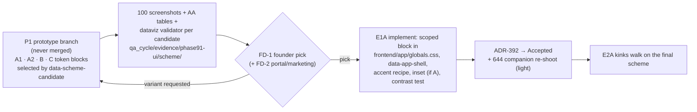
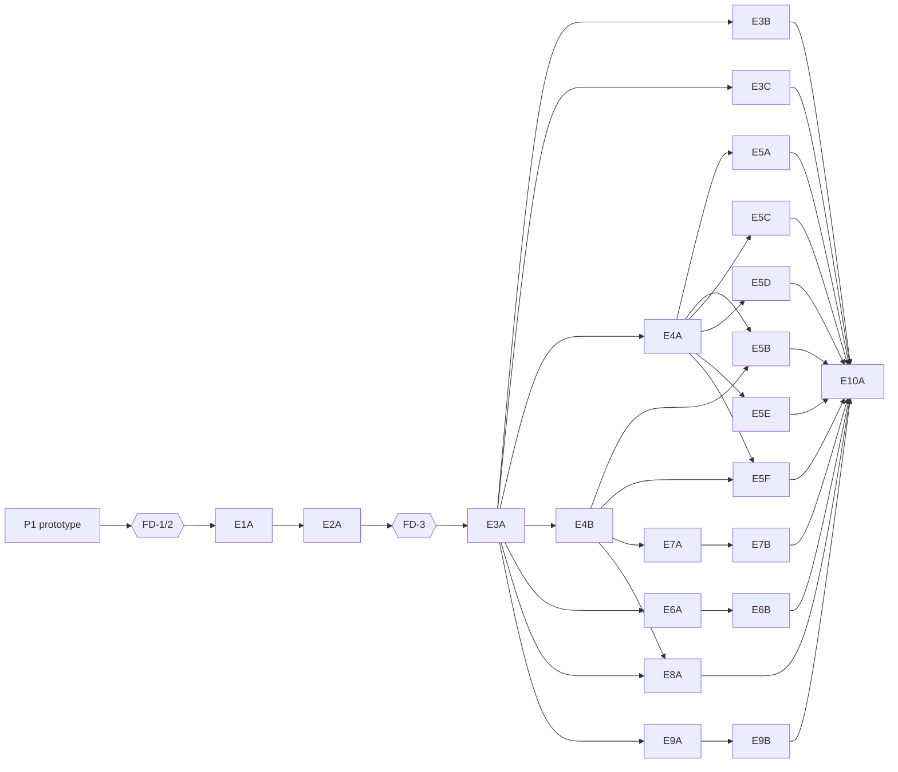

> Merge into ARCHITECTURE.md as **Section 18**.

# Phase 91 — Kazi UI Modernization II: Light-Mode Colour Scheme, Kink Register, Settings and the Daily-Use Long Tail

> Linked from the note lines at the top of ARCHITECTURE.md like Phases 86–93.

> Inputs: `requirements/claude-code-prompt-phase91.md` (founder decisions 1–5 of 2026-11-12, Sections 1–10, constraints, out of scope; refreshed 2026-11-22, sequencing 92 → 93 → 91), `.arch-context-phase91.md` (the verified inventory, measured at `main` @ `5aae8f4ab`; cited below as "inventory §n"), `architecture/phase90-ui-modernization.md` (§15, whose constraints carry over), `.arch-rulings-phase90.md`, and the orchestrator's rulings R1–R7 for this phase (stated where they apply, marked **R1**…**R7**). Code spot-verified at `main` @ `d0098d179` (2026-11-22): the two commits after `5aae8f4ab` touch no file under `frontend/`, `packages/` or `portal/` (`git diff --stat 5aae8f4ab..HEAD -- frontend packages portal` is empty). ADRs 392–396 are written alongside this document. Phase 93 runs **before** this phase and is architecture-only at the time of writing, so every Phase 93 surface named here (the Take-on tab, the Home sign-off widget) is re-scouted by the slice that restyles it. Line numbers are HEAD and move when a slice lands — re-grep, never trust the number.

`FD-n` are this document's founder decisions (§18.10). The requirements' own numbered founder decisions are cited as `RD-n` so the two series never collide.

## 18.0 Requirements corrections

Every row was checked against the code. "Ruling" is what this document does about it.

| # | Requirement says | Code says | Ruling |
|---|---|---|---|
| 1 | Section 7 lists trust sub-pages without `interest` (refreshed), but Section 7 still implies an interest-run surface may exist | `trust-accounting/interest` was deleted by Phase 92 PR #1810 together with `InterestRunWizard`, `DeleteInterestRunDialog`, `LpffRateDialog`; e2e asserts its **absence** (`day-00-firm-setup.spec.ts:278` no "Interest" link; `day-90-review.spec.ts:244` no "LPFF Rate" column) | No interest surface in scope. The removed screen stays removed; no slice may reintroduce a link or column |
| 2 | `other-creditors` and the Rule 54.15 monthly list are "alignment only" | Both already render `PageHeader` (`other-creditors/page.tsx:193`, `reconciliation/lists/[listId]/page.tsx:48,64`) and kit `StatCard`; `other-creditors` already uses DataTable (`FundLedgerTable`, `UnidentifiedDepositsTable`); the monthly list has 2 raw tables (`:104`, `:185`) | Alignment only (§18.3.7): monthly-list tables onto DataTable, `LedgerPager` lifted into the kit, no layout change |
| 3 | Trust page sizes: transactions 530, reconciliation 403, investments 338 | Confirmed at HEAD; `client-ledgers/[clientId]` 457, `reconciliation/new` 970 (`"use client"`, `ReconciliationSplitPane` 815) | Budgets in §18.11 use these numbers |
| 4 | `PageHeader` used by 7 of 58 `org/[slug]` pages; 71 files contain `<h1` | Confirmed (inventory §8.1): 7 page files (8 counting the dashboard, whose header is `dashboard-header.tsx`); 71 files with `<h1`; display-h1 metric (`font-display text-3xl`) 92 | Baseline re-measured at E1A on the then-HEAD (§18.1 baseline) |
| 5 | Direct tables: settings 10, trust 6, invoices 4, legal 1 | Confirmed, but invoices' 4 include `invoices/[id]/edit/(components)/add-disbursements-picker.tsx`, an orphan with no `page.tsx`, and `documents/loading.tsx` adds a 23rd file under `org/[slug]` | The orphan picker and `documents/loading.tsx` are out of scope (no route renders them as a page); the exit metric lists them separately |
| 6 | 63 EmptyState call sites in 53 files | 61 calls of the shared `@/components/empty-state` in 52 files; the other 2 are a **local look-alike** `function EmptyState` in `ai/reviews/reviews-client.tsx:88` (dashed `py-12` block, `<h3>` title) | The guard counts the shared component (61). The local look-alike is deleted and its two uses move onto the shared component (R2, ADR-393) |
| 7 | `dashboard/my-tasks-widget.tsx:59` is an offender | It already passes `variant="compact"` (one of the 8 with a variant, all `compact`) | Not an offender; only the height budget (§18.3.3) applies |
| 8 | "No tasks assigned" copy lives in `lib/messages/en/empty-states.json` | Hard-coded in `my-work/assigned-task-list.tsx:65` and `urgency-task-list.tsx:240` ("No tasks assigned" / "Tasks assigned to you will appear here"); `empty-states.json:27` ("No tasks assigned to you") is used only by `my-work/page.tsx:200` | Copy stays where it is, unchanged. Moving it into the JSON is not required and is not done |
| 9 | Custom-fields one-liner keeps "the same visibility and gating as today" | "Configure Fields" is **ungated**: `CustomFieldSection.tsx:525-535` renders it with no `canManage`/`editable` check, including in the task Sheet (`task-detail-sheet.tsx:321`) | Visible to everyone, as today (RD-4); no gate is added (adding one is a behaviour change) |
| 10 | "Each settings family page gets a `PageHeader` (existing title)" | No family page has a header; each of the 31 tab loaders renders its **own** `<h1>` (`settings-family-page.tsx:96` runs only the active loader), and e2e asserts those h1 texts ("Tax Settings", "Roles & Permissions", "Data Protection", "Rates & Currency", "Notification Preferences", "Custom Fields", "Tags", "General", "Packs", "Templates"; inventory §9 item 1) | **R3**: no family-level h1. Each tab keeps exactly one h1 with its existing text, rendered through `PageHeader` inside the tab (§18.3.4, ADR-394) |
| 11 | Settings forms save "per-section vs per-page, exactly as today" | One tab mixes three models: Firm › General has one "Save Settings" for three cards (`general-settings-form.tsx:341`), its own "Save letterhead" (`letterhead-settings-form.tsx:236`) and an instant-save portal-cadence Select (`portal-settings-section.tsx:75`); Data protection mixes select-with-confirm, a section Save and per-row Save icons | **R4**: `SettingsSection` supports per-card footer save, page-level save, instant-save (no footer) and a destructive variant side by side; it adds no save semantics (ADR-394) |
| 12 | Trust and audit tables move to DataTable "with server-side `?page=` paging, as today" | DataTable pages locally only (`pageSize`, `data-table.tsx:74`; `DataTablePagination` "the page index is local state (nothing is written to the URL, ADR-369)", `data-table-pagination.tsx:25-27`). Transactions, client ledgers, a client's history and reconciliation page on `?page=` with hand-rolled Link pagers (`transactions/page.tsx:224-231,488-520`); the audit log pages with `router.push` buttons (`audit-log-client.tsx:448-458,945-985`); other-creditors already has a `LedgerPager` beside DataTable (`other-creditors/page.tsx:452-496`) | **R5**: DataTable gains an additive server-paged mode (ADR-395, refining ADR-369), built in E4B before the trust and audit-trail slices |
| 13 | Settings nav "below `md` … the walk confirms whether the family tabs compensate" | The rail is `hidden md:block` (`settings/layout.tsx:13-14`); the family's tab strip scrolls at every width (`settings-family-tabs.tsx:84-85`), so tabs **within** a family are reachable, but there is no way to switch **family** below `md` except the app Sheet's single "Settings" item, "Audit trail" or the command palette | **R3**: a horizontal, scrollable family link bar below `md` (§18.2.4, ADR-394) |
| 14 | Section 5 includes the Phase 93 `take-on` tab | Phase 93 is specified on today's primitives (no `SettingsSection` exists): a tab file `matters/_tabs/take-on-tab.tsx`, a wizard rendered in place at `?tab=take-on&batch={id}`, batch-history and paged validation tables, a destructive commit dialog, and a Home widget `take-on-sign-off-widget.tsx` + `sign-off-sheet.tsx` (`phase93-client-trust-take-on.md` §17.8.2, inventory §5.5) | **R7**: frame-only restyle; the slice re-scouts it; Phase 93 owns its behaviour (§18.3.5) |
| 15 | Families "firm, matters, fees, documents, connections"; tabs named by id | Nav order is Firm, Matters, **Documents**, **Fees & Trust**, Connections (`lib/settings-nav.ts:44,115,180,214,275`); `fees?tab=tariffs` is labelled **"Rates"**, `connections?tab=xero` **"Integrations"** | Labels and order unchanged; this document uses the labels in UI-facing tables |
| 16 | Settings rail "sticky under the floating header" | It sticks at `top-14` (`settings-sidebar.tsx:42`), which predates the Phase 90 floating-header offset, and hard-codes its active state (`border-teal-600 bg-teal-50 … dark:bg-slate-800`, `:84`) | Restyled onto `--sidebar`-style tokens and the `top-[calc(var(--app-header-height)+0.5rem)]` offset (§18.3.4) |
| 17 | DataTable features include `containerClassName` | Not a DataTable prop: it belongs to `components/ui/table.tsx:9-18`, which DataTable sets internally (`data-table.tsx:342`) | Slices use `frame`, `stickyHeader`, column `priority`; never `containerClassName` on DataTable |
| 18 | Seed the register with 644's dark-mode debt list | D-1…D-5 are **already fixed** (#1782, #1783, #1785) and guarded by `__tests__/dark-mode-contrast-guard.test.ts`; what remains is shared-component debt (`@b2mash/ui` Card `card.tsx:10`, Badge `badge.tsx:13-29`, Skeleton `skeleton.tsx:7`) and long-tail `dark:` pairs | The register seeds D-1…D-5 as "fixed (PR)" and the shared-component list as open (§18.3.2) |
| 19 | White on `teal-600` ≈ 3.7:1 fails; `teal-700` passes; candidate A uses teal-50/teal-950 | Only `--teal-500` and `--teal-600` are Kazi-tuned (`packages/ui/styles/globals.css:103-104,144-145`); `teal-50`, `teal-700`, `teal-950` are Tailwind's stock palette. `Button variant="accent"` is `bg-teal-600 text-white` (`packages/ui/src/button.tsx:14`, 45 call sites, 24 files in the firm app). A scratch OKLCH→sRGB conversion gives white on teal-600 **3.16:1** (gamut-clamped; the requirements' 3.7 used another mapping — it fails either way). The same pair is the **focused menu item**: `focus:bg-accent focus:text-accent-foreground` (`ui/dropdown-menu.tsx:64,82,113`, `ui/select.tsx:103`) with `--accent: var(--teal-600)`, `--accent-foreground: white` | **R1**: new teal shades are Kazi-tuned OKLCH tokens, not stock utilities (§18.2.1). The light accent failure is fixed in E1A through new `--button-accent` tokens and a light-only `--accent` retune in the scoped block, if FD-1's palette retunes them; otherwise it is kink K-04 (§18.3.2). Dark mode has the same failure — white on teal-600 for the accent button (the recipe is hard-coded, so it is teal-600 in both themes) and white on `--accent: var(--teal-500)` (**2.25:1**, `packages/ui/styles/globals.css:232-233`) for focused menu items — recorded as kink K-21, not fixed here unless FD-1 says so |
| 20 | "App-only overrides in `frontend/app/globals.css`" keep the portal and marketing unaffected | The portal is unaffected (it has its own `portal/app/globals.css:12`). Marketing is **not**: `frontend/app/globals.css` is imported by the root layout for every frontend route — marketing `/` (`app/page.tsx`), auth, mock login, `accept/[token]`, and the pre-org `(app)` routes — and marketing paints its canvas from `body { @apply bg-background }` (`packages/ui/styles/globals.css:283-285`). A plain `:root` override of `--background`/`--ring` there reaches marketing | **R1 refined**: the light-scheme block in `frontend/app/globals.css` is scoped to the firm shell with `:root:not(.dark):has([data-app-shell="firm"])` (§18.2.1, ADR-392). Without the scope R1's "marketing unaffected" would not hold |
| 21 | Light pass includes `platform-admin/{access-requests,billing,demo}` | These live at `frontend/app/(app)/platform-admin/…`, **not** under `org/[slug]`: outside the 58-page metric and outside the `/org/` themed prefix, so always light (`theme-config.ts`, ADR-371) | In the light pass for PageHeader/EmptyState/tables; observed in **light only**; excluded from the PageHeader-adoption metric |
| 22 | Light pass includes "documents" | `$FA/documents/` holds only `actions.ts` + `loading.tsx` (no page) | Dropped (no route) |
| 23 | Candidate A uses `SidebarInset variant="inset"` | Supported by the installed CLI file (`ui/sidebar.tsx:181`; wrapper `has-data-[variant=inset]:bg-sidebar` `:158`; inset margins `:333`); AppSidebar uses the default `"sidebar"` variant (`app-sidebar.tsx:200-205`); `<main id="main-content">` paints its own `bg-background` (`$FA/layout.tsx:142`); AppHeader is `sticky top-2 mx-2 mt-2` inside `SidebarInset` (`app-header.tsx:29`) | E1A handles all three if FD-1 picks A (§18.3.1); `SidebarInset` stays a `<div>` (`ui/sidebar.tsx:325`) so `<main>` remains the only main landmark |
| 24 | Fee-note detail hero "using the `hero-tiles.ts` server-only pattern and the shared `tileFrom`/`overdueHint` module" | `lib/hero-tiles.ts` exists (642B) but is `import "server-only"` (`:1`), and the fee-note detail's state is **client-owned**: `useInvoiceDetail` holds `useState(initialInvoice)` and every action replaces it with `setInvoice(result.invoice)` (`use-invoice-detail.ts:39,126…319`) without a server re-render. Server-computed tiles would show the pre-action Paid/Balance after "Record Payment" while the totals section shows the new one | **ADR-396**: the fee-note hero tiles are derived on the client from the same `invoice` state as the totals, by a pure mapper; `hero-tiles.ts` is not used (§18.3.6) |
| 25 | Fee-note KPI strip includes "due date or days overdue" | "Days overdue" text already exists in the product: `formatDaysOverdue` → "{n}d overdue" / "Due today" / "{n}d until due" (`collections-history-table.tsx:138-142`), rendered on the fee-note detail page itself in "Collection activity"; an identical private copy is in `invoices/collections/collections-client.tsx:31-35` | Reused, no new copy (§18.10 X3). Both private copies are consolidated into `lib/format.ts`: E6A moves the function and repoints `collections-client.tsx`; E6B repoints `collections-history-table.tsx` |
| 26 | Fee-notes list gets "a StatCard row only from existing reads (e.g. outstanding, overdue, billed this period)" | The list **already has four tiles** with labels and testids: "Total outstanding", "Overdue", "Approved, not sent" (from `GET /api/invoices/outstanding-summary`, gated `FINANCIAL_VISIBILITY`) and "Paid This Month" (computed from the listed rows), via a local `SummaryTile` (`invoices/page.tsx:48-66,193-226`). "Billed this period" has no read | The four existing tiles move onto kit `StatCard` with their labels and testids; no "billed this period" tile (R6). "Paid This Month" sums every listed row's `total` regardless of currency and takes the last row's currency (`:24-42`) — a pre-existing breach of the mixed-currency rule (rulings §6), kept as is and raised as FD-10 |
| 27 | Diary: postponed/cancelled/heard entries visually distinct with icon and label | Diary rows render no court-date status (`diary-event-row.tsx`, `diary-list-view.tsx`); the status only drives row actions (`diary-row-actions.tsx:57`). The labels "Scheduled", "Postponed", "Heard", "Cancelled" exist in `legal/court-date-list-view.tsx:28-44` | Reuse those labels with an icon; whether non-SCHEDULED court dates reach the diary feed at all is observed first (§18.3.8) |
| 28 | Carry-forwards: sidebar density F2, sort chevrons F1, palette focus, sensitive-events false all-clear | All four **open** at HEAD (inventory §1.4): F2 is worse (the Trust group has 7 items, `lib/nav-items.ts:227-283`); F1 `data-table-column-header.tsx:37` always draws the inactive `ChevronsUpDown`; no focus handling in `command-palette-dialog.tsx`; `sensitive-events-widget.tsx:124` `const events = recent ?? [];` renders the clean "No sensitive events…" state when the read failed | F1 → E4B; F2, palette focus, sensitive events → E3C (grouping is FD-6; the sensitive-events fix needs error copy, FD-4) |
| 29 | Token-contrast test proves the scheme | `__tests__/theme/color-math.ts` `readBlock(css, ":root" \| ".dark")` (`:39`) reads only those two selectors from each file | E1A extends the loader to read the scoped firm block and asserts every candidate pair (§18.8.3) |
| 30 | Fee-note detail uses `DetailHero` with "the existing actions" and title | `DetailHero.title` is typed `string` (`components/shared/detail-hero.tsx:25`); the fee-note h1 contains a `HelpTip` (`invoice-header-actions.tsx:47-50`) | E6B widens `title` to `ReactNode` (backward compatible: matters and clients pass strings; their tests re-run) |
| 31 | Trust and audit tables move onto DataTable | DataTable takes function props and must be rendered **only from a `"use client"` module** — a thin per-page wrapper that receives serializable props (`data-table.tsx:3-7`, Phase 90 OQ #19); the trust pages are server components whose pagers are closures (`transactions/page.tsx:214-231`) | Every migrated table gets a per-page client wrapper that receives rows, `pageIndex`, `pageCount`, the query as a plain object and the base path, and builds `hrefFor`/`rowHref`/row actions itself (§18.2.5, ADR-395) |
| 32 | "If the breakdown exceeds 20 slices, split Sections 8–9 into Phase 92 rather than cramming" | With the slice-size cuts (E3A, E5A, E5D each split in two) the phase is 21 slices, which would trigger that rule | **Rule waived by the founder** (FD-12, ruled 2026-11-22): Sections 8–9 stay in Phase 91 as E8A, E9A, E9B; Phase 91 is 21 slices plus P1 |

## 18.1 Overview

Phase 90 built Kazi's design system and moved the four surfaces a design partner sees first onto it: the shell, Home, matters and clients, and the trust dashboard and profitability. Everything else still hand-builds its header, tables, cards and empty states, so a demo that opens on the polished dashboard falls back into the old look as soon as it clicks into Settings, a fee note or a trust ledger. Phase 90 also used its new primitives at the wrong size: page-level empty states render inside small sections ("No tasks assigned", "No custom fields configured" in a narrow Sheet).

This phase makes the firm app look like one product. It is a **visual phase**: labels, tab names, routes, `?tab=` mechanics, `data-testid`s, gating, save semantics and visible copy do not change. It adds no endpoint, entity or migration (R6). In order:

1. **Light-mode colour scheme**, decided design-first. Three candidates are prototyped on an unmerged branch; the founder picks one (FD-1); the pick is implemented as tokens scoped to the firm shell and merges before any other surface slice. This reverses Phase 90's deliberate slate-950 light rail ([ADR-392](../adr/ADR-392-firm-app-light-mode-colour-scheme.md)).
2. **Kinks register**: a real-browser walk of every page as owner and member, at 1024/1440 in light and dark and 390 for the shell and settings, approved by the founder (FD-3) before surface work starts.
3. **One EmptyState sizing rule**, enforced at every call site by a vitest source-scan guard ([ADR-393](../adr/ADR-393-emptystate-sizing-rule-and-enforcement.md)).
4. **Settings shell + section cards**: a restyled settings rail, a family switcher below `md`, the 642C underline tab style, and a `SettingsSection` primitive that carries every save model the tabs use today ([ADR-394](../adr/ADR-394-settings-shell-section-cards-and-mobile-nav.md)).
5. **Fee notes and the trust sub-pages** fully on the Phase 90 primitives, with a server-paged DataTable mode for the `?page=` tables ([ADR-395](../adr/ADR-395-datatable-server-paged-mode.md)) and a client-derived fee-note hero ([ADR-396](../adr/ADR-396-fee-note-detail-hero-client-derived-tiles.md)).
6. **Diary, My Work, timesheet and notifications** fully on the primitives (Section 8), and a **light pass** over compliance, conflict check, the legal registers, team, AI reviews, information requests and platform admin (Section 9).

### What's new

| Surface | Existing at HEAD `d0098d179` | After Phase 91 |
|---|---|---|
| Light scheme | slate-950 rail, white text, black primary buttons (`frontend/app/globals.css:27-36`; `--primary: var(--slate-950)` shared) | the FD-1 candidate, written as a scoped token block in `frontend/app/globals.css` that applies only inside the firm shell in light mode; Kazi-tuned teal steps; dark mode unchanged; portal and marketing unchanged (FD-2) |
| Kinks | carry-forwards scattered across the 644 closure report | `qa_cycle/evidence/phase91-ui/kinks-register.md`, founder-approved, every item owned by a slice or backlogged with a reason |
| EmptyState | 53 of 61 shared calls default to the page-level block | every call passes `variant` (guarded; allowlist empty at exit, `variant` then required in the type); section/card/sheet states `compact`; one-line slots `inline`; the AI-reviews look-alike gone |
| Settings shell | desktop-only rail at `top-14`, hard-coded teal active state; pill tab strip; per-tab hand-rolled cards | token-driven rail at the floating-header offset; family link bar below `md`; underline tab strip; `SettingsSection` cards with right-aligned actions on all 32 tabs and 11 sub-pages |
| DataTable | client mode only (local `pageSize`) | + server-paged mode (`pagination` prop: URL page links or a callback), inactive sort chevrons no longer widen tables (F1) |
| Fee notes | inline h1, raw table, local `SummaryTile`, no hero | `PageHeader`, DataTable (client mode + CSV), the four existing tiles on `StatCard`; detail `DetailHero` with a 4-tile strip derived from the live fee note |
| Trust sub-pages | inline h1s, raw tables, three hand-rolled pagers | `PageHeader`, DataTable (server-paged where `?page=` exists), status chips on the badge helpers; domain logic untouched |
| Personal pages | inline h1s, page-sized empties in sections | `PageHeader`, kit lists/tables, `compact` empties (My Work sections in E3A); diary statuses with icon + label |
| Light-pass pages | inline h1s, raw tables, page-sized empties | `PageHeader`, DataTable where a table exists, correct EmptyState variants |
| Backend | — | **none** (R6) |

### Scope at HEAD

- **Numbering.** Section 18; ADRs 392–396; epics continue at **661** (Phase 92 = 645–652, Phase 93 plans 653–660); no Flyway migration (§18.7).
- **In scope.** Requirements Sections 1–10 as corrected in §18.0 (the ">20 slices" split rule is waived, FD-12). Settings counts are **32 tabs** (Matters 8 once Phase 93's `take-on` lands) and **11 sub-pages**; settings route count stays 17 (ADR-341).
- **Out of scope** (unchanged from the requirements): portal restyle (unless FD-2), marketing redesign, any settings IA change, any copy/label/route/testid change not approved through the register, new features, bulk actions, write endpoints, entities, migrations, trust domain logic, MCP, AI skills, template packs, Tiptap editor internals, a theme customizer or a second light scheme, folder renames, full redesign of the light-pass pages, and the backend carry-forward F-4 (`ProjectUpcomingDeadlinesService` status filter — "target zero backend").

### Baseline statement

Phase 93 lands between this document and the first build slice, so every number here is provisional. **E1A records the baseline on its own HEAD before editing**, with these commands (inventory §8.1; `B='frontend/app/(app)/org/[slug]'`), and the exit slice compares against that record, not against this table:

| Metric | Command | Now (`5aae8f4ab` ≡ `d0098d179` for frontend) |
|---|---|---|
| Pages under `org/[slug]` | `find "$B" -name page.tsx \| wc -l` | 58 (Phase 93 adds none: the wizard renders inside `?tab=take-on`) |
| `PageHeader` adoption | `find "$B" -name page.tsx -exec grep -l "PageHeader" {} + \| wc -l` | 7 (+ dashboard via `dashboard-header.tsx`) |
| Files with `<h1` | `grep -rl '<h1' "$B" \| wc -l` | 71 |
| Display h1 | `git grep -c "font-display text-3xl" -- frontend/app frontend/components \| awk -F: '{s+=$NF} END {print s}'` | 92 |
| Direct tables by area | `grep -rlE "<Table\b\|<table\b" "$B"` grouped by first path segment | settings 10, trust-accounting 6, invoices 4, legal 1, documents/loading 1 |
| EmptyState calls without `variant` | the E3A guard's report (TS compiler walk, §18.8.3); interim: the perl multi-line scan of inventory §4.1 | 53 shared (55 incl. the look-alike) → **0** at Phase 91's exit (allowlist empty) |
| Raw hex (PCRE, `*.tsx`) | `git grep -nP "#[0-9a-fA-F]{3,6}\b" -- "frontend/components/**/*.tsx" "frontend/app/**/*.tsx" \| wc -l` | 32 |
| `dark:` lines, whole frontend | `git grep -c "dark:" -- "frontend/**/*.ts" "frontend/**/*.tsx" \| awk -F: '{s+=$NF} END {print s}'` | 3647 |
| Suites | `legal-lifecycle`, `legal-depth-ii`, default suite pass counts on a fresh stack (`e2e-down` → `e2e-up`) | recorded at E1A |

## 18.2 Design model

**There is no domain model change.** No entity, table, column, enum value, capability, endpoint, Flyway migration, cache or seed is added, changed or removed (R6). Unchanged and relied on: the five settings families, their tab ids, labels and order, `resolveSettingsTab` fallback and the "only the active loader runs" rule (`lib/settings-nav.ts`, `settings-family-page.tsx:96`, ADR-341); every server action and save handler; every read and its gate; `NAV_GROUPS` content and order (ADR-339); the dark token blocks (`packages/ui/styles/globals.css:217-274`, `frontend/app/globals.css:46-58`); the theme provider and head script (ADR-371, ADR-374). What this section defines is the frontend design model: the light-scheme tokens and the new or extended primitives.

### 18.2.1 Light-scheme token model ([ADR-392](../adr/ADR-392-firm-app-light-mode-colour-scheme.md))

**Where the tokens live (R1, refined by §18.0 row 20).** One new block at the end of `frontend/app/globals.css`:

```css
/* Phase 91 light scheme — firm shell only (ADR-392). Light only: never matches under .dark.
   Specificity (0,3,0) beats the shared :root (0,1,0) and the app :root above; .dark never
   matches this selector, so the dark blocks keep winning in dark mode. */
:root:not(.dark):has([data-app-shell="firm"]) {
  /* the FD-1 candidate's values (table below) */
}
```

- `data-app-shell="firm"` is set by the org layout on the `SidebarProvider` wrapper (`$FA/layout.tsx`; the wrapper spreads its props onto `div[data-slot=sidebar-wrapper]` — verify at build, else wrap it in a `div` with the attribute). Only the firm shell renders it, so marketing `/`, auth, mock login, `accept/[token]` and the pre-org `(app)` routes keep today's tokens, and the portal never loads this file.
- Tokens are set on `:root` (not on the wrapper) so Radix portals — dialogs, sheets, popovers, menus, toasts, which mount under `<body>` — receive them too. Scoping on the wrapper element instead was rejected for exactly that reason (ADR-392 option 3).
- `:has()` re-evaluates on DOM change, so a client navigation from `/` into `/org/…` switches the scheme without a reload; the theme head script (ADR-374) is not touched.
- No existing token value in the shared file `packages/ui/styles/globals.css` changes (R1). The scheme adds two **new** shared tokens, `--button-accent` and `--button-accent-foreground`, whose shared `:root` and `.dark` values are today's teal-600 and white, and one recipe line in `button.tsx` that reads them (below). Both are pixel-identical everywhere the scoped block does not match — marketing, auth, `accept/[token]`, the portal and **dark mode**.

**Kazi-tuned teal steps.** Candidates need lighter and darker teals than the two Kazi defines. They are added as raw tokens in `frontend/app/globals.css` `:root` (unscoped raw scale, consumed only by the scoped block) with a `kazi-` prefix so nobody mistakes them for Tailwind's stock `teal-*` utilities, which stay stock:

| Token | Value † | Hex (scratch) | Role |
|---|---|---|---|
| `--kazi-teal-50` | `oklch(96.5% 0.022 183)` | `#e4f9f5` | tint fill (B/C hover; A optional) |
| `--kazi-teal-100` | `oklch(92.5% 0.04 183)` | `#caf0e9` | active-pill fill (A) |
| `--kazi-teal-700` | `oklch(50% 0.11 184)` | `#00776a` | primary/accent fill with white text; rail indicator on light rails |
| `--kazi-teal-950` | `oklch(28% 0.05 190)` | `#00312e` | text on teal tints; base of rail C |

† Starting values from the scratch conversion in §18.6.1; the prototype (P1) tunes them and E1A's contrast test is authoritative. Hue stays within 183–190 so every step reads as the same teal as `--teal-500`/`--teal-600`.

**What each candidate sets** (requirements Section 1 starting points; values † to be tuned in P1). Tokens not listed keep today's value. `--card` is **unchanged in every candidate** on purpose: the chart palette was validated against the card surface (`#fdfeff`, `packages/ui/styles/globals.css:11-27`), so keeping the card keeps that validation true; P1 and E1A still re-run the checks against the new canvas.

| Token | A — light rail, inset canvas | B — tinted rail | C — deep-teal rail |
|---|---|---|---|
| `--sidebar` | `oklch(96.5% 0.005 260)` `#f1f3f7` | `oklch(94% 0.016 215)` `#e0eef2` | `oklch(28% 0.05 195)` `#003030` |
| `--sidebar-foreground` | `var(--slate-700)` | `var(--slate-900)` | white |
| `--sidebar-accent` (active/hover fill) | `var(--kazi-teal-100)` | `oklch(100% 0 0)` (white pill) | `oklch(100% 0 0 / 8%)` |
| `--sidebar-accent-foreground` | `var(--kazi-teal-950)` | `var(--slate-900)` | white |
| `--sidebar-primary` (2px active bar, `SIDEBAR_ACTIVE_BAR`) | `var(--kazi-teal-700)` | `var(--kazi-teal-700)` | `var(--teal-500)` (unchanged) |
| `--sidebar-primary-foreground` | white | white | `var(--slate-950)` (unchanged) |
| `--sidebar-border` | `var(--border)` | `oklch(88% 0.016 215)` | `oklch(100% 0 0 / 10%)` (unchanged) |
| `--sidebar-ring` | `var(--ring)` | `var(--ring)` | `var(--teal-500)` (unchanged) |
| `--background` (canvas) | `oklch(99.6% 0.002 260)` — the inset card is the work surface | `oklch(99.6% 0.002 260)` | unchanged `oklch(97.2% 0.004 260)` |
| `--border` | unchanged | unchanged | unchanged |
| `--primary` / `-foreground` | A1 `var(--slate-900)` / white · A2 `var(--kazi-teal-700)` / white | `var(--slate-900)` / white | `var(--kazi-teal-700)` / white |
| `--accent` / `-foreground` (focused menu/select items; scoped light block only) | `var(--kazi-teal-700)` / white | `var(--kazi-teal-700)` / white | `var(--kazi-teal-700)` / white |
| `--button-accent` / `-foreground` (new; `variant="accent"` buttons; scoped light block only) | `var(--kazi-teal-700)` / white | `var(--kazi-teal-700)` / white | `var(--kazi-teal-700)` / white |
| `--ring` | unchanged `oklch(58% 0.13 183)` | unchanged | unchanged |
| Shell structure | `Sidebar variant="inset"`; `<main>` drops its own `bg-background` (the inset card paints it) | default variant | default variant |

Why `--accent` and `--button-accent` move in every candidate: `--accent` is the focused menu-item fill (`ui/dropdown-menu.tsx:64`, `ui/select.tsx:103`) and `--button-accent` the `variant="accent"` button fill. White on teal-600 fails AA in both places today (§18.0 row 19); `--kazi-teal-700` passes (§18.6.1). They are two tokens, not one, because `--accent` already differs by theme: `.dark` sets `--accent: var(--teal-500)` with white text (`packages/ui/styles/globals.css:232-233`), so pointing the button recipe at `--accent` would lighten every dark-mode accent button from teal-600 to teal-500 (2.25:1). Both overrides live only in the scoped `:root:not(.dark)` block, so dark mode is untouched. Why A offers two primaries: slate-900 (A1) keeps today's hierarchy — a black default button beside a teal accent "Approve"/"Send fee note" (`invoice-header-actions.tsx:68,77,87`) — while teal-700 (A2) is brand-forward but makes `default` and `accent` buttons the same colour, flattening that hierarchy. FD-1 decides; the recommendation is A1 (§18.10).

**The `accent` button recipe** (`packages/ui/src/button.tsx:14`): `bg-teal-600 text-white hover:bg-teal-600/90` → `bg-(--button-accent) text-(--button-accent-foreground) hover:bg-(--button-accent)/90` — the `(--x)` arbitrary-property form, which tailwind-merge handles (638B lesson). `packages/ui/styles/globals.css` gains `--button-accent: var(--teal-600)` and `--button-accent-foreground: oklch(100% 0 0)` in both `:root` and `.dark`, so every surface outside the scoped light block — marketing CTAs, `accept/[token]`, the portal, and every theme's dark mode — renders the same pixels; only the scoped firm light block overrides them to `--kazi-teal-700`/white. These are the scheme slice's only `packages/ui` edits and they trigger PORTAL-GATE. They ship only if FD-1's palette retunes the accent (all three candidates do); otherwise the light failure stays kink K-04. The dark failure (K-21) is unchanged either way.

**Brand colour.** `--brand-color` stays a 3px accent bar beside the org name (`app-sidebar.tsx:225-236`), never text (G-A3). It is decorative (the org name carries the identity), so no ratio is required, but P1 shows a real non-teal brand on each rail: a dark burgundy `#7b2432` reads at 8.9:1 on rail A and 8.3:1 on B but 1.5:1 on C (the Phase 88 "dark brand on a dark rail" problem returns); a gold `#e7b643` is the reverse (1.7 on A, 7.6 on C). Recorded per candidate in the P1 pack.

### 18.2.2 `SettingsSection` and `SettingsActionBar` ([ADR-394](../adr/ADR-394-settings-shell-section-cards-and-mobile-nav.md))

`frontend/components/settings/settings-section.tsx` (L2 per [ADR-367](../adr/ADR-367-design-system-layering.md); no `"use client"`, server-safe, composes `@b2mash/ui` `Card`). It is layout only: it owns no form state, submits nothing and adds no confirmation.

| Prop | Type | Default | Notes |
|---|---|---|---|
| `title` | `ReactNode` | — | optional. When present it is rendered as a heading with **today's text at today's level** (`as`). A section that has no heading today gets **no** title — no new copy (§18.10 X3) |
| `as` | `"h2" \| "h3"` | `"h2"` | the level the section's heading has today (most settings cards use `h2`, e.g. `TaxSettingsForm.tsx:55`, `general-settings-form.tsx:181`; pack cards keep `h3`, asserted by `packs.spec.ts:122`) |
| `description` | `ReactNode` | — | only where a description line exists today |
| `actions` | `ReactNode` | — | right-aligned in the header row (e.g. "Add tax rate", "New template") — existing buttons passed in unchanged |
| `children` | `ReactNode` | required | the fields, table or list. A table inside uses DataTable `frame={false}` |
| `footer` | `ReactNode` | — | **per-card save**: the form's existing Save button (and its existing status message) right-aligned in a `CardFooter` with a top border. Absent → no footer (instant-save cards, read-only cards, page-level save) |
| `status` | `ReactNode` | — | left side of the footer: the form's existing saving/dirty/saved text or `role="status"` message, rendered where it is today relative to the button |
| `variant` | `"default" \| "destructive"` | `"default"` | destructive = `border-destructive/40` frame and a `bg-destructive/5` header wash (tokens only); for danger-zone blocks (anonymise, Disconnect Xero, revoke MCP access, uninstall pack). No heading text is added ("Danger zone" is new copy); the existing button and its existing `AlertDialog`/`window.confirm` stay |
| `data-testid`, `className`, `id` | | | passthrough; existing section testids (`trust-accounts-section`, `retention-card`) move onto the root |

`SettingsActionBar` (same file): `{ children: ReactNode; status?: ReactNode; sticky?: boolean }` — the **page-level save** row: right-aligned actions after a group of sections (Firm › General's one "Save Settings" for Currency, …, Branding; `general-settings-form.tsx:339-345`). `sticky` (default off) pins it to the bottom of the viewport only for tabs whose single save sits below a long form; enabling it is a slice decision recorded in the PR, because a sticky bar changes what is visible at 1024.

The four save models side by side on one tab (Firm › General):

```tsx
<PageHeader title={<>General <HelpTip code="org.general" /></>} />
<GeneralSettingsForm>                       {/* unchanged state + handleSave */}
  <SettingsSection title="Currency">…</SettingsSection>
  <SettingsSection title={…}>…</SettingsSection>
  <SettingsSection title="Branding">…</SettingsSection>
  <SettingsActionBar status={message}>
    <Button disabled={saving || !colorValid} onClick={handleSave}>Save Settings</Button>
  </SettingsActionBar>
</GeneralSettingsForm>
<SettingsSection title="Letterhead" footer={<Button …>Save letterhead</Button>}>…</SettingsSection>
<SettingsSection title="Portal">…{/* Select saves on change; no footer */}</SettingsSection>
<SettingsSection variant="destructive" …>…{/* logo delete keeps its confirm */}</SettingsSection>
```

(Section titles shown are the existing headings; the slice copies each from the file it edits.)

### 18.2.3 EmptyState variants and the rule ([ADR-393](../adr/ADR-393-emptystate-sizing-rule-and-enforcement.md))

The props stay as they are (`empty-state.tsx:10-21`); two things change:

1. **Every call site passes `variant`**, enforced by a vitest source-scan guard (§18.8.3) that fails on any `<EmptyState` JSX element without a `variant` attribute. The prop stays optional in the type and keeps its `"default"` fallback while the sweep ratchets: the guard carries an allowlist of files owned by later surface slices, each slice deletes its entries, and the slice that deletes the last entry also makes `variant` required in the type (belt and braces). Not a default-prop change (R2): switching the fallback to `compact` would silently shrink the ≈40 genuine page-level and tab-panel states.
2. **The JSDoc states the rule**:

| Variant | Use when | Markup |
|---|---|---|
| `default` | the empty state **is** the whole content of a page or of a page-level tab panel | `gap-3 py-16`, 48px icon tile, `h2` title |
| `compact` | inside a section, card, widget, chart card, dialog body or Sheet — with **at most a one-line description and one optional action** | `gap-2 py-8`, 40px icon tile, `h2` title |
| `inline` | a table body or a single-line slot (one row: icon, title, description, action) | `py-3 text-sm` row, title is a `<p>` |

**No new variant.** The requirements allow one smaller than `compact` "for example one row with an icon, text and a trailing link"; `inline` already is that row. The custom-fields one-liner (RD-4) uses `inline`. Whether the one-liner keeps the existing description visible is FD-7 (recommendation: keep it; it wraps to a second line only in the task Sheet).

**Height budget** for a section-level empty (requirements Section 3, "not taller than about one populated row group"), computed from the real classes (`empty-state.tsx:92-114`): `py-8` (2 × 32px) + icon tile `size-10` (40) + `h2 text-base` (24) + description `text-sm` (20 per line) + `gap-2` (8) between children + an action row `mt-2` + `Button size="sm"` `h-8` (8 + 32, `packages/ui/src/button.tsx:29`):

| `compact` content | Height |
|---|---|
| one-line description, no action | 64 + 40 + 24 + 20 + 2×8 = **164px** |
| one-line description + one action | 64 + 40 + 24 + 20 + 3×8 + 40 = **212px** |
| two-line description, no action | 184px |
| two-line description + one action | 232px — over budget |

The budget is **≤ 13.25rem (212px)** for the EmptyState box (the section's own heading excluded), measured in the 1440 light OBS at the container's real width. Rule: `compact` gets at most a one-line description (at that width) plus an optional single action; anything that does not fit uses `inline` (`py-3` + one 20px line ≈ 44px, wrapping only in very narrow containers).

**Heading side effect.** `default`/`compact` render the title as `h2` (`empty-state.tsx:101-108`). Moving a site to `inline` turns its title into a `<p>`; a site whose title is asserted as a heading by e2e (`project-crud.spec.ts:144` "No time tracked yet"; inventory §4.4) stays `default` or `compact`. The AI-reviews look-alike's titles were `h3`; on the shared component they become `h2` inside the tab panel — no e2e asserts them (grep at HEAD: 0 hits for "No pending reviews"/"No review history" in `frontend/e2e`).

`secondaryLink`'s hard-coded `text-teal-600 hover:text-teal-700` (`:58,62`) becomes `text-primary underline underline-offset-4` (the link follows the scheme and is identified by its underline, not by colour alone; teal-600 on white is 3.16:1, below AA for body-size text). This is the only visual change to the component itself.

### 18.2.4 Settings navigation: rail and mobile family bar ([ADR-394](../adr/ADR-394-settings-shell-section-cards-and-mobile-nav.md))

- **Rail** (`components/settings/settings-sidebar.tsx`, restyled in place): `nav aria-label="Settings navigation"` unchanged; families as today (only the active family expands its tabs); active family `aria-current="page"`, active tab `aria-current="true"` unchanged; styling moves to tokens — active tab `bg-muted text-foreground font-medium` plus the same 2px `before:` bar the main sidebar uses (`SIDEBAR_ACTIVE_BAR` in `components/shell/sidebar-styles.ts`, in `bg-primary`), inactive `text-muted-foreground hover:bg-muted hover:text-foreground`. Sticky at `top-[calc(var(--app-header-height)+0.5rem)]`, height `calc(100svh-var(--app-header-height)-1rem)`.
- **Mobile family bar** (`components/settings/settings-family-bar.tsx`, new, client — it reads `usePathname` for the active family like the rail): rendered by `settings/layout.tsx` above the content in a `md:hidden` wrapper; the rail keeps `hidden md:block`. Below `md` exactly one of the two is in the accessibility tree (`display: none` removes the other), so both carry the existing name **"Settings navigation"** without a duplicate landmark.

| Prop | Type | Notes |
|---|---|---|
| `slug` | `string` | |
| (internal) | | five `Link`s to `family.href(slug)` in `FAMILIES` order with each family's icon and label; active = `aria-current="page"` + the underline from `tab-underline.ts`'s **`aria-current="page"` variant** (links carry no `aria-selected`; §18.2.6); `ScrollArea` horizontal with edge fades; the active link scrolls into view on mount |

Why links and not a `Select` (R3; ADR-394 options): a link bar needs no client navigation code (a Select needs `onValueChange` → `router.push`, i.e. new behaviour), keeps prefetch, middle-click and the real URL, shows the current family without opening anything, and is one tap to switch; five labels fit at 390px with at most one scroll. The bar does not repeat the tab list — the family's own tab strip below it already scrolls.

### 18.2.5 DataTable server-paged mode ([ADR-395](../adr/ADR-395-datatable-server-paged-mode.md))

Additive prop on `DataTable` (`components/data-table/data-table.tsx`), mutually exclusive with local paging, CSV and selection **at the type level** (a discriminated union on the props):

| Prop | Type | Notes |
|---|---|---|
| `pagination` | `{ pageIndex: number; pageCount: number; hrefFor: (pageIndex: number) => string } \| { pageIndex: number; pageCount: number; onPageChange: (pageIndex: number) => void }` | zero-based like every backend page today (`transactionPage.pageNumber`, `other-creditors` `page.number`); URL-owned (`hrefFor`, links) or callback-owned (`onPageChange`, buttons) — the same split the `sort` prop already has |
| `paginationLabel` | `string` | optional; wraps the pager in `<nav aria-label>` only where one exists today (audit log: "Audit log pagination", `audit-log-client.tsx:945`) |
| `paginationShowSingle` | `boolean` | default `false` = nothing rendered when `pageCount <= 1` (trust pagers, `LedgerPager`); `true` keeps the audit log's always-visible pager |
| — | | with `pagination`: `pageSize`, `exportCsv` and `selectable` are `never`; `columnVisibility` defaults to `false` (state would reset on every page navigation) |

The pager (`components/data-table/data-table-page-links.tsx`, new; lifts `LedgerPager`, `other-creditors/page.tsx:452-496`) renders exactly today's copy and roles: the text "Page {n} of {m}", and "Previous"/"Next" as `Button asChild variant="outline" size="sm"` → `Link` when enabled and a disabled `Button` at the ends (the trust pagers), or plain buttons calling `onPageChange` (the audit log). Accessible names stay "Previous"/"Next" — **not** the local pager's "Go to previous page" `aria-label` (`data-table-pagination.tsx:62,72`). TanStack is untouched: the rows are the page the server sent, `manualPagination` stays on (`data-table.tsx:272`), and no pagination state enters the table.

**Only from a client wrapper.** `hrefFor`, `onPageChange`, `rowHref`, `rowTestId` functions and column definitions are functions, so DataTable is rendered **only from a `"use client"` module** (`data-table.tsx:3-7`; Phase 90 OQ #19; the `MattersDataTable`/`ClientsDataTable` precedent). Each server-paged page renders a thin per-page wrapper (its columns module) and passes only serializable props: the rows, `pageIndex`, `pageCount`, the current query as a plain object (`Record<string, string>`) and the base path (plus any serializable context the rows need, e.g. `currentMemberId` for approvals). The wrapper builds `hrefFor` with `buildPageHref(basePath, query, pageIndex, param = "page")` (`lib/page-href.ts`, new in E4B, pure): it keeps every query param and sets `param`, which is exactly today's `pageUrl` (`transactions/page.tsx:224-231`) and covers other-creditors' `page`/`itemsPage` lists. Filter links stay server-built (they are plain `href` strings).

### 18.2.6 Small primitive changes

| Change | Where | Why |
|---|---|---|
| Inactive sort chevron no longer adds width (F1) | `data-table-column-header.tsx:37` | the always-drawn inline `ChevronsUpDown size-3.5` widened the matters table 844 → 904px in a 718px container (641A F1). The inactive chevron stays **visible at all times** at low opacity (`opacity-40`, no hover-only reveal — sortability must be discoverable without a pointer) but is positioned `absolute` inside padding reserved on sortable headers (`pr-5` on the header cell, the icon at its end), so it occupies no column width; the active icon uses the same slot, so sorting never shifts the column. `aria-sort` unchanged. E4B measures the matters table at 1024 before/after |
| `rowTestId` accepts a function | `data-table.tsx` (`rowTestId?: string \| ((row: T) => string)`) | trust tables are asserted by per-row ids (`transaction-row-<id>`, `history-row-<id>`, `investment-row-<id>`, `statement-row-<id>`, `disbursement-row-<id>`; inventory §9 item 6); a constant string cannot express them. Additive; a string still means "same id on every row" |
| Tab underline style shared | `components/shared/tab-underline.ts` (new), extracted from `grouped-tab-bar.tsx:46-78`: the edge-fade constants and **two exported variants** of the `after:` underline — `TAB_UNDERLINE_SELECTED` keyed on `aria-selected=true` (GroupedTabBar, settings family tabs; 642C lesson 4: key on `aria-selected`, not `data-state`) and `TAB_UNDERLINE_CURRENT` keyed on `aria-current=page` (the mobile family link bar, whose items are links, not tabs) | one look without forking, and each variant keys on the attribute its element actually carries |
| `formatDaysOverdue` shared | two identical private copies (`collections-client.tsx:31-35`, `collections-history-table.tsx:138-142`) consolidated into `lib/format.ts`: E6A moves it and repoints the collections client; E6B repoints the history table | the fee-note hero's due tile reuses the existing strings (§18.0 row 25); one definition instead of two |
| Fee-note hero mapper | `lib/fee-note-hero.ts` (new, pure, no `server-only`): `feeNoteHeroTiles(invoice: InvoiceResponse, todayIso: string): HeroTile[]` | ADR-396; tiles in §18.3.6 |
| `DetailHero.title` widened | `components/shared/detail-hero.tsx:25`: `title: string` → `title: ReactNode` (E6B) | the fee-note h1 contains a `HelpTip`; backward compatible — matters and clients pass strings, and their header tests re-run unchanged |
| Court-date status badge shared | `components/legal/court-date-status-badge.tsx` (new) from `court-date-list-view.tsx:28-44`, with a lucide icon per status | diary rows reuse the existing labels (§18.3.8) |

## 18.3 Core flows and behaviour

### 18.3.1 Light-mode colour scheme: prototype → founder pick → implement (Section 1; [ADR-392](../adr/ADR-392-firm-app-light-mode-colour-scheme.md))

**P1 — prototype (prerequisite, never merged).** Runs right after this document, before `/breakdown` slices start, so FD-1 is answered before building.

1. Branch `phase91/p1-scheme-prototype` from `main`. It is **never merged**; only its evidence is committed (step 5).
2. In `frontend/app/globals.css` the branch adds one block per candidate, each selected by an attribute on `<html>`: `:root:not(.dark)[data-scheme-candidate="a1"]`, `"a2"`, `"b"`, `"c"`, plus the `--kazi-teal-*` raw tokens, the new `--button-accent` tokens and the recipe change (§18.2.1). A throwaway `?scheme=a1|a2|b|c` handler (a few lines in the org layout's client boundary) sets the attribute, so one running stack shows every candidate on the same data. Candidate A's `variant="inset"` is toggled by the same attribute (the `Sidebar` reads it). Nothing else changes, so the screenshots differ only by scheme.
3. Shoot on the `:3001` mock-auth stack after the legal-lifecycle suite has populated data, at **1440×900 and 1024×768**, sidebar **expanded and collapsed**, for each of A1, A2, B, C (and today's scheme as the reference): Home (owner; StatCards with an up and a down delta, the WIP chart, the floating header), a matter detail (hero, status badges, grouped tabs), Settings › Firm › General (today's settings look, cards and forms), the fee-notes list (an unmigrated page — how the long tail looks in the new scheme) and the matters list (a DataTable). Set a non-teal firm brand colour (burgundy `#7b2432`, then gold `#e7b643`) on the test org so the `org-brand-accent` bar is judged against each rail. 5 pages × 2 widths × 2 rail states × 5 schemes = 100 screenshots.
4. For each candidate compute the AA table of §18.6.1 with the repo's `__tests__/theme/color-math.ts` (not the scratch numbers), and run the `dataviz` skill's `validate_palette.js` for `chart-1..5` against the candidate's canvas and card.
5. Commit the evidence on a docs-only PR (no product file): `qa_cycle/evidence/phase91-ui/scheme/<candidate>/<page>-<width>-<expanded|collapsed>.png`, `scheme/README.md` (the branch name and head SHA, how to reproduce, the contrast tables, validator output, a one-paragraph read of each candidate, and the recommendation).
6. **FD-1**: the founder picks a candidate (or asks for a variant, which repeats steps 2–5 for that variant only), including the primary-button colour. FD-2 (portal and marketing) was RULED on 2026-11-22: firm app only.

**E1A — implement (merges before any other Phase 91 surface slice).**

1. Record the baseline (§18.1) on the then-HEAD.
2. Write the chosen values into the scoped block of §18.2.1 and the `--kazi-teal-*` raw tokens; add `data-app-shell="firm"` in `$FA/layout.tsx`. `.dark` blocks untouched.
3. If the pick retunes the accent (all three candidates do): add `--button-accent`/`--button-accent-foreground` to `packages/ui/styles/globals.css` `:root` **and** `.dark` with today's teal-600/white; change the `accent` recipe in `packages/ui/src/button.tsx` to `bg-(--button-accent) text-(--button-accent-foreground)`; override both, and `--accent`, only in the scoped light block. PORTAL-GATE, with before/after screenshots proving pixel identity of portal `/home`, marketing `/` and a **dark-mode** firm page with accent buttons and an open dropdown (e.g. the fee-note header and a row menu).
4. If the pick is A: `AppSidebar` gets `variant="inset"`; `<main id="main-content">` drops `bg-background` (the inset card paints it; the main landmark and id stay); check that the floating `AppHeader` (`sticky top-2 mx-2 mt-2`, `app-header.tsx:29`) sits inside the rounded card without a double margin, that every sticky offset (`top-[calc(var(--app-header-height)+0.5rem)]` in GroupedTabBar, DataTable sticky headers) still lands under the header, and that the 390px Sheet is unaffected (inset is `md:` only). If B or C: no structural change.
5. Grep `components/shell/*`, `components/ui/sidebar.tsx`, `sidebar-*-footer.tsx`, `auth-header-controls.tsx`, `auth/user-menu-bff.tsx` for `slate-950`, `text-white`, `bg-white/`, `white/`, `black`; at HEAD the shell has none (one comment, `app-sidebar.tsx:226`, updated to name the new rail), but the user menus carry 14 `dark:` lines that the light rail may expose — fix on touched lines with tokens.
6. Extend the token-contrast test to read the scoped block and assert every pair of §18.6.1 for the chosen candidate; update the `globals.css` header comment's validation record (`packages/ui/styles/globals.css:11-27` is not edited — the app file gets its own comment).
7. Re-shoot the Phase 90 exit-matrix surfaces in **light only** into `qa_cycle/evidence/phase91-ui/scheme-after/` (the 644 companion set), plus portal `/home` and marketing `/` unchanged, plus the **dark accent check**: the same accent buttons and focused menu item in dark before and after, pixel-identical (K-21 stays open).
8. ADR-392 is marked Accepted with the pick (orchestrator-authorised status change of a Proposed ADR written by this phase; the index `kazi-architecture/90-adr-index.md` records it and the supersession of §15.2.5's sidebar paragraph).

Lesson 13 of Phase 90 applies: before the scheme ships, E1A walks **every** route in light at 1440 (not only the changed surfaces), because a token change reaches untouched code. Findings feed the register (E2A), not E1A, unless the scheme itself made a page illegible.

### 18.3.2 Kinks register (Section 2)

**Where.** `qa_cycle/evidence/phase91-ui/kinks-register.md` + `qa_cycle/evidence/phase91-ui/kinks/<id>-<slug>.png`. One file, edited in the PR of every slice that closes an item (the slice that closes an item edits its row in the same PR — Phase 90 lesson 12).

**Walk (E2A).** On the `:3001` stack after the legal-lifecycle suite (pages have data), **after E1A merged** (every observation uses the final scheme). Every `org/[slug]` route (58) and all 32 settings tabs and 11 sub-pages, the task detail sheet, every create/edit dialog reachable from an in-scope page, at 1024 and 1440 × light and dark × Alice (owner) and Carol (member); the shell and settings at 390 (Sheet and family switching). `platform-admin/*` in light only (always light). Driven with Playwright scripts kept as executed (Phase 90 lesson 9).

**Row format** (one table, compact single-line cells — lesson 8):

| Id | Page | Route | Persona | Viewport | Theme | Screenshot | Category | Symptom | Proposed fix | Owner section/slice | Needs decision | Founder disposition | Closed by |
|---|---|---|---|---|---|---|---|---|---|---|---|---|---|

Categories (fixed): **density · empty-state sizing · overflow and truncation · dark-mode break · inconsistent primitive · sticky and scroll · focus and keyboard · other**. "Needs decision" is one of `copy`, `IA`, `behaviour` or blank. A row with a non-blank "Needs decision" is **never** fixed silently (root `CLAUDE.md` §6–§7): it goes to the founder with the exact proposed text or change.

**Approval (FD-3).** The founder marks each row `in-phase` (with its owner slice), `backlog` or `won't-fix` (with a reason). No surface slice starts before the register is approved. Items approved after the owner slice merged go to the exit slice's follow-up list, not into a re-opened slice.

**Seed rows** (known before the walk; the walk adds the rest):

| Id | Item | Category | Owner | Needs decision |
|---|---|---|---|---|
| K-01 | Page-level EmptyState inside sections, cards and the task Sheet (inventory §4.2) | empty-state sizing | E3A + surface slices | — |
| K-02 | No settings family switch below `md` (§18.0 row 13) | inconsistent primitive | E4A | — |
| K-03 | Settings rail sticks at `top-14`, hard-coded active state (`settings-sidebar.tsx:42,84`) | sticky and scroll | E4A | — |
| K-04 | Light mode: white on teal-600 fails AA on `Button variant="accent"` and focused menu/select items (§18.0 row 19) | other (contrast) | E1A if FD-1 retunes the accent tokens, else backlog | — |
| K-05 | Sidebar density F2: Trust (7 items) below the fold at 1440×900; Fees, Trust, Firm below the fold in the 390 Sheet | density | E3C (row height and group spacing only, FD-9) | IA if anything beyond spacing |
| K-06 | Inactive sort chevrons widen tables (641A F1) | density | E4B | — |
| K-07 | Command palette does not return focus to its trigger on close | focus and keyboard | E3C | — |
| K-08 | Sensitive-events widget shows "No sensitive events…" when its read failed (false all-clear) | other | E3C | copy (FD-4) |
| K-09 | `/my-work` task tables clip at 1440 (O-4) | overflow and truncation | E8A | — |
| K-10 | `/trust-accounting/transactions`: a 150-char reference pushes Amount/Status off the card (O-5) | overflow and truncation | E7A | — |
| K-11 | Saved view with explicit columns collapses the Client column to 16px at 1024 (F-642A-1, MEDIUM) | overflow and truncation | E4B (kit column sizing) if approved | — |
| K-12 | Settings forbidden-tab notice is a hard-coded slate pair (`settings-family-page.tsx:104-111`) | dark-mode break | E4A | — |
| K-13 | Shared-component dark debt: `@b2mash/ui` Card border, Badge status pairs, Skeleton (`card.tsx:10`, `badge.tsx:13-29`, `skeleton.tsx:7`) | dark-mode break | backlog by default (PORTAL-GATE; in-scope pages use the token `StatusBadge`/`StatusBadgeCell` instead) | — |
| K-14 | "Paid This Month" sums all currencies and labels the sum with the last row's currency (`invoices/page.tsx:24-42`) | other | FD-10 | behaviour |
| K-15 | Tag chip text colour computed as `#000000`/`#FFFFFF` (`tags-content.tsx:17`, `TagInput.tsx:26`; B-7) | other (contrast) | E5C on the touched line | — |
| K-16 | D-1…D-5 dark-mode debt from the 644 closure | dark-mode break | **fixed** (#1782, #1783, #1785) | — |
| K-17 | Template editor console warning: duplicate tiptap `link`/`underline` (O-7) | other | backlog (editor internals frozen) | — |
| K-18 | `kazi-theme` stored value with a space crashes the page (F-9) | other | backlog (behaviour, own PR) | behaviour |
| K-19 | GroupedTabBar tabpanels' `aria-labelledby` point at 36 non-existent ids (B-19) | focus and keyboard | backlog (own PR) | behaviour |
| K-20 | "Activity · Activity" double label on the matter Activity tab (642C) | other | backlog | copy |
| K-21 | Dark mode: accent button white on teal-600 (3.16:1) and focused menu/select item white on teal-500 (2.25:1) (`packages/ui/styles/globals.css:232-233`) | dark-mode break | backlog (pre-existing; not fixed in Phase 91 unless FD-1 says so) | — |

### 18.3.3 EmptyState sweep and guard (Section 3; [ADR-393](../adr/ADR-393-emptystate-sizing-rule-and-enforcement.md))

**Assignment by container** (inventory §4.2). E3A lands the guard and fixes the named offenders (Section, Card, Sheet and context-dependent rows); E3B sets every remaining site on pages Phase 91 does not otherwise touch (the Phase 90 pages and detail-tab panels); sites on pages owned by a later slice are listed in the guard's allowlist with that slice's id. Section 8–9 pages are owned by E8A, E9A and E9B:

| Container | Variant | Sites (app paths relative to `$FA`) | Slice |
|---|---|---|---|
| Whole page | `default` (explicit) | `clients/page.tsx:241,247`; `matters/page.tsx:267`; `reports/page.tsx:78`; `reports/profitability/page.tsx:77` | E3B |
| | | `invoices/page.tsx:260`; `invoices/billing-runs/page.tsx:101`; `invoices/unbilled/page.tsx:104,110` | E6A |
| | | `diary/diary-page-client.tsx:255,281,303`; `notifications-page-client.tsx:124` | E8A |
| | | `compliance/requests/page.tsx:101` | E9A |
| Page-level tab panel | `default` (explicit) | detail-page tabs: `activity/activity-feed.tsx:24`, `audit/audit-timeline.tsx:174`, `budget/budget-panel.tsx:89`, `correspondence/correspondence-list.tsx:34`, `customers/customer-invoices-tab.tsx:55`, `customers/customer-projects-panel.tsx:88`, `documents/customer-documents-panel.tsx:84`, `documents/documents-panel.tsx:426`, `profitability/customer-financials-tab.tsx:118`, `profitability/project-financials-tab.tsx:37`, `projects/project-customers-panel.tsx:70`, `projects/project-members-panel.tsx:129`, `projects/time-summary-panel.tsx:97`, `rates/customer-rates-tab.tsx:72`, `rates/project-rates-tab.tsx:71`, `tasks/task-list-panel.tsx:334,355` | E3B |
| | | settings tab panels: `packs-page-client.tsx:158,182`, `templates-content.tsx:117`, `custom-fields-content.tsx:153`, `tags-content.tsx:44`, `rates/member-rates-table.tsx:102` | E5C–E5F |
| | | `team/member-list.tsx:67,150`, `team/pending-invitations.tsx:43,94`; `access-request/access-requests-table.tsx:128` | E9B |
| Section (heading kept) | `compact` | `my-work/page.tsx:200`; `my-work/assigned-task-list.tsx:65`; `urgency-task-list.tsx:240`; `available-task-list.tsx:67`; `comments/comment-section-client.tsx:79` | E3A |
| Card | `compact` | `my-work/today-time-entries.tsx:33` | E3A |
| | | `billing/demo-tenants-table.tsx:61` | E9B |
| Sheet | `compact` | `tasks/time-entry-list.tsx:83,123` | E3A |
| Table body | `inline` | `billing/billing-tenants-table.tsx:148` | E9B |
| Context-dependent | `inline` | `field-definitions/CustomFieldSection.tsx:527` (all four consumers: fee-note detail section, client and matter Fields tabs, task Sheet) | E3A |
| Already explicit | unchanged | the 8 `compact` sites (`charts/chart-card.tsx:90`, seven dashboard widgets) | — |

**Named fixes in E3A.**

- **Custom fields one-liner (RD-4).** `CustomFieldSection`'s `fieldsByGroup.size === 0` branch renders `EmptyState variant="inline"` with the existing icon, title "No custom fields configured", description (FD-7) and the existing "Configure Fields" `actionHref` — for everyone, as today. `matter-fields-tab.tsx:37-48`'s hand-rolled `py-12` block takes the same inline treatment with its two existing sentences as title and description, and **keeps `data-testid="matter-fields-tab"` on the wrapper** of both branches (asserted by `day-01-03-onboarding.spec.ts:264`, `day-14-conveyancing.spec.ts:95,300`).
- **"No tasks assigned".** The My Work lists keep their `h2` "My Tasks" heading and render `compact` under it — one-line description, no action, 164px, within the 212px budget (§18.2.3). Copy hard-coded as today. `my-tasks-widget.tsx` is already compact; only the budget is measured.
- **AI reviews.** `ai/reviews/reviews-client.tsx`'s local `function EmptyState` (`:88`) is deleted; its two uses become the shared component, `variant="default"` (each is the whole content of a page-level tab panel), `icon={ShieldCheck}`, same title and description.
- **The guard** (§18.8.3) lands in E3A with its allowlist; E3B, E5A–E5F, E6A, E8A and E9A delete their entries; **E9B** deletes the last entry and makes `variant` required in the type. E10A asserts the allowlist is empty.

**Hand-rolled empties** (inventory §4.4) are converted by the slice that owns their page, with copy unchanged, and testids kept on a wrapper: settings → E5A–E5F; fee notes → E6A/E6B (`unbilled-summary.tsx:78-79` text is asserted by `unbilled-summary-expenses.test.tsx:121`); trust → E7A/E7B (`client-ledgers/page.tsx:192` keeps `data-testid="empty-state"`, `investments/page.tsx` keeps `empty-investments`, `other-creditors` keeps `no-account-state`); legal/compliance → E9A (`project-statements-tab.tsx:124-126` keeps `statements-empty`). Out-of-scope files (inventory §4.4 "Other") are not touched; `CommandEmpty` in pickers stays.

### 18.3.4 Settings shell (Section 4; [ADR-394](../adr/ADR-394-settings-shell-section-cards-and-mobile-nav.md))

What happens on a settings request (unchanged parts in plain text, changes in bold):

1. `settings/layout.tsx` renders the rail (`hidden md:block`) and **the mobile family bar (`md:hidden`)** around `{children}`.
2. The family page (`settings/<family>/page.tsx`, 19–22 lines) calls `renderSettingsFamilyPage(familyId, loaders, props)`: capabilities (+ org settings when a tab is module-gated), `resolveSettingsTab` (unknown/forbidden → first permitted tab, never 404), **only the active loader runs**, `<title>` `{Family} — {Tab} · Settings`.
3. `SettingsFamilyTabs` renders the permitted tabs with `aria-label="{Family label} settings"` (asserted `firm-family.test.tsx:96`), manual activation, `router.replace(?tab=…, {scroll:false})` + `useOptimistic`, focus into the new panel on commit, `forceMount` panel at `opacity-60` while pending — **styled with `tab-underline.ts`'s `aria-selected` variant inside a horizontal `ScrollArea` with edge fades** instead of the pill tray (`ui/tabs.tsx` defaults). Mechanics, ids, labels, order and the D11 "no mobile pill row" rule are unchanged.
4. **The forbidden notice** keeps its text and `role="status"` and moves to tokens (`bg-muted text-muted-foreground border-border`, K-12).
5. The tab loader renders **`PageHeader`** with the tab's existing h1 children (text + HelpTip where present) and existing description, then its content in **`SettingsSection`s**. The two "permission" branches some loaders have (e.g. Tax: h1 + "You do not have permission to manage tax settings.", `tax.tsx:12-20`) also render `PageHeader` so the page keeps exactly one h1.

Sticky: the rail sticks under the floating header; the family tab strip is **not** made sticky (it is above a `PageHeader` that scrolls away; making it sticky would cover form fields at 1024 — decided in ADR-394, revisitable from the register).

### 18.3.5 Settings content by family (Section 5)

"Sections" lists today's card headings, which become `SettingsSection` titles at their current level; a section without a heading today stays untitled. "Save" is preserved exactly. All tables move onto DataTable **client mode, `frame={false}` inside the section, `pageSize={null}`, `columnVisibility={false}`** unless the row says otherwise; status chips use `StatusBadge`/`StatusBadgeCell`. Every row keeps its gate. PageHeader titles are the existing h1s (verified at HEAD by grepping each loader).

| Family › tab (label) | PageHeader title (existing h1) | Sections → save model | Table → mode | Destructive | E2E to preserve | Slice |
|---|---|---|---|---|---|---|
| Firm › General | "General" + HelpTip | General form cards (3) → **page-level** `SettingsActionBar` "Save Settings"; Letterhead → per-card; Portal cadence → instant (no footer); Org documents | org-docs raw `<table>` → DataTable client | logo delete (existing confirm) | `general-settings:21` `/^General/` | E5A |
| Firm › Roles | "Roles & Permissions" | system roles; custom roles; capability reference (Collapsible kept) | capability reference raw `<table>` → kit table styling (static matrix inside a Collapsible; DataTable adds nothing) | delete custom role (dialog) | `roles-capabilities:21,33,49` incl. "System Roles" heading, cell names | E5A |
| Firm › Audit trail | "Audit log" | filters (URL) + log | `<Table>` → DataTable **server-paged, `onPageChange`** (keeps `router.push`), `paginationLabel="Audit log pagination"`, `paginationShowSingle` | — | `admin-audit-lifecycle` 7 hits, `audit-row-` prefix | E5B |
| Firm › Data protection | "Data Protection" | Jurisdiction (instant select + confirm); Information officer (per-card); Retention policies (per-row Save icon); Processing register (per-row edit, `window.confirm` delete); PAIA manual | 2 `<Table>` → DataTable client (row actions in an actions column) | register delete (existing confirm) | exact "Data Protection" h1; "Retention Policies"/"Processing Register" headings (`:95-96,128,152`); tab "Data requests" (`:172`) | E5B |
| Firm › Data requests | "DSAR Requests" | requests list + Log dialog | `<Table>` → DataTable client | — | "DSAR Requests" h1 (`:36,173`) | E5B |
| Firm › Compliance | "Compliance" | Matter retention (per-card, `canEdit={caps.isOwner}`); Compliance settings (per-card "Save Settings"); Retention policies (per-row); Compliance packs (2 tables) + **Phase 93's 3 FICA review-interval inputs** (re-scouted) | tables → DataTable client | retention-policy delete | `retention-card` testids | E5A |
| Firm › Features | "Features" | module switches → instant, optimistic (no footer) | — | disabling a module (no confirm today; none added) | — | E5A |
| Firm › Subscription (label) | "Billing" + HelpTip | read-only cards | — | — | — | E5A |
| Matters › Templates | "Matter Templates" | list + New | `<Table>` → DataTable client, row link to `[id]` | delete (AlertDialog) | — | E5C |
| Matters › Naming | "Matter Naming" | one form → per-card "Save Settings" | — | — | — | E5C |
| Matters › Custom fields | "Custom Fields" + HelpTip | **nested entity Tabs kept** (PROJECT/TASK/CUSTOMER/INVOICE); field groups; fields | `<Table>` → DataTable client | delete field/group (dialogs) | `/^Custom Fields/`, "Field Definitions" heading, inner tab "Clients" (`custom-fields:24,38,39,46,58`) | E5C |
| Matters › Tags | "Tags" + HelpTip | list + search | raw `<table>` → DataTable client (`toolbar.search` hosts the existing "Search tags..." input) | delete tag (dialog) | `/^Tags/`, "Search tags...", cell names (`tags:23,52,73`) | E5C |
| Matters › Checklists | "Checklists" | list | raw `<table>` → DataTable client | deactivate (`window.confirm`) | — | E5C |
| Matters › Request templates | "Request Templates" | list | raw `<table>` → DataTable client | deactivate (`window.confirm`) | — | E5C |
| Matters › Request settings | "Request Settings" | one form → per-card | — | — | — | E5C |
| Matters › Take-on (Phase 93) | Phase 93's h1 (re-scout) | **frame only**: dataset picker, batch history, go-live checklist card, and the in-place wizard frame (`?tab=take-on&batch=`) in `SettingsSection`s; steps, validation, commit dialog, sign-off panel untouched | batch history / paged validation rows → DataTable only if Phase 93 shipped them on a primitive with parity; otherwise kit table styling | commit dialog (Phase 93) untouched | Phase 93's testids (re-scout) | E5C |
| Fees › Rates | "Rates & Currency" | **inner Tabs kept** (Billing Rates / Cost Rates), CurrencySelector; in-page `FINANCIAL_VISIBILITY` check | 2 tables → DataTable client | delete rate (dialog) | `/Rates & Currency/` (`rate-cards:14,26`, `day-00:58`, `day-90:392,448`); tabs "Billing Rates"/"Cost Rates" (`day-00:145-146,164`); "Cost Rates" heading (`day-00:165`); `billing-rate-owner` | E5D |
| Fees › Tax | "Tax Settings" | Tax configuration (per-card "Save Settings"); Tax rates (per-row dialog) | raw `<table>` → DataTable client, `rowTestId="tax-rate-row"` | deactivate rate | "Tax Settings" h1, cells (`tax-settings:24,39,57`) | E5D |
| Fees › Time recording | "Time Tracking" | one form → per-card | — | — | — | E5D |
| Fees › Fee runs | "Batch Billing" | one form → per-card | — | — | — | E5D |
| Fees › Collections | "Collections" | one form → per-card | — | — | — | E5D |
| Fees › Trust accounting | "Trust Accounting Settings" | Trust accounts (list + Add + Section 86 advisory); Approval settings (read-only); Reminder settings (static) | `divide-y` list kept (no table today) | — | `trust-settings-page`, `trust-accounts-section` | E5D |
| Documents › Templates | "Templates" + HelpTip | templates list + Upload; Branding (per-card Save) | `<Table>` → DataTable client | logo delete; deactivate | `packs:127` `locator("h1").filter({hasText:"Templates"})`; `template-management` 7 hits | E5E |
| Documents › Clauses | "Clause Library" | cards + editor Sheet | — (cards) | deactivate/delete (AlertDialog) | — | E5E |
| Documents › Acceptance | "Document Acceptance" | one form → per-card | — | — | — | E5E |
| Documents › Email | "Email" | **inner Tabs kept**; delivery log | `DeliveryLogTable` → DataTable client | — | — | E5E |
| Connections › Integrations | "Integrations" + HelpTip | per card (IntegrationCard instant Switch; PaymentIntegrationCard "Save Configuration"; Xero cards) | `XeroTaxMappingEditor` `<Table>` → kit table styling (inline editable cells; DataTable's row model adds nothing to an editor) | **Disconnect Xero** (AlertDialog) → `variant="destructive"`; API key delete; payment disconnect | — | E5F |
| Connections › MCP | "Claude / MCP Connector" | MCP connector card (instant Switch) | — | **Revoke access** (dialog) → destructive section | — | E5F |
| Connections › AI | "AI Configuration" | AI profile form → one "Save Configuration"/"Complete Setup" per-card; cost summary; link to history | — | — | — | E5F |
| Connections › Notifications | "Notification Preferences" + HelpTip | switches + one "Save preferences" → page-level | — | — | `/^Notification Preferences/` (`notification-preferences:56`) | E5F |
| Connections › Packs | "Packs" | **inner Tabs kept** (Available/Installed); pack cards on Card + `StatusBadge` | — | **Uninstall pack** (AlertDialog + check) | `packs:111` h1 "Packs"; tab `/Installed/i` (`:116,167,196`); `pack-card-${id}` + `h3` title (`:122`) | E5F |
| Connections › Automations | "Automations" | rule list (instant Switch per row); link to executions | `<Table>` → DataTable client | — | `automation-crud` 4 hits | E5F |

**Sub-pages** (11; frame = `PageHeader` with the existing h1 text + content in `SettingsSection`; editors' internals untouched):

| Sub-page | PageHeader title (existing) | Change | Table → mode | Gate (unchanged) | Slice |
|---|---|---|---|---|---|
| `documents/templates/[id]/edit` | h1 inside `TemplateEditorClient.tsx:205` stays there (the editor owns it) | page padding/frame only; Tiptap internals frozen | — | read-only if non-admin or PLATFORM | E5E |
| `documents/templates/new` | "New Template" | PageHeader + section | — | — | E5E |
| `matters/templates/[id]` (+ `new`) | existing h1 (`:94`) | PageHeader + sections around `TemplateEditor` | — | admin else redirect | E5C |
| `matters/checklists/new` | existing h1 (`:24`) | PageHeader + section | — | — | E5C |
| `matters/checklists/[id]` | existing h1 (`:42,66`) | PageHeader (Edit link admin + ORG_CUSTOM in `actions`) | raw `<table>` → DataTable client | — | E5C |
| `matters/checklists/[id]/edit` | existing h1 (`:45,71`) | PageHeader + section | — | admin | E5C |
| `matters/request-templates/new` | existing h1 (`:26,48`) | PageHeader + section | — | admin | E5C |
| `matters/request-templates/[id]` | existing h1 (`:48`) | PageHeader + section | — | admin | E5C |
| `connections/xero/sync-log` | "Sync Log" | PageHeader; filters in `toolbar.filters` | `SyncLogTable` → DataTable (server-paged if its read pages — re-scout `actions.ts`; else client) | admin or `INTEGRATION_VIEW_SYNC_STATUS`; reconcile owner or `FINANCIAL_RECONCILE` | E5F |
| `connections/ai/history` | existing h1 (`:32,73`) | PageHeader | `history-client.tsx:93` `<Table>` → DataTable (mode per its read) | admin or `AI_MANAGE` | E5F |
| `connections/automations/executions` | "Execution Log" | PageHeader | `execution-log.tsx` → DataTable (mode per its read) | admin else redirect | E5F |

Observation for every settings slice: owner **and** member (Carol) and, for a gated tab, a custom role holding/lacking the tab's capability, confirming every tab and section hides exactly as before (requirements Section 5).

### 18.3.6 Fee notes (Section 6; [ADR-396](../adr/ADR-396-fee-note-detail-hero-client-derived-tiles.md))

Every migrated list keeps search, filters, URL state, row links and gating (requirements constraint); client-rendered dates use `formatDateInSA` (`lib/format.ts:37-47`) because DataTable cells render in a client component.

| Page (`$FA/…`) | Primitives | Data source (existing read) | Gate (unchanged) | E2E to preserve | Slice |
|---|---|---|---|---|---|
| `invoices` | `PageHeader` (title = today's h1 children "Fee notes" + `HelpTip`; `actions` = the count pill, then `CreateInvoiceButton`); the Fee notes \| Fee runs **links** restyled with the underline (they stay links, not tabs); `StatCard` ×4; status filter links in `toolbar.filters`; DataTable client mode, `exportCsv: {filename: "fee-notes"}`, `rowHref` → detail; columns Fee note (link), Client, Status (`StatusBadge` + online-payment icon), Issue Date (`priority: "low"`), Due Date (`low`), Total (`align: "end"`, `MoneyCell` + `BalanceDueHint`), Currency (`lowest`) | `api.get('/api/invoices?status&clientId')` (`invoices/page.tsx:94-106`); tiles below | `INVOICING` or admin/owner (`:79-81`, else 404); tiles `FINANCIAL_VISIBILITY` | h1 "Fee notes" (`day-30-billing:83,297`, `day-90:113`); links "Fee notes"/"Fee runs" exact (`billing-runs:28-29`); `main.getByRole("row")` (`invoice-crud:55,106`); `row-balance-due`; tile testids `fee-notes-*` (vitest `fee-notes-summary.test.tsx`) | E6A |
| `invoices/billing-runs` | `PageHeader` "Fee runs" (+ the module-off branch); DataTable client; "New Billing Run" in `actions`; EmptyState `default` | `listBillingRuns({size:100})` | `bulk_billing` module + admin/owner (`billing-runs/page.tsx:17-24`) | h1 "Fee runs" (`billing-runs:20`); "New Billing Run" (`:31,38`) | E6A |
| `invoices/billing-runs/[id]` | `PageHeader`; the private `StatCard` fn in `billing-run-summary-cards.tsx:9` → kit `StatCard` with its 5 existing labels; `billing-run-items-table.tsx` → DataTable client | `getBillingRun(id)`, `getItems(id)` | as the list | — (unwalked at 644; OBS creates a run first) | E6A |
| `invoices/billing-runs/new` | `PageHeader` "New fee run"; wizard steps on kit table styling, visual alignment only (step tables carry selection behaviour that DataTable's CSV-only `selectable` must not replace) | wizard actions (unchanged) | as the list | h1 "New fee run" (`billing-runs:42`) | E6A |
| `invoices/collections` | `PageHeader` "Debtors"; debtor table (`collections-client.tsx:64`) → DataTable client; reminder queue in a section; hand-rolled empties → `compact`/`inline`; its private `formatDaysOverdue` (`:31-35`) moves to `lib/format.ts` | `getDebtors({page:0,size:50})` — first page only and **no pager today**; none added (parity) | `INVOICING` or admin/owner; AI review links `AI_REVIEW` | none (no e2e; vitest + OBS) | E6A |
| `invoices/unbilled` | `PageHeader`; period/currency filters in `toolbar.filters`; `unbilled-work-table.tsx` → DataTable client; `unbilled-summary.tsx` empty text kept (vitest `unbilled-summary-expenses.test.tsx:121`) | `getUnbilledSummary({periodFrom,periodTo,currency})` | `INVOICING` or admin/owner | none (no e2e) | E6A |
| `invoices/[id]` | `DetailHero` (its `title` widened to `ReactNode`, `detail-hero.tsx:25`) composed inside `InvoiceHeaderActions` (client; DetailHero has no `"use client"` and renders inside client header cards, `detail-hero.tsx:55-59`); tiles from `feeNoteHeroTiles`; `PaymentEventHistory` and `collections-history-table` → DataTable client; the editable line table keeps kit table styling (draft rows carry inline edit/delete); `CustomFieldSection` per §18.3.3 | `api.get('/api/invoices/{id}')` (`:51`) and `/payment-events` (`:72`), already made | `INVOICING` or admin/owner (`:43-44`); actions by `isAdmin`/`INVOICING`/`canRecordPayment` as today | h1 "Draft fee note" (`helpers/legal-lifecycle.ts:445`, `day-30-billing:64,68`, `trust-balanced-month:527,530`); `invoice-balance-due`, `record-payment-form`, `payment-method-select`, `send-override-dialog`; placeholder "Line item description"; text locators the tiles would duplicate — `invoice-detail.test.tsx:302` `getByText("Amount paid")` (scoped with `within(…)` to the totals block in E6B) and e2e `feeNoteTotalsRow`, anchored on `main getByText("Subtotal", {exact:true})` (`helpers/legal-lifecycle.ts:494-497`, so the hero must never render "Subtotal") | E6B |

**Fee-notes list tiles** (all exist today; labels and testids kept; moved from the local `SummaryTile`, `invoices/page.tsx:48-66`, onto kit `StatCard` in a `grid-cols-2 @3xl:grid-cols-4` container, or alone at `max-w-xs` when the summary is absent, as today):

| Tile (existing label) | Value | Source | State rules |
|---|---|---|---|
| Total outstanding | `outstandingTotal` in `summary.currency` | `fetchOutstandingSummaryAction()` → `GET /api/invoices/outstanding-summary` (`invoice-crud-actions.ts:89`), a `WidgetResult` | absent (no `FINANCIAL_VISIBILITY`) → tile not rendered; error → `state="error"` |
| Overdue | `overdueTotal` | same read | same |
| Approved, not sent | `approvedUnsentTotal` | same read | same |
| Paid This Month | `computePaidThisMonth(invoices)` (`:24-42`) | the list read | always rendered; behaviour unchanged (FD-10) |

**Fee-note hero** (ADR-396). `DetailHero` props: `title` = today's h1 children (the number, or "Draft fee note", + `HelpTip` — hence the `ReactNode` widening); **no `identifier` chip** — the number already is the title, and a chip would repeat it (a correction to the requirements' "fee-note number as identifier", confirmed by FD-5 (b)); `subtitle` = today's meta row (Client, Issued, Due when not a draft, Currency — `invoice-header-actions.tsx:52-57`); `status` = the existing `StatusBadge`; `actions` = today's buttons unchanged. The page passes `todayIso` (`todayInSA()`, computed once on the server) so the client mapper never computes "today" itself (no hydration mismatch near midnight).

| Tile id | Label (existing on this page) | Value | Hint | Shown when |
|---|---|---|---|---|
| `total` | "Total" (`invoice-totals-section.tsx:47`) | `invoice.total` | — | always |
| `paid` | "Amount paid" (`:55`) | `invoice.amountPaid ?? 0` | — | status SENT, PARTIALLY_PAID or PAID |
| `balance` | "Balance due" (`:59`) | `invoice.balanceDue ?? invoice.total` | — | status SENT, PARTIALLY_PAID or PAID |
| `due` | "Due" (`invoice-header-actions.tsx:54`, "Due:") | `formatDate(invoice.dueDate)` | `formatDaysOverdue(days)` ("{n}d overdue" with the `--danger` icon / "Due today" / "{n}d until due"), only while a balance is owed | not a draft, `dueDate` present |

Tile testids are new (`fee-note-hero-tile-<id>`); `invoice-balance-due` and `totals-balance-due` stay only where they are (a second element with either id would break strict-mode locators). Every value already renders on the same page for the same viewer, so the strip exposes nothing new (§18.9). The strip **repeats** labels the totals block shows lower on the page ("Total", "Amount paid", "Balance due"); FD-5 records that. E6B greps `frontend/e2e` and `__tests__` for unscoped text locators on those four labels and scopes every hit.

### 18.3.7 Trust sub-pages (Section 7)

No trust domain logic changes: running balances stay server-side (ADR-361), the Phase 92 statement-driven interest, creditor ledgers and investments (ADR-375–384) and Section 35 generation are untouched, and the removed interest screen stays removed. `TrustTransactionsTable` (643A, `components/trust/trust-transactions-table.tsx`, `"use client"`) is **extended, not forked**: additive optional `actions?: (row) => ReactNode` (the Actions column) and `pagination` passthrough, both function-valued and therefore **passed only from a client wrapper**; the dashboard's server call (rows, currency, `empty`) is unchanged.

**Client wrappers.** Every table below is rendered through a per-page `"use client"` wrapper (its columns module), never directly from the server page (§18.2.5). The server page passes serializable props — rows, `pageIndex`, `pageCount`, the query as a plain object, the base path and serializable row context — and the wrapper builds `hrefFor` (`buildPageHref`), `rowHref`, per-row testids and the row actions. For transactions, `TransactionsDataTable` (`components/trust/transactions-data-table.tsx`, new) receives the rows plus `canApproveTrust` and `currentMemberId`, which today's page already computes (`transactions/page.tsx:115,193-202`), and renders the existing client components `ApprovalBadge` (`approval-badge.tsx`, dual-approval guard via `firstApprovedBy`/`currentMemberId`) and `ReversalButton` (`reversal-button.tsx`) inside `actions`, then renders `TrustTransactionsTable` with them. Wrappers: `transactions-data-table.tsx`, `client-ledgers-data-table.tsx`, `client-history-data-table.tsx` (E7A); `reconciliations-data-table.tsx`, `investments-data-table.tsx`, `monthly-list-tables.tsx` (E7B); other-creditors' existing `FundLedgerTable`/`UnidentifiedDepositsTable` client components take the pager props (E4B).

| Page (`$FA/trust-accounting/…`) | Primitives | Data source | `?page=` mode | Gate | E2E to preserve | Slice |
|---|---|---|---|---|---|---|
| `transactions` | `PageHeader` "Transactions" (`TransactionActions` "Record transaction" in `actions`); status links + `TransactionFilters` in toolbar; `TransactionsDataTable` wrapper → `TrustTransactionsTable` + Actions column (`ApprovalBadge` approve/reject with the dual-approval guard, `ReversalButton`), `stickyHeader={false}`; Reference cell wraps (K-10) | `fetchTransactions(accountId,{status,type,dateFrom,dateTo,customerId,projectId,page})` | server-paged; the wrapper's `hrefFor` = `buildPageHref` reproducing `pageUrl` (`:224-231`) | module + `VIEW_TRUST` or admin/owner (`:97-110`) | h1 "Transactions" (`helpers/legal-lifecycle.ts:322`, `day-90:268`, `trust-balanced-month:309`, `day-05:91`); `transactions-table`; `transaction-row-<id>` (`:396`); "Record Transaction" | E7A |
| `client-ledgers` | `PageHeader` (existing h1); search + non-zero toggle in toolbar; DataTable 7 columns | `fetchClientLedgers` | server-paged | same | `client-ledgers-page`, `client-ledgers-table`, `empty-state`; the page's own "Search" button (`day-07-14:226`, `day-30:240`); link "Client Ledgers" (`day-07-14:193`) | E7A |
| `client-ledgers/[clientId]` | `PageHeader` (existing h1; "Generate Statement" in `actions`); `LedgerTotalsBreakdown` figures as a compact `StatCard` row with their existing labels; history DataTable with **Running Balance** (`tx.runningBalance`, server) | `fetchClientLedger`, `fetchClientHistory` | server-paged | same | `history-table`, `history-row-` | E7A |
| `reconciliation` | `PageHeader` "Reconciliation" ("New reconciliation" in `actions`); `reconciliations-table` (status chips; neutral link to the monthly list) and `open-statements-table` + `DiscardStatementDialog` → DataTable | `fetchReconciliations`, `fetchBankStatements` | server-paged (reconciliations) | same | h1 "Reconciliation" (`day-45:44`); `statement-row-` | E7B |
| `reconciliation/new` | `PageHeader` "New Reconciliation"; visual alignment only (970-line client wizard, `ReconciliationSplitPane` internals untouched) | client actions (unchanged) | — | same | h1 "New Reconciliation" (`day-45:58`) | E7B |
| `investments` | `PageHeader` "Investments"; `InvestmentBasisFilter` in toolbar; DataTable 8 columns, Actions (`MANAGE_TRUST`) | `fetchInvestments(accountId,basis)` | none today (no pager) | same | `investments-page`, `investments-table`, `investment-row-`, `empty-investments` (`day-60:52,247`) | E7B |
| `reports` | `PageHeader` "Trust Reports"; report cards on `Card` | `getReportDefinitions()` | — | module + `VIEW_TRUST` page; definitions per their own gate (comment `reports/page.tsx:27-28`) | `trust-reports-page`, `report-card-*`; "Section 35"/"Investment Register" (`day-90:152,220`) | E7B |
| `other-creditors` (alignment) | already `PageHeader` + DataTable + `StatCard`; `LedgerPager` → the kit pager through its existing client tables (`FundLedgerTable`, `UnidentifiedDepositsTable`) — done in **E4B** as the mode's first consumer; E7B applies approved register items only | unchanged | server-paged (both lists) | unchanged | `other-creditors-page`, `no-account-state`, `fund-ledger-in-debit` | E4B / E7B |
| `reconciliation/lists/[listId]` (alignment) | already `PageHeader` + `StatCard`; `monthly-list-creditors` and the flags table → DataTable client (severity chips) | `fetchMonthlyList(listId)` | — | unchanged | `monthly-list-page` | E7B |

Per-row testid prefixes (`transaction-row-<id>`, `history-row-<id>`, `investment-row-<id>`, `statement-row-<id>`) need DataTable's `rowTestId` to accept a function (`string | (row) => string`), an additive change made in E4B and used from the wrappers. `trust-tx-row-<id>` is **not** a transactions-page id: it belongs to the disbursement link dialog (`legal/trust-transaction-link-dialog.tsx:129`, asserted with `[data-testid^="trust-tx-row-"]` in `day-05-disbursements.spec.ts:287`), which Phase 91 does not touch.

### 18.3.8 Diary, My Work, timesheet, notifications (Section 8)

Built in E8A. The My Work section empties are already `compact` from E3A.

| Page | Primitives | Data source | Gate | E2E to preserve | Slice |
|---|---|---|---|---|---|
| `diary` | `PageHeader` (existing h1 + subtitle); list view (`diary-list-view.tsx`) on kit table styling; court-date rows show `CourtDateStatusBadge` (icon + existing label) when not SCHEDULED; day/week/month grids untouched; URL state (`view`, `from`, `types`, `feeEarner`, `matter`) unchanged | `getDiary`, `getDiaryMembers`, `getDiaryMatters` | unchanged (page has no own gate; feed scoped by the API) | sidebar level-1 heading; `day-07-14` 2 hits | E8A |
| `my-work` | `PageHeader` via `my-work-header.tsx` ("My Work"; date range in `actions`); TASK saved views in the toolbar slot unchanged; assigned/urgency/available lists → DataTable client `frame={false}` inside their sections with column `priority` (K-09); `compact` empties; TodaysAgenda/WeeklyTimeSummary/TimeBreakdown not redone | `/api/my-work/tasks`, `fetchPersonalDashboard`, time summary, views (`getViews("TASK")`) | admin flags as today (`my-work/page.tsx:156-158`) | h1 "My Work" (`day-07-14:57,170`, `project-time:244`); "By Task" (`project-time:145`) | E8A |
| `my-work/timesheet` | `PageHeader` (existing h1 text, `:75`); grid visual alignment only — entry behaviour and keyboard handling untouched | week entries | unchanged | "Timesheet Report" link (`day-60:483-484`) | E8A |
| `notifications` | `PageHeader` "Notifications"; list on kit list styling (Card + `divide-y` rows); all/unread toggle kept; EmptyState `default` | `fetchNotifications(false, 0)` | unchanged | h1 "Notifications" (`notification-bell:112,138`); `notification-preferences` 5 hits | E8A |

Diary statuses are **observed first**: if the feed never returns POSTPONED/HEARD/CANCELLED court dates, the badge has nothing to show and the slice records that (no backend change; F-4 stays out of scope).

### 18.3.9 Light pass (Section 9)

For each page: `PageHeader` (existing h1 text; the "permission" branches too), the correct EmptyState variant, DataTable **only where a table exists** (client mode, parity), tokens over `dark:` pairs on touched lines, and approved register items. No hero, no new StatCards, no layout redesign.

| Slice | Pages | Existing tables → DataTable | Notes |
|---|---|---|---|
| E9A | `compliance` (+ `requests`, `requests/[id]`), `conflict-check`, `legal/adverse-parties`, `legal/disbursements` (+ `[id]`), `legal/tariffs`, `information-requests/[id]` | `OnboardingPipelineSection.tsx:55`, `DataRequestsSection.tsx:52`, `DataRequestTable.tsx:25`, `conflict-check-history.tsx:130`, `adverse-party-registry-client.tsx:189` (`adverse-party-table`), `disbursement-list-view.tsx:180` (`disbursement-row-` prefix, `disbursements-list-page`) | h1s asserted: "Compliance" (`day-90:351`), "Disbursements" (`day-05:149`); `day-05:428` `tab.getByRole("heading",{name:"Disbursements"})` is a substring match, so no empty-state title containing "Disbursements" may render as a heading next to it (keep the hand-rolled empty at `disbursement-list-view.tsx:168` as `inline`, title a `<p>`); `information-requests/[id]` non-admin branch keeps its h1 + text; `tariff-item-search` |
| E9B | `team`, `ai/reviews`, `platform-admin/{access-requests,billing,demo}`; guard finalisation | `team/member-list.tsx:192`, `pending-invitations.tsx:107`, `access-requests-table.tsx:54`, `billing-tenants-table.tsx:154`, `demo-tenants-table.tsx:71` | `team` has a plain `<h1` + HelpTip → `PageHeader`; `ai/reviews` local look-alike already removed in E3A; platform-admin is outside `org/[slug]` and always light (observed light only); E9B removes the guard's last allowlist entries and makes `variant` required |

`reports/[reportSlug]` (B-4) is **not** in the light pass: its pager is coupled to `helpers/trust-balanced-month.ts:507-509` (`getByText(/^Page \d+ of \d+$/)`, button "Next" exact) and its results table is generic; it stays in the backlog.

### 18.3.10 Exit gate (Section 10)

Same shape as Phase 90's exit slices (its E8A/E8B), in one slice (E10A) because no backend change lands:

1. **Suites on a fresh stack** (`e2e-down` → `e2e-up`): `legal-lifecycle`, `legal-depth-ii`, the default suite (`PLAYWRIGHT_BASE_URL=http://localhost:3001`, flags without `--`), never overlapping a Maven verify; FE-GATE and PORTAL-GATE on `main`; BE-VERIFY only if any Java landed (none planned).
2. **Observation matrix** to `qa_cycle/evidence/phase91-ui/exit/`: every Phase 91 surface (scheme, shell, settings, fee notes, trust sub-pages, and the sites E3A/E3B changed) at 1024 and 1440 × light and dark; owner and member for settings (all 32 tabs) and fee notes; 390px for the shell and the settings family bar (keyboard focus through the scrolling bar, lesson 5). The matrix includes the Section 8–9 pages: diary, My Work, timesheet, notifications and every light-pass page (owner and member), with platform-admin in light only.
3. **Closure report**: register outcomes (fixed / backlog / won't-fix, each with a reason); before/after metrics from the E1A baseline (§18.1); the updated dark-mode debt list; documented `PageHeader` exceptions (the template editor's own h1 in `TemplateEditorClient.tsx`; `invoices/[id]`, whose h1 lives in `DetailHero`; any page whose h1 sits in a client header component); the PageHeader adoption metric over all 58 `org/[slug]` pages; EmptyState calls without `variant` (target 0, guard allowlist empty); the ADR-392 link.
4. **Screenshots**: re-shoot the `documentation/screenshots/` and `frontend/public/screenshots/` images that show the app shell in light mode, or list each as stale (F-7).

## 18.4 API surface

**No new endpoint, and no changed contract.** The backend target is zero and is met: every StatCard and hero tile on an in-scope page maps to a read the page already makes. The one tile the requirements suggest that has no source — fee notes "billed this period" — is **dropped** (R6), not built.

| Surface | Tile / figure | Read (existing) | Gate |
|---|---|---|---|
| Fee-notes list | Total outstanding, Overdue, Approved, not sent | `GET /api/invoices/outstanding-summary` via `fetchOutstandingSummaryAction` (`invoice-crud-actions.ts:89`) | `FINANCIAL_VISIBILITY` (absent → no request, `invoices/page.tsx:84-90`) |
| Fee-notes list | Paid This Month | `GET /api/invoices?status&clientId` (the list itself) | `INVOICING` |
| Fee-note detail | Total, Amount paid, Balance due, Due | `GET /api/invoices/{id}` (`invoices/[id]/page.tsx:51`), kept live by `useInvoiceDetail` after each action | `INVOICING` |
| Billing run detail | the 5 existing summary cards | `getBillingRun(id)` | `bulk_billing` + admin/owner |
| Client ledger detail | `LedgerTotalsBreakdown` figures | `fetchClientLedger` | `trust_accounting` + `VIEW_TRUST` |
| Monthly list, other creditors | existing `StatCard`s | `fetchMonthlyList`, `fetchCreditorAccounts` | unchanged |
| Settings › Take-on | Phase 93's summary cards | Phase 93's reads | `MANAGE_TAKE_ON` (+ dataset read capability, Phase 93 X1) |

Paging contracts used by the server-paged DataTable are today's: `page` (zero-based) in, `{pageNumber|number, totalPages}` out (`transactions/page.tsx:209-210`, `other-creditors/page.tsx:457`, `audit-log-client.tsx:425`).

## 18.5 Sequence diagrams

### 18.5.1 Server-paged DataTable: a page change that keeps `?page=` ([ADR-395](../adr/ADR-395-datatable-server-paged-mode.md))

```mermaid
sequenceDiagram
  autonumber
  actor U as Bookkeeper (VIEW_TRUST)
  participant B as Browser — TransactionsDataTable ("use client" wrapper) + DataTable
  participant N as Next.js RSC — trust-accounting/transactions/page.tsx
  participant S as Spring Boot — trust transactions read
  participant D as Postgres (tenant schema)
  U->>B: open /trust-accounting/transactions?status=APPROVED&page=1
  B->>N: GET (RSC request)
  N->>N: gate: module + VIEW_TRUST (else notFound)
  N->>S: fetchTransactions(accountId, status APPROVED, page 1)
  S->>D: select page 1 (existing query, existing sort)
  D-->>S: rows + totalPages
  S-->>N: page of rows, pageNumber 1, totalPages 4
  N-->>B: serializable props only: rows, pageIndex 1, pageCount 4, query (plain object), basePath, currentMemberId
  B->>B: wrapper builds hrefFor = buildPageHref(basePath, query, i), the Actions column and row testids
  Note over B: "Page 2 of 4"; Previous/Next are Links to page 0 and page 2,<br/>keeping every other query param exactly as today's pageUrl (transactions/page.tsx:224-231)
  U->>B: click "Next"
  B->>N: soft navigation ?status=APPROVED&page=2
  N->>S: fetchTransactions(..., page: 2)
  S-->>N: page 2
  N-->>B: new serializable props (new rows, pageIndex 2)
  Note over B: TanStack never holds page state (manualPagination);<br/>a filter change drops `page` (filterUrl, :214-222) → back to page 1, as today
  U->>B: click "Next" twice quickly
  Note over B,N: two GET navigations; the router renders the last one — no write, nothing to reconcile
```

The audit log is the callback variant: its buttons call `goToPage(n)` → `updateUrl` → `router.push(buildPath(qs), {scroll:false})` inside `startTransition` (`audit-log-client.tsx:448-458`), which keeps the table's pending dimming; DataTable's `pagination.onPageChange` is wired to that same function.

### 18.5.2 Settings section save: per-card save, double submit, revalidate ([ADR-394](../adr/ADR-394-settings-shell-section-cards-and-mobile-nav.md))

```mermaid
sequenceDiagram
  autonumber
  actor A as Admin
  participant F as TaxSettingsForm (client; owns saving state)
  participant SS as SettingsSection (layout only)
  participant SA as Server action updateTaxSettings (fees/_tabs/tax-actions.ts:17, unchanged)
  participant API as Spring Boot PATCH /api/settings/tax
  participant RSC as Next.js revalidatePath → tab loader
  F->>SS: render footer = the existing Save Settings button (disabled while saving), status = message
  A->>F: edit fields
  A->>F: click "Save Settings"
  F->>F: setSaving(true) → button disabled (existing guard, TaxSettingsForm.tsx:34,125)
  A--xF: second click while saving — ignored (disabled button, no new logic)
  F->>SA: handleSave() → updateTaxSettings(slug, data)
  SA->>API: PATCH (existing payload)
  API-->>SA: 200 / 4xx
  SA->>RSC: revalidatePath of /org/slug/settings/fees (existing, tax-actions.ts:38)
  SA-->>F: ActionResult (success or error)
  F->>F: setSaving(false); message = "Tax settings updated." or the error (existing text, :44-47)
  F->>SS: status slot shows the message where it shows today
  Note over SS: SettingsSection never submits, confirms or disables anything:<br/>pending/disabled come from the form's own state (R4)
  Note over F,RSC: next_16_2_6_lost_react_ping: if a revalidated tab stalls, it is reported, never masked with a timeout
```

Instant-save controls (the portal cadence Select, Features switches, MCP and integration switches) keep their own optimistic state and live in a `SettingsSection` with no footer. Destructive actions keep their existing `AlertDialog` or `window.confirm`.

### 18.5.3 Colour-scheme decision ([ADR-392](../adr/ADR-392-firm-app-light-mode-colour-scheme.md))



## 18.6 Additional concerns

### 18.6.1 Accessibility

**AA contrast table for the candidates** (requirements constraint; the PR carries the measured table). Starting numbers from a scratch OKLCH→sRGB conversion with gamut clamping at `d0098d179`; the P1 pack and E1A replace them with `__tests__/theme/color-math.ts` results.

| Pair (requirement) | Floor | Today (light) | A | B | C | Dark — today, unchanged by every candidate |
|---|---|---|---|---|---|---|
| body text on canvas (`--foreground` on `--background`) | 4.5 | 16.5 | 17.7 | 17.7 | 16.5 | 20.0 (white on slate-950) |
| body text on card | 4.5 | 17.7 | 17.7 | 17.7 | 17.7 | 17.9 (white on slate-900) |
| muted text on canvas (`--muted-foreground`) | 4.5 | 7.0 | 7.5 | 7.5 | 7.0 | 7.5 (slate-400 on slate-950) |
| rail text (`--sidebar-foreground` on `--sidebar`) | 4.5 | 20.0 (white on slate-950) | 9.4 (slate-700) | 15.1 (slate-900) | 14.3 (white) | 19.3 (white on `oklch(16.5% …)`) |
| active item text on its fill | 4.5 | ≈ 17.9 (white on white 6%) | 11.6 (teal-950 on teal-100) | 17.9 (slate-900 on white pill) | 12.0 (white on white 8%) | 16.9 (white on white 6%) |
| active indicator bar vs rail (non-text) | 3.0 | teal-500 on slate-950 8.9 | **teal-600: 2.85 (fails)** → kazi-teal-700: 5.0 | kazi-teal-700: 4.6 | teal-500: 6.3 | 8.6 (teal-500) |
| primary-button label | 4.5 | 20.0 (white on slate-950) | A1 17.9 · A2 5.5 | 17.9 | 5.5 | 20.0 (slate-950 on white) |
| `accent` button label (`--button-accent`) | 4.5 | **3.16 (white on teal-600, fails)** | 5.5 | 5.5 | 5.5 | **3.16 (white on teal-600, fails — K-21, pre-existing, not fixed here unless FD-1 says so)** |
| focused menu/select item (`--accent`) | 4.5 | **3.16 (white on teal-600, fails)** | 5.5 | 5.5 | 5.5 | **2.25 (white on teal-500, fails — K-21)** |
| focus ring (`--ring`) vs rail | 3.0 | n/a on rail (`--sidebar-ring` teal-500) | 3.5 | 3.3 | 3.7 (`--sidebar-ring` teal-500: 6.3) | 8.6 (`--sidebar-ring` teal-500) |
| focus ring vs canvas | 3.0 | 3.56 | 3.82 | 3.82 | 3.56 | 8.9 (teal-500 on slate-950) |

The dark column is the same for every candidate because the scheme block matches only `:not(.dark)` and the new `--button-accent` tokens default to today's teal-600/white in `.dark`; E1A's OBS and PORTAL-GATE evidence include a dark before/after of an accent button and a focused menu item (pixel-identical).

Notes: **teal-500/teal-600 cannot be the indicator on a light rail** (2.0 and 2.85:1 on rail A), so A and B move `--sidebar-primary` to `--kazi-teal-700`. Rail vs canvas is 1.09 (A) and 1.17 (B): the zones are separated by the inset card's border and shadow (A) or the rail border (B), not by luminance — P1's screenshots judge whether that reads. `--warning` stays below 3:1 on light cards by design (icon + label carry it, §15.2.5).

Other rules carried over unchanged: colour is never the only status signal (diary statuses, overdue hints, approval chips all carry icon + text); every page keeps exactly one `h1`; `SettingsSection` titles keep today's heading levels; the mobile family bar and the settings tab strip are horizontal scroll containers with edge fades, so each slice that ships one runs a **keyboard-focus OBS at 390 and 1024** (WCAG 2.4.11, Phase 90 lesson 5); the command palette returns focus to its trigger on close (K-07).

### 18.6.2 Dark-mode policy

Unchanged from ADR-371: dark is opt-in, light is the default, `/org/*` only, portal never dark. The scheme block cannot match in dark (`:root:not(.dark)`), so the dark rail stays `oklch(16.5% 0.008 260)`. Every slice replaces `dark:` pairs with tokens **on the lines it touches** (`bg-white dark:bg-slate-900` → `bg-card`, etc., §15.6.5) and records the before/after `dark:` line count for its files. Whether dark mode is offered to design partners after this phase is FD-8 (the 644 blocker D-1 is fixed, #1782).

### 18.6.3 E2E coupling and SEL-COMPAT per area

There are no committed visual baselines (`E2E_VISUAL=1` is opt-in), so a restyle cannot fail on pixels; it fails on roles, names and testids (inventory §9). Each slice's PR carries a **SEL-COMPAT** list: the selectors below that touch its files, each proven by the suite run.

| Area | Must preserve |
|---|---|
| All pages | exactly one `<main id="main-content">` (44 strict `locator("main")` uses); exactly one level-1 heading inside `#main-content` on every nav page (`sidebar-navigation.spec.ts:38-39`), including empty states and permission branches; header search stays "Search, Command K" |
| Settings | each tab's h1 text (inventory §9 item 1; §18.3.5 column); family tabs stay `role="tab"` in a `tablist` named "{Family} settings"; inner Tabs (custom fields, rates, email, packs) untouched; heading texts used as substrings ("Retention Policies", "Processing Register", "Field Definitions", "System Roles", "Cost Rates") stay headings at their level and no new heading repeats those words; `pack-card-<id>` with an `h3` title; `tax-rate-row`; `trust-settings-page`, `trust-accounts-section`; "Search tags..." placeholder |
| Fee notes | h1 "Fee notes", "Draft fee note", "Fee runs", "New fee run"; links "Fee notes"/"Fee runs" (exact) and "New Billing Run"; `row-balance-due`, `invoice-balance-due` (single instance), `record-payment-form`, `payment-method-select`, `send-override-dialog`; `main.getByRole("row")`; matter fee-notes tab via `openGroupedTab(page,"finance","invoices")` untouched; **text locators the hero tiles duplicate**: `invoice-detail.test.tsx:302` `getByText("Amount paid")` (E6B scopes it with `within(…)` to the totals block), e2e `feeNoteTotalsRow(page, label)` anchored on `main getByText("Subtotal", {exact:true})` (`helpers/legal-lifecycle.ts:494-497`; the hero never renders "Subtotal", and E6B greps the specs for unscoped "Total", "Amount paid", "Balance due", "Due" text locators) |
| Trust | h1 "Transactions", "Reconciliation", "New Reconciliation", "Investments", "Trust Accounting" (dashboard, unchanged); `transactions-table` and the per-row prefixes (`transaction-row-`, `history-row-`, `investment-row-`, `statement-row-`); `client-ledgers-page`/`-table`, `history-table`, `investments-page`/`-table`, `empty-investments`, `empty-state`, `trust-reports-page`, `report-card-*`, `other-creditors-page`, `monthly-list-page`, `no-account-state`; the client-ledgers page's own "Search" button; "Record Transaction"; **absence** of any "Interest" link and "LPFF Rate" column; `day-90:164-190,228-244` exact `columnheader`s |
| Personal | h1 "My Work", "Notifications"; "By Task"; "Timesheet Report" link; "View all notifications" |
| Light pass | `adverse-party-table`, `disbursement-row-`, `disbursements-list-page`, `statements-empty`, `tariff-item-search`; h1 "Compliance", "Disbursements"; `trust-tx-row-` belongs to `legal/trust-transaction-link-dialog.tsx:129` (`day-05-disbursements.spec.ts:287`) and stays untouched |
| Empty states | `empty-investments`, `statements-empty`, `matter-fields-tab` (both branches), `integrity-no-flags`, `sensitive-events-empty`; heading texts "No time tracked yet" (stays a heading), "No information requests yet", "No profitability data yet" |

Vitest: tests asserting classes on restyled components (`toHaveClass` on the settings rail, tabs, summary tiles) are rewritten to assert state (`aria-current`, `aria-selected`, text, testids), as Phase 90 did (§15.6.6).

### 18.6.4 Performance

- No new dependency. The `:has()` selector matches one attribute on one element; browsers evaluate `:root:has([attr])` with subject invalidation, and the org shell renders the wrapper once per navigation. E1A records a Performance-panel trace of a matter page load before and after (style recalculation time) in its PR.
- DataTable (and `@tanstack/react-table`) now loads on settings, fee-note, trust and personal pages that render a table. Server-paged tables receive one page of rows, so client payloads shrink or stay the same; client-mode lists receive what they receive today.
- No server action is added. Fee-note hero tiles are a pure function of state already on the client.
- `next_16_2_6_lost_react_ping`: settings saves that `revalidatePath` keep their behaviour; a stalled update is reported, never masked with a timeout or reload.

### 18.6.5 Copy freeze

Visible copy — including empty-state titles and descriptions, `lib/messages/en/*.json`, tab labels, button labels and headings — stays as it is; new words are new copy (638B ruling). The exceptions are the colour-scheme decision (visual only) and register items the founder approves as copy changes, recorded in the register row with the decision. How the phase avoids new copy: section titles only where a heading exists today; no family-level header; the mobile bar reuses "Settings navigation" and the family labels; pagers reuse "Page {n} of {m}", "Previous", "Next"; tiles reuse labels already on the page; diary statuses reuse the court-date labels; DataTable's chrome ("Columns", "Export CSV") is existing kit copy already in the product (Phase 90). Every place that would still need new text is listed and ruled in §18.10 X3.

## 18.7 Database migrations

**None.** The phase adds no entity, table, column, index, enum value, seed or template-pack bump: it is a frontend phase whose every figure maps to an existing read (§18.4). Phase 93's tenant migrations (V30–V35 planned) are unaffected; the next free numbers are whatever Phase 93 leaves.

## 18.8 Implementation guidance

Paths: `$FA` = `frontend/app/(app)/org/[slug]`, `$S` = `$FA/settings`; `components/`, `lib/`, `__tests__/` are under `frontend/`. "new" = created by the slice. Every slice re-greps its line numbers first (Phase 93 lands before this phase and touches settings).

### 18.8.1 `packages/ui` changes (PORTAL-GATE trigger)

| Slice | File | Change |
|---|---|---|
| E1A | `packages/ui/styles/globals.css` | **adds** `--button-accent: var(--teal-600)` and `--button-accent-foreground: oklch(100% 0 0)` to both `:root` and `.dark` (today's values, so pixel-identical); no existing token value changes (R1). FD-2 = "portal follows" would add a portal-scoped copy of the light block instead (§18.10) |
| E1A | `packages/ui/src/button.tsx` | `accent` recipe reads `bg-(--button-accent) text-(--button-accent-foreground) hover:bg-(--button-accent)/90` (the `(--x)` form tailwind-merge handles, 638B lesson). Only if FD-1 retunes the accent. Evidence in the PR: portal `/home`, marketing `/` and a dark-mode firm page with accent buttons and a focused menu item, before/after, pixel-identical |

No other slice touches `packages/ui`; `SettingsSection` lives in `frontend/components` (ADR-394).

### 18.8.2 Frontend changes (file → change)

| Slice | File(s) | Change |
|---|---|---|
| P1 | branch only (never merged); `qa_cycle/evidence/phase91-ui/scheme/**` (docs PR) | §18.3.1 P1 |
| E1A | `app/globals.css` (scoped light block incl. `--accent` and `--button-accent` overrides); `$FA/layout.tsx` (`data-app-shell`; inset + `<main>` bg if A); `components/shell/app-sidebar.tsx` (variant if A; comment); `__tests__/theme/color-math.ts` + `token-contrast.test.ts` (scoped block); `__tests__/theme/chart-palette.test.ts` (canvas re-check); `auth-header-controls.tsx`, `auth/user-menu-bff.tsx` (touched `dark:` lines) | §18.3.1 E1A |
| E2A | `qa_cycle/evidence/phase91-ui/kinks-register.md` + `kinks/*.png` + the walk scripts | §18.3.2 |
| E3A | `components/empty-state.tsx` (JSDoc, `secondaryLink` tokens); `__tests__/emptystate-variant-guard.test.ts` (new, with the allowlist); `CustomFieldSection.tsx`, `projects/matter-fields-tab.tsx`; `my-work/{assigned,urgency,available}-task-list.tsx`, `today-time-entries.tsx`, `$FA/my-work/page.tsx`; `tasks/time-entry-list.tsx`, `comments/comment-section-client.tsx`; `$FA/ai/reviews/reviews-client.tsx`; their tests | §18.3.3 named offenders (Section, Card, Sheet, context-dependent rows) |
| E3B | the 4 Phase 90 page sites (`clients`, `matters`, `reports`, `reports/profitability`) and the 17 detail-tab panel files of §18.3.3 (`variant="default"`, one attribute each); the guard's allowlist loses those entries | §18.3.3 "E3B" rows; ≈22 files, ≈25 changed lines, no visual change (each site already renders `default`) |
| E3C | `components/shell/app-sidebar.tsx`, `ui/sidebar.tsx` only if row height needs the CLI file (prefer `className` on `SidebarMenuButton`), `lib/nav-items.ts` **not** touched; `command-palette-dialog.tsx` / `command-palette-provider.tsx` (focus return); `dashboard/sensitive-events-widget.tsx` (error branch with `WidgetErrorLine`, FD-4) + tests | K-05, K-07, K-08 |
| E4A | `$S/layout.tsx`; `components/settings/settings-sidebar.tsx`; `settings-family-bar.tsx` (new); `settings-family-tabs.tsx`; `settings-family-page.tsx` (notice tokens); `settings-section.tsx` (new); `components/shared/tab-underline.ts` (new) + `grouped-tab-bar.tsx` (import it; no visual change); tests | §18.3.4 |
| E4B | `components/data-table/data-table.tsx` (`pagination` union, `rowTestId` function), `data-table-page-links.tsx` (new), `data-table-column-header.tsx` (F1: reserved padding + absolutely positioned persistent chevron), `define-columns.tsx` (types); `lib/page-href.ts` (new, `buildPageHref`) + test; `$FA/trust-accounting/other-creditors/page.tsx` (`LedgerPager` removed; passes `pageIndex`/`pageCount`/query/basePath) + `components/trust/{FundLedgerTable,UnidentifiedDepositsTable}.tsx` (the existing client wrappers build `hrefFor`, the first consumer); tests | §18.2.5–18.2.6; K-06, K-11 if approved |
| E5A | `$S/firm/_tabs/{general,roles,compliance,features,subscription}.tsx`; `components/settings/{general-settings-form,letterhead-settings-form,portal-settings-section,org-documents-section,features-settings-form}.tsx` + an org-documents table client wrapper; `components/roles/custom-roles-section.tsx`; `firm/_tabs/capability-reference.tsx`; compliance forms/tables (incl. Phase 93's FICA interval inputs, re-scouted) | §18.3.5 Firm I rows (general, roles, compliance, features, subscription) |
| E5B | `$S/firm/_tabs/{audit-trail,data-protection,data-requests}.tsx`; `firm/_tabs/audit-log-client.tsx` (already `"use client"`; server-paged DataTable with `onPageChange`); `components/data-protection/*` (jurisdiction, information officer, retention policies, processing register, PAIA, DSAR table + dialog) | §18.3.5 Firm II rows (audit trail, data protection, data requests) |
| E5C | `$S/matters/_tabs/*.tsx` (8 incl. take-on); `components/templates/TemplateList.tsx`, `project-naming-settings`, `custom-fields-content.tsx`, `tags-content.tsx` (K-15), `request-reminder-settings-form`; Phase 93's `take-on-tab.tsx` frame (re-scouted); the 6 matters sub-pages | §18.3.5 Matters rows |
| E5D | `$S/fees/_tabs/*.tsx` (6); `components/rates/member-rates-table.tsx`; `TaxSettingsForm`, `fees/_tabs/tax-rate-table.tsx`; `time-tracking-settings-form`, `batch-billing-settings`, `collections-settings-form`; trust-accounting tab | §18.3.5 Fees rows |
| E5E | `$S/documents/_tabs/*.tsx` (4); `templates-content.tsx`, `branding-section.tsx`, `clauses-content.tsx`, `AcceptanceSettingsForm`, `EmailSettingsContent`, `DeliveryLogTable`; `documents/templates/{new,[id]/edit}/page.tsx` | §18.3.5 Documents rows + 2 sub-pages |
| E5F | `$S/connections/_tabs/*.tsx` (6); `components/integrations/*` cards, `mcp-connector-card.tsx`, `ai-profile-form.tsx` (frame), `notification-preferences-form`, `packs-page-client.tsx`, `pack-card.tsx`, `automations/rule-list.tsx`; `connections/{xero/sync-log,ai/history,automations/executions}` pages + their log tables (client wrappers; server-paged if their reads page) | §18.3.5 Connections rows + 3 log sub-pages |
| E6A | `$FA/invoices/page.tsx`; `components/invoices/fee-notes-table.tsx` + `fee-note-columns.tsx` (new client modules); `$FA/invoices/billing-runs/{page,[id]/page,new/page}.tsx`; `components/billing-runs/{billing-run-summary-cards,billing-run-items-table}.tsx`; `$FA/invoices/collections/{page,collections-client,reminder-queue}.tsx` (`collections-client`'s private `formatDaysOverdue` → `lib/format.ts`); `lib/format.ts`; `$FA/invoices/unbilled/page.tsx`, `components/invoices/{unbilled-work-table,unbilled-summary}.tsx` | §18.3.6 list rows |
| E6B | `components/invoices/{invoice-header-actions,invoice-detail-client}.tsx`; `components/shared/detail-hero.tsx` (`title: ReactNode`) + `__tests__/…/detail-hero.test.tsx` (a `ReactNode` title case; matter/client header tests re-run); `lib/fee-note-hero.ts` (new) + test; `components/collections/collections-history-table.tsx` (drops its private `formatDaysOverdue`, imports `lib/format.ts`; DataTable); `PaymentEventHistory.tsx`; `$FA/invoices/[id]/page.tsx` (`todayIso`); `invoice-detail.test.tsx` (`within(…)` scoping) | §18.3.6 detail |
| E7A | `$FA/trust-accounting/{transactions,client-ledgers,client-ledgers/[clientId]}/page.tsx`; `components/trust/trust-transactions-table.tsx` (additive `actions`, `pagination`, client-only); client wrappers `components/trust/{transactions-data-table,client-ledgers-data-table,client-history-data-table}.tsx` (new); `LedgerTotalsBreakdown` | §18.3.7 |
| E7B | `$FA/trust-accounting/{reconciliation,reconciliation/new,investments,reports,reconciliation/lists/[listId]}/page.tsx`; client wrappers `components/trust/{reconciliations-data-table,investments-data-table,monthly-list-tables}.tsx` (new) | §18.3.7 |
| E8A | `$FA/diary/{page,diary-page-client}.tsx`, `components/diary/{diary-list-view,diary-event-row}.tsx`, `components/legal/court-date-status-badge.tsx` (new) + `court-date-list-view.tsx` (import it); `$FA/my-work/{page,my-work-header}.tsx`, the three task lists; `$FA/my-work/timesheet/page.tsx`; `$FA/notifications/page.tsx`, `notifications-page-client.tsx` | §18.3.8 |
| E9A, E9B | the §18.3.9 pages and their table components (each table through a client wrapper); the Section 8–9 EmptyState sites; E9B also empties the guard's allowlist and makes `variant` required in `empty-state.tsx` | §18.3.9 |
| E10A | evidence + closure report; `TASKS.md`; ARCHITECTURE.md Section 18 note line; `kazi-architecture/90-adr-index.md` | §18.3.10 |

### 18.8.3 Testing strategy

| Test | Scope |
|---|---|
| `__tests__/theme/token-contrast.test.ts` (extended, E1A) | parses the scoped firm block (extend `readBlock` in `color-math.ts:39` to accept the selector) and asserts every §18.6.1 pair for the chosen candidate; the existing `:root`/`.dark` assertions stay, proving marketing/portal values are unchanged |
| `__tests__/theme/chart-palette.test.ts` (E1A) | `chart-1..5` ≥ 3:1 against the new canvas as well as the card |
| `__tests__/emptystate-variant-guard.test.ts` (new, E3A) | modelled on `dark-mode-contrast-guard.test.ts`: `readSourceTree(["app","components"])` from `__tests__/helpers/source-scan.ts`, `ts.createSourceFile` per `.tsx`, walk `JsxSelfClosingElement`/`JsxOpeningElement` whose tag name is `EmptyState` and whose import resolves to `@/components/empty-state`, and fail with `file:line` when no `variant` attribute is present; an `ALLOWLIST` of files owned by later slices (each with its slice id), shrunk by E3B, E5A–E5F, E6A, E8A and E9A and emptied by E9B; **self-tests** its matcher on inline fixtures (multi-line JSX, spread props, a local component also named `EmptyState`) like the dark-mode guard does |
| vitest — primitives | `settings-section.test.tsx` (title levels h2/h3; no title → no heading; description; actions; footer present/absent; status slot; destructive variant `data-variant`; testid passthrough), `settings-family-bar.test.tsx` (five links in order, hrefs = `family.href`, `aria-current`, nav name "Settings navigation"), `settings-sidebar.test.tsx` (rewritten to state), `settings-family-tabs` / `firm-family.test.tsx` (tablist name, `aria-selected`, manual activation unchanged), `data-table.test.tsx` (+ server-paged: links vs callback, disabled ends, hidden at one page unless `paginationShowSingle`, `paginationLabel` nav, names "Previous"/"Next", "Page n of m"; the type union rejects `pageSize`+`pagination` — a `@ts-expect-error` case; `rowTestId` function; F1 header width unaffected by the inactive icon), `empty-state.test.tsx` (`secondaryLink` styling), `fee-note-hero.test.ts` (each status; amountPaid null; dueDate absent; overdue/due today/until due with a fixed `todayIso`; draft omits paid/balance/due), `detail-hero.test.tsx` (+ a `ReactNode` title with a nested `HelpTip` stays the single `h1`), `page-href.test.ts` (keeps every param, sets `page`/`itemsPage`, drops nothing), `tab-underline` variants (`aria-selected` vs `aria-current`), a column-header width test (inactive chevron adds no width), `court-date-status-badge.test.tsx` |
| vitest — surfaces | each migrated page's existing test updated to state assertions (e.g. `fee-notes-summary.test.tsx`, `invoice-detail.test.tsx`, `invoice-payment-ux.test.tsx`, trust page tests, `tax-settings`, `packs`), plus `sensitive-events-widget.test.tsx` (null `recent` → error line, not the empty state; FD-4) and command-palette focus return |
| Playwright | `legal-lifecycle` and `legal-depth-ii` on a fresh stack before **every** UI slice merges, `PLAYWRIGHT_BASE_URL=http://localhost:3001`, flags without `--`, never overlapping a Maven verify; the default suite in E10A. Specs change only where a role genuinely changed (none expected; the PR says so) |
| OBS (merge gate for layout) | per UI slice: its surfaces at 1024 and 1440 × light and dark, screenshots in the PR, before and after; owner + member (Carol) wherever a surface is gated; settings slices also a custom role holding/lacking the tab's capability; 390 for E3C, E4A and anything with a scroll container; E1A adds the dark accent before/after; keyboard-focus OBS for scroll containers; measured container widths for any container-query breakpoint (lesson 3) |

**Gates per slice.** FE-GATE `pnpm lint && pnpm typecheck && pnpm format:check && pnpm test && pnpm build` (frontend; nvm node 20, pnpm by absolute path — memory `env_homebrew_node26_localstorage`); PORTAL-GATE (`pnpm --dir portal lint && typecheck && format:check && test && build`) for E1A only; E2E-LEGAL as above; OBS. Review: CodeRabbit (wait for the hourly cap) plus two `feature-dev:code-reviewer` passes — and the orchestrator's OBS gates the merge, not the approvals (requirements; Phase 90 lesson 1).

## 18.9 Permission model summary

**No capability is added, renamed or re-assigned, and no gate moves.** Default role capabilities are unchanged (tenant `V1__baseline.sql`; owner/admin hold `FINANCIAL_VISIBILITY`, `INVOICING`, `VIEW_TRUST` and the rest; the member role holds `VIEW_LEGAL`, `VIEW_TRUST`, `MANAGE_DISBURSEMENTS`, `GENERATE_STATEMENT_OF_ACCOUNT`, `AI_EXECUTE`). Gating idioms stay where they are: server `hasCapability` (admin ∨ owner ∨ held) for RSC fetch decisions, client `useCapabilities()` for interactive UI, and settings' `adminOnly`/`requiredModule`/`requiredCapability` through `canAccessSettingsTab` (ADR-341). A restyle that moves a gated element into a new container (a `SettingsSection`, a `PageHeader` `actions` slot, a hero) carries its gate with it unchanged.

| Surface | Gate it keeps | Redacted / denied rendering |
|---|---|---|
| Settings families and tabs | per-tab `adminOnly` / `requiredModule` / `requiredCapability` (`lib/settings-nav.ts`), plus each loader's in-page guard where it has one (inventory §5.2 "+g") | forbidden `?tab=` → first permitted tab + `role="status"` notice; tab absent from the strip, never disabled; family bar shows all five families (each family page resolves its own permitted tabs, as the rail does) |
| Settings › Matters › Take-on (Phase 93) | `MANAGE_TAKE_ON` only (FD-36 of §17.10) | as any forbidden tab |
| Home sign-off widget + sheet (Phase 93) | `(isOwner ∨ SIGN_OFF_TRUST_TAKE_ON) ∧ VIEW_TRUST` (`lib/dashboard-home.ts`, Phase 93) | widget absent when the queue is empty or the gate fails; touched only if the E3A sweep finds an EmptyState there (re-scout) |
| Settings › Fees › Rates | nav ungated; in-page `FINANCIAL_VISIBILITY` (`tariffs.tsx:16-18`) | today's in-page message |
| Settings › Fees › Trust accounting | admin + `trust_accounting` module + in-page guard (`trust-accounting.tsx:23`) | tab absent |
| Settings › Connections › Integrations / MCP / AI / Automations | `INTEGRATION_MANAGE`; MCP `requiredCapability`; AI admin or `AI_MANAGE`; Automations admin or `AUTOMATIONS` | as today |
| Settings sub-pages | as §18.3.5 sub-page table (admin redirects; `INTEGRATION_VIEW_SYNC_STATUS`, `FINANCIAL_RECONCILE`, `AI_MANAGE`) | as today |
| Fee-notes list | page: `INVOICING` or admin/owner; tiles: `FINANCIAL_VISIBILITY` | no capability → 404; no `FINANCIAL_VISIBILITY` → three tiles absent (no request), "Paid This Month" alone |
| Fee-note detail + hero | page: `INVOICING` or admin/owner; actions: `isAdmin`, `RequiresCapability cap="INVOICING"`, `canRecordPayment` | tiles show only figures the totals section already shows the same viewer; no tile has a separate gate, so none is omitted for redaction |
| Billing runs | `bulk_billing` module + admin/owner | module-off branch (its own h1, now `PageHeader`) |
| Collections, unbilled | `INVOICING` or admin/owner; AI review links `AI_REVIEW` | 404 |
| Trust sub-pages | `trust_accounting` module + `VIEW_TRUST` (or admin/owner); row actions `MANAGE_TRUST` / approval rules (dual approval) as today; trust report data per its definitions' gate | 404 / actions hidden |
| Member (Carol) view of financial figures | member lacks `FINANCIAL_VISIBILITY` and `INVOICING` by default: fee-note pages 404, tiles never rendered as 0 | "—" or absent, never 0 (Phase 90 rule) |
| Diary, My Work, timesheet, notifications | unchanged (API-scoped; My Work admin flags for shared views) | — |
| Light-pass pages | compliance admin/owner or `CUSTOMER_MANAGEMENT`; AI reviews `AI_REVIEW`; others as today; platform-admin its own platform gate | as today |
| DataTable CSV (fee-notes list etc.) | none of its own — exports only rendered, visible rows | — |

## 18.10 Cross-cutting decisions

### X1 — Authorization: every new or changed read surface

| Surface | Gate | Status |
|---|---|---|
| Light scheme, settings shell, mobile family bar | no data | RULED — no authorization surface |
| Fee-notes list StatCards on kit `StatCard` | the existing `FINANCIAL_VISIBILITY` decision at `invoices/page.tsx:84-90` (absent → no request) | RULED — moved, not re-decided |
| Fee-note hero tiles | the page's `INVOICING` gate; tiles are derived from the fee note the viewer already sees in full | RULED (ADR-396) — no new exposure; a future redaction of fee-note amounts would have to redact the totals section too |
| `LedgerTotalsBreakdown` as StatCards; billing-run summary cards on kit StatCard | the pages' existing gates | RULED |
| Server-paged DataTable | no read of its own; the page makes the same paged read | RULED |
| Phase 93 take-on tab and sign-off widget | Phase 93's gates (`MANAGE_TAKE_ON`; `SIGN_OFF_TRUST_TAKE_ON` + `VIEW_TRUST`) | RULED (R7) — frame-only restyle; the re-scout confirms no gated element moved out of its gate |
| CSV export on migrated lists | rendered rows only (ADR-369) | RULED |

### X2 — Read consistency: every figure composed from more than one read

Rule: **this phase composes no new figure from two reads.** No StatCard sums table rows on the client, and no tile mixes reads. Where an existing page already shows figures from separate reads side by side, the phase moves them as they are.

| Figure | Reads | Torn read possible? | Ruling |
|---|---|---|---|
| Fee-notes list: Total outstanding / Overdue / Approved, not sent | one `outstanding-summary` response | no — one response | RULED |
| Fee-notes list: Paid This Month beside the three above | the list read vs the summary read (two concurrent requests) | yes, for a payment posted between them | RULED harmless — different concepts (cash this month vs debtor book), display-only, and the same as today |
| Fee-note hero vs totals section vs partially-paid indicator | the single `invoice` state in `useInvoiceDetail` | no — one object; this is why the hero is client-derived (ADR-396) | RULED |
| Client ledger detail: `LedgerTotalsBreakdown` (ledger read) vs history running balance (history read) | `fetchClientLedger` vs `fetchClientHistory` | yes, if a posting lands between them | RULED — **not harmless in principle** (two trust balances that disagree invite an "is the ledger wrong?" question), but pre-existing and unchanged: the phase does not place the two in one tile or compute one from the other; recorded as a register row by E7A if OBS ever shows a disagreement |
| Billing run detail: summary cards (`getBillingRun`) vs items table (`getItems`) | two reads | yes, during an in-progress run | RULED harmless — pre-existing; the run's own status shows it is in progress |
| Monthly list / other-creditors StatCards | Phase 92's reads | — | RULED — unchanged (Phase 92 owns their consistency) |

### X3 — User-facing wording: every place this phase would need new text

Copy freeze (§18.6.5). Each row is ruled "reuse" (with the source) or sent to the founder.

| Where | Text needed | Ruling |
|---|---|---|
| Fee-notes list StatCard labels | four labels | **Reuse**: "Total outstanding", "Overdue", "Approved, not sent", "Paid This Month" (`invoices/page.tsx:200-225`) — RULED; no "billed this period" tile (no read) |
| Fee-note detail hero tile labels | four labels + due hint | **FD-5 (RULED 2026-11-22, as recommended)** — reuses "Total", "Amount paid", "Balance due" (`invoice-totals-section.tsx:47,55,59`), "Due" (`invoice-header-actions.tsx:54`) and `formatDaysOverdue`'s "{n}d overdue" / "Due today" / "{n}d until due" (`collections-history-table.tsx:138-142`). Every word already renders on this page, and the strip repeats the totals block's labels lower on the same page; the placement is new, so the founder confirms (FD-5 also drops the identifier chip) |
| Settings section titles and descriptions | a title per card | **Reuse** today's card headings and description lines; a card with no heading today gets **no** title — RULED |
| Settings family-level header | a family title | **None** — no family h1 (R3); the tab's existing h1 is the page title — RULED |
| Settings destructive section | a "Danger zone" heading | **None** — visual variant only; existing buttons and dialog copy — RULED |
| Mobile settings nav | accessible name + item labels | **Reuse** "Settings navigation" (`settings-sidebar.tsx:41`) and the family labels — RULED |
| EmptyState smaller variant | — | **None needed** — no new variant; `inline` renders existing title/description — RULED; the custom-fields one-liner keeps its description (**FD-7**, RULED 2026-11-22) |
| Sensitive-events failed read | an error line | **FD-4 (RULED 2026-11-22, as recommended)** — exact text via the existing `WidgetErrorLine` template (`widget-parts.tsx:58-63`): **"Sensitive events could not be loaded. Refresh to try again."** |
| Server-paged pager | page text, buttons, nav name | **Reuse** "Page {n} of {m}", "Previous", "Next" (`transactions/page.tsx:491-516`, `other-creditors/page.tsx:465-494`), "Audit log pagination" and "No events" (`audit-log-client.tsx:945-955`) — RULED |
| DataTable chrome on newly migrated lists | "Columns", "Export CSV", "Rows per page" | **Reuse** — existing kit copy (Phase 90, ADR-369); server-paged tables show none of it (columns menu off, CSV and local paging excluded) — RULED |
| Diary court-date statuses | four status labels | **Reuse** "Scheduled", "Postponed", "Heard", "Cancelled" (`court-date-list-view.tsx:28-44`) — RULED |
| Billing-run summary cards | five labels | **Reuse** the private component's labels (`billing-run-summary-cards.tsx`) — RULED |
| Kinks that need copy | per row | **Register** "Needs decision: copy" → founder (FD-3); never silently fixed — RULED |

### X4 — Fate of retired code and data

**No data is retired** (no migration, no stored value changes). Code retired, each after a repo-wide `git grep` of the symbol across `frontend/ portal/ packages/ qa/ documentation/` pasted in the PR:

| Retired | Replaced by | Slice |
|---|---|---|
| `ai/reviews/reviews-client.tsx` local `function EmptyState` (`:88`) | shared `EmptyState variant="default"` | E3A |
| `matter-fields-tab.tsx:37-48` hand-rolled empty block (testid kept on wrapper) | `EmptyState variant="inline"` | E3A |
| Hand-rolled empties in in-scope files (inventory §4.4) | shared `EmptyState` (variant per container) | owning slice |
| Settings rail's hard-coded classes (component kept) | tokens; `settings-sidebar.tsx` stays | E4A |
| Settings tab strip pill styling (component kept) | shared underline | E4A |
| Every tab loader's inline `font-display text-3xl` h1 + description block | `PageHeader` with the same text | E5A–E5F |
| `LedgerPager` (`other-creditors/page.tsx:452-496`) and the hand-rolled pagers of transactions, client ledgers, client history, reconciliation, audit log | `data-table-page-links.tsx` via DataTable `pagination` | E4B, E7A, E7B, E5B |
| `invoices/page.tsx` local `SummaryTile` (`:48-66`) | kit `StatCard` | E6A |
| `billing-run-summary-cards.tsx` private `StatCard` fn (`:9`) | kit `StatCard` (file kept as the composition) | E6A |
| Raw `<table>`s on in-scope pages | DataTable or kit table styling | owning slice |
| Both private `formatDaysOverdue` copies (`invoices/collections/collections-client.tsx:31-35`, `collections-history-table.tsx:138-142`) | one `lib/format.ts` export | E6A (moves it, repoints the collections client), E6B (repoints the history table) |
| Inline `statusBadge` in `court-date-list-view.tsx` | `court-date-status-badge.tsx` | E8A |
| Old theme value `--sidebar: var(--slate-950)` comment "Signal Deck's identity mark" | the scoped block + a comment naming ADR-392 | E1A |
| The P1 prototype branch | deleted after FD-1 (its evidence stays committed) | P1 |

The guard's allowlist is itself retired code: E9B empties it and tightens the `variant` type.

### X5 — Concurrency

| Interaction | What can race | Ruling |
|---|---|---|
| Settings per-card / page-level save, double click | two submits | RULED — the form's existing `disabled={saving}` (e.g. `TaxSettingsForm.tsx:125`, `general-settings-form.tsx:341`) is the guard; `SettingsSection`/`SettingsActionBar` add no submit path and no second button |
| Instant-save controls (Features switches, portal cadence Select, MCP/integration switches, automation toggles) | rapid toggles | RULED — unchanged optimistic state in each control; the restyle wraps them, never re-implements them |
| Switching settings tab with unsaved edits | edits lost on `router.replace` | RULED — unchanged (no dirty-guard is added; that would be new behaviour); a register row if the walk flags it |
| Server-paged page links clicked rapidly; a filter change mid-navigation | two GET navigations | RULED — last navigation wins; reads only; a filter change drops `page` exactly as today (`filterUrl`, `transactions/page.tsx:214-222`) |
| Audit log paging inside `startTransition` | overlapping `router.push` | RULED — unchanged (`searchParamsRef` latest-read pattern, `audit-log-client.tsx:440-458`) |
| Fee-note actions vs hero tiles | stale tiles after an action | RULED — tiles derive from the state each action replaces (ADR-396) |
| Take-on wizard, commit dialog, sign-off sheet | batch locks, commit claims | RULED — untouched; Phase 93 §17.10 X5 owns them (R7) |
| Command palette focus return | focus target unmounted by navigation | RULED in E3C — return focus only when the trigger is still connected (`isConnected`), else leave focus to the new page |

### Founder decisions

| # | Question | Recommendation | Blocks | Ruling (2026-11-22) |
|---|---|---|---|---|
| FD-1 | Which light scheme — A (light rail, inset canvas), B (tinted rail) or C (deep-teal rail), or a variant — and which primary-button colour? | **A1**: light rail with the inset canvas, **slate-900 primary buttons** (keeps the default-vs-accent hierarchy on every action bar), and — in the scoped light block only — `--accent` (focused menu/select items) and the new `--button-accent` (accent buttons) retuned to the Kazi-tuned teal-700 so both pass AA. Dark mode is unchanged; its pre-existing accent failure (K-21) stays recorded unless you decide to fix it here. Judge on the P1 screenshots, not on this table | E1A | **OPEN** — taken after the P1 screenshots; gates E1A |
| FD-2 | Do the portal and the marketing site follow the new light scheme? | **No.** Firm app only: the block is scoped to the firm shell in `frontend/app/globals.css`; the portal, marketing and every dark theme keep today's pixels (the new shared `--button-accent` tokens default to today's teal-600/white in `:root` and `.dark`). "Yes" would mean a portal-scoped copy of the block in `portal/app/globals.css` plus PORTAL-GATE and a portal OBS — a separate slice | E1A | RULED as recommended (firm app only) |
| FD-3 | Approve the kinks register: each row in-phase (owner slice), backlog or won't-fix with a reason; every "Needs decision" row answered | Approve the seed dispositions in §18.3.2 and the walk's additions; copy/IA/behaviour rows default to backlog unless explicitly approved | E3A (every later slice depends on E3A) | **OPEN** — taken after E2A; gates E3A |
| FD-4 | The sensitive-events false all-clear: show an error line when the read failed? (new copy) | **Approve**: `<WidgetErrorLine subject="Sensitive events" />` → "Sensitive events could not be loaded. Refresh to try again." (the template five other Home widgets already use); the severity count pills stay | E3C (the fix only; the slice ships without it if declined, and K-08 goes to backlog) | RULED as recommended |
| FD-5 | Fee-note detail hero: (a) approve the tile labels "Total", "Amount paid", "Balance due", "Due" with the "{n}d overdue" / "Due today" / "{n}d until due" hint — all strings already on the page, and the strip **repeats** the labels the totals block shows lower on the page; (b) drop the requirements' identifier chip, because the fee-note number is already the h1 | **Approve both** | E6B (declined (a) → hero without tiles) | RULED as recommended |
| FD-6 | May E3C group three cross-cutting kinks (sidebar density, palette focus return, sensitive-events error) in one PR? (root `CLAUDE.md` §7 requires authorisation) | **Approve**: all three are small, shell-level and observed on the same OBS pass; each in its own commit with its own test | E3C (approved, so E3C stays one slice) | RULED as recommended |
| FD-7 | Custom-fields one-liner: keep the existing description ("Custom fields let you track…") visible in the `inline` row, or show only icon, title and "Configure Fields" as RD-4 lists? | **Keep the description** (copy freeze; it wraps to a second line only in the task Sheet). Dropping it is a copy removal the founder may approve | E3A | RULED as recommended |
| FD-8 | Is dark mode offered to design partners after Phase 91? (open since the 644 closure; its blocker D-1 is fixed, #1782) | **Yes, after E10A's dark walk passes** for every in-scope surface; until then it stays available but unadvertised | — | RULED as recommended |
| FD-9 | Sidebar density (K-05): row height and group spacing only, or an IA change (fewer items, regrouping)? | **Row height and spacing only** (and the existing collapsed defaults); IA is out of scope (ADR-339) | E3C | RULED as recommended |
| FD-10 | "Paid This Month" sums every currency and labels it with the last row's currency (pre-existing; rulings §6). Fix it? | **Not in Phase 91** (a behaviour change): file it as its own PR (filter to the default currency like `outstanding-summary` does, with a test first); E6A keeps today's behaviour | — | RULED as recommended |
| FD-11 | K-11 (F-642A-1, MEDIUM): saved view with explicit columns collapses the Client column at 1024 — fix in the kit during E4B? | **Yes**, if the walk reproduces it on HEAD (it is a DataTable sizing bug, and E4B already edits the kit) | E4B (scope only) | RULED as recommended |
| FD-12 | Move Sections 8–9 out of Phase 91 per the requirements' ">20 slices" rule (the pre-decided cuts of E3A, E5A and E5D make 21)? | Confirm (move them) | — | RULED **against** the recommendation: the ">20 slices" split rule is waived; Sections 8–9 stay in Phase 91 (E8A, E9A, E9B) |

## 18.11 Capability slices

Phase 91 is **21 slices** plus the prerequisite **P1** (the scheme prototype, which produces evidence and a founder decision but merges no product code), in ten epics that `/breakdown 91` maps to **epics 661–670** (after Phase 93's planned 653–660), one per requirements section: 661 = E1 scheme (P1, E1A), 662 = E2 register (E2A), 663 = E3 EmptyState + shell kinks (E3A–E3C), 664 = E4 settings shell + DataTable mode (E4A, E4B), 665 = E5 settings content (E5A–E5F), 666 = E6 fee notes (E6A, E6B), 667 = E7 trust sub-pages (E7A, E7B), 668 = E8 personal pages (E8A), 669 = E9 light pass (E9A, E9B), 670 = E10 exit gate (E10A). One PR per slice, ≈12–20 files counted **including tests**, ≤ ~1500 new lines; E3B and E5C exceed the file guide with mechanical one-line edits and sub-page frames respectively (stated per row). Branches `phase91/<nn><letter>-<slug>`. **Verify**: *FE* = FE-GATE; *FE+PORTAL* = FE-GATE + PORTAL-GATE; *docs* = no product file. No slice touches Java (R6), so no slice runs `backend/scripts/verify.sh`. Every UI slice re-runs `legal-lifecycle` + `legal-depth-ii` on a fresh stack before merge and records the OBS of §18.8.3, which gates the merge.

**Why 21.** The cuts are pre-decided: E3A splits into the guard + named offenders (E3A) and the mechanical variant sweep (E3B); the Firm family splits into Firm I (E5A) and Firm II (E5B); Documents + Connections splits into E5E and E5F. That makes 21 slices. The requirements' ">20 slices → split Sections 8–9" rule is **waived by the founder** (FD-12, ruled 2026-11-22), so Sections 8–9 stay in Phase 91. FD-6 was approved, so E3C stays one slice.

**Build order** (sequential, one PR at a time — memory `feedback_sequential_derisked_execution`):

`P1 → FD-1 → E1A → E2A → FD-3 → E3A → E3B → E3C → E4A → E4B → E5A → E5B → E5C → E5D → E5E → E5F → E6A → E6B → E7A → E7B → E8A → E9A → E9B → E10A`

(FD-2 and FD-4…FD-12 are ruled; FD-1 and FD-3 remain open and gate E1A and E3A.)

Hard constraints inside that order: E1A merges before any other surface slice (all later observations use the final scheme); no surface slice starts before FD-3; E3A precedes every surface slice (it lands the guard whose allowlist they shrink); **E4B precedes E5B (audit trail), E5F (connection logs), E7A and E7B** (R5); E4A precedes every E5 slice. After E4B the settings, fee-note, trust and personal groups are independent of each other, and E8A ∥ E9A are independent too (E9B follows E9A because it empties the guard's allowlist); the order above is the sequential recommendation, not a dependency. Every table a slice moves onto DataTable is rendered through a per-page `"use client"` wrapper (§18.2.5); wrapper files are counted in the budgets below.

**Observation for primitive work.** E4A and E4B ship primitives with their first consumer inside the same slice (the settings rail and family bar; other-creditors' pager), so each observes a real page; their vitest covers every state.

| Slice | Title | Scope | Verify | Key deliverables | Files (≈) | Depends on | Tests | Observation |
|---|---|---|---|---|---|---|---|---|
| **P1** | Light-scheme prototype and founder pack (prerequisite) | branch + evidence | docs | unmerged branch with A1/A2/B/C token blocks behind `data-scheme-candidate`; 100 screenshots; AA tables incl. the dark column (repo colour maths); dataviz validator per candidate; `scheme/README.md` with the recommendation | evidence only | this document | — | the screenshot matrix itself |
| **E1A** | Light scheme implemented | FE (+ packages/ui) | FE+PORTAL | baseline recorded (§18.1); scoped light block (`--sidebar-*`, canvas, primary, `--accent`, `--button-accent`) + `--kazi-teal-*`; `data-app-shell="firm"`; inset shell if A; shared `--button-accent` tokens (today's values in `:root` and `.dark`) and the `accent` recipe on them; shell grep; contrast + palette tests extended; whole-app light walk; 644 companion re-shoot; ADR-392 → Accepted | 12 | P1, FD-1, FD-2 | `token-contrast` (scoped block, every §18.6.1 pair; `.dark` values unchanged), `chart-palette` (canvas), `app-sidebar` (variant) | every route light at 1440 (lesson 13); shell 1024/1440 × expanded/collapsed × light/dark; 390 Sheet; portal `/home` and marketing `/` pixel-unchanged; **dark before/after of accent buttons and a focused menu item, pixel-identical** |
| **E2A** | Kinks register | QA + docs | docs | the walk (§18.3.2) on the final scheme; `kinks-register.md` with seed + walk rows, screenshots, owner per row; FD-3 pack | evidence only | E1A | — | the walk itself |
| **E3A** | EmptyState rule, guard and named offenders | FE | FE | JSDoc rule (incl. the 212px compact budget); guard + allowlist; custom-fields one-liner (4 consumers); `matter-fields-tab` (testid kept); My Work section empties `compact`; task-Sheet and card sites; AI-reviews look-alike removed; `secondaryLink` tokens | 14 | E2A, FD-3, FD-7 | guard (+ self-tests), `empty-state`, `custom-field-section`, my-work lists, `reviews-client` | task Sheet (custom fields, time entries, comments), matter/client Fields tabs, fee-note detail fields section, My Work at 1024/1440 × light/dark; owner + member |
| **E3B** | EmptyState variant sweep (Phase 90 pages and detail tabs) | FE | FE | `variant="default"` on the 4 Phase 90 page sites and 17 detail-tab panel files (§18.3.3); allowlist entries removed | 22 (≈25 one-line edits; no visual change) | E3A | guard (allowlist shrinks), the touched components' existing tests | spot-check 5 detail tabs empty at 1440 light/dark (unchanged) |
| **E3C** | Cross-cutting shell kinks | FE | FE | K-05 sidebar density (row height/spacing only, FD-9); K-07 palette focus return; K-08 sensitive-events error line (FD-4). One commit each (FD-6) | 8 | E3A, FD-4, FD-6, FD-9 | `app-sidebar` (state, not classes), `command-palette-dialog` (focus returns to trigger; trigger gone → no throw), `sensitive-events-widget` (null `recent` → error line) | 1440×900 and 390 Sheet: Trust/Fees/Firm reachable without scrolling where spacing allows (measured); palette open/close by keyboard; Home with the audit read failing (mock) |
| **E4A** | Settings shell | FE | FE | `SettingsSection` + `SettingsActionBar`; rail on tokens at the floating-header offset; mobile family bar; tab strip on `tab-underline.ts` (`aria-selected` variant; family bar uses the `aria-current` variant) with `ScrollArea`; forbidden notice on tokens | 12 | E3A | `settings-section` (all states), `settings-family-bar`, `settings-sidebar`, `firm-family` (tablist name, manual activation), `grouped-tab-bar` (unchanged behaviour), `tab-underline` | every family at 1024/1440 × light/dark; 390 family switching + keyboard focus through both scroll strips |
| **E4B** | DataTable server-paged mode + sort chevrons | FE | FE | `pagination` union (links / callback), `paginationLabel`, `paginationShowSingle`; `data-table-page-links.tsx`; `lib/page-href.ts`; `rowTestId` function; F1 persistent low-opacity chevron in reserved padding; other-creditors `LedgerPager` replaced via its existing client tables (first consumer); K-11 if FD-11 | 13 | E3A, FD-11 | `data-table` (server-paged cases, type-level exclusion, names "Previous"/"Next", F1 width), `page-href`, other-creditors page test | other-creditors both lists paging, light/dark; matters table at 1024 before/after (F1, measured width) |
| **E5A** | Settings — Firm I | FE | FE | General (three save models side by side), Roles, Compliance (+ Phase 93 FICA inputs, re-scouted), Features, Subscription per §18.3.5 | 14 | E4A | `general-settings`, `roles-capabilities` (e2e); updated vitest per form | owner, member; 1024/1440 × light/dark |
| **E5B** | Settings — Firm II | FE | FE | Audit trail (server-paged DataTable, `onPageChange`, "Audit log pagination"), Data protection (mixed models, destructive sections), Data requests | 12 | E4A, E4B | `data-protection-settings`, `admin-audit-lifecycle` (e2e); updated vitest | owner, member, custom role with/without `TEAM_OVERSIGHT`; audit log ≥ 2 pages |
| **E5C** | Settings — Matters (incl. take-on frame) | FE | FE | 8 tabs incl. Phase 93 take-on (frame only, re-scouted); tags K-15; 6 matters sub-pages | 22 (6 are sub-page frames) | E4A, Phase 93 shipped | `custom-fields`, `tags` (e2e); `matters-family`, take-on tab tests green unchanged | owner, member, a role without `MANAGE_TAKE_ON` (tab absent); a take-on batch mid-wizard |
| **E5D** | Settings — Fees & Trust | FE | FE | 6 tabs (Rates inner tabs kept; Tax table `tax-rate-row`; trust-accounting cards) | 14 | E4A | `rate-cards`, `tax-settings` (e2e); updated vitest | owner, member (Rates in-page gate), module-off tenant (trust tab absent) |
| **E5E** | Settings — Documents | FE | FE | 4 tabs + 2 template sub-pages (editor frame only, Tiptap untouched) | 12 | E4A | `template-management` (e2e), `packs:127` "Templates" h1 | owner, member; template editor page frame |
| **E5F** | Settings — Connections | FE | FE | 6 tabs (Disconnect Xero, Revoke access, Uninstall pack as destructive sections; pack cards on Card + `StatusBadge`, `h3` kept) + 3 log sub-pages on DataTable (client wrappers) | 16 | E4A, E4B | `packs`, `notification-preferences`, `automation-crud` (e2e) | owner, member, a role without `INTEGRATION_MANAGE` |
| **E6A** | Fee notes list, billing runs, collections, unbilled | FE | FE | list on `PageHeader` + DataTable client wrapper (+ CSV) + four kit StatCards; billing runs list/detail/new; collections (its `formatDaysOverdue` → `lib/format.ts`); unbilled; hand-rolled empties; its own allowlist entries removed (E9B removes the last ones) | 19 | E3A | `fee-notes-summary`, billing-run tests, `format` (`formatDaysOverdue`); `invoice-lifecycle`, `invoice-crud`, `billing-runs` (e2e) | owner, member (404), a `FINANCIAL_VISIBILITY`-less invoicing role (one tile); a billing run detail (create one) |
| **E6B** | Fee-note detail hero | FE | FE | `DetailHero.title` → `ReactNode`; `DetailHero` in `InvoiceHeaderActions`; `feeNoteHeroTiles` (ADR-396) with `todayIso`; history table repointed to `lib/format.ts`; payments + collection activity on DataTable; text-locator scoping | 13 | E6A, FD-5 | `detail-hero` (ReactNode title; matter/client header tests re-run), `fee-note-hero`, `invoice-detail` (`within(…)`), `invoice-payment-ux`, `collections-history-table` | DRAFT, APPROVED, SENT overdue, PARTIALLY_PAID (record a payment → tiles update without reload), PAID, VOID; 1024/1440 × light/dark |
| **E7A** | Trust — transactions and client ledgers | FE | FE | transactions (`TransactionsDataTable` wrapper building the Actions column from `ApprovalBadge`/`ReversalButton`, server-paged, K-10); client ledgers; a client's history (Running Balance, server-paged, totals as StatCards) — each through its client wrapper | 15 | E4B | trust page tests; `day-07-14`, `trust-balanced-month`, `day-05` (e2e) | owner, member; ≥ 2 pages of transactions (page 2 deep link); dual-approval row; 150-char reference |
| **E7B** | Trust — reconciliation, investments, reports, Phase 92 alignment | FE | FE | reconciliation list (server-paged) + wizard frame; investments; reports; monthly-list tables on DataTable — each through its client wrapper | 17 | E7A | `day-45`, `day-60`, `day-90` (e2e) | owner, member; a completed reconciliation linking to its monthly list; an empty investments register |
| **E8A** | Diary, My Work, timesheet, notifications | FE | FE | §18.3.8; court-date status badge; K-09; client wrappers for the task lists; their allowlist entries removed | 15 | E3A, E4B | diary, my-work, notifications tests; `day-07-14`, `project-time`, `notification-bell` (e2e) | owner, member; a postponed court date (if the feed returns it); timesheet keyboard entry unchanged |
| **E9A** | Light pass I — compliance, conflict check, legal registers, information requests | FE | FE | §18.3.9 E9A pages; their allowlist entries removed | 16 | E3A | `day-05`, `day-90` (e2e); page tests | owner, member; 1024/1440 × light/dark |
| **E9B** | Light pass II — team, AI reviews, platform admin; guard finalised | FE | FE | §18.3.9 E9B pages; **allowlist emptied; `variant` required in the type** | 12 | E9A | guard (empty allowlist), team, access-request, billing tables | team as owner/member; platform-admin light only |
| **E10A** | Exit gate | QA + docs | — (runs FE-GATE, PORTAL-GATE on `main`) | fresh-stack suites; observation matrix of every in-scope surface incl. the Section 8–9 pages (§18.3.10); closure report (register outcomes, metrics vs the E1A baseline — PageHeader adoption over all 58 pages, EmptyState calls without `variant` = 0 with the allowlist empty — dark debt incl. K-21, PageHeader exceptions, ADR-392 link); docs PNGs re-shot or listed; ARCHITECTURE.md note line; `TASKS.md`; ADR index | docs only | all slices | suites at or above the baseline | §18.3.10 matrix |



Notes: E5C waits for Phase 93's take-on tab to be on `main` (sequencing 92 → 93 → 91 guarantees it) and re-scouts it before editing. E3A creates the guard's allowlist; E3B, the E5 slices, E6A, E8A and E9A each remove their own entries in the same PR, so a rebase only ever deletes lines; E9B removes the last ones and makes `variant` required; E10A asserts the allowlist is empty.

## 18.12 ADR index

### 18.12.1 New

| ADR | Title | Decision in one line |
|---|---|---|
| [ADR-392](../adr/ADR-392-firm-app-light-mode-colour-scheme.md) | Firm-app light-mode colour scheme: decided design-first, scoped to the firm shell | **Proposed — pending FD-1.** Three candidates prototyped on an unmerged branch; the pick ships as a `:root:not(.dark):has([data-app-shell="firm"])` block in `frontend/app/globals.css` with Kazi-tuned teal steps; accent buttons read new `--button-accent` tokens (today's values in shared `:root`/`.dark`, overridden only in the scoped light block); dark mode untouched; recommended A1; supersedes §15.2.5's slate-950 light-rail paragraph |
| [ADR-393](../adr/ADR-393-emptystate-sizing-rule-and-enforcement.md) | EmptyState sizing rule and its enforcement | `default` = whole page or page-level tab panel, `compact` = section/card/widget/dialog/Sheet, `inline` = table body or one-line slot; `compact` limited to a one-line description + one action (212px budget); explicit `variant` at every call site enforced by a vitest AST guard with a shrinking allowlist; no default-prop change; no new variant |
| [ADR-394](../adr/ADR-394-settings-shell-section-cards-and-mobile-nav.md) | Settings shell: `SettingsSection`, one h1 per tab, and a mobile family bar | `SettingsSection` in `frontend/components/settings` (layout only, every save model side by side, destructive variant); each tab's existing h1 through `PageHeader`, no family h1; below `md` a horizontal link bar named "Settings navigation" |
| [ADR-395](../adr/ADR-395-datatable-server-paged-mode.md) | DataTable server-paged mode (refines ADR-369) | additive `pagination` prop (URL links or callback), mutually exclusive with local paging, CSV and selection, rendered only from a per-page `"use client"` wrapper that receives serializable props; pager copy and roles from today's pagers; TanStack holds no page state |
| [ADR-396](../adr/ADR-396-fee-note-detail-hero-client-derived-tiles.md) | Fee-note detail hero: tiles derived on the client from the live fee note (deviation from ADR-373's server-only loaders) | a pure `feeNoteHeroTiles(invoice, todayIso)` over `useInvoiceDetail`'s state, because the page's state is client-owned; `DetailHero.title` widened to `ReactNode`; no new read, no redaction beyond the page's own gate |

No ADR for a read-only aggregate endpoint: none is added (§18.4).

### 18.12.2 Referenced

| ADR | Why |
|---|---|
| [ADR-367](../adr/ADR-367-design-system-layering.md) | Layering rule: where `SettingsSection`, the pager and the hero mapper live; the "new page" rule this phase applies to the long tail |
| [ADR-368](../adr/ADR-368-admincn-template-adoption.md) | Any admincn-derived composition keeps its credit header |
| [ADR-369](../adr/ADR-369-datatable-tanstack-client-mode.md) | DataTable client mode and URL contract; its designed "server-paginated seam" is built by ADR-395 |
| [ADR-370](../adr/ADR-370-chart-kit-and-palette.md) | Chart palette validated against the card; re-checked against the new canvas |
| [ADR-371](../adr/ADR-371-dark-mode-light-default.md) | Dark mode policy carried over; `/org/` only; portal never dark |
| [ADR-372](../adr/ADR-372-read-only-chart-series-endpoints.md) | The endpoint pattern this phase does not need |
| [ADR-373](../adr/ADR-373-detail-hero-kpi-strip.md) | DetailHero contract; ADR-396 deviates only in where tiles are computed |
| [ADR-374](../adr/ADR-374-theme-first-paint-head-script.md) | The head script is untouched; the scheme needs no first-paint class |
| [ADR-341](../adr/ADR-341-settings-taxonomy-five-families-controls-stay-pages-go.md) | Five families, `?tab=`, only the active loader runs, route count 17 — all unchanged |
| [ADR-339](../adr/ADR-339-attorney-week-navigation-and-one-diary.md) | Nav zones and order unchanged by the density fix |
| [ADR-347](../adr/ADR-347-fee-note-due-date-and-balance-model.md) | `amountPaid`/`balanceDue` and the outstanding summary the tiles show |
| [ADR-355](../adr/ADR-355-owner-only-capabilities-client-side.md) | Client vs server gating idioms (sign-off widget's owner-only capability) |
| [ADR-361](../adr/ADR-361-client-ledger-running-balance-server-side.md) | Running balance stays server-side on the migrated history table |
| ADR-375 – ADR-384 | Phase 92 trust behaviour (statement-driven interest, creditor ledgers, investments, monthly-list locking, retired interest-run data) — untouched; the removed interest screen stays removed |
| ADR-385 – ADR-391 | Phase 93 take-on (architecture, opening entries, sign-off) — its tab, wizard, sign-off widget and sheet are restyled frame-only (R7) |
| [ADR-330](../adr/ADR-330-archive-tag-not-fork.md) | Legal-only; no vertical theming |
