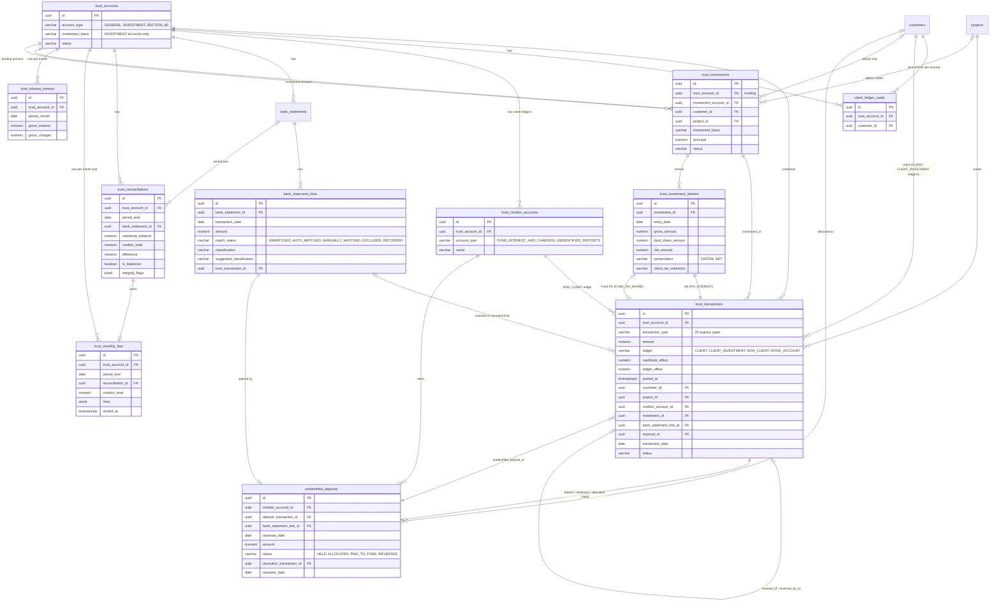
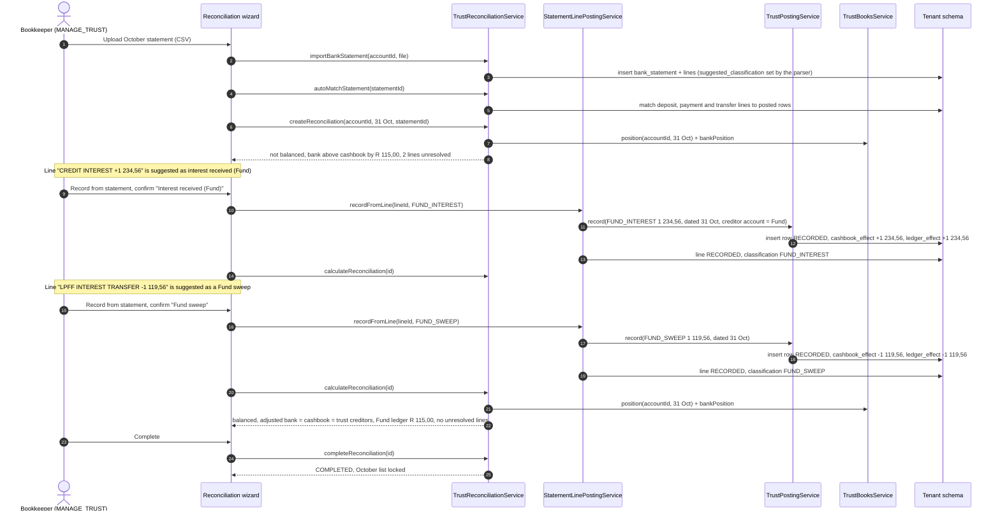
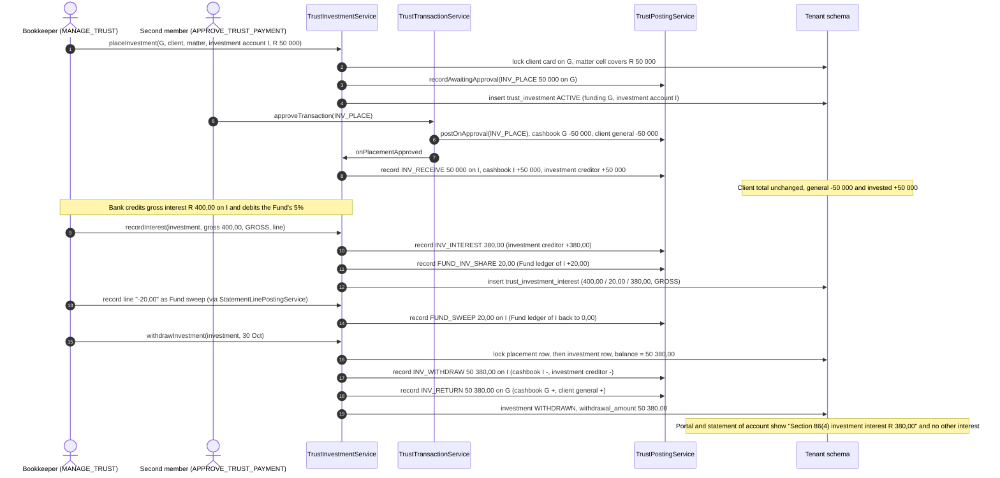
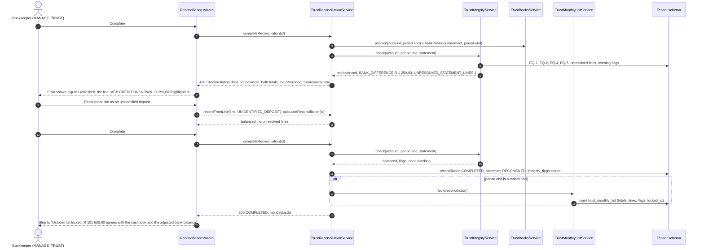

# Phase 92 — Trust Books That Are Provably Right: Statement-Driven Interest, Non-Client Trust Creditors, Investments On The Books

> Merge into ARCHITECTURE.md as **Section 16** (linked from the note lines at the top of ARCHITECTURE.md like Phases 86–90).

> Inputs: `requirements/claude-code-prompt-phase92.md` (founder decisions 1–9, legal basis L1–L12, assumptions A1–A6, epics E1–E8, ten ADR topics), `.arch-context-phase92.md` (context inventory: numbering §1, conventions §2, verbatim trust DDL / entities / signatures / balance queries §3, frontend §4, tests and QA steps §5, design record §6; its §0 corrects the requirements' scouting note), the orchestrator rulings **R1–R15** (binding; quoted by number below), `backend/CLAUDE.md`, `frontend/CLAUDE.md`. Code verified at `main` HEAD `8440d3cf4` (2026-11-16). ADRs 375–384 are written after this document by a separate author and are referenced by number; their titles, decisions and options are fixed in §16.15. Line numbers are HEAD and shift when a slice lands — re-grep, never trust the number. Where the requirements and the inventory differ, the inventory's evidence wins and this document says so at the point of difference (collected in §16.14.5). Tenancy is schema-per-tenant only (R13): no tenant column, no RLS, no filter, no plan tiers anywhere in this design.

## 16.1 Overview

Three phases of trust work left Kazi with a defect that makes the books wrong in law. The calculated interest run credits clients with interest that vests in the Legal Practitioners' Fidelity Fund (L1), and posts a Fund outflow for money never recorded as received, so no reconciliation can balance after a run (cashbook R 25,52 below the client ledgers, measured on the e2e stack on 2026-11-14 — `Kazi trust accounting findings and proposal.md`, "What Kazi does today", item 6). Tracing it showed the cause is structural, not local. **Nothing asserts that the trust books balance.** The cashbook is recomputed from transactions; the client ledger is a stored balance changed by ten mutator calls (nine in `TrustTransactionService`, one in `InterestService`) plus a zero-card upsert; the meaning of a transaction type is restated in eleven code locations (inventory §3.5: the DDL CHECK; the cashbook `CASE` query; the six client-balance `CASE` queries, counted as one location; the credit / debit sets in three services; `LedgerTotals`; two report queries; the statement-of-account builder; the portal sync) and again in the label maps of three codebases (backend, frontend, portal); the reconciliation compares a past statement with today's books; there is nowhere to hold trust money for anyone who is not a client; and invested money leaves the books while invested.

This phase replaces that with one posting model and proves it.

1. **Every posted trust transaction carries its own effect.** A row records which ledger it moves and by how much, and how much it moves the cashbook. One Java registry decides those effects once, at posting. Every balance — cashbook, client ledger, matter cell, investment creditor, Fund ledger, unidentified deposits — is a `SUM` over those rows as at a date. A row-level database CHECK constrains a posted row's shape to "moves the cashbook and one ledger by the same signed amount, or moves a ledger only"; it does not know whether the sign or the ledger is right for the type — that is EQ-6, checked by the harness ([ADR-378](../adr/ADR-378-ledger-balances-derived-from-posting-effects.md)).
2. **The cashbook mirrors the bank statement.** Interest, Fund sweeps, bank charges and unidentified deposits are recorded from statement lines the firm classifies; nothing is calculated and nothing is posted without the firm's confirmation ([ADR-375](../adr/ADR-375-statement-driven-trust-interest.md), [ADR-380](../adr/ADR-380-statement-line-classification-and-posting.md)).
3. **Trust money held for a non-client has a ledger**: the Fund's interest and charges, and itemised unidentified deposits, per trust account ([ADR-376](../adr/ADR-376-non-client-trust-creditor-ledger.md)).
4. **Invested money stays on the books.** Section 86(3) and 86(4) investments sit in trust accounts of type `INVESTMENT`; a client's invested money is a client investment creditor balance; section 86(4) interest is recorded per investment with the statutory 95/5 split ([ADR-379](../adr/ADR-379-investment-accounting-on-the-books.md)).
5. **One equation, as at a date, enforced at four levels**: a row-shape CHECK on every posted row, an integration-test harness after every posting path, an integrity check the firm can see, and a gate on completing a reconciliation — never a block on day-to-day posting (founder decision 7; [ADR-377](../adr/ADR-377-trust-equation-and-where-it-is-enforced.md)).
6. **The Rule 54.15 monthly list and the Rule 54.28 schedule come straight from those books**, and a month's list is frozen when that month's reconciliation completes ([ADR-382](../adr/ADR-382-monthly-trust-creditor-list-locking.md)).
7. **The calculated interest run is removed outright** — code, tables, rates, pages, report ([ADR-383](../adr/ADR-383-retired-interest-run-data-is-dropped.md)).

The exit bar is an observed balanced month in the browser on a fresh stack (§16.9.6), with every figure worked out in advance in this document.

### 16.1.1 Today vs Phase 92

| Concern | Today (HEAD `8440d3cf4`) | After Phase 92 |
|---|---|---|
| Interest on s86(2)/(3) money | Calculated per client from daily balances × `lpff_rates`; posted as `INTEREST_CREDIT` to clients and one client-less `INTEREST_LPFF`; gross never recorded as received | Recorded from the statement line as `FUND_INTEREST` (100% the Fund's); the sweep as `FUND_SWEEP`; no calculation anywhere |
| Interest on s86(4) investments | Hand-typed running total on the investment; no transaction; no 5% | One `trust_investment_interest` entry per bank credit: gross, Fund 5%, net; posted as `INV_INTEREST` (+ `FUND_INV_SHARE` when the bank credits gross) |
| Non-client trust money | Impossible: `chk_trust_txn_customer_required` allows a client-less row only for `INTEREST_LPFF` | `trust_creditor_accounts` per trust account: Fund interest and charges; Unidentified deposits (itemised in `unidentified_deposits`) |
| Bank charges | No type | `BANK_CHARGE` against the Fund ledger, with recoverable flag and VAT; `CHARGE_REFUND` restores it |
| Client ledger balance | Stored on `client_ledger_cards.balance`, written by 10 mutator calls plus an upsert, CHECK ≥ 0 | Derived: `SUM(ledger_effect)` over posted rows; the card row survives only as the per-client lock anchor |
| Type semantics | 11 code locations (seven SQL `CASE` queries among them) plus label maps in three codebases | `TrustTransactionType` registry; effects stored per row; no SQL or UI code knows a type's sign |
| Reversal | Original set `REVERSED` and dropped from sums; `REVERSAL` row counts 0; a credit can never be reversed through the product | Contra entry: the original stays in the books, the `REVERSAL` row carries the negated effects on its own date |
| Reconciliation equation | adjusted bank = cashbook = stored client-card total, all **as at now** | adjusted bank = cashbook = client ledgers + investment creditors + non-client creditors + inter-account, every term **as at the period end** (R1) |
| Statement line | UNMATCHED / AUTO_MATCHED / MANUALLY_MATCHED / EXCLUDED | + `RECORDED` with a `classification`; unmatching a recorded line reverses what it created |
| Investments | Placement is a `PAYMENT`: the money leaves the client's balance and the books | Placement moves the money to an `INVESTMENT` trust account and to the client's investment creditor balance; the client's total is unchanged (L7) |
| Integrity | None. No test or screen asserts the books balance | Harness (tests), integrity check (dashboard), completion gate (reconciliation) |
| Monthly list | `client-trust-balances` report from stored cards; clients only | Rule 54.15 list: every creditor by name (general + invested), the Fund and unidentified lines, compared with bank + investment; locked per month |
| Rule 54.28 | `interest-allocation` report of a calculated run | Interest-and-charges schedule from postings plus memo records for at-source sweeps |
| Seeded demo books | Four `RECORDED` rows, no ledger cards: cashbook R27 000, stored card total R0 | Seeded through rows that carry effects; the equation holds; the deliberately overdrawn client shows as an integrity flag (R2) |
| Trust report pack | v3, 7 slugs | v4, 9 slugs (three added, `interest-allocation` removed), with an explicit membership reconcile (R11) |

### 16.1.2 The trust equation

All figures are in rands to the cent, `numeric(15,2)`. "Posted" means `trust_transactions.posted_at IS NOT NULL` (§16.2.2); a row awaiting approval or rejected has no effect on any figure. `D` is an SA business date (`LocalDate`).

**Per trust account `A`, as at `D`:**

| Term | Definition (tables and columns) |
|---|---|
| `cashbook(A,D)` | `SUM(t.cashbook_effect)` over `trust_transactions t` where `t.trust_account_id = A`, `t.posted_at IS NOT NULL`, `t.transaction_date <= D` |
| `clientLedgers(A,D)` | `SUM(t.ledger_effect)` over the same rows where `t.ledger = 'CLIENT'` |
| `investmentCreditors(A,D)` | … where `t.ledger = 'CLIENT_INVESTMENT'` (non-zero only on `INVESTMENT` accounts holding s86(4) money) |
| `fundLedger(A,D)` | … where `t.ledger = 'NON_CLIENT'` and the row's `creditor_account_id` is the account's `FUND_INTEREST_AND_CHARGES` creditor account |
| `unidentified(A,D)` | … where `t.ledger = 'NON_CLIENT'` and the creditor account is `UNIDENTIFIED_DEPOSITS` |
| `interAccount(A,D)` | … where `t.ledger = 'INTER_ACCOUNT'`: money placed in (negative, on the funding account) or held in (positive, on the investment account) a section 86(3) investment account |
| `otherNonClient(A,D)` | … where `t.ledger = 'NON_CLIENT'` and the creditor account is of any other type. **Always zero in this phase** (no third creditor type is built); it is a term of the definition so that a future type is counted from its first row rather than dropped from the creditor side |
| `creditors(A,D)` | `clientLedgers + investmentCreditors + fundLedger + unidentified + otherNonClient + interAccount` — six terms, the single definition used by `TrustBooksService`, the reconciliation, the integrity check, the monthly list and the harness |
| `bank(A,D)` | for a reconciliation of `A` with period end `D`: `bank_statements.closing_balance` of its statement — the running balance after the statement's last line, which is dated on or before `D` — carried forward unchanged to `D` (§16.3.4). Known only where a reconciliation has period end `D`. |
| `outstandingDeposits(A,D)` / `outstandingPayments(A,D)` | posted rows with `cashbook_effect > 0` / `< 0`, dated `<= D`, not matched to a statement line dated `<= D` (§16.3.3) |
| `adjustedBank(A,D)` | `bank + outstandingDeposits − outstandingPayments` |

- **EQ-1 (bank agrees with cashbook):** `adjustedBank(A,D) = cashbook(A,D)`. Checkable only at a reconciliation's period end.
- **EQ-2 (cashbook agrees with trust creditors):** `cashbook(A,D) = creditors(A,D)`. Checkable at any date.

**Firm-wide, as at `D`** (summing over every trust account of the firm, open or closed):

- **EQ-3:** `Σ_A interAccount(A,D) = 0`, and therefore
  `Σ_A cashbook(A,D) = Σ_A clientLedgers + Σ_A investmentCreditors + Σ_A fundLedger + Σ_A unidentified + Σ_A otherNonClient` (the last is zero in this phase).
  With EQ-1 on every account this is the requirements' statement: **trust bank + trust investment accounts (adjusted for outstanding items) = cashbook = client ledgers + client investment creditors + non-client trust creditors.** The trust banking accounts are the accounts of type `GENERAL` / `SECTION_86`; the trust investment accounts are those of type `INVESTMENT`.

**Supporting identities** (each guards a place where two records describe the same money):

- **EQ-4 (itemised):** every posted row on an unidentified-deposits ledger carries its item (`trust_transactions.unidentified_deposit_id`); each item's **balance as at `D`** — `SUM(ledger_effect)` over its posted `NON_CLIENT` rows dated `<= D` — is either 0 or the item's `amount`; an item is **open as at `D`** exactly when that balance equals its amount; and therefore `unidentified(A,D) = Σ amount` of the items of `A` open as at `D`. As at today, an item is open exactly when its `status` is `HELD`.
- **EQ-5 (per investment):** for every `trust_investments` row, `SUM(ledger_effect)` over posted rows with that `investment_id` on ledger `CLIENT_INVESTMENT` (s86(4)) or `INTER_ACCOUNT` on the investment account (s86(3)) equals principal placed + net interest entries − amount withdrawn.
- **EQ-6 (registry):** every posted row's `ledger`, `cashbook_effect` and `ledger_effect` are exactly what `TrustTransactionType` prescribes for its type; a `REVERSAL` row carries the negation of its original's.

Why the per-account equation has an `interAccount` term: a section 86(3) placement moves cash out of the trust banking account without changing any client's balance (E4), so that account's cashbook is below its client ledgers by the amount placed, and the investment account's cashbook is above its own creditors by the same amount. The two cancel firm-wide (EQ-3). On screen the term is shown where a practitioner expects it: on the banking account as "Placed in section 86(3) investment accounts" beside the bank balance, on the investment account as "Held for the firm's trust creditors".

Why EQ-2 is nearly structural and still checked: the row CHECK `chk_trust_txn_posting` (§16.7.2) guarantees each posted row moves the cashbook and one ledger equally or moves a ledger only. It is a shape check: a row with the wrong sign, or on the wrong ledger for its type, passes it (EQ-6 and the harness cover those). Given the shape, EQ-2 can fail only if cashbook-neutral rows on an account do not sum to zero (an unpaired transfer or allocation leg). EQ-4, EQ-5 and EQ-6 are not structural at all. The harness and the integrity check exist for those classes and for EQ-1, which no constraint can know.

### 16.1.3 Already shipped — do not re-plan

- Reconciliation wizard step-4 crash (#1778) and the missing initial calculate / double-create guard in the wizard (#1779).
- `BankStatementParseException` → HTTP 422 (`GlobalExceptionHandler.java:150-151`, Phase 89 §14.3.4, test `BankStatementImportErrorIntegrationTest`). **The E8 item "→ 500 is fixed if it reproduces" is struck on that evidence (R9).**
- Backend manual match already accepts `RECORDED` and `APPROVED` (`TrustReconciliationService.java:378-382`). The manual-match defect is frontend-only (R9; §16.6.1).

### 16.1.4 Scope at HEAD

- **Numbering.** Section 16. ADR-375..384 (Phase 91's requirements line "continues from ADR-375" must be corrected to ADR-385 — §16.12.2 #8). Epics 645–652. Tenant migrations next free **V16**, global next free **V7**, both stated as *next free at build time*; the numbers in §16.7 are guides. Trust report pack `trust-reports` **3 → 4**. `legal-za` template pack 15 → 16 only because two document bodies gain invested-balance lines (§16.6.4).
- **In scope beyond the requirements' text, by ruling:** period-bounded reconciliation (R1, in E2); seeded demo books that satisfy the equation (R2, with the harness); one transaction-type registry (R6); the reversal reproductions (R8); the report-pack membership reconcile (R11).
- **Founder decisions are final (R14):** allow-and-flag on a Fund ledger in debit; no hard block on posting; the run is removed outright; no remediation tooling; exit bar = an observed balanced month.

### 16.1.5 Out of scope

Listed in full in §16.14.3. In one line: no firm float, no interest estimator or expected-interest check, no auto-posting from statements, no bank feeds or new statement formats, no IT3(b) filing, no s87(4) submission form, no LPFF refund claim, no trust cash or estates in the Rule 54.15 comparison, no Phase 91 redesign of trust pages, no change to fee notes, business-side accounting or Xero.

### 16.1.6 Baseline statement

Before slice 645A starts the slice owner records on `main`: `backend/scripts/verify.sh` green with the test count (count `<testcase>` elements, not the `tests=` attribute); FE gate green including `format:check`; legal-lifecycle and legal-depth-ii pass counts on a fresh stack; and the measured difference `cashbook − stored card total` on a freshly seeded demo tenant (expected R27 000,00 per inventory §0.2). The exit gate (§16.9.6) compares against these, not against memory.

## 16.2 Domain Model

Conventions (inventory §2.2–2.3, binding): plain `@Entity`, no Lombok, no base class, no tenant column; `UUID` ids; foreign keys as bare `UUID` columns; money `BigDecimal` `numeric(15,2)`; business dates `LocalDate`, instants `Instant` set in `@PrePersist` / `@PreUpdate`; DTOs as records nested in the service; wire names `clientId` / `matterId`, columns `customer_id` / `project_id`. New status and type columns follow the module's existing majority: a Java enum mapped `@Enumerated(EnumType.STRING)` **plus** a DDL CHECK, except where a row says otherwise with its reason. Packages are relative to `T/` = `backend/src/main/java/io/b2mash/b2b/b2bstrawman/verticals/legal/trustaccounting/`.

Five new tables, one new registry enum, six changed tables, four dropped tables:

| | Table | Entity (package) | Slice |
|---|---|---|---|
| new | `trust_creditor_accounts` | `TrustCreditorAccount` (`creditor/`) | 646B |
| new | `unidentified_deposits` | `UnidentifiedDeposit` (`creditor/`) | 647B |
| new | `trust_investment_interest` | `TrustInvestmentInterest` (`investment/`) | 648B |
| new | `trust_interest_memos` | `TrustInterestMemo` (`creditor/`) | 650B |
| new | `trust_monthly_lists` | `TrustMonthlyList` (`books/`) | 650A |
| changed | `trust_transactions` | `TrustTransaction` | 646A, 646B, 647A, 649B |
| changed | `client_ledger_cards` | `ClientLedgerCard` | 646A |
| changed | `bank_statement_lines` | `BankStatementLine` | 647A |
| changed | `trust_reconciliations` | `TrustReconciliation` | 646B, 649C, 652C |
| changed | `trust_accounts`, `trust_investments` | `TrustAccount`, `TrustInvestment` | 648A |
| dropped | `interest_runs`, `interest_allocations`, `interest_allocation_lines`, `lpff_rates` | — | 651A |

### 16.2.1 The transaction-type registry — `TrustTransactionType` (`transaction/`; R6, [ADR-378](../adr/ADR-378-ledger-balances-derived-from-posting-effects.md))

A Java enum, one constant per transaction type, holding everything any consumer needs to know about a type. The column `trust_transactions.transaction_type` stays `varchar(20)` and the entity field stays a `String` — changing the field's Java type would touch the 11-argument constructor at every call site and every test for no gain; callers use `TrustTransactionType.of(txn.getTransactionType())`. A schema test (`TrustTransactionTypeSchemaTest`) asserts the DDL CHECK `chk_trust_txn_type` lists exactly the enum's constants and that every name is at most 20 characters.

**Type names fit `varchar(20)`; neither column is widened (R5).** Why: widening needs a tenant migration, a global migration for `portal.portal_trust_transaction.transaction_type` and an entity-length change, and buys only longer names. The requirements' `LPFF_INTEREST_RECEIVED` (22 characters) becomes `FUND_INTEREST`. The short form appears only in type codes; every label a person reads uses the long form, Legal Practitioners' Fidelity Fund.

| Attribute | Type | Meaning |
|---|---|---|
| `cashbookSign` | `int` −1 / 0 / +1 | effect on the trust account's cashbook, times `amount` |
| `ledger` | `TrustLedger` | which ledger the row moves: `CLIENT`, `CLIENT_INVESTMENT`, `NON_CLIENT`, `INTER_ACCOUNT` |
| `ledgerSign` | `int` −1 / +1 | effect on that ledger, times `amount` |
| `creditorAccountType` | `TrustCreditorAccountType` or null | for `NON_CLIENT`: which creditor account of the trust account |
| `approval` | `NONE` / `REQUIRED` / `WITH_PAIR` / `WITH_ORIGINAL` | `NONE` posts at once with status `RECORDED`; `REQUIRED` is saved `AWAITING_APPROVAL` and posts on approval; `WITH_PAIR` is never recorded on its own — the row is created and posted by the service in the same transaction that posts its paired row; `WITH_ORIGINAL` (`REVERSAL` only) follows the original type's `reversal` rule |
| `reversal` | `IMMEDIATE` / `NEEDS_APPROVAL` / `PAIR` / `VIA_PAIR` / `OWNER` / `NONE` | how a posted row of this type is reversed (§16.3.11) |
| `origin` | `FIRM` / `BANK` | `BANK` types are created only by recording a statement line |
| `clientVisible` | `boolean` | may be projected to the portal and a statement of account |
| `auditKey` | `String` | the `eventType` prefix, e.g. `trust_fund_interest` |
| `label` / `clientLabel` | `String` | firm-facing and client-facing wording; no screen or document prints the constant |

The registry (final names; R5):

| Type | Cashbook | Ledger | Ledger effect | Approval | Reversal | Origin | Label (firm) |
|---|---|---|---|---|---|---|---|
| `DEPOSIT` | + | CLIENT | + | NONE | NEEDS_APPROVAL | FIRM | Deposit |
| `PAYMENT` | − | CLIENT | − | REQUIRED | IMMEDIATE | FIRM | Payment |
| `FEE_TRANSFER` | − | CLIENT | − | REQUIRED | IMMEDIATE | FIRM | Fee transfer |
| `REFUND` | − | CLIENT | − | REQUIRED | IMMEDIATE | FIRM | Refund |
| `TRANSFER_OUT` | 0 | CLIENT | − | NONE | PAIR | FIRM | Transfer out |
| `TRANSFER_IN` | 0 | CLIENT | + | NONE | VIA_PAIR | FIRM | Transfer in |
| `REVERSAL` | −original | original's | −original | WITH_ORIGINAL | NONE | — | Reversal |
| `FUND_INTEREST` | + | NON_CLIENT (Fund) | + | NONE | IMMEDIATE | BANK | Interest received for the Legal Practitioners' Fidelity Fund |
| `FUND_SWEEP` | − | NON_CLIENT (Fund) | − | NONE | IMMEDIATE | BANK | Interest paid to the Legal Practitioners' Fidelity Fund |
| `BANK_CHARGE` | − | NON_CLIENT (Fund) | − | NONE | IMMEDIATE | BANK | Bank charge |
| `CHARGE_REFUND` | + | NON_CLIENT (Fund) | + | NONE | IMMEDIATE | BANK | Bank charge refunded from the business account |
| `UNIDENTIFIED_DEPOSIT` | + | NON_CLIENT (Unidentified) | + | NONE | OWNER | BANK | Unidentified deposit |
| `UNIDENT_ALLOC_OUT` | 0 | NON_CLIENT (Unidentified) | − | REQUIRED | PAIR | FIRM | Unidentified deposit allocated |
| `UNIDENT_ALLOC_IN` | 0 | CLIENT | + | WITH_PAIR | VIA_PAIR | FIRM | Deposit identified and allocated |
| `UNIDENT_FUND_PAY` | − | NON_CLIENT (Unidentified) | − | REQUIRED | IMMEDIATE | FIRM | Unidentified deposit paid to the Fund |
| `INV_PLACE` | − | CLIENT | − | REQUIRED | NONE | FIRM | Placed in section 86(4) investment |
| `INV_RECEIVE` | + | CLIENT_INVESTMENT | + | WITH_PAIR | NONE | FIRM | Investment capital received |
| `INV_INTEREST` | + | CLIENT_INVESTMENT | + | NONE | OWNER | FIRM | Section 86(4) investment interest |
| `FUND_INV_SHARE` | + | NON_CLIENT (Fund) | + | NONE | OWNER | FIRM | Fund share of section 86(4) interest (5%) |
| `INV_WITHDRAW` | − | CLIENT_INVESTMENT | − | NONE | NONE | FIRM | Investment withdrawn |
| `INV_RETURN` | + | CLIENT | + | WITH_PAIR | NONE | FIRM | Investment returned to trust |
| `FIRM_INV_PLACE` | − | INTER_ACCOUNT | − | REQUIRED | NONE | FIRM | Placed in section 86(3) investment account |
| `FIRM_INV_RECEIVE` | + | INTER_ACCOUNT | + | WITH_PAIR | NONE | FIRM | Section 86(3) investment capital received |
| `FIRM_INV_WITHDRAW` | − | INTER_ACCOUNT | − | NONE | NONE | FIRM | Section 86(3) investment withdrawn |
| `FIRM_INV_RETURN` | + | INTER_ACCOUNT | + | WITH_PAIR | NONE | FIRM | Section 86(3) investment returned to trust |

**The approval rule, exactly as the registry has it.** `REQUIRED` — a posting the firm initiates that takes money out of a trust banking account or moves it to another creditor on the firm's say-so: `PAYMENT`, `FEE_TRANSFER`, `REFUND`, `INV_PLACE`, `FIRM_INV_PLACE`, `UNIDENT_ALLOC_OUT`, `UNIDENT_FUND_PAY`. `NONE` for every `origin = BANK` type (the bank has already done it, §16.3.5). `NONE` also for these firm-originated types, each for a stated reason:

| Firm-originated type with `NONE` | Reason |
|---|---|
| `DEPOSIT` | money coming in; today's rule, unchanged |
| `TRANSFER_OUT` / `TRANSFER_IN` | today's rule, unchanged: an inter-client transfer is recorded without approval and no cash leaves the account |
| `INV_INTEREST`, `FUND_INV_SHARE` | the bank credited the interest; they are `FIRM` only because they can also be entered from a bank advice with no statement line. They add to trust creditors and take nothing out |
| `INV_WITHDRAW` / `INV_RETURN`, `FIRM_INV_WITHDRAW` / `FIRM_INV_RETURN` | money returning to the trust banking account; they replace today's unapproved withdrawal `DEPOSIT`. `INV_RETURN` and `FIRM_INV_RETURN` are `WITH_PAIR` rows of that same act |

`WITH_PAIR` rows (`UNIDENT_ALLOC_IN`, `INV_RECEIVE`, `FIRM_INV_RECEIVE`, `INV_RETURN`, `FIRM_INV_RETURN`) take effect with their pair and inherit whatever control their pair had.

Twenty-five types: seven kept, eighteen new. **Retired: `INTEREST_CREDIT` and `INTEREST_LPFF`** (646A deletes the rows and removes both from the CHECK; see §16.7.2). `INTEREST_CREDIT` is not kept for section 86(4): section 86(4) interest accrues to the client's *investment* creditor balance, a different ledger, so reusing a type whose history means "credited to the general ledger by a calculated run" would put two meanings on one name.

Design reasons:
- **One row, one ledger.** A business event that touches two ledgers is two rows (a transfer already is). This is what lets the row CHECK state the equation locally.
- **Four placement and four return types rather than two generic "inter-account" types.** Approval differs by direction (placing money out needs a second member; bringing it back does not), and the registry can only be authoritative if `approval` is a property of the type.
- **`UNIDENTIFIED_DEPOSIT`, `INV_INTEREST` and `FUND_INV_SHARE` reverse only through their owner** (`OWNER`): the item or interest entry that describes the same money must change state in the same transaction, and the way in is the owner's own action (unmatch the line; reverse the interest entry), so the generic reverse endpoint refuses and names the screen to use. `UNIDENT_ALLOC_OUT` and `UNIDENT_FUND_PAY` are reversed on the generic endpoint, which calls the item's hook (`onResolutionReversed`) in the same transaction.
- **`origin = BANK`** types can only be created by `StatementLinePostingService` (§16.3.5). There is no free-standing "record bank charge" dialog: a charge that is not on a statement line is not yet a fact.

Consumers routed through the registry (every row of inventory §3.5's table):

| Consumer today | After |
|---|---|
| Cashbook JPQL CASE; six client-balance CASEs; trend query; running-balance window | `SUM(cashbook_effect)` / `SUM(ledger_effect)` with a `ledger` predicate — no type names in SQL |
| `TrustTransactionService` `CREDIT_TYPES` / `DEBIT_TYPES` (reversal, approval) | `type.reversal()`, `type.approval()` |
| `TrustReconciliationService` `CREDIT_TYPES` / `DEBIT_TYPES` (sign match) | sign of `cashbook_effect` (candidate rows are posted) |
| `ClientLedgerService` sets, `computeLedgerEffect`; `LedgerTotals.plus` | `txn.getLedgerEffect()`; totals grouped by type with `type.ledgerSign()` |
| `ClientLedgerStatementQuery`, `TrustReceiptsPaymentsQuery` | sign of the effect columns |
| `StatementOfAccountContextBuilder` | `ledger_effect` + `type.clientLabel()` |
| `TrustLedgerPortalSyncService.signedAmount` | `ledger_effect`; eligibility `type.clientVisible()` |
| `TrustTransactionTypeLabels`, `ActivityMessageFormatter` | delegate to `type.clientLabel()` / `type.label()` |
| `frontend/lib/types/trust.ts` (`transactionTypeLabel`, `isInflowType`), filter lists | `typeLabel` and `direction` arrive on every transaction DTO; filter options come from `GET /api/trust-transaction-types` |
| `portal/lib/labels.ts` trust map | `typeLabel` on the portal DTO; the map is deleted |

### 16.2.2 `trust_transactions` — changed

| Column | Type | Null | Added | Purpose and reason |
|---|---|---|---|---|
| `ledger` | `varchar(20)` | NOT NULL | 646A | `CLIENT` / `CLIENT_INVESTMENT` / `NON_CLIENT` / `INTER_ACCOUNT`. Stored (from the registry, at creation) so balance queries need no type knowledge. |
| `cashbook_effect` | `numeric(15,2)` | NOT NULL default 0 | 646A | signed effect on the cashbook; 0 until posted |
| `ledger_effect` | `numeric(15,2)` | NOT NULL default 0 | 646A | signed effect on the row's ledger; 0 until posted |
| `posted_at` | `timestamptz` | NULL | 646A | when the row took effect (recording for `approval = NONE`, final approval otherwise). NULL = not posted. Also the "entered after the month was locked" test (§16.3.10). |
| `creditor_account_id` | `uuid` FK `trust_creditor_accounts` | NULL | 646B | the non-client creditor account, for `ledger = 'NON_CLIENT'` |
| `investment_id` | `uuid` FK `trust_investments` | NULL | 646B | the investment the row belongs to (all `INV_*`, `FIRM_INV_*`, `FUND_INV_SHARE`) |
| `unidentified_deposit_id` | `uuid` FK `unidentified_deposits` | NULL | 647B | the item a row belongs to: required on `UNIDENTIFIED_DEPOSIT`, `UNIDENT_ALLOC_OUT`, `UNIDENT_FUND_PAY` (CHECK `chk_trust_txn_unidentified_item`), copied onto their `REVERSAL` rows and onto `UNIDENT_ALLOC_IN`. It is what makes "open as at a date" derivable from the ledger (EQ-4). |
| `charge_recoverable` | `boolean` | NULL | 647A | `BANK_CHARGE` only: on the Fund's recoverable list or not ([ADR-381](../adr/ADR-381-bank-charges-and-fund-ledger-debit.md)) |
| `charge_vat_amount` | `numeric(15,2)` | NULL | 647A | `BANK_CHARGE` only: the VAT included in `amount` |

Unchanged: every existing column, including `status` (`RECORDED`, `AWAITING_APPROVAL`, `APPROVED`, `REJECTED`, `REVERSED`), `reversal_of`, `reversed_by_id`, `bank_statement_line_id`. **`status = 'REVERSED'` changes meaning in 649B**: it marks a posted original that has been reversed and it *still counts* (its `REVERSAL` row carries the contra effect).

Constraints (full SQL in §16.7):

- `chk_trust_txn_posting` — a row is unposted (`posted_at IS NULL`, both effects 0, status `AWAITING_APPROVAL` or `REJECTED`) or posted (`posted_at IS NOT NULL`, status `RECORDED` / `APPROVED` / `REVERSED`, `abs(ledger_effect) = amount`, and `cashbook_effect = ledger_effect OR cashbook_effect = 0`). This is a row-shape check, the row-level half of EQ-2: it does not verify that the sign or the ledger suits the type (EQ-6 does).
- `chk_trust_txn_ledger_target` — replaces `chk_trust_txn_customer_required` (E2: "client or non-client creditor account, never both, never neither"):

  | `ledger` | `customer_id` | `project_id` | `creditor_account_id` | `investment_id` |
  |---|---|---|---|---|
  | `CLIENT` | required | (matter rule stays in the service, G89-F28) | must be null | optional |
  | `CLIENT_INVESTMENT` | required | optional | must be null | required |
  | `NON_CLIENT` | must be null | must be null | required | optional |
  | `INTER_ACCOUNT` | must be null | must be null | must be null | required |

  **Deviation from the requirements' wording, stated:** the fourth row has neither a client nor a creditor account. E2's "never neither" was written before E4's terms; E4 itself requires that a section 86(3) placement change "no client's balance", and the money is not owed to the Fund or to an unknown depositor either. It is the firm's trust creditors' money held in a different account, which is what `INTER_ACCOUNT` records. No third non-client creditor type is built (E2).
- `chk_trust_txn_charge` — `charge_recoverable` and `charge_vat_amount` are non-null exactly when `transaction_type = 'BANK_CHARGE'`; `0 <= charge_vat_amount < amount`.
- `chk_trust_txn_type` — the 25 names.

Why two charge columns on this table rather than a side table: they are two scalars read with the row by the Fund ledger screen and the Rule 54.28 schedule; a one-to-one table would add an entity, a repository and a join to carry them.

Entity changes: new fields with getters; one package-private mutator `applyPosting(TrustLedgerEffect effect, Instant postedAt)` called only by `TrustPostingService`; an ArchUnit rule (`TrustPostingRulesTest`) forbids any other class in main code from calling it or from constructing a `TrustTransaction` with a posted status without passing through that service (the demo seeder included — R2).

### 16.2.3 `client_ledger_cards` — reduced to the lock anchor (R7, [ADR-378](../adr/ADR-378-ledger-balances-derived-from-posting-effects.md))

**Ruling: ledger balances are derived.** The columns `balance`, `total_deposits`, `total_payments`, `total_fee_transfers`, `total_interest_credited`, `last_transaction_date`, their five CHECKs and the index `idx_client_ledger_balance` are dropped in 646A. The row itself stays: `id`, `trust_account_id`, `customer_id`, `created_at`, `updated_at`, `uq_client_ledger_account_customer`.

Why derived, in order of weight:
1. **R1 requires every term as at a date.** A stored balance can only answer "now". Reconciliation, the monthly list and the as-at position therefore must be derived; keeping a stored figure beside them for list pages would be a second source of truth for the same number.
2. **The divergence class disappears instead of being guarded.** Ten mutator call sites (nine in `TrustTransactionService`, one in `InterestService`; inventory §3.6) each had to remember to touch the card. With effects on the row there is one write (`TrustPostingService`) and nothing to forget.
3. **A stored card cannot hold a client in debit** (`chk_client_ledger_balance_non_negative`), yet "any client ledger in debit" is a flag the integrity check must raise (E5), and the demo data deliberately contains one.

Why the row stays: `findByAccountAndCustomerForUpdate` is how every posting for a client is serialised (ADR-231's `SELECT … FOR UPDATE`). The sufficiency checks keep that lock and compute the balance under it. ADR-231's CHECK half is replaced by the derived check under the same lock; ADR-378 amends ADR-230 and ADR-231 accordingly.

Read cost, weighed honestly:

| Reader | Today | Derived | Cost |
|---|---|---|---|
| One client's balance / sufficiency check | 1 row | `SUM(ledger_effect)` over that client's rows on the account via `idx_trust_txn_ledger_sum` (§16.7.2) | index range scan; tens to low hundreds of rows per client |
| Matter cell (debit guard, closure gate) | already derived | unchanged shape, simpler SQL | same as today |
| Matters list / clients list (`sumBalancesByCustomerIdIn`) | 1 card row per client on the page | one grouped `SUM … WHERE customer_id IN (:ids) GROUP BY customer_id` | one query per page as today; scans the page's clients' rows (25 clients × ~50 rows) |
| Account total (reconciliation, dashboard, MCP) | `SUM(balance)` over cards | one aggregate over the account's posted rows (§16.3.3) | linear in the account's transactions: ≈10–30 ms at 50 000 rows on the covering index |
| Client ledger list page | cards page | grouped sum over the account, paged in SQL | same aggregate as the account total |

At design-partner volumes this is cheaper than the bugs it removes. The honest limit: the account-total aggregate grows with history. The escape hatch, **not built**, is an opening-balance snapshot per locked month (`trust_monthly_lists` already holds exactly those figures), so a sum would start from the last lock. ADR-378 records it as the path if a tenant's account passes about a million rows.

Migration path (concrete): 646A adds the effect columns, backfills them from the HEAD sign table, switches every reader in §16.2.1's table and every reader in inventory §3.6 to derived queries, deletes the card mutators (`addDeposit`, `debitBalance`, `addPayment`, `addFeeTransfer`, `addInterestCredit`, `creditBalance`) and drops the columns — in one slice, because a half-switched state (some readers stored, some derived) is exactly the divergence the phase exists to remove. The characterisation harness from 649A runs before and after and must report identical figures for every existing posting path.

### 16.2.4 `trust_creditor_accounts` — new ([ADR-376](../adr/ADR-376-non-client-trust-creditor-ledger.md))

The trust creditor ledger for non-clients: one row per creditor account per trust account.

| Field | Column | Type | Null | Notes |
|---|---|---|---|---|
| `id` | `id` | `uuid` | NOT NULL | PK |
| `trustAccountId` | `trust_account_id` | `uuid` FK `trust_accounts` | NOT NULL | one ledger per trust bank account (L5, A4) |
| `accountType` | `account_type` | `varchar(40)` | NOT NULL | `TrustCreditorAccountType`: `FUND_INTEREST_AND_CHARGES`, `UNIDENTIFIED_DEPOSITS`. **No DDL CHECK**, deliberately: E2 requires that the model "admit further types without a schema change"; the enum validates in Java. This is the one status-like column in the module without a CHECK and the entity Javadoc says why. |
| `name` | `name` | `varchar(200)` | NOT NULL | display name, e.g. "Legal Practitioners' Fidelity Fund — interest and charges", "Unidentified deposits" |
| `createdAt` | `created_at` | `timestamptz` | NOT NULL | |

- Unique: `uq_trust_creditor_account_singleton (trust_account_id, account_type)` as a partial unique index over the two shipped types, so a later type that allows several accounts per trust account (a named third party, say) needs no index change.
- Created with the trust account (`TrustAccountService.createTrustAccount`) and, for existing accounts, by the 646B migration. Never deleted; closing a trust account leaves them.
- The balance is derived: `SUM(ledger_effect)` over posted rows with this `creditor_account_id`.
- **A Fund ledger in debit is allowed and flagged** (decision 9, A1): no sufficiency check on `FUND_SWEEP`, `BANK_CHARGE`. **An unidentified-deposits ledger in debit is impossible by construction**: the only debits are `UNIDENT_ALLOC_OUT` and `UNIDENT_FUND_PAY`, each for exactly one `HELD` item's amount, each moving that item out of `HELD` under a row lock (§16.3.6).
- A4 (one ledger carrying both interest and charges): if an auditor requires two, a second `account_type` and a registry edit split them; no table changes.

### 16.2.5 `unidentified_deposits` — new ([ADR-376](../adr/ADR-376-non-client-trust-creditor-ledger.md))

One row per unidentified deposit, so the ledger balance is always the sum of open items (EQ-4) and an age analysis is a query.

| Field | Column | Type | Null | Notes |
|---|---|---|---|---|
| `id` | `id` | `uuid` | NOT NULL | PK |
| `trustAccountId` | `trust_account_id` | `uuid` FK | NOT NULL | |
| `creditorAccountId` | `creditor_account_id` | `uuid` FK `trust_creditor_accounts` | NOT NULL | the account's `UNIDENTIFIED_DEPOSITS` ledger |
| `depositTransactionId` | `deposit_transaction_id` | `uuid` FK `trust_transactions` | NULL, unique | the `UNIDENTIFIED_DEPOSIT` row that opened it. Null only inside the creating transaction: the item is saved first so the row can carry `unidentified_deposit_id`, then this is set |
| `bankStatementLineId` | `bank_statement_line_id` | `uuid` FK `bank_statement_lines` | NOT NULL | kept for the life of the item, through allocation (E3: "keeping the link to the original bank line") |
| `receivedDate` | `received_date` | `date` | NOT NULL | the statement line's date; ageing runs from here (L9) |
| `bankDescription` | `bank_description` | `varchar(500)` | NOT NULL | copied from the line, so the item reads on its own |
| `bankReference` | `bank_reference` | `varchar(200)` | NULL | copied from the line |
| `amount` | `amount` | `numeric(15,2)` | NOT NULL, > 0 | whole-item only; an item is never split |
| `status` | `status` | `varchar(20)` | NOT NULL | `UnidentifiedDepositStatus`: `HELD`, `ALLOCATED`, `PAID_TO_FUND`, `REVERSED` (CHECK) |
| `resolutionTransactionId` | `resolution_transaction_id` | `uuid` FK `trust_transactions` | NULL | the `UNIDENT_ALLOC_OUT` or `UNIDENT_FUND_PAY` row; set when the request is made, so a pending resolution is visible while the item is still `HELD` |
| `allocationCreditTransactionId` | `allocation_credit_transaction_id` | `uuid` FK `trust_transactions` | NULL | the `UNIDENT_ALLOC_IN` row, written at approval |
| `allocatedCustomerId` / `allocatedProjectId` | `allocated_customer_id` / `allocated_project_id` | `uuid` FK | NULL | the client and matter requested, then confirmed |
| `resolvedDate` | `resolved_date` | `date` | NULL | the current resolution row's `transaction_date`; describes the item's **present** state only (it is cleared when an allocation or payment is undone). **It is not used to decide whether the item was open at a past date** — see below |
| `notes` | `notes` | `text` | NULL | |
| `createdAt` / `updatedAt` | | `timestamptz` | NOT NULL | |

- **Open as at a date is derived from the item's transactions, not from its status columns.** The item's balance as at `D` is `SUM(ledger_effect)` over posted rows with `unidentified_deposit_id = item.id` and `ledger = 'NON_CLIENT'` dated `<= D`; it is the item's amount (open) or 0 (not open). Why not `resolved_date`: an allocation dated the 10th and undone on the 20th leaves the item `HELD` with `resolved_date` null, so a status-based rule would call it open on the 15th, while the ledger — a contra model — correctly shows it allocated on the 15th. Deriving both sides of EQ-4 from the same rows makes them agree at every date. A resolution-history table was the alternative; it would be a second record of what the transactions already say, and one more thing to keep in step.
- **`resolved_date` by status:** `HELD` — null; `ALLOCATED` — the allocation rows' date; `PAID_TO_FUND` — the payment row's date; `REVERSED` — the date of the contra row that reversed the opening deposit (the line's date). In every case it is the `transaction_date` of the row that took the item out of `HELD`, so it never disagrees with the ledger about the present.
- `REVERSED` is a fourth status beyond the requirements' three: the line that opened the item was unmatched (it was not an unidentified deposit after all). Without it an unmatched item would have to be deleted, and the audit trail would point at nothing.
- Indexes: `(trust_account_id, status, received_date)` for the list and age analysis.
- Why whole-item only: one bank credit has one payer. A firm that must spread it over two matters allocates it to one and uses the existing transfer. Splitting would need item lines and a partial-balance state for no stated requirement.
- No fee transfer or payment can be taken from an item (L9) by construction: neither `PAYMENT` nor `FEE_TRANSFER` can target a non-client ledger.

### 16.2.6 `bank_statement_lines` — classification and link to created transactions ([ADR-380](../adr/ADR-380-statement-line-classification-and-posting.md))

| Column | Type | Null | Purpose |
|---|---|---|---|
| `classification` | `varchar(30)` | NULL | `StatementLineClassification` the firm confirmed: `FUND_INTEREST`, `FUND_SWEEP`, `BANK_CHARGE`, `CHARGE_REFUND`, `UNIDENTIFIED_DEPOSIT`, `INVESTMENT_INTEREST`. Non-null exactly when `match_status = 'RECORDED'` (CHECK). |
| `suggested_classification` | `varchar(30)` | NULL | the parser's suggestion, set at import, never acted on by the system |

`match_status` gains a fifth value, **`RECORDED`**: the line was posted from, not matched to. A separate value rather than reusing `MANUALLY_MATCHED` because unmatching the two is different (a matched line just lets go of its transaction; a recorded line reverses what it created) and because the integrity flag "statement lines neither matched, recorded nor excluded" (E5) names the three states apart.

Link to the created transaction(s): each created `trust_transactions` row carries `bank_statement_line_id = line.id` (the existing column, many-to-one already). `bank_statement_lines.trust_transaction_id` holds the **primary** created row. One line creates two rows in exactly one case: section 86(4) interest credited gross, where the line's amount is split into `INV_INTEREST` (primary) and `FUND_INV_SHARE`. Everything that needs "all rows of this line" queries by `bank_statement_line_id`; nothing assumes one. `bank_statements.matched_count` counts lines that are matched **or** recorded.

`INVESTMENT_INTEREST` is a sixth classification beyond E3's five. E4 requires section 86(4) interest to be "recorded per investment from that investment account's statement"; offering it where the other classifications live keeps one way to post from a line. It is offered only on an `INVESTMENT` account whose basis is `CLIENT_INSTRUCTION`.

### 16.2.7 `trust_accounts` and `trust_investments` — investments on the books ([ADR-379](../adr/ADR-379-investment-accounting-on-the-books.md))

**The trust investment account is a `trust_accounts` row of type `INVESTMENT`.** Why: the money side of the equation is "trust bank + trust investment accounts"; an investment account has a bank statement, a cashbook, a Fund ledger for its 5% (E4) and Rule 54.28 figures of its own. `trust_accounts` already gives all of that — statement import, matching, reconciliation and the as-at queries work on it unchanged. A second kind of account object would duplicate every one.

`trust_accounts` — one column added (648A):

| Column | Type | Null | Purpose |
|---|---|---|---|
| `investment_basis` | `varchar(20)` | NULL | `InvestmentBasis` of the money this account holds; non-null exactly when `account_type = 'INVESTMENT'` (CHECK). Classifies the account for Rule 54.28 and decides which interest classification applies. |

Section classification used by every report (`TrustAccountSection`, a derived value, not a column): `GENERAL` and `SECTION_86` → section 86(2); `INVESTMENT` + `FIRM_DISCRETION` → section 86(3); `INVESTMENT` + `CLIENT_INSTRUCTION` → section 86(4). Treating `SECTION_86` as a section 86(2) trust banking account is a working assumption (§16.14.2 OL-1): the demo seeder uses that type for the firm's main account.

`trust_investments` — changed (648A, 648B):

| Column | Change | Purpose and reason |
|---|---|---|
| `trust_account_id` | unchanged, re-described | the **funding** trust banking account the money came from and returns to (Rule 54.14.7.3, L8) |
| `investment_account_id` | **new** `uuid` FK `trust_accounts`, NOT NULL | the `INVESTMENT` account holding the money. Its `investment_basis` must equal the investment's (service check). Several investments may share one account (§16.14.2 OL-2). |
| `customer_id` | now **nullable** | required for `CLIENT_INSTRUCTION`, null for `FIRM_DISCRETION` (CHECK `chk_trust_invest_client_by_basis`): a section 86(3) placement is the firm's initiative over pooled surplus and changes no client's balance (E4) |
| `project_id` | **new** `uuid` FK `projects`, NULL | the matter, for `CLIENT_INSTRUCTION` (today it lives only on the placement payment); needed so investment-ledger rows and the portal projection are per matter |
| `interest_earned` | **dropped** (648B) | the hand-typed running figure; replaced by the sum of `trust_investment_interest` entries |
| `deposit_transaction_id` | now **nullable** | the `INV_PLACE` / `FIRM_INV_PLACE` row. Null only inside the placing transaction (insert order, §16.3.7); never null in a committed row (EQ-5 and the harness assert it) |
| `withdrawal_transaction_id`, `withdrawal_amount`, `withdrawal_date` | unchanged | now the `INV_RETURN` / `FIRM_INV_RETURN` row; amount = the investment's balance when withdrawn |

The **client investment creditor balance** is not a table: it is `SUM(ledger_effect)` over posted rows with `ledger = 'CLIENT_INVESTMENT'`, by `investment_id`, by client, or by investment account. A client's total trust balance is general (`CLIENT`, on banking accounts) plus invested (`CLIENT_INVESTMENT`, on investment accounts); placement moves an amount from the first to the second and leaves the total unchanged (L7).

Statuses stay `ACTIVE`, `MATURED`, `WITHDRAWN`, `CANCELLED`. Nothing sets `MATURED` today and this phase does not add it (§16.14.4).

### 16.2.8 `trust_investment_interest` — new, per-investment interest entries ([ADR-379](../adr/ADR-379-investment-accounting-on-the-books.md))

One row each time the bank credits interest on a section 86(4) investment (L8). It is the per-investment tax record (A3) and the source of the section 86(4) lines of the Rule 54.28 schedule.

| Field | Column | Type | Null | Notes |
|---|---|---|---|---|
| `id` | `id` | `uuid` | NOT NULL | PK |
| `investmentId` | `investment_id` | `uuid` FK `trust_investments` | NOT NULL | `CLIENT_INSTRUCTION` investments only (service check) |
| `entryDate` | `entry_date` | `date` | NOT NULL | the date the bank credited it |
| `grossAmount` | `gross_amount` | `numeric(15,2)` | NOT NULL, > 0 | |
| `fundShareAmount` | `fund_share_amount` | `numeric(15,2)` | NOT NULL, ≥ 0 | the Fund's 5% |
| `netAmount` | `net_amount` | `numeric(15,2)` | NOT NULL, > 0 | the client's 95%; CHECK `gross_amount = fund_share_amount + net_amount` |
| `presentation` | `presentation` | `varchar(10)` | NOT NULL | `InterestPresentation`: `GROSS` (bank credited gross; the 5% leaves separately) or `NET` (bank credited net; the 5% never reached the account) — A2 |
| `netTransactionId` | `net_transaction_id` | `uuid` FK `trust_transactions` | NOT NULL | the `INV_INTEREST` row |
| `fundShareTransactionId` | `fund_share_transaction_id` | `uuid` FK `trust_transactions` | NULL | the `FUND_INV_SHARE` row; non-null exactly when `presentation = 'GROSS'` (CHECK) |
| `bankStatementLineId` | `bank_statement_line_id` | `uuid` FK | NULL | set when recorded from a statement line; null when recorded from a bank advice |
| `clientTaxReference` | `client_tax_reference` | `varchar(100)` | NULL | snapshot of `customers.tax_number` at entry (A3: "where held"); a snapshot so a later edit of the client does not rewrite a past record |
| `status` | `status` | `varchar(20)` | NOT NULL | `POSTED`, `REVERSED` (CHECK) |
| `recordedBy` | `recorded_by` | `uuid` FK `members` | NOT NULL | |
| `createdAt` | `created_at` | `timestamptz` | NOT NULL | |

- The 5% is `TrustAccountingConstants.STATUTORY_LPFF_SHARE_PERCENT` — a constant, not a setting (E4; the constant survives ADR-235's supersession). The service computes `round(gross × 0.05, 2, HALF_UP)` and accepts a typed Fund share within R0,01 of it, so the bank's own rounding can be mirrored; anything further is refused. The rounding rule is a working assumption (§16.14.2 OL-5).
- Why a table and not columns on the transaction: gross and the 5% exist even when only the net reached the account (`NET`), so they cannot be derived from the cashbook.
- The portal and the statement of account read a client's interest from `INV_INTEREST` rows; nothing else is ever labelled interest to a client (E4).

### 16.2.9 `trust_interest_memos` — new, memo records for at-source sweeps ([ADR-384](../adr/ADR-384-memo-records-for-at-source-sweeps.md))

Where a bank sweeps interest to the Fund before it reaches the trust account, or shows only a net figure (L4), nothing is posted to the cashbook — the cashbook mirrors the statement. Rule 54.28 still wants gross interest and gross charges per account (L11). A memo record carries them. **It has no effect on any term of the equation.**

| Field | Column | Type | Null | Notes |
|---|---|---|---|---|
| `id` | `id` | `uuid` | NOT NULL | PK |
| `trustAccountId` | `trust_account_id` | `uuid` FK | NOT NULL | |
| `periodMonth` | `period_month` | `date` | NOT NULL | first day of the month; CHECK `EXTRACT(DAY FROM period_month) = 1` |
| `grossInterest` | `gross_interest` | `numeric(15,2)` | NOT NULL, ≥ 0 | interest earned and swept at source, not in the cashbook |
| `grossCharges` | `gross_charges` | `numeric(15,2)` | NOT NULL, ≥ 0 | charges levied at source, not in the cashbook |
| `chargesVat` | `charges_vat` | `numeric(15,2)` | NOT NULL, ≥ 0 | VAT included in `gross_charges` |
| `sourceNote` | `source_note` | `varchar(500)` | NOT NULL | where the figures came from (bank advice reference, Fund statement) |
| `recordedBy` | `recorded_by` | `uuid` FK `members` | NOT NULL | |
| `createdAt` / `updatedAt` | | `timestamptz` | NOT NULL | |

Unique `(trust_account_id, period_month)`: one memo per account per month, edited in place (an audit event records each save). The schedule shows posted and memo figures in separate columns, so a firm that both posts and memos the same interest sees the duplication instead of a silently doubled total.

### 16.2.10 `trust_monthly_lists` — new, the monthly list lock artefact ([ADR-382](../adr/ADR-382-monthly-trust-creditor-list-locking.md))

The Rule 54.15 list of one trust account at one month end, frozen when that month's reconciliation completes (L10).

| Field | Column | Type | Null | Notes |
|---|---|---|---|---|
| `id` | `id` | `uuid` | NOT NULL | PK |
| `trustAccountId` | `trust_account_id` | `uuid` FK | NOT NULL | |
| `periodEnd` | `period_end` | `date` | NOT NULL | last day of a calendar month |
| `reconciliationId` | `reconciliation_id` | `uuid` FK `trust_reconciliations` | NOT NULL, unique | the completed reconciliation that produced it |
| `bankBalance`, `outstandingDeposits`, `outstandingPayments`, `adjustedBankBalance` | | `numeric(15,2)` | NOT NULL | the money side as reconciled |
| `cashbookBalance` | `cashbook_balance` | `numeric(15,2)` | NOT NULL | |
| `clientLedgerTotal`, `investmentCreditorTotal`, `fundLedgerBalance`, `unidentifiedDepositTotal`, `interAccountBalance`, `creditorTotal` | | `numeric(15,2)` | NOT NULL | the creditor side |
| `difference` | `difference` | `numeric(15,2)` | NOT NULL | always 0,00 — a list is only locked by a balanced reconciliation; stored so the artefact states its own comparison result |
| `lines` | `lines` | `jsonb` | NOT NULL | the frozen list: one object per creditor — `{kind, clientId, name, matters:[{matterId, name, balance}], balance}` with `kind` ∈ `CLIENT`, `CLIENT_INVESTMENT`, `FUND`, `UNIDENTIFIED`, `INTER_ACCOUNT`; unidentified items listed individually with received date and bank description |
| `integrityFlags` | `integrity_flags` | `jsonb` | NOT NULL | the flags raised at completion (§16.3.9), frozen |
| `lockedBy` | `locked_by` | `uuid` FK `members` | NOT NULL | |
| `lockedAt` | `locked_at` | `timestamptz` | NOT NULL | the instant after which a posting dated on or before `period_end` counts as back-dated |

- Unique `(trust_account_id, period_end)`. Rows are never updated and never deleted (A5: either retention period holds).
- Why `jsonb` for the lines and not a child table: the artefact is written once and read whole to render; no query ever joins to a line. Names are frozen with it on purpose — the list must show what it showed on the day.
- Why per trust account: completion is per account, and a list can only be frozen against a balance that was reconciled. The firm-wide Rule 54.15 report assembles every account's list for the month (§16.8.1).

### 16.2.11 `trust_reconciliations` — changed

| Column | Type | Added | Purpose |
|---|---|---|---|
| `investment_creditor_total`, `fund_ledger_balance`, `unidentified_deposit_total`, `inter_account_balance`, `creditor_total`, `difference` | `numeric(15,2)` NOT NULL default 0 | 646B | the creditor side broken down, as calculated as at `period_end` |
| `integrity_flags` | `jsonb` NOT NULL default `'[]'` | 646B (first written by 649C) | flags at the last calculation |

`client_ledger_total`, `cashbook_balance`, `bank_balance`, `outstanding_*`, `adjusted_bank_balance`, `is_balanced` keep their names and now hold as-at figures. `bank_statement_id` stays nullable in the DDL (old rows) but is required by `createReconciliation`. **`period_end` is the firm's explicit choice (as today — wizard step 1, `CreateReconciliationRequest.periodEnd`), never derived from the statement**: the parser sets a statement's `period_end` to its last line's date (`CsvBankStatementParser.java:156-161`), so a month with no movement on its last day would otherwise never reconcile to a month end. The statement must have no line dated after `period_end` (§16.3.4). 652C adds one reconciliation per account per period end (§16.3.12).

### 16.2.12 Removed

| Removed | Slice | Note |
|---|---|---|
| Rows of type `INTEREST_CREDIT`, `INTEREST_LPFF` and their `REVERSAL` rows; both names in `chk_trust_txn_type` | 646A | deleted so the posting CHECK can hold; no production data (R12, decision 5) |
| `client_ledger_cards.balance`, `total_*`, `last_transaction_date` + CHECKs + `idx_client_ledger_balance` | 646A | derived |
| `chk_trust_txn_customer_required` | 646B | replaced by `chk_trust_txn_ledger_target` |
| `trust_investments.interest_earned`, `chk_trust_invest_earned` | 648B | replaced by entries |
| Report definition `interest-allocation` | 650B | replaced by the Rule 54.28 schedule |
| Tables `interest_allocation_lines`, `interest_allocations`, `interest_runs`, `lpff_rates` and their indexes | 651A | **dropped, not kept read-only** (R12, [ADR-383](../adr/ADR-383-retired-interest-run-data-is-dropped.md)) |
| Entities `InterestRun`, `InterestAllocation`, `InterestAllocationLine`, `LpffRate`; `LpffRate.lpffSharePercent`; the "client has any client-instructed investment" switch; `TrustDomainEvent.InterestPosted`; notification type `TRUST_INTEREST_POSTED` | 651A | |

Kept on purpose: `idx_trust_txn_project` and the matter-cell queries introduced with ADR-366 (the matter debit guard uses them); `MyCapabilitiesResponse.memberId` from ADR-362 (other consumers); `TrustAccountingConstants.STATUTORY_LPFF_SHARE_PERCENT` (its Javadoc is re-pointed to ADR-379).

### 16.2.13 Entity-relationship diagram (trust module after the phase)



## 16.3 Core Flows and Backend Behaviour

Every service method below starts with `moduleGuard.requireModule("trust_accounting")`, injects `Clock`, and throws only the semantic exceptions of `exception/` (`InvalidStateException` for every business refusal, with money in the en-ZA house format). Controllers are one-line delegations with `@RequiresCapability`. Signatures are conceptual. Each subsection ends with **Who** (capability), **Maker-checker**, and **Audit** (`eventType` → `entityType`; entity types are lowercase snake_case per the audit convention — never the UPPERCASE EntityTag form).

### 16.3.1 The guard — interest-run posting refused (E1, slice 645A)

`InterestService.postInterestRun(UUID runId)` and `InterestService.approveInterestRun(UUID runId)` throw as their first statement after the module guard:

```java
throw new InvalidStateException(
    "Interest runs are not posted",
    "Interest on trust money vests in the Legal Practitioners' Fidelity Fund (section 86(5) of the "
        + "Legal Practice Act). Kazi no longer posts calculated interest. Record interest from the "
        + "bank statement instead.");
```

Creating, calculating, viewing and deleting drafts keep working until 651A removes them (E1). The frontend hides Post, Post to Ledger and the approve action and shows a notice (§16.6.2). Nothing is seeded to remove: no seeder posts an interest run (R3; inventory §0.3). The data work is two Playwright specs: `day-60-interest.spec.ts` (its approve and post tests are replaced by "no Post or Approve action is offered, and the API refuses with the message above") and `day-00-firm-setup.spec.ts:262` (the LPFF-rate test stays — a rate is still needed to calculate a draft — and is re-run against the page that now carries the notice; it is deleted in 651A). `portal/e2e/tests/portal-client-90day/day-14-30.spec.ts:24` carries a comment that relies on the Day 60 run changing a balance; the slice checks the assertion beneath it still holds and corrects the comment.

- **Who:** unchanged capabilities on the two endpoints; both now always answer 400.
- **Audit:** none (a refusal is not an event).
- **Test:** `InterestPostingGuardIntegrationTest` — post and approve on an APPROVED / DRAFT run both return 400 with the ProblemDetail title and detail; no `trust_transactions` row is written (id-scoped count for the run's account).

### 16.3.2 Posting — the one place effects are written (slice 646A; [ADR-378](../adr/ADR-378-ledger-balances-derived-from-posting-effects.md))

```java
// T/transaction/TrustPostingService.java
public class TrustPostingService {
  /** Row with approval = NONE: persists it RECORDED with ledger, effects and postedAt set. */
  TrustTransaction record(TrustTransaction draft);
  /** Row with approval = REQUIRED: persists it AWAITING_APPROVAL with ledger set and effects 0. */
  TrustTransaction recordAwaitingApproval(TrustTransaction draft);
  /** Final approval: sets status APPROVED, effects from the registry, postedAt = now. */
  TrustTransaction postOnApproval(TrustTransaction pending, UUID approverId);
  /** A REVERSAL row: effects are the negation of the original's; original gets REVERSED + reversedById. */
  TrustTransaction postReversal(TrustTransaction reversal, TrustTransaction original);
}
```

Rules:
- Effects come from `TrustTransactionType`: `cashbook_effect = cashbookSign × amount`, `ledger_effect = ledgerSign × amount`. No caller passes a sign.
- `TrustTransactionService`, `StatementLinePostingService`, `UnidentifiedDepositService`, `TrustInvestmentService` and `LegalDemoDataSeeder` all save posted rows through this service and nothing else does (ArchUnit `TrustPostingRulesTest`).
- Sufficiency checks stay where they are (record time and approval time, under the client card's row lock) and read the derived balance: `ledgerQueries.clientBalance(accountId, customerId)` and `ledgerQueries.matterCellBalance(accountId, customerId, projectId)`. Pending debits are not reserved, as today.
- Events are unchanged in kind: `TrustTransactionRecordedEvent` for rows posted at recording, `TrustTransactionApprovalEvent` for the approval lifecycle. A row with no client and no matter publishes its recorded event too; the portal listener already ignores rows without portal scope.

The balance queries collapse to one repository surface (`T/transaction/TrustLedgerQueryRepository`, native SQL with interface projections, nullable binds cast on both occurrences):

```java
TrustPositionRow position(UUID trustAccountId, LocalDate asAt);                       // §16.3.3
BigDecimal clientBalance(UUID trustAccountId, UUID customerId, LocalDate asAt);       // ledger = CLIENT
BigDecimal matterCellBalance(UUID trustAccountId, UUID customerId, UUID projectId, LocalDate asAt);
List<ClientBalanceRow> clientBalances(UUID trustAccountId, LocalDate asAt);           // list + Rule 54.15
List<ClientBalanceRow> generalBalancesByClient(Collection<UUID> customerIds);         // matters / clients lists
BigDecimal matterBalance(UUID projectId);                                             // closure gate: CLIENT + CLIENT_INVESTMENT
BigDecimal creditorAccountBalance(UUID creditorAccountId, LocalDate asAt);
BigDecimal investmentBalance(UUID investmentId, LocalDate asAt);
OutstandingRow outstanding(UUID trustAccountId, LocalDate asAt);                      // §16.3.3
```

Consumer semantics that change because a number is now defined, each stated so no slice has to guess:

| Consumer | Figure after 646A/646B |
|---|---|
| Matters list, clients list, `TrustBoundaryGuard`, `TrustAwareCollectionsAdvisor` | the client's **general** balance (`CLIENT` ledger) across trust banking accounts. Invested money is not available to pay a fee note, so it is not added. |
| Matter closure gate (`TrustBalanceZeroGate`) | `CLIENT` + `CLIENT_INVESTMENT` for the matter: a matter with money still invested cannot be closed as "nil trust balance". |
| `GET …/total-balance`, MCP `get_trust_balance` without a client | client ledgers on the account, with the other creditor terms returned beside it (§16.6.5) |
| `client-trust-balances` report | driven by clients with posted rows, not by existing cards — a client with transactions and no card can no longer be missing |
| Dashboard `getTrustPosition`, trend query | EQ-2's two sides (§16.3.3); `difference = cashbook − creditorTotal` |

- **Who / Maker-checker / Audit:** unchanged for the five existing posting types (the registry reproduces today's rules exactly).

### 16.3.3 The equation as at a date (slice 646B; R1; [ADR-377](../adr/ADR-377-trust-equation-and-where-it-is-enforced.md))

```java
// T/books/TrustBooksService.java
public record TrustPosition(UUID trustAccountId, LocalDate asAt, BigDecimal cashbook, BigDecimal clientLedgers,
    BigDecimal investmentCreditors, BigDecimal fundLedger, BigDecimal unidentifiedDeposits,
    BigDecimal otherNonClient, BigDecimal interAccount, BigDecimal creditorTotal, BigDecimal difference) {}
public record BankPosition(BigDecimal bankBalance, BigDecimal outstandingDeposits,
    BigDecimal outstandingPayments, BigDecimal adjustedBankBalance) {}

TrustPosition position(UUID trustAccountId, LocalDate asAt);     // EQ-2 terms for one account
FirmTrustPosition firmPosition(LocalDate asAt);                   // every account + EQ-3 totals
BankPosition bankPosition(UUID trustAccountId, UUID bankStatementId, LocalDate asAt);   // EQ-1 terms as at the reconciliation's period end
```

One aggregate gives every book-side term of EQ-2 for an account:

```sql
SELECT
  COALESCE(SUM(t.cashbook_effect), 0)                                                   AS cashbook,
  COALESCE(SUM(t.ledger_effect) FILTER (WHERE t.ledger = 'CLIENT'), 0)                  AS client_ledgers,
  COALESCE(SUM(t.ledger_effect) FILTER (WHERE t.ledger = 'CLIENT_INVESTMENT'), 0)       AS investment_creditors,
  COALESCE(SUM(t.ledger_effect) FILTER (WHERE t.ledger = 'NON_CLIENT'
                                          AND ca.account_type = 'FUND_INTEREST_AND_CHARGES'), 0) AS fund_ledger,
  COALESCE(SUM(t.ledger_effect) FILTER (WHERE t.ledger = 'NON_CLIENT'
                                          AND ca.account_type = 'UNIDENTIFIED_DEPOSITS'), 0)     AS unidentified,
  COALESCE(SUM(t.ledger_effect) FILTER (WHERE t.ledger = 'NON_CLIENT'
                                          AND ca.account_type NOT IN ('FUND_INTEREST_AND_CHARGES',
                                                                      'UNIDENTIFIED_DEPOSITS')), 0) AS other_non_client,
  COALESCE(SUM(t.ledger_effect) FILTER (WHERE t.ledger = 'INTER_ACCOUNT'), 0)           AS inter_account
FROM trust_transactions t
LEFT JOIN trust_creditor_accounts ca ON ca.id = t.creditor_account_id
WHERE t.trust_account_id = :trustAccountId
  AND t.posted_at IS NOT NULL
  AND t.transaction_date <= :asAt
```

`other_non_client` is always zero in this phase (no third creditor type is built); it is in the query so a future type is counted on the day its first row is posted rather than silently dropped from the creditor side. `creditorTotal` is the sum of the six ledger columns — exactly `creditors(A,D)` of §16.1.2 — and `difference = cashbook − creditorTotal`. The reconciliation and the monthly list store the five named terms and `creditor_total`; `otherNonClient` is `creditor_total` minus the five and needs no column while it is always zero.

"As at `D`" means **the books as now known for dates up to `D`**: a posting entered today and dated last month is included. What was known when a month was closed is a different question, answered by the locked list (§16.3.10).

Outstanding items as at `D` — the cashbook rows the bank had not shown by `D`:

```sql
SELECT
  COALESCE( SUM(t.cashbook_effect) FILTER (WHERE t.cashbook_effect > 0), 0) AS outstanding_deposits,
  COALESCE(-SUM(t.cashbook_effect) FILTER (WHERE t.cashbook_effect < 0), 0) AS outstanding_payments
FROM trust_transactions t
LEFT JOIN bank_statement_lines l ON l.id = t.bank_statement_line_id
WHERE t.trust_account_id = :trustAccountId
  AND t.posted_at IS NOT NULL
  AND t.cashbook_effect <> 0
  AND t.transaction_date <= :asAt
  AND (t.bank_statement_line_id IS NULL OR l.transaction_date > :asAt)
  -- a reversed row and its reversal, neither of them on a statement line, cancel and are not
  -- outstanding items (an entry made in error and corrected never reached the bank)
  AND NOT (t.bank_statement_line_id IS NULL AND t.reversed_by_id IS NOT NULL AND EXISTS (
             SELECT 1 FROM trust_transactions r
              WHERE r.id = t.reversed_by_id AND r.posted_at IS NOT NULL
                AND r.bank_statement_line_id IS NULL AND r.transaction_date <= :asAt))
  AND NOT (t.bank_statement_line_id IS NULL AND t.reversal_of IS NOT NULL AND EXISTS (
             SELECT 1 FROM trust_transactions o
              WHERE o.id = t.reversal_of AND o.bank_statement_line_id IS NULL))
```

Two consequences of dating the match by the **line's** date: a payment matched in November to a November line is still outstanding as at 31 October, as it must be; and re-running October's figures after November has been matched gives October's answer, not November's. Cashbook-neutral rows (transfers, allocations) are never outstanding — they never reach the bank.

Why this is in E2 and not E6 (R1): the monthly list locks against a reconciled balance, and the as-at trust position reuses the same terms. A lock built on a reconciliation that compared an October statement with November's books would freeze a figure that was never true.

- **Who:** `VIEW_TRUST` for every read.

### 16.3.4 Reconciliation — calculation and the completion gate (slices 646B, 649C)

```java
// T/reconciliation/TrustReconciliationService.java (changed)
TrustReconciliationResponse createReconciliation(UUID accountId, LocalDate periodEnd, UUID bankStatementId);
TrustReconciliationResponse calculateReconciliation(UUID reconciliationId);
TrustReconciliationResponse completeReconciliation(UUID reconciliationId);
```

`createReconciliation` keeps today's signature: **the firm chooses the period end** (wizard step 1) and it is the as-at date `D` for every term and the date a month-end list locks for. A statement is now required. The statement's own `period_end` is not used as `D`: the parsers derive it from the last line's date, which is the last *movement*, not the end of the period. Rules, each a 400 with its sentence:

| Rule | Refusal |
|---|---|
| the statement belongs to the account (existing check) | "Bank statement does not belong to the specified trust account" |
| no line of the statement is dated after `D` | "This statement has lines dated after {D}. Choose a later period end, or import a statement that ends on or before it." |
| no other imported statement of the account has a line dated after this statement's last line and on or before `D` | "Statement {fileName} has movements between this statement's last line and {D}. Reconcile against the statement that covers the period end." |
| `D` is not in the future | "The period end cannot be in the future" |

**A statement whose lines end before the period end** is the ordinary case (no movement on the last days of the month): the bank balance as at `D` is the statement's closing balance — the running balance after its last line — because, by the two rules above, the bank shows nothing between that line and `D`. So `bank(A,D) = statement.closing_balance`. The investment account in the exit month is exactly this: its last line is 30 October, its balance R 0,00 is carried to 31 October, and it locks for October.

`calculateReconciliation`, with `D = reconciliation.periodEnd`:

1. `position = trustBooksService.position(accountId, D)`.
2. `bank = trustBooksService.bankPosition(accountId, bankStatementId, D)` — the statement's closing balance carried to `D`, plus the outstanding query above as at `D`.
3. Store on the reconciliation: `bank_balance`, `outstanding_deposits`, `outstanding_payments`, `adjusted_bank_balance`, `cashbook_balance`, `client_ledger_total`, `investment_creditor_total`, `fund_ledger_balance`, `unidentified_deposit_total`, `inter_account_balance`, `creditor_total`, `difference = adjusted_bank_balance − creditor_total`.
4. `is_balanced = adjustedBank.compareTo(cashbook) == 0 && cashbook.compareTo(creditorTotal) == 0` (EQ-1 and EQ-2 as at `D`).
5. From 649C: `integrity_flags = trustIntegrityService.check(accountId, D, bankStatementId).flags()`.

The response carries the breakdown (`creditorBreakdown`, §16.4.4), the bank-to-cashbook difference and the cashbook-to-creditors difference separately (a firm needs to know *which* comparison is out), and the total of excluded lines as an explanatory figure — an excluded line still adjusts nothing, so excluding a real bank movement leaves exactly that amount as the bank-to-cashbook difference, and the screen says so.

`completeReconciliation` — the gate. It recalculates first (never trusts stored figures), then evaluates **all four** conditions and, if any fails, refuses **once, with every failed condition in one response**: the ProblemDetail title is that of the first failing condition in the order G1 → G4, and the detail carries one sentence per failing condition in that order. Aggregated rather than first-failure because a firm fixing a month end needs the whole list, and the usual case (an unrecorded line) fails G1 and G4 together. It completes only when **all** of these hold:

| # | Condition | Refusal (`InvalidStateException`) |
|---|---|---|
| G1 | EQ-1: adjusted bank = cashbook as at `D` | "Reconciliation does not balance" — "Adjusted bank balance R x differs from the cashbook R y by R z as at {D}." |
| G2 | EQ-2: cashbook = trust creditors as at `D` | "Trust books do not balance" — each side's total and the difference, then the breakdown |
| G3 | EQ-4 (per-item balances from the items' rows, as at `D`) and EQ-5 hold for the account as at `D` | names the ledger or the item and both figures |
| G4 | no line of the statement is `UNMATCHED` | "n statement lines are neither matched, recorded nor excluded" |

Flags that do **not** block completion, each on its own footing: a **Fund ledger in debit** — founder decision 9 and A1 (allow and flag); **non-recoverable charges not yet refunded**, **unidentified deposits older than one year** and **postings back-dated into a locked month** — information the firm acts on, none of which makes the books unequal; and a **client ledger in debit** — **not** covered by decision 9 or A1, which concern the Fund ledger only. For a client in debit this document proceeds on the working assumption of OL-7 (flag only), and the question stays open as ruling #5 (§16.12.2); the design leaves room for an acknowledgement or a block (one condition in the gate, one boolean on the complete request) without building either. All flags are stored on the reconciliation and frozen into the monthly list.

On success: status `COMPLETED`, `completed_by`, `completed_at`; the statement's status becomes `RECONCILED`; and if `D` is the last day of a calendar month, `trustMonthlyListService.lock(reconciliation)` runs **in the same transaction** (§16.3.10). `TrustDomainEvent.ReconciliationCompleted` is still not published: the lock must be atomic with completion, so it is a direct call, and nothing else in this phase needs the event (R10; listed in §16.14.4).

- **Who:** `MANAGE_TRUST` to create, calculate, complete; `VIEW_TRUST` to read.
- **Maker-checker:** none added. Completion is not a posting; today any member with `MANAGE_TRUST` completes, and that stays.
- **Audit:** `trust_reconciliation.created`, `.calculated`, `.completed` → `trust_reconciliation` (the completed event's details gain `creditor_total`, `difference`, `flags`, `monthly_list_id`).

### 16.3.5 Record from statement (E3, slices 647A, 647B, 648B; [ADR-380](../adr/ADR-380-statement-line-classification-and-posting.md), [ADR-375](../adr/ADR-375-statement-driven-trust-interest.md))

```java
// T/reconciliation/StatementLinePostingService.java
public record RecordFromLineRequest(
    @NotNull StatementLineClassification classification,
    Boolean chargeRecoverable, BigDecimal chargeVatAmount,                    // BANK_CHARGE
    UUID investmentId, BigDecimal grossAmount, BigDecimal fundShareAmount,
    InterestPresentation presentation,                                        // INVESTMENT_INTEREST
    String notes) {}
public record RecordFromLineResponse(BankStatementLineResponse line,
    List<TrustTransactionResponse> transactions, UUID unidentifiedDepositId, UUID investmentInterestId) {}

RecordFromLineResponse recordFromLine(UUID lineId, RecordFromLineRequest request);
void unmatch(UUID lineId);    // TrustReconciliationService.unmatch delegates here for RECORDED lines
```

Common rules for every classification:

1. The line is locked (`findByIdForUpdate`) and must be `UNMATCHED`; otherwise 400 "This statement line is already matched, recorded or excluded".
2. The classification must agree with the line's sign: credit lines take `FUND_INTEREST`, `CHARGE_REFUND`, `UNIDENTIFIED_DEPOSIT`, `INVESTMENT_INTEREST`; debit lines take `FUND_SWEEP`, `BANK_CHARGE`.
3. Each created row: `trust_account_id` = the statement's account, `amount` = `abs(line.amount)` (or its split), `transaction_date` = **the line's date**, `reference` = the line's reference or `STMT-{lineNumber}-{yyyyMMdd}` when blank, `description` = the line's description, `bank_statement_line_id` = the line, posted through `TrustPostingService.record` → status `RECORDED`.
4. The line becomes `match_status = 'RECORDED'`, `classification` = the request's, `trust_transaction_id` = the primary created row, `match_confidence` null; the statement's `matched_count` rises by one.
5. Nothing is ever recorded without this call. A parser suggestion only pre-selects the dialog's classification.

**Maker-checker ruling (requirements' default, confirmed):** a bank-originated line posts as `RECORDED` with no approval. Why: the bank has already done it. An approval step cannot undo a bank movement; it can only delay the cashbook from mirroring the statement, which is the state this phase exists to remove. The control is elsewhere: the entry is tied to an imported statement line (it cannot be invented), it is audited with the member who classified it, it appears on the Fund ledger and the Rule 54.28 schedule, and a wrong classification is undone by unmatching.

Posting table — what each classification writes. `L` is the line's absolute amount. Columns are the equation's terms on the statement's trust account.

| Classification | Rows created | Cashbook | Client ledger | Investment creditor | Fund ledger | Unidentified items | Allowed on |
|---|---|---|---|---|---|---|---|
| `FUND_INTEREST` — interest received (Fund) | `FUND_INTEREST` `L` | +L | — | — | +L | — | s86(2) and s86(3) accounts |
| `FUND_SWEEP` — transfer to the Fund | `FUND_SWEEP` `L` | −L | — | — | −L | — | any account |
| `BANK_CHARGE` | `BANK_CHARGE` `L` with `charge_recoverable`, `charge_vat_amount` | −L | — | — | −L | — | any account |
| `CHARGE_REFUND` — bank charge refund / firm top-up | `CHARGE_REFUND` `L` | +L | — | — | +L | — | any account |
| `UNIDENTIFIED_DEPOSIT` | `UNIDENTIFIED_DEPOSIT` `L` + one `unidentified_deposits` item `HELD` | +L | — | — | — | +L (one item) | trust banking accounts |
| `INVESTMENT_INTEREST`, presentation `GROSS` (`L` = gross) | `INV_INTEREST` `net` + `FUND_INV_SHARE` `fund` + one `trust_investment_interest` entry | +L | — | +net | +fund | — | s86(4) investment accounts |
| `INVESTMENT_INTEREST`, presentation `NET` (`L` = net) | `INV_INTEREST` `L` + one entry (gross and fund recorded on the entry only) | +L | — | +L | — | — | s86(4) investment accounts |

Every row satisfies `cashbook_effect = ledger_effect`, so EQ-2 holds after each one.

Per-classification rules:

- **`FUND_INTEREST`** is refused on a section 86(4) investment account ("Interest on a section 86(4) investment is recorded against the investment — choose Section 86(4) investment interest"). This does not stop the firm recording the line; it routes it to the classification that knows the 95/5 split.
- **`FUND_SWEEP`** has no sufficiency check: if the bank swept more than the ledger holds, the ledger goes into debit and is flagged (decision 9). On a section 86(4) investment account it is how the separately debited 5% leaves.
- **`BANK_CHARGE`** requires `chargeRecoverable` and `chargeVatAmount` (0 allowed; must be less than `L`). Recoverable or not, the charge debits the Fund ledger, because that is the only ledger on the account that is not a client's and the bank has taken the money (E3). A non-recoverable charge raises the flag `CHARGES_TO_REFUND` until `CHARGE_REFUND` rows cover it (§16.3.9). VAT is captured and reported; whether VAT on a recoverable charge is for the firm's account is not decided here (§16.14.2 OL-3).
- **`CHARGE_REFUND`** is one type for both a bank's refund of a charge and the firm's top-up from the business account: on the statement both are a credit that restores the Fund ledger, and the firm cannot reliably tell Kazi which it is.
- **`UNIDENTIFIED_DEPOSIT`** is refused on investment accounts (a credit there is investment money or interest; if the firm truly cannot identify it, it excludes the line and takes it up with the bank). `UnidentifiedDepositService.open(line, transaction)` writes the item in the same transaction.
- **`INVESTMENT_INTEREST`** delegates to `TrustInvestmentService.recordInterest` (§16.3.8) with the line id; the investment must be `ACTIVE`, `CLIENT_INSTRUCTION`, and held in this account.

**Net presentation on a banking account (L4):** where the bank shows only a net sweep or nothing at all, the firm records nothing in the cashbook — there is no line to record from — and captures gross interest and charges as a memo record (§16.3.13, [ADR-384](../adr/ADR-384-memo-records-for-at-source-sweeps.md)). Where the bank shows a single **net credit** (interest less charges), the firm records that line as `FUND_INTEREST` for the net amount and puts the gross figures in the memo. Kazi does not gross up a line.

**Parser suggestion.** `ParsedStatementLine` gains `suggestedClassification`. `CsvBankStatementParser` gets one overridable method, `suggestClassification(String description, BigDecimal amount)`, with a default keyword table (case-insensitive, on the description):

| Sign | Description contains | Suggestion |
|---|---|---|
| debit | `LPFF`, `FIDELITY` | `FUND_SWEEP` |
| credit | `INTEREST` (and not `LPFF` / `FIDELITY`) | `FUND_INTEREST` (stored as `INVESTMENT_INTEREST` when the statement's account is a section 86(4) investment account) |
| debit | `FEE`, `CHARGE`, `COMMISSION`, `SERVICE` | `BANK_CHARGE` |
| credit | (`FEE` or `CHARGE`) and (`REFUND` or `REVERSAL`) | `CHARGE_REFUND` |

No bank parser overrides it in this phase: how each bank words these lines is not published and confidence per bank is low (L4), so bank-specific rules would be guesses. `UNIDENTIFIED_DEPOSIT` is never suggested — the absence of a match is not evidence of an unknown owner. Auto-match runs first; a line that auto-matches keeps no suggestion.

**Unmatch semantics.**

| Line state | `unmatch(lineId)` does |
|---|---|
| `AUTO_MATCHED` / `MANUALLY_MATCHED` | as today: clears both sides, line → `UNMATCHED`. Nothing is reversed (the transaction existed before the match). |
| `RECORDED` | reverses every posted row with `bank_statement_line_id = line` **through the normal reversal path** (`TrustTransactionService.reverseForUnmatch`, §16.3.11), each contra row dated the **line's date**; clears `bank_statement_line_id` on the originals; line → `UNMATCHED`, `classification` null (the suggestion is kept); `matched_count` falls by one. |
| `EXCLUDED` | refused as today (there is no un-exclude; out of scope) |

Why the contra row takes the line's date here, when a reversal otherwise takes today's: unmatching a recorded line corrects a classification mistake — the bank never did the thing the row said. A same-date contra leaves no trace in any as-at balance. If that date falls in a locked month the contra is still dated the line's date and both rows show as post-lock adjustments against that month's list (§16.3.10), which is the truth: the list was locked on a mistake. The original and its contra are both off any statement line, so the outstanding query treats them as cancelling.

Owner hooks on unmatch: an `UNIDENTIFIED_DEPOSIT` line can be unmatched only while its item is `HELD` with no pending resolution (else 400 "Undo the allocation first"); the item becomes `REVERSED` with `resolved_date` = the contra row's date, which for an unmatch is the line's date (= `received_date`). The contra row carries the item's id, so the item's balance is 0 from that date and it was never open as at any date (EQ-4). An `INVESTMENT_INTEREST` line reverses the interest entry (`status = 'REVERSED'`) and is refused once the investment is withdrawn.

- **Who:** `MANAGE_TRUST` for record and unmatch.
- **Maker-checker:** none (ruling above). Unmatch of a recorded line is immediate for the same reason.
- **Audit:** `bank_statement_line.recorded` → `bank_statement_line` (details: `classification`, `transaction_ids`, `amount`, `statement_id`); per created row `trust_fund_interest.recorded`, `trust_fund_sweep.recorded`, `trust_bank_charge.recorded` (details add `recoverable`, `vat_amount`), `trust_charge_refund.recorded`, `trust_unidentified_deposit.recorded` → `trust_transaction`; `unidentified_deposit.opened` → `unidentified_deposit`; `bank_statement_line.unmatched` → `bank_statement_line` (details gain `reversed_transaction_ids`). Activity sentences and audit labels for each are added in the same slice (E3: "audit events and activity labels for every new action").

### 16.3.6 Unidentified deposits — allocate to a client, or pay to the Fund (slice 647B; [ADR-376](../adr/ADR-376-non-client-trust-creditor-ledger.md))

```java
// T/creditor/UnidentifiedDepositService.java
public record AllocateRequest(@NotNull UUID clientId, @NotNull UUID matterId, LocalDate allocationDate, String notes) {}
public record PayToFundRequest(@NotBlank String reference, @NotNull LocalDate transactionDate, String notes) {}
public record UnidentifiedDepositResponse(UUID id, UUID trustAccountId, LocalDate receivedDate, String bankDescription,
    String bankReference, BigDecimal amount, String status, int ageDays, boolean olderThanOneYear,
    UUID allocatedClientId, String allocatedClientName, UUID allocatedMatterId, String allocatedMatterName,
    UUID resolutionTransactionId, String resolutionStatus, LocalDate resolvedDate, UUID bankStatementLineId, String notes) {}

Page<UnidentifiedDepositResponse> list(UUID trustAccountId, UnidentifiedDepositStatus status, Pageable pageable);
UnidentifiedDepositResponse allocate(UUID depositId, AllocateRequest request);
UnidentifiedDepositResponse payToFund(UUID depositId, PayToFundRequest request);
void onResolutionApproved(TrustTransaction resolution);   // called by performApprovalCompletion
void onResolutionRejected(TrustTransaction resolution);
void onResolutionReversed(TrustTransaction resolution);
```

Lock order for every operation on an item: the item row (`findByIdForUpdate`), then — for an allocation — the target client's ledger card.

**Allocate to a client and matter.** The item must be `HELD` with no pending resolution; the client must be linked to the matter (`requireClientMatter`, G89-F28).

| Step | Rows | Cashbook | Client ledger | Unidentified ledger | Item |
|---|---|---|---|---|---|
| Request | `UNIDENT_ALLOC_OUT` `L`, `AWAITING_APPROVAL`, creditor account = unidentified, dated `allocationDate` (default today; from the item's received date to today), reference `UID-{8 hex of item id}` | 0 | 0 | 0 | `HELD`, `resolution_transaction_id` set, `allocated_customer_id` / `allocated_project_id` set |
| Approval | the `UNIDENT_ALLOC_OUT` row posts; `UNIDENT_ALLOC_IN` `L` is created `APPROVED` and posted for the client and matter, same date and reference, description "Deposit received {receivedDate} — {bankDescription}" | 0 | +L | −L | `ALLOCATED`, `allocation_credit_transaction_id`, `resolved_date` set |
| Rejection | the `UNIDENT_ALLOC_OUT` row → `REJECTED` | 0 | 0 | 0 | `HELD`, `resolution_transaction_id` and the allocated ids cleared |

The pair is cashbook-neutral and sums to zero on the account, so EQ-2 holds. Every row that moves the unidentified ledger carries `unidentified_deposit_id` (the opening deposit, the `UNIDENT_ALLOC_OUT`, a `UNIDENT_FUND_PAY`, and any `REVERSAL` of them), and the item leaves `HELD` in the same transaction the ledger falls, so EQ-4 holds today and at every past date. The allocation is dated the day the firm identified the owner (`allocationDate`, by default the day of the request), not the day the money arrived: the cashbook recorded the receipt on the bank's date, and the client's ledger did not hold the money until it was identified. The client's ledger line says when it was received. That dating is a working assumption (§16.14.2 OL-6). The original bank line stays on the item (`bank_statement_line_id`) and on the `UNIDENTIFIED_DEPOSIT` row.

Why only the debit leg exists before approval: a pair created up front needs both legs kept in step through approval and rejection. One pending row, with the credit leg written when it takes effect, has no intermediate state to get wrong.

**Pay to the Fund (section 87(4), L9).** The item must be `HELD` with no pending resolution.

| Step | Rows | Cashbook | Unidentified ledger | Item |
|---|---|---|---|---|
| Request | `UNIDENT_FUND_PAY` `L`, `AWAITING_APPROVAL`, dated `request.transactionDate` | 0 | 0 | `HELD`, `resolution_transaction_id` set |
| Approval | the row posts | −L | −L | `PAID_TO_FUND`, `resolved_date` set |
| Rejection | → `REJECTED` | 0 | 0 | `HELD`, cleared |

The payment is then an ordinary outstanding payment until it is matched to its statement line. The Fund submission paperwork is out of scope (E3). Kazi does not enforce *when* an item may be paid to the Fund: the dialog shows the item's age and, under one year, warns that unclaimed trust money is ordinarily paid over only after the period the Act sets — the precise timing rule is not settled here (§16.14.2 OL-4).

**Undo.** Reversing a posted `UNIDENT_ALLOC_OUT` reverses both legs as a pair (the same shape as a transfer reversal: the client must still hold the money on that matter) and returns the item to `HELD` with `resolved_date` and the resolution ids cleared. The contra rows keep the item's id, so for dates between the allocation and its reversal the item still reads as allocated (balance 0), and from the reversal date it reads as open again — the status columns only ever describe now. Reversing a posted `UNIDENT_FUND_PAY` (the payment bounced) returns the item to `HELD`. Both go through `TrustTransactionService.reverseTransaction`, which calls `onResolutionReversed`.

- **Who:** `VIEW_TRUST` to list; `MANAGE_TRUST` to request an allocation or a payment; `APPROVE_TRUST_PAYMENT` to approve or reject (the existing `/api/trust-transactions/{id}/approve|reject`).
- **Maker-checker:** both resolutions need approval under the account's existing mode (single: the requester cannot approve; dual: threshold rule as for payments). An allocation moves trust money onto a client's ledger on the firm's say-so, and a Fund payment is a payment out of trust; both are firm-initiated (requirements' default, confirmed).
- **Audit:** `unidentified_deposit.allocation_requested`, `.allocated`, `.allocation_rejected`, `.payment_requested`, `.paid_to_fund`, `.payment_rejected`, `.reopened`, `.reversed` → `unidentified_deposit` (allocation events use `AuditDetails.matterScoped` so the matter and client activity tabs show them); the transaction rows emit `trust_unident_alloc_out.approved`, `trust_unident_fund_pay.approved` and so on → `trust_transaction` from the registry's `auditKey`.

### 16.3.7 Investments — placement and withdrawal across two accounts (E4, slice 648A; [ADR-379](../adr/ADR-379-investment-accounting-on-the-books.md))

```java
// T/investment/TrustInvestmentService.java (changed)
public record PlaceInvestmentRequest(@NotNull UUID investmentAccountId, UUID clientId, UUID matterId,
    String institution, String accountNumber, BigDecimal principal, BigDecimal interestRate,
    LocalDate depositDate, LocalDate maturityDate, String notes, InvestmentBasis investmentBasis) {}
public record WithdrawInvestmentRequest(@NotNull LocalDate withdrawalDate) {}

TrustInvestmentResponse placeInvestment(UUID fundingAccountId, PlaceInvestmentRequest request);
TrustInvestmentResponse withdrawInvestment(UUID investmentId, WithdrawInvestmentRequest request);
void onPlacementApproved(TrustTransaction placement);    // called by performApprovalCompletion
```

`G` is the funding trust banking account, `I` the investment account, `P` the principal.

Placement checks: `G` is `ACTIVE` and not of type `INVESTMENT`; `I` is `ACTIVE`, of type `INVESTMENT`, and `I.investment_basis = request.investmentBasis`; for `CLIENT_INSTRUCTION` the client and matter are required and the client's matter cell on `G` covers `P` (derived, under the card lock); for `FIRM_DISCRETION` client and matter must be absent and `cashbook(G, today) ≥ P`. The investment is saved `ACTIVE` while its placement awaits approval and becomes `CANCELLED` if the placement is rejected — unchanged behaviour (G89-F87). Lock order is unchanged: placement row, then investment row.

**Section 86(4) — client instruction:**

| Step | Rows | Cashbook `G` | Client general (`G`) | Cashbook `I` | Investment creditor (`I`) | Client total |
|---|---|---|---|---|---|---|
| Request | `INV_PLACE` `P` on `G`, `AWAITING_APPROVAL` (client, matter, `investment_id`) | 0 | 0 | 0 | 0 | unchanged |
| Approval | `INV_PLACE` posts; `INV_RECEIVE` `P` created `APPROVED` and posted on `I` (client, matter, `investment_id`), same date and reference | −P | −P | +P | +P | **unchanged** |
| Withdrawal, balance `B` = principal + net interest | `INV_WITHDRAW` `B` on `I`; `INV_RETURN` `B` on `G` (client, the placement's matter); both `RECORDED`, dated `withdrawalDate`, reference `INV-WD-…` | +B | +B | −B | −B | unchanged |

**Section 86(3) — firm's initiative:**

| Step | Rows | Cashbook `G` | Inter-account (`G`) | Cashbook `I` | Inter-account (`I`) | Any client |
|---|---|---|---|---|---|---|
| Request | `FIRM_INV_PLACE` `P` on `G`, `AWAITING_APPROVAL` | 0 | 0 | 0 | 0 | unchanged |
| Approval | `FIRM_INV_PLACE` posts; `FIRM_INV_RECEIVE` `P` posted on `I` | −P | −P | +P | +P | **unchanged** |
| Withdrawal of principal `P` | `FIRM_INV_WITHDRAW` `P` on `I`; `FIRM_INV_RETURN` `P` on `G` | +P | +P | −P | −P | unchanged |

**Insert order (one transaction).** Today the placement payment is saved first and the investment second, because `trust_investments.deposit_transaction_id` is NOT NULL. The new placement row needs the investment's id (`investment_id` is required by `chk_trust_txn_ledger_target` for `FIRM_INV_PLACE`, and wanted on `INV_PLACE`). So: (1) save the investment `ACTIVE` with `deposit_transaction_id` null; (2) generate the reference from its id; (3) save the placement row `AWAITING_APPROVAL` carrying `investment_id`; (4) set `investment.deposit_transaction_id`. V21 therefore drops NOT NULL on that column. Consequence for `chk_trust_txn_ledger_target`: none — every placement row carries its `investment_id` from its first insert, so no relaxed or deferred form of the CHECK is needed. Withdrawal's lock order (placement row, then investment row) is unaffected: both rows exist before either can be locked by another transaction.

**References are generated by Kazi; the request has no reference field.** Placement: `INV-{first 8 hex of the investment id}` on both rows of the pair (`INV_PLACE` and `INV_RECEIVE`, or `FIRM_INV_PLACE` and `FIRM_INV_RECEIVE`). Withdrawal: `INV-WD-{same 8 hex}` on both rows. (Today's `INV-{institution}-{accountNumber}` is replaced: it repeats for a second investment at the same institution.) The matcher's exact-reference signal needs the same string on the bank's two statements, so the firm quotes the reference on the transfer; where the bank shows another reference, the amount-and-date signals still match the line.

Each account satisfies EQ-2 after each step, the inter-account terms cancel (EQ-3), and EQ-5 ties each investment's rows to its record. The transfer appears on both bank statements; each row is matched to its own account's line by the ordinary matcher (same reference, same amount, opposite signs on the two statements) — that is what "tied to the bank lines on both accounts" means here. No new matching code.

Withdrawal amount: for section 86(4), `B = investmentBalance(investmentId)` — capital plus every posted net interest entry (Rule 54.14.7.3: the proceeds return through the trust banking account). The hand-typed figure is gone; there is nothing to type. For section 86(3), `B = P`: its interest was never the investment's — it is the Fund's, recorded as `FUND_INTEREST` on `I` and swept (§16.3.5). Withdrawal is whole-investment only, as today. The Fund's unswept 5% on `I` is not part of a withdrawal; it stays on `I`'s Fund ledger until its sweep line is recorded.

- **Who:** `MANAGE_TRUST` to place and withdraw; `APPROVE_TRUST_PAYMENT` to approve or reject a placement; `VIEW_TRUST` to read.
- **Maker-checker:** placement needs approval under `G`'s mode (it moves money out of the trust banking account — today's rule for the `PAYMENT` it replaces). Withdrawal needs none (it brings money back to the trust banking account — today's rule for the `DEPOSIT` it replaces).
- **Audit:** `trust_investment.placed`, `.withdrawn`, `.cancelled` → `trust_investment` (details add `investment_account_id`, `funding_account_id`; `matterScoped` for section 86(4)); the rows emit `trust_inv_place.approved`, `trust_firm_inv_place.approved`, … → `trust_transaction`.

### 16.3.8 Investment interest — gross and net presentations (slice 648B)

```java
public record RecordInvestmentInterestRequest(@NotNull LocalDate entryDate, @NotNull BigDecimal grossAmount,
    BigDecimal fundShareAmount, @NotNull InterestPresentation presentation, UUID bankStatementLineId) {}
public record InvestmentInterestResponse(UUID id, UUID investmentId, LocalDate entryDate, BigDecimal grossAmount,
    BigDecimal fundShareAmount, BigDecimal netAmount, String presentation, String status,
    UUID netTransactionId, UUID fundShareTransactionId, UUID bankStatementLineId, String clientTaxReference) {}

InvestmentInterestResponse recordInterest(UUID investmentId, RecordInvestmentInterestRequest request);
List<InvestmentInterestResponse> listInterest(UUID investmentId);
InvestmentInterestResponse reverseInterest(UUID interestId);
```

The investment must be `ACTIVE` and `CLIENT_INSTRUCTION`. `fund = fundShareAmount` if given (must be within R0,01 of `round(gross × 0,05, HALF_UP)`), else the computed value; `net = gross − fund`. With `G = gross`, on investment account `I`:

| Presentation | What the statement shows | Rows | Cashbook `I` | Investment creditor | Fund ledger (`I`) | Entry |
|---|---|---|---|---|---|---|
| `GROSS` | a credit of `gross`; later a separate debit of the 5% | `INV_INTEREST` `net` + `FUND_INV_SHARE` `fund`, both tied to the credit line | +gross | +net | +fund | gross, fund, net |
| `GROSS`, later | the 5% debit line | recorded from that line as `FUND_SWEEP` `fund` (§16.3.5) | −fund | — | −fund | — |
| `NET` | a credit of `net` only | `INV_INTEREST` `net` | +net | +net | — | gross, fund, net (the 5% went to the Fund at source and never touched `I`) |

Either way the entry holds gross, the Fund's 5%, the client's 95%, the date and the client's tax reference where held (A2, A3) — the figures a firm needs for IT3(b). Kazi does not file. When called without a statement line (a bank advice), the rows are ordinary outstanding items on `I` until matched.

`reverseInterest` reverses the entry's row or rows (contra, dated the entry date) and sets the entry `REVERSED`; refused once the investment is withdrawn. Interest on a section 86(3) investment is never recorded here: `recordInterest` refuses `FIRM_DISCRETION` with "Interest on a section 86(3) investment belongs to the Legal Practitioners' Fidelity Fund — record it from the investment account's statement as interest received".

- **Who:** `MANAGE_TRUST`; `VIEW_TRUST` to list.
- **Maker-checker:** none — the bank credited it (same reasoning as §16.3.5).
- **Audit:** `trust_investment.interest_recorded` (details: `gross`, `fund_share`, `net`, `presentation`, `interest_id`), `trust_investment.interest_reversed` → `trust_investment`, matter-scoped.

### 16.3.9 Integrity check and its flags (E5, slice 649C; [ADR-377](../adr/ADR-377-trust-equation-and-where-it-is-enforced.md))

```java
// T/books/TrustIntegrityService.java
public record IntegrityFlag(String code, String severity, String message, BigDecimal amount, List<FlagSubject> subjects) {}
public record FlagSubject(String kind, UUID id, String name, BigDecimal amount) {}
public record TrustIntegrityReport(UUID trustAccountId, LocalDate asAt, TrustPosition position, BankPosition bank,
    boolean balanced, List<IntegrityFlag> flags, UUID lastCompletedReconciliationId, LocalDate lastReconciledThrough) {}

TrustIntegrityReport check(UUID trustAccountId, LocalDate asAt, UUID bankStatementId);   // statement optional
FirmIntegrityReport checkFirm(LocalDate asAt);    // every account's report + EQ-3 + firm totals
```

`balanced` is true when no `BLOCKING` flag is raised. `bank` is null unless a statement is given (the completion gate) or a reconciliation of the account has period end `asAt`.

| Code | Severity | Raised when | Source |
|---|---|---|---|
| `BANK_DIFFERENCE` | BLOCKING | EQ-1 fails at a reconciliation's period end | §16.3.3 |
| `BOOKS_OUT_OF_BALANCE` | BLOCKING | EQ-2 fails: names cashbook, creditor total and the difference | §16.3.3 |
| `INTER_ACCOUNT_NOT_ZERO` | BLOCKING (firm report only) | EQ-3 fails | sum over accounts |
| `UNIDENTIFIED_ITEMS_MISMATCH` | BLOCKING | EQ-4 fails as at `D`: a posted unidentified-ledger row with no item, an item whose balance as at `D` is neither 0 nor its amount, or (as at today) an item whose status disagrees with its balance | per-item balance from its rows |
| `INVESTMENT_BALANCE_MISMATCH` | BLOCKING | EQ-5 fails for an investment | rows vs record and entries |
| `UNRESOLVED_STATEMENT_LINES` | BLOCKING for that statement's reconciliation; WARNING on the dashboard | lines `UNMATCHED` in the statement (dashboard: in any imported statement not yet reconciled) | `bank_statement_lines` |
| `FUND_LEDGER_IN_DEBIT` | WARNING | `fundLedger(A,D) < 0` | decision 9, A1 |
| `CLIENT_LEDGER_IN_DEBIT` | WARNING | any client's `CLIENT` balance on `A` is below zero as at `D`; one subject per client | requirements E5. The rule numbers E5 gives (Rule 54.14.9 / 54.14.11) come from E5 and the advisor's "other common errors" list, **not** from positions L1–L12; their effect is an open legal point (OL-7) |
| `UNIDENTIFIED_OVER_ONE_YEAR` | WARNING | an item open as at `D` (by its balance as at `D`, EQ-4) with `received_date < D − 1 year`; one subject per item | L9 |
| `CHARGES_TO_REFUND` | WARNING | non-recoverable `BANK_CHARGE` amounts (not reversed) exceed `CHARGE_REFUND` amounts (not reversed) as at `D`; amount = the excess | E3 |
| `BACKDATED_AFTER_LOCK` | WARNING | posted rows with `transaction_date <= L.period_end` and `posted_at > L.locked_at` for a locked list `L` of the account; one subject per list | §16.3.10 |

Where it shows: the trust dashboard (firm-wide, as at today, §16.6.1) and the reconciliation's completion gate (§16.3.4). **It never runs on a posting path and never refuses a posting** (decision 7). Why not a hard block, in one paragraph for ADR-377: a firm must always be able to record what its bank statement shows; a block on imbalance would stop the very entries that correct it; and the blocking conditions are, by construction, programming defects rather than user errors, so the right responses are a test that fails before release and a visible check after — not a refused deposit at a firm's month end.

The independent oracle: the test harness (§16.9.1) computes the same terms with its own SQL and asserts this service agrees, so a mistake in `TrustBooksService` cannot certify itself.

- **Who:** `VIEW_TRUST`.
- **Audit:** none (a read).

### 16.3.10 Monthly list lock and back-dated postings (E6, slice 650A; [ADR-382](../adr/ADR-382-monthly-trust-creditor-list-locking.md))

```java
// T/books/TrustMonthlyListService.java
TrustMonthlyList lock(TrustReconciliation completed);                 // same transaction as completion
List<MonthlyListSummary> list(UUID trustAccountId);
MonthlyListResponse get(UUID monthlyListId);                           // frozen figures + adjustmentsSinceLock
CreditorList liveList(UUID trustAccountId, LocalDate asAt);            // the same shape, computed now
```

The month a list locks for is the **reconciliation's** `period_end` — the date the firm chose — never the statement's last line date. A statement whose last movement is on the 30th still locks October when the firm reconciles to 31 October (§16.3.4).

**What is frozen** when a reconciliation whose `period_end` is a month end completes: the reconciled money side, the cashbook, each creditor-side total, and the full list of creditors by name as at the period end — every client with a non-zero general balance (with a per-matter breakdown), every client with a non-zero invested balance on an investment account, the Fund interest-and-charges line (shown even at zero, and when in debit), each open unidentified deposit individually, the inter-account line where non-zero — plus the integrity flags and who locked it and when. A reconciliation to any other day completes without a lock.

**Back-dated postings are never refused and never alter a locked list.** A row is back-dated against list `L` when `transaction_date <= L.period_end` and `posted_at > L.locked_at`. `get` returns them as `adjustmentsSinceLock` (rows, net effect per ledger) and the difference between the locked creditor total and the live `position(account, L.period_end)`. The Rule 54.15 report prints the locked list and, where any exist, a clearly separate "Entered after this list was locked" schedule. The integrity check raises `BACKDATED_AFTER_LOCK`. Posting dialogs warn before the fact: `TrustAccountResponse` gains `lockedThrough` (the latest locked `period_end`), and a date on or before it shows "This date falls in a month whose list is locked. The entry will be recorded and shown as a later adjustment."

Why allow it: a bank can show, and a firm can discover, a movement dated in a closed month; the cashbook must still mirror it (requirements: "no rule in this phase may stop a firm recording a transaction that appears on its bank statement"). Why not re-lock: a list that changes after it was compared and signed off is not evidence of what was compared. Reopening a completed reconciliation is not built (§16.14.3).

- **Who:** `VIEW_TRUST` to read lists; locking has no endpoint of its own.
- **Audit:** `trust_monthly_list.locked` → `trust_monthly_list` (details: `trust_account_id`, `period_end`, `creditor_total`, `reconciliation_id`).

### 16.3.11 Reversal — contra entries, and the four hypotheses (slices 649A, 649B; R8)

**Model after 649B.** A reversal is a contra entry. The original stays posted and keeps its effects; it gets `status = 'REVERSED'` and `reversed_by_id` as markers. The `REVERSAL` row copies the original's ledger target (`ledger`, client, matter, creditor account, investment) and carries the negated effects, on **its own date**. Why: the bank statement shows both movements on their own days (a payment on the 13th, its return on the 15th), and an as-at balance for the 14th must still show the payment. Today the original simply vanishes from every sum, so reversing a row rewrites history for every earlier as-at date — fatal to a locked month.

```java
public record ReverseRequest(@NotBlank String reason, LocalDate reversalDate) {}   // reversalDate optional
TrustTransactionResponse reverseTransaction(UUID transactionId, ReverseRequest request);
List<TrustTransaction> reverseForUnmatch(UUID bankStatementLineId);                  // §16.3.5, dated the line's date
```

`reversalDate` defaults to today (`LocalDate.now(clock)`, as now) and may be set to any date from the original's date to today — the date the bank shows the reversal. It is an addition the requirements do not list; it is needed because a reversal that the bank dated last month cannot otherwise be put in last month's books (§16.12.2 #6).

By registry `reversal` value: `IMMEDIATE` posts the contra at once (`RECORDED`). `NEEDS_APPROVAL` saves the contra `AWAITING_APPROVAL`; nothing moves until approval, when the contra posts, the original is marked, and the client's matter cell must still cover the amount (else the approval is refused). `PAIR` reverses both legs together. `VIA_PAIR` is refused with a pointer to the other leg. `OWNER` is refused on the generic endpoint with a pointer to the owning screen. `NONE` is refused. A reversal publishes `TrustTransactionRecordedEvent` when it posts, so the portal read-model is re-projected at once instead of at the matter's next unrelated event (inventory §3.7 item 10; the replay now includes `REVERSAL` rows because it sums `ledger_effect`).

**The hypotheses.** Each is unproven until its test is red on `main` (root CLAUDE.md §4). Slice 649A writes the tests against HEAD, records the red run in the PR, and commits each reproduced one as a *pinned defect* (the assertion states today's wrong outcome and the test name ends `_pinsKnownDefect`), so `main` stays green and the pin flips in the fixing slice. A hypothesis that does not reproduce is struck in the PR with the evidence, and nothing is changed for it.

| # | Hypothesis | Reproduction test (`TrustReversalEquationIntegrationTest`) | Intended behaviour | Fixed in |
|---|---|---|---|---|
| H-a | An approved credit reversal changes neither cashbook nor card | Record a deposit of R5 000; obtain a reversible credit the way `TrustTransactionServiceTest.reverseCreditTransaction_requiresApproval` does (it sets the status to `APPROVED` by hand — itself evidence for H-d); reverse; approve as a second member. Assert cashbook −R5 000, client ledger −R5 000, original `REVERSED`. Expected red: all three unchanged. | The approved contra reduces the cashbook and the client's ledger by the amount; refused at approval if the matter cell no longer covers it | 649B |
| H-b | A debit reversal credits the card only if one exists | Write a posted `PAYMENT` for a client with no ledger card (the way `LegalDemoDataSeeder.saveTrustTxn` does); reverse it. Assert `cashbook − client ledger total` is unchanged by the reversal. Expected red: the cashbook rises by the amount and the stored card total does not. Also attempt the same through the service alone; record whether any service-only path reaches a debit with no card. | A reversal moves both sides or neither. If it reproduces only through direct repository writes, it is recorded as "structural — closed by derived balances", not patched in the reversal code | 646A (derived balances remove the card) |
| H-c | A rejected credit reversal blocks any later reversal | Reverse a credit; reject the reversal; reverse again. Expected red: the second attempt is refused as "already reversed" because `existsByReversalOf` counts the rejected row. | A rejected reversal leaves the original reversible: the already-reversed check ignores `REJECTED` contra rows | 649B |
| H-d | Only `APPROVED` rows can be reversed, so a `RECORDED` deposit cannot | Record a deposit through the service (status `RECORDED`); reverse it. Expected: refused at the `APPROVED` check (`:1258-1261`). | **A ruling, not a defect — §16.12.2 #1.** Recommended: any *posted* row (`RECORDED` or `APPROVED`) is reversible per its registry rule. The test is written either way and asserts whichever behaviour the founder rules. | 649B, per ruling |

Why H-d needs a ruling before 647A: unmatching a recorded statement line (E3) reverses a `RECORDED` row, and the exit gate (E8) requires "a reversal of a credit". Under today's rule a deposit — the only credit a firm can record — is never `APPROVED`, so neither is possible through the product. The working assumption for every later slice is the recommended ruling.

- **Who:** `MANAGE_TRUST` to reverse; `APPROVE_TRUST_PAYMENT` to approve a `NEEDS_APPROVAL` contra.
- **Maker-checker:** unchanged for existing types (credits need approval, debits do not). Bank-originated types reverse immediately.
- **Audit:** `trust_transaction.reversed` (details add `reversal_date`), `trust_reversal.approved` / `.rejected` → `trust_transaction`.

### 16.3.12 One reconciliation per account and period end (E8, slice 652C — only if the defect reproduces; reproduced 2026-11-19)

Hypothesis (inventory §4.4): re-uploading a statement, or going back in the wizard, discards the wizard's handle to the `DRAFT` and a second `createReconciliation` writes another. Reproduction: `TrustReconciliationDraftIntegrationTest.secondCreateForSameAccountAndPeriod_returnsTheDraft` — two creates for one account and period end; expected red: two rows. Intended behaviour: `createReconciliation` is get-or-create — an existing `DRAFT` for `(account, period_end)` is returned with its `bank_statement_id` re-pointed to the new statement and recalculated; an existing `COMPLETED` one refuses with 409 "This period is already reconciled". A unique index backs it (§16.7.11). The wizard then needs no orphan handling: after any reset it asks again and gets the same draft.

> **Amendment (652C, 2026-11-19).** The defect reproduced (red on `main` 30ad1643b — two rows; `qa_cycle/evidence/phase92/652C/red-before.txt`) and was built in PR #1817 (V29, §16.7.11). CodeRabbit round 1 added: calculate and complete take a body `{"expectedBankStatementId"}` (`ExpectedStatementRequest`, required — every caller is the wizard) naming the statement the caller reviewed; a draft re-pointed to another statement since (a continuation in another tab) refuses **409 "This reconciliation now uses a different statement"** and is left unchanged — no statement marked `RECONCILED`, no list locked. Calculate and complete lock the reconciliation row first (`findByIdForUpdate`); lock order for every writer: reconciliation → bank statement → trust account (tasks/phase92-decisions.md 652C D-13..D-15).

### 16.3.13 Memo records for at-source sweeps (slice 650B; [ADR-384](../adr/ADR-384-memo-records-for-at-source-sweeps.md))

```java
// T/creditor/TrustInterestMemoService.java
public record SaveInterestMemoRequest(@NotNull BigDecimal grossInterest, @NotNull BigDecimal grossCharges,
    @NotNull BigDecimal chargesVat, @NotBlank String sourceNote) {}
InterestMemoResponse save(UUID trustAccountId, YearMonth month, SaveInterestMemoRequest request);   // upsert
List<InterestMemoResponse> list(UUID trustAccountId, int year);
```

A memo posts nothing. It is read only by the Rule 54.28 schedule and the Section 35 pack. It may be saved or corrected at any time, including for a locked month (it is not part of the locked list).

- **Who:** `MANAGE_TRUST` to save; `VIEW_TRUST` to list. **Maker-checker:** none (no money moves). **Audit:** `trust_interest_memo.saved` → `trust_interest_memo` (details: `period_month`, the three amounts, previous values on an update).

### 16.3.14 Removing the calculated run (E7, slice 651A; [ADR-375](../adr/ADR-375-statement-driven-trust-interest.md), [ADR-383](../adr/ADR-383-retired-interest-run-data-is-dropped.md))

Deleted outright: packages `T/interest/` and `T/lpff/`; `TrustAccountService.addLpffRate` / `listLpffRates` / `getCurrentLpffRate` and their records; the `/lpff-rates` and `/interest-runs` endpoints (§16.4.9); `TrustDomainEvent.InterestPosted` and its two listeners; notification type `TRUST_INTEREST_POSTED`; audit labels `interest_run`, `lpff_rate`; `InvestmentRegisterQuery`'s last use of `LpffRateRepository` (its `applicableLpffRate` column left the report definition in 650B); the nav entry in `VerticalModuleRegistry` and `nav-items.ts`; the interest page, wizard, dialogs, types, schemas and tests (§16.6.2); the E1 guard with the code it guards; the four tables (§16.7.10). Nothing is kept as an estimate (founder decision 6). The MCP tool contracts are updated and the consumer-repo follow-ups listed (§16.6.5). The status lines on ADR-234, ADR-235, ADR-362 and ADR-366 (`Superseded by ADR-375`) and on ADR-230 and ADR-231 (amended by ADR-378) were set when ADR-375..384 were accepted, at architecture time — not by this slice. 651A updates `kazi-architecture/90-adr-index.md`, the remaining `kazi-architecture/` trust references and the findings doc's status section.

### 16.3.15 Seeded books satisfy the equation (R2; slice 646A)

`LegalDemoDataSeeder.seedTrustAccounting` stops writing `TrustTransaction` rows straight to the repository. It creates the two clients' ledger-card rows (lock anchors) and posts each row through `TrustPostingService`: deposits via `record`, payments via `recordAwaitingApproval` then `postOnApproval`, so every seeded row has its ledger, its effects and `posted_at`. The posting service applies no sufficiency check (those belong to `TrustTransactionService`), so the seeder can still leave its second client R3 000 overdrawn **on purpose**: the equation holds (cashbook R27 000,00 = client ledgers R30 000,00 + (−R3 000,00)), and the integrity check shows that client under `CLIENT_LEDGER_IN_DEBIT`, which is what the `trust-reconciliation` skill's demo needs. Keeping that client is a founder call (§16.12.2 #2). `LegalDemoTrustBooksIntegrationTest` runs the harness against a freshly seeded demo tenant: EQ-2 holds, exactly one client is flagged, for R3 000,00. `compose/seed/lib/trust.sh` only creates an account and needs no change.

## 16.4 API Surface

All paths are firm-app endpoints behind the JWT filter chain; capabilities are declared with `@RequiresCapability` on the controller method. Wire names use `clientId` / `matterId`. Lists that are bare arrays today stay bare arrays (G89-F17, pinned by `trust-reconciliation-wire-shapes.test.ts`); paged endpoints use the VIA_DTO shape `{ content, page }`. Every new or changed DTO is pinned on both sides in the slice that introduces it (the ADR-365 contract-pin pattern: `TrustWireContractTest` + `frontend/__tests__/trust-wire-shapes.test.ts`). R/W = read or write.

### 16.4.1 Transaction types and transactions

| Method | Path | Description | Capability | R/W | Slice |
|---|---|---|---|---|---|
| GET | `/api/trust-transaction-types` | **New.** The registry as data: `[{ code, label, direction, ledger, origin, requiresApproval, reversal, clientVisible }]` — feeds filter options; no screen hard-codes a type list | VIEW_TRUST | R | 646A |
| GET | `/api/trust-accounts/{accountId}/transactions` | Changed response: each row gains `typeLabel`, `direction` (`IN` / `OUT` / `NEUTRAL`), `ledger`, `creditorAccountId`, `investmentId`, `postedAt`; new filter `ledger` | VIEW_TRUST | R | 646A |
| POST | `/api/trust-accounts/{accountId}/transactions/fee-transfer` | Changed request: optional `transactionDate` (defaults to today; not in the future) — §16.12.2 #6 | MANAGE_TRUST | W | 646B |
| POST | `/api/trust-transactions/{id}/reverse` | Changed request: optional `reversalDate`; behaviour per §16.3.11 | MANAGE_TRUST | W | 649B |
| POST | `/api/trust-transactions/{id}/approve`, `/reject` | Unchanged paths; now also complete or cancel a placement, an allocation and a Fund payment | APPROVE_TRUST_PAYMENT | W | 647B, 648A |
| GET | `/api/trust-accounts/{accountId}/cashbook-balance` | Changed: optional `asAt` | VIEW_TRUST | R | 646B |
| GET | `/api/trust-accounts/{accountId}/total-balance` | Changed: optional `asAt`; response adds the creditor breakdown beside `balance` (client ledgers) | VIEW_TRUST | R | 646B |
| GET | `/api/trust-accounts`, `/api/trust-accounts/{id}` | Changed response: `investmentBasis`, `section` (`S86_2` / `S86_3` / `S86_4`), `lockedThrough` | VIEW_TRUST | R | 648A, 650A |
| POST / PUT | `/api/trust-accounts`, `/api/trust-accounts/{id}` | Changed request: `investmentBasis`, required when `accountType = INVESTMENT`, refused otherwise | MANAGE_TRUST | W | 648A |

`TrustTransactionResponse` after the phase (additions marked):

```json
{
  "id": "0a1b…", "trustAccountId": "7c2d…",
  "transactionType": "FUND_INTEREST",
  "typeLabel": "Interest received for the Legal Practitioners' Fidelity Fund",
  "direction": "IN",
  "ledger": "NON_CLIENT",
  "amount": 1234.56,
  "clientId": null, "matterId": null,
  "creditorAccountId": "51e0…", "investmentId": null,
  "reference": "STMT-17-20261031", "description": "CREDIT INTEREST",
  "transactionDate": "2026-10-31", "status": "RECORDED", "postedAt": "2026-11-02T08:14:03Z",
  "bankStatementLineId": "9f44…", "reversalOf": null, "reversedById": null,
  "recordedBy": "3d7a…", "createdAt": "2026-11-02T08:14:03Z", "runningBalance": null
}
```

### 16.4.2 Non-client trust creditors

| Method | Path | Description | Capability | R/W | Slice |
|---|---|---|---|---|---|
| GET | `/api/trust-accounts/{accountId}/creditor-accounts` | **New.** The account's non-client creditor accounts with balances; optional `asAt` | VIEW_TRUST | R | 646B |
| GET | `/api/trust-creditor-accounts/{creditorAccountId}/transactions` | **New.** That ledger's rows, paged, each with a running balance (the ADR-361 window over `ledger_effect`) | VIEW_TRUST | R | 647A |
| GET | `/api/trust-accounts/{accountId}/unidentified-deposits` | **New.** Items, paged; filter `status` | VIEW_TRUST | R | 647B |
| POST | `/api/unidentified-deposits/{depositId}/allocate` | **New.** Request an allocation to a client and matter (creates the pending `UNIDENT_ALLOC_OUT`) | MANAGE_TRUST | W | 647B |
| POST | `/api/unidentified-deposits/{depositId}/pay-to-fund` | **New.** Request payment to the Fund (creates the pending `UNIDENT_FUND_PAY`) | MANAGE_TRUST | W | 647B |
| GET | `/api/trust-accounts/{accountId}/interest-memos?year=` | **New.** Memo records of the year | VIEW_TRUST | R | 650B |
| PUT | `/api/trust-accounts/{accountId}/interest-memos/{yyyy-MM}` | **New.** Save the month's memo (upsert) | MANAGE_TRUST | W | 650B |

`GET …/creditor-accounts` → `200`:

```json
[
  { "id": "51e0…", "trustAccountId": "7c2d…", "accountType": "FUND_INTEREST_AND_CHARGES",
    "name": "Legal Practitioners' Fidelity Fund — interest and charges",
    "balance": 0.00, "inDebit": false, "asAt": "2026-10-31" },
  { "id": "62f1…", "trustAccountId": "7c2d…", "accountType": "UNIDENTIFIED_DEPOSITS",
    "name": "Unidentified deposits", "balance": 1250.00, "inDebit": false, "asAt": "2026-10-31", "openItems": 1 }
]
```

`POST /api/unidentified-deposits/{id}/allocate` — request `{ "clientId": "…", "matterId": "…", "allocationDate": "2026-10-27", "notes": "Confirmed by client, proof of payment on file" }` → `200` `UnidentifiedDepositResponse` with `status: "HELD"`, `resolutionTransactionId` set and `resolutionStatus: "AWAITING_APPROVAL"`. Errors: 400 "This deposit already has a pending allocation or payment"; 400 client not linked to the matter; 404 unknown item.

### 16.4.3 Statement lines

| Method | Path | Description | Capability | R/W | Slice |
|---|---|---|---|---|---|
| POST | `/api/bank-statement-lines/{lineId}/record` | **New.** Record from statement (§16.3.5) | MANAGE_TRUST | W | 647A (Fund classifications), 647B (`UNIDENTIFIED_DEPOSIT`), 648B (`INVESTMENT_INTEREST`) |
| POST | `/api/bank-statement-lines/{lineId}/unmatch` | Changed behaviour: a `RECORDED` line's created rows are reversed | MANAGE_TRUST | W | 647A |
| POST | `/api/bank-statement-lines/{lineId}/match`, `/exclude` | Unchanged | MANAGE_TRUST | W | — |
| GET | `/api/bank-statements/{statementId}` | Changed response: each line gains `classification`, `classificationLabel`, `suggestedClassification`, `createdTransactionIds`; `matchStatus` may be `RECORDED` | VIEW_TRUST | R | 647A |

`POST /api/bank-statement-lines/{lineId}/record`:

```json
{ "classification": "BANK_CHARGE", "chargeRecoverable": false, "chargeVatAmount": 7.50, "notes": null }
```

→ `201`:

```json
{
  "line": { "id": "9f52…", "lineNumber": 16, "transactionDate": "2026-10-30", "description": "CASH DEPOSIT FEE",
            "amount": -57.50, "matchStatus": "RECORDED", "classification": "BANK_CHARGE",
            "classificationLabel": "Bank charge", "suggestedClassification": "BANK_CHARGE",
            "trustTransactionId": "b771…", "createdTransactionIds": ["b771…"] },
  "transactions": [ { "id": "b771…", "transactionType": "BANK_CHARGE", "typeLabel": "Bank charge",
                      "direction": "OUT", "ledger": "NON_CLIENT", "amount": 57.50, "status": "RECORDED",
                      "transactionDate": "2026-10-30", "chargeRecoverable": false, "chargeVatAmount": 7.50 } ],
  "unidentifiedDepositId": null,
  "investmentInterestId": null
}
```

Section 86(4) interest credited gross, from a line of +400,00:

```json
{ "classification": "INVESTMENT_INTEREST", "investmentId": "e3a9…", "grossAmount": 400.00,
  "fundShareAmount": 20.00, "presentation": "GROSS" }
```

→ two transactions (`INV_INTEREST` 380,00 and `FUND_INV_SHARE` 20,00) and `investmentInterestId` set. Errors (all 400, ProblemDetail with title and detail): line not `UNMATCHED`; classification does not agree with the line's sign; classification not allowed on this account; charge fields missing; gross does not equal the line amount (`GROSS`) or net does not (`NET`); Fund share outside the rounding tolerance.

### 16.4.4 Reconciliation, integrity and monthly lists

| Method | Path | Description | Capability | R/W | Slice |
|---|---|---|---|---|---|
| POST | `/api/trust-accounts/{accountId}/reconciliations` | Changed request: `periodEnd` required as today (the firm's choice) and `bankStatementId` now required; the statement may end before `periodEnd` but may hold no line after it (§16.3.4). From 652C: get-or-create | MANAGE_TRUST | W | 646B, 652C |
| POST | `/api/trust-reconciliations/{id}/calculate` | Changed response (below); every term as at the period end. From 652C: body `{"expectedBankStatementId"}` required; 409 when the draft now uses another statement (§16.3.12 amendment) | MANAGE_TRUST | W | 646B, 652C |
| POST | `/api/trust-reconciliations/{id}/complete` | Changed: the gate G1–G4 (§16.3.4); locks the monthly list at a month end. From 652C: body `{"expectedBankStatementId"}` required; 409 when the draft now uses another statement (§16.3.12 amendment) | MANAGE_TRUST | W | 649C, 650A, 652C |
| GET | `/api/trust-reconciliations/{id}`, `/api/trust-accounts/{accountId}/reconciliations` | Changed response | VIEW_TRUST | R | 646B |
| GET | `/api/trust-accounts/{accountId}/integrity?asAt=` | **New.** `TrustIntegrityReport` for one account (default as at today) | VIEW_TRUST | R | 649C |
| GET | `/api/trust-integrity?asAt=` | **New.** Firm-wide report: every account, EQ-3, firm totals | VIEW_TRUST | R | 649C |
| GET | `/api/trust-accounts/{accountId}/monthly-lists` | **New.** Locked lists of the account, newest first (bare array of summaries) | VIEW_TRUST | R | 650A |
| GET | `/api/trust-monthly-lists/{id}` | **New.** One locked list with `adjustmentsSinceLock` | VIEW_TRUST | R | 650A |
| GET | `/api/dashboard/trust-position?accountId=` | Changed response: `creditorBreakdown`, `difference = cashbook − creditorTotal`, `integrity` summary (balanced, flag codes and counts) | VIEW_TRUST | R | 646B, 649C |
| GET | `/api/dashboard/trust-balance-trend` | Unchanged shape; the ledger series is now all trust creditors | VIEW_TRUST | R | 646B |

`TrustReconciliationResponse` after the phase:

```json
{
  "id": "c0de…", "trustAccountId": "7c2d…", "periodEnd": "2026-10-31", "bankStatementId": "aa10…",
  "bankBalance": 103130.00, "outstandingDeposits": 0.00, "outstandingPayments": 1500.00,
  "adjustedBankBalance": 101630.00,
  "cashbookBalance": 101630.00,
  "clientLedgerTotal": 100380.00,
  "creditorBreakdown": {
    "clientLedgers": 100380.00, "investmentCreditors": 0.00, "fundInterestAndCharges": 0.00,
    "unidentifiedDeposits": 1250.00, "otherNonClient": 0.00, "interAccount": 0.00, "total": 101630.00
  },
  "bankToCashbookDifference": 0.00, "cashbookToCreditorsDifference": 0.00, "difference": 0.00,
  "excludedLinesTotal": 0.00, "unresolvedLineCount": 0,
  "isBalanced": true,
  "integrityFlags": [],
  "status": "COMPLETED", "completedBy": "3d7a…", "completedAt": "2026-11-02T09:02:11Z",
  "monthlyListId": "d1ce…", "notes": null,
  "createdAt": "2026-11-02T08:01:00Z", "updatedAt": "2026-11-02T09:02:11Z"
}
```

`POST …/complete` refused (G2 shown) → `400`:

```json
{ "type": "about:blank", "status": 400, "title": "Trust books do not balance",
  "detail": "As at 31 October 2026 the cashbook is R 101 630,00 and trust creditors total R 101 580,00 — a difference of R 50,00. Client ledgers R 100 330,00; investment creditors R 0,00; Fund interest and charges R 0,00; unidentified deposits R 1 250,00." }
```

`GET /api/trust-accounts/{accountId}/integrity?asAt=2026-10-30` → `200`:

```json
{
  "trustAccountId": "7c2d…", "asAt": "2026-10-30",
  "position": { "cashbook": 102957.50, "clientLedgers": 101880.00, "investmentCreditors": 0.00,
                "fundLedger": -172.50, "unidentifiedDeposits": 1250.00, "otherNonClient": 0.00,
                "interAccount": 0.00, "creditorTotal": 102957.50, "difference": 0.00 },
  "bank": null,
  "balanced": true,
  "flags": [
    { "code": "FUND_LEDGER_IN_DEBIT", "severity": "WARNING",
      "message": "The Fund interest and charges ledger is R 172,50 in debit.", "amount": 172.50, "subjects": [] },
    { "code": "CHARGES_TO_REFUND", "severity": "WARNING",
      "message": "R 57,50 of non-recoverable bank charges has been debited to trust and not yet refunded from the business account.",
      "amount": 57.50, "subjects": [] }
  ],
  "lastCompletedReconciliationId": null, "lastReconciledThrough": null
}
```

(Those are the exit month's figures for 30 October, worked in §16.9.6.)

### 16.4.5 Investments

| Method | Path | Description | Capability | R/W | Slice |
|---|---|---|---|---|---|
| POST | `/api/trust-accounts/{accountId}/investments` | Changed request: `investmentAccountId` required; `clientId` / `matterId` required for `CLIENT_INSTRUCTION` and refused for `FIRM_DISCRETION`. `{accountId}` is the funding account | MANAGE_TRUST | W | 648A |
| POST | `/api/trust-investments/{investmentId}/withdraw` | Changed request: `{ "withdrawalDate": "2026-10-30" }` | MANAGE_TRUST | W | 648A |
| GET | `/api/trust-accounts/{accountId}/investments`, `/api/trust-investments/{id}`, `…/investments/maturing` | Changed response: `investmentAccountId`, `investmentAccountName`, `matterId`, `balance`, `grossInterest`, `fundShare`, `netInterest`; `clientId` nullable; `interestEarned` removed. The list accepts either the funding or the investment account id | VIEW_TRUST | R | 648A, 648B |
| POST | `/api/trust-investments/{investmentId}/interest` | **New.** Record an interest entry (§16.3.8). Replaces `PUT …/interest` | MANAGE_TRUST | W | 648B |
| GET | `/api/trust-investments/{investmentId}/interest` | **New.** The investment's entries (bare array) | VIEW_TRUST | R | 648B |
| POST | `/api/trust-investment-interest/{interestId}/reverse` | **New.** Reverse an entry | MANAGE_TRUST | W | 648B |

`POST /api/trust-investments/{id}/interest` — request `{ "entryDate": "2026-10-31", "grossAmount": 100.00, "presentation": "NET", "bankStatementLineId": "77aa…" }` → `201`:

```json
{ "id": "f00d…", "investmentId": "e4b0…", "entryDate": "2026-10-31", "grossAmount": 100.00,
  "fundShareAmount": 5.00, "netAmount": 95.00, "presentation": "NET", "status": "POSTED",
  "netTransactionId": "8c11…", "fundShareTransactionId": null, "bankStatementLineId": "77aa…",
  "clientTaxReference": "9012345678" }
```

### 16.4.6 Reports

Reports run through the generic reporting endpoints (`ReportingController`, `FINANCIAL_VISIBILITY`; the trust reports page also needs `VIEW_TRUST`). No new endpoint. Slugs after the phase (§16.8): `trust-receipts-payments`, `client-trust-balances`, `client-ledger-statement`, `trust-reconciliation`, `investment-register`, `section-35-data-pack`, **`trust-position`**, **`trust-interest-charges-schedule`**, **`unidentified-deposits-age-analysis`**.

### 16.4.7 Portal (portal token; scoped to the contact's client)

| Method | Path | Change | Slice |
|---|---|---|---|
| GET | `/portal/trust/summary` | each matter gains `investedBalance`; the total shows general and invested separately | 648B |
| GET | `/portal/trust/matters/{matterId}/transactions` | each row gains `typeLabel` and `ledger`; section 86(4) interest appears as its own row | 648B |
| GET | `/portal/trust/movements` | rows gain `typeLabel` | 648B |

### 16.4.8 MCP tools (read-only catalogue; `VIEW_TRUST` + `MCP_ACCESS`)

No tool is added or removed (`McpReadOnlyRegistryTest` stays pinned to the same names). Contracts change as in §16.6.5.

### 16.4.9 Removed endpoints

| Method | Path | Removed in |
|---|---|---|
| GET, POST | `/api/trust-accounts/{id}/lpff-rates` | 651A |
| POST, GET | `/api/trust-accounts/{accountId}/interest-runs` | 651A |
| GET, DELETE | `/api/interest-runs/{runId}` | 651A |
| POST | `/api/interest-runs/{runId}/calculate` | 651A |
| POST | `/api/interest-runs/{runId}/approve`, `/post` | refuse from 645A; removed in 651A |
| PUT | `/api/trust-investments/{investmentId}/interest` | 648B (replaced by the POST) |

Changed contracts that are not removals: `clientId` on an investment becomes nullable; `interestEarned` on an investment is replaced by `grossInterest` / `fundShare` / `netInterest`; the reconciliation create request requires `bankStatementId` as well as `periodEnd`; `ClientLedgerCardResponse` keeps its shape (its `balance` and totals are derived; `totalInterestCredited` is removed in 646A and `investedBalance` added in 648A).

## 16.5 Sequence Diagrams

### 16.5.1 Interest and its sweep, from statement lines to a balanced reconciliation



(A cut-down month with only these two lines unrecorded: +1 234,56 − 1 119,56 leaves the bank R 115,00 above the cashbook, and afterwards R 115,00 on the Fund ledger. In the full month of §16.9.6 that R 115,00 is the recoverable bank charge the bank set off before sweeping, recorded from its own line, and the Fund ledger ends at nil.)

### 16.5.2 A section 86(4) investment cycle



### 16.5.3 Completing a reconciliation — the integrity gate fails, then passes



## 16.6 Frontend, Portal, Documents and MCP

Frontend rules that bind every change here (`frontend/CLAUDE.md`): Server Components by default; `params` awaited; server actions beside the route calling `api` only, returning `ActionResult`; SWR wrapping server actions inside dialogs; Zod schemas in `lib/schemas/trust.ts`, never inline; a dialog that sits beside another trigger owns its own button (never two adjacent `asChild` triggers); slate and teal only; the legal word written in the source; Phase 90 primitives (`PageHeader`, `StatCard`, `EmptyState`, `DataTable`) as they stand. **Nothing here pre-empts Phase 91's redesign**: new surfaces are plain compositions of existing primitives. UI questions go to the `vercel:nextjs`, `react-best-practices` and `shadcn` skills, not first principles. No raw enum reaches a screen: every type, status and classification is shown through a label that arrives from the API or a label map guarded by a test.

### 16.6.1 Firm app — pages and components

Paths are under `frontend/app/(app)/org/[slug]/trust-accounting/` (`FE/`) and `frontend/components/trust/`.

| Surface | Change | Slice |
|---|---|---|
| `FE/reconciliation/new/page.tsx` (wizard) | Step 4 gains **Record from statement** beside Match and Exclude on an unmatched line: `RecordFromStatementDialog` (owns its trigger) pre-selects the suggestion, shows only the classifications valid for the line's sign and the account's section, and collects the extra fields (recoverable + VAT for a charge; investment, gross, presentation for section 86(4) interest). Recorded lines show a "Recorded: {classification label}" badge and an Unmatch action whose confirmation says the entries will be reversed. | 647A, 647B, 648B |
| `ReconciliationSplitPane.tsx` | The summary becomes two comparisons with their own differences — *adjusted bank vs cashbook* and *cashbook vs trust creditors* — and a **creditor breakdown**: client ledgers, investment creditors (investment accounts), Fund interest and charges, unidentified deposits, section 86(3) placements where non-zero. Unresolved-line count and excluded-lines total shown. Complete is enabled only when the response says balanced with no unresolved lines; the backend gate is the authority. | 646B, 649C |
| Wizard defect — silent recalculation failure | `handleMatch`, `handleExclude`, `handleUnmatch` gain the missing `else`: a failed recalculation sets the error banner ("The match was saved but the balances could not be recalculated: …") and marks the figures stale. Reproduce first with a vitest that makes `calculateReconciliation` fail. | 652A |
| Wizard defect — manual-match pane | The pane fetches posted, unlinked transactions: `RECORDED` and `APPROVED` (two fetches merged, since the list endpoint takes one status), not `APPROVED` only. **Frontend-only** (R9). Reproduce first with a vitest: a `RECORDED` deposit is absent from the pane on HEAD. | 652B |
| Wizard defect — orphaned draft | After 652C the wizard calls create after any reset and receives the same draft; `resetFromStep2` / `resetFromStep3` stop being a source of orphans. | 652C |
| `FE/reconciliation/page.tsx`, wizard step 5 | List rows show the period end, balanced state and a "List locked" marker for month ends; step 5 and the row open a read-only view of the locked list (totals, creditors, any entries made after the lock) from `GET /api/trust-monthly-lists/{id}` | 650A |
| `FE/page.tsx` (trust overview) | New **Trust integrity** card (`TrustIntegrityCard`, server component fed by `GET /api/trust-integrity`): "Books balance" or the two totals and the difference, then the flags as a list with amounts and links (Fund ledger, client ledger, unidentified deposits, the unreconciled statement). The balance StatCards re-source from the breakdown: Cashbook, Client ledgers, Other trust creditors, Invested. | 649C |
| `components/dashboard/trust-position-widget.tsx` | Reads `difference` against the creditor total, not client ledgers | 646B |
| **New** `FE/other-creditors/page.tsx` + `actions.ts` | "Other trust creditors": the Fund interest-and-charges ledger (balance, in-debit notice, rows with running balance, charges showing recoverable and VAT), the **unidentified deposits** table (received, description, amount, age, status; Allocate and Pay to the Fund dialogs, each owning its trigger), and from 650B the at-source memo records per month | 646B (page + balances), 647A (Fund ledger rows), 647B (items), 650B (memos) |
| `FE/transactions/page.tsx`, `FE/client-ledgers/[clientId]/page.tsx` | Type filter options from `GET /api/trust-transaction-types`; labels and in/out styling from `typeLabel` / `direction`; pending allocations, placements and Fund payments appear in the approvals list with their own labels | 646A, 647B, 648A |
| `FE/client-ledgers/…`, `ledger-totals-breakdown.tsx` | Balance derived; an "Invested (section 86(4))" figure beside the general balance; "Interest credited" total removed | 646A, 648A |
| `FE/investments/*`, `PlaceInvestmentDialog.tsx` | Investment account picker (filtered by basis; "Add investment account" opens the existing account dialog with type and basis preset); client and matter hidden for section 86(3); register shows balance, gross / Fund 5% / net interest | 648A |
| `RecordInvestmentInterestDialog.tsx` | Rebuilt: date, gross, presentation (Gross / Net of the Fund's 5%), computed Fund share and client share, optional statement line; a section 86(3) investment shows no interest action and a note pointing to its account's statement | 648B |
| `WithdrawInvestmentDialog.tsx` | Shows the amount that will return (capital + recorded net interest) and takes the date; nothing is typed in | 648A |
| `CreateTrustAccountDialog.tsx` | Basis select when the type is Investment | 648A |
| Posting dialogs (`Record*Dialog.tsx`) | Locked-month warning when the date is on or before `lockedThrough`; fee transfer gains an optional date | 650A, 646B |
| `reversal-button.tsx` | Optional reversal date; offered for posted rows per the registry's `reversal` value | 649B |
| `FE/reports/page.tsx` | Cards for the nine slugs | 650B |
| `lib/types/trust.ts`, `lib/schemas/trust.ts`, `lib/nav-items.ts`, `components/audit/entity-type-labels.ts` | Types and schemas per §16.4; nav gains "Other trust creditors" after "Client ledgers" (646B) and loses "Interest" (651A); audit labels for `trust_creditor_account`, `unidentified_deposit`, `trust_monthly_list`, `trust_interest_memo` | as marked |

Trust zone navigation after the phase: Overview, Transactions, Client ledgers, **Other trust creditors**, Reconciliation, Investments, Trust reports (mirrored in `VerticalModuleRegistry`; pinned by `TrustAccountingModuleRegistrationTest`, `sidebar-navigation.spec.ts` and QA step 0.59 — §16.12.1).

### 16.6.2 Interest page — notice, then removal

645A: `FE/interest/InterestPageClient.tsx` drops the Post and Review & approve row actions; `InterestRunWizard.tsx` drops Post to Ledger and the approve step; the page carries a notice (shadcn `Alert`): "Calculated interest is not posted. Interest on trust money vests in the Legal Practitioners' Fidelity Fund (section 86(5) of the Legal Practice Act). Record interest from the bank statement when you reconcile." Vitest asserts no control with those names renders for any run status or role.

651A removes: `FE/interest/` (page, client, actions); `InterestRunWizard.tsx`, `DeleteInterestRunDialog.tsx`, `LpffRateDialog.tsx`; the "LPFF rates" section of `settings/fees/_tabs/trust-accounting.tsx`; the `LpffRate` and interest-run types and `createInterestRunSchema` / `addLpffRateSchema`; the nav item, breadcrumb and legacy-redirect entries for `/interest`; the `interest_run` and `lpff_rate` audit labels; the vitest files `trust-interest.test.tsx`, `trust/interest-run-wizard.test.tsx`, `trust/interest-runs-table.test.tsx` and the interest cases in `trust-investment-basis.test.tsx`, `trust-tabs-settings.test.tsx`, `lib/types/__tests__/trust.test.ts`.

### 16.6.3 Portal — ledger sync and pages

`TrustLedgerPortalSyncService.recomputeMatter` keeps its shape (replay the matter's posted rows in posting order) with three changes: the signed amount is `ledger_effect`; eligibility is `type.clientVisible()` plus a client and a matter (non-client and inter-account rows never reach the portal — the Fund's interest is not the client's business and is not shown); rows are split by ledger. `CLIENT` rows drive `running_balance` and `current_balance` as now. `CLIENT_INVESTMENT` rows drive a new `portal.portal_trust_balance.invested_balance`; of them only `INV_INTEREST` is projected as a visible row, labelled "Section 86(4) investment interest" (§16.7.8). `INV_PLACE` and `INV_RETURN` are ordinary general-ledger rows ("Placed in section 86(4) investment", "Investment returned to trust"). The read-model stores the type code (it fits `varchar(20)`, R5); the label is resolved by the backend from the registry and returned as `typeLabel`, so `portal/lib/labels.ts`'s trust map is deleted and the portal raw-enum guard has nothing to guard on this path. `onInterestPosted` and its fan-out are deleted with the run (651A).

Portal pages: `portal/components/trust/balance-card.tsx` shows "Held in trust" and, when non-zero, "Invested on your instruction (section 86(4))"; `transaction-list.tsx` renders `typeLabel`. A client sees interest **only** as `INV_INTEREST` rows on their own investments (E4). The trust-activity email uses the same labels.

### 16.6.4 Statement of account and client trust statement

`StatementOfAccountContextBuilder`'s trust section reads `ledger_effect` and `type.clientLabel()`; it lists general-ledger movements for the matter, a separate "Section 86(4) investment" block (capital placed, interest credited — net, with gross and the Fund's 5% shown for the client's tax records — and capital returned) and the invested balance at the statement date. `ClientTrustStatementContext` gains the same invested block. Both template bodies change, so the `legal-za` template pack goes **15 → 16** with the mandatory ADR-356 reconcile entries (`content` hashes, cumulative chain) and its seeder reconcile test (648B). The closed-primary-account report against "the two statement builders" (E8) is a hypothesis: 652D writes `StatementBuilderClosedPrimaryAccountIntegrationTest` (a client whose only trust account is closed, or whose primary `GENERAL` account is closed while another holds their money; generate both documents). If it fails, the fix is its own PR; if it passes, the item is struck with the evidence.

### 16.6.5 MCP tool contracts and the consumer follow-up

| Tool | Change | Slice |
|---|---|---|
| `get_trust_balance` (no client) | Description corrected: it returned client ledgers while calling it "the account's total trust balance". `McpTrustBalanceDto` gains `investedMinorUnits`, `fundLedgerMinorUnits`, `unidentifiedDepositsMinorUnits`, `totalTrustCreditorsMinorUnits`, `cashbookMinorUnits`, `asAt`; `balanceMinorUnits` stays client ledgers (general) so existing callers do not change meaning | 646B |
| `get_trust_balance` (with a client) | `balanceMinorUnits` = general balance (derived; may now be negative for an overdrawn client); `investedMinorUnits` added | 646A, 648A |
| `list_trust_transactions` | Each item gains `typeLabel`, `direction`, `ledger`; the retired interest types can no longer appear; investment rows can | 646A, 648A |

No tool exposes interest runs, rates, investments or reconciliations, so nothing is removed from the catalogue. Follow-up list for the consumer repo `../claude-for-legal-sa` (`kazi-legal-za` plugin; **not changed in this phase** — E7):
1. `trust-reconciliation` skill: replace "cashbook equals client ledgers" with the full equation and read the new creditor fields.
2. Remove any reference to interest runs, LPFF rates or `INTEREST_CREDIT` / `INTEREST_LPFF`.
3. Read `typeLabel` instead of mapping type codes.
4. The demo's overdrawn client is still there (if the founder keeps it, §16.12.2 #2) and now also appears as an integrity flag; say so in the skill's walkthrough.
5. Consider a read tool for the integrity report in a later phase (out of scope here).

## 16.7 Database Migrations

### 16.7.1 Rules for every migration in this phase

- **Numbers are next free at build time.** Tenant next free is V16 and global next free is V7 *today*; the numbers below are guides in build order. A slice takes the next free number when it is built or rebased, and never chases the number written here.
- Both `V1__baseline.sql` files are immutable. A migration is closed once a persistent stack has applied it; a later slice takes a new file.
- Every statement is idempotent (`IF NOT EXISTS`, `IF EXISTS`, `ON CONFLICT DO NOTHING`); every catalog guard is scoped to `current_schema()` (the V15 pattern, copied below). No `ON DELETE CASCADE` (house rule): children are deleted first, in the migration or the service.
- **No production data exists (R12, founder decision 5).** Migrations restructure freely and dev / e2e environments are reset. Each migration must still **succeed** on a schema holding demo-seeder data and on a walked dev schema holding posted interest runs, investments and reconciliations; where old rows cannot be carried into the new model they are deleted, and the migration's header comment says which and why. That is the whole of "data handling" in this phase — there is no backfill runner and no remediation tooling.
- Each migration ships a targeted schema test (precedents: `TrustAccountingSchemaTest`, `TrustInvestmentSchemaTest`, `ContainsTrustDataMigrationTest`) that applies it to a schema seeded with the old shapes it claims to handle.
- The sign `CASE` blocks that appear in V16 and V17 are the HEAD sign table frozen at migration time. They are the last place a type's sign is written in SQL.

### 16.7.2 Tenant `V16__phase92_trust_posting_core.sql` (slice 646A)

```sql
-- Phase 92 / 646A (ADR-378): every posted trust transaction carries its own effect; client ledger
-- balances are derived. Idempotent; catalog guards scoped to current_schema().

-- 1. Remove postings made by the calculated interest run (INTEREST_CREDIT, INTEREST_LPFF) and their
--    reversals. No real tenant has posted a run (founder decision 5); the guard (645A) stops new
--    ones. INTEREST_LPFF has a cashbook effect and no ledger, so it cannot satisfy the posting CHECK.
UPDATE interest_allocation_lines SET trust_transaction_id = NULL WHERE trust_transaction_id IS NOT NULL;
UPDATE interest_allocations      SET trust_transaction_id = NULL WHERE trust_transaction_id IS NOT NULL;
UPDATE interest_runs SET status = 'APPROVED', posted_at = NULL WHERE status = 'POSTED';

UPDATE bank_statement_lines l
   SET match_status = 'UNMATCHED', trust_transaction_id = NULL, match_confidence = NULL
 WHERE l.trust_transaction_id IN (
         SELECT t.id FROM trust_transactions t
          WHERE t.transaction_type IN ('INTEREST_CREDIT', 'INTEREST_LPFF')
             OR t.reversal_of IN (SELECT i.id FROM trust_transactions i
                                   WHERE i.transaction_type IN ('INTEREST_CREDIT', 'INTEREST_LPFF')));
UPDATE bank_statements s
   SET matched_count = (SELECT count(*) FROM bank_statement_lines l
                         WHERE l.bank_statement_id = s.id
                           AND l.match_status IN ('AUTO_MATCHED', 'MANUALLY_MATCHED'));

UPDATE trust_transactions SET reversed_by_id = NULL
 WHERE transaction_type IN ('INTEREST_CREDIT', 'INTEREST_LPFF') AND reversed_by_id IS NOT NULL;
DELETE FROM trust_transactions
 WHERE reversal_of IN (SELECT i.id FROM trust_transactions i
                        WHERE i.transaction_type IN ('INTEREST_CREDIT', 'INTEREST_LPFF'));
DELETE FROM trust_transactions WHERE transaction_type IN ('INTEREST_CREDIT', 'INTEREST_LPFF');

-- 2. Effect columns
ALTER TABLE trust_transactions ADD COLUMN IF NOT EXISTS ledger varchar(20) NOT NULL DEFAULT 'CLIENT';
ALTER TABLE trust_transactions ADD COLUMN IF NOT EXISTS cashbook_effect numeric(15,2) NOT NULL DEFAULT 0;
ALTER TABLE trust_transactions ADD COLUMN IF NOT EXISTS ledger_effect   numeric(15,2) NOT NULL DEFAULT 0;
ALTER TABLE trust_transactions ADD COLUMN IF NOT EXISTS posted_at timestamptz;

-- 3. Backfill with HEAD semantics: RECORDED / APPROVED rows count; a REVERSED original and every
--    REVERSAL row count 0 (649B changes that). posted_at IS NULL makes this run once.
UPDATE trust_transactions t
   SET posted_at = COALESCE(t.second_approved_at, t.approved_at, t.created_at),
       cashbook_effect = CASE
           WHEN t.status = 'REVERSED' THEN 0
           WHEN t.transaction_type = 'DEPOSIT' THEN t.amount
           WHEN t.transaction_type IN ('PAYMENT', 'FEE_TRANSFER', 'REFUND') THEN -t.amount
           ELSE 0 END,
       ledger_effect = CASE
           WHEN t.status = 'REVERSED' THEN 0
           WHEN t.transaction_type IN ('DEPOSIT', 'TRANSFER_IN') THEN t.amount
           WHEN t.transaction_type IN ('PAYMENT', 'FEE_TRANSFER', 'REFUND', 'TRANSFER_OUT') THEN -t.amount
           ELSE 0 END
 WHERE t.posted_at IS NULL AND t.status IN ('RECORDED', 'APPROVED', 'REVERSED');

-- 4. Row shape (first form; tightened in the 649B migration)
DO $$
BEGIN
  IF NOT EXISTS (SELECT 1 FROM pg_constraint c JOIN pg_namespace n ON n.oid = c.connamespace
                  WHERE c.conname = 'chk_trust_txn_posting' AND n.nspname = current_schema()) THEN
    ALTER TABLE trust_transactions ADD CONSTRAINT chk_trust_txn_posting CHECK (
         (posted_at IS NULL AND status IN ('AWAITING_APPROVAL', 'REJECTED')
            AND cashbook_effect = 0 AND ledger_effect = 0)
      OR (posted_at IS NOT NULL AND status IN ('RECORDED', 'APPROVED', 'REVERSED')
            AND abs(ledger_effect) IN (0, amount)
            AND (cashbook_effect = ledger_effect OR cashbook_effect = 0)));
  END IF;
END $$;

-- 5. The two interest types leave the type CHECK (V15 swap pattern)
DO $$
BEGIN
  IF EXISTS (SELECT 1 FROM pg_constraint c JOIN pg_namespace n ON n.oid = c.connamespace
              WHERE c.conname = 'chk_trust_txn_type' AND n.nspname = current_schema()
                AND pg_get_constraintdef(c.oid) LIKE '%INTEREST_LPFF%') THEN
    ALTER TABLE trust_transactions DROP CONSTRAINT chk_trust_txn_type;
  END IF;
  IF NOT EXISTS (SELECT 1 FROM pg_constraint c JOIN pg_namespace n ON n.oid = c.connamespace
                  WHERE c.conname = 'chk_trust_txn_type' AND n.nspname = current_schema()) THEN
    ALTER TABLE trust_transactions ADD CONSTRAINT chk_trust_txn_type CHECK (transaction_type IN (
      'DEPOSIT', 'PAYMENT', 'TRANSFER_IN', 'TRANSFER_OUT', 'FEE_TRANSFER', 'REFUND', 'REVERSAL'));
  END IF;
END $$;

-- 6. client_ledger_cards becomes the per-client lock anchor: stored balance and totals go.
--    Dropping a column drops the CHECKs that mention only that column.
DROP INDEX IF EXISTS idx_client_ledger_balance;
ALTER TABLE client_ledger_cards
  DROP COLUMN IF EXISTS balance,
  DROP COLUMN IF EXISTS total_deposits,
  DROP COLUMN IF EXISTS total_payments,
  DROP COLUMN IF EXISTS total_fee_transfers,
  DROP COLUMN IF EXISTS total_interest_credited,
  DROP COLUMN IF EXISTS last_transaction_date;

-- A lock anchor for every client that has rows but no card (demo-seeder rows, inventory §0.2)
INSERT INTO client_ledger_cards (trust_account_id, customer_id)
SELECT DISTINCT t.trust_account_id, t.customer_id
  FROM trust_transactions t WHERE t.customer_id IS NOT NULL
ON CONFLICT (trust_account_id, customer_id) DO NOTHING;

-- 7. Index for every derived balance
CREATE INDEX IF NOT EXISTS idx_trust_txn_ledger_sum
    ON trust_transactions (trust_account_id, ledger, customer_id, transaction_date)
    INCLUDE (cashbook_effect, ledger_effect, project_id)
    WHERE posted_at IS NOT NULL;
```

Index rationale: `idx_trust_txn_ledger_sum` serves the account aggregate of §16.3.3 (prefix `trust_account_id`, index-only), a client's balance and the client-ledger list (prefix + `ledger` + `customer_id`), and the as-at bound (`transaction_date`); partial on posted rows because nothing else is ever summed. `idx_trust_txn_customer` (existing) serves the matters / clients list batch; `idx_trust_txn_project` (V12, kept) serves the matter cell and the closure gate. `idx_trust_txn_account_date` (existing) stays for the transactions list. Demo data: the four seeded rows receive effects from step 3 and cards from step 6, after which cashbook R27 000,00 = client ledgers R27 000,00 (R30 000,00 and −R3 000,00).

### 16.7.3 Tenant `V17__phase92_trust_reversal_contra.sql` (slice 649B)

```sql
-- Phase 92 / 649B (ADR-378): a reversal is a contra entry. A REVERSED original keeps its effects;
-- its posted REVERSAL row carries the negation. Net balances are unchanged for debit and transfer
-- reversals made under the old model (original 0 + reversal 0 becomes original x + reversal -x).

-- 1. Reversed originals get their effects back (only the six pre-phase posting types exist here)
UPDATE trust_transactions o
   SET cashbook_effect = CASE
           WHEN o.transaction_type = 'DEPOSIT' THEN o.amount
           WHEN o.transaction_type IN ('PAYMENT', 'FEE_TRANSFER', 'REFUND') THEN -o.amount
           ELSE 0 END,
       ledger_effect = CASE
           WHEN o.transaction_type IN ('DEPOSIT', 'TRANSFER_IN') THEN o.amount
           ELSE -o.amount END
 WHERE o.status = 'REVERSED' AND o.transaction_type <> 'REVERSAL' AND o.ledger_effect = 0;

-- 2. A posted credit reversal that never took effect (hypothesis H-a rows): apply it now by marking
--    the original. Dev data only; this is the behaviour the approval was meant to have.
UPDATE trust_transactions o
   SET status = 'REVERSED', reversed_by_id = r.id
  FROM trust_transactions r
 WHERE r.reversal_of = o.id AND r.transaction_type = 'REVERSAL' AND r.posted_at IS NOT NULL
   AND o.status IN ('RECORDED', 'APPROVED');

-- 3. Posted REVERSAL rows carry the negation of their original
UPDATE trust_transactions r
   SET ledger = o.ledger, cashbook_effect = -o.cashbook_effect, ledger_effect = -o.ledger_effect
  FROM trust_transactions o
 WHERE r.reversal_of = o.id AND r.transaction_type = 'REVERSAL'
   AND r.posted_at IS NOT NULL AND r.ledger_effect = 0;

-- 4. A posted REVERSAL with no original cannot be given an effect; none is expected. Unpost it
--    rather than fail the migration.
UPDATE trust_transactions SET status = 'REJECTED', posted_at = NULL,
       rejection_reason = 'Phase 92 migration: reversal with no original'
 WHERE transaction_type = 'REVERSAL' AND posted_at IS NOT NULL AND ledger_effect = 0;

-- 5. Tighten the row shape: a posted row always moves its ledger by exactly its amount.
--    Drop and re-add unconditionally: no guard on how the old definition is rendered, and
--    re-running is harmless (the constraint is re-validated against rows steps 1-4 made conform).
ALTER TABLE trust_transactions DROP CONSTRAINT IF EXISTS chk_trust_txn_posting;
ALTER TABLE trust_transactions ADD CONSTRAINT chk_trust_txn_posting CHECK (
       (posted_at IS NULL AND status IN ('AWAITING_APPROVAL', 'REJECTED')
          AND cashbook_effect = 0 AND ledger_effect = 0)
    OR (posted_at IS NOT NULL AND status IN ('RECORDED', 'APPROVED', 'REVERSED')
          AND abs(ledger_effect) = amount
          AND (cashbook_effect = ledger_effect OR cashbook_effect = 0)));
```

`ALTER TABLE … DROP CONSTRAINT IF EXISTS` is scoped to the table in the current schema, so it needs no catalog guard. Step 2 can leave a dev client's derived balance below zero; that is reported by the integrity check, not prevented.

### 16.7.4 Tenant `V18__phase92_trust_creditor_accounts.sql` (slice 646B)

```sql
-- Phase 92 / 646B (ADR-376, ADR-377): non-client trust creditor ledger; the client-required
-- constraint becomes a ledger-target constraint; the full Phase 92 type list; reconciliation
-- stores the creditor side.

CREATE TABLE IF NOT EXISTS trust_creditor_accounts (
    id uuid DEFAULT gen_random_uuid() NOT NULL,
    trust_account_id uuid NOT NULL,
    account_type varchar(40) NOT NULL,          -- validated by TrustCreditorAccountType; no CHECK on purpose
    name varchar(200) NOT NULL,
    created_at timestamptz DEFAULT now() NOT NULL,
    CONSTRAINT trust_creditor_accounts_pkey PRIMARY KEY (id),
    CONSTRAINT trust_creditor_accounts_trust_account_id_fkey
        FOREIGN KEY (trust_account_id) REFERENCES trust_accounts(id)
);
CREATE UNIQUE INDEX IF NOT EXISTS uq_trust_creditor_account_singleton
    ON trust_creditor_accounts (trust_account_id, account_type)
    WHERE account_type IN ('FUND_INTEREST_AND_CHARGES', 'UNIDENTIFIED_DEPOSITS');

-- Both ledgers for every existing trust account, open or closed
INSERT INTO trust_creditor_accounts (trust_account_id, account_type, name)
SELECT a.id, v.account_type, v.name
  FROM trust_accounts a
 CROSS JOIN (VALUES
   ('FUND_INTEREST_AND_CHARGES', 'Legal Practitioners'' Fidelity Fund — interest and charges'),
   ('UNIDENTIFIED_DEPOSITS',     'Unidentified deposits')) AS v(account_type, name)
ON CONFLICT DO NOTHING;

ALTER TABLE trust_transactions ADD COLUMN IF NOT EXISTS creditor_account_id uuid;
ALTER TABLE trust_transactions ADD COLUMN IF NOT EXISTS investment_id uuid;

DO $$
BEGIN
  IF NOT EXISTS (SELECT 1 FROM pg_constraint c JOIN pg_namespace n ON n.oid = c.connamespace
                  WHERE c.conname = 'trust_transactions_creditor_account_id_fkey' AND n.nspname = current_schema()) THEN
    ALTER TABLE trust_transactions ADD CONSTRAINT trust_transactions_creditor_account_id_fkey
      FOREIGN KEY (creditor_account_id) REFERENCES trust_creditor_accounts(id);
  END IF;
  IF NOT EXISTS (SELECT 1 FROM pg_constraint c JOIN pg_namespace n ON n.oid = c.connamespace
                  WHERE c.conname = 'trust_transactions_investment_id_fkey' AND n.nspname = current_schema()) THEN
    ALTER TABLE trust_transactions ADD CONSTRAINT trust_transactions_investment_id_fkey
      FOREIGN KEY (investment_id) REFERENCES trust_investments(id);
  END IF;

  -- "client or non-client creditor account, never both" (plus the inter-account case, §16.2.2)
  ALTER TABLE trust_transactions DROP CONSTRAINT IF EXISTS chk_trust_txn_customer_required;
  IF NOT EXISTS (SELECT 1 FROM pg_constraint c JOIN pg_namespace n ON n.oid = c.connamespace
                  WHERE c.conname = 'chk_trust_txn_ledger_target' AND n.nspname = current_schema()) THEN
    ALTER TABLE trust_transactions ADD CONSTRAINT chk_trust_txn_ledger_target CHECK (
         (ledger = 'CLIENT' AND customer_id IS NOT NULL AND creditor_account_id IS NULL)
      OR (ledger = 'CLIENT_INVESTMENT' AND customer_id IS NOT NULL AND investment_id IS NOT NULL
            AND creditor_account_id IS NULL)
      OR (ledger = 'NON_CLIENT' AND creditor_account_id IS NOT NULL
            AND customer_id IS NULL AND project_id IS NULL)
      OR (ledger = 'INTER_ACCOUNT' AND investment_id IS NOT NULL AND customer_id IS NULL
            AND project_id IS NULL AND creditor_account_id IS NULL));
  END IF;

  -- The full Phase 92 type list (all names <= 20 characters; R5)
  IF EXISTS (SELECT 1 FROM pg_constraint c JOIN pg_namespace n ON n.oid = c.connamespace
              WHERE c.conname = 'chk_trust_txn_type' AND n.nspname = current_schema()
                AND pg_get_constraintdef(c.oid) NOT LIKE '%FUND_INTEREST%') THEN
    ALTER TABLE trust_transactions DROP CONSTRAINT chk_trust_txn_type;
  END IF;
  IF NOT EXISTS (SELECT 1 FROM pg_constraint c JOIN pg_namespace n ON n.oid = c.connamespace
                  WHERE c.conname = 'chk_trust_txn_type' AND n.nspname = current_schema()) THEN
    ALTER TABLE trust_transactions ADD CONSTRAINT chk_trust_txn_type CHECK (transaction_type IN (
      'DEPOSIT', 'PAYMENT', 'TRANSFER_IN', 'TRANSFER_OUT', 'FEE_TRANSFER', 'REFUND', 'REVERSAL',
      'FUND_INTEREST', 'FUND_SWEEP', 'BANK_CHARGE', 'CHARGE_REFUND',
      'UNIDENTIFIED_DEPOSIT', 'UNIDENT_ALLOC_OUT', 'UNIDENT_ALLOC_IN', 'UNIDENT_FUND_PAY',
      'INV_PLACE', 'INV_RECEIVE', 'INV_INTEREST', 'FUND_INV_SHARE', 'INV_WITHDRAW', 'INV_RETURN',
      'FIRM_INV_PLACE', 'FIRM_INV_RECEIVE', 'FIRM_INV_WITHDRAW', 'FIRM_INV_RETURN'));
  END IF;
END $$;

CREATE INDEX IF NOT EXISTS idx_trust_txn_creditor_account
    ON trust_transactions (creditor_account_id, transaction_date)
    WHERE creditor_account_id IS NOT NULL;
CREATE INDEX IF NOT EXISTS idx_trust_txn_investment
    ON trust_transactions (investment_id) WHERE investment_id IS NOT NULL;

-- Reconciliation stores the creditor side as calculated as at period_end
ALTER TABLE trust_reconciliations
  ADD COLUMN IF NOT EXISTS investment_creditor_total  numeric(15,2) NOT NULL DEFAULT 0,
  ADD COLUMN IF NOT EXISTS fund_ledger_balance        numeric(15,2) NOT NULL DEFAULT 0,
  ADD COLUMN IF NOT EXISTS unidentified_deposit_total numeric(15,2) NOT NULL DEFAULT 0,
  ADD COLUMN IF NOT EXISTS inter_account_balance      numeric(15,2) NOT NULL DEFAULT 0,
  ADD COLUMN IF NOT EXISTS creditor_total             numeric(15,2) NOT NULL DEFAULT 0,
  ADD COLUMN IF NOT EXISTS difference                 numeric(15,2) NOT NULL DEFAULT 0,
  ADD COLUMN IF NOT EXISTS integrity_flags            jsonb NOT NULL DEFAULT '[]'::jsonb;
UPDATE trust_reconciliations
   SET creditor_total = client_ledger_total, difference = adjusted_bank_balance - client_ledger_total
 WHERE creditor_total = 0 AND client_ledger_total <> 0;
```

Index rationale: `idx_trust_txn_creditor_account` serves a creditor ledger's rows and running balance in date order and its balance; `idx_trust_txn_investment` serves EQ-5 and an investment's balance. Why the whole type list lands here and not type by type: one constraint swap instead of five, and no later slice needs a migration merely to use a type. `integrity_flags` is created here and first written by 649C, to avoid a migration that adds one column. Demo data: every existing row has a client and `ledger = 'CLIENT'` (V16 removed the only client-less rows), so `chk_trust_txn_ledger_target` validates.

### 16.7.5 Tenant `V19__phase92_statement_line_classification.sql` (slice 647A)

```sql
-- Phase 92 / 647A (ADR-380, ADR-381): record-from-statement on a line; bank-charge detail.
ALTER TABLE bank_statement_lines ADD COLUMN IF NOT EXISTS classification varchar(30);
ALTER TABLE bank_statement_lines ADD COLUMN IF NOT EXISTS suggested_classification varchar(30);

DO $$
BEGIN
  IF EXISTS (SELECT 1 FROM pg_constraint c JOIN pg_namespace n ON n.oid = c.connamespace
              WHERE c.conname = 'chk_bank_line_match_status' AND n.nspname = current_schema()
                AND pg_get_constraintdef(c.oid) NOT LIKE '%RECORDED%') THEN
    ALTER TABLE bank_statement_lines DROP CONSTRAINT chk_bank_line_match_status;
  END IF;
  IF NOT EXISTS (SELECT 1 FROM pg_constraint c JOIN pg_namespace n ON n.oid = c.connamespace
                  WHERE c.conname = 'chk_bank_line_match_status' AND n.nspname = current_schema()) THEN
    ALTER TABLE bank_statement_lines ADD CONSTRAINT chk_bank_line_match_status
      CHECK (match_status IN ('UNMATCHED', 'AUTO_MATCHED', 'MANUALLY_MATCHED', 'EXCLUDED', 'RECORDED'));
  END IF;
  IF NOT EXISTS (SELECT 1 FROM pg_constraint c JOIN pg_namespace n ON n.oid = c.connamespace
                  WHERE c.conname = 'chk_bank_line_classification' AND n.nspname = current_schema()) THEN
    ALTER TABLE bank_statement_lines ADD CONSTRAINT chk_bank_line_classification CHECK (
          (classification IS NOT NULL) = (match_status = 'RECORDED')
      AND (classification IS NULL OR classification IN ('FUND_INTEREST', 'FUND_SWEEP', 'BANK_CHARGE',
             'CHARGE_REFUND', 'UNIDENTIFIED_DEPOSIT', 'INVESTMENT_INTEREST'))
      AND (suggested_classification IS NULL OR suggested_classification IN ('FUND_INTEREST',
             'FUND_SWEEP', 'BANK_CHARGE', 'CHARGE_REFUND', 'INVESTMENT_INTEREST')));
  END IF;
END $$;

ALTER TABLE trust_transactions ADD COLUMN IF NOT EXISTS charge_recoverable boolean;
ALTER TABLE trust_transactions ADD COLUMN IF NOT EXISTS charge_vat_amount numeric(15,2);
DO $$
BEGIN
  IF NOT EXISTS (SELECT 1 FROM pg_constraint c JOIN pg_namespace n ON n.oid = c.connamespace
                  WHERE c.conname = 'chk_trust_txn_charge' AND n.nspname = current_schema()) THEN
    ALTER TABLE trust_transactions ADD CONSTRAINT chk_trust_txn_charge CHECK (
         (transaction_type = 'BANK_CHARGE' AND charge_recoverable IS NOT NULL
            AND charge_vat_amount IS NOT NULL AND charge_vat_amount >= 0 AND charge_vat_amount < amount)
      OR (transaction_type <> 'BANK_CHARGE' AND charge_recoverable IS NULL AND charge_vat_amount IS NULL));
  END IF;
END $$;
```

`idx_bank_line_unmatched` (existing, partial on `UNMATCHED`) already serves the unresolved-lines flag. `idx_trust_txn_reconciliation` (existing, on `bank_statement_line_id`) already serves "all rows created from this line". No new index.

### 16.7.6 Tenant `V20__phase92_unidentified_deposits.sql` (slice 647B)

```sql
-- Phase 92 / 647B (ADR-376): itemised unidentified deposits.
CREATE TABLE IF NOT EXISTS unidentified_deposits (
    id uuid DEFAULT gen_random_uuid() NOT NULL,
    trust_account_id uuid NOT NULL,
    creditor_account_id uuid NOT NULL,
    deposit_transaction_id uuid,                -- null only inside the creating transaction
    bank_statement_line_id uuid NOT NULL,
    received_date date NOT NULL,
    bank_description varchar(500) NOT NULL,
    bank_reference varchar(200),
    amount numeric(15,2) NOT NULL,
    status varchar(20) DEFAULT 'HELD' NOT NULL,
    resolution_transaction_id uuid,
    allocation_credit_transaction_id uuid,
    allocated_customer_id uuid,
    allocated_project_id uuid,
    resolved_date date,
    notes text,
    created_at timestamptz DEFAULT now() NOT NULL,
    updated_at timestamptz DEFAULT now() NOT NULL,
    CONSTRAINT unidentified_deposits_pkey PRIMARY KEY (id),
    CONSTRAINT uq_unidentified_deposit_txn UNIQUE (deposit_transaction_id),
    CONSTRAINT chk_unidentified_deposit_amount CHECK (amount > 0),
    CONSTRAINT chk_unidentified_deposit_status
        CHECK (status IN ('HELD', 'ALLOCATED', 'PAID_TO_FUND', 'REVERSED')),
    CONSTRAINT chk_unidentified_deposit_resolved CHECK (
        (status = 'HELD' AND resolved_date IS NULL)
     OR (status IN ('ALLOCATED', 'PAID_TO_FUND', 'REVERSED') AND resolved_date IS NOT NULL)),
        -- resolved_date = transaction_date of the row that took the item out of HELD
        -- (for REVERSED: the contra of the opening deposit, dated the statement line's date)
    CONSTRAINT chk_unidentified_deposit_allocated CHECK (
        status <> 'ALLOCATED'
     OR (allocated_customer_id IS NOT NULL AND allocated_project_id IS NOT NULL
         AND allocation_credit_transaction_id IS NOT NULL)),
    CONSTRAINT unidentified_deposits_trust_account_id_fkey FOREIGN KEY (trust_account_id) REFERENCES trust_accounts(id),
    CONSTRAINT unidentified_deposits_creditor_account_id_fkey FOREIGN KEY (creditor_account_id) REFERENCES trust_creditor_accounts(id),
    CONSTRAINT unidentified_deposits_deposit_txn_fkey FOREIGN KEY (deposit_transaction_id) REFERENCES trust_transactions(id),
    CONSTRAINT unidentified_deposits_line_fkey FOREIGN KEY (bank_statement_line_id) REFERENCES bank_statement_lines(id),
    CONSTRAINT unidentified_deposits_resolution_txn_fkey FOREIGN KEY (resolution_transaction_id) REFERENCES trust_transactions(id),
    CONSTRAINT unidentified_deposits_alloc_credit_txn_fkey FOREIGN KEY (allocation_credit_transaction_id) REFERENCES trust_transactions(id),
    CONSTRAINT unidentified_deposits_customer_fkey FOREIGN KEY (allocated_customer_id) REFERENCES customers(id),
    CONSTRAINT unidentified_deposits_project_fkey FOREIGN KEY (allocated_project_id) REFERENCES projects(id)
);
CREATE INDEX IF NOT EXISTS idx_unidentified_deposits_account_status
    ON unidentified_deposits (trust_account_id, status, received_date);
```

```sql
-- Every row that moves an unidentified-deposits ledger names its item, so "open as at a date"
-- is derived from the ledger itself (EQ-4), not from the item's current status.
ALTER TABLE trust_transactions ADD COLUMN IF NOT EXISTS unidentified_deposit_id uuid;
DO $$
BEGIN
  IF NOT EXISTS (SELECT 1 FROM pg_constraint c JOIN pg_namespace n ON n.oid = c.connamespace
                  WHERE c.conname = 'trust_transactions_unidentified_deposit_id_fkey' AND n.nspname = current_schema()) THEN
    ALTER TABLE trust_transactions ADD CONSTRAINT trust_transactions_unidentified_deposit_id_fkey
      FOREIGN KEY (unidentified_deposit_id) REFERENCES unidentified_deposits(id);
  END IF;
  IF NOT EXISTS (SELECT 1 FROM pg_constraint c JOIN pg_namespace n ON n.oid = c.connamespace
                  WHERE c.conname = 'chk_trust_txn_unidentified_item' AND n.nspname = current_schema()) THEN
    ALTER TABLE trust_transactions ADD CONSTRAINT chk_trust_txn_unidentified_item CHECK (
         transaction_type NOT IN ('UNIDENTIFIED_DEPOSIT', 'UNIDENT_ALLOC_OUT', 'UNIDENT_FUND_PAY')
      OR unidentified_deposit_id IS NOT NULL);
  END IF;
END $$;
CREATE INDEX IF NOT EXISTS idx_trust_txn_unidentified_deposit
    ON trust_transactions (unidentified_deposit_id, transaction_date)
    WHERE unidentified_deposit_id IS NOT NULL;
```

`idx_unidentified_deposits_account_status` serves the list (by account and status, oldest first). `idx_trust_txn_unidentified_deposit` serves each item's balance as at a date — the EQ-4 check and the age analysis as at a past date. A `REVERSAL` row cannot be forced by the CHECK to carry the item (its type is `REVERSAL`); `TrustPostingService.postReversal` copies it and the harness asserts it. No data handling: the table starts empty and no pre-phase row has one of the three types.

### 16.7.7 Tenant `V21__phase92_investment_accounts.sql` (slice 648A)

```sql
-- Phase 92 / 648A (ADR-379): investments sit in INVESTMENT trust accounts and stay on the books.
-- Legacy trust_investments rows are DELETED: under the old model a placement was a PAYMENT that
-- took the money off the books, and no investment account exists to carry it to. No real tenant
-- has placed an investment (requirements, Constraints). The legacy placement PAYMENT and
-- withdrawal DEPOSIT rows stay as the ordinary payments and deposits they were posted as, so
-- every existing balance is unchanged and the equation still holds.

ALTER TABLE trust_accounts ADD COLUMN IF NOT EXISTS investment_basis varchar(20);
-- Existing INVESTMENT accounts (test and collections fixtures) default to firm discretion
UPDATE trust_accounts SET investment_basis = 'FIRM_DISCRETION'
 WHERE account_type = 'INVESTMENT' AND investment_basis IS NULL;

DO $$
BEGIN
  IF NOT EXISTS (SELECT 1 FROM pg_constraint c JOIN pg_namespace n ON n.oid = c.connamespace
                  WHERE c.conname = 'chk_trust_account_investment_basis' AND n.nspname = current_schema()) THEN
    ALTER TABLE trust_accounts ADD CONSTRAINT chk_trust_account_investment_basis CHECK (
         (account_type = 'INVESTMENT' AND investment_basis IN ('FIRM_DISCRETION', 'CLIENT_INSTRUCTION'))
      OR (account_type <> 'INVESTMENT' AND investment_basis IS NULL));
  END IF;

  -- The column's absence marks "not yet migrated": the delete can never run against new-model rows
  IF NOT EXISTS (SELECT 1 FROM information_schema.columns
                  WHERE table_schema = current_schema() AND table_name = 'trust_investments'
                    AND column_name = 'investment_account_id') THEN
    DELETE FROM trust_investments;
    ALTER TABLE trust_investments ADD COLUMN investment_account_id uuid NOT NULL;
    ALTER TABLE trust_investments ADD CONSTRAINT trust_investments_investment_account_id_fkey
      FOREIGN KEY (investment_account_id) REFERENCES trust_accounts(id);
  END IF;
END $$;

ALTER TABLE trust_investments ADD COLUMN IF NOT EXISTS project_id uuid;
ALTER TABLE trust_investments ALTER COLUMN customer_id DROP NOT NULL;
-- The investment row is saved before its placement row (which must carry investment_id), so this
-- column is null inside the placing transaction and set before commit (§16.3.7).
ALTER TABLE trust_investments ALTER COLUMN deposit_transaction_id DROP NOT NULL;

DO $$
BEGIN
  IF NOT EXISTS (SELECT 1 FROM pg_constraint c JOIN pg_namespace n ON n.oid = c.connamespace
                  WHERE c.conname = 'trust_investments_project_id_fkey' AND n.nspname = current_schema()) THEN
    ALTER TABLE trust_investments ADD CONSTRAINT trust_investments_project_id_fkey
      FOREIGN KEY (project_id) REFERENCES projects(id);
  END IF;
  IF NOT EXISTS (SELECT 1 FROM pg_constraint c JOIN pg_namespace n ON n.oid = c.connamespace
                  WHERE c.conname = 'chk_trust_invest_client_by_basis' AND n.nspname = current_schema()) THEN
    ALTER TABLE trust_investments ADD CONSTRAINT chk_trust_invest_client_by_basis CHECK (
         (investment_basis = 'CLIENT_INSTRUCTION' AND customer_id IS NOT NULL AND project_id IS NOT NULL)
      OR (investment_basis = 'FIRM_DISCRETION' AND customer_id IS NULL AND project_id IS NULL));
  END IF;
END $$;

CREATE INDEX IF NOT EXISTS idx_trust_invest_investment_account
    ON trust_investments (investment_account_id, status);
```

`idx_trust_invest_investment_account` serves "investments held in this account" (the record-interest picker and the register by account). The existing `idx_trust_invest_account_status`, `idx_trust_invest_customer` and `idx_trust_invest_maturity` are unchanged. The `trust_transactions.investment_id` foreign key was added in V18, so deleting legacy investments here violates nothing (no pre-phase row carries an `investment_id`).

### 16.7.8 Tenant `V22__phase92_investment_interest.sql` and global `V7__portal_trust_invested_balance.sql` (slice 648B)

```sql
-- Tenant. Phase 92 / 648B (ADR-379): per-investment interest entries replace the typed running total.
CREATE TABLE IF NOT EXISTS trust_investment_interest (
    id uuid DEFAULT gen_random_uuid() NOT NULL,
    investment_id uuid NOT NULL,
    entry_date date NOT NULL,
    gross_amount numeric(15,2) NOT NULL,
    fund_share_amount numeric(15,2) NOT NULL,
    net_amount numeric(15,2) NOT NULL,
    presentation varchar(10) NOT NULL,
    net_transaction_id uuid NOT NULL,
    fund_share_transaction_id uuid,
    bank_statement_line_id uuid,
    client_tax_reference varchar(100),
    status varchar(20) DEFAULT 'POSTED' NOT NULL,
    recorded_by uuid NOT NULL,
    created_at timestamptz DEFAULT now() NOT NULL,
    CONSTRAINT trust_investment_interest_pkey PRIMARY KEY (id),
    CONSTRAINT chk_invest_interest_amounts CHECK (
        gross_amount > 0 AND fund_share_amount >= 0 AND net_amount > 0
        AND gross_amount = fund_share_amount + net_amount),
    CONSTRAINT chk_invest_interest_presentation CHECK (presentation IN ('GROSS', 'NET')),
    CONSTRAINT chk_invest_interest_fund_txn CHECK (
        (presentation = 'GROSS') = (fund_share_transaction_id IS NOT NULL)),
    CONSTRAINT chk_invest_interest_status CHECK (status IN ('POSTED', 'REVERSED')),
    CONSTRAINT trust_investment_interest_investment_fkey FOREIGN KEY (investment_id) REFERENCES trust_investments(id),
    CONSTRAINT trust_investment_interest_net_txn_fkey FOREIGN KEY (net_transaction_id) REFERENCES trust_transactions(id),
    CONSTRAINT trust_investment_interest_fund_txn_fkey FOREIGN KEY (fund_share_transaction_id) REFERENCES trust_transactions(id),
    CONSTRAINT trust_investment_interest_line_fkey FOREIGN KEY (bank_statement_line_id) REFERENCES bank_statement_lines(id),
    CONSTRAINT trust_investment_interest_recorded_by_fkey FOREIGN KEY (recorded_by) REFERENCES members(id)
);
CREATE INDEX IF NOT EXISTS idx_invest_interest_investment
    ON trust_investment_interest (investment_id, entry_date);

-- The hand-typed running total goes (its CHECK chk_trust_invest_earned goes with the column)
ALTER TABLE trust_investments DROP COLUMN IF EXISTS interest_earned;
```

The 5% is deliberately **not** a CHECK: the service enforces it with the constant and a R0,01 tolerance for the bank's rounding (§16.2.8); a database CHECK would either forbid the tolerance or encode a second copy of the percentage.

```sql
-- Global (schema portal). Phase 92 / 648B: the portal shows invested money and s86(4) interest.
-- transaction_type stays varchar(20): every Phase 92 type name fits (R5).
ALTER TABLE portal.portal_trust_balance
  ADD COLUMN IF NOT EXISTS invested_balance numeric(15,2) NOT NULL DEFAULT 0;
ALTER TABLE portal.portal_trust_transaction
  ADD COLUMN IF NOT EXISTS ledger varchar(20) NOT NULL DEFAULT 'CLIENT';
```

A global migration must not read tenant schemas, so existing portal rows keep `ledger = 'CLIENT'` and `invested_balance = 0`; both are correct for every pre-phase row (no investment creditor rows existed). Portal rows for the interest postings deleted by tenant V16 are removed when `recomputeMatter` next replays that matter (it deletes rows no longer eligible); dev and e2e stacks are reset anyway (R12). `PortalReadModelOrgScopingGuardTest` is unaffected (no new table). `global-baseline.snapshot` is unchanged (V1 is not edited).

### 16.7.9 Tenant `V23__phase92_trust_monthly_lists.sql` (650A) and `V24__phase92_trust_interest_memos.sql` (650B)

```sql
-- Phase 92 / 650A (ADR-382): the Rule 54.15 list of one trust account at one month end, frozen.
CREATE TABLE IF NOT EXISTS trust_monthly_lists (
    id uuid DEFAULT gen_random_uuid() NOT NULL,
    trust_account_id uuid NOT NULL,
    period_end date NOT NULL,
    reconciliation_id uuid NOT NULL,
    bank_balance numeric(15,2) NOT NULL,
    outstanding_deposits numeric(15,2) NOT NULL,
    outstanding_payments numeric(15,2) NOT NULL,
    adjusted_bank_balance numeric(15,2) NOT NULL,
    cashbook_balance numeric(15,2) NOT NULL,
    client_ledger_total numeric(15,2) NOT NULL,
    investment_creditor_total numeric(15,2) NOT NULL,
    fund_ledger_balance numeric(15,2) NOT NULL,
    unidentified_deposit_total numeric(15,2) NOT NULL,
    inter_account_balance numeric(15,2) NOT NULL,
    creditor_total numeric(15,2) NOT NULL,
    difference numeric(15,2) NOT NULL,
    lines jsonb NOT NULL,
    integrity_flags jsonb DEFAULT '[]'::jsonb NOT NULL,
    locked_by uuid NOT NULL,
    locked_at timestamptz NOT NULL,
    CONSTRAINT trust_monthly_lists_pkey PRIMARY KEY (id),
    CONSTRAINT uq_trust_monthly_list_account_period UNIQUE (trust_account_id, period_end),
    CONSTRAINT uq_trust_monthly_list_reconciliation UNIQUE (reconciliation_id),
    CONSTRAINT chk_trust_monthly_list_month_end
        CHECK (period_end = (date_trunc('month', period_end) + interval '1 month - 1 day')::date),
    CONSTRAINT chk_trust_monthly_list_balanced CHECK (difference = 0),
    CONSTRAINT trust_monthly_lists_trust_account_id_fkey FOREIGN KEY (trust_account_id) REFERENCES trust_accounts(id),
    CONSTRAINT trust_monthly_lists_reconciliation_id_fkey FOREIGN KEY (reconciliation_id) REFERENCES trust_reconciliations(id),
    CONSTRAINT trust_monthly_lists_locked_by_fkey FOREIGN KEY (locked_by) REFERENCES members(id)
);
```

The unique constraint on `(trust_account_id, period_end)` is the only index needed (lists by account, newest first; `lockedThrough`). The back-dated query runs over `trust_transactions` by account and date on `idx_trust_txn_ledger_sum`. Reconciliations completed before this migration have no list; nothing is back-filled (their figures were calculated as at "now", not as at their period end, so freezing them would freeze a wrong comparison).

```sql
-- Phase 92 / 650B (ADR-384): Rule 54.28 figures for interest and charges that never reached the
-- trust account. No effect on any balance.
CREATE TABLE IF NOT EXISTS trust_interest_memos (
    id uuid DEFAULT gen_random_uuid() NOT NULL,
    trust_account_id uuid NOT NULL,
    period_month date NOT NULL,
    gross_interest numeric(15,2) DEFAULT 0 NOT NULL,
    gross_charges numeric(15,2) DEFAULT 0 NOT NULL,
    charges_vat numeric(15,2) DEFAULT 0 NOT NULL,
    source_note varchar(500) NOT NULL,
    recorded_by uuid NOT NULL,
    created_at timestamptz DEFAULT now() NOT NULL,
    updated_at timestamptz DEFAULT now() NOT NULL,
    CONSTRAINT trust_interest_memos_pkey PRIMARY KEY (id),
    CONSTRAINT uq_trust_interest_memo_account_month UNIQUE (trust_account_id, period_month),
    CONSTRAINT chk_trust_interest_memo_month CHECK (EXTRACT(DAY FROM period_month) = 1),
    CONSTRAINT chk_trust_interest_memo_amounts CHECK (
        gross_interest >= 0 AND gross_charges >= 0 AND charges_vat >= 0 AND charges_vat <= gross_charges),
    CONSTRAINT trust_interest_memos_trust_account_id_fkey FOREIGN KEY (trust_account_id) REFERENCES trust_accounts(id),
    CONSTRAINT trust_interest_memos_recorded_by_fkey FOREIGN KEY (recorded_by) REFERENCES members(id)
);
```

### 16.7.10 Tenant `V25__phase92_drop_interest_run.sql` (slice 651A; [ADR-383](../adr/ADR-383-retired-interest-run-data-is-dropped.md))

```sql
-- Phase 92 / 651A (ADR-383): the calculated interest run is removed outright. Its tables are
-- DROPPED, not kept read-only: no real tenant ever posted a run (founder decision 5), the figures
-- they hold are calculations Kazi now says were wrong in law, and V16 already removed the postings
-- they pointed at. Children first (no CASCADE). idx_trust_txn_project (created with these tables
-- in V12) is KEPT: the matter-cell debit guard uses it.
DROP TABLE IF EXISTS interest_allocation_lines;
DROP TABLE IF EXISTS interest_allocations;
DROP TABLE IF EXISTS interest_runs;
DROP TABLE IF EXISTS lpff_rates;

-- Audit history keeps its interest_run / lpff_rate events (audit rows are never rewritten); their
-- entity links no longer resolve and the audit UI already renders an unknown entity as plain text.
```

Dropping a table drops its indexes and constraints (`idx_interest_alloc_run`, `idx_interest_run_account_period`, `uq_interest_run_no_overlap`, `idx_lpff_rates_account_date`). `TrustAccountingSchemaTest` and `BaselineSchemaParityTest` need attention in the same slice: the parity test pins V1 only and is unaffected; the schema test's interest and LPFF assertions are deleted and replaced by "the four tables do not exist after migration".

### 16.7.11 Tenant `V26__phase92_trust_recon_unique.sql` (slice 652C — only if the orphaned-draft defect reproduces)

```sql
-- Phase 92 / 652C: one reconciliation per trust account and period end. Dev data may hold
-- duplicates: keep the COMPLETED one if any, else the most recently updated DRAFT.
DELETE FROM trust_reconciliations r
 USING trust_reconciliations keep
 WHERE r.trust_account_id = keep.trust_account_id
   AND r.period_end = keep.period_end
   AND r.id <> keep.id
   AND NOT EXISTS (SELECT 1 FROM trust_monthly_lists m WHERE m.reconciliation_id = r.id)
   AND ( (keep.status = 'COMPLETED' AND r.status = 'DRAFT')
      OR (keep.status = r.status AND (keep.updated_at, keep.id) > (r.updated_at, r.id)) );

CREATE UNIQUE INDEX IF NOT EXISTS uq_trust_recon_account_period
    ON trust_reconciliations (trust_account_id, period_end);
```

The existing `idx_trust_recon_account_period (trust_account_id, period_end DESC)` becomes redundant for equality lookups but still serves "latest first"; it is left. A row referenced by a monthly list is never deleted (a locked list's reconciliation is, by construction, the completed one).

> **Amendment (652C, 2026-11-19).** Shipped as tenant **V29** `V29__phase92_trust_recon_unique.sql` (V26 was taken). The pairwise `DELETE` above was refined to one `row_number()` ranking per (account, period end): the row a monthly list references first, then `COMPLETED` over `DRAFT`, then the latest `completed_at`, `updated_at`, `id`; every other row is deleted unless a list references it. An older unreferenced `COMPLETED` duplicate is therefore deleted too (dev data only, R12). See tasks/phase92-decisions.md 652C D-1 / D-2.

### 16.7.12 Pack reconciles (no SQL)

Trust report pack 3 → 4 with a membership step (§16.8.6, slice 650B). `legal-za` template pack 15 → 16 for the two statement bodies (§16.6.4, slice 648B). No capability rows are inserted: the phase adds no capability (§16.11).

## 16.8 Reports

Every report is a `ReportDefinition` in `TrustReportPackSeeder` plus a `ReportQuery` bean matched by slug, run through the generic reporting endpoints. Wording uses the Act's and the Rules' terms — "trust creditor", "Legal Practitioners' Fidelity Fund", "section 86(4) investment" — and no report prints a type constant. Every report header states: "Trust cash, estates and other trust assets are not recorded in Kazi and are not included in this comparison."

### 16.8.1 Rule 54.15 monthly trust creditor list — `client-trust-balances` evolved (query and endpoints in 650A; report definition in 650B)

The slug is kept and the report renamed "Trust creditors list (Rule 54.15)" — evolved rather than paralleled (E6), so saved links and the Section 35 pack keep working. Parameters: `asOfDate` (required from v4; a month end to obtain locked lists), `trust_account_id` (optional — omitted means **firm-wide**, the form Rule 54.15 describes).

- **Rows:** every person for whom money is held, by name: general balance, invested balance (section 86(4)), total; then one line per trust account for "Legal Practitioners' Fidelity Fund — interest and charges" and one line per open unidentified deposit (received date, bank description, amount), each subtotalled.
- **Totals and comparison:** total trust creditors against trust bank (adjusted, per trust banking account) + trust investment accounts (per investment account) + trust cash (shown as "not recorded in Kazi"), and the difference.
- **Source per account:** the locked `trust_monthly_lists` row for that account and month where one exists (marked "Locked {date} by {member}"), otherwise the live list as at the date (marked "Not locked — this account's reconciliation for the month is not complete"). A firm-wide list is fully locked only when every account's is.
- **After-lock schedule:** for each locked account, the rows entered after the lock and dated on or before the period end, with their net effect (§16.3.10).
- Section 86(3) placements net to nil across accounts and are shown as a note, not as a creditor.

### 16.8.2 As-at trust position — `trust-position` (new; query in 650A, report definition in 650B)

Parameters: `asOfDate` (required, any date — the auditor's second test date), `trust_account_id` (optional; omitted = firm-wide). Output: per account the cashbook and each creditor term as at the date, the difference (EQ-2), and the integrity flags as at the date; firm-wide totals and EQ-3. The bank side is shown only for an account with a reconciliation whose period end is that date; otherwise the line reads "No reconciliation has this period end — the cashbook is compared with trust creditors only". Source: `TrustIntegrityService.checkFirm(asOfDate)`.

### 16.8.3 Rule 54.28 interest-and-charges schedule — `trust-interest-charges-schedule` (new, slice 650B)

Replaces `interest-allocation`. Parameters: `dateFrom`, `dateTo` (month boundaries), `trust_account_id` (optional). One block per account, headed by its section (86(2), 86(3) or 86(4)); one row per month:

| Column | Source |
|---|---|
| Fund ledger brought forward | `creditorAccountBalance(fund, day before month start)` |
| Gross interest earned — in the cashbook | section 86(2)/(3): `FUND_INTEREST` rows of the month; section 86(4): `gross_amount` of posted interest entries of the month |
| Gross interest earned — at source (memo) | `trust_interest_memos.gross_interest` |
| Of which the client's share (section 86(4) only) | `net_amount` of the entries |
| Of which the Fund's 5% (section 86(4) only) | `fund_share_amount` of the entries, split "credited to the account" (`GROSS`) and "paid at source" (`NET`) |
| Gross charges levied — in the cashbook | `BANK_CHARGE` rows, split recoverable / non-recoverable, with VAT |
| Gross charges levied — at source (memo) | `trust_interest_memos.gross_charges` (and VAT) |
| Charges refunded | `CHARGE_REFUND` rows |
| Paid to the Fund | `FUND_SWEEP` rows |
| Fund ledger carried forward | `creditorAccountBalance(fund, month end)` |

**The identity each row must satisfy** (asserted by the report test): for a section 86(2) or 86(3) block, *brought forward + gross interest in the cashbook − gross charges in the cashbook + charges refunded − paid to the Fund = carried forward*. For a section 86(4) block the client's 95% never touches the Fund ledger, so the interest term is only the Fund's 5% **credited to the account** (`FUND_INV_SHARE` rows, i.e. `GROSS` presentation): *brought forward + Fund 5% credited to the account − gross charges in the cashbook + charges refunded − paid to the Fund = carried forward*. A 5% paid at source (`NET`) and every memo figure are outside the identity — they never reached the ledger.

Reversed rows are excluded with their contra (a recorded-in-error line never happened). Charges are reported whether or not a claim is made (L11). Cashbook and memo figures are separate columns and are never added silently.

### 16.8.4 Unidentified deposits age analysis — `unidentified-deposits-age-analysis` (new, slice 650B)

Parameters: `asOfDate`, `trust_account_id` (optional). Items open as at the date — by each item's balance as at the date from its own rows (EQ-4), not by its current status — in bands 0–30, 31–90, 91–180, 181–365 days and over one year (the over-one-year band is what L9 turns on), each item with received date, bank description, amount and age; plus items allocated or paid to the Fund in the twelve months to the date, with how they were resolved.

### 16.8.5 Other reports and the Section 35 data pack (slices 646A, 648B, 650B)

| Report | Change |
|---|---|
| `trust-receipts-payments` | sign from `cashbook_effect`; labels from the registry; non-client and investment rows included under their own headings |
| `client-ledger-statement` | `ledger_effect`; an "invested" block for a client with a section 86(4) investment (capital, interest, returns) |
| `trust-reconciliation` | prints both comparisons and the creditor breakdown as stored on the reconciliation |
| `investment-register` | per investment: account, basis, principal, balance, gross interest, Fund 5%, net interest, status; `applicableLpffRate` column removed from the definition (650B, with the pack bump) |
| `section-35-data-pack` | (1) receipts and payments as above; (2) trust creditors as at year end **including the Fund and unidentified lines** and invested balances; (3) the latest reconciliation on or before year end with its breakdown; (4) investments **on the books** by section; (5) **the Rule 54.28 schedule for the year** in place of interest allocation; (6) **each Fund sweep with its matched statement line** — date, amount, statement file name and line number — as Rule 54.14.16 evidence, and a list of sweeps with no statement line; (7) ledger statements, available individually |

### 16.8.6 Pack version 3 → 4 and the reconcile step (R11; slice 650B)

**Every report-definition edit of the phase lands in 650B, so the pack is bumped once.** Earlier slices (646A, 648A, 648B) change query internals only and keep each report's columns; 651A deletes code only.

`TrustReportPackSeeder`: `PACK_VERSION = 4`; `SLUGS` = the nine of §16.4.6; `TrustReportsV3` is frozen in the test tree beside V1 and V2. Field-level `RECONCILE` entries are added for every changed field of the six surviving reports, with the cumulative chain re-pointed to the new heads (ADR-356).

Field entries cannot add or remove a report — the reconcile only edits fields of rows that exist. An explicit **membership step** is added, as an `applyReconcileEntry` override in the seeder (the `FieldPackSeeder` "membership" precedent):

| Entry | Meaning | Behaviour |
|---|---|---|
| `entry("trust-position", "membership", null, "trust-reports")` and the same for `trust-interest-charges-schedule`, `unidentified-deposits-age-analysis` | add a report to an installed pack | additive upsert: if no `report_definitions` row has that slug, create it exactly as a fresh install does (`upsertReport(shipped(slug))`); if a row exists it is never written |
| `entry("interest-allocation", "membership", "trust-reports", null)` | retire a report | delete the system-owned row (`slug` + `is_system`), firm-edited or not: its query bean no longer exists, so a surviving row could only fail at run time. Logged at INFO with the tenant. The builder checks for foreign keys into `report_definitions` first; if any reference exists, the row is marked hidden instead and that is recorded in the PR |

The membership entries run before the field entries in `reconcileExistingPack`, inside the version gate's transaction (a failure rolls the version back). `TrustReportPackSeederIntegrationTest` gains: installed at 3 → reconcile to 4 creates the three, removes `interest-allocation`, leaves a firm-edited surviving report alone; installed at 4 is a no-op; a fresh tenant gets nine.

## 16.9 Invariant Harness and Testing Strategy

Test conventions (inventory §2.10, binding): `@SpringBootTest @AutoConfigureMockMvc @Import(TestcontainersConfiguration.class) @ActiveProfiles("test") @TestInstance(PER_CLASS)`; embedded Postgres, never Testcontainers; each class provisions its own tenant with a unique `ORG_ID`; helpers from `testutil/` (`TestMemberHelper`, `TestJwtFactory`, `TestCustomerFactory`, `TestTrustMatterHelper`); error paths assert ProblemDetail title and detail; no exact count over shared-tenant state. Reproduce before fix: a red test on `main` first (root CLAUDE.md §4).

### 16.9.1 The harness — `TrustBooksHarness` (`backend/src/test/java/…/testutil/`)

A Spring test component with **its own SQL** (`JdbcTemplate` against the tenant schema), so it is an oracle independent of `TrustBooksService` and `TrustIntegrityService`. It also calls those services and asserts they agree with it.

```java
public final class TrustBooksHarness {
  /** Every equation the books can be checked against without a bank statement: EQ-2, EQ-4, EQ-5, EQ-6. */
  void assertBalanced(UUID trustAccountId);
  void assertBalancedAsAt(UUID trustAccountId, LocalDate asAt);
  /** EQ-3 over every account of the tenant, plus assertBalanced for each. */
  void assertFirmBalanced(LocalDate asAt);
  /** EQ-1 as at the reconciliation's period end, given the statement. */
  void assertBankAgrees(UUID trustAccountId, UUID bankStatementId, LocalDate periodEnd);
  /** The production services return the oracle's figures. */
  void assertServicesAgree(UUID trustAccountId, LocalDate asAt);

  BooksSnapshot snapshot(UUID trustAccountId);              // all terms, as at today
  /** Runs the action, then asserts balanced and that each term moved by exactly the stated delta. */
  void assertMoves(UUID trustAccountId, Expected expected, Runnable action);
}
public record Expected(BigDecimal cashbook, BigDecimal clientLedgers, BigDecimal investmentCreditors,
    BigDecimal fundLedger, BigDecimal unidentified, BigDecimal interAccount) {
  static Expected none();                                   // nothing moves (a pending or rejected row)
  static Expected cashbookAndClient(String signedAmount);   // convenience builders per ledger
  static Expected cashbookAndFund(String signedAmount);
  // …
}
```

Rules of use:
- **A fresh trust account per test method** (the equation is per account; a `PER_CLASS` tenant accumulates siblings' rows). `assertFirmBalanced` is safe over shared state because it is an invariant, not a count.
- **Every posting test asserts through `assertMoves`**, which checks the equation *and* the size of the move. A posting that balances by moving nothing would otherwise pass.
- **Every slice that changes posting behaviour extends the harness-backed suite in the same PR** (requirements, Style and boundaries). The slice table (§16.13) names the paths each slice adds.
- EQ-4 is checked per item and per date: the harness sums each item's posted `NON_CLIENT` rows as at the date, asserts 0 or the amount, asserts every unidentified-ledger row (reversals included) names an item, and asserts today's status agrees. Path 15's undo case asserts three dates: before the allocation (open), between allocation and undo (not open), after the undo (open).
- EQ-6 is checked by re-deriving each posted row's expected `ledger` and effects from `TrustTransactionType` (for a `REVERSAL`, from its original) and comparing with the stored columns.

**Version 0 (slice 649A, on the HEAD model).** Before effect columns exist the oracle computes the cashbook with the HEAD sign table and compares it with the stored card total. It is a characterisation: every existing posting path is exercised and its outcome recorded. Paths that balance are asserted to balance. Paths that do not are committed as pinned defects (§16.3.11) with the measured difference, so the list of known failures is in the test tree, not in a document. 646A swaps the oracle's internals to the effect columns without changing a single expectation except the pins it closes.

### 16.9.2 Posting paths the harness must cover

Each row is at least one `assertMoves` case; "→ none" means the step must move nothing.

| # | Path | Added in |
|---|---|---|
| 1 | Deposit (recorded) | 649A |
| 2 | Payment: requested → none; approved (single mode); approved (dual mode, first approval → none, second posts); rejected → none | 649A |
| 3 | Fee transfer: requested → none; approved; rejected → none | 649A |
| 4 | Refund: requested → none; approved; rejected → none | 649A |
| 5 | Inter-client transfer (both legs; cashbook-neutral; client total unchanged) | 649A |
| 6 | Reversal of a debit: payment, fee transfer (with the fee-note cascade), refund | 649A (pinned where wrong), 649B |
| 7 | Reversal of a credit: requested → none; approved; rejected → none; rejected then reversed again (H-c) | 649A (pinned), 649B |
| 8 | Reversal of a transfer (both legs) | 649A |
| 9 | Reversal of a `RECORDED` deposit (H-d, per ruling) | 649B |
| 10 | Reversal dated in an earlier period: as-at balances before, between and after the two dates | 649B |
| 11 | Seeded demo data: equation holds; one client flagged in debit | 649A (pinned: difference R27 000,00), 646A |
| 12 | Record from statement: `FUND_INTEREST`, `FUND_SWEEP`, `BANK_CHARGE` (recoverable; non-recoverable), `CHARGE_REFUND` — and unmatch of each | 647A |
| 13 | Fund ledger driven into debit by a charge before interest (allowed; flagged; still balanced) | 647A |
| 14 | `UNIDENTIFIED_DEPOSIT` from a line; its unmatch while held; unmatch refused once allocated | 647B |
| 15 | Allocation: requested → none; approved (unidentified −, client +, cashbook 0); rejected → none; undo after approval, with EQ-4 asserted as at a date before, between and after | 647B |
| 16 | Payment to the Fund: requested → none; approved; rejected → none; reversed (item reopens) | 647B |
| 17 | Section 86(4) placement: requested → none; approved (two accounts; client total unchanged); rejected → none, investment cancelled | 648A |
| 18 | Section 86(3) placement and return (inter-account terms cancel firm-wide; no client moves) | 648A |
| 19 | Section 86(4) withdrawal (both accounts; client general + balance) | 648A |
| 20 | Investment interest: `GROSS` (two rows), then the 5% sweep; `NET`; reversal of an entry; from a line and without one | 648B |
| 21 | Section 86(3) interest on an investment account as `FUND_INTEREST` and its sweep | 648B |
| 22 | Period-crossing: a payment dated in month 1 matched to a line in month 2 is outstanding as at month 1's end and not as at month 2's; EQ-1 holds at both ends | 646B |
| 23 | Period-crossing: a row back-dated into a locked month — the locked list is unchanged, the live as-at position moves, the flag is raised | 650A |
| 24 | Reconciliation completion: refused on G1, G2, G4 in turn, then passes; a month end locks, a mid-month does not | 649C, 650A |

`assertFirmBalanced(today)` runs at the end of every harness-backed test class.

### 16.9.3 Hypothesis reproductions

The four reversal hypotheses and their tests are specified in §16.3.11 (R8). The other unproven items, each with its red-first test:

| Item | Test | If it does not reproduce |
|---|---|---|
| Zero-amount balance rows import as statement lines (new, found in review) | `BankStatementParserTest.zeroAmountBalanceRows_areNotImportedAsLines`, on the existing `fixtures/trust/standard-bank-sample.csv` (its line 3 is `2026-03-01,Opening Balance,,0.00,200000.00`): `parseLine` (`CsvBankStatementParser.java:182-213`) accepts it, so expect red — a 0,00 line that can be neither matched nor recorded and that gate G4 would hold a reconciliation on. Intended behaviour: the shared parser skips a row whose amount is zero and whose description is an opening / closing / brought-forward / carried-forward balance marker, and still takes the opening and closing balance from the running-balance column | struck with the evidence; slice 652G is not built, and the exit CSVs need no change (no such line is imported either way) |
| Orphaned draft (E8) | `TrustReconciliationDraftIntegrationTest.secondCreateForSameAccountAndPeriod_returnsTheDraft` (§16.3.12) | struck with the evidence; slice 652C and V26 are not built — *amended 2026-11-19: reproduced red, built in PR #1817 as V29* |
| Silent recalculation failure (E8) | vitest in `trust-reconciliation.test.tsx`: `calculateReconciliation` rejects after a successful match; expect an error banner | struck |
| Manual-match pane lists only `APPROVED` (E8; frontend-only, R9) | vitest: a `RECORDED` unlinked deposit is offered in the pane | struck |
| Closed-primary-account in the two statement builders (E8) | `StatementBuilderClosedPrimaryAccountIntegrationTest` (§16.6.4) | struck; 652D is not built |
| `BankStatementParseException` → 500 | **already struck (R9)**: `GlobalExceptionHandler.java:150` maps it to 422 and `BankStatementImportErrorIntegrationTest` proves it | — |

### 16.9.4 Test table

| Test | Scope | Slice |
|---|---|---|
| `InterestPostingGuardIntegrationTest` | post and approve refused with the s86(5) message; no row written | 645A |
| `TrustEquationCharacterisationIntegrationTest` | paths 1–8, 11 on HEAD; pinned defects with measured differences | 649A |
| `TrustReversalEquationIntegrationTest` | H-a..H-d reproductions; after 649B the intended behaviour; paths 6–10 | 649A, 649B |
| `TrustTransactionTypeRegistryTest` | every type's attributes; names ≤ 20; every type has both labels; no label contains an underscore or an upper-case constant | 646A |
| `TrustTransactionTypeSchemaTest` | `chk_trust_txn_type` lists exactly the enum's constants | 646A, 646B |
| `TrustPostingRulesTest` (ArchUnit) | only `TrustPostingService` writes effects or saves a posted row | 646A |
| `TrustPostingCoreMigrationTest` | V16 on a schema with posted interest runs, reversed rows, card-less seeder rows: migrates; balances equal the pre-migration cashbook; interest rows gone | 646A |
| `DerivedLedgerBalanceIntegrationTest` | client, matter-cell, list-batch and account totals equal the oracle; a client with rows and no card is listed | 646A |
| `LegalDemoTrustBooksIntegrationTest` | seeded demo tenant balances; one `CLIENT_LEDGER_IN_DEBIT` subject for R3 000,00 | 646A |
| `TrustReversalContraMigrationTest` | V17 on old-model reversals: net balances unchanged; as-at history restored | 649B |
| `TrustCreditorAccountIntegrationTest` | two accounts per trust account on create and after migration; constraint matrix of `chk_trust_txn_ledger_target` (each ledger, each forbidden combination) | 646B |
| `TrustPositionAsAtIntegrationTest` | every term as at a date; outstanding as at a date (path 22); firm position and EQ-3 | 646B |
| `TrustReconciliationServiceReconciliationTest` (changed) | `isBalanced` on the new equation, as at the period end; statement required; period end chosen by the firm; a statement with a line after the period end refused; a statement ending before a month end still reconciles (and from 650A locks) for that month end | 646B |
| `TrustPositionIntegrationTest`, `TrustBalanceTrendIntegrationTest` (changed) | dashboard on the new equation | 646B |
| `StatementLinePostingIntegrationTest` | each Fund classification: rows, dates, link, line state, sign and section refusals; unmatch reverses on the line's date; outstanding query ignores the cancelling pair | 647A |
| `BankStatementParserTest` (changed) | suggestions per keyword table; none for ordinary lines; fixtures gain interest, sweep and charge lines | 647A |
| `UnidentifiedDepositIntegrationTest` | paths 14–16; maker-checker (requester cannot approve); EQ-4 after every step and as at past dates across an undo; every unidentified-ledger row names its item; age and one-year flag | 647B |
| `TrustInvestmentServiceIntegrationTest` (rewritten), `TrustInvestmentPlacementGuardIntegrationTest`, `TrustInvestmentWithdrawReverseRaceIntegrationTest` (changed) | paths 17–19; basis must match the account; lock order kept | 648A |
| `TrustInvestmentAccountsMigrationTest` | V21 on a schema with legacy investments: they are deleted, their payments and deposits remain, balances unchanged | 648A |
| `TrustInvestmentInterestIntegrationTest` | paths 20–21; 5% and tolerance; tax reference snapshot; section 86(3) refused | 648B |
| `TrustLedgerPortalSyncServiceIntegrationTest` (changed), `PortalTrustControllerIntegrationTest` (changed) | invested balance; interest row label; non-client rows never projected; reversal re-projects at once | 649B, 648B |
| `StatementOfAccountContextBuilderTest` (changed), `LegalZaTemplateReconcileIntegrationTest` v16 | invested block; interest only from `INV_INTEREST` | 648B |
| `TrustIntegrityServiceIntegrationTest` | every flag raised and cleared; blocking vs warning; agrees with the harness | 649C |
| `TrustReconciliationCompletionGateIntegrationTest` | path 24 | 649C |
| `TrustMonthlyListIntegrationTest` | lock content; uniqueness; path 23; `lockedThrough` | 650A |
| `TrustReportQueryIntegrationTest`, `Section35DataPackContentIntegrationTest`, `InvestmentReportBasisIntegrationTest` (changed) | every report on the new figures; sweep evidence; schedule identity per block (§16.8.3): s86(2)/(3) b/f + interest − charges + refunds − sweeps = c/f; s86(4) b/f + Fund 5% credited to the account − charges + refunds − sweeps = c/f | 650A, 650B |
| `TrustInterestMemoIntegrationTest` | upsert; no effect on any term (`Expected.none()`) | 650B |
| `TrustReportPackSeederIntegrationTest` (changed, + `TrustReportsV3`) | 3 → 4 membership and field reconcile (§16.8.6) | 650B |
| `TrustWireContractTest` + `frontend/__tests__/trust-wire-shapes.test.ts` | every DTO of §16.4 pinned both sides | each slice |
| `InterestRunRemovalTest` | the four tables do not exist; the removed endpoints answer 404; `McpReadOnlyRegistryTest`, `NotificationCatalogueWithoutSchedulesTest`, `TrustAccountingModuleRegistrationTest`, `CapabilityEndpointTest` re-pinned | 651A |
| `CatalogueBatch2TrustBillingTest` (changed) | MCP DTO additions | 646A, 646B |
| `TrustBoundaryGuardTest`, `TrustBalanceZeroGateTest`, `TrustAwareCollectionsAdvisorTest`, `MatterTrustBalanceEndpointTest`, `ClientLedger*Test`, `LedgerTotalsTest` (changed) | derived balances; fixtures stop writing cards (`TestTrustBalanceFactory` posts through the service) | 646A |

Deleted with the run (651A): the six `interest/*` tests, `InterestPortalProjectionIntegrationTest`, the LPFF cases of `TrustAccountServiceTest` and `TrustAccountingControllerTest`. `InterestPostingGuardIntegrationTest` is deleted with the guard.

Test scoping (root CLAUDE.md §5): targeted runs include the changed class's package **and every package that imports it** — for the posting core that is most of the backend (dashboard, portal sync, statements, MCP, closure gates, collections, reports). Each backend slice ends with the full `backend/scripts/verify.sh`.

### 16.9.5 Frontend, portal and Playwright

Vitest (full suite, never narrowed; plus `format:check`): `trust-reconciliation.test.tsx` (record-from-statement dialog per classification; the two E8 reproductions; breakdown; Complete disabled until balanced), `trust-dashboard.test.tsx` (integrity card: balanced, out of balance, each flag), new `trust-other-creditors.test.tsx`, `trust-investment-basis.test.tsx` and `trust-investments-reports.test.tsx` (rewritten for accounts and entries), `trust-transactions.test.tsx` (labels from the DTO; no local type map), `trust-interest.test.tsx` (645A: no Post / Approve control; deleted in 651A), portal `transaction-list.test.tsx` and `balance-card` tests. The guards that will notice new copy and fields — `no-terminology-remnants.test.ts`, `dark-mode-contrast-guard.test.ts`, the portal raw-enum guard — must stay green without new allow-list entries.

Playwright specs that change (legal suites run from a worktree, on a fresh stack for gate-grade runs — `e2e-down` then `e2e-up`, flags without `--`, never overlapping a Maven verify):

| Spec | Change | Slice |
|---|---|---|
| `legal-lifecycle/day-60-interest.spec.ts` | approve and post tests replaced by "not offered, API refuses" | 645A |
| | placements use an investment account; the s86(3) placement names no client; the s86(4) one asserts the client's total is unchanged (step 60.16 amended, §16.12.1) | 648A |
| | interest-run tests removed; file renamed `day-60-investments.spec.ts` | 651A |
| `legal-lifecycle/day-00-firm-setup.spec.ts:262` | re-run against the notice (645A); LPFF-rate test removed (651A) | 645A, 651A |
| `legal-lifecycle/day-45-recon-prescription.spec.ts` | assertions follow the two-comparison summary; still stops at upload (the full flow lives in the exit spec) | 646B |
| `legal-lifecycle/day-90-review.spec.ts` | nine report cards; Section 35 pack contents; investment register columns | 650B |
| `navigation/sidebar-navigation.spec.ts` | "Other trust creditors" added (646B); "Interest" removed (651A) | 646B, 651A |
| `legal-depth-ii/day-05-disbursements.spec.ts`, `day-30-45-soa-writeoff.spec.ts`, `day-75-85-closure.spec.ts` | no intended change; they are the regression net for derived balances, the statement of account and the closure gate | 646A, 648B |
| `portal-client-90day/day-14-30.spec.ts` | comment at `:24` corrected (645A); labels now from the API (648B) | 645A, 648B |
| **new** `legal-lifecycle/trust-balanced-month.spec.ts` | the exit gate below | 652E |

### 16.9.6 The exit gate — one balanced month, worked

Driven in the browser with Playwright on a fresh mock-auth stack; committed as `trust-balanced-month.spec.ts`. PASS means observed in the browser against the backend and the database (root CLAUDE.md §3).

**The month** is the previous calendar month relative to the run date, so every posting is back-dated into a closed period and none of the other lifecycle specs' entries (dated today) fall inside it. The spec computes dates from the month's first and last day; the worked example is **October 2026**. In a month with fewer days, "31" reads as the last day and "30" as the day before. The spec uses **its own trust accounts, clients and matters**, so the figures below are exact whatever else is on the stack.

**Set-up** (Alice, owner): trust banking account **G** "Month-End Trust Account" (General, not primary); investment accounts **I-A** "Section 86(4) investment — Ndlovu" (no. 62000000001) and **I-B** "Section 86(4) investment — Khumalo" (no. 62000000002), both Investment, basis client instruction; clients **Ndlovu Family Trust** (matter M1 "Ndlovu — estate transfer") and **Khumalo Holdings** (matter M2 "Khumalo — lease dispute"), each with a portal contact; an approved fee note for R 8 500,00 on M1.

**Postings** (A = Alice records, B = Bob approves; amounts in rands):

| # | Date | Action | By | G cashbook | Ndlovu general | Khumalo general | Fund (G) | Unidentified (G) |
|---|---|---|---|---|---|---|---|---|
| 1 | 01 Oct | Deposit, Ndlovu / M1, ref `DEP-A-001` | A | +100 000,00 | +100 000,00 | | | |
| 2 | 02 Oct | Deposit, Khumalo / M2, ref `DEP-B-001` | A | +40 000,00 | | +40 000,00 | | |
| 3 | 05 Oct | Payment, Ndlovu / M1, ref `PAY-A-001`; Alice's own approval refused; Bob approves | A, B | −12 500,00 | −12 500,00 | | | |
| 4 | 06 Oct | Fee transfer for the fee note, ref `FT-A-001`, dated 06 Oct; Bob approves | A, B | −8 500,00 | −8 500,00 | | | |
| 5 | 07 Oct | Refund, Khumalo / M2, ref `REF-B-001`; Bob approves | A, B | −5 000,00 | | −5 000,00 | | |
| 6 | 08 Oct | Transfer Ndlovu / M1 → Khumalo / M2 | A | 0,00 | −10 000,00 | +10 000,00 | | |
| 7 | 09 Oct | Deposit, Khumalo / M2, ref `DEP-B-002` | A | +3 000,00 | | +3 000,00 | | |
| 8 | 12 Oct | **Reversal of a credit**: reverse #7, reversal date 12 Oct; Bob approves | A, B | −3 000,00 | | −3 000,00 | | |
| 9 | 13 Oct | Payment, Ndlovu / M1, ref `PAY-A-002`; Bob approves | A, B | −2 000,00 | −2 000,00 | | | |
| 10 | 15 Oct | **Reversal of a debit**: reverse #9, reversal date 15 Oct | A | +2 000,00 | +2 000,00 | | | |
| 11 | 15 Oct | Place section 86(4) investment, Ndlovu / M1, R 50 000,00 into I-A (Kazi generates the reference, shown here as `INV-A`); Bob approves | A, B | −50 000,00 | −50 000,00 | | | |
| 12 | 16 Oct | Place section 86(4) investment, Khumalo / M2, R 20 000,00 into I-B (generated reference, shown as `INV-B`); Bob approves | A, B | −20 000,00 | | −20 000,00 | | |
| 13 | 29 Oct | (on I-A, at reconciliation) interest gross 400,00, Fund 20,00, net 380,00, **gross** presentation; then the 20,00 sweep | A | | | | | |
| 14 | 30 Oct | Withdraw the Ndlovu investment, date 30 Oct: R 50 380,00 returns to G (generated reference, shown as `INV-WD-A`) | A | +50 380,00 | +50 380,00 | | | |
| 15 | 31 Oct | (on I-B, at reconciliation) interest gross 100,00, Fund 5,00, net 95,00, **net** presentation | A | | | | | |
| 16 | 31 Oct | Payment, Khumalo / M2, R 1 500,00, ref `PAY-B-001`; Bob approves. **Not on the statement** — an outstanding payment | A, B | −1 500,00 | | −1 500,00 | | |
| 17 | 20 Oct | (at reconciliation) statement line recorded as an unidentified deposit | A | +7 500,00 | | | | +7 500,00 |
| 18 | 22 Oct | (at reconciliation) statement line recorded as an unidentified deposit — left open | A | +1 250,00 | | | | +1 250,00 |
| 19 | 30 Oct | (at reconciliation) bank charge, recoverable, VAT 15,00 | A | −115,00 | | | −115,00 | |
| 20 | 30 Oct | (at reconciliation) bank charge, **non-recoverable**, VAT 7,50 | A | −57,50 | | | −57,50 | |
| 21 | 31 Oct | (at reconciliation) interest received (Fund) | A | +1 234,56 | | | +1 234,56 | |
| 22 | 31 Oct | (at reconciliation) Fund sweep | A | −1 119,56 | | | −1 119,56 | |
| 23 | 31 Oct | (at reconciliation) bank charge refund / firm top-up | A | +57,50 | | | +57,50 | |
| 24 | 27 Oct | Allocate unidentified deposit #17 to Khumalo / M2, allocation date 27 Oct; Bob approves | A, B | 0,00 | | +7 500,00 | | −7 500,00 |
| | | **Totals at 31 Oct** | | **101 630,00** | **69 380,00** | **31 000,00** | **0,00** | **1 250,00** |

Checks on the arithmetic: cashbook 100 000 + 40 000 − 12 500 − 8 500 − 5 000 + 3 000 − 3 000 − 2 000 + 2 000 − 50 000 − 20 000 + 50 380 − 1 500 + 7 500 + 1 250 − 115 − 57,50 + 1 234,56 − 1 119,56 + 57,50 = **101 630,00**. Ndlovu 100 000 − 12 500 − 8 500 − 10 000 − 2 000 + 2 000 − 50 000 + 50 380 = **69 380,00**. Khumalo 40 000 − 5 000 + 10 000 + 3 000 − 3 000 − 20 000 − 1 500 + 7 500 = **31 000,00**. Fund −115 − 57,50 + 1 234,56 − 1 119,56 + 57,50 = **0,00**. Creditors on G: 69 380,00 + 31 000,00 + 0,00 + 1 250,00 = **101 630,00** = cashbook.

**Statement for G** (`month-end-trust-account.csv`, Standard Bank layout as in `fixtures/trust/standard-bank-sample.csv`; opening balance 0,00; closing balance **103 130,00**):

```
Standard Bank Trust Account - Acc 0123450001
Date,Description,Reference,Amount,Balance
2026-10-01,Opening Balance,,0.00,0.00
2026-10-01,DEPOSIT NDLOVU FAMILY TRUST,DEP-A-001,100000.00,100000.00
2026-10-02,DEPOSIT KHUMALO HOLDINGS,DEP-B-001,40000.00,140000.00
2026-10-05,EFT PAYMENT SHERIFF PRETORIA,PAY-A-001,-12500.00,127500.00
2026-10-06,TRANSFER TO BUSINESS ACC,FT-A-001,-8500.00,119000.00
2026-10-07,EFT REFUND KHUMALO HOLDINGS,REF-B-001,-5000.00,114000.00
2026-10-09,DEPOSIT KHUMALO HOLDINGS,DEP-B-002,3000.00,117000.00
2026-10-12,UNPAID DEPOSIT RETURNED,REV-DEP-B-002,-3000.00,114000.00
2026-10-13,EFT PAYMENT COUNSEL,PAY-A-002,-2000.00,112000.00
2026-10-15,EFT RETURNED COUNSEL,REV-PAY-A-002,2000.00,114000.00
2026-10-15,TRANSFER TO INVESTMENT 62000000001,INV-A,-50000.00,64000.00
2026-10-16,TRANSFER TO INVESTMENT 62000000002,INV-B,-20000.00,44000.00
2026-10-20,CASH DEPOSIT BRANCH 0045,,7500.00,51500.00
2026-10-22,ACB CREDIT UNKNOWN,,1250.00,52750.00
2026-10-30,TRANSFER FROM INVESTMENT 62000000001,INV-WD-A,50380.00,103130.00
2026-10-30,MONTHLY SERVICE FEE,,-115.00,103015.00
2026-10-30,CASH DEPOSIT FEE,,-57.50,102957.50
2026-10-31,CREDIT INTEREST,,1234.56,104192.06
2026-10-31,LPFF INTEREST TRANSFER,,-1119.56,103072.50
2026-10-31,TRANSFER FROM BUSINESS ACC,,57.50,103130.00
```

The file has twenty data rows: the `Opening Balance` row and nineteen movement lines. **The `Opening Balance` row must not become a statement line.** On HEAD it would (a 0,00 line that can be neither matched nor recorded, which gate G4 would hold the reconciliation on); that is the hypothesis slice 652G reproduces and fixes (§16.9.3), and 652E depends on its outcome — fixed or struck, the row is not imported, so every count below is of the nineteen movement lines and no exclude step is needed. Of the nineteen, twelve match postings made beforehand (#1–5, 7–12, 14) and seven are recorded from the statement (#17–23). Statement period as parsed: 1–31 October (first and last line dates); opening balance 0,00 (first movement's balance less its amount). `INV-A`, `INV-B` and `INV-WD-A` stand for the references **Kazi generates** — the place-investment request has no reference field: `INV-{first 8 hex of the investment id}` for a placement and `INV-WD-{same 8 hex}` for a withdrawal, the same string on both accounts' rows (§16.3.7). The spec writes the CSV files after making the postings and copies the generated references into them, so the investment transfers match by reference on both accounts. The parser should suggest a bank charge for the two fee lines, interest received (Fund) for `CREDIT INTEREST` and a Fund sweep for `LPFF INTEREST TRANSFER`, and nothing for the others.

**Statement for I-A** (`investment-ndlovu.csv`; opening 0,00; closing **0,00**; four movement lines; **last line dated 30 October** — the parser's statement period ends 30 October, the reconciliation's period end is 31 October):

```
Standard Bank Trust Investment Account - Acc 62000000001
Date,Description,Reference,Amount,Balance
2026-10-15,Opening Balance,,0.00,0.00
2026-10-15,TRANSFER FROM TRUST,INV-A,50000.00,50000.00
2026-10-29,INTEREST CAPITALISED,,400.00,50400.00
2026-10-29,LPFF 5PCT S86(4),,-20.00,50380.00
2026-10-30,TRANSFER TO TRUST,INV-WD-A,-50380.00,0.00
```

**Statement for I-B** (`investment-khumalo.csv`; opening 0,00; closing **20 095,00**; two movement lines):

```
Standard Bank Trust Investment Account - Acc 62000000002
Date,Description,Reference,Amount,Balance
2026-10-16,Opening Balance,,0.00,0.00
2026-10-16,TRANSFER FROM TRUST,INV-B,20000.00,20000.00
2026-10-31,INTEREST NET OF LPFF 5PCT,,95.00,20095.00
```

All three files are literal, first line included: `StandardBankCsvParser.canParse` needs "STANDARD BANK" in the first line. Each carries the `Opening Balance` row a real Standard Bank export has; as on G, it is not imported as a line.

**Steps.**

1. Fresh stack (`e2e-down`, `e2e-up`). Sign in as Alice. Create the set-up above.
2. Make postings #1–12 in date order, signing in as Bob for each approval. After #3, confirm Alice's attempt to approve her own payment is refused.
3. After #11 is approved, open Ndlovu's client ledger: general R 19 000,00, invested R 50 000,00, **total R 69 000,00 — the same total as before the placement**.
4. Reconcile **I-A**: in step 1 of the wizard choose the account and **period end 31 Oct**; upload its statement (four lines; its last line is 30 Oct, which is allowed — no line is after the period end); auto-match the two transfer lines (the second after step 6); on the +400,00 line choose Record from statement → Section 86(4) investment interest, gross 400,00, gross presentation (#13: client 380,00, Fund 20,00); on the −20,00 line choose Fund sweep.
5. Check the investment: balance R 50 380,00; gross interest 400,00, Fund 5% 20,00, net 380,00.
6. Withdraw the Ndlovu investment dated 30 Oct (#14): the dialog shows R 50 380,00 and takes no amount. Finish I-A's reconciliation, as at 31 Oct: the statement's closing balance 0,00 (after its last line on 30 Oct) is carried to 31 Oct; adjusted bank 0,00 = cashbook 0,00 = creditors 0,00. Complete. **I-A's October list locks** — the lock follows the reconciliation's period end (31 Oct), not the statement's last line (30 Oct).
7. Reconcile **I-B** with period end 31 Oct: upload (two lines); auto-match the transfer; record the +95,00 line as section 86(4) interest, gross 100,00, **net** presentation (#15: Fund 5,00 at source). Adjusted bank 20 095,00 = cashbook 20 095,00 = investment creditors 20 095,00. Complete; the list locks.
8. Record payment #16 (dated 31 Oct), Bob approves.
9. Reconcile **G** with period end 31 Oct: upload the statement (nineteen lines imported; the `Opening Balance` row is not one of them); auto-match. Expect twelve matched lines and seven unmatched; the summary shows the books out of balance and Complete disabled.
10. Record six of the seven lines (#17, #19–23) with the classifications in the table, leaving "ACB CREDIT UNKNOWN" unrecorded; for the two charges set recoverable / non-recoverable and the VAT. The summary shows one unresolved line and the bank R 1 250,00 above the cashbook; Complete is disabled. The spec also calls the complete endpoint directly and asserts **one** 400 carrying both failed conditions (the gate aggregates, §16.3.4): title "Reconciliation does not balance" (G1, first in order), detail naming the R 1 250,00 bank-to-cashbook difference and one unresolved line (G4). G2 and G3 pass at this point.
11. Record the seventh line as an unidentified deposit (#18). Both comparisons now agree at R 101 630,00 (the allocation in step 13 only moves R 7 500,00 from the unidentified line to Khumalo's ledger); no line is unresolved.
12. Open **Other trust creditors**: Fund ledger R 0,00 with five rows; two unidentified deposits held (R 7 500,00, R 1 250,00).
13. Allocate the R 7 500,00 item to Khumalo / M2 with allocation date 27 Oct (#24); Bob approves. Khumalo's ledger shows "Deposit identified and allocated" R 7 500,00 with the original receipt date in its description; one item remains held.
14. Open the trust position report as at **30 Oct**: cashbook 102 957,50 = trust creditors 102 957,50 (client ledgers 101 880,00; Fund −172,50; unidentified 1 250,00). The Fund ledger is R 172,50 in debit and flagged, and R 57,50 of non-recoverable charges is flagged for refund from the business account — yet the books balance. This is the allow-and-flag behaviour (decision 9), observed.
15. Back in G's reconciliation, recalculate. Expect exactly the figures below. Complete. G's October list locks.

**Expected at completion, 31 October 2026:**

| | G | I-A | I-B | Firm |
|---|---|---|---|---|
| Bank statement closing balance | 103 130,00 | 0,00 | 20 095,00 | 123 225,00 |
| + outstanding deposits | 0,00 | 0,00 | 0,00 | 0,00 |
| − outstanding payments | 1 500,00 | 0,00 | 0,00 | 1 500,00 |
| **Adjusted bank / investment** | **101 630,00** | **0,00** | **20 095,00** | **121 725,00** |
| **Cashbook** | **101 630,00** | **0,00** | **20 095,00** | **121 725,00** |
| Client ledgers (general) | 100 380,00 | — | — | 100 380,00 |
| Client investment creditors | — | 0,00 | 20 095,00 | 20 095,00 |
| Fund interest and charges | 0,00 | 0,00 | 0,00 | 0,00 |
| Unidentified deposits | 1 250,00 | — | — | 1 250,00 |
| Section 86(3) inter-account | 0,00 | 0,00 | 0,00 | 0,00 |
| **Trust creditors** | **101 630,00** | **0,00** | **20 095,00** | **121 725,00** |
| **Difference** | **0,00** | **0,00** | **0,00** | **0,00** |

16. **Rule 54.15 list** for 31 Oct, firm-wide, all three accounts locked for October (three `trust_monthly_lists` rows with `period_end = 2026-10-31`, I-A's included although its statement's last line is 30 Oct): Ndlovu Family Trust — general 69 380,00, invested 0,00, total 69 380,00; Khumalo Holdings — general 31 000,00, invested 20 095,00, total 51 095,00; Legal Practitioners' Fidelity Fund — interest and charges 0,00; unidentified deposit received 22 Oct "ACB CREDIT UNKNOWN" 1 250,00. **Total trust creditors 121 725,00** against trust bank 101 630,00 + trust investment 20 095,00 = **121 725,00**; difference 0,00.
17. **Rule 54.28 schedule** for October: G (section 86(2)) — gross interest 1 234,56; gross charges 172,50 (recoverable 115,00 including VAT 15,00; non-recoverable 57,50 including VAT 7,50); charges refunded 57,50; paid to the Fund 1 119,56; Fund ledger brought forward 0,00, carried forward 0,00. I-A (section 86(4)) — gross interest 400,00, client 380,00, Fund 20,00 credited and paid 20,00. I-B (section 86(4)) — gross interest 100,00, client 95,00, Fund 5,00 paid at source. Total gross interest 1 734,56; total gross charges 172,50.
18. **Section 35 data pack** for a year ending 31 Oct: trust creditors total 121 725,00 with the Fund and unidentified lines; investments on the books 20 095,00; the schedule figures of step 17; two Fund sweeps, each shown with its statement file and line.
19. **Portal**, as Ndlovu's contact: the trust page shows "Section 86(4) investment interest" R 380,00 and no other interest line; as Khumalo's contact: R 95,00, "Held in trust" R 31 000,00 and "Invested on your instruction" R 20 095,00. Neither sees the R 1 234,56.
20. **Trust dashboard**: integrity card "Books balance" firm-wide; flags: none (the one open unidentified deposit is under a year old).
21. Database check (read-only `psql`, evidence only): for each of the three accounts `SUM(cashbook_effect) = SUM(ledger_effect)` over posted rows dated ≤ 31 Oct, and the three `trust_monthly_lists` rows hold the totals above.

Evidence for closure: the Playwright report, screenshots of steps 10, 14, 15, 16, 17, 19 and 20, the three CSV files, and the `psql` output, at `qa_cycle/evidence/phase92-exit/`.

## 16.10 Implementation Guidance

Read `backend/CLAUDE.md` and `frontend/CLAUDE.md` before touching either side. `B/` = `backend/src/main/java/io/b2mash/b2b/b2bstrawman/`, `T/` = `B/verticals/legal/trustaccounting/`, `FE/` = `frontend/app/(app)/org/[slug]/trust-accounting/`. Line numbers are HEAD `8440d3cf4`; re-grep.

### 16.10.1 Backend changes (file → change)

| File | Change | Slice |
|---|---|---|
| `T/interest/InterestService.java` | `postInterestRun`, `approveInterestRun` throw the s86(5) refusal first (645A); unreachable posting body deleted (646A); file deleted (651A) | 645A, 646A, 651A |
| **new** `T/transaction/TrustTransactionType.java`, `TrustLedger.java`, `TrustLedgerEffect.java` | the registry (§16.2.1); `of(String)`, `effectFor(amount)`, `negated()` | 646A (7 types), 646B (all 25) |
| **new** `T/transaction/TrustPostingService.java` | the only writer of effects and posted rows (§16.3.2) | 646A |
| **new** `T/transaction/TrustLedgerQueryRepository.java` (+ projections) | every derived balance (§16.3.2) | 646A, 646B |
| `T/transaction/TrustTransaction.java` | fields `ledger`, `cashbookEffect`, `ledgerEffect`, `postedAt` (646A); `creditorAccountId`, `investmentId` (646B); `chargeRecoverable`, `chargeVatAmount` (647A); package-private `applyPosting` | as marked |
| `T/transaction/TrustTransactionRepository.java` | the seven sign `CASE` queries — the cashbook query (`:176-196`) and the six client-balance queries (`:93-104, 205-223, 237-263, 314-334, 342-355, 365-383`) — and the outstanding pair (`:404-428`) deleted or rewritten over effect columns; `existsByReversalOf` → `existsByReversalOfAndStatusNot` (649B); `findByBankStatementLineId` (647A) | 646A, 646B, 649B |
| `T/transaction/TrustTransactionService.java` | all nine card mutator calls (`:378, 552, 559, 1036, 1038, 1040, 1353, 1568, 1574`; the tenth, `InterestService.java:604`, goes with the posting body; the upsert `:1706-1720` is kept as the lock-anchor upsert) replaced by `TrustPostingService` calls; sufficiency checks read derived balances under the same lock; `CREDIT_TYPES` / `DEBIT_TYPES` (`:1217-1221`) replaced by registry attributes; `performApprovalCompletion` dispatches owner hooks (allocation, Fund payment, placement); reversal rewritten as contra with `reversalDate`, `reverseForUnmatch`, H-c fix, H-d per ruling; reversal publishes the recorded event; **signature change `reverseTransaction(UUID, String)` → `(UUID, ReverseRequest)`** — callers: `TrustTransactionController.java:120-123` (the only main-code caller; it passes the request record instead of `request.reason()`; no MCP tool or other service calls it) and the test callers `TrustTransactionServiceTest`, `TrustFeeTransferReversalCascadeTest`, `TrustPostingDateZoneIntegrationTest`, `ClientLedgerRunningBalanceIntegrationTest`, `ClientLedgerTotalsIntegrationTest`, `TrustInvestmentWithdrawReverseRaceIntegrationTest` (649B); **the placement guard** (`:1272-1290`, `findByPlacementTransactionIdForUpdate` on a `PAYMENT`) stays untouched through 649B and is replaced in 648A by the registry: `INV_PLACE` and `FIRM_INV_PLACE` have `reversal = NONE`, so the reversal is refused on the type, with the same message ("Withdraw the investment instead…"), under the row lock already taken on the original — no investment lookup is needed, and no legacy placement `PAYMENT` remains to guard because V21 deletes legacy investments. The withdraw / reverse race test then asserts the type refusal; `RecordFeeTransferRequest.transactionDate`; response gains the §16.4.1 fields | 646A, 646B, 647B, 648A, 649B |
| `T/transaction/TrustTransactionTypeLabels.java` | delegates to `TrustTransactionType.clientLabel()` | 646A |
| **new** `T/transaction/TrustTransactionTypeController.java` | `GET /api/trust-transaction-types` | 646A |
| `T/ledger/ClientLedgerCard.java`, `ClientLedgerCardRepository.java` | balance, totals and mutators removed; `calculateTotalTrustBalance`, `sumBalancesForCustomer`, `sumBalancesByCustomerIdIn` removed (callers move to `TrustLedgerQueryRepository`); the `ForUpdate` finders stay | 646A |
| `T/ledger/ClientLedgerService.java`, `LedgerTotals.java` | `CREDIT_TYPES` / `DEBIT_TYPES` and `computeLedgerEffect` removed; balance and list derived; `LedgerTotals` grouped by type using `ledgerSign`; `investedBalance` (648A) | 646A, 648A |
| **new** `T/creditor/TrustCreditorAccount.java`, `TrustCreditorAccountType.java`, `TrustCreditorAccountRepository.java`, `TrustCreditorLedgerService.java`, `TrustCreditorLedgerController.java` | non-client ledger; balances; rows with running balance | 646B, 647A |
| `T/TrustAccountService.java`, `TrustAccount.java`, `TrustAccountingController.java` | creditor accounts created with the account (646B); `investmentBasis`, `section`, `lockedThrough` (648A, 650A); LPFF methods, records and endpoints removed (651A) | as marked |
| **new** `T/books/TrustBooksService.java`, `TrustPosition`, `BankPosition`, `FirmTrustPosition` | the equation as at a date (§16.3.3) | 646B |
| `T/reconciliation/TrustReconciliationService.java`, `TrustReconciliation.java`, controller | `CREDIT_TYPES` / `DEBIT_TYPES` (`:50-53`) removed — sign match on `cashbook_effect`; create requires a statement; calculate and complete per §16.3.4; `unmatch` delegates recorded lines; inject `Clock`; get-or-create (652C) | 646B, 647A, 649C, 652C |
| **new** `T/reconciliation/StatementLinePostingService.java`, `StatementLineClassification.java` | record from statement; unmatch of recorded lines (§16.3.5) | 647A, 647B, 648B |
| `T/reconciliation/BankStatementLine.java`, `parser/ParsedStatementLine.java`, `parser/CsvBankStatementParser.java` | `classification`, `suggestedClassification`; `suggestClassification` default rules | 647A |
| **new** `T/creditor/UnidentifiedDeposit.java`, `UnidentifiedDepositStatus.java`, repository, `UnidentifiedDepositService.java`, `UnidentifiedDepositController.java` | items; allocate; pay to the Fund; owner hooks (§16.3.6) | 647B |
| `T/investment/TrustInvestment.java`, `TrustInvestmentService.java`, `TrustInvestmentController.java` | investment account, matter, nullable client; placement, withdrawal and hooks per §16.3.7; `recordInterestEarned` deleted; interest entries per §16.3.8 | 648A, 648B |
| **new** `T/investment/TrustInvestmentInterest.java`, `InterestPresentation.java`, repository | entries | 648B |
| **new** `T/books/TrustIntegrityService.java`, `TrustIntegrityController.java` | check, flags, firm report (§16.3.9) | 649C |
| **new** `T/books/TrustMonthlyList.java`, repository, `TrustMonthlyListService.java`, `TrustMonthlyListController.java` | lock artefact (§16.3.10) | 650A |
| **new** `T/creditor/TrustInterestMemo.java`, repository, `TrustInterestMemoService.java`, `TrustInterestMemoController.java` | memo records (§16.3.13) | 650B |
| `T/report/*Query.java`, `TrustReportPackSeeder.java` | sign sets (`ClientLedgerStatementQuery:97`, `TrustReceiptsPaymentsQuery:116`) → effect columns (646A); `ClientTrustBalancesQuery` → Rule 54.15 list, `TrustPositionQuery` (650A); `TrustInterestChargesScheduleQuery`, `UnidentifiedDepositsAgeQuery`, Section 35 changes, `InterestAllocationReportQuery` deleted, pack v4 + membership reconcile (650B) | as marked |
| `T/event/TrustDomainEvent.java`, `TrustNotificationHandler.java` | `InterestPosted` and `onInterestPosted` removed | 651A |
| `T/TrustAccountingConstants.java` | Javadoc re-pointed to ADR-379 | 648B |
| `B/dashboard/DashboardService.java` (`:516-538`) | trust position on `TrustBooksService`; integrity summary | 646B, 649C |
| `B/customerbackend/service/TrustLedgerPortalSyncService.java` (`:546-557`, `:153-166`), `PortalTrustLedgerService.java`, portal DTOs | `signedAmount` → `ledger_effect`; split by ledger; `invested_balance`; `typeLabel`; `onInterestPosted` removed | 646A, 648B, 651A |
| `B/verticals/legal/statement/StatementOfAccountContextBuilder.java` (`:107-116`), `T/ledger/ClientTrustStatementContext.java` | effect columns and labels (646A); invested block (648B) | 646A, 648B |
| `B/mcp/tool/TrustTools.java`, `B/mcp/dto/McpTrustBalanceDto.java`, `McpTrustTransactionItem.java` | §16.6.5 | 646A, 646B, 648A |
| `B/integration/accounting/sync/TrustBoundaryGuard.java`, `B/verticals/legal/collections/TrustAwareCollectionsAdvisor.java`, `B/project/ProjectService.java`, `B/customer/CustomerService.java`, `B/verticals/legal/closure/gates/TrustBalanceZeroGate.java` | read derived balances (§16.3.2's table) | 646A |
| `B/demo/seed/LegalDemoDataSeeder.java` (`:198-301`) | posts through `TrustPostingService`; creates lock anchors (§16.3.15) | 646A |
| `B/audit/AuditEventTypeRegistry.java`, `B/activity/ActivityMessageFormatter.java` | labels and sentences for every new event and type; `:730` "interest credit" removed | each slice |
| `B/notification/NotificationService.java` (`:209`), `B/verticals/VerticalModuleRegistry.java` (`:59`) | `TRUST_INTEREST_POSTED` removed; nav items updated | 646B, 651A |
| `backend/src/main/resources/template-packs/legal-za/` (`pack.json`, `statement-of-account.json`, `client-trust-statement.json`) | v16; invested block; reconcile entries | 648B |
| `backend/src/main/resources/db/migration/tenant/V16…V26`, `global/V7` | §16.7 | as marked |
| `backend/src/test/java/…/testutil/TrustBooksHarness.java`, `TestTrustBalanceFactory.java` | harness (§16.9.1); the factory posts through the service instead of writing a card | 649A, 646A |
| `kazi-architecture/30-modules/trust-accounting.md`, `60-verticals/legal-za.md`, `40-data-model.md`, `50-flows/payment-receipt-to-trust-allocation.md`, `glossary.md`, `90-adr-index.md`; `Kazi trust accounting findings and proposal.md` status section; `requirements/claude-code-prompt-phase91.md:236` | documentation; the ADR index and remaining references to the superseded ADRs (their status lines were already set when ADR-375..384 were accepted) | 651A |

### 16.10.2 Frontend and portal changes (file → change)

| File | Change | Slice |
|---|---|---|
| `FE/interest/InterestPageClient.tsx`, `components/trust/InterestRunWizard.tsx`, `FE/interest/page.tsx` | hide Post / approve; notice (645A); deleted (651A) | 645A, 651A |
| `lib/types/trust.ts` | `TrustTransaction` gains `typeLabel`, `direction`, `ledger`, `creditorAccountId`, `investmentId`; `transactionTypeLabel` and `isInflowType` deleted; new types for creditor accounts, unidentified deposits, classification, integrity report, monthly list, memo, interest entry; interest-run and LPFF types deleted (651A) | each slice |
| `lib/schemas/trust.ts` | `recordFromStatementSchema`, `allocateUnidentifiedSchema`, `payToFundSchema`, `recordInvestmentInterestSchema` (rebuilt), `withdrawInvestmentSchema`, `saveInterestMemoSchema`; `placeInvestmentSchema` and `createTrustAccountSchema` changed | as needed |
| `FE/reconciliation/new/page.tsx`, `FE/reconciliation/actions.ts`, `components/trust/ReconciliationSplitPane.tsx`, **new** `components/trust/RecordFromStatementDialog.tsx` | §16.6.1 | 646B, 647A, 647B, 648B, 649C, 652A–C |
| **new** `FE/other-creditors/page.tsx`, `actions.ts`; **new** `components/trust/FundLedgerTable.tsx`, `UnidentifiedDepositsTable.tsx`, `AllocateUnidentifiedDialog.tsx`, `PayToFundDialog.tsx`, `InterestMemoDialog.tsx` | §16.6.1 | 646B, 647A, 647B, 650B |
| `FE/page.tsx`, `FE/actions.ts`, **new** `components/trust/TrustIntegrityCard.tsx`, `components/dashboard/trust-position-widget.tsx` | integrity card; re-sourced tiles | 646B, 649C |
| `FE/transactions/page.tsx`, `FE/client-ledgers/[clientId]/page.tsx`, `components/trust/transaction-filters.tsx`, `trust-transactions-table.tsx`, `ledger-totals-breakdown.tsx`, `reversal-button.tsx` | options and labels from the API; reversal date | 646A, 649B |
| `FE/investments/*`, `components/trust/PlaceInvestmentDialog.tsx`, `RecordInvestmentInterestDialog.tsx`, `WithdrawInvestmentDialog.tsx`, `CreateTrustAccountDialog.tsx` | §16.6.1 | 648A, 648B |
| `components/trust/Record*Dialog.tsx` | locked-month warning; fee-transfer date | 646B, 650A |
| `FE/reports/page.tsx` | nine cards | 650B |
| `app/(app)/org/[slug]/settings/fees/_tabs/trust-accounting.tsx` (`:163-216`) | LPFF rates section removed; basis shown for investment accounts | 648A, 651A |
| `lib/nav-items.ts` (`:225-284`), `components/breadcrumbs.tsx`, `lib/legacy-redirects.ts`, `components/audit/entity-type-labels.ts` (`:44-45`) | §16.6.1, §16.6.2 | 646B, 651A |
| `portal/lib/api/trust.ts`, `portal/lib/labels.ts`, `portal/components/trust/balance-card.tsx`, `transaction-list.tsx`, `portal/app/(authenticated)/trust/*` | §16.6.3 | 648B |
| `frontend/e2e/tests/**`, `portal/e2e/tests/**` | §16.9.5 | as marked |

### 16.10.3 Code pattern — the registry

```java
public enum TrustTransactionType {
  DEPOSIT(+1, TrustLedger.CLIENT, +1, null, Approval.NONE, Reversal.NEEDS_APPROVAL, Origin.FIRM, true,
      "trust_deposit", "Deposit", "Deposit"),
  FUND_INTEREST(+1, TrustLedger.NON_CLIENT, +1, TrustCreditorAccountType.FUND_INTEREST_AND_CHARGES,
      Approval.NONE, Reversal.IMMEDIATE, Origin.BANK, false,
      "trust_fund_interest", "Interest received for the Legal Practitioners' Fidelity Fund", null),
  INV_INTEREST(+1, TrustLedger.CLIENT_INVESTMENT, +1, null, Approval.NONE, Reversal.OWNER, Origin.FIRM, true,
      "trust_inv_interest", "Section 86(4) investment interest", "Section 86(4) investment interest"),
  // … 22 more
  ;

  public static TrustTransactionType of(String code) { … }      // InvalidStateException on an unknown code

  public TrustLedgerEffect effectFor(BigDecimal amount) {
    return new TrustLedgerEffect(ledger, amount.multiply(BigDecimal.valueOf(cashbookSign)),
        amount.multiply(BigDecimal.valueOf(ledgerSign)));
  }
}

public record TrustLedgerEffect(TrustLedger ledger, BigDecimal cashbookEffect, BigDecimal ledgerEffect) {
  public TrustLedgerEffect negated() {
    return new TrustLedgerEffect(ledger, cashbookEffect.negate(), ledgerEffect.negate());
  }
}
```

The `Approval` enum has four constants — `NONE`, `REQUIRED`, `WITH_PAIR`, `WITH_ORIGINAL` (§16.2.1); `TrustPostingService.record` and `recordAwaitingApproval` refuse a `WITH_PAIR` or `WITH_ORIGINAL` type, which can only enter through the pair and reversal paths. `REVERSAL` has no effect of its own: `TrustPostingService.postReversal` computes `TrustTransactionType.of(original.getTransactionType()).effectFor(amount).negated()` and copies the original's ledger target.

### 16.10.4 Code pattern — a new entity (module template)

```java
@Entity
@Table(name = "trust_creditor_accounts")
public class TrustCreditorAccount {

  @Id
  @GeneratedValue(strategy = GenerationType.UUID)
  private UUID id;

  @Column(name = "trust_account_id", nullable = false)
  private UUID trustAccountId;

  /** No DDL CHECK on purpose: further types must not need a schema change (ADR-376). */
  @Enumerated(EnumType.STRING)
  @Column(name = "account_type", nullable = false, length = 40)
  private TrustCreditorAccountType accountType;

  @Column(name = "name", nullable = false, length = 200)
  private String name;

  @Column(name = "created_at", nullable = false, updatable = false)
  private Instant createdAt;

  protected TrustCreditorAccount() {}

  public TrustCreditorAccount(UUID trustAccountId, TrustCreditorAccountType accountType, String name) {
    this.trustAccountId = trustAccountId;
    this.accountType = accountType;
    this.name = name;
  }

  @PrePersist
  protected void onCreate() {
    this.createdAt = Instant.now();
  }
  // getters only
}
```

`jsonb` columns (`trust_monthly_lists.lines`, `integrity_flags`) map as `@JdbcTypeCode(SqlTypes.JSON)` on a `List<…>` of records, as other `jsonb` columns in the tenant schema do; re-read one existing mapping before writing the first.

### 16.10.5 Code pattern — a derived-balance repository method

```java
public interface TrustLedgerQueryRepository extends Repository<TrustTransaction, UUID> {

  @Query(nativeQuery = true, value = """
      SELECT COALESCE(SUM(t.ledger_effect), 0)
        FROM trust_transactions t
       WHERE t.trust_account_id = :trustAccountId
         AND t.customer_id = :customerId
         AND t.ledger = 'CLIENT'
         AND t.posted_at IS NOT NULL
         AND t.transaction_date <= CAST(:asAt AS date)
      """)
  BigDecimal clientBalance(@Param("trustAccountId") UUID trustAccountId,
      @Param("customerId") UUID customerId, @Param("asAt") LocalDate asAt);
}
```

"Today" is passed as `LocalDate.now(clock)` by the service — never `CURRENT_DATE` in SQL (the database's day is not the SA business day; ADR-358) and never a zone-less `now()` (ArchUnit).

### 16.10.6 Code pattern — a controller method and a server action

```java
@PostMapping("/api/bank-statement-lines/{lineId}/record")
@RequiresCapability("MANAGE_TRUST")
public ResponseEntity<RecordFromLineResponse> recordFromLine(
    @PathVariable UUID lineId, @Valid @RequestBody RecordFromLineRequest request) {
  return ResponseEntity.status(HttpStatus.CREATED)
      .body(statementLinePostingService.recordFromLine(lineId, request));
}
```

```ts
// FE/reconciliation/actions.ts
export async function recordFromStatement(
  lineId: string,
  input: RecordFromStatementFormData
): Promise<ActionResult<RecordFromLineResponse>> {
  try {
    const data = await api.post<RecordFromLineResponse>(
      `/api/bank-statement-lines/${lineId}/record`,
      input
    );
    revalidatePath("/", "layout");
    return { success: true, data };
  } catch (error) {
    return { success: false, error: error instanceof Error ? error.message : "Failed to record the line" };
  }
}
```

After a successful record, match, exclude or unmatch the wizard recalculates and **reports a failed recalculation** (the 652A rule applies to the new action from the day it is written). A `revalidatePath` result must not be awaited with a timeout or a reload (the next@16.2.6 lost-ping note).

## 16.11 Permission Model Summary

**No new capability** ([ADR-380](../adr/ADR-380-statement-line-classification-and-posting.md)). The three trust capabilities already separate reading, recording and approving, and a new one would need a tenant migration inserting role grants, `CapabilityEndpointTest` and frontend capability lists for no finer control than the phase needs. Default grants are unchanged: owner and admin hold all three; member holds `VIEW_TRUST` only.

| Operation | Capability | Maker-checker |
|---|---|---|
| Read anything in §16.4 (balances, creditor accounts, items, integrity, monthly lists, memos, investments, interest entries, transaction types) | `VIEW_TRUST` | — |
| Run a trust report | `VIEW_TRUST` + `FINANCIAL_VISIBILITY` (unchanged) | — |
| Import a statement, auto-match, match, exclude, unmatch | `MANAGE_TRUST` | none |
| **Record from statement** (all six classifications) | `MANAGE_TRUST` | **none** — bank-originated, posts `RECORDED` |
| Unmatch a recorded line (reverses its entries) | `MANAGE_TRUST` | none |
| Request an unidentified-deposit allocation; request payment to the Fund | `MANAGE_TRUST` | **approval required** |
| Approve or reject an allocation, a Fund payment, a placement, a payment, fee transfer, refund, or a credit reversal | `APPROVE_TRUST_PAYMENT` | single mode: not the requester; dual mode: the account's threshold rule |
| Place an investment (section 86(3) or 86(4)) | `MANAGE_TRUST` | **approval required** |
| Withdraw an investment; record or reverse an investment interest entry | `MANAGE_TRUST` | none |
| Reverse a transaction | `MANAGE_TRUST` | per the type's registry rule (credits: approval; debits and bank-originated: none) |
| Create, calculate, complete a reconciliation (which locks a month-end list) | `MANAGE_TRUST` | none (unchanged) |
| Save a memo record | `MANAGE_TRUST` | none (no money moves) |
| Create or change a trust account, including an investment account and its basis | `MANAGE_TRUST` | none (unchanged) |
| Post or approve an interest run | — | refused for everyone from 645A; endpoints removed in 651A |
| Portal: see own general and invested balances and own section 86(4) interest | portal token, scoped to the contact's client | — |
| MCP `get_trust_balance`, `list_trust_transactions` | `VIEW_TRUST` + `MCP_ACCESS` (unchanged) | — |

Documents that print trust money keep the `contains_trust_data` gate (`TrustDataVisibility`, `VIEW_TRUST`). Every write is module-gated (`trust_accounting`) in the service.

## 16.12 Scenario Amendments and Open Rulings

### 16.12.1 Scenario amendments — **REQUIRES FOUNDER AUTHORISATION before any scenario file is edited**

Root CLAUDE.md §6: editing a scenario to match the product is a product decision. The founder has decided the product change (decisions 6 and the E4 investment model); this table is the exact list of steps that change and the direction of the new wording, for explicit sign-off. **No file below is touched until the founder authorises this table**; the edit is then one docs PR (slice 651B), annotated in the LZKC-029 style citing "Phase 92 decision 6 / E4". Evidence for each row: the cited requirement and section of this document — these are not reclassifications of defects.

**A. `qa/testplan/demos/legal-za-90day-keycloak.md`** (inside `demos/`, protected by §6)

| Step | Line | Today | Proposed direction | Why |
|---|---|---|---|---|
| **0.59** | 179 | Trust zone expands to "Overview, Transactions, Client ledgers, Reconciliation, **Interest**, Investments, Trust reports" | "Overview, Transactions, Client ledgers, **Other trust creditors**, Reconciliation, Investments, Trust reports" | the Interest page is removed (E7); the non-client creditor page is added (E2) — §16.6.1 |
| **0.63** | 186 | "Set LPFF rate to **6.5%** (test rate)" | Step removed. Replaced by a check: "Settings › Fees & Trust shows no LPFF rate section; interest is recorded from the bank statement" | rates are deleted with the run (E7, decision 6) |

No other step in `demos/` needs amendment (inventory §5.4): none runs an interest run, places an investment or completes a bank reconciliation. `legal-za-full-lifecycle-keycloak.md` step 10.4(a) (upload a CSV with a deposit line) stays valid as written.

**B. `qa/testplan/qa-legal-lifecycle-test-plan.md`** (outside `demos/`; listed for the same sign-off because the Playwright lifecycle specs trace to it)

| Step | Line | Today | Proposed direction | Why |
|---|---|---|---|---|
| 0.21 | 42 | "Set LPFF rate: 6.5% (test rate)" | removed | E7 |
| 45.3 | 335 | Upload a statement with the two deposits and the fee transfer | the statement also carries an interest line, a Fund sweep and a bank charge | E3 |
| 45.5 | 337 | "Unmatched items can be manually matched or excluded" | "…matched, **recorded from the statement** (interest received for the Fund, Fund sweep, bank charge) or excluded" | E3 |
| 45.6 | 338 | "Verify **3-way reconciliation**: bank balance = cashbook balance = client ledger total" | "Verify adjusted bank balance = cashbook = **trust creditors** (client ledgers + Fund interest and charges + unidentified deposits), as at the statement's end date" | E2, R1 |
| 45.7 | 339 | mark complete | "Complete — refused while any line is unresolved or the books do not balance; a month-end reconciliation locks that month's list" | E5, E6 |
| Day 45 checkpoint | 373 | "Bank reconciliation balanced (3-way)" | "Bank reconciliation balanced against all trust creditors; integrity check shows no blocking flag" | E5 |
| 60.1–60.10 | 382–395 | Interest run: navigate, create, calculate (daily-balance), LPFF split at 6.5%, approve, post, `INTEREST_CREDIT` and `INTEREST_LPFF` posted | **Removed as a block.** Replaced by: no Interest page exists; on the next reconciliation the bank's interest line is recorded as interest received for the Fund and the sweep as a Fund sweep; no client receives interest on general trust money | decision 6, L1, E3, E7 |
| 60.12–60.14 | 398–400 | Place an investment for Moroka Family Trust, R200 000, basis §86(3) | A §86(3) placement names **no client**: the firm places R200 000 of surplus trust money into a §86(3) investment account | E4 |
| **60.16** | 402 | "Verify trust balance **reduced** (R200,000 moved to investment)" | "Verify **no client's trust balance changed**; the trust position shows R200 000 in a section 86(3) investment account and the firm-wide equation still holds" | E4, L7 — the present step asserts the inspection finding L7 describes |
| 60.18–60.19 | 404–405 | QuickCollect R30 000, Nedbank, 7.0%, basis §86(4) | adds: placed into a §86(4) investment account; QuickCollect's general balance falls by R30 000 and invested balance rises by R30 000 — **total unchanged** | E4 |
| 60.20 | 406 | register distinguishes the two bases | unchanged in intent; adds balance and interest columns | E4 |
| Day 60 checkpoints | 429–433 | "Interest run completed with LPFF split…"; "INTEREST_CREDIT + INTEREST_LPFF transactions posted"; "§86(3) … LPFF rate from config"; "§86(4) … statutory 5% rate" | removed / replaced: "§86(3) interest is recorded for the Fund from the investment account's statement"; "§86(4) interest is recorded per investment: gross, Fund 5%, client 95%" | E4, E7 |
| Day 90 Section 35 contents | 515–517 | "Interest allocations (with LPFF split details)" | "Interest and charges schedule (Rule 54.28); trust creditors including the Fund and unidentified deposits; Fund sweeps with their statement lines" | E6 |
| 90.13, 90.15 | 523–525 | Investment Register "with applicable rates" | "…with balances and interest (gross, Fund 5%, net)" | E4, E7 |
| 90.30 | 552 | "Verify trust reconciliation status shown (if integrated)" | unchanged; may add "and the trust integrity status" | E5 |
| Final checkpoint | 574 | "…reconciliation, interest run, 2 investments…" | "…reconciliation, interest and sweep recorded from the statement, 2 investments on the books…" | E7 |

Also to be read and, if they mention the same steps, listed in the docs PR before it is opened (not read by the inventory): `qa/testplan/legal-testplan-audit-2026-10-19.md`, `qa/testplan/data-integrity-financial-accuracy.md`. Spec files follow their own slices (§16.9.5); a spec is code and is changed with the behaviour, but its step text must not get ahead of an unauthorised scenario — 648A and 651A therefore depend on this authorisation.

### 16.12.2 Open rulings for the founder

> **Founder rulings, 2026-11-16 (given at architecture time; these close the rows named):**
> - **§16.12.1 scenario amendments: AUTHORISED as listed** (tables A and B). Any change to a scenario file beyond those rows comes back to the founder.
> - **#1:** allow reversing any posted row (`RECORDED` or `APPROVED`) under its registry rule; today's behaviour is treated as a defect. Root CLAUDE.md §4 still applies: 649B reproduces it with a failing test first.
> - **#2, #5, #11, #12:** recommendations accepted (keep the overdrawn demo client; client ledger in debit is flag-only, with OL-7 still open for a trust auditor; delete the `interest-allocation` report row; delete legacy dev investments and interest postings).
> - **#6 and #10:** all five departures from the requirements text confirmed, including the three optional date fields.
> - **#8:** done.
> - **Still at their stated defaults, not ruled:** #4 (not built), #7 (one PR each), #9 (label "Other trust creditors").

| # | Question | Recommendation and working assumption | Blocks |
|---|---|---|---|
| 1 | **R8(d).** Only `APPROVED` rows can be reversed today, so a `RECORDED` deposit — the only credit a firm can post — can never be reversed through the product (the existing tests reach a reversible credit by setting the status by hand). Intended design, or defect? | **Allow reversing any posted row** (`RECORDED` or `APPROVED`) under its registry rule; credits still need approval. E3's unmatch and the exit gate's "reversal of a credit" both need it. Assumed in every later slice. | 649B, 647A, 652E |
| 2 | Keep the demo seeder's deliberately overdrawn client (−R3 000)? | **Keep.** The equation holds and it demonstrates `CLIENT_LEDGER_IN_DEBIT`; the `trust-reconciliation` skill's demo relies on it. | 646A (seeder shape) |
| 3 | Authorise the scenario amendments of §16.12.1. | — | 651B, 648A, 651A |
| 4 | An investment account with no importable statement (a bank certificate only): allow reconciling it from a typed balance? | **Not built.** The firm keys the certificate as a two-line CSV for the generic parser. If design partners object, a typed-balance reconciliation is a small follow-up. | — |
| 5 | Should a client ledger in debit require an explicit acknowledgement before a reconciliation completes? | **No in this phase** (flag only, by analogy with decision 9); the complete request leaves room for it. See §16.14.2 OL-7. | 649C |
| 6 | Three request fields the requirements do not list: `transactionDate` on a fee transfer, `reversalDate` on a reversal, `allocationDate` on an allocation — each optional, defaulting to today, never in the future. | **Add them.** A cashbook that mirrors the bank must be able to carry the bank's date; without them the exit month cannot be posted into a closed month at all. | 646B, 649B, 647B, 652E |
| 7 | 652A and 652B are both small frontend-only wizard defects. One PR each (default), or one PR as a same-class cluster (root CLAUDE.md §7 needs explicit authorisation)? | **One PR each** unless authorised. | 652A, 652B |
| 8 | `requirements/claude-code-prompt-phase91.md:236` says Phase 91 "continues from ADR-375". Phase 92 runs first and takes 375–384. | **Done 2026-11-16** at architecture time: the Phase 91 line now reads **ADR-385**. | — |
| 9 | Navigation label and place: "Other trust creditors", after "Client ledgers". | As stated; it uses the Rules' word "creditor" and reads beside "Client ledgers". | 646B |
| 10 | Deviations from the requirements' text (§16.14.5): the `INTER_ACCOUNT` ledger case for section 86(3); a sixth line classification; a fourth unidentified-deposit status; `INTEREST_CREDIT` retired rather than kept. | Confirm. | 646B, 647B, 648A, 648B |
| 11 | Retiring `interest-allocation` deletes the system report row even where a firm edited it (its query no longer exists). | Confirm. | 650B |
| 12 | Legacy dev investments and interest postings are deleted by migration, not converted (R12). | Confirm; environments are reset in any case. | 646A, 648A |

## 16.13 Capability Slices

Eight epics, **645–652**, one per requirement epic E1–E8, cut into **21 slices by verify cost**: one PR per slice, backend and frontend together where they close one gap. **Full backend verifies: 13 certain** (645A, 649A, 646A, 649B, 646B, 647A, 647B, 648A, 648B, 649C, 650A, 650B, 651A) **plus one each for 652C, 652D and 652G only if their defects reproduce — 16 at most.** The other five slices (651B, 652A, 652B, 652E, 652F) need no backend verify.

**Build order is not numeric order**, because the harness (E5) must arrive before the model changes and be extended by every posting slice:

`645A → 649A → 646A → 649B → 646B → 647A → 647B → 648A → 648B → 649C → 650A → 650B → 651A → 651B → 652A → 652B → 652C → 652D → 652G → 652E → 652F`

(652G is lettered last because it was added in review; it is built before 652E, which depends on it. It has no other dependency and may be pulled forward to any point after 645A — 649C's gate G4 makes it worth having before firms import real Standard Bank files.)

Gates for every slice: backend — `backend/scripts/verify.sh` clean (full suite); frontend and portal — `pnpm lint && pnpm build && pnpm test` plus `format:check`, full vitest; a review pass that reads the diff; a verify marker per touched area; observed PASS evidence in the PR body. **PW** = the legal Playwright suites (lifecycle + depth-ii) are re-run for the slice, from a worktree, never overlapping a Maven verify; "fresh" = on a fresh stack (`e2e-down`, `e2e-up`). **Mig** = carries a migration (next free number at build time). **Harness** = the paths of §16.9.2 the slice adds.

| Slice | Epic (req.) | Title | Scope | Deliverables | Depends on | Tests | Harness | PW | Mig |
|---|---|---|---|---|---|---|---|---|---|
| **645A** | 645 (E1) | Stop the harm: interest-run posting refused | BE + FE | guard on post and approve; Post / approve hidden; notice; `day-60-interest` and `day-00` specs; portal spec comment. **Small: mergeable on day one.** | — | `InterestPostingGuardIntegrationTest`; `trust-interest.test.tsx` | — | ✓ | — |
| **649A** | 649 (E5) | Harness v0 and the reversal reproductions | BE tests only | `TrustBooksHarness` (HEAD oracle); characterisation of every existing path and of the seeded demo data; H-a..H-d red-first, committed as pins or struck | 645A | `TrustEquationCharacterisationIntegrationTest`, `TrustReversalEquationIntegrationTest` | 1–8, 11 | — | — |
| **646A** | 646 (E2) | Posting core: type registry, effects on the row, derived balances, seeded books | BE + FE | registry (7 types); `TrustPostingService`; `TrustLedgerQueryRepository`; every consumer of §16.2.1 and §16.3.2 switched; card columns dropped; interest postings deleted; seeder through the service (R2); `GET /api/trust-transaction-types`; labels and direction from the DTO; closes H-b's pin | 649A; ruling #2 | registry, schema, ArchUnit, migration, derived-balance, demo-books tests; changed consumer tests | 11 (pin closed); all v0 paths unchanged | ✓ | **V16** |
| **649B** | 649 (E5) | Reversal as a contra entry | BE + FE | contra model; `reversalDate`; H-a, H-c fixed; H-d per ruling #1; reversal re-projects the portal; pins flipped | 646A; ruling #1 | `TrustReversalEquationIntegrationTest` (intended behaviour), `TrustReversalContraMigrationTest`, portal sync test | 6–10 | ✓ | **V17** |
| **646B** | 646 (E2) | Non-client creditor ledger and the equation as at a date | BE + FE | `trust_creditor_accounts`; ledger-target constraint; all 25 types in the registry and CHECK; `TrustBooksService`; period-bounded reconciliation (R1); dashboard, trend and MCP on the new equation; reconciliation breakdown UI; "Other trust creditors" page (balances) and nav; fee-transfer date | 649B | creditor-account, as-at, reconciliation, dashboard, MCP tests | 22 | ✓ | **V18** |
| **647A** | 647 (E3) | Record from statement: Fund interest, sweep, charges, refund | BE + FE | `StatementLinePostingService`; line classification and `RECORDED`; parser suggestions; unmatch reverses; charge detail; Fund ledger rows on the page; wizard dialog; audit and activity labels | 646B | `StatementLinePostingIntegrationTest`, parser test, wizard vitest | 12, 13 | ✓ | **V19** |
| **647B** | 647 (E3) | Unidentified deposits: item, allocate, pay to the Fund | BE + FE | `unidentified_deposits`; classification `UNIDENTIFIED_DEPOSIT`; allocation and Fund payment with approval; undo; items table and dialogs | 647A | `UnidentifiedDepositIntegrationTest`, vitest | 14–16 | ✓ | **V20** |
| **648A** | 648 (E4) | Investments on the books: accounts, placement, withdrawal | BE + FE | account basis; investment account and matter on the investment; `INV_*` and `FIRM_INV_*` flows; legacy investments deleted; investment screens; `day-60` investment steps | 646B; rulings #3, #12 | investment service, guard, race and migration tests; vitest | 17–19 | ✓ | **V21** |
| **648B** | 648 (E4) | Section 86(4) interest per investment; client-facing surfaces | BE + FE + portal + pack | `trust_investment_interest`; gross and net; classification `INVESTMENT_INTEREST`; interest dialog; portal invested balance and labels; statement of account and client trust statement (legal-za v16) | 648A, 647A | interest, portal sync, SoA builder, template reconcile tests; portal vitest | 20, 21 | ✓ (+ portal suite) | **V22**, **global V7** |
| **649C** | 649 (E5) | Integrity check, dashboard card, completion gate | BE + FE | `TrustIntegrityService`; flags; endpoints; `TrustIntegrityCard`; gate G1–G4 in `completeReconciliation` | 647B, 648B | integrity and gate tests; dashboard vitest | 24 (gate) | ✓ | — |
| **650A** | 650 (E6) | Monthly list lock, Rule 54.15 list, as-at trust position | BE + FE | `trust_monthly_lists`; lock in completion; `lockedThrough` and dialog warning; back-dated flag; list and position **query internals and endpoints** (their report definitions ship in 650B) | 649C | monthly-list test; report query tests | 23, 24 (lock) | ✓ | **V23** |
| **650B** | 650 (E6) | Rule 54.28 schedule, memo records, age analysis, Section 35 pack, pack v4 | BE + FE | `trust_interest_memos`; three new report definitions; all definition edits; `interest-allocation` retired; membership reconcile (R11); reports page; memo UI; `day-90` spec | 650A; ruling #11 | memo, schedule, Section 35, seeder reconcile tests | — (memo moves nothing) | ✓ | **V24** |
| **651A** | 651 (E7) | Remove the calculated run | BE + FE + docs | §16.3.14 and §16.6.2; tables dropped; MCP and catalogue pins; `kazi-architecture/90-adr-index.md` and other `kazi-architecture/` updates, findings-doc update (ADR status lines are already set); Phase 91 ADR line; `day-00`, `day-60`, sidebar specs | 650B; ruling #3 | `InterestRunRemovalTest`; re-pinned catalogue tests; vitest deletions | — | ✓ | **V25** |
| **651B** | 651 (E7) | Scenario amendments | docs | the two files of §16.12.1, annotated; the two unread plans checked | ruling #3; 651A | consistency read: no step names a removed control | — | — | — |
| **652A** | 652 (E8) | Wizard: a failed recalculation is reported | FE | red vitest first; the missing `else` on match, exclude, unmatch (and record) | 647A | `trust-reconciliation.test.tsx` | — | ✓ | — |
| **652B** | 652 (E8) | Wizard: manual-match pane lists all posted, unlinked transactions | FE | red vitest first; fetch `RECORDED` and `APPROVED` | — (after 646A) | `trust-reconciliation.test.tsx` | — | ✓ | — |
| **652C** | 652 (E8) | One reconciliation per account and period end *(only if it reproduces)* | BE + FE | red test first; get-or-create; unique index; wizard relies on it | 650A | `TrustReconciliationDraftIntegrationTest` | — | ✓ | **V26** |
| **652D** | 652 (E8) | Statement builders with a closed primary account *(only if it reproduces)* | BE | red test first; fix in the builder that fails | 648B | `StatementBuilderClosedPrimaryAccountIntegrationTest` | — | — | — |
| **652G** | 652 (E8) | Parser: zero-amount balance rows are not statement lines *(only if it reproduces)* | BE | red test first on the existing Standard Bank fixture; skip rule in `CsvBankStatementParser`; fixture line-count expectations updated | — | `BankStatementParserTest` | — | — | — |
| **652E** | 652 (E8) | The balanced month as a committed spec | e2e | `trust-balanced-month.spec.ts` per §16.9.6; the three CSV builders | every code slice including 652G's outcome (fixed or struck); rulings #1, #6 | the spec itself, observed | the whole month | ✓ fresh | — |
| **652F** | 652 (E8) | Exit: three suites on a fresh stack, closure report | QA + docs | lifecycle + depth-ii, default, portal suites on a fresh stack; harness green across §16.9.2; verify markers for every slice; closure report with evidence paths and the status of A1–A6 and OL-1..OL-9; a short written correction procedure for a posted interest run (requirements, Out of scope); ARCHITECTURE.md note line; `TASKS.md` | 652E | at or above the §16.1.6 baselines; 0 open HIGH or MEDIUM trust defects | — | ✓ fresh | — |

Why this cut:
- **645A is alone and small** (founder decision 2): two throws, hidden buttons, a notice, two specs.
- **649A before 646A**: the posting core is the largest refactor of the phase and must be proven behaviour-preserving. The harness is the proof; it has to exist first, against the old model.
- **646A is deliberately one slice.** Stored and derived balances cannot coexist across a merge without being two sources of truth; splitting by consumer would create exactly that window.
- **The seeder fix sits in 646A, not 645A** (R2 left the choice open): before the posting service exists, "fixing" the seeder means hand-writing cards in a model about to be deleted; 649A pins the seeded imbalance in the meantime.
- **649B before 646B and 647A**: recording from a statement and unmatching depend on the contra model and on ruling #1.
- **647 and 648 are two slices each** because each half has its own table, flows and screen; a single slice would be reviewed poorly.
- **649C after 648B**: the check's flags and EQ-4 / EQ-5 need the items and the investments to exist; building it earlier would mean rebuilding it twice. Until then the harness carries the equation in tests.
- **Report definitions change in one slice (650B)** so the pack is bumped and reconciled once.
- **651A late**: the run's drafts stay viewable until its replacement (statement-driven interest and the schedule) is in place, as E1 intends.

Migration ownership: each migration belongs to the slice in the table and takes the next free number when that slice is built; none appends to another slice's file. Ordering constraints beyond the build order: V18 must precede any slice that posts a new type; global V7 runs before tenant V22 in the same deploy (global migrations always run first); the `legal-za` template pack v16 reconcile chain is cumulative on v15.

Epic rows for `TASKS.md` (under a `**Phase 92 — Trust Books That Are Provably Right**` banner linking `tasks/phase92-trust-books-provably-right.md`):

| Epic | Title | Slices (verifies) |
|---|---|---|
| 645 | Stop the harm: interest-run posting guard (E1) | 645A (1) |
| 646 | Posting core, non-client creditor ledger and the as-at equation (E2) | 646A, 646B (2) |
| 647 | Post from the statement line (E3) | 647A, 647B (2) |
| 648 | Investments on the books, interest per investment (E4) | 648A, 648B (2) |
| 649 | Invariant harness, reversal correctness, integrity check (E5) | 649A, 649B, 649C (3) |
| 650 | Rule 54.15 list and Rule 54.28 schedule (E6) | 650A, 650B (2) |
| 651 | Remove the calculated interest run (E7) | 651A, 651B (1) |
| 652 | Wizard and import defects and the exit gate (E8) | 652A–652G (0 + up to 3) |

## 16.14 Assumptions, Open Legal Points, Out of Scope, Noted-Not-Fixed

### 16.14.1 Assumptions register (A1–A6 carried forward)

Each is to be confirmed with a practising trust auditor or tax adviser; none blocks the build. The closure report (652F) restates each with its status.

| # | Assumption | Where the design relies on it | If wrong, what changes |
|---|---|---|---|
| A1 | A transient debit on the Fund interest-and-charges ledger is recorded as it happened and flagged, not blocked | no sufficiency check on `FUND_SWEEP` / `BANK_CHARGE` (§16.2.4); flag `FUND_LEDGER_IN_DEBIT` is a warning (§16.3.9); the exit month shows it on 30 October | add a firm-funded float entry type on that ledger (one registry constant, `NON_CLIENT` Fund, +), or make the flag need an acknowledgement at completion (one boolean on the complete request). No table changes. |
| A2 | Section 86(4) interest may arrive gross or net of the 5%; both are supported | `InterestPresentation` on the entry (§16.2.8, §16.3.8) | nothing |
| A3 | Kazi keeps the per-investment figures for IT3(b) and does not file | `trust_investment_interest` holds gross, 5%, net, date and `client_tax_reference` | a later export or filing feature reads the same table |
| A4 | The Fund ledger is one per trust bank account and carries both interest and charges | one `FUND_INTEREST_AND_CHARGES` creditor account per trust account; charges debit it | a second `TrustCreditorAccountType` and a `creditorAccountType` change on `BANK_CHARGE` / `CHARGE_REFUND` in the registry. Naming and one enum; no table changes (the type column has no CHECK for this reason). |
| A5 | Retention of the monthly list is seven years (or five) | `trust_monthly_lists` rows are never updated or deleted | nothing |
| A6 | Rule 54.14.16.5 (non-payment to the Fund is misconduct) survives the 2023 amendment | copy only: the interest notice and the Section 35 sweep-evidence heading | copy |

### 16.14.2 Open legal points (R15)

These came up in the design and are **not** covered by L1–L12 or A1–A6. None is settled here. Each has a working assumption the build proceeds on, chosen so that a different answer changes configuration, copy or a query — not the data model. They go to a Fable legal-advisor agent with cited sources (Perplexity for research), and the founder signs off (requirements, Style and boundaries).

| # | Point | Working assumption | If the answer differs |
|---|---|---|---|
| OL-1 | What is a trust account of type `SECTION_86` in Kazi's model, for Rule 54.28's per-section reporting? | It is a trust banking account and reports under section 86(2), like `GENERAL` (the demo seeder uses it for the firm's main account) | change the `TrustAccountSection` mapping (one method) |
| OL-2 | May several section 86(4) investments share one investment bank account, or must each client's investment be a separate account? | The model allows one or many investments per `INVESTMENT` trust account; interest is always recorded against a named investment, so per-client figures are never pooled. The exit month uses one account per client. | add a service check "one active section 86(4) investment per investment account" |
| OL-3 | Is the VAT on a *recoverable* bank charge for the firm's account (L6 says VAT vendors deduct net of VAT)? Does it depend on the firm's VAT status? | VAT is captured per charge and reported; `CHARGES_TO_REFUND` counts non-recoverable charges only | add the VAT of recoverable charges to the flag's amount, optionally conditional on the firm's VAT registration (a query change) |
| OL-4 | When may, or must, an unidentified or unclaimed amount be paid to the Fund (L9: "after the second annual closing")? | Not enforced: Kazi shows the item's age, flags items over one year, and warns in the dialog for younger items | add a date rule to `payToFund` (a service check) or tighten the warning |
| OL-5 | How is the Fund's 5% rounded, and whose figure governs where the bank's differs by a cent? | Half-up to the cent on gross; a typed Fund share within R0,01 of that is accepted so the bank's figure can be mirrored | change the rounding mode or tolerance (constants) |
| OL-6 | When an unidentified deposit is identified, is the client's ledger credited on the date of identification or on the original date of receipt? | Date of identification (`allocationDate`), with the receipt date in the description | allow `allocationDate` to default to the received date; no model change. A received date in a locked month would then show as an after-lock adjustment. |
| OL-7 | Does a client ledger in debit (requirements E5 and the advisor's "other common errors" list cite Rule 54.14.9 / 54.14.11; neither rule is among the positions L1–L12, so its text has not been read for this design) have to be corrected, or acknowledged, before a month's reconciliation may be completed? | Flag only; completion is not blocked (by analogy with decision 9 — the books can balance while a client is overdrawn) | require an acknowledgement or block (one condition in the gate; ruling #5) |
| OL-8 | Rule 54.15 (L10): is the list per person only, or must it show each matter? What does "each balance noted in the ledger" require of the system? | Per person, with a per-matter breakdown frozen alongside; the locked list's id is recorded on the completed reconciliation | add a per-ledger note row at lock (a write in `TrustMonthlyListService.lock`) |
| OL-9 | Are recoverable charges on one trust account ever set off against interest on another (for example an investment account's charges against the banking account's interest)? | No: each trust account has its own Fund ledger and its own schedule block (A4 read per account) | a firm-wide Fund summary on the schedule (report change) |

### 16.14.3 Out of scope

- Remediation tooling for posted interest runs. The closure report carries a short written correction procedure for a future case, nothing more.
- Bank feeds; new statement formats (OFX, PDF); auto-posting from a statement without the firm's confirmation; bank-specific narration rules beyond the shared keyword table.
- IT3(b) generation or filing; the section 87(4) Fund submission form; the LPFF bank-charge and audit-fee refund claim.
- A firm-funded float on the Fund ledger (A1) unless an auditor requires it.
- An interest estimator or expected-interest check of any kind. No rate is stored anywhere after 651A.
- Trust cash, estates and "other trust assets" in the Rule 54.15 comparison (Kazi holds no such balances; every report says so).
- Rule 55 investments with no underlying matter.
- Splitting an unidentified deposit; partial withdrawal of an investment; setting an investment `MATURED`.
- Reconciling an account from a typed bank balance with no statement (ruling #4); un-excluding a statement line; reopening a completed reconciliation or unlocking a monthly list.
- A new capability; a new MCP tool; any change in the consumer repo `../claude-for-legal-sa` (follow-ups listed in §16.6.5).
- Phase 91's redesign of trust pages; dark-mode work; changes to fee notes, business-side accounting or Xero.
- An opening-balance snapshot to bound the account-total aggregate (§16.2.3) — designed as the escape hatch, not built.

### 16.14.4 Noted, not fixed

Found while designing; outside this phase's slices. Each is reported, not bundled (root CLAUDE.md §7).

| Item | Evidence | Why not here |
|---|---|---|
| `TrustDomainEvent.ReconciliationCompleted` is never published; its two listeners are dead | inventory §3.9; `completeReconciliation` has no publisher | the list lock is a direct call in the completion transaction and needs no event (R10) |
| `TrustDomainEvent.InvestmentMaturing` and `PaymentAwaitingApproval / PaymentApproved / PaymentRejected` are never published | inventory §3.9 | unrelated to the books balancing (R10) |
| Nothing ever sets an investment `MATURED` | inventory §3.4 | no requirement; withdrawal accepts `ACTIVE` |
| Notification types `TRUST_RECONCILIATION_OVERDUE`, `TRUST_APPROVAL_AGING` are in the catalogue and never created | inventory §3.9 | unrelated |
| The demo seeder's main account is type `SECTION_86` while the dashboard and statement builders look for a primary `GENERAL` account | `LegalDemoDataSeeder.java:219`; `DashboardService.java:614`; `StatementOfAccountContextBuilder.java:562` | overlaps the unverified closed-primary-account report; 652D's test will show whether it bites; otherwise a separate fix |
| `matterBalance` for the closure gate is not account-scoped | `calculateBalanceByProjectId` | behaviour kept (a matter's money across accounts is the right question for closure) |
| Audit label registry keys are dotted (`trust.transaction.approved`) while emitted types are underscored (`trust_…`), so trust events fall back to humanised labels | `AuditEventTypeRegistry.java:89-101` | new events get correct labels in their slices; the old mismatch is a separate, cross-cutting fix |
| The transactions list endpoint takes a single `status` | inventory §4.4 | 652B merges two fetches in the frontend (R9: frontend-only) |
| Postings on a `CLOSED` trust account are refused, including recording a late statement line | existing account-status checks | the one existing rule that can stop a firm recording a bank movement; kept as-is and raised for a later ruling |

### 16.14.5 Where this document departs from the requirements, and why

| Requirement text | This document | Reason |
|---|---|---|
| E1: "seeders stop posting interest runs; existing seeded interest postings are removed" | no seeder change in 645A; two Playwright specs change | no seeder posts a run (inventory §0.3; R3) |
| E2: "client or non-client creditor account, never both, never neither" | a fourth ledger case, `INTER_ACCOUNT`, has neither | E4's section 86(3) placement changes no client's balance and is not owed to a non-client creditor (§16.2.2) |
| E3: five classifications | six (`INVESTMENT_INTEREST`) | E4 needs per-investment interest from the investment account's statement (§16.2.6) |
| E2: item status "held, allocated to a client, paid to the Fund" | a fourth, `REVERSED` | an unmatched line must not delete its item (§16.2.5) |
| E3: type names `LPFF_INTEREST_RECEIVED`, `LPFF_INTEREST_PAID` | `FUND_INTEREST`, `FUND_SWEEP` | `varchar(20)` in two schemas (R5) |
| E7: "`INTEREST_CREDIT` survives only if `/architecture` keeps it for s86(4)" | retired | section 86(4) interest accrues to a different ledger (§16.2.1) |
| E5: "ledger-card balances stay stored … or become derived" | derived, with effects stored per row | R1 and R7 (§16.2.3) |
| E6: lockable list "per month" | per trust account per month, assembled firm-wide by the report | a list can only be frozen against a reconciled balance, and reconciliation is per account (§16.2.10) |
| E8: "`BankStatementParseException` → HTTP 500 is fixed if it reproduces" | struck | already 422 (R9) |
| E8: manual-match pane defect | frontend-only | backend already accepts `RECORDED` (R9) |
| — | optional `transactionDate` (fee transfer), `reversalDate`, `allocationDate` | the cashbook must carry the bank's date; the exit month is posted into a closed month (ruling #6) |
| Scouting note: seeded books | already unbalanced without any interest run (R27 000,00 vs R0) | inventory §0.2; fixed in 646A (R2) |
| Scouting note: reconciliation | not period-bounded | inventory §0.1; fixed in 646B (R1) |

## 16.15 ADR Index

Ten ADRs, **ADR-375 to ADR-384**, one per ADR topic in the requirements, in the requirements' order. No topic is added or merged. Two rulings that have no topic of their own are placed where the orchestrator directed: the transaction-type registry (R6) and the reversal-as-contra model live in ADR-378, and period-bounded figures (R1) in ADR-377. They are written after this document by a separate author, who **expands** the decision below and weighs the listed options; the decisions are made. Format: the repo's current shape (`**Status**`, `**Context**`, `**Options Considered**` with pros and cons, `**Decision**`, `**Rationale**`, `**Consequences**`, related links), as in ADR-374 and ADR-366.

| ADR | File | Title |
|---|---|---|
| ADR-375 | `ADR-375-statement-driven-trust-interest.md` | Trust interest is recorded from the bank statement, never calculated; statutory shares are constants |
| ADR-376 | `ADR-376-non-client-trust-creditor-ledger.md` | A trust creditor ledger for non-clients: typed accounts per trust account, itemised unidentified deposits |
| ADR-377 | `ADR-377-trust-equation-and-where-it-is-enforced.md` | The trust equation, as at a date, and where it is enforced: row constraint, test harness, integrity check, reconciliation gate — never a block on posting |
| ADR-378 | `ADR-378-ledger-balances-derived-from-posting-effects.md` | Ledger balances are derived from per-row posting effects set by one transaction-type registry; reversals are contra entries |
| ADR-379 | `ADR-379-investment-accounting-on-the-books.md` | Investments stay on the books: investment trust accounts, client investment creditor balances, gross and net section 86(4) interest |
| ADR-380 | `ADR-380-statement-line-classification-and-posting.md` | Statement lines are classified and posted from: transaction types, approval rules, unmatch semantics, parser suggestions |
| ADR-381 | `ADR-381-bank-charges-and-fund-ledger-debit.md` | Bank charges debit the Fund ledger with a recoverable flag and VAT; a Fund ledger in debit is allowed and flagged |
| ADR-382 | `ADR-382-monthly-trust-creditor-list-locking.md` | The monthly trust creditor list is frozen when the month's reconciliation completes; back-dated postings are recorded and flagged against it |
| ADR-383 | `ADR-383-retired-interest-run-data-is-dropped.md` | Retired interest-run tables, rates and transaction types are dropped, not kept read-only |
| ADR-384 | `ADR-384-memo-records-for-at-source-sweeps.md` | Memo records carry Rule 54.28 figures for interest and charges that never reach the trust account |

**ADR-375 — Statement-driven trust interest.** *Status line:* Accepted (supersedes ADR-234, ADR-235, ADR-362, ADR-366).
*Decision:* Kazi never calculates trust interest. Interest on section 86(2) and 86(3) money is recorded only from a bank statement line as money held for the Fund, and leaves when the sweep line is recorded; interest on a section 86(4) investment is recorded per investment from what the bank credited. The 5% Fund share of section 86(4) interest is a code constant; no interest rate and no configurable share is stored. The calculated run, its approval surface and its per-matter allocation are removed.
*Options to weigh:* (1) keep the calculated run and correct its recipients (clients get nothing on general money; post gross then the Fund's share); (2) keep the calculation as a non-posting estimate or expected-interest check beside statement-driven posting; (3) statement-driven only, with a firm-entered monthly figure and no link to a statement line; (4) statement-driven only, recorded from a classified statement line (chosen). Weigh against L1–L4, founder decision 6, and "Kazi stays a mirror of the bank".

**ADR-376 — Non-client trust creditor ledger.**
*Decision:* A `trust_creditor_accounts` table holds typed creditor accounts per trust account; two types ship (Fund interest and charges; unidentified deposits). A transaction targets exactly one ledger, enforced by `chk_trust_txn_ledger_target`; the type column carries no CHECK so a further type needs no schema change. Unidentified deposits are itemised in `unidentified_deposits`, one row per bank credit with a status, so the ledger balance is always the sum of open items. Each of an item's transactions carries `trust_transactions.unidentified_deposit_id`, and whether an item is open as at a date is derived from those rows, not from its status columns (§16.2.5). Balances are derived.
*Options to weigh:* (1) no table — a `ledger` enum value per non-client kind on the transaction; (2) model the Fund and "Unidentified" as system rows in `customers` so the existing client ledger carries them; (3) a general chart-of-accounts / double-entry journal for trust; (4) typed creditor accounts per trust account with itemised unidentified deposits (chosen). Also weigh per-trust-account versus firm-wide Fund ledger (L5, A4), and whole-item versus splittable unidentified deposits.

**ADR-377 — The trust equation and where it is enforced.**
*Decision:* The equation (EQ-1 to EQ-6, §16.1.2) is defined per trust account and firm-wide with every term computed as at a date, including outstanding items dated by the statement line's date. It is enforced at four levels: a row CHECK on the shape of a posted row; an independent test harness asserted after every posting path; a visible integrity check on the dashboard; and a gate on completing a reconciliation. It is never a block on recording a transaction, and warnings (Fund ledger in debit, client ledger in debit, old unidentified deposits) never block completion.
*Options to weigh:* (1) a hard block — refuse any posting that would leave the books out of balance; (2) a deferred database constraint or trigger that checks the account's sums at commit; (3) a nightly batch check with a notification; (4) tests plus a visible check plus a completion gate, with a row-shape CHECK (chosen); (5) tests only. Also weigh figures "as at now" versus "as at the period end" (R1) and matching dated by line date versus by match time.

**ADR-378 — Ledger balances derived from posting effects; one type registry; contra reversals.** *Status line:* Accepted (amends ADR-230 and ADR-231).
*Decision:* `client_ledger_cards.balance` and its totals are dropped; the card row remains only as the per-client lock. Each posted transaction stores `ledger`, `cashbook_effect`, `ledger_effect` and `posted_at`, written once by `TrustPostingService` from the `TrustTransactionType` registry, and every balance is a sum over those columns as at a date. The registry is the single source of a type's cashbook sign, ledger, approval rule, reversal rule and labels; no SQL, report, portal or UI code restates them. A reversal is a contra row carrying the negated effects on its own date; the original stays in the books.
*Options to weigh:* (1) keep stored balances and guard them with the harness and a reconciling job; (2) stored balances maintained by a database trigger on `trust_transactions`; (3) derived balances computed with sign `CASE` expressions generated from the registry, no stored effects; (4) derived balances over stored per-row effects (chosen); (5) derived balances plus a periodic snapshot table (the recorded escape hatch). Weigh list-page read cost honestly (§16.2.3), the ten mutator call sites, the as-at requirement, and the inability of a stored non-negative balance to show a client in debit. For reversals weigh "original drops out of sums" (today) against the contra entry.

**ADR-379 — Investment accounting.**
*Decision:* A trust investment account is a `trust_accounts` row of type `INVESTMENT` carrying its basis, so it has a cashbook, statements, a Fund ledger and a reconciliation like any trust account. A section 86(4) placement moves money from the client's general ledger on the banking account to a client investment creditor balance on the investment account (paired rows; the client's total is unchanged); a section 86(3) placement moves cash between accounts through an inter-account term and changes no client's balance. Section 86(4) interest is one `trust_investment_interest` entry per bank credit holding gross, the Fund's 5% and net, with a `GROSS` or `NET` presentation deciding which rows reach the cashbook; section 86(3) interest is the Fund's.
*Options to weigh:* (1) today's model — placement as a payment, money off the books; (2) keep the money on the client's general ledger and track the investment as a memo "earmark" with no second account; (3) a separate investment sub-ledger keyed by investment with no `trust_accounts` row; (4) investment accounts as trust accounts with paired placement and return rows (chosen). For interest weigh a typed running total (today), a single net-only row, and the per-entry gross / 5% / net record with two presentations (A2, A3, L7, L8).

**ADR-380 — Statement line classification and posting.** *Status line:* Accepted (extends ADR-233; applies ADR-232).
*Decision:* An unmatched statement line can be recorded from: the firm confirms a classification and Kazi creates the matched transaction, dated the line's date and linked to the line, which becomes `RECORDED`. Approval follows the registry's `approval` attribute exactly (§16.2.1): bank-originated postings need none and post `RECORDED`; firm-initiated postings that take money out of a trust banking account or move it to another creditor on the firm's say-so — payment, fee transfer, refund, investment placement (both bases), allocation of an unidentified deposit, payment to the Fund — follow the account's maker-checker rule; the remaining firm-originated types need none, each for the reason tabled in §16.2.1 (deposits and inter-client transfers as today; investment interest because the bank credited it; investment withdrawals because the money returns to the trust banking account). Unmatching a recorded line reverses what it created through the normal reversal path, as a same-date contra. Parser suggestions come from a shared keyword table, are stored on the line, and never post. Type names fit `varchar(20)`; no capability is added.
*Options to weigh:* (1) no new action — the firm records a manual transaction, then matches it; (2) auto-post from recognised narrations with a review queue; (3) record-from-line with approval required for every created posting; (4) record-from-line, bank-originated postings unapproved, firm-initiated ones approved (chosen). Also weigh widening `transaction_type` in both schemas versus short names (R5); unmatch as hard delete versus contra reversal; per-bank narration rules versus one shared table (L4).

**ADR-381 — Bank charges and a Fund ledger in debit.**
*Decision:* Every bank charge on a trust account is recorded as it appears and debits that account's Fund interest-and-charges ledger, carrying a recoverable flag and the VAT amount. A non-recoverable charge raises a "to refund from the business account" flag until charge-refund credits cover it. A Fund ledger in debit is allowed and flagged; it never blocks a posting or a reconciliation, and no firm-float concept exists.
*Options to weigh:* (1) block a charge or sweep that would put the Fund ledger in debit; (2) a firm-funded float entry type that keeps the ledger non-negative; (3) post non-recoverable charges to a separate "firm to refund" creditor account; (4) allow and flag on the one ledger (chosen, founder decision 9, A1). Also weigh VAT as a separate transaction versus a column on the charge, and one type versus two for a bank refund and a firm top-up.

**ADR-382 — Monthly list locking.**
*Decision:* Completing a reconciliation whose period end is a month end writes, in the same transaction, an immutable `trust_monthly_lists` row for that trust account: the reconciled money side, every creditor by name with balances, totals, the comparison result and the flags. A later posting dated in a locked month is recorded normally, never changes the locked row, and is shown against it as an after-lock adjustment (`posted_at` later than `locked_at`) and as an integrity flag. Locked lists are never edited, re-locked or deleted.
*Options to weigh:* (1) no artefact — recompute the list as at the month end on demand; (2) a period lock that refuses postings dated in a locked month; (3) store only totals and recompute names; (4) store the rendered PDF as the artefact; (5) an immutable structured snapshot with after-lock adjustments shown beside it (chosen). Also weigh per-account versus firm-wide locking, and a synchronous call versus publishing `ReconciliationCompleted`.

**ADR-383 — Retired data is dropped.**
*Decision:* `interest_runs`, `interest_allocations`, `interest_allocation_lines` and `lpff_rates` are dropped; rows of type `INTEREST_CREDIT` and `INTEREST_LPFF` and their reversals are deleted and both names leave the type CHECK; **all** legacy `trust_investments` rows are deleted by V21 (§16.7.7) — none can be carried over, because under the old model no investment account exists for any of them — while their placement payments and withdrawal deposits stay as the ordinary payments and deposits they were posted as. No read-only archive and no remediation tooling is built. This is safe only because no real tenant has posted a run or placed an investment; the closure report carries a written correction procedure for any future case.
*Options to weigh:* (1) keep the tables read-only with a historical screen; (2) keep the tables and rows but hide them, converting interest postings into Fund-ledger entries by migration; (3) export to an archive file per tenant, then drop; (4) drop outright (chosen, R12, founder decisions 5 and 6).

**ADR-384 — Memo records for at-source sweeps.**
*Decision:* Where interest and charges never reach the trust account, nothing is posted to the cashbook. A `trust_interest_memos` row per trust account and month records gross interest, gross charges and VAT with a source note, has no effect on any balance, and is read only by the Rule 54.28 schedule and the Section 35 pack, which show posted and memo figures in separate columns.
*Options to weigh:* (1) post a wash pair (interest received and Fund sweep on the same day) so the figures live in the cashbook; (2) free-text notes on the reconciliation; (3) parameters typed into the report at run time; (4) a structured memo record per account and month outside the ledger (chosen). Weigh against "the cashbook mirrors the statement" (L4, L11).

**Superseded by this phase.** Each carries the status line `Superseded by [ADR-375](ADR-375-statement-driven-trust-interest.md)`, set when ADR-375..384 were accepted at architecture time; slice 651A only updates `kazi-architecture/90-adr-index.md` and any remaining references:

| ADR | Title | What survives |
|---|---|---|
| ADR-234 | Interest Calculation — Daily Balance Method | nothing; its premise (clients share section 86(2) interest) is what L1 overturns |
| ADR-235 | Statutory vs Configurable LPFF Share for Section 86(4) Investments | the constant `STATUTORY_LPFF_SHARE_PERCENT` (now cited from ADR-379); the configurable share and the general-balance switch go |
| ADR-362 | Interest runs are persisted drafts with a second-member approval surface | `MyCapabilitiesResponse.memberId` (other consumers) |
| ADR-366 | Interest credits allocated to matters | `idx_trust_txn_project` and the matter-cell queries (the debit guard uses them) |

**Amended** (status lines likewise set at acceptance, not in a slice): ADR-230 (double-entry with cached balances → balances derived; ADR-378), ADR-231 (negative-balance prevention: the row lock stays, the CHECK is replaced by a derived check under the lock; ADR-378).

**Other trust ADRs relied on without change:** ADR-232 (configurable dual authorisation — the maker-checker rule every approval-required type uses), ADR-233 (bank reconciliation matching — the 0.80 threshold and signals are unchanged; sign compatibility now reads the effect), ADR-238 (entity type varchar vs enum — why the transaction type stays a string column with a registry), ADR-276 (trust hard guard against accounting export — unaffected), ADR-329 (trust-aware collections seam — now reads the derived general balance), ADR-356 (pack content reconciliation — the pack v4 and template v16 bumps and the membership step), ADR-357 (terminology guard — all new copy), ADR-358 (SA business clock — every "today"), ADR-361 (client-ledger running balance — the window now sums `ledger_effect` and is reused for creditor ledgers), ADR-365 (wire-shape contract pins — every DTO in §16.4), ADR-372 (read-only chart series — the trend's ledger series is all trust creditors).
