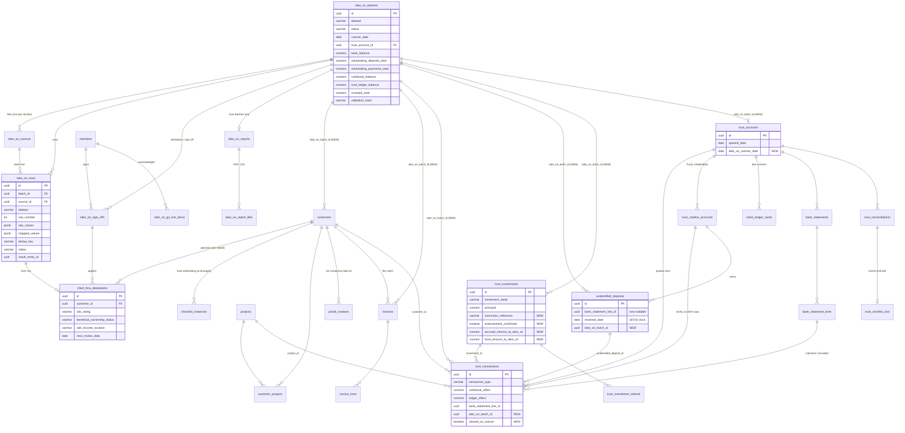
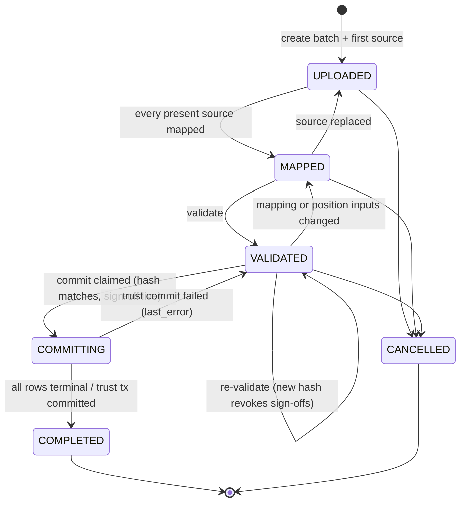

> Merge into ARCHITECTURE.md as **Section 17**.

# Phase 93 — Client & Trust Take-On: Move a Firm Onto Kazi With Books That Reconcile From Day One

> Linked from the note lines at the top of ARCHITECTURE.md like Phases 86–92.

> Inputs: `requirements/claude-code-prompt-phase93.md` (requirements decisions 1–7 (RD-1 to RD-7), legal basis, assumptions A1–A6, constraints, epics E1–E8, ADR topics 1–7), `.arch-context.md` (context inventory at origin/main `575bf4c75`; its §0 lists where HEAD differs from the requirements' scouting note), `backend/CLAUDE.md`, `frontend/CLAUDE.md`, and the Phase 92 document (`architecture/phase92-trust-books-provably-right.md`, Section 16) whose registry, equation and creditor model this phase builds on. Code verified at `main` HEAD `8feb21a3a` (2026-11-20; the only code change since the inventory SHA is FU-13, PR #1824, which touches `TrustReceiptsPaymentsQuery` and `TrustTransactionRepository` and nothing this design relies on). Line numbers are HEAD and shift when a slice lands — re-grep, never trust the number. Where the requirements and the inventory differ, the inventory wins (it is newer) and this document says so at the point of difference (collected in §17.1.4). Tenancy is schema-per-tenant only: no tenant column, no RLS, no Hibernate filter anywhere in this design. ADRs 385–391 are new (§17.12).

## 17.1 Overview

A firm cannot run two sets of trust books in parallel, so a pilot on Kazi starts on a **cutover date**: everything the firm owes or is owed on that date has to be in Kazi before the first transaction after it. Today Kazi can keep a firm's books correctly (Phase 92) but cannot receive them. The only imports are the Xero client pull and trust bank statements. This phase adds a **take-on**: a firm (or the founder white-gloving a pilot) uploads its previous system's exports as CSV or Excel files under **Settings → Matters → Take-on**, maps the columns, reviews a full dry run, signs where the law puts responsibility, commits, and gets a per-row result report. Four datasets go in dependency order: **clients** (ACTIVE, with a FICA attestation), **matters**, the **trust opening position** (every creditor group plus the bank items outstanding at cutover, gated by the reconciled cutover position and signed off by a partner or director), and **debtor opening balances** (brought-forward fee notes, issued without any of the side effects of sending).

The design has one centre of gravity: **the first post-cutover reconciliation must balance with no manual adjustment** (the requirements' acceptance invariant and exit bar). Phase 92's equation is the test: per trust account, adjusted bank = cashbook (EQ-1) and cashbook = trust creditors (EQ-2), every term as at a date, plus EQ-4/EQ-5 and gates G1–G4. Phase 92 also defines "outstanding" as every posted row that moves the cashbook and is not matched to a bank line. A naive opening credit is exactly such a row, so it would be counted a second time against a bank balance that already holds the money (`TrustLedgerQueryRepository.java:497`). This phase therefore gives opening entries their own registry types, a **cleared-at-cutover** attribute that keeps them out of the outstanding sum, and represents each item outstanding at cutover as a real, matchable row on the creditor it belongs to, paired with a cleared offset so the creditor's balance is unchanged (§17.3.8, [ADR-386](../adr/ADR-386-trust-opening-entries-in-the-registry.md)). Everything else in the phase — the batch machinery, the attestation, the quiet issue path — is shaped so that none of it fires an email, a payment link, a notification, a Xero push or an automation, and none of it bypasses a gate the normal UI relies on.

The phase reuses rather than builds frameworks: the batch lifecycle copies `BillingRun`/`BillingRunItem` (guarded transitions, per-item status, `failureReason`, result FK); dedup, row valve and two-phase validate-then-persist copy `XeroCustomerImportService`; the CSV reader copies the tolerant disciplines of `CsvBankStatementParser`; posting goes through `TrustPostingService` and the `TrustTransactionType` registry; the take-on report body is `TrustMonthlyListService.liveList(accountId, cutoverDate)`; the asynchronous commit runs on the existing job queue (`infrastructure/jobqueue/`).

### 17.1.1 What's new

| Concern | Today (HEAD `8feb21a3a`) | After Phase 93 |
|---|---|---|
| Bulk import | Xero client pull (PROSPECT, one-shot flag) and bank statements only | Take-on batches for four datasets from CSV or XLSX, re-runnable, dedup-key idempotent ([ADR-385](../adr/ADR-385-take-on-architecture.md)) |
| XLSX | Never read (all POI use is DOCX/XWPF) | One row model for CSV and XLSX; XLSX via POI usermodel, cached formula values only |
| Imported client lifecycle | Every `createCustomer` overload pins PROSPECT; ACTIVE needs onboarding checklists | A documented take-on entry path lands clients ACTIVE with no checklists, no `CustomerCreatedEvent`, no lifecycle event, and counts the take-on as activity for dormancy ([ADR-389](../adr/ADR-389-imported-client-lifecycle-entry-path.md)) |
| FICA for a client verified elsewhere | Impossible: no checklist ⇒ `NOT_STARTED` ⇒ "FICA outstanding" | `client_fica_attestations` record CDD done in the prior system; the projector returns `ATTESTED` or `ATTESTED_REVIEW`; a "FICA review due" queue ([ADR-388](../adr/ADR-388-fica-attestation-model.md)) |
| Trust opening balance | No opening-balance concept anywhere; an opening credit would be an outstanding deposit | Eleven `TAKEON_*` registry types; `cleared_at_cutover` on the row keeps cleared openings out of the outstanding sum; outstanding cutover items are matchable rows with offsets ([ADR-386](../adr/ADR-386-trust-opening-entries-in-the-registry.md)) |
| Unidentified deposits | Only from a statement line (`bank_statement_line_id NOT NULL`) | Also taken on without a line, keeping the original `received_date` (the s87(4) clock) ([ADR-387](../adr/ADR-387-investments-and-unidentified-deposits-at-cutover.md)) |
| Investments | No instruction reference, endorsement, accrued interest or Fund-share field | Rule 54.17.2 reference and date, Rule 54.17.3 endorsement, accrued uncapitalised interest (memo), Fund amount held at take-on ([ADR-387](../adr/ADR-387-investments-and-unidentified-deposits-at-cutover.md)) |
| Postings before a take-on | n/a | Refused on a taken-on account when dated on or before its cutover date (`trust_accounts.take_on_cutover_date`) |
| Partner/director sign-off | No such concept | `SIGN_OFF_TRUST_TAKE_ON` (owner-only, grantable to a custom "Partner" role) plus a typed Rule 54.19 declaration ([ADR-391](../adr/ADR-391-take-on-report-and-sign-off.md)) |
| Fee notes reach SENT | Only via `send()`: email + PDF, payment link, notification, Xero, automation | A quiet issue path for brought-forward fee notes: SENT with none of those, portal-visible ([ADR-390](../adr/ADR-390-quiet-issue-of-brought-forward-fee-notes.md)) |
| Take-on artefact for the auditor | None | Immutable take-on report (snapshot row + PDF and CSV with SHA-256), gated by `VIEW_TRUST` ([ADR-391](../adr/ADR-391-take-on-report-and-sign-off.md)) |
| Audit | No `takeon.*` family; SAFE_TOKEN discipline only for MCP | 17 `takeon.*` events plus `customer.fica_attested` and `invoice.brought_forward_issued`, counts and refs only, enforced by a typed details builder and a no-PII test |
| Trust reports over the cutover | n/a | Receipts & Payments, Section 35, balance trend, schedule, statements and the age report show the take-on as one brought-forward figure, never as receipts and payments (§17.3.15) |
| Settings | `settings/matters` has 7 tabs; `take-on` reserved by ADR-341 | 8th tab `take-on`, capability-gated; route count stays 17 |

### 17.1.2 Why Phase 84 was superseded

Phase 84 (`requirements/claude-code-prompt-phase84.md`, 2026-07-11) was never architected. Its product decisions carry over; its trust mechanics are void. The requirements' table "Why 84 was superseded" is authoritative; in one line each: its control total ignored five of the six creditor terms; its `OPENING_BALANCE` constant presumed `CREDIT_TYPES` and a stored ledger-card balance, neither of which exists; its opening credit would have been an outstanding deposit and failed EQ-1; its "Xero lands ACTIVE" precedent is false (`XeroCustomerImportService` creates PROSPECT); its quiet SENT path does not exist; it omitted the Fund ledger, unidentified deposits, investments and outstanding items; and its V4/V125 numbering and Settings page predate V30, the owner/admin capability grant and ADR-341.

### 17.1.3 Scope at HEAD

- **Numbering.** Section 17. ADR-385..391. Epics **653–660** (one per requirement epic E1–E8). Tenant migrations next free **V30**; global next free **V8** (not used — §17.7). All are *next free at build time*; numbers here are guides.
- **ADR-385 was "reserved" by Phase 91's requirements** (`requirements/claude-code-prompt-phase91.md`, the line "ADR numbering continues from ADR-385"). Phase 93 now runs before 91 (requirements decision 7 (RD-7)) and takes 385–391; that Phase 91 line must be bumped to **ADR-392** when Phase 91 is architected (the same correction Phase 92 made, §16.12.2 #8). Phase 91 takes **Section 18**.
- **Phase 92 follow-ups read at HEAD** (inventory §13): FU-6, FU-9, FU-14, FU-16 not started (FU-6, FU-9 ruled; FU-14 unruled; FU-16 scoped); FU-22 and FU-23 proposed only. How each interacts is stated where it bites and collected in §17.10 (X5) and §17.11.

### 17.1.4 Corrections to the requirements' scouting note (the inventory wins)

| # | Requirements say | HEAD says | Consequence here |
|---|---|---|---|
| C1 | INVOICE_GENERATION needs address, **tax number**, email or portal contact | Tax number moved to send time (`StructuralPrerequisiteCheck.java:77-78`, `INVOICE_SEND_ONLY_FIELDS`); INVOICE_GENERATION checks `address_line1`, `city`, `country` and email-or-portal-contact (`:48-51`) | The quiet path's prerequisite question is about address and contact, not tax number (§17.3.10) |
| C2 | Unidentified deposits take on as items with their dates | `unidentified_deposits.bank_statement_line_id` is NOT NULL and `UNIDENTIFIED_DEPOSIT` is `recordedOnlyFromStatementLine()` (`TrustTransactionType.java:502`) | Line FK made nullable for take-on items only, plus a dedicated type (§17.2.9) |
| C3 | Investments record instruction ref, endorsement, accrued interest, Fund share | `TrustInvestment` has none of these | Four columns added (§17.2.10) |
| C4 | "Any trust creditor in debit" is a block | At reconciliation a client in debit is a **warning** (`CLIENT_LEDGER_IN_DEBIT`, `TrustIntegrityService.java:87`) | The take-on debit block is take-on-owned (§17.3.9) |
| C5 | The deferred Phase 92 opening-balance snapshot is a candidate mechanism | It is a read-performance escape hatch (Phase 92 doc `:262`, `:2858`), not a cutover mechanism | Cleared-at-cutover is designed from scratch ([ADR-386](../adr/ADR-386-trust-opening-entries-in-the-registry.md)) |
| C6 | Outstanding items "that later bank lines can match" | Auto-match pools rows dated `periodStart − 7d … periodEnd + 7d` only (`TrustReconciliationService.java:355-356`) | Items dated at cutover, and unmatched take-on items join the pool regardless of date (§17.3.11) |
| C7 | Opening entries must not email | `PortalEmailNotificationChannel` emails the client on every recorded `DEPOSIT` (`:158`) | Opening entries never reuse `DEPOSIT` and publish no `TrustTransactionRecordedEvent` |
| C8 | Imported clients would need checklists | FICA status is computed; no checklist and no request ⇒ `NOT_STARTED` (`FicaStatusProjector.java:34`, `:72-90`) | The projector learns about attestations (§17.3.4) |
| C9 | "Apache POI is already a dependency" | True (`poi-ooxml` 5.4.0) but XSSF is never used | The XLSX reader is new code (§17.3.1) |
| C10 | SAFE_TOKEN discipline for `takeon.*` | `SAFE_TOKEN` exists only in `mcp/McpAuditMetadata.java:40`; nothing filters ordinary audit details, and `customer.created` already logs name and email (`CustomerService.java:536-544`) | Take-on owns its enforcement: typed details + a no-PII test (§17.6.4) |
| C11 | (not mentioned) | `customers.email` is `NOT NULL` with `uq_customers_email UNIQUE (email)` (`V1__baseline.sql:996`) | A client row with no email cannot be taken on (founder decision FD-22) |
| C12 | `recordedOnlyFromStatementLine` at `:487-489` | It is at `TrustTransactionType.java:502` | Citation corrected |

### 17.1.5 Out of scope

From the requirements, unchanged: source-system presets (the persisted mapping is their seed); history of any kind (past transactions, fee notes, payments, trust movements, time); WIP / unbilled-time take-on; migrating documents and FICA documents (the attestation points to them); contact/portal-user, task and conflict-register import; undo of a committed batch (row result FKs keep it possible); API migration connectors; a beneficiary bank-details register; auditor portal; a POPIA breach register; and the `trust_account.updated` audit omission (`TrustAccountService.java:310-325`, its own PR). Added by this design: **stale or cancelled cutover cheques are corrected with an ordinary reversal** of the outstanding item (§17.3.8) — no write-back wizard; **matter lead reassignment** beyond the optional lead column (§17.3.6); **the pre-existing PII in `customer.created` and `project.created` details on the normal UI path** (noted, not fixed — §17.6.4); **a per-client form to update or re-attest a FICA attestation** (the review queue is the deliverable, §17.3.5); **dormancy of newly activated non-imported clients** with no activity rows (a hypothesis from reading `DORMANCY_SQL`; needs its own reproduce-first PR — §17.3.3).

Also out of scope, pre-existing at HEAD and recorded as a Phase 92 follow-up candidate: the Receipts & Payments running balance starts at R0,00 for every range rather than at the cashbook before the range (§17.3.15).

## 17.2 Domain Model

Conventions (inventory §7, Phase 92 §16.2): plain `@Entity`, no Lombok, no base class, no tenant column; `UUID` ids via `GenerationType.UUID`; foreign keys as bare `UUID` columns; money `BigDecimal` `numeric(15,2)`; business dates `LocalDate`; instants `Instant` set in `@PrePersist` / `@PreUpdate`; status columns as a Java enum `@Enumerated(EnumType.STRING)` **plus** a DDL CHECK; guarded transition methods on the entity (the `BillingRun` shape), never a public status setter; DTOs as records nested in the service; wire names `clientId` / `matterId`, columns `customer_id` / `project_id`.

Package placement (requirements § Style and boundaries): the batch machinery in a new horizontal **`takeon/`** package; trust opening entries in the trust domain (`verticals/legal/trustaccounting/takeon/`); the FICA attestation in **`compliance/`**; the quiet issue path in **`invoice/`**; the imported-client entry path in **`customer/`**.

| | Table | Entity (package) | Slice |
|---|---|---|---|
| new | `take_on_batches` | `TakeOnBatch` (`takeon/`) | 653A |
| new | `take_on_sources` | `TakeOnSource` (`takeon/`) | 653A |
| new | `take_on_rows` | `TakeOnRow` (`takeon/`) | 653A |
| new | `take_on_sign_offs` | `TakeOnSignOff` (`takeon/`) | 653A (used from 655A) |
| new | `client_fica_attestations` | `ClientFicaAttestation` (`compliance/`) | 655A |
| new | `take_on_go_live_items` | `TakeOnGoLiveItem` (`takeon/`) | 656A |
| new | `take_on_reports`, `take_on_report_files` | `TakeOnReport`, `TakeOnReportFile` (`takeon/`) | 657B, 657C |
| new | registry constants | 11 `TAKEON_*` in `TrustTransactionType` | 657A |
| changed | `trust_transactions` | `TrustTransaction` (+`take_on_batch_id`, `cleared_at_cutover`) | 657A |
| changed | `trust_accounts` | `TrustAccount` (+`take_on_cutover_date`, `take_on_batch_id`) | 657A |
| changed | `unidentified_deposits` | `UnidentifiedDeposit` (line FK nullable for take-on items, +`take_on_batch_id`) | 657A |
| changed | `trust_investments` | `TrustInvestment` (+instruction, endorsement, accrued, Fund amount, batch) | 657A |
| changed | `customers` | `Customer` (+`take_on_batch_id`, `taken_on_at`) | 655A |
| changed | `org_settings` | FICA review intervals on the `DataRequestSettings` embeddable | 655A |
| changed | `invoices` | `Invoice` (+`take_on_batch_id`) | 658A |

**Unchanged** (called out because a reader might expect a change): `projects` and `customer_projects` (imported matters are ordinary matters — provenance lives on `take_on_rows`); `client_ledger_cards` (still only the lock anchor); `trust_creditor_accounts` (no new creditor type — the design deliberately avoids a "take-on clearing" creditor, §17.3.8); `bank_statements`, `bank_statement_lines`, `trust_reconciliations`, `trust_monthly_lists` (no new columns; the first post-cutover reconciliation is an ordinary one); `generated_documents` (the take-on report does not use it, [ADR-391](../adr/ADR-391-take-on-report-and-sign-off.md)); `portal_contacts` and every portal read-model table (no global migration).

### 17.2.1 `take_on_batches` — new ([ADR-385](../adr/ADR-385-take-on-architecture.md))

One batch is one attempt to take on one dataset. It is the unit of validation, attestation/sign-off, commit and audit.

| Field | Type | Constraints | Notes |
|---|---|---|---|
| `id` | `uuid` | PK | |
| `dataset` | `varchar(30)` | NOT NULL, CHECK in (`CLIENTS`, `MATTERS`, `TRUST_POSITION`, `DEBTOR_BALANCES`) | `TakeOnDataset` enum |
| `status` | `varchar(20)` | NOT NULL, CHECK in (`UPLOADED`, `MAPPED`, `VALIDATED`, `COMMITTING`, `COMPLETED`, `CANCELLED`) | `TakeOnBatchStatus`; transitions in §17.3.2 |
| `name` | `varchar(200)` | nullable | Free label, e.g. "Clients — AJS export 31 Oct". Not audited (could hold a name) |
| `cutover_date` | `date` | required for `TRUST_POSITION` and `DEBTOR_BALANCES` (CHECK) | The take-on "as at" date |
| `trust_account_id` | `uuid` | FK `trust_accounts`; required iff `TRUST_POSITION` (CHECK) | The trust **banking** account (`GENERAL` or `SECTION_86`) whose position is taken on |
| `bank_balance` | `numeric(15,2)` | nullable; required at validation for `TRUST_POSITION` | Old system: bank statement balance at cutover |
| `outstanding_deposits_total` | `numeric(15,2)` | ≥ 0 | Old system: deposits in transit at cutover |
| `outstanding_payments_total` | `numeric(15,2)` | ≥ 0 | Old system: unpresented payments at cutover |
| `cashbook_balance` | `numeric(15,2)` | | Old system: cashbook balance at cutover (its Rule 54.15.1 list total) |
| `fund_ledger_balance` | `numeric(15,2)` | signed; default 0 | Fund interest-and-charges ledger on the banking account; negative = in debit |
| `invested_total` | `numeric(15,2)` | ≥ 0; default 0 | Σ balances per the institutions' confirmations for the investments in this batch |
| `mid_month_acknowledged` | `boolean` | NOT NULL default false | A3: a cutover that is not a month end needs this before validation passes |
| `validation_hash` | `varchar(64)` | nullable | SHA-256 of the canonical validated content (§17.3.2); what sign-off and commit bind to |
| `validated_at` | `timestamptz` | | |
| `total_rows`, `valid_rows`, `error_rows`, `duplicate_rows`, `block_count` | `integer` | NOT NULL default 0 | Validation roll-ups, written in the validating transaction |
| `created_rows`, `skipped_rows`, `failed_rows` | `integer` | NOT NULL default 0 | Commit roll-ups |
| `summary` | `jsonb` | nullable | Dataset summary: control totals; for trust the cutover EQ-1/EQ-2 preview (§17.3.9). Amounts live here, never in audit |
| `last_error` | `varchar(1000)` | | Last commit failure reason (batch returns to `VALIDATED`) |
| `created_by` | `uuid` | NOT NULL | member |
| `commit_requested_by` | `uuid` | | member who confirmed the commit |
| `created_at`, `updated_at` | `timestamptz` | NOT NULL | |
| `commit_started_at`, `completed_at`, `cancelled_at` | `timestamptz` | | |
| `cancelled_by` | `uuid` | | |

Design decisions:
- **Position inputs on the batch, not in a file.** They are the five figures of the old system's reconciled position at cutover (requirements E5); a firm types them from its last reconciliation. Putting them on the batch makes them part of the validation hash, so a signed-off position cannot be edited without invalidating the sign-off.
- **The Fund ledger is one figure, not a file section.** A banking account has exactly one Fund interest-and-charges ledger (`uq_trust_creditor_account_singleton`, V18). A Fund amount held on an *investment* account travels on its investment row (§17.2.10).
- **One trust batch per banking account.** Investments name their investment account; the batch posts to the banking account and every investment account its rows name, in one transaction (§17.3.9).
- **No `FAILED` batch status.** Row-level datasets fail per row (rows `FAILED`, batch `COMPLETED` with `failed_rows > 0`); the trust position is all-or-nothing and a failed commit leaves the batch `VALIDATED` with `last_error`. A batch status that means "partly done" would be a third meaning to explain.

### 17.2.2 `take_on_sources` — new

One uploaded file (and chosen sheet) inside a batch. `CLIENTS`, `MATTERS` and `DEBTOR_BALANCES` batches have exactly one source (section `MAIN`); a `TRUST_POSITION` batch has one source per creditor-group section it uses. This departs from the requirements' E1, which put file metadata on the batch: the trust position is several of the old system's reports (client balances, unidentified deposits, investment register, outstanding items) that must be committed atomically, and forcing them into one file with a row-type column would make column mapping heterogeneous and error-prone.

| Field | Type | Constraints | Notes |
|---|---|---|---|
| `id` | `uuid` | PK | |
| `batch_id` | `uuid` | NOT NULL, FK `take_on_batches` | |
| `section` | `varchar(30)` | NOT NULL, CHECK in (`MAIN`, `CLIENT_LEDGER`, `UNIDENTIFIED_DEPOSITS`, `INVESTMENTS`, `OUTSTANDING_ITEMS`); UNIQUE (`batch_id`, `section`) | `TakeOnSection`; `MAIN` only for the three single-file datasets (CHECK in service) |
| `file_name` | `varchar(255)` | NOT NULL | Original name, sanitised |
| `content_type` | `varchar(100)` | NOT NULL | As validated (§17.6.2) |
| `file_format` | `varchar(10)` | NOT NULL, CHECK in (`CSV`, `XLSX`) | |
| `file_size` | `bigint` | NOT NULL, ≤ 10 485 760 | |
| `file_sha256` | `varchar(64)` | NOT NULL | Printed on the take-on report's source-files section |
| `s3_key` | `varchar(500)` | nullable | `take-on/{tenantSchema}/{batchId}/{uuid}/{fileName}`; null once purged |
| `sheet_names` | `jsonb` | XLSX only | Visible and hidden sheets, in workbook order |
| `sheet_name` | `varchar(100)` | | The chosen sheet (XLSX) |
| `header_row` | `integer` | NOT NULL default 1 | 1-based row holding the headers |
| `parse_options` | `jsonb` | NOT NULL | `{dateFormat, decimalSeparator, delimiter, encoding}` (§17.3.1) |
| `column_mapping` | `jsonb` | nullable until mapped | `{targets: {targetField: sourceHeader}, customFields: {slug: sourceHeader}, parked: [sourceHeader…], defaults: {targetField: value}}` — the seed for presets |
| `row_count`, `malformed_count`, `blank_skipped` | `integer` | NOT NULL default 0 | |
| `uploaded_by` | `uuid` | NOT NULL | |
| `uploaded_at`, `mapped_at`, `purged_at` | `timestamptz` | | |

### 17.2.3 `take_on_rows` — new

| Field | Type | Constraints | Notes |
|---|---|---|---|
| `id` | `uuid` | PK | |
| `batch_id` | `uuid` | NOT NULL, FK | |
| `source_id` | `uuid` | NOT NULL, FK `take_on_sources` | |
| `dataset` | `varchar(30)` | NOT NULL | Denormalised from the batch so the cross-batch dedup index can be one index |
| `section` | `varchar(30)` | NOT NULL | Denormalised from the source |
| `row_number` | `integer` | NOT NULL; UNIQUE (`source_id`, `row_number`) | Spreadsheet row number as the user sees it (header row counted) |
| `raw_values` | `jsonb` | NOT NULL | `{sourceHeader: text}` exactly as read; redactable (§17.10 X4) |
| `mapped_values` | `jsonb` | nullable | Typed, normalised target values after mapping (ISO dates, plain decimals, enum names) |
| `source_ref` | `varchar(200)` | nullable | `takeon_source_ref`: the previous system's id for the record; always recorded when present, else `row:{n}` |
| `dedup_key` | `varchar(300)` | nullable | Dataset-specific key (§17.3.3–17.3.10); lower-cased |
| `status` | `varchar(20)` | NOT NULL, CHECK in (`PENDING`, `VALIDATED`, `ERROR`, `CREATED`, `SKIPPED_DUPLICATE`, `SKIPPED_ZERO`, `FAILED`) | `TakeOnRowStatus`; `SKIPPED_ZERO` = a trust client-ledger row with a nil balance (nothing to post, §17.3.7) |
| `errors` | `jsonb` | NOT NULL default `[]` | `[{code, field, message}]`; any entry ⇒ `ERROR` |
| `warnings` | `jsonb` | NOT NULL default `[]` | Non-blocking notes shown on the preview |
| `block` | `boolean` | NOT NULL default false | The error is a statutory hard block (§17.3.9) — styled differently, never overridable |
| `duplicate_of_id` | `uuid` | | Existing entity the row matched at validation |
| `failure_reason` | `varchar(1000)` | | Commit-time failure (row `FAILED`) |
| `result_entity_type` | `varchar(30)` | | `CLIENT`, `MATTER`, `TRUST_TRANSACTION`, `UNIDENTIFIED_DEPOSIT`, `TRUST_INVESTMENT`, `FEE_NOTE` |
| `result_entity_id` | `uuid` | | The created (or, for `SKIPPED_DUPLICATE`, matched) entity |
| `result_refs` | `jsonb` | | Secondary ids (e.g. the attestation id; both rows of an outstanding item and its offset) |
| `created_at`, `updated_at` | `timestamptz` | NOT NULL | |

Statuses: `PENDING` (read, not yet validated) → `VALIDATED` | `ERROR` (dry run) → `CREATED` | `SKIPPED_DUPLICATE` | `SKIPPED_ZERO` | `FAILED` (commit). A row matched to an existing entity at validation stays `VALIDATED` with `duplicate_of_id` set and becomes `SKIPPED_DUPLICATE` at commit. Re-validation resets every non-terminal row to `PENDING` first. Rows of a `COMPLETED` batch are terminal.

Why `dedup_key` lives on the row with a cross-batch unique index (`uq_take_on_rows_created_key`, §17.7): requirements decision 6 (RD-6) says idempotency comes from dedup keys, not a global "already ran" flag. A unique partial index over `(dataset, dedup_key) WHERE status = 'CREATED'` makes "the same record taken on twice" impossible even for two batches committing concurrently, without a flag anywhere.

**Dedup keys, exactly** (lower-cased; `{account}` is a trust account id). Trust keys carry the account and the section so the same client and matter on a `GENERAL` and a `SECTION_86` account never collide; within one trust batch the index is a second line of defence behind `uq_take_on_batches_trust_position` (one committed position per account).

| Dataset / section | `dedup_key` | In-file duplicate |
|---|---|---|
| `CLIENTS` | `email:{email}` | `ERROR` |
| `MATTERS` | `ref:{referenceNumber}`, else `name:{clientId}:{name}` | `ERROR` |
| `DEBTOR_BALANCES` | `number:{feeNoteNumber}` | `ERROR` |
| `CLIENT_LEDGER` | `{account}:CLIENT_LEDGER:{clientId}:{matterId}` — the matter is mandatory (every client posting needs one of the client's matters, `TrustClientMatterRule.requireClientMatter`, §17.3.7), so a row without a resolvable matter is an `ERROR` (a hard block) and gets no key; there is no null encoding | `ERROR` (one balance per client and matter) |
| `UNIDENTIFIED_DEPOSITS` | `{account}:UNIDENTIFIED_DEPOSITS:src:{sourceRef}`, else `{account}:UNIDENTIFIED_DEPOSITS:row:{batchId}:{rowNumber}` | same date + amount + reference → **warning** (two identical deposits on one day are possible) |
| `INVESTMENTS` | `{investmentAccount}:INVESTMENTS:{institution}:{accountNumber}` — keyed by the *investment* account, so one investment cannot be taken on twice through two banking accounts | `ERROR` |
| `OUTSTANDING_ITEMS` (client and matter mandatory, FD-18) | `{account}:OUTSTANDING_ITEMS:{kind}:src:{sourceRef}`, else `{account}:OUTSTANDING_ITEMS:{kind}:row:{batchId}:{rowNumber}` — two items for one client never collide | same kind + reference + amount → **warning** |

### 17.2.4 `take_on_sign_offs` — new ([ADR-388](../adr/ADR-388-fica-attestation-model.md), [ADR-391](../adr/ADR-391-take-on-report-and-sign-off.md))

One act of responsibility over a validated batch: the FICA attestation for a clients batch, or the partner/director sign-off for a trust position.

| Field | Type | Constraints | Notes |
|---|---|---|---|
| `id` | `uuid` | PK | |
| `batch_id` | `uuid` | NOT NULL, FK | |
| `kind` | `varchar(20)` | NOT NULL, CHECK in (`FICA_ATTESTATION`, `TRUST_SIGN_OFF`) | |
| `member_id` | `uuid` | NOT NULL, FK `members` | |
| `member_name` | `varchar(255)` | NOT NULL | Snapshot: the record must say who signed even if the member is later removed |
| `role_name` | `varchar(100)` | NOT NULL | Snapshot of the member's org role name at signing |
| `statement_version` | `varchar(40)` | NOT NULL | e.g. `FICA-ATTEST-v1`, `TAKEON-SIGNOFF-v1` (§17.10 X3) |
| `statement_text` | `text` | NOT NULL | The exact text shown and accepted, with the firm name, account and dates filled in |
| `validation_hash` | `varchar(64)` | NOT NULL | The batch hash signed; commit requires equality |
| `batch_defaults` | `jsonb` | | Attestation only: batch-level defaults applied to blank row fields (e.g. records location) |
| `signed_at` | `timestamptz` | NOT NULL | |
| `revoked_at` | `timestamptz` | | Set by re-validation that changes the hash, by explicit revoke, or by cancel |
| `revoked_reason` | `varchar(30)` | CHECK in (`REVALIDATED`, `REVOKED`, `CANCELLED`) | |

Partial unique index `(batch_id, kind) WHERE revoked_at IS NULL`: at most one live sign-off of each kind per batch.

### 17.2.5 `client_fica_attestations` — new (`compliance/`; [ADR-388](../adr/ADR-388-fica-attestation-model.md))

A record that customer due diligence for this client was performed by the firm in its previous system, and where the records are. It is **not** verification in Kazi, and it is a pointer to records that must still exist (FICA s22, s23).

| Field | Type | Constraints | Notes |
|---|---|---|---|
| `id` | `uuid` | PK | |
| `customer_id` | `uuid` | NOT NULL, FK `customers` | |
| `status` | `varchar(20)` | NOT NULL, CHECK in (`ACTIVE`, `SUPERSEDED`) | Partial unique `(customer_id) WHERE status = 'ACTIVE'` |
| `take_on_batch_id` | `uuid` | NOT NULL, FK | |
| `take_on_row_id` | `uuid` | NOT NULL, FK | |
| `sign_off_id` | `uuid` | NOT NULL, FK `take_on_sign_offs` | The batch attestation this applies |
| `cdd_completed_date` | `date` | NOT NULL | |
| `last_review_date` | `date` | nullable | |
| `risk_rating` | `varchar(10)` | NOT NULL, CHECK in (`LOW`, `MEDIUM`, `HIGH`, `UNRATED`) | Blank in the file ⇒ `UNRATED` |
| `fica_client_type` | `varchar(30)` | NOT NULL, CHECK in (`NATURAL_PERSON`, `COMPANY`, `CLOSE_CORPORATION`, `TRUST`, `PARTNERSHIP`, `OTHER`) | FICA's view of the client; `customers.customer_type` (INDIVIDUAL/COMPANY/TRUST) is derived from it |
| `beneficial_ownership_status` | `varchar(20)` | NOT NULL, CHECK in (`DONE`, `NOT_APPLICABLE`, `OUTSTANDING`) | |
| `screening_status` | `varchar(20)` | NOT NULL, CHECK in (`SCREENED_CLEAR`, `SCREENED_MATCH`, `NOT_SCREENED`) | PEP/sanctions screening in the prior system |
| `screening_date` | `date` | required unless `NOT_SCREENED` (CHECK) | |
| `source_of_funds_status` | `varchar(20)` | NOT NULL default `NOT_REQUIRED`, CHECK in (`DONE`, `NOT_REQUIRED`, `OUTSTANDING`) | Where the firm's RMCP requires it |
| `cdd_records_location` | `varchar(500)` | NOT NULL | Old-system or archive reference (s22 pointer) |
| `source_system_ref` | `varchar(200)` | | The previous system's client id |
| `next_review_date` | `date` | nullable | Derived at creation: `coalesce(last_review_date, cdd_completed_date)` + the firm's interval for the rating; null when `UNRATED` |
| `attested_by` | `uuid` | NOT NULL | = `sign_off.member_id`, denormalised for queries |
| `attested_at` | `timestamptz` | NOT NULL | |
| `created_at`, `superseded_at` | `timestamptz` | | |

Design decisions:
- **Stored, not computed.** ADR-348 rules "no persisted column" for the *status*; this is not a status column but the evidence the projection reads, exactly as checklist instances are. The status stays computed (§17.3.4).
- **One table per fact.** A per-client attestation row, not a jsonb blob on `customers`, because the review queue queries `risk_rating`, `beneficial_ownership_status` and `next_review_date`, and a client can be re-attested (old row `SUPERSEDED`).
- **Review intervals are firm settings, not law.** s21C requires ongoing due diligence at a risk-based frequency set in the firm's RMCP (s42, Guidance Note 7); Kazi cannot know it. Three integer settings (`fica_review_months_low|medium|high`, defaults 36/24/12, founder decision FD-7) live on `DataRequestSettings`, the embeddable that already holds `dormancy_threshold_days`.

### 17.2.6 `take_on_go_live_items` — new (E7)

| Field | Type | Constraints | Notes |
|---|---|---|---|
| `item_key` | `varchar(40)` | PK, CHECK in (`TRUST_RECORDS_RETAINED`, `FICA_RECORDS_RETAINED`, `ARCHIVE_HOSTING_CONSIDERED`, `AUDITOR_INFORMED`) | `GoLiveItem` enum; copy in §17.10 X3 |
| `acknowledged_by` | `uuid` | NOT NULL | |
| `acknowledged_at` | `timestamptz` | NOT NULL | |
| `note` | `varchar(1000)` | | e.g. where the archive lives |

One row per acknowledged item; withdrawing deletes the row (audited). A table, not an `org_settings` jsonb, because each acknowledgement is an attributable act with its own audit event, and the list is per firm, not per batch.

### 17.2.7 `take_on_reports` and `take_on_report_files` — new ([ADR-391](../adr/ADR-391-take-on-report-and-sign-off.md))

`take_on_reports` (`@Immutable`, every column `updatable = false`, like `TrustMonthlyList`):

| Field | Type | Constraints | Notes |
|---|---|---|---|
| `id` | `uuid` | PK | |
| `batch_id` | `uuid` | NOT NULL, UNIQUE, FK | One report per trust batch |
| `trust_account_id` | `uuid` | NOT NULL | |
| `cutover_date` | `date` | NOT NULL | |
| `snapshot` | `jsonb` | NOT NULL | Everything the PDF/CSV print (§17.3.12): reconciled position (inputs and Kazi-computed), creditor list by group from `liveList`, investments, unidentified items, outstanding items, control totals, flags, sign-off, source files |
| `snapshot_sha256` | `varchar(64)` | NOT NULL | Over the canonical snapshot |
| `generated_by` | `uuid` | NOT NULL | The committing member |
| `generated_at` | `timestamptz` | NOT NULL | |

`take_on_report_files`: `id`, `report_id` (FK), `format` (`PDF` \| `CSV`; UNIQUE (`report_id`, `format`)), `s3_key` (`take-on/{tenantSchema}/{batchId}/report/{reportId}/take-on-report.{pdf|csv}`), `sha256`, `file_size`, `rendered_at`. Rendered after commit from the snapshot; a missing file is re-rendered from the same snapshot; an existing one is never overwritten.

### 17.2.8 `TrustTransactionType` — eleven `TAKEON_*` constants and two registry changes ([ADR-386](../adr/ADR-386-trust-opening-entries-in-the-registry.md))

Registry changes:
- **`Origin.TAKE_ON`** (new enum value; `enum Origin` at `TrustTransactionType.java:356`). A type with this origin is created only by `TrustOpeningPositionService` through `TrustPostingService.recordOpening` (§17.3.9); `record` refuses it. New predicate `recordedOnlyAtTakeOn()` beside `recordedOnlyFromStatementLine()` (`:502`).
- **`Approval.AT_SIGN_OFF`** (new enum value; `enum Approval` at `TrustTransactionType.java:325`): the row is posted `APPROVED`, with `approved_by` = the batch's live trust signer and `approved_at` = the sign-off time, by `recordOpening` only. Every other posting method refuses it, and the exhaustive `switch (pairApproval)` in `recordWithPair` (`TrustPostingService.java:155-159`) gets an `AT_SIGN_OFF -> null` arm (a take-on row is never a pair).
- **`Clearance`** (new attribute, 12th constructor argument): `BANK` (every existing constant: outstanding until matched to a statement line) or `AT_CUTOVER` (cleared at posting: never outstanding, never matchable). `TrustPostingService` writes it onto the row as `cleared_at_cutover` exactly as it writes the effects — so no SQL needs to know a type's clearance (the ADR-378 principle).

| Type | cb | ledger | lg | CAT | approval | reversal | origin | clearance | clientVisible | auditKey | label / clientLabel |
|---|---|---|---|---|---|---|---|---|---|---|---|
| `TAKEON_CLIENT` | +1 | CLIENT | +1 | – | AT_SIGN_OFF | NONE | TAKE_ON | AT_CUTOVER | Y | `trust_takeon_client` | "Balance brought forward — take-on" / same |
| `TAKEON_FUND` | +1 | NON_CLIENT | +1 | FUND | AT_SIGN_OFF | NONE | TAKE_ON | AT_CUTOVER | N | `trust_takeon_fund` | "Fund ledger brought forward — take-on" |
| `TAKEON_FUND_DEBIT` | −1 | NON_CLIENT | −1 | FUND | AT_SIGN_OFF | NONE | TAKE_ON | AT_CUTOVER | N | `trust_takeon_fund_debit` | "Fund ledger brought forward in debit — take-on" |
| `TAKEON_UNIDENTIFIED` | +1 | NON_CLIENT | +1 | UNID | AT_SIGN_OFF | NONE | TAKE_ON | AT_CUTOVER | N | `trust_takeon_unidentified` | "Unidentified deposit brought forward — take-on" |
| `TAKEON_INVESTMENT` | +1 | CLIENT_INVESTMENT | +1 | – | AT_SIGN_OFF | NONE | TAKE_ON | AT_CUTOVER | N | `trust_takeon_investment` | "Section 86(4) investment brought forward — take-on" |
| `TAKEON_FIRM_INV_OUT` | −1 | INTER_ACCOUNT | −1 | – | AT_SIGN_OFF | NONE | TAKE_ON | AT_CUTOVER | N | `trust_takeon_firm_inv_out` | "Placed in section 86(3) investment — brought forward" |
| `TAKEON_FIRM_INV_IN` | +1 | INTER_ACCOUNT | +1 | – | AT_SIGN_OFF | NONE | TAKE_ON | AT_CUTOVER | N | `trust_takeon_firm_inv_in` | "Section 86(3) investment brought forward — take-on" |
| `TAKEON_PAY_UNPRES` | −1 | CLIENT | −1 | – | AT_SIGN_OFF | IMMEDIATE | TAKE_ON | BANK | N | `trust_takeon_pay_unpres` | "Payment not yet presented at take-on" |
| `TAKEON_PAY_OFFSET` | +1 | CLIENT | +1 | – | AT_SIGN_OFF | NONE | TAKE_ON | AT_CUTOVER | N | `trust_takeon_pay_offset` | "Take-on offset — payment not yet presented" |
| `TAKEON_DEP_TRANSIT` | +1 | CLIENT | +1 | – | AT_SIGN_OFF | NEEDS_APPROVAL | TAKE_ON | BANK | N | `trust_takeon_dep_transit` | "Deposit not yet cleared at take-on" |
| `TAKEON_DEP_OFFSET` | −1 | CLIENT | −1 | – | AT_SIGN_OFF | NONE | TAKE_ON | AT_CUTOVER | N | `trust_takeon_dep_offset` | "Take-on offset — deposit not yet cleared" |

(cb = cashbookSign; lg = ledgerSign; CAT = creditorAccountType, FUND = `FUND_INTEREST_AND_CHARGES`, UNID = `UNIDENTIFIED_DEPOSITS`. Every name ≤ 20 characters for `varchar(20)`; the longest are `TAKEON_UNIDENTIFIED` and `TAKEON_FIRM_INV_OUT` at 19.)

Why each attribute:
- **Approval `AT_SIGN_OFF`, posted `APPROVED`.** The rows are posted together under the batch's partner/director sign-off, which is the authorisation (Rule 54.19); a per-row maker-checker over hundreds of brought-forward balances would add clicks, not control (FD-25). Posting them `APPROVED` with the signer as approver records that authorisation on every row, and it is what the investment flows require of a placement: `withdrawInvestment` and the interest entry both refuse unless the investment's `deposit_transaction_id` row is `APPROVED` and posted (`TrustInvestmentService.java:593`, `:988`). A `RECORDED` take-on placement would make a taken-on investment impossible to withdraw or credit with interest, leaving its statement line unresolved and G4 blocking (ADR-387). `APPROVED` is already a posted status everywhere (`chk_trust_txn_posting`, V17:61). On an account with `require_dual_approval` the rows still carry one approver and a null `second_approved_by`: dual approval is enforced only when a pending row is approved (`TrustTransactionService.java:903-911`), and no integrity check or projection treats a single-approved posted row as an anomaly (FD-25).
- **Reversal `NONE` for cleared rows.** The cutover position is signed and reported to the auditor; reversing one opening row would silently change it. A misallocation between clients is corrected with an ordinary `TRANSFER_OUT`/`TRANSFER_IN`; the account total cannot be wrong because commit refuses unless it ties to the cent. **`TAKEON_PAY_UNPRES` reverses `IMMEDIATE`** (like `PAYMENT`): a cutover cheque later cancelled is written back to the client by an ordinary reversal. **`TAKEON_DEP_TRANSIT` reverses `NEEDS_APPROVAL`** (like `DEPOSIT`): a deposit in transit that never arrives takes money off a client's ledger.
- **Client visibility.** Only `TAKEON_CLIENT` is client-visible. The outstanding item and its offset net to zero on the client's ledger, so hiding both keeps the portal's running balance equal to the brought-forward figure the client saw on the old statement (founder decision FD-8). `TAKEON_INVESTMENT` follows `INV_RECEIVE` (N); the portal's invested balance is projected from the `CLIENT_INVESTMENT` ledger (global V7) and picks it up.
- **No `DEPOSIT` reuse.** `PortalEmailNotificationChannel.onTrustTransactionRecorded` emails the client for every recorded `DEPOSIT` (`:158`). A dedicated code keeps that impossible, and take-on publishes no `TrustTransactionRecordedEvent` at all.
- **`TAKEON_FUND_DEBIT` exists** because `chk_trust_txn_amount_positive` (`V1__baseline.sql:1818`) forbids a negative amount and a type's sign is fixed; it is used only when the Fund ledger is in debit at cutover, which is allowed and flagged (ADR-381; FD-12).

Registry tests change (§17.8.4): `values()` 25 → 36 (also the hard-coded `hasSize(25)` on `chk_trust_txn_type` in `TrustCreditorAccountIntegrationTest.java:555`); the per-row attribute table asserts `approval()` per type (`TrustTransactionTypeRegistryTest.java:397`), so the eleven rows carry `AT_SIGN_OFF`, and the bank-types-are-`NONE` assertion (`:429`) is unchanged but a new one pins every `TAKE_ON`-origin type to `AT_SIGN_OFF`. The test fixture's `TrustBooksFixture.postDirect` (`testutil/TrustBooksFixture.java:744-768`) sends every non-`NONE` approval through `recordAwaitingApproval` + `postOnApproval`, which `AT_SIGN_OFF` types refuse — so the 657A harness posts take-on rows through a new `postOpening(…)` helper that calls `recordOpening` with a test `OpeningAuthority` (built through a package-level test factory in the take-on package), and `postDirect` throws a clear "use postOpening" for `TAKE_ON` types; the never-client-visible non-client/inter-account set 12 → 17; the investment-row set gains the three investment-ledger types by its ledger rule; a new `TAKE_ON`-origin set pins the eleven.

### 17.2.9 `trust_transactions`, `trust_accounts`, `unidentified_deposits` — changed

**`trust_transactions`** (+2 columns):

| Field | Type | Constraints | Notes |
|---|---|---|---|
| `take_on_batch_id` | `uuid` | FK `take_on_batches`; CHECK `chk_trust_txn_take_on_batch`: `(left(transaction_type, 7) = 'TAKEON_') = (take_on_batch_id IS NOT NULL)` | Provenance; a `REVERSAL` of a take-on row carries none |
| `cleared_at_cutover` | `boolean` | NOT NULL default false; CHECK `chk_trust_txn_cutover_cleared`: `NOT cleared_at_cutover OR (take_on_batch_id IS NOT NULL AND bank_statement_line_id IS NULL)` | Written from the registry's `Clearance` at posting |

Existing CHECKs extended: `chk_trust_txn_type` (+11 names); `chk_trust_txn_unidentified_item` (`V21:69-71`) adds `TAKEON_UNIDENTIFIED` to the types that need `unidentified_deposit_id`. Unique partial index `uq_trust_txn_takeon_client_matter (trust_account_id, customer_id, project_id) WHERE transaction_type = 'TAKEON_CLIENT'`: one brought-forward balance per client and matter per account, enforced by the database (§17.10 X5).

**`trust_accounts`** (+2 columns): `take_on_cutover_date date` and `take_on_batch_id uuid` (FK), set together in the commit transaction on the banking account and on each investment account the batch posts to; never changed afterwards. An investment account shared by two banking accounts is set by the first batch; a later batch may post to it only at the **same** cutover date (§17.3.9). While set, `TrustPostingService` refuses any non-`TAKE_ON` posting dated on or before the cutover date (409 `DATED_BEFORE_TAKE_ON`, §17.3.11), and statement import excludes lines dated on or before it (refusing a statement wholly on or before it, FD-32).

**`unidentified_deposits`** (one column changed, one added):
- `bank_statement_line_id` → **nullable**, with `chk_unidentified_deposit_origin`: `(bank_statement_line_id IS NULL) = (take_on_batch_id IS NOT NULL)` — an item comes from exactly one of a statement line or a take-on.
- `take_on_batch_id uuid` (FK).
- `deposit_transaction_id` is the `TAKEON_UNIDENTIFIED` row (set by `attachDepositTransaction` in the commit transaction), so `uq_unidentified_deposit_txn`, the FK `unidentified_deposits_deposit_txn_fkey` and `findByDepositTransactionIdForUpdate` (`UnidentifiedDepositRepository.java:27`) all hold for take-on items exactly as for statement items.
- `bank_description` stays `NOT NULL`: a take-on item uses the file's description, else "Unidentified deposit brought forward — take-on (ref {bank reference})".
- **Resolution date window.** `UnidentifiedDepositService.requireDateInWindow` (`:616-643`) offers received date … today. On a taken-on account its floor becomes `max(received_date, take_on_cutover_date + 1 day)` (and the existing reopened-date floor still applies), with the message "The {allocation|payment} date must be after the take-on date ({C}) and no later than today"; otherwise the dialog would offer dates the `DATED_BEFORE_TAKE_ON` guard refuses.
- `received_date` keeps its meaning: **the original deposit date**, the s87(4)(a) clock, carried from the file. The posting row is dated at the cutover date; the item is not. `UNIDENTIFIED_OVER_ONE_YEAR` (`TrustIntegrityService`, by `received_date`) therefore fires correctly from the first day.
- Readers that assumed every item has a line (the allocation dialog's link to the bank line, the Section 35 data pack's evidence column, the unidentified-deposits age report) show "Taken on at {cutover date}" instead of a line for a take-on item.

### 17.2.10 `trust_investments` — changed ([ADR-387](../adr/ADR-387-investments-and-unidentified-deposits-at-cutover.md))

| Field | Type | Constraints | Notes |
|---|---|---|---|
| `instruction_reference` | `varchar(200)` | nullable | s86(4): the client's instruction or Rule 54.17.2 written confirmation reference |
| `instruction_date` | `date` | nullable | |
| `endorsement_confirmed` | `boolean` | NOT NULL default false | Rule 54.17.3: the account is endorsed as opened under s86(4) |
| `accrued_interest_at_take_on` | `numeric(15,2)` | nullable, ≥ 0 | Accrued, **uncapitalised** interest at cutover — memo only, never posted (A5, FD-13) |
| `fund_amount_at_take_on` | `numeric(15,2)` | nullable, ≥ 0 | Interest already capitalised in the investment that belongs to the Fund and was not yet paid over at cutover (s86(5) 5% share for s86(4); all interest for s86(3)) — posted as `TAKEON_FUND` on the investment account |
| `take_on_batch_id` | `uuid` | FK | |

CHECK `chk_trust_invest_take_on_instruction`: `take_on_batch_id IS NULL OR investment_basis <> 'CLIENT_INSTRUCTION' OR (instruction_reference IS NOT NULL AND instruction_date IS NOT NULL AND endorsement_confirmed)` — mandatory for taken-on s86(4) investments (FD-14), optional for investments placed in Kazi (the placement form is unchanged this phase). `principal` of a taken-on investment is the **client's** balance in the investment at cutover (capitalised interest included, Fund share excluded); `deposit_date` is the original placement date; `deposit_transaction_id` is the take-on row on the investment account, so EQ-5's `placed` term (`TrustLedgerQueryRepository.java:596-600`) counts it from the cutover date.

### 17.2.11 `customers`, `invoices`, `org_settings` — changed

- **`customers`** + `take_on_batch_id uuid` (FK) and `taken_on_at timestamptz`. `taken_on_at` joins the dormancy query's `GREATEST(...)` (§17.3.3); `GREATEST` ignores NULLs in PostgreSQL, so every non-imported client's dormancy is unchanged.
- **`invoices`** + `take_on_batch_id uuid` (FK): marks a brought-forward fee note (badge, guards). No other column; `issue_date` and `due_date` already exist and are set by the quiet path.
- **`org_settings`** + `fica_review_months_low integer NOT NULL DEFAULT 36`, `fica_review_months_medium … DEFAULT 24`, `fica_review_months_high … DEFAULT 12` (each CHECK 1–120). They join the `DataRequestSettings` embeddable (which holds `dormancy_threshold_days`) with `@AttributeOverride` column pins beside the existing three (`OrgSettings.java:93-103`). Two settings pins move with them: `OrgSettingsSchemaSnapshotTest` pins the column list, so it gains the three rows `fica_review_months_* | integer | NO` with an authorised-pin comment (the precedent comments at `:60` and `:80`); `OrgSettingsEmbeddableNullReloadTest` needs no structural change — the new columns are `NOT NULL`, so `DataRequestSettings` can no longer materialise as null — and gains one assertion that the three getters return 36/24/12 after its raw-SQL legacy-row reload.

### 17.2.12 Entity-relationship diagram (the trust, client, matter, fee-note and compliance neighbourhood)

The full tenant schema (106 entities) is too large for one diagram; this shows every table the phase adds or changes plus its existing neighbours in the trust, client, matter, fee-note and compliance areas. New tables and new columns are marked `NEW`.



## 17.3 Core Flows and Backend Behaviour

Every flow below runs inside one tenant schema: requests resolve the tenant from the JWT as everywhere else, the commit job carries the tenant id and runs under `RequestScopes.runForTenant`, and a batch id from another tenant is simply not found (404) because the row is not in the caller's schema. Nothing in this phase reads or writes the `public` schema or the portal's global tables except through the existing portal read-model handlers.

### 17.3.1 Upload and parse — one row model for CSV and XLSX (slice 653A)

```java
// takeon/reader/
public record TakeOnParseOptions(String dateFormat, DecimalSeparator decimalSeparator, Character delimiter, String encoding) {}
public record TakeOnRawRow(int rowNumber, Map<String, String> values) {}
public record TakeOnSheet(String sheetName, List<String> headers, List<TakeOnRawRow> rows,
                          int malformedCount, int blankSkipped, List<String> warnings) {}
public sealed interface TakeOnFileReader permits CsvTakeOnReader, XlsxTakeOnReader {
  List<String> sheetNames(byte[] file);                    // CSV: one synthetic sheet "CSV"
  TakeOnSheet read(byte[] file, String sheetName, int headerRow, TakeOnParseOptions options);
}
```

Both readers produce `Map<header, text>` per row; typing happens later, in mapping. The disciplines copy `CsvBankStatementParser` (skip blank lines, count malformed rows rather than fail, throw only if *every* row is malformed) but the helpers are new code because the bank parser's are `protected` instance methods and two of them are wrong for this use: `parseAmount` strips all commas, so decimal-comma amounts (common in SA Excel exports) are misread, and `splitCsvLine` has no multi-line quoted fields (inventory §22).

- **CSV:** strip a UTF-8 BOM; decode strictly as UTF-8, and on a malformed sequence decode as Windows-1252 and record `encoding` plus a warning; detect the delimiter from the header line among `, ; \t |` (overridable); RFC 4180 quoting including `""` escapes and quoted newlines; the header row is `header_row`; blank headers become `Column N`; duplicate headers get a `(2)` suffix and a warning.
- **XLSX:** read with POI's **streaming** event API, never `XSSFWorkbook`: `OPCPackage.open(InputStream)` → `XSSFReader`, sheets from `XSSFReader.SheetIterator` (names in workbook order; the hidden/very-hidden state read from `workbook.xml`'s `<sheet state>`), shared strings via `ReadOnlySharedStringsTable`, styles via `XSSFReader.getStylesTable()`, and each sheet parsed by `XSSFSheetXMLHandler(styles, sharedStrings, handler, formatter, formulasNotResults = false)` — memory stays proportional to one row, not the workbook (a 10 MB `.xlsx` can be ~100 MB as a DOM). POI's zip-bomb guard (`ZipSecureFile`) stays at its defaults; `.xls` (HSSF) is refused at upload. `formulasNotResults = false` means **a formula cell yields its cached result only, never an evaluation**. The `formatter` is a take-on `DataFormatter` subclass overriding `formatRawCellContents(double, int, String)`: a date format (`DateUtil.isADateFormat`) → ISO `yyyy-MM-dd`; any other number → `NumberToTextConverter.toText(value)` (Excel's own 15-significant-digit text, ignoring display formats such as `#,##0` that would round `1234.56` to `1,235`). Strings are trimmed; booleans become `true`/`false`; an error cell (the handler's `ERROR:` prefix, e.g. `#REF!`, `#VALUE!`) makes the row malformed with "This cell holds an error ({code}). Correct it in Excel and upload again." A formula saved without a cached value arrives blank; a blank required field then fails with "{Field} is required. If this cell holds a formula, open the file in Excel, save it, and upload it again." Merged cells: only the top-left cell carries the value. Founder decision FD-17 records this policy.
- **Limits:** 10 MB per file (Spring's 10 MB/15 MB multipart limits, `application.yml:59-60`), at most 10 000 data rows per source (the Xero import's valve, `XeroCustomerImportService.java:41`) and 100 columns; over either is a 422 at upload, before anything is stored.

The upload transaction stores the source row, uploads the raw bytes to S3 **after** a successful parse (the bank-statement order, `TrustReconciliationService.java:241-243`) and writes one `take_on_rows` row per data row with `raw_values` and status `PENDING`. A batch whose source is replaced (`DELETE` the source, upload again) returns to `UPLOADED`.

### 17.3.2 Batch lifecycle, mapping and dry-run validation (slice 653A; [ADR-385](../adr/ADR-385-take-on-architecture.md))



Transitions are entity methods on `TakeOnBatch` (`markMapped()`, `markValidated(hash, counts, summary)`, `claimCommit(hash)`, `complete(counts)`, `returnToValidated(error)`, `cancel(actor)`), each throwing `IllegalStateException` on a wrong source state, mapped to 409 by the existing handler.

**Mapping.** For each source the user maps target fields (required and optional, per dataset and section — `GET /api/take-on/datasets`, §17.4.1, serves the field catalogue) to source headers, may set batch-level defaults for blank cells, may map leftover columns to an existing custom field (validated by `CustomFieldValidator` for `CUSTOMER`, `PROJECT` or `INVOICE`), and any other leftover column is **parked** under the entity's `customFields` key `takeon_parked` as `{header: text}` (the Xero import parks `country` the same way, `XeroCustomerImportService.java:415-421`). A column mapped to `source_ref` is recorded on every row; otherwise the row's source ref is `row:{n}`. The mapping JSON is stored on the source verbatim — it is the preset seed (requirements decision 4 (RD-4)).

**Validation** (`TakeOnValidationService.validate(batchId)`) is dataset-polymorphic (`TakeOnDatasetHandler` per dataset, §17.8.1) and is one transaction:

```java
@Transactional(isolation = Isolation.REPEATABLE_READ)   // one snapshot for every lookup and count (X2)
public TakeOnBatchResponse validate(UUID batchId) {
  var batch = batches.findByIdForUpdate(batchId);       // serialises with sign-off and commit claim (X5)
  batch.requireValidatable();                            // MAPPED or VALIDATED
  var handler = handlers.forDataset(batch.getDataset());
  var context = handler.loadContext(batch);              // existing clients by email/ID/source ref, matters, accounts…
  for (TakeOnRow row : rows.findByBatchOrderBySourceAndRowNumber(batchId)) {
    row.resetForValidation();
    handler.mapAndValidate(row, context);                // types values; errors, warnings, block, dedup_key, duplicate_of_id
  }
  handler.validateBatchLevel(batch, context);            // in-file duplicates, control totals, trust equation (§17.3.9)
  var hash = TakeOnHashes.of(batch, sources, rows);      // canonical JSON → SHA-256
  signOffs.revokeIfHashChanged(batch, hash, REVALIDATED);
  batch.markValidated(hash, counts, handler.summary(context));
  audit.batchValidated(batch);                           // counts only
  return toResponse(batch);
}
```

Validation never creates or changes a client, matter, fee note or trust row. Every lookup and every count in the summary is read under one `REPEATABLE_READ` snapshot (the `ClientLedgerService` precedent, `ClientLedgerService.java:193`), so the summary cards cannot disagree with the row table (§17.10 X2). The hash covers the batch inputs, each source's file SHA-256, mapping and parse options, and every row's `mapped_values` and status; a sign-off or attestation binds to it.

Generic row checks: required fields present; dates parse with the source's `dateFormat` (or arrive ISO from XLSX); amounts parse with its `decimalSeparator` — currency symbols (`R`), spaces, non-breaking spaces and the *other* separator as thousands grouping are stripped, `(1 234,56)`, a trailing minus and a `DR` suffix mean negative, and an ambiguous `1,234` under `POINT` is an error rather than a guess; enum fields accept the enum name case-insensitively plus the documented aliases (e.g. `S86(4)` → `CLIENT_INSTRUCTION`); text fields are length-checked against the target column. In-file duplicates of a dedup key mark the second and later rows `ERROR` ("Duplicate of row 14 in this file").

### 17.3.3 Clients commit — the take-on entry path (slice 655A; [ADR-389](../adr/ADR-389-imported-client-lifecycle-entry-path.md))

**Validation (clients).** Required: name, email, client type, CDD completed date, beneficial-ownership status, screening status, CDD records location (or the batch default). Email must be a valid address — `customers.email` is `NOT NULL` with `uq_customers_email` (`V1__baseline.sql:996`), so a row without one is `ERROR` "An email address is required to create a client in Kazi" (FD-22). Dedup, in order (requirements E3): (1) email, case-insensitive, against `customers` and against earlier rows of the file; (2) name (case-insensitive) + tax number, or name + ID number. A match sets `duplicate_of_id`; the row stays `VALIDATED` and will be `SKIPPED_DUPLICATE`, recording its `source_ref` against the existing client so later datasets resolve it. `dedup_key = "email:" + lower(email)`. Country must be ISO-2 or blank. Warnings (not errors): missing address line 1, city or country — "This client has no address; fee notes cannot be generated for them until one is added (statements and brought-forward balances are unaffected)".

**FICA attestation (before commit).** A member holding `MANAGE_COMPLIANCE` (A1 default) **and `MANAGE_TAKE_ON`** reviews the validated rows in the wizard (the ordinary `GET …/rows`, which needs `MANAGE_TAKE_ON` + `CUSTOMER_MANAGEMENT`) and attests once for the batch (FD-37: the attester works inside the take-on screens; there is no separate attestation-review read) (`POST /api/take-on/batches/{id}/attestation` with the batch hash, the statement version and any batch defaults). The attestation is a `take_on_sign_offs` row of kind `FICA_ATTESTATION`; commit requires a live one whose hash equals the batch's.

**Commit** is asynchronous for every dataset and runs on the existing job queue, designed around three facts of that queue (verified at HEAD):

- `idx_job_queue_dedup` is `UNIQUE (job_type, tenant_id) WHERE status IN ('PENDING', 'CLAIMED')` (global `V1__baseline.sql:369`) and ignores the payload, so a second job of the same type for the tenant is **silently dropped** by `DefaultJobEnqueuer` while the first is pending or running. A job per batch would strand every batch but the first in `COMMITTING`.
- `staleClaimTimeoutMinutes = 15` (`JobQueueProperties.java:18`): `StaleJobRecoveryTask` puts a job claimed longer than that back to `PENDING`, so a long commit can be **delivered twice** while the first delivery is still running.
- `JobHandler.execute(JsonNode)` runs with `TENANT_ID` and `ORG_ID` bound but **no `MEMBER_ID`**; `JobEnqueuer.enqueue(jobType, tenantId, orgId, shardId, JsonNode payload)` is the signature.

So the design is **one per-tenant drain job** with **row locks, not the queue, as the guard against double processing**:

1. `POST …/commit` (one short transaction): lock the batch, `claimCommit` (status `VALIDATED` → `COMMITTING`, hash equal, sign-off live), flush — **`uq_take_on_batches_committing` allows one `COMMITTING` batch per tenant** (§17.7.2), so a commit while another batch runs is 409 `ANOTHER_BATCH_COMMITTING` "Another take-on batch is committing. Wait for it to finish.", and a second request for the same batch (double-submit) fails `claimCommit` with 409 `ALREADY_COMMITTING` "This take-on batch is already committing." — audit `takeon.batch.commit_requested`; that transaction commits. **Then, as a separate step outside it**, `TakeOnCommitFacade` (the controller's entry point, not `@Transactional`) calls `jobEnqueuer.enqueue("take_on_drain", tenantId, orgId, shardId, null)`, which runs in its own transaction (`DefaultJobEnqueuer.enqueue` is `@Transactional` REQUIRED, `DefaultJobEnqueuer.java:46-47`, and there is no outer transaction to join). Not `afterCommit`: from a synchronization callback a REQUIRED method joins the already-committed transaction and its insert is never committed. Not inside the claim transaction either: `enqueue` catches a dedup `DataIntegrityViolationException` from `saveAndFlush` (`:74-81`), but by then the shared transaction is marked rollback-only and the claim itself would roll back. If a drain is already pending, the enqueue is deduplicated away (pre-filter `findActiveTenantIdsByJobType`, `:58-62`) and that drain picks the batch up; if one is running and has already made its last check, the batch waits for the sweep (step 4, at most about five minutes). If the enqueue itself fails, the facade logs it and still answers 202: the batch is `COMMITTING`, and the sweep enqueues the drain for it within five minutes.
   **Queue switched off.** `DefaultJobEnqueuer` silently no-ops when `kazi.job-queue.enabled` is false (`isQueueDisabled`, `:173-187`). So `TakeOnCommitFacade` checks `JobQueueProperties.isEnabled()` **before** claiming and refuses with 409 `TAKE_ON_QUEUE_DISABLED` "Take-on commits run in the background, and the background worker is switched off on this server." — no batch is ever left `COMMITTING` with nothing to run it. At HEAD the queue is on by default (`application.yml:145-146`) and no `dev`, `local`, `keycloak`, `e2e` or `prod` profile file or compose file overrides it, so the browser and E2E stacks commit normally; only `application-test.yml:121-122` turns it off. Integration tests (655A, 657B, 657C) therefore call `TakeOnCommitService.requestCommit` and then `TakeOnDrainJobHandler.execute(null)` directly in tenant scope (helper `TakeOnTestDrain.run(tenant)`), and one MockMvc test asserts the 409 under the test profile.
2. **`TakeOnDrainJobHandler`** (`take_on_drain`) loops: `SELECT … FROM take_on_batches WHERE status = 'COMMITTING' ORDER BY commit_started_at LIMIT 1 FOR UPDATE SKIP LOCKED` in a short transaction; for the batch found it binds the actor with `RequestScopes.runForTenantWithMember(tenantId, orgId, batch.getCommitRequestedBy(), …)` (`RequestScopes.java:227`) so audit rows and `created_by` columns name the member who confirmed the commit, and runs the dataset's runner (below); it returns when no `COMMITTING` batch is left. Each run stops taking new work after **10 minutes** (below the 15-minute stale threshold) and simply returns; the sweep in step 4 continues it.
3. **Per-row runners** (clients, matters, debtors): each row is its own `TransactionTemplate` transaction that claims it with `SELECT … FROM take_on_rows WHERE batch_id = ? AND status = 'VALIDATED' ORDER BY row_number LIMIT 1 FOR UPDATE SKIP LOCKED`, re-checks the status under the lock, processes it, and marks it terminal. A redelivered or concurrent drain therefore skips any row another worker holds and never sees a terminal row again — at-least-once delivery is harmless. When no `VALIDATED` row remains, a final transaction locks the batch, re-checks `COMMITTING`, completes it with counts and audits `takeon.batch.committed` (idempotent: a second completer finds `COMPLETED` and stops). **Trust runner**: the whole position is one transaction that begins `SELECT … FROM take_on_batches WHERE id = ? FOR UPDATE SKIP LOCKED`; a second delivery finds the row locked and skips (§17.3.9).
4. **`TakeOnDrainSweep`** (ShedLock, every 5 minutes, the `DormancyScheduledJob` shape) enqueues **only for tenants with work** — not `fanOutToAllTenants`, which would write one job row per tenant every five minutes. It reads the tenants from `public.org_schema_mapping` (`OrgSchemaMapping.java:13`; `schema_name`, `external_org_id`, `shard_id`) and runs, per chunk of 200 schemas on the primary datasource (`kazi.sharding.enabled: false`, `application.yml:142-143`; with sharding on, per shard), one native statement built only from mapping schema names (validated `^tenant_[0-9a-f]+$` and quoted, never request input):
   ```sql
   SELECT 'tenant_ab12…' AS schema_name
    WHERE EXISTS (SELECT 1 FROM "tenant_ab12…".take_on_batches WHERE status = 'COMMITTING')
       OR EXISTS (SELECT 1 FROM "tenant_ab12…".take_on_reports r
                   WHERE (NOT EXISTS (SELECT 1 FROM "tenant_ab12…".take_on_report_files f
                                       WHERE f.report_id = r.id AND f.format = 'PDF')
                          OR NOT EXISTS (SELECT 1 FROM "tenant_ab12…".take_on_report_files f
                                          WHERE f.report_id = r.id AND f.format = 'CSV'))
                     AND NOT EXISTS (SELECT 1 FROM "tenant_ab12…".take_on_report_renders x
                                      WHERE x.report_id = r.id AND x.failed_at IS NOT NULL))
   UNION ALL SELECT … -- next schema
   ```
   (served by `uq_take_on_batches_committing`, `uq_take_on_report_files_format` and the `take_on_report_renders` primary key; a report whose render has failed five times is left out — §17.3.12), then `jobEnqueuer.enqueue("take_on_drain", …)` for each hit; the queue's dedup makes a hit with a queued drain a no-op. This catches a commit whose enqueue was deduplicated against a finishing drain, a run that stopped at its 10-minute budget or died with its pod, and a report render lost to a crash. Worst-case latency for a stranded batch is five minutes, visible as "Committing…" in the wizard.
5. **A reclaimed run can still finish.** If a run outlives the 15-minute stale threshold, `StaleJobRecoveryTask` puts its job back to `PENDING` (`StaleJobRecoveryTask.java:47`) and another worker may claim it while the first is still running; when the first returns, `JobWorker.markCompleted` (`JobWorker.java:233-241`) saves `COMPLETED` regardless. Nothing depends on the job row's status: both runs claim batches and rows with `SKIP LOCKED` and re-check status under the lock, so neither processes what the other holds or has finished, and any work left is found by the sweep.

Why tenant-wide serialisation rather than per dataset: the drain is single-threaded per tenant anyway; take-on is a one-off migration, not a throughput path; and one committing batch at a time removes every cross-dataset interleaving (a matters batch committing while its clients are still being created) without having to reason about them. The client polls `GET /api/take-on/batches/{id}` for progress (`created_rows`/`skipped_rows`/`failed_rows` are updated per row).

```java
// takeon/TakeOnCommitService.java
@Transactional
public TakeOnBatchResponse requestCommit(UUID batchId, CommitRequest request) {
  var batch = batches.findByIdForUpdate(batchId);
  accessPolicy.requireWrite(batch.getDataset());
  batch.claimCommit(request.validationHash(), signOffs.requireLive(batch), actor.memberId()); // 409 unless VALIDATED, hash equal, sign-off live
  batches.saveAndFlush(batch);              // uq_take_on_batches_committing → 409 if any batch of this tenant is committing
  audit.commitRequested(batch);             // takeon.batch.commit_requested
  return toResponse(batch);                 // the claim commits here
}

// takeon/TakeOnCommitFacade.java — called by TakeOnController; deliberately NOT @Transactional
public TakeOnBatchResponse commit(UUID batchId, CommitRequest request) {
  if (!jobQueueProperties.isEnabled()) throw TakeOnProblems.queueDisabled();   // 409 before any claim
  var response = commitService.requestCommit(batchId, request);                // tx 1: claim, committed
  try {
    jobEnqueuer.enqueue("take_on_drain", tenant.id(), tenant.orgId(), tenant.shardId(), null); // tx 2: own transaction
  } catch (RuntimeException e) {                                   // claim already committed: never fail the request
    log.warn("take_on_drain enqueue failed for batch={} — the sweep will enqueue it", batchId, e);
  }
  return response;                                                 // 202 COMMITTING either way
}

// customer/TakenOnCustomerService.java — the one documented ACTIVE entry path (ArchUnit: callers only in ..takeon..)
public record TakenOnClient(String name, String email, String phone, String idNumber, CustomerType type,
    String registrationNumber, String taxNumber, Address address, String contactName, String contactEmail,
    String contactPhone, String entityType, LocalDate financialYearEnd, Map<String, Object> customFields) {}
public Customer createTakenOn(TakenOnClient spec, UUID takeOnBatchId, UUID actorMemberId);
```

The clients runner processes rows as in step 3 — a crash or redeploy mid-commit resumes where it stopped and re-running cannot create twice. Per row:

1. Re-check the dedup (a client may have been created in the UI since validation). Match → `SKIPPED_DUPLICATE`, `result_entity_id` = the existing client.
2. `createTakenOn`: `existsByEmail` → row `FAILED` "A client with this email address already exists"; `customFieldValidator.validate(CUSTOMER, …)`; build with the 8-argument constructor and `LifecycleStatus.ACTIVE` (`Customer.java:152-162`); set structural fields, `lifecycleStatusChangedAt = now`, `lifecycleStatusChangedBy = actor`, `take_on_batch_id`, `taken_on_at = now`; auto-apply field groups by `entityType` as `createCustomer` does (`CustomerService.java:516-531`, extracted to a shared private method so both paths use it); save; audit `customer.created` with details `{source: "TAKE_ON", take_on_batch_id}` — **not** the name and email the UI path logs.
3. Create the client's `client_fica_attestations` row (§17.3.4) and audit `customer.fica_attested` `{attestation_id, take_on_batch_id}`.
4. Mark the row `CREATED` with `result_entity_id` and `result_refs.attestationId`.

When no row is left non-terminal the job completes the batch (counts) and audits `takeon.batch.committed`.

**What fires and what does not** (each verified at HEAD):

| Mechanism | Normal UI path | Take-on path | Why |
|---|---|---|---|
| `CustomerCreatedEvent` → `PortalContactAutoProvisioner.onCustomerCreated` (`:44`) | portal contact created | **not published** | Requirements: portal access is an explicit later action (FD-10) |
| `CustomerCreatedEvent` → `AccountingSyncEventListener.onCustomerCreated` (`:88`) | Xero push queued | **not published** | The firm's accounting system already has these clients; a push would duplicate them |
| `CustomerLifecycleService.transition` → checklists (`:150-152`), `customer.lifecycle.transitioned`, `CustomerStatusChangedEvent` → automation `CUSTOMER_STATUS_CHANGED` | on every transition | **none** — no transition happens; the client is born ACTIVE | No onboarding checklists (the attestation replaces them); no automation trigger |
| `customer.created` audit | name + email in details | `{source, take_on_batch_id}` | No PII in new audit rows (§17.6.4) |
| `createCustomer`'s PROSPECT default | unchanged | unchanged | The UI path is not weakened (requirements § Constraints) |

**Dormancy.** `DORMANCY_SQL` (`CustomerLifecycleService.java:44-72`) selects ACTIVE clients whose `GREATEST(time entries, tasks, documents, invoices, comments)` activity is older than the threshold **or NULL** — an imported client has none of those rows and would go DORMANT at the first 02:00 run (`DormancyScheduledJob.java:48-49`). The take-on counts as activity: `MAX(c.taken_on_at)` is added to both `GREATEST(...)` expressions (aggregated because the query groups by client). For a client with no take-on the term is NULL and `GREATEST` ignores it, so no other client's dormancy changes. An imported client therefore goes dormant only if nothing at all happens on it for the threshold (default 90 days) after take-on — the ordinary rule from a sensible start date. The QA capstone triggers the job and observes it (§17.8.4).

The same hazard plausibly affects a client activated through onboarding with no activity rows yet; that is a hypothesis from reading the SQL, not a reproduced defect, and is out of scope here (§17.1.5).

**Portal access later.** `POST /api/take-on/batches/{id}/portal-contacts` (requires `MANAGE_TAKE_ON` and `CUSTOMER_MANAGEMENT`) creates a `GENERAL` portal contact for each `CREATED` client of a completed batch that has none, through `PortalContactService.createContact` — which saves and reconciles the portal directory but **sends no email** (`PortalContactService.java:35-56`). Magic-link invitations stay the existing, separate, per-client action. Audit `takeon.portal_contacts.created {batch_id, created_count, skipped_count}`.

### 17.3.4 FICA attestation and the status projection (slice 655A; [ADR-388](../adr/ADR-388-fica-attestation-model.md))

Each committed client row creates one `client_fica_attestations` row from the row's FICA columns, the batch defaults and the batch attestation:

```java
// compliance/ClientFicaAttestationService.java
public ClientFicaAttestation attest(UUID customerId, AttestedCdd cdd, TakeOnSignOff attestation, UUID takeOnRowId);
// next_review_date = UNRATED ? null : coalesce(lastReviewDate, cddCompletedDate).plusMonths(settings.reviewMonths(rating))
public Optional<ClientFicaAttestation> active(UUID customerId);
public Map<UUID, ClientFicaAttestation> activeFor(Collection<UUID> customerIds);   // one query, for list projections
```

**The projector learns about attestations.** `FicaStatusProjector.project(...)` (`FicaStatusProjector.java:72`) is pure; it gains two parameters — the client's active attestation (nullable) and `today` — and two statuses:

| Order | Evidence | Projected status | Label (§17.10 X3) |
|---|---|---|---|
| 1 | an onboarding checklist instance `IN_PROGRESS` | `IN_PROGRESS` | unchanged |
| 2 | newest onboarding instance `COMPLETED` | `DONE` | unchanged ("FICA verified") |
| 3 | FICA information requests (the existing fallback) giving anything but `NOT_STARTED` | as today | unchanged |
| 4 | an active attestation with **no review reason** | **`ATTESTED`** | "Verified in prior system (attested)" |
| 5 | an active attestation **with** a review reason | **`ATTESTED_REVIEW`** | "Review due (attested)" |
| 6 | nothing | `NOT_STARTED` | unchanged |

Kazi evidence wins over an attestation: once the firm runs a Kazi onboarding checklist for an imported client, that is the current truth. Review reasons, computed in the projector from the attestation and `today`: `UNRATED`; `BENEFICIAL_OWNERSHIP_OUTSTANDING`; `SOURCE_OF_FUNDS_OUTSTANDING`; `NOT_SCREENED`; `REVIEW_DATE_PASSED` (`next_review_date <= today`). The first two are the requirements' (E3); the other three are the same kind of gap and cost nothing to include. They are returned on `FicaStatusResponse` as `reviewReasons` so the UI can say why.

Consumers change in three places, each to a named predicate instead of `!= DONE`:
- `FicaStatusProjector.isOutstanding(status)` = `NOT_STARTED | IN_PROGRESS | ATTESTED_REVIEW`; `isClear(status)` = `DONE | ATTESTED`.
- `DashboardService.getFicaOutstanding` (`DashboardService.java:481`) filters on `isOutstanding` — today it filters `!DONE`, which would list every cleanly attested client as outstanding.
- `CustomerService`'s client-list filter (`CustomerService.java:311`) maps `ficaStatus=OUTSTANDING` to `isOutstanding`, `DONE` to `isClear`, and the new `ficaStatus=REVIEW` to `ATTESTED_REVIEW` only.

`InformationRequestService.getFicaStatus`/`getFicaStatuses` (`:779-825`) load attestations with `activeFor(ids)` in the same read so a client list costs one more query, not one per client.

### 17.3.5 The FICA review queue (slice 655A; founder decision FD-6)

The queue is the **client list filtered to `ficaStatus=REVIEW`**, exposed as a system saved view "FICA review due" (`system:fica-review-due`, beside `system:fica-outstanding` in `frontend/lib/constants/system-views.ts:68-72`), sorted by `next_review_date` ascending with `UNRATED` first, showing risk rating, review reasons and records location. Why the client list, not a new compliance page tab or the dashboard widget: it already filters, pages, saves views and links to the client, and it is where the firm already looks for "FICA outstanding"; a dashboard widget shows only 50 rows (`DashboardController.java:126`, clamp 1–50); a compliance tab would duplicate the list. The dashboard's "FICA outstanding" widget includes `ATTESTED_REVIEW` clients by the predicate above, so they are not invisible. Client detail shows the attestation card (all fields, who attested, when, records location) under the FICA section, read through `GET /api/clients/{clientId}/fica-attestation` (`CUSTOMER_MANAGEMENT`, the gate of the sibling `GET /api/clients/{clientId}/fica-status`, `CustomerController.java:269`).

Leaving the queue: the firm either runs a Kazi onboarding checklist (status becomes `IN_PROGRESS`/`DONE`) or, for a review-date or rating gap, records a re-attestation in a later phase. A per-client "update attestation" form is **not** in this phase; the queue is the deliverable (§17.1.5).

### 17.3.6 Matters commit (slice 656A)

**Validation.** Required: matter name and one client reference — client email, client source ref, or client ID number. Resolution, in that order, against existing clients and against clients `CREATED` or `SKIPPED_DUPLICATE` in any completed clients batch (by `take_on_rows.source_ref`, `idx_take_on_rows_source_ref`). Unresolvable → `ERROR` "No client matches {reference}. Take the client on first, or correct the reference." (requirements E4: no orphan matters). A resolved client in `PROSPECT`, `OFFBOARDING` or `OFFBOARDED` → `ERROR` with the lifecycle guard's own text, "Cannot create matter for client in {status} lifecycle status" (`CustomerLifecycleGuard`). Dedup: reference number, case-insensitive, against `projects.reference_number`; else name + client. `dedup_key = "ref:" + lower(referenceNumber)` or `"name:" + clientId + ":" + lower(name)`. Optional: description, due date, work type (normalised by `WorkTypes.normalizeForStorage`), priority, lead member email (must be a member of the firm; unknown → warning), custom fields.

**Commit** (one transaction per row, as clients): `projectService.createProject(name, description, actor, customFields, null, clientId, dueDate, referenceNumber, priority, workType)` — the 10-argument overload (`ProjectService.java:616-626`) unchanged. It writes the lead `ProjectMember` (the importing member), the `CustomerProject` link and its `CustomerProjectLinkedEvent` (portal read-model upsert, AFTER_COMMIT, no email), the `project.created` audit and `ProjectCreatedEvent` (no listener). **No template is instantiated** (imported matters are in flight). When a lead member email is mapped, the member is added and `ProjectMemberService.transferLead` (`:171`) moves the lead in the same transaction; failure there is a warning on a `CREATED` row, not a failed row.

### 17.3.7 The trust opening position — the model per creditor group (slices 657A, 657B; [ADR-386](../adr/ADR-386-trust-opening-entries-in-the-registry.md), [ADR-387](../adr/ADR-387-investments-and-unidentified-deposits-at-cutover.md))

A `TRUST_POSITION` batch takes on one trust **banking** account `G` (type `GENERAL` or `SECTION_86`) at cutover date `C`, together with the investment accounts its investment rows name. Inputs on the batch are the old system's reconciled position for `G` at `C` (its Rule 54.15.1 list totals): bank statement balance `B`, outstanding deposits `OD`, outstanding payments `OP`, cashbook `CB`, the Fund ledger balance `F` (signed), and `invested_total` (Σ institution confirmations). Sections and the rows each posts, all dated `C`:

| Creditor group | Source | Kazi rows (account) | Cleared? | Other records |
|---|---|---|---|---|
| Client and matter ledgers | `CLIENT_LEDGER` section: client ref, matter ref, balance ≥ 0 | `TAKEON_CLIENT` per (client, matter) on `G` | yes | client ledger card lock anchor (existing) |
| Fund interest-and-charges ledger | batch input `F` | `TAKEON_FUND` (F > 0) or `TAKEON_FUND_DEBIT` (F < 0) on `G`'s Fund creditor account; none if 0 | yes | — |
| Held unidentified deposits | `UNIDENTIFIED_DEPOSITS` section: original received date, amount, bank reference and/or description | one `unidentified_deposits` item (HELD, no line, `received_date` = original) + one `TAKEON_UNIDENTIFIED` naming it on `G` | yes | EQ-4 holds by construction |
| s86(4) investments | `INVESTMENTS` rows with basis `CLIENT_INSTRUCTION` | one `trust_investments` row (ACTIVE) + `TAKEON_INVESTMENT` (client, matter, investment) on the investment account `I4`; `TAKEON_FUND` on `I4` for `fund_amount_at_take_on` if > 0 | yes | `deposit_transaction_id` = the take-on row (EQ-5) |
| s86(3) investments | `INVESTMENTS` rows with basis `FIRM_DISCRETION` | one `trust_investments` row + `TAKEON_FIRM_INV_IN` on `I3` and `TAKEON_FIRM_INV_OUT` on `G` (same investment id); `TAKEON_FUND` on `I3` for Fund interest held | yes | EQ-3: Σ inter-account = 0 |
| Outstanding items at cutover | `OUTSTANDING_ITEMS` section: kind, original date, amount, reference, client ref, matter ref | deposit in transit: `TAKEON_DEP_TRANSIT` + `TAKEON_DEP_OFFSET`; unpresented payment: `TAKEON_PAY_UNPRES` + `TAKEON_PAY_OFFSET`; both rows on the client's matter on `G` | item no, offset yes | §17.3.8 |

**Nil balances (FD-33).** `chk_trust_txn_amount_positive` (`V1__baseline.sql:1818`) forbids a zero amount, so a client-ledger row with balance R0,00 posts nothing and is marked `SKIPPED_ZERO` at commit (it still validates its client and matter, and is listed on the result report). A client at R0,00 with an outstanding item at cutover (e.g. their whole balance was paid out by a cheque not yet presented) has no `TAKEON_CLIENT` row and only the item and its offset, which net to zero — their balance is R0,00 and the item is outstanding, as in the old books. Likewise a Fund balance of 0 posts no Fund row, and investment amounts of 0 in `fund_amount_at_take_on` post nothing.

Every client row passes `TrustClientMatterRule.requireClientMatter(client, matterId)` (`TrustClientMatterRule.java:50`): a matter is required and must be the client's (requirements: a client trust row without a resolvable matter of that client is a hard block). An outstanding item names its client and matter for the same reason, and because that is what makes a cancelled cheque an ordinary reversal (§17.3.8). Investment movements in transit at cutover (a placement or withdrawal not yet received by the other account) are not representable and are a row `ERROR`: "Settle investment movements in the previous system before the cutover date."

Why rows on the creditor's ledger rather than a lump "opening balance": the Phase 92 equation sums six creditor terms from rows (`TrustBooksService.java:160-166`); a balance that is not a row would be invisible to the client ledger page, the Rule 54.15 list, the integrity check, the portal and the statement of account — each of which reads rows — and would need every one of them changed.

### 17.3.8 Cleared at cutover, and the items outstanding at cutover ([ADR-386](../adr/ADR-386-trust-opening-entries-in-the-registry.md))

**The hazard.** Phase 92 defines outstanding items as posted rows with a non-zero cashbook effect not matched to a statement line dated on or before the as-at date (`TrustLedgerQueryRepository.outstanding`, `:507`, predicate at `:497`). The bank's statement balance at cutover already contains every opening balance. If an opening credit were an ordinary row, the first reconciliation would compute adjusted bank = `B` + (every opening credit) − …, double-counting the whole position, and EQ-1 would fail by roughly `CB`.

**Cleared at cutover.** The registry's `Clearance.AT_CUTOVER` is written to `trust_transactions.cleared_at_cutover = true` at posting. The outstanding query gains one predicate — `AND NOT t.cleared_at_cutover` — and nothing else changes: cleared rows count in the cashbook and their ledger, as at every date from `C`, and are never outstanding. A cleared row can never be linked to a bank line (`chk_trust_txn_cutover_cleared`), `TrustPostingService.linkBankLine` (`:246`) refuses it with 409 `CLEARED_AT_CUTOVER`, and the auto-match pool excludes it.

**Items outstanding at cutover.** In the old books these are already in the cashbook and in a creditor's balance; they are outstanding only against the bank. Each becomes **two rows on the client's matter**:

| Item | Row 1 (outstanding, matchable) | Row 2 (cleared offset) | Net on cashbook / client ledger | Outstanding at `C` |
|---|---|---|---|---|
| Deposit in transit, amount `d` | `TAKEON_DEP_TRANSIT` +d / +d | `TAKEON_DEP_OFFSET` −d / −d | 0 / 0 | deposits +d |
| Unpresented payment, amount `p` | `TAKEON_PAY_UNPRES` −p / −p | `TAKEON_PAY_OFFSET` +p / +p | 0 / 0 | payments +p |

So the client's brought-forward balance (`TAKEON_CLIENT`) is exactly the old ledger balance, the cashbook is exactly `CB`, and the outstanding sums are exactly `OD` and `OP`. When the bank line arrives it is matched to row 1 by the existing auto-match or manual match, and row 1 stops being outstanding. If the cheque is cancelled, the firm reverses row 1 (`Reversal.IMMEDIATE`, as for a `PAYMENT`): the contra puts `p` back on the client and the cashbook, and the existing outstanding rule cancels the reversed original against its unlinked reversal (`TrustLedgerQueryRepository.java:497-505`). A deposit in transit that never arrives is reversed the same way under `NEEDS_APPROVAL`. Both rows of a pair are hidden from the client (§17.2.8), so the portal shows the brought-forward balance only.

**Why not the alternatives** (in full in ADR-386): the deferred Phase 92 snapshot is a read-performance device and would make every balance query snapshot-aware; synthetic "cutover statement" lines would put fake bank lines into the bank-statement domain, the Section 35 pack and the match UI; a separate cutover-items table would need a second match target, a second outstanding source and changes to unmatch, auto-match and every outstanding listing; a "take-on clearing" creditor account would add a third creditor type and make a cancelled cheque a two-step write-back. The chosen design changes one predicate in one query and reuses the whole matching machinery.

### 17.3.9 Trust position — validation, hard blocks, sign-off and commit (slice 657B)

**Validation** (the `TRUST_POSITION` handler, inside the `REPEATABLE_READ` validation transaction of §17.3.2). Account checks first; each is an `ERROR` on the batch (shown above the row table) that stops further checks:

| Check | Message |
|---|---|
| `G` is a `GENERAL` or `SECTION_86` trust account | "Choose the trust banking account to take on. Investment accounts are taken on through their investment rows." |
| `G` and every named investment account are `ACTIVE` (`TrustAccountStatus`), not `CLOSED` | "{Account} is closed. Take on only into open trust accounts." |
| `G.opened_date <= C` (and each named investment account's) | "The account's opened date ({opened}) is after the cutover date ({C}). Change the opened date in Trust accounting before taking on." |
| no `trust_transactions` row on `G` dated `<= C`, in any status but `REJECTED`; on a named investment account, none **other than take-on rows of a completed batch with the same cutover date**, and no completed reconciliation of it yet (an investment account shared by two banking accounts — each banking account's batch posts its own investments, keyed by the investment, §17.2.3; take on both banking accounts before reconciling the shared one) | "This account already has transactions dated on or before the cutover date. A take-on must be the first entry." / "{Investment account} was taken on at {C′}; take this account on at the same date." |
| no `COMPLETED` reconciliation on those accounts | "This account already has a completed reconciliation." |
| `G.take_on_cutover_date IS NULL` and no other `TRUST_POSITION` batch for `G` is `COMMITTING`/`COMPLETED` | "This account has already been taken on (batch {id})." |
| `C` is a month end, or `mid_month_acknowledged` | "The cutover date is not a month end. Confirm a mid-month cutover, and reconcile the previous system to this date." (A3, FD-11) |

Row checks per section: client and matter resolve (as §17.3.6), `requireClientMatter`; balance ≥ 0; one row per (client, matter) (`dedup_key = clientId:matterId`); unidentified items have a received date ≤ `C`, amount > 0, and a bank reference or description; investments resolve their investment account (by account number or name, type `INVESTMENT`, basis equal to the row's), have institution, account number, principal > 0, interest rate, original deposit date ≤ `C`, and for s86(4) a resolvable client and matter, `instruction_reference`, `instruction_date`, `endorsement_confirmed = true`; `principal + fund_amount_at_take_on = balance_per_confirmation` per investment; outstanding items have kind, original date ≤ `C`, amount > 0, reference, and a resolvable client and matter.

**Batch-level arithmetic** (computed in memory from the rows just validated and the batch inputs — no row is posted, so there is nothing in the database to read; X2):

```text
clients        = Σ CLIENT_LEDGER balances
unidentified   = Σ UNIDENTIFIED_DEPOSITS amounts
s86_3_placed   = Σ principal of FIRM_DISCRETION investments
creditors(G)   = clients + F + unidentified − s86_3_placed            -- EQ-2 terms on G, incl. inter-account
listedOD       = Σ deposits in transit;   listedOP = Σ unpresented payments
EQ-1(C)        : B + OD − OP = CB
items tie      : listedOD = OD  and  listedOP = OP
EQ-2(C)        : CB = creditors(G)
investments    : Σ balance_per_confirmation = invested_total
creditorsFirm  = clients + Σ s86(4) principal + F + Σ fund_amount_at_take_on + unidentified
moneyHeld      = (B + OD − OP) + invested_total
deficit test   : creditorsFirm > moneyHeld
```

(Check: with EQ-2(C), `B + OD − OP = clients + F + unidentified − s86_3_placed`; `invested_total = Σ s86(4) principal + s86_3_placed + Σ fund_amount`; so `moneyHeld = creditorsFirm` exactly.)

The summary returns each side and each difference for the wizard's live indicator (`summary.equation`, §17.4.4). With EQ-1, EQ-2 and the investment tie all holding to the cent, the firm-wide position balances by arithmetic: the trust creditors (clients in general and invested, the Fund, unidentified) equal the adjusted bank balance plus the investment balances. The **deficit test** is nevertheless computed and reported separately, as "trust creditors > trust bank (adjusted) + investments", because it is the statutory comparison (Rules 54.14.8, 54.14.10) and carries its own message; it can fire only when one of the equalities already fails, and then it is shown first.

**Hard blocks** — `block = true`, never overridable (A4: never; requirements § Constraints). Exact text in §17.10 X3:

| Block | Trigger | Legal basis shown |
|---|---|---|
| Client in debit | a `CLIENT_LEDGER` balance < 0 (negative or `DR`) | Rule 54.14.9, and the Rule 54.14.11 duty to report immediately to the Council in writing with the reason and proof of rectification |
| Overall deficit | the deficit test above | Rules 54.14.8 and 54.14.10 |
| Control total | EQ-1(C), items-tie or EQ-2(C) fails by any amount | — (states the difference) |
| Unidentified deposit without its date | blank or unparsable received date | s87(4)(a) — the date starts the period after which unclaimed money is paid to the Fund |
| Client trust row without the client's matter | matter missing or not the client's | — ("Every client balance must sit on one of that client's matters") |

Not blocks: a Fund ledger in debit (`F < 0`) is allowed and flagged `FUND_LEDGER_IN_DEBIT`, as after take-on (ADR-381; FD-12); unidentified items older than one year are flagged `UNIDENTIFIED_OVER_ONE_YEAR` by their original date.

**Sign-off.** `POST /api/take-on/batches/{id}/sign-off` with `{validationHash, statementVersion, declarationAccepted: true}` requires `SIGN_OFF_TRUST_TAKE_ON` and `VIEW_TRUST`, a `VALIDATED` batch with no row errors and no blocks, and the current hash. It locks the batch row (`FOR UPDATE`, the same lock validation takes, so a sign-off and a re-validation cannot interleave), stores a `TRUST_SIGN_OFF` row with the declaration text (§17.10 X3), and audits `takeon.batch.signed_off`. The signer may be the same person who uploaded (a sole practitioner must be able to do both); both are recorded and printed on the report, and when they are the same member the report's sign-off section says "Prepared and signed off by the same person" (FD-31). Who holds `SIGN_OFF_TRUST_TAKE_ON` is FD-4. The signer reviews the batch through `GET /api/take-on/batches/{id}/sign-off-review` (annotated `SIGN_OFF_TRUST_TAKE_ON`, `VIEW_TRUST` checked in the service): the batch, its position inputs, the equation summary, the blocks and the paged rows — so a custom "Partner" role holding the sign-off capability and `VIEW_TRUST` but not `MANAGE_TAKE_ON` can read exactly what it signs (§17.9).

**The signer's entry point is the dashboard, not the Take-on tab** (FD-36). The tab stays gated by `MANAGE_TAKE_ON` alone (`requiredCapability` in `frontend/lib/settings-nav.ts:27` takes one value, and the nav model is not widened for one tab). A member who can sign — owner, or a custom role holding `SIGN_OFF_TRUST_TAKE_ON` and `VIEW_TRUST` — sees a home widget "Trust take-on awaiting your sign-off" listing `GET /api/take-on/sign-off-queue`; each item opens a sign-off sheet rendered **solely** from `GET …/sign-off-review` (batch, position inputs, equation summary, blocks, flags, paged rows), `POST …/sign-off` and the signer's own withdrawal (`DELETE …/trust-sign-off`). It never calls a `MANAGE_TAKE_ON` endpoint, so a sign-off-only role is never shown a 403. An owner working in the wizard sees the same sheet content as the wizard's sign-off step (one component, the same three calls).

**Commit** (the trust runner of the `take_on_drain` job, §17.3.3; one transaction, all or nothing; actor bound from `commit_requested_by`):

```java
// verticals/legal/trustaccounting/takeon/TrustOpeningPositionService.java  (ArchUnit: callable only from ..takeon..)
@Transactional
public TrustOpeningPositionResult commit(UUID batchId) {
  var locked = takeOnBatches.findByIdForUpdateSkipLocked(batchId); // 1. the path's own row; empty ⇒ another delivery holds it
  if (locked.isEmpty() || !locked.get().isCommitting()) return TrustOpeningPositionResult.skipped();
  var batch = locked.get();
  var signOff = signOffs.requireLive(batch, TRUST_SIGN_OFF);         //    its member and time become every row's approver
  var plan = planner.plan(batch, rows.validatedRows(batchId));     //    re-resolve every reference under lock
  plan.clientAnchors().stream().sorted().forEach(a -> posting.lockClient(a.accountId(), a.clientId())); // 2. anchors, UUID order
  accounts.lockForUpdate(plan.accountIds().stream().sorted().toList());                              // 3. accounts, UUID order
  preconditions.recheck(plan);           // no rows <= C, no completed reconciliation, not taken on, opened_date <= C
  var authority = OpeningAuthority.forBatch(batch, signOff);      // package-private constructor: the only key to recordOpening
  plan.unidentifiedItems().forEach(i -> unidentified.openTakenOn(i, authority));
  plan.investments().forEach(i -> investments.openTakenOn(i, authority));
  plan.rows().forEach(r -> posting.recordOpening(r.draft(), authority));   // effects + cleared_at_cutover from the registry
  accounts.markTakenOn(plan.accountIds(), batch.getCutoverDate(), batch.getId());
  selfCheck.assertTies(plan, batch);     // books.position(A, C) and ledgerQueries.outstanding(A, C) equal the inputs to the cent;
                                         // integrity.check(A, C, null) has no EQ-4/EQ-5 failure — else throw → rollback
  var report = reports.snapshot(batch, plan);                     // take_on_reports row, liveList(G, C) inside this transaction
  rows.markCreated(plan); batch.complete(plan.counts());
  events.publishEvent(TrustDomainEvent.TakeOnPositionCommitted.of(batch.getId(), plan.accountIds(), report.getId(),
      batch.getCommitRequestedBy(), RequestScopes.requireTenantId(), RequestScopes.requireOrgId()));
  return …;
}
```

The lock order is Phase 92's global order (`TrustPostingService` class Javadoc, `:40-68`): the path's own rows, then client anchors in UUID order, then trust account rows. Holding the accounts `FOR UPDATE` blocks every concurrent posting on them (postings take the account `FOR SHARE` to stamp `posted_at`, `TrustPostingService.java:344-347`) for the length of the commit, so the self-check reads a position nobody else can change. The self-check is the in-transaction proof: the same `TrustBooksService.position` and `TrustLedgerQueryRepository.outstanding` the first reconciliation will use must return `CB`, `OD`, `OP` and the creditor terms the batch was validated with; any difference is a programming error and rolls the whole take-on back. On any exception a separate transaction returns the batch to `VALIDATED` with `last_error` and audits `takeon.batch.commit_failed {reason_code}`; the sign-off stays live because the hash has not changed, and a re-validation will revoke it if the data differ.

`TrustPostingService.recordOpening(TrustTransaction draft, OpeningAuthority authority)` posts `Origin.TAKE_ON` types (approval `AT_SIGN_OFF`): it requires the authority to name the draft's batch, sets status **`APPROVED`** with `approved_by` = the signer and `approved_at` = the sign-off time, applies `effectFor(amount)`, writes `cleared_at_cutover` from the registry, and stamps `posted_at`. `record` gains `require(type.origin() != TAKE_ON)`. Because the investment rows that are an investment's `deposit_transaction_id` (`TAKEON_INVESTMENT`, `TAKEON_FIRM_INV_IN`) are `APPROVED` and posted, `withdrawInvestment` and the interest entry accept a taken-on investment (`TrustInvestmentService.java:593`, `:988`; worked in §17.3.13). **How they find "the placement"** (verified at HEAD): neither looks for an `INV_PLACE` or for anything on the funding account. Withdrawal reads `deposit_transaction_id` through `TrustInvestmentRepository.findPlacementTransactionIdById` (`:43-44`, `SELECT i.depositTransactionId`) and locks that row (`TrustInvestmentService.java:576-583`); the interest entry reads `investment.getDepositTransactionId()` (`:981-987`). After the check, withdrawal posts `INV_WITHDRAW`/`FIRM_INV_WITHDRAW` on `investment_account_id` and `INV_RETURN`/`FIRM_INV_RETURN` on `trust_account_id` (the funding account), using `placement.getProjectId()` for the matter (`:656-685`), and for s86(4) it withdraws `ledgerQueries.investmentBalance(investment id, investment account)` (`:645-649`). So **no lookup changes**; the take-on commit must set exactly what those reads use: `deposit_transaction_id` = the `TAKEON_INVESTMENT` (s86(4)) or `TAKEON_FIRM_INV_IN` (s86(3)) row; that row's `investment_id` = the investment (so `investmentBalance` counts it) and, for s86(4), its `customer_id`/`project_id` = the client and matter (so `INV_RETURN` lands on the right matter); `trust_account_id` = the banking account `G` and `investment_account_id` = `I4`/`I3`; `status = ACTIVE`. `TakenOnInvestmentLifecycleIntegrationTest` (657B) asserts each: the interest entry and the withdrawal both resolve the take-on row as the placement, the `INV_RETURN` is on `G` with the take-on row's matter, and the withdrawn amount is the investment balance including the take-on row.

No take-on posting publishes `TrustTransactionRecordedEvent` (so neither the portal sync nor `PortalEmailNotificationChannel` sees a per-row event). The commit publishes one **`TrustDomainEvent.TakeOnPositionCommitted(batchId, accountIds, reportId, committedBy, tenantId, orgId, occurredAt)`** — a new record in the sealed `TrustDomainEvent` (`TrustDomainEvent.java:19`), carrying the tenant and org ids the listeners need, like `ReconciliationCompleted` (`:154`). Its AFTER_COMMIT listener lives **in `TrustLedgerPortalSyncService`** beside `onReconciliationCompleted` (`:173`), so it can call the private `syncForTrustAccount` (`:214`) under `RequestScopes.runForTenant(event.tenantId(), event.orgId(), …)` for each account — recomputing each matter **once** instead of one replay per row (the FU-23 cost pattern, inventory §21); `syncForTrustAccount` stays private. The report files are rendered by the same drain job after the commit (§17.3.12), not by a second job type, so they cannot be lost to the queue's per-tenant dedup.

### 17.3.10 Debtor opening balances — the quiet issue path (slice 658A; [ADR-390](../adr/ADR-390-quiet-issue-of-brought-forward-fee-notes.md))

**Validation.** Required: client reference, fee-note number, issue date, outstanding amount > 0. Optional: matter reference (must be the client's), due date (default: issue date + the firm's default payment terms, with a warning), currency (must equal the firm's currency), description. Brought-forward fee notes keep the **source fee-note number** as `invoice_number` so the client and the auditor recognise it; `idx_invoices_number_unique` (`V1__baseline.sql:2140`) makes a collision an `ERROR` ("Fee-note number {n} already exists in Kazi"), except an existing brought-forward note for the same client and amount, which is a duplicate (`dedup_key = "number:" + lower(number)`). A client with no email and no portal contact, or no address, is **not** an error: see the prerequisite decision below. `cutover_date` on the batch is the "as at" date printed on the line.

**Commit** (one transaction per row):

```java
// invoice/BroughtForwardFeeNoteService.java  (ArchUnit: callable only from ..takeon..)
public record BroughtForwardFeeNote(UUID clientId, UUID matterId, String feeNoteNumber, LocalDate issueDate,
    LocalDate dueDate, BigDecimal outstandingAmount, String sourceRef, LocalDate asAt) {}
public Invoice issue(BroughtForwardFeeNote spec, UUID takeOnBatchId, UUID actorMemberId);
```

1. Load the client; the legacy `status == "ACTIVE"` check and `CustomerLifecycleGuard` `CREATE_INVOICE` (blocks only OFFBOARDED) from `validateInvoicePrerequisites` (`InvoiceCreationService.java:799-819`) **apply**; the `INVOICE_GENERATION` prerequisite check does **not** (below).
2. Build the draft through the same customer-snapshot builder `createDraft` uses (extracted from `createDraft` to a package-private method so both paths snapshot name, email and address identically), currency = firm currency.
3. One `MANUAL` line: description "Balance brought forward as at {asAt} — fee note {number}", quantity 1, unit price = outstanding amount, no tax rate (the amount is the VAT-inclusive balance; VAT was accounted for when the fee note was issued in the previous system; FD-26), matter = the row's matter if any.
4. `invoice.issueBroughtForward(number, issueDate, dueDate, takeOnBatchId, actor)` — a new entity transition **DRAFT → SENT**, legal only when `takeOnBatchId` is non-null; it sets `invoice_number`, `issue_date`, `due_date`, `approved_by` (the committing member), and `take_on_batch_id`. `markSent()` (`Invoice.java:270`, APPROVED → SENT) is unchanged.
5. Audit `invoice.created` `{source: "TAKE_ON", take_on_batch_id}` and `invoice.brought_forward_issued` `{invoice_id, take_on_batch_id}` — no amounts.
6. Publish `InvoiceSyncEvent(…, "SENT", issueDate, dueDate, subtotal, tax 0, total, currency, notes, paymentUrl = null, paymentSessionId = null, …)` so `PortalEventHandler.onInvoiceSynced` (`:386`) upserts the portal fee note (portal visibility default *visible*, FD-9).

Every side effect of the normal route, and what the quiet path does:

| Step of `approve` + `send` (`InvoiceTransitionService`) | Quiet path |
|---|---|
| `invoiceNumberService.assignNumber()` consumes the firm's sequence (`approve`, `:140`) | **not called** — the source number is kept; the firm's sequence is untouched |
| `InvoiceApprovedEvent` → `NotificationEventHandler.onInvoiceApproved` (`:252`, in-app to creator) and `AccountingSyncEventListener.onInvoiceApproved` (`:31`, Xero) | **not published** |
| `invoice.approved` audit | not written (replaced by `invoice.brought_forward_issued`) |
| `validateInvoiceSend` — branding, client fields, tax number (`InvoiceValidationService.java:78-87`) | **not applied** — nothing is sent |
| `paymentLinkService.generatePaymentLink` (`send`, `:259`) | **not called** — no PSP session, no `PaymentEvent`, no `payment.session.created` |
| `invoice.sent` audit | not written |
| `InvoiceSentEvent` (`:285`) → `InvoiceEmailEventListener.onInvoiceSent` (`:45`, client email + PDF), `NotificationEventHandler.onInvoiceSent` (`:271`, in-app + channel dispatch), `AccountingSyncEventListener.onInvoiceSent` (`:50`, Xero), `AutomationEventListener` (`INVOICE_STATUS_CHANGED`) | **not published** — so no email, notification, Xero push or automation |
| `InvoiceSyncEvent` "SENT" (`:320`) → portal fee note | **published**, with no payment URL |

**The INVOICE_GENERATION prerequisite.** At HEAD it requires `address_line1`, `city`, `country` and an email or portal contact (C1). Its purpose is that a fee note *generated* by Kazi can be rendered and delivered. A brought-forward fee note is a fact about the past — the previous system generated and delivered it — so the gate is not applied to it, and it is not weakened for any other fee note: `createDraft` still calls `validateInvoicePrerequisites` first (`InvoiceCreationService.java:155`), and the quiet path is reachable only from the take-on commit (ArchUnit). The address warning at validation tells the firm what it will need before it generates anything new for that client.

**Afterwards** the fee notes are ordinary SENT fee notes: AR aging, client detail, dashboards and statements of account include them; `CashDigestService` counts them in outstanding and aging (`OUTSTANDING_PREDICATE`, ungated, `CashDigestService.java:64`) and, because `issue_date` is historic, not in "billed this week"; collections sees them only if `collections_enabled` (default false, `V1:456`; `CollectionsScanService.java:132`) and then only as proposals behind the human-approved send gate. A payment recorded later moves them to PARTIALLY_PAID/PAID as normal. PARTIALLY_PAID is never set at import. They are excluded from billing runs because billing runs only create new drafts. The fee-note page shows a "Brought forward — take-on" badge; the Send, Approve and Void-draft actions are absent because the status is SENT; Void (allowed for SENT) stays available for a wrongly imported balance and is audited as usual (FD-27).

**After the commit, events are real — except Xero.** Paying or voiding a brought-forward fee note later is a genuine post-cutover event, so `InvoicePaidEvent`, `InvoicePartiallyPaidEvent` and `InvoiceVoidedEvent` keep their ordinary listeners: staff notifications (`NotificationEventHandler`), automations (`INVOICE_STATUS_CHANGED`), `CollectionsPaymentListener`, and the portal sync (void deletes the portal fee note). The one exception is the accounting sync: `AccountingSyncEventListener.onInvoiceVoided` (`:69`) and every other invoice trigger end in `AccountingSyncService.enqueueInvoicePush` (`:91`), which would push a void (or, through a later sync, a payment) of an invoice Xero never received from Kazi. `enqueueInvoicePush` gains a provenance guard — an invoice with `take_on_batch_id` is never enqueued, logged at debug as "brought-forward fee note — not synced" — in the service, not the listener, so every present and future trigger is covered (FD-28).

### 17.3.11 After the take-on — postings, statements and matching on a taken-on account (slices 657A, 657C)

- **No posting dated on or before the cutover.** `TrustPostingService` (in `record`, `recordAwaitingApproval`, `recordWithPair` and `postOnApproval`) refuses a non-`TAKE_ON` row whose `transaction_date <= trust_accounts.take_on_cutover_date` with 409 `DATED_BEFORE_TAKE_ON`: "This account was taken on at {C}. Entries on or before that date belong in the previous system's books." Reversals are dated by `reversalDate` (default today) and are refused the same way if dated on or before `C`. The take-on position is what the partner signed and the auditor received; a back-dated entry would change it silently. This is a narrower rule than FU-14 (postings before `opened_date`), independent of how FU-14 is ruled, and needs no new date concept beyond the column set at commit.
- **Statement import — coherent with a mid-month cutover (FD-11, FD-32).** A bank's statement for the cutover month starts before a mid-month `C`, so refusing any line on or before `C` would make the default "mid-month allowed" unusable. `TrustReconciliationService.importBankStatement` (`:190`) on a taken-on account therefore **accepts** the statement and, in the import transaction, sets every line dated on or before `C` to `EXCLUDED` with `excluded_reason` "Before take-on: in the previous system's books" — **directly at construction**, not through `excludeLine` (which loads and locks a saved `UNMATCHED` line and audits each one, `:584-610`): in the import loop (`:270-286`) the new line, which the constructor makes `UNMATCHED` (`BankStatementLine.java:92`), gets `setMatchStatus("EXCLUDED")` and `setExcludedReason(…)` before its single save. `matchedCount` stays 0 for those lines, exactly as after a manual exclusion (excluded lines are not "matched", `:597-600`), and the reconciliation's unmatched count already counts only `UNMATCHED` lines (`:411-413`), so progress and counts stay consistent with no counter change. The existing `bank_statement.imported` audit (`:292`) gains `excluded_before_take_on` (a count) in its details — no new event type. Excluded lines are resolved for G4 (only `UNMATCHED` lines block, `TrustIntegrityService.java:503-510`) and never matched; with an import warning "{n} lines dated on or before the take-on date {C} were excluded." Only a statement whose lines are **all** dated on or before `C` is refused (422 `STATEMENT_BEFORE_TAKE_ON`: "Every line of this statement is dated on or before the take-on date {C}. It belongs to the previous system's books."). EQ-1 is unaffected by the exclusions: the statement's closing balance already contains those movements, and so does the cutover position. FU-6's duplicate/replace and future-date rules apply on top when they land.
- **Auto-match pool.** `trustTransactionRepository.findUnmatchedCandidates(accountId, start, end)` (called at `TrustReconciliationService.java:358-360`) excludes `cleared_at_cutover` rows and **includes every unmatched take-on outstanding item regardless of date**: `AND NOT t.cleared_at_cutover AND (t.transaction_date BETWEEN :start AND :end OR (t.take_on_batch_id IS NOT NULL AND t.bank_statement_line_id IS NULL))`. Items are dated `C`, which is inside the first statement's −7-day window anyway; the extra clause matters for a cheque presented two or three months later (C6; FD-3). Exact reference, then amount + date, then amount-only tiers apply unchanged; the item's `reference` is the old cheque or EFT reference. Manual match (`manualMatch`, `:432`) needs only `amount == |line.amount|` and already works for any unmatched row.
- **The first reconciliation: the balance at the cutover.** Nothing in Kazi compares a statement's balances with anything but the closing (inventory §11). Slice 657C adds a **warning** flag `OPENING_DIFFERS_FROM_TAKE_ON` to `TrustIntegrityService`'s flags for the first statement of a taken-on account (the one whose lines span or follow `C` first), comparing the batch's `bank_balance` with the statement's **balance at `C`**: the `running_balance` of its last line dated on or before `C` when the statement has running balances (`BankStatementLine.running_balance`); otherwise `opening_balance + Σ amounts of lines dated on or before C` (for a month-end cutover that is just the opening balance). Text: "The statement's balance at the take-on date (R{x}) is not the bank balance entered at take-on (R{B}). Check this is the statement that follows the cutover." It never blocks: EQ-1 uses the closing balance only, and a CSV with no running-balance column yields an opening of R0,00 (`CsvBankStatementParser.java:185-195`), which would raise the flag spuriously.
- **Cleared rows cannot be matched.** `linkBankLine` and `manualMatch` refuse a `cleared_at_cutover` row with 409 `CLEARED_AT_CUTOVER`: "This entry is part of the take-on position, which was cleared at the cutover date. It cannot be matched to a bank statement line."
- **A cutover cheque presented for a different amount.** Manual match requires the row's amount to equal the line's (`TrustReconciliationService.java:487`). If a cheque listed as unpresented at `R p` is presented at `R q`, the firm reverses the `TAKEON_PAY_UNPRES` row (the client is credited `p`), records an ordinary `PAYMENT` of `q` for the same client and matter dated the presentation date (approval as for any payment), and matches that to the line — "reverse and re-enter". A difference that is the bank's error is taken up with the bank, as for any line.

### 17.3.12 The take-on report (slices 657B snapshot, 657C files; [ADR-391](../adr/ADR-391-take-on-report-and-sign-off.md))

The snapshot is built **inside the commit transaction**, after the self-check, from the posted rows — so it can never disagree with the books it describes:

```java
public record TakeOnReportSnapshot(
    FirmHeader firm, AccountHeader account, LocalDate cutoverDate, boolean midMonth,
    ReconciledPosition previousSystem,      // B, OD, OP, CB, F, invested_total as entered
    ReconciledPosition kazi,                // the same five figures from TrustBooksService / outstanding() at C
    CreditorList creditorList,              // TrustMonthlyListService.liveList(G, C) — clients by matter, Fund, unidentified, invested, inter-account
    List<CreditorList> investmentAccounts,  // liveList(I, C) for each investment account in the batch
    List<InvestmentLine> investments,       // basis, client/matter, institution, account, principal, rate, dates, accrued (memo), Fund amount, instruction ref/date, endorsement
    List<UnidentifiedLine> unidentified,    // original received date, age at C, amount, reference
    List<OutstandingLine> outstandingItems, // kind, original date, reference, client/matter, amount
    ControlTotals totals, List<String> flags, SignOff signOff, List<SourceFile> sources, UUID batchId) {}
```

`liveList(accountId, asAt)` (`TrustMonthlyListService.java:478`) is the same content a month-end lock freezes, at any date; `lock()` (`:237`) is not usable because it requires a completed reconciliation. The snapshot is stored as `take_on_reports.snapshot` with its SHA-256 and never updated.

**Files.** The `take_on_drain` job, after a trust commit and on every later run, renders the files of any `take_on_reports` row missing a `take_on_report_files` row (so a render lost to a crash is retried by the 5-minute sweep). **Retry cap:** each attempt upserts `take_on_report_renders` (`attempts + 1`, `last_error_code`, `last_attempt_at`) in its own transaction; at the **fifth** failure it sets `failed_at`, logs at ERROR `take-on report render failed permanently report={id} code={code}` (the operations alert fires on ERROR logs), and the sweep predicate and the drain skip a report with `failed_at` set — so a permanently failing render is not re-enqueued every five minutes forever. The report JSON carries `files: { pdf, csv }` each `READY | RENDERING | FAILED`; downloads return 202 + `Retry-After` while `RENDERING` and 409 `REPORT_RENDER_FAILED` once `FAILED`, worded "The report files could not be produced. The report itself is saved and unchanged. Try again, or contact support if it fails again." "Try again" calls `POST /api/take-on/reports/{reportId}/render`, which clears `failed_at` and `attempts` (one more cycle of five). Rendering is: a PDF (a classpath Thymeleaf template `templates/takeon/take-on-report.html` → `PdfRenderingService.htmlToPdf`, the trust-report rendering route, `ReportRenderingService.renderPdf`) and a CSV (one line per creditor line, with group, client, matter, amount; then investments, unidentified items and outstanding items as tagged sections) from the snapshot, uploads both to S3 and inserts `take_on_report_files` rows with their SHA-256. PDF metadata dates are set from `generated_at`, so a re-render of a lost file is byte-stable. Downloads go through `GET /api/take-on/reports/{reportId}/pdf|csv` (`VIEW_TRUST`), streamed from S3, audited `takeon.report.downloaded {report_id, format}`.

**Contents and headings** (exact headings in §17.10 X3): firm and account header with cutover date and a "Mid-month cutover" notice when applicable; reconciled position at cutover (previous system vs Kazi, side by side, each difference R0,00); trust creditors at cutover by group (Rule 54.15.1-style: clients by matter, Fund interest and charges, unidentified deposits itemised, section 86(4) investments, section 86(3) investments, inter-account); control totals and the equations; outstanding items; flags; sign-off (name, role, declaration and its version, time); source files (name, sheet, SHA-256, rows, uploaded by and when); the FICA attestation is **not** in this report (it belongs to the clients batch and is shown on each client).

### 17.3.13 The first post-cutover reconciliation — the exit invariant, worked

Trust banking account **G**, cutover **31 October 2026** (a month end). Investment accounts **I3** (s86(3), `FIRM_DISCRETION`) and **I4** (s86(4), `CLIENT_INSTRUCTION`).

**The previous system at 31 October.** Clients: Client A / matter A1 R300 000,00; Client B / B1 R150 000,00; Client C / C1 R49 500,00 (total R499 500,00). Fund ledger R1 250,00. Unidentified deposits: R2 000,00 received 15 June 2025 and R750,00 received 3 September 2026 (R2 750,00). s86(3): R100 000,00 placed by the firm at I3 (the clients' balances still include it). s86(4): R200 000,00 for Client A / A1 at I4, accrued uncapitalised interest R1 234,56, no Fund share outstanding. Outstanding at cutover: deposit in transit R5 000,00 for B / B1, ref `EFT B-0001`; unpresented payment R20 000,00 for A / A1, ref `PAY-778`.
Cashbook `CB` = 499 500 + 1 250 + 2 750 − 100 000 = **R403 500,00**. Bank statement balance `B` = `CB` − `OD` + `OP` = 403 500 − 5 000 + 20 000 = **R418 500,00**. `invested_total` = 100 000 + 200 000 = R300 000,00.

**Take-on validation.** EQ-1(C): 418 500 + 5 000 − 20 000 = 403 500 = `CB` ✓. Items tie: 5 000 = `OD`, 20 000 = `OP` ✓. EQ-2(C): `creditors(G)` = 499 500 + 1 250 + 2 750 − 100 000 = 403 500 ✓. Investments tie 300 000 ✓. Deficit test: `creditorsFirm` = 499 500 + 200 000 + 1 250 + 0 + 2 750 = 703 500; `moneyHeld` = 403 500 + 300 000 = 703 500 — no deficit ✓. No client in debit ✓.

**Rows posted, all dated 31 October** (✓ = `cleared_at_cutover`):

| Account | Row | Cashbook | Ledger |
|---|---|---|---|
| G | `TAKEON_CLIENT` A/A1 ✓ | +300 000,00 | client A1 +300 000,00 |
| G | `TAKEON_CLIENT` B/B1 ✓ | +150 000,00 | client B1 +150 000,00 |
| G | `TAKEON_CLIENT` C/C1 ✓ | +49 500,00 | client C1 +49 500,00 |
| G | `TAKEON_FUND` ✓ | +1 250,00 | Fund +1 250,00 |
| G | `TAKEON_UNIDENTIFIED` ×2 ✓ | +2 750,00 | unidentified +2 750,00 (items keep 15 Jun 2025, 3 Sep 2026) |
| G | `TAKEON_FIRM_INV_OUT` ✓ | −100 000,00 | inter-account −100 000,00 |
| G | `TAKEON_DEP_TRANSIT` B/B1 (outstanding) | +5 000,00 | client B1 +5 000,00 |
| G | `TAKEON_DEP_OFFSET` B/B1 ✓ | −5 000,00 | client B1 −5 000,00 |
| G | `TAKEON_PAY_UNPRES` A/A1 (outstanding) | −20 000,00 | client A1 −20 000,00 |
| G | `TAKEON_PAY_OFFSET` A/A1 ✓ | +20 000,00 | client A1 +20 000,00 |
| I3 | `TAKEON_FIRM_INV_IN` ✓ | +100 000,00 | inter-account +100 000,00 |
| I4 | `TAKEON_INVESTMENT` A/A1 ✓ | +200 000,00 | client investment A +200 000,00 |

Commit self-check at 31 October on G: cashbook 403 500,00 = `CB`; outstanding deposits 5 000,00 (only `TAKEON_DEP_TRANSIT` — the cleared rows are excluded), payments 20 000,00; adjusted bank 418 500 + 5 000 − 20 000 = 403 500,00 = cashbook (EQ-1); creditors: A1 300 000 − 20 000 + 20 000 = 300 000; B1 150 000 + 5 000 − 5 000 = 150 000; C1 49 500 → clients 499 500; Fund 1 250; unidentified 2 750; inter-account −100 000 → 403 500,00 (EQ-2). I3: 100 000 = inter-account 100 000; I4: 200 000 = client investment 200 000; EQ-3: −100 000 + 100 000 = 0; EQ-5: I4's investment `placed` 200 000 = its rows 200 000.

*Without* `cleared_at_cutover`, every row on G would be outstanding at 31 October: deposits 300 000 + 150 000 + 49 500 + 1 250 + 2 750 + 5 000 + 20 000 = R528 500,00 and payments 100 000 + 5 000 + 20 000 = R125 000,00, so adjusted bank = 418 500 + 528 500 − 125 000 = R822 000,00 against a cashbook of R403 500,00 — EQ-1 out by R418 500,00, the bank balance counted twice. That is the double count the attribute prevents.

**November in Kazi.** Statement S1 for G, 1–30 November, **opening balance R418 500,00** (= `B`), lines:

| Date | Line | Amount | Resolved as |
|---|---|---|---|
| 2 Nov | `EFT B-0001` | +5 000,00 | auto-matched (exact reference) to `TAKEON_DEP_TRANSIT` |
| 4 Nov | `PAY-778` | −20 000,00 | auto-matched to `TAKEON_PAY_UNPRES` |
| 10 Nov | `C1-DEP` | +60 000,00 | matched to a `DEPOSIT` C/C1 recorded 10 Nov |
| 20 Nov | `B1-PAY` | −15 000,00 | matched to an approved `PAYMENT` B/B1 of 20 Nov |
| 30 Nov | `INTEREST` | +312,40 | recorded from the line as `FUND_INTEREST` |
| 30 Nov | `SERVICE FEE` | −85,00 | recorded from the line as `BANK_CHARGE` (recoverable) |

Closing balance = 418 500 + 5 000 − 20 000 + 60 000 − 15 000 + 312,40 − 85,00 = **R448 727,40**. Also in Kazi: a `PAYMENT` of R10 000,00 for A / A1 dated 28 November, approved, **not on S1** (presented in December).

**Reconciliation of G at 30 November** (`calculateReconciliation`):
- Cashbook = 403 500 + 60 000 − 15 000 + 312,40 − 85,00 − 10 000 = **R438 727,40**.
- Outstanding deposits = 0 (`TAKEON_DEP_TRANSIT` is linked to a line dated 2 Nov ≤ 30 Nov); outstanding payments = 10 000,00 (the 28 Nov payment); cleared rows excluded.
- Adjusted bank = 448 727,40 + 0 − 10 000 = **R438 727,40** = cashbook → **EQ-1 ✓**.
- Creditors: A1 300 000 − 10 000 = 290 000; B1 150 000 − 15 000 = 135 000; C1 49 500 + 60 000 = 109 500 (clients 534 500,00); Fund 1 250 + 312,40 − 85,00 = 1 477,40; unidentified 2 750,00; inter-account −100 000,00 → **R438 727,40** = cashbook → **EQ-2 ✓**.
- EQ-4: both items HELD, item balances equal their amounts ✓. EQ-5 on I3 and I4: unchanged from cutover ✓ (I3 and I4 are reconciled on their own statements; they had no movements).
- G4: every line on S1 resolved ✓. `OPENING_DIFFERS_FROM_TAKE_ON` not raised (418 500,00 = `B`). Flags: none blocking; `UNIDENTIFIED_OVER_ONE_YEAR` for the 15 June 2025 item (correct — by its original date).
- Completion passes G1–G4; 30 November is a month end, so the Rule 54.15 list is locked (ADR-382). **No manual adjustment was made.** This is the scenario the QA capstone reproduces in the browser (§17.8.4).

**A taken-on investment after the cutover (I4, s86(4)).** I4's November statement opens at R200 000,00 and has one line, 30 Nov "CAPITALISED INTEREST" +R1 600,00 (closing R201 600,00) — it includes the R1 234,56 accrued at cutover, which was a memo and never posted, so nothing is counted twice. The firm records the line as interest in the GROSS presentation (Phase 92, 648B): `INV_INTEREST` net R1 520,00 for Client A and `FUND_INV_SHARE` R80,00 (the s86(5) 5%) on I4's Fund ledger. The interest entry checks that the investment's placement row is approved and posted (`TrustInvestmentService.java:988`); the placement is the `TAKEON_INVESTMENT` row, posted `APPROVED` by the sign-off, so the entry is accepted — with a `RECORDED` take-on row it would be refused and the line would stay unresolved, blocking G4. Reconciliation of I4 at 30 November: cashbook 200 000 + 1 600 = **R201 600,00** = bank, no outstanding items (EQ-1 ✓); creditors: Client A investment 200 000 + 1 520 = 201 520,00, Fund 80,00 → R201 600,00 (EQ-2 ✓); EQ-5: placed 200 000 + net interest 1 520 − withdrawn 0 = 201 520 = the investment's rows ✓. On 10 December Client A instructs a withdrawal: `withdrawInvestment` (same approved-placement check, `:593`) posts `INV_WITHDRAW` R201 520,00 on I4 and `INV_RETURN` R201 520,00 to A / A1 on G, each outstanding until its own statement shows it; the R80,00 Fund share stays on I4's Fund ledger until the bank's sweep line is recorded as `FUND_SWEEP`. The integration test `TakenOnInvestmentLifecycleIntegrationTest` (657B) runs exactly this: interest, reconcile I4, withdraw, reconcile G and I4 in December.

### 17.3.14 Cancel, purge and the go-live checklist (slices 653A, 656A)

- **Cancel** (`UPLOADED`, `MAPPED`, `VALIDATED`): revokes live sign-offs (`CANCELLED`), deletes each source's S3 object, sets `purged_at`, replaces every row's `raw_values` and `mapped_values` with `{"purged": true}`, keeps the batch and row shells (counts, statuses, errors' codes) for the audit trail. Audit `takeon.batch.cancelled {batch_id, dataset, purged_sources, reason_code: "USER"}`.
- **Abandoned batches**: a daily ShedLock job (`take_on_abandoned_batch_purge`, 03:00, the `DormancyScheduledJob` shape) cancels and purges batches not committed within **30 days** of creation, `reason_code: "ABANDONED"` (§17.10 X4; FD-24). It claims each batch `FOR UPDATE SKIP LOCKED` and re-checks its status, so it can never purge a batch a commit request has just claimed (X5).
- **Go-live checklist**: `GET /api/take-on/go-live-checklist` lists the four items with their acknowledgement; `PUT …/{itemKey}` acknowledges (with an optional note), `DELETE …/{itemKey}` withdraws; audits `takeon.go_live.acknowledged|withdrawn {item_key}`. It is shown on the Take-on tab beside the dataset picker and does not gate any commit — the acknowledgements are the firm's, about records Kazi does not hold (A2).

### 17.3.15 Trust reports and folds over the cutover (slices 657A folds, 657C reports)

Take-on rows are real rows, so every **balance** (cashbook, ledgers, the Rule 54.15 list, the integrity check, EQ-1 to EQ-6, the portal balance) is right with no change. Readers that list or sum **movements** are not: without a rule they would present the whole opening position as receipts and payments of the cutover day. One rule applies to every such reader — **the take-on is one brought-forward figure, never a movement** — implemented per reader:

| Reader (file at HEAD) | Without a rule | Rule | Slice |
|---|---|---|---|
| Receipts & Payments, `TrustReceiptsPaymentsQuery` (`:80-148`) over `findForReceiptsPayments` (`TrustTransactionRepository.java:354`); running balance starts at 0 | `CB` + every offset and outstanding item listed as receipts/payments of `C`; totals inflated by about 2 × the position | the query gains `AND t.takeOnBatchId IS NULL`; when `dateFrom <= C <= dateTo` the report prepends one line dated `C`, type "Balance brought forward — take-on", credit `CB` (Σ `cashbook_effect` of the account's take-on rows, read in the same transaction), `broughtForward: true`, and the running balance starts from it; `summary.totalReceipts`/`totalPayments`/`netMovement` exclude it and `summary.broughtForward` carries it. A range starting after `C` is unchanged (see the note below the table) | 657C |
| Section 35 data pack part 1, `Section35DataPackQuery` (`:120-133`) | as above for the financial year containing `C` | follows Receipts & Payments; `receiptPaymentLine` prints the brought-forward line in the same column layout | 657C |
| Staff client statements: `ClientLedgerService` statement (`:378`) and `ClientLedgerStatementQuery` (`:92`) over `findForStatement` (`:377`), which does not filter `clientVisible` | the brought-forward line **and** each outstanding item's two rows (−p / +p), which net to zero | the query is unchanged (the opening balance `clientBalance(start − 1)` and the closing stay derived from the same rows); a shared `TakeOnStatementLines.fold(rows)` replaces every take-on row of the client in the range with **one** line dated `C`, "Balance brought forward — take-on", amount Σ their `ledger_effect` (= the `TAKEON_CLIENT` balance while the items stand). A later reversal of a cutover cheque is an ordinary `REVERSAL` row after `C` and is listed as such | 657C |
| Interest-and-charges schedule, `TrustInterestChargesScheduleQuery.addFundGroup` (`:351-374`, `default → addUnexplained` at `:372`) | `TAKEON_FUND`/`TAKEON_FUND_DEBIT` in month `C` fall to `default`, so the month reads "does not balance" | new arm `case TAKEON_FUND, TAKEON_FUND_DEBIT -> m.takeOnBroughtForward = m.takeOnBroughtForward.add(effect)`; the month's printed brought-forward is `fundBalance(from − 1) + takeOnBroughtForward`, labelled "Brought forward at take-on ({C})", and the identity uses it | 657A |
| Trust balance trend, `DashboardService.getTrustBalanceTrend` (`:561-600`) over `findMonthlyBalanceMovements` (`TrustTransactionRepository.java:294-313`) | a jump from R0 to `CB` in month `C` | the query is unchanged (it is a balance, and from `C` it is right); for a taken-on account the series starts at the month containing `C` — earlier months are omitted, and the response's new `takenOnAt` date lets the chart say "Taken on at {C}" | 657C |
| Unidentified deposits age report, `UnidentifiedDepositsAgeQuery` | — | no change: it ages each item by `received_date` (the original date, `:153`), reads balances from the item's own rows (EQ-4) and needs no statement line; a test pins a taken-on item in the right band | 657C (test) |
| Investment register, Rule 54.15 list, reconciliation report, integrity, portal | — | balances: no change. The investment register shows a taken-on investment's original placement date and "brought forward at take-on" | — |

**Pre-existing, out of scope: Receipts & Payments' running balance.** At HEAD the report's "balance" column starts at R0,00 for every range (`TrustReceiptsPaymentsQuery.java:114`, `runningBalance = BigDecimal.ZERO`) — it is the running net movement within the range, not the cashbook, for any range that does not start at the account's first entry. That is true today for every account, taken on or not, so Phase 93 does not introduce it and does not fix it: a range containing `C` is correct (the brought-forward line is the cashbook at `C`, and nothing precedes it on a taken-on account), and a range starting after `C` behaves as every range does today. Recorded as a **Phase 92 follow-up candidate**: seed the running balance with the cashbook at `dateFrom − 1` (`TrustBooksService.position`) and print it as the opening line for every range.

**Exhaustive folds over `TrustTransactionType`** (compile-enforced; the new arms, slice 657A):

| Switch (file:line) | New arms |
|---|---|
| `LedgerTotals.plus` (`ledger/LedgerTotals.java:78-115`, exhaustive) | the record gains a ninth component **`broughtForward`**, a *signed* net: `case TAKEON_CLIENT, TAKEON_PAY_OFFSET, TAKEON_DEP_TRANSIT -> withBroughtForward(broughtForward.add(amount))`; `case TAKEON_PAY_UNPRES, TAKEON_DEP_OFFSET -> withBroughtForward(broughtForward.subtract(amount))`; `derivedBalance()` adds `broughtForward` as-is, so it still equals `clientBalance`. `case TAKEON_FUND, TAKEON_FUND_DEBIT, TAKEON_UNIDENTIFIED, TAKEON_INVESTMENT, TAKEON_FIRM_INV_OUT, TAKEON_FIRM_INV_IN -> this` (never on the `CLIENT` ledger). `ZERO` and the eight `with…` helpers gain the argument; `ClientLedgerCardResponse` exposes it as "Brought forward at take-on" |
| `ClientLedgerService.InvestedMovements.plus` (`ledger/ClientLedgerService.java:485-515`, exhaustive) | `case TAKEON_INVESTMENT -> placed.add(total)` (it is the investment's placement, like `INV_RECEIVE`); the other ten `TAKEON_*` → `this` |
| `TrustInterestChargesScheduleQuery.addFundGroup` (`:359`, has `default`) | the arm in the table above — without it the code compiles and the month silently fails its check, so the test below pins it |
| `TrustPostingService.recordWithPair` `switch (pairApproval)` (`:155-159`, exhaustive) | `case AT_SIGN_OFF -> null` |
| `TrustTransactionDirection.of` / `ofRow` (`transaction/TrustTransactionDirection.java:22`, `:35`) | no switch: direction comes from `ledgerSign()`, so the eleven types get IN/OUT from the registry with no change |
| `TrustMonthlyListService.clientLine` (`books/TrustMonthlyListService.java:665-682`) | reads `deposits`/`payments`/`feeTransfers` only; `CreditorLine` gains a nullable `broughtForward` filled from `totals.broughtForward()` on the client's first line, printed "B/f at take-on", so the line's figures still explain its balance |
| `TrustTransactionService.listTransactionTypes` (`transaction/TrustTransactionService.java:281-295`) | none: `approval() == REQUIRED` is false for `AT_SIGN_OFF`, which is right (no approval step is offered) |

**Tests** (657A/657C): `TakeOnReportsOverCutoverIntegrationTest` — on the §17.3.13 fixture: Receipts & Payments 1–30 November shows one brought-forward line of R403 500,00 then only the November movements, totals exclude it; the same for 1 Dec–31 Dec has no brought-forward line; a staff statement for Client A over November shows one brought-forward line and no offset rows, closing at the derived balance; the schedule for November on `G` balances; the trend for a 12-month window starts in November; the age report bands a taken-on item received 400 days before `C` as "over one year"; `LedgerTotals.derivedBalance()` equals `clientBalance` for a client with a brought-forward balance and a cutover cheque, before and after the cheque is reversed. `TrustTransactionTypeRegistryTest` gains a test that every `TAKEON_*` type has an explicit arm in `addFundGroup` or is not on a Fund ledger.

## 17.4 API Surface

All new endpoints live under `/api/take-on` in `TakeOnController` (and `TakeOnReportController`, `TakeOnGoLiveController`), each with `@RequiresCapability` on the method. **`@RequiresCapability` takes one value** (`String value()`, `orgrole/RequiresCapability.java:21`), so wherever the Auth column shows "A + B" the annotation names **A** and the service enforces **B** through `CapabilityAuthorizationService.requireCapability` (`orgrole/CapabilityAuthorizationService.java:24`) — for the dataset capability inside `TakeOnAccessPolicy` (§17.9) after loading the batch, because the dataset is not in the path; for the fixed second capabilities (`CUSTOMER_MANAGEMENT` on attestation and portal contacts, `VIEW_TRUST` on sign-off and its review) at the top of the service method. Each such pair has a 403 test for the caller holding only A. Lists are paged (`Pageable`, default 50, max 200). Errors are RFC 7807 problem details as elsewhere; 409 for state conflicts, 422 for unparsable files, 400 for request validation.

### 17.4.1 Batches and sources

| Method | Path | Description | Auth | R/W |
|---|---|---|---|---|
| GET | `/api/take-on/datasets` | Dataset catalogue: sections, target fields (required/optional, type, aliases), dependency status (e.g. "3 clients batches completed") | `MANAGE_TAKE_ON` | R |
| GET | `/api/take-on/templates/{dataset}?section=` | CSV template with headers and one example row of fictional data | `MANAGE_TAKE_ON` | R |
| POST | `/api/take-on/batches` | multipart `file`, `dataset`, `section?`, `trustAccountId?`, `name?` → creates the batch and its first source | `MANAGE_TAKE_ON` + dataset write | W |
| GET | `/api/take-on/batches?dataset=&status=&page=` | Batch history (datasets the caller may read only) | `MANAGE_TAKE_ON` | R |
| GET | `/api/take-on/batches/{batchId}` | Batch with sources, counts, summary, live sign-offs, `allowedActions` | `MANAGE_TAKE_ON` + dataset read | R |
| POST | `/api/take-on/batches/{batchId}/sources` | multipart `file`, `section` (trust sections) | `MANAGE_TAKE_ON` + dataset write | W |
| DELETE | `/api/take-on/batches/{batchId}/sources/{sourceId}` | Remove a source before validation (purges the file) | `MANAGE_TAKE_ON` + dataset write | W |
| PUT | `/api/take-on/batches/{batchId}/sources/{sourceId}/sheet` | `{sheetName, headerRow}` (XLSX) → re-reads rows | `MANAGE_TAKE_ON` + dataset write | W |
| GET | `/api/take-on/batches/{batchId}/sources/{sourceId}/preview?limit=20` | Headers, first rows, detected parse options, suggested mapping | `MANAGE_TAKE_ON` + dataset read | R |
| PUT | `/api/take-on/batches/{batchId}/sources/{sourceId}/mapping` | `{targets, customFields, parked, defaults, parseOptions}` | `MANAGE_TAKE_ON` + dataset write | W |
| GET | `/api/take-on/batches/{batchId}/sources/{sourceId}/file` | Raw file download (audited `takeon.file.downloaded`) | `MANAGE_TAKE_ON` + dataset read | R |
| PUT | `/api/take-on/batches/{batchId}/position` | Trust inputs `{cutoverDate, bankBalance, outstandingDepositsTotal, outstandingPaymentsTotal, cashbookBalance, fundLedgerBalance, investedTotal, midMonthAcknowledged}`; debtor batches `{cutoverDate}` | `MANAGE_TAKE_ON` + dataset write | W |
| POST | `/api/take-on/batches/{batchId}/validate` | Dry run (writes row results; commits nothing) | `MANAGE_TAKE_ON` + dataset write | W |
| GET | `/api/take-on/batches/{batchId}/rows?status=&section=&blocksOnly=&page=` | Row table | `MANAGE_TAKE_ON` + dataset read | R |
| POST | `/api/take-on/batches/{batchId}/attestation` | `{validationHash, statementVersion, defaults}` (clients) | `MANAGE_TAKE_ON` (annotation) + `CUSTOMER_MANAGEMENT` (access policy) + `MANAGE_COMPLIANCE` (service) | W |
| GET | `/api/take-on/sign-off-queue` | Trust batches `VALIDATED`, no blocks, no live sign-off (id, account, cutover date, prepared by, validated at) | `SIGN_OFF_TRUST_TAKE_ON` + `VIEW_TRUST` | R |
| GET | `/api/take-on/batches/{batchId}/sign-off-review?page=` | What the signer signs: batch, position inputs, equation summary, blocks, flags, paged rows (trust batches only) | `SIGN_OFF_TRUST_TAKE_ON` + `VIEW_TRUST` | R |
| POST | `/api/take-on/batches/{batchId}/sign-off` | `{validationHash, statementVersion, declarationAccepted}` (trust) | `SIGN_OFF_TRUST_TAKE_ON` + `VIEW_TRUST` | W |
| DELETE | `/api/take-on/batches/{batchId}/sign-offs/{signOffId}` | Revoke an attestation or sign-off before commit (preparer/admin) | `MANAGE_TAKE_ON` (annotation) + dataset write (access policy) | W |
| DELETE | `/api/take-on/batches/{batchId}/trust-sign-off` | The signer withdraws their own live trust sign-off before commit | `SIGN_OFF_TRUST_TAKE_ON` (annotation); service: `VIEW_TRUST`, and the caller is the live `TRUST_SIGN_OFF`'s member (else 403) | W |
| POST | `/api/take-on/batches/{batchId}/commit` | `{validationHash}` → 202, batch `COMMITTING`. 409s: `TAKE_ON_QUEUE_DISABLED` (refused before any claim), `ALREADY_COMMITTING` (this batch, e.g. a double-submit), `ANOTHER_BATCH_COMMITTING` (a different batch holds the tenant's slot), `HASH_MISMATCH` | `MANAGE_TAKE_ON` + dataset write | W |
| POST | `/api/take-on/batches/{batchId}/cancel` | Cancel and purge | `MANAGE_TAKE_ON` + dataset write | W |
| GET | `/api/take-on/batches/{batchId}/result.csv` | Per-row result report (row, source ref, status, entity id, message), streamed | `MANAGE_TAKE_ON` + dataset read | R |
| POST | `/api/take-on/batches/{batchId}/portal-contacts` | Create portal contacts for the batch's created clients (no email) | `MANAGE_TAKE_ON` + `CUSTOMER_MANAGEMENT` | W |

### 17.4.2 Reports and go-live checklist

| Method | Path | Description | Auth | R/W |
|---|---|---|---|---|
| GET | `/api/take-on/reports?trustAccountId=` | Take-on reports | `VIEW_TRUST` | R |
| GET | `/api/take-on/reports/{reportId}` | Snapshot as JSON (for the results page) | `VIEW_TRUST` | R |
| GET | `/api/take-on/reports/{reportId}/pdf` | PDF (202 + `Retry-After` while rendering; 409 `REPORT_RENDER_FAILED` after five failed attempts) | `VIEW_TRUST` | R |
| POST | `/api/take-on/reports/{reportId}/render` | Retry a failed render (clears the attempt count) | `VIEW_TRUST` | W |
| GET | `/api/take-on/reports/{reportId}/csv` | CSV | `VIEW_TRUST` | R |
| GET | `/api/take-on/go-live-checklist` | Four items + acknowledgements | `MANAGE_TAKE_ON` | R |
| PUT | `/api/take-on/go-live-checklist/{itemKey}` | `{note?}` acknowledge | `MANAGE_TAKE_ON` | W |
| DELETE | `/api/take-on/go-live-checklist/{itemKey}` | Withdraw | `MANAGE_TAKE_ON` | W |

### 17.4.3 Changed existing endpoints

| Method | Path | Change | Auth (unchanged) |
|---|---|---|---|
| GET | `/api/clients/{clientId}/fica-status` | `status` may be `ATTESTED` / `ATTESTED_REVIEW`; adds `reviewReasons[]`, `attestationId` | `CUSTOMER_MANAGEMENT` |
| GET | `/api/clients/{clientId}/fica-attestation` | **new** — the active attestation or 404 | `CUSTOMER_MANAGEMENT` |
| GET | `/api/clients?ficaStatus=REVIEW` | new filter value; `OUTSTANDING` now includes `ATTESTED_REVIEW`, `DONE` includes `ATTESTED` | as the client list |
| GET | `/api/trust-transaction-types` | 36 types; each adds `takeOnOnly` and `clearedAtCutover` booleans so record pickers can exclude take-on types without a hard-coded list | as today |
| GET | `/api/invoices/{id}`, list | adds `takeOnBatchId` (nullable) → "Brought forward — take-on" badge | as today |
| GET | `/api/trust-accounts/{id}` | adds `takeOnCutoverDate` | as today |
| POST | `/api/trust-accounts/{accountId}/bank-statements` | lines dated ≤ C stored `EXCLUDED` with an import warning; 422 `STATEMENT_BEFORE_TAKE_ON` only when every line is ≤ C (§17.3.11) | `MANAGE_TRUST` |
| any trust posting endpoint | | 409 `DATED_BEFORE_TAKE_ON` | as today |
| GET | `/api/trust-accounts/{id}/integrity`, reconciliation responses | flag `OPENING_DIFFERS_FROM_TAKE_ON` | as today |

### 17.4.4 Key JSON shapes

`GET /api/take-on/batches/{id}` for a validated trust batch:

```json
{
  "id": "9b1c…", "dataset": "TRUST_POSITION", "status": "VALIDATED", "name": "Trust — 31 Oct 2026",
  "cutoverDate": "2026-10-31", "trustAccountId": "4f0e…", "midMonthAcknowledged": false,
  "position": { "bankBalance": "418500.00", "outstandingDepositsTotal": "5000.00", "outstandingPaymentsTotal": "20000.00",
                "cashbookBalance": "403500.00", "fundLedgerBalance": "1250.00", "investedTotal": "300000.00" },
  "sources": [
    { "id": "…", "section": "CLIENT_LEDGER", "fileName": "client-balances.xlsx", "fileFormat": "XLSX", "sheetName": "Balances",
      "rowCount": 3, "malformedCount": 0, "mapped": true },
    { "id": "…", "section": "OUTSTANDING_ITEMS", "fileName": "outstanding.csv", "fileFormat": "CSV", "rowCount": 2, "mapped": true }
  ],
  "counts": { "total": 9, "valid": 9, "error": 0, "duplicate": 0, "blocks": 0, "created": 0, "skipped": 0, "failed": 0 },
  "validationHash": "5d1f…e0",
  "summary": {
    "equation": {
      "eq1": { "bankBalance": "418500.00", "plusOutstandingDeposits": "5000.00", "lessOutstandingPayments": "20000.00",
               "adjustedBank": "403500.00", "cashbook": "403500.00", "difference": "0.00", "holds": true },
      "itemsTie": { "listedDeposits": "5000.00", "listedPayments": "20000.00", "holds": true },
      "eq2": { "clientLedgers": "499500.00", "fundLedger": "1250.00", "unidentified": "2750.00",
               "placedInSection86_3": "-100000.00", "creditors": "403500.00", "cashbook": "403500.00",
               "difference": "0.00", "holds": true },
      "investments": { "perConfirmations": "300000.00", "listed": "300000.00", "holds": true },
      "deficit": { "trustCreditors": "703500.00", "moneyHeld": "703500.00", "inDeficit": false }
    },
    "flags": [ "UNIDENTIFIED_OVER_ONE_YEAR" ]
  },
  "signOffs": [],
  "allowedActions": [ "SIGN_OFF", "REVALIDATE", "CANCEL" ]
}
```

A row with a block (`GET …/rows?blocksOnly=true`):

```json
{ "id": "…", "section": "CLIENT_LEDGER", "rowNumber": 7, "sourceRef": "AJS-C-0042", "status": "ERROR", "block": true,
  "values": { "clientRef": "AJS-C-0042", "matterRef": "M-0193", "balance": "-1250.00" },
  "errors": [ { "code": "CLIENT_IN_DEBIT", "field": "balance",
    "message": "This client's matter is in debit (R-1 250,00) at the cutover date. No trust creditor may be in debit (Rule 54.14.9). The firm must immediately report a debit balance to the Council in writing, with the reason and proof that it was rectified (Rule 54.14.11). Correct it in the previous system, then upload the corrected file." } ],
  "warnings": [] }
```

Commit request and responses:

```json
POST /api/take-on/batches/9b1c…/commit      { "validationHash": "5d1f…e0" }
202 { "id": "9b1c…", "status": "COMMITTING", "commitStartedAt": "2026-11-21T08:14:03Z" }
409 { "type": ".../take-on/hash-mismatch", "title": "The batch changed since it was signed off",
      "detail": "Re-validate and sign off again before committing." }
409 { "type": ".../take-on/already-committing", "title": "This take-on batch is already committing",
      "detail": "This take-on batch is already committing. Wait for it to finish." }      // double-submit, same batch
409 { "type": ".../take-on/another-batch-committing", "title": "Another take-on batch is committing",
      "detail": "Another take-on batch is committing. Wait for it to finish." }           // uq_take_on_batches_committing
409 { "type": ".../take-on/queue-disabled", "title": "Take-on commits are switched off on this server",
      "detail": "Take-on commits run in the background, and the background worker is switched off on this server." }
                                                                                      // TAKE_ON_QUEUE_DISABLED, before any claim
```

## 17.5 Sequence Diagrams

### 17.5.1 Trust opening position — validate, refuse, correct, sign off, commit

```mermaid
sequenceDiagram
    actor Admin as Admin (MANAGE_TAKE_ON + MANAGE_TRUST)
    actor Partner as Partner (SIGN_OFF_TRUST_TAKE_ON)
    participant B as Browser
    participant N as Next.js (server actions)
    participant S as Spring Boot
    participant DB as Tenant schema
    Admin->>B: upload client balances (XLSX), outstanding items (CSV); enter position
    B->>N: uploadTakeOnFile(formData)
    N->>S: POST /api/take-on/batches (multipart)
    S->>DB: take_on_batches, take_on_sources, take_on_rows (PENDING); S3 put raw file
    Admin->>B: map columns, Validate
    N->>S: POST /batches/{id}/validate
    S->>DB: SELECT … FOR UPDATE batch; REPEATABLE READ lookups
    S-->>N: 200 VALIDATED, blocks=1 (CLIENT_IN_DEBIT, Rule 54.14.9 / 54.14.11 text), eq2.holds=false
    N-->>B: block banner + EQ indicator red
    Note over Admin,B: firm corrects the debit in the old system, re-exports
    Admin->>B: replace source, Validate
    N->>S: DELETE source, POST source, PUT mapping, POST validate
    S-->>N: 200 VALIDATED, blocks=0, eq1/eq2 hold, hash H2
    Partner->>B: review, accept declaration, Sign off
    N->>S: POST /batches/{id}/sign-off {hash H2}
    S->>DB: lock batch; insert take_on_sign_offs (TRUST_SIGN_OFF, H2)
    alt Admin re-validates after sign-off and the data changed
        S->>DB: revoke sign-off (REVALIDATED), hash H3
        S-->>N: 200 VALIDATED, signOffs=[]
    end
    Admin->>B: Commit (destructive confirmation)
    N->>S: POST /batches/{id}/commit {hash H2}
    alt kazi.job-queue.enabled = false
        S-->>N: 409 TAKE_ON_QUEUE_DISABLED (refused before any claim; batch stays VALIDATED)
    end
    S->>DB: lock batch; status COMMITTING (hash = H2, sign-off live); uq_take_on_batches_committing (one per tenant); audit takeon.batch.commit_requested
    alt double-submit / second tab (same batch)
        N->>S: POST /batches/{id}/commit {hash H2}
        S-->>N: 409 ALREADY_COMMITTING "This take-on batch is already committing."
    else a different batch is COMMITTING (uq_take_on_batches_committing)
        S-->>N: 409 ANOTHER_BATCH_COMMITTING "Another take-on batch is committing."
    end
    S->>DB: (claim committed) then, own transaction: enqueue take_on_drain (dedup: no-op if a drain is queued/running)
    S-->>N: 202 COMMITTING
    Note over S,DB: take_on_drain job (or the 5-minute TakeOnDrainSweep): runForTenantWithMember(commit_requested_by)
    S->>DB: SELECT batch FOR UPDATE SKIP LOCKED (redelivery finds it locked → skip)
    S->>DB: client anchors (UUID order) → accounts FOR UPDATE
    S->>DB: recheck preconditions; insert items, investments, TAKEON_* rows (cleared_at_cutover)
    S->>DB: self-check position(C), outstanding(C) == inputs; integrity EQ-4/EQ-5
    alt self-check fails or a concurrent posting dated <= C appeared before the lock
        S->>DB: ROLLBACK; new tx: status VALIDATED, last_error
    else ties
        S->>DB: take_on_reports snapshot; trust_accounts.take_on_cutover_date; COMPLETED; COMMIT
        S->>S: AFTER_COMMIT event listener (not the enqueue): TakeOnPositionCommitted → portal syncForTrustAccount per account (once)
        S->>DB: same drain: render PDF/CSV, take_on_report_files (S3)
    end
    B->>N: poll batch
    N->>S: GET /batches/{id}
    S-->>B: COMPLETED, reportId → download PDF / CSV
```

### 17.5.2 Clients commit with FICA attestation

```mermaid
sequenceDiagram
    actor Admin as Admin (MANAGE_TAKE_ON)
    actor CO as Compliance officer (MANAGE_TAKE_ON + MANAGE_COMPLIANCE + CUSTOMER_MANAGEMENT)
    participant B as Browser
    participant N as Next.js
    participant S as Spring Boot
    participant DB as Tenant schema
    Admin->>B: upload clients.csv, map, Validate
    N->>S: POST /batches/{id}/validate
    S-->>N: 25 rows: 20 valid (1 UNRATED), 3 duplicates, 2 errors (no email; bad date)
    CO->>B: review rows, set records-location default, Attest
    N->>S: POST /batches/{id}/attestation {hash, FICA-ATTEST-v1, defaults}
    S->>DB: take_on_sign_offs (FICA_ATTESTATION)
    Admin->>B: Commit
    N->>S: POST /batches/{id}/commit
    S-->>N: 202 COMMITTING (claim committed, then enqueue take_on_drain in its own transaction)
    Note over S,DB: drain job binds MEMBER_ID = commit_requested_by (runForTenantWithMember)
    loop each VALIDATED row, own transaction
        S->>DB: SELECT next VALIDATED row FOR UPDATE SKIP LOCKED; re-check status
        S->>DB: dedup recheck
        alt now a duplicate
            S->>DB: row SKIPPED_DUPLICATE (result = existing client)
        else new
            S->>DB: customers (ACTIVE, taken_on_at); client_fica_attestations; audits customer.created {source}, customer.fica_attested
            Note right of S: no CustomerCreatedEvent → no portal contact, no Xero push;<br/>no lifecycle transition → no checklists, no automation
            S->>DB: row CREATED
        end
        alt uq_customers_email violated (created in the UI meanwhile)
            S->>DB: row FAILED "A client with this email address already exists"
        end
    end
    Note over S: run budget 10 min (< 15-min stale claim); the sweep continues an unfinished batch
    S->>DB: lock batch, still COMMITTING → COMPLETED (20 created, 3 skipped, 0 failed); takeon.batch.committed
    B->>N: open "FICA review due" view
    N->>S: GET /api/clients?ficaStatus=REVIEW
    S-->>B: the UNRATED client, reason UNRATED
```

### 17.5.3 First post-cutover reconciliation

```mermaid
sequenceDiagram
    actor Bk as Bookkeeper (MANAGE_TRUST)
    participant B as Browser
    participant N as Next.js
    participant S as Spring Boot
    participant DB as Tenant schema
    Bk->>B: upload November statement (opening 418 500,00)
    N->>S: POST /api/trust-accounts/{G}/bank-statements
    S->>DB: store statement + lines; lines dated <= take_on_cutover_date → EXCLUDED "Before take-on" (none here: month-end cutover)
    alt every line dated 31 Oct or earlier
        S-->>N: 422 STATEMENT_BEFORE_TAKE_ON
    end
    Bk->>B: Auto-match
    N->>S: POST /bank-statements/{id}/auto-match
    S->>DB: pool = unmatched rows in window ∪ unmatched take-on items (not cleared)
    S->>DB: EFT B-0001 → TAKEON_DEP_TRANSIT; PAY-778 → TAKEON_PAY_UNPRES; deposits/payments
    Bk->>B: record INTEREST, SERVICE FEE from lines
    Bk->>B: New reconciliation, period end 30 Nov, Calculate
    N->>S: POST /trust-reconciliations, POST /{id}/calculate
    S->>DB: cashbook(30 Nov); outstanding excludes cleared_at_cutover; creditors
    S-->>N: EQ-1 438 727,40 = 438 727,40; EQ-2 holds; no OPENING_DIFFERS_FROM_TAKE_ON
    Bk->>B: Complete
    N->>S: POST /{id}/complete
    S->>DB: G1–G4 pass; COMPLETED; Rule 54.15 list locked for 30 Nov
    S-->>B: Reconciled
```

### 17.5.4 Quiet issue of a brought-forward fee note

```mermaid
sequenceDiagram
    actor Admin as Admin (MANAGE_TAKE_ON + INVOICING)
    participant N as Next.js
    participant S as Spring Boot
    participant DB as Tenant schema
    participant P as Portal read model
    Admin->>N: Commit debtor batch
    N->>S: POST /batches/{id}/commit
    S-->>N: 202 COMMITTING (claim committed, then enqueue take_on_drain in its own transaction)
    loop each VALIDATED row (FOR UPDATE SKIP LOCKED), own transaction, MEMBER_ID = commit_requested_by
        S->>DB: client ACTIVE? lifecycle guard CREATE_INVOICE (INVOICE_GENERATION not applied)
        S->>DB: invoices DRAFT + MANUAL line "Balance brought forward as at 31 Oct 2026 — fee note INV-2291"
        S->>DB: issueBroughtForward → SENT, source number, issue/due dates, take_on_batch_id
        S->>DB: audit invoice.created {source}, invoice.brought_forward_issued
        Note right of S: NOT called: assignNumber, generatePaymentLink, validateInvoiceSend<br/>NOT published: InvoiceApprovedEvent, InvoiceSentEvent<br/>⇒ no email, PDF, notification, Xero push, automation
        S-)P: InvoiceSyncEvent SENT (AFTER_COMMIT) → upsertPortalInvoice (no payment URL)
        alt invoice_number collides (idx_invoices_number_unique)
            S->>DB: row FAILED "Fee-note number INV-2291 already exists in Kazi"
        end
    end
    Note over S,DB: Mon 07:00 CashDigest counts them in outstanding/aging;<br/>06:00 collections scan no-ops unless collections_enabled
    Note over Admin,P: later, a real payment or a Void: InvoicePaidEvent / InvoiceVoidedEvent fire as usual<br/>(notifications, automations, collections, portal) — enqueueInvoicePush skips take_on_batch_id ⇒ no Xero push
```

## 17.6 Files, Audit, POPIA and Portal

### 17.6.1 S3 key structure

| Object | Key | Written | Deleted |
|---|---|---|---|
| Raw take-on file | `take-on/{tenantSchema}/{batchId}/{uuid}/{fileName}` (the trust-statement shape, `TrustReconciliationService.java:241-243`; built by a `TakeOnStorageKeys` helper, not inline) | upload, after a successful parse | cancel / abandoned purge; kept for committed batches (§17.10 X4) |
| Take-on report | `take-on/{tenantSchema}/{batchId}/report/{reportId}/take-on-report.pdf` and `.csv` | `take_on_drain` job (after the trust commit) | never (trust record) |

`fileName` is sanitised (path separators and control characters removed, 200 characters max). Objects are written with the storage service's default server-side encryption; downloads are streamed through the backend, never presigned to the browser, so every download is authorised and audited.

### 17.6.2 File validation

Frontend server action (mirroring `uploadBankStatement`, `trust-accounting/reconciliation/actions.ts:74-110`): extension `.csv` or `.xlsx`; MIME `text/csv`, `application/vnd.ms-excel` (browsers send it for CSV), `application/vnd.openxmlformats-officedocument.spreadsheetml.sheet` or empty; size ≤ 10 MB; then `FormData` straight to the backend with auth headers and no Content-Type. Backend, independently: the same extension and size rules; **content sniffing** — an `.xlsx` must start with the ZIP signature `PK\x03\x04` and open as an OOXML workbook, a `.csv` must not (and must not contain NUL bytes); `.xls`, `.xlsm`, `.xlsb`, `.ods` are refused with "Save the file as .xlsx or .csv and upload it again." Macro-enabled content is never read (usermodel reads cell values only).

### 17.6.3 XLSX handling

Multi-sheet: `sheet_names` is returned by the upload; with one visible sheet it is chosen automatically, otherwise the wizard's sheet picker sets it (`PUT …/sheet`), and the rows are re-read. Header row is configurable (exports often have a title row). Formulas: cached values only, never evaluated (no external-link or volatile-function surprises, and the value is what the user saw when they saved). Dates: date-formatted cells become ISO dates; text that looks like a date is parsed with the source's `dateFormat`; a numeric cell in a date field that is *not* date-formatted is an error ("Format this column as a date in Excel, or as text dd/mm/yyyy"), never interpreted as an Excel serial. Numbers: `NumberToTextConverter`, so the text matches what Excel displays at full precision. Hidden rows and columns are read (the user mapped them knowingly or will see them in the preview). FD-17.

### 17.6.4 Audit — the `takeon.*` family and the no-PII rule

Catalogue entries in `AuditEventTypeRegistry` (individual entries, ADR-261 severities read-time; group "Take-on"):

| Event | Params (only these) | Slice |
|---|---|---|
| `takeon.batch.created` | `batch_id`, `dataset` | 653A |
| `takeon.source.uploaded` | `batch_id`, `source_id`, `section`, `file_format`, `file_size_kb`, `row_count`, `malformed_count` | 653A |
| `takeon.source.mapped` | `batch_id`, `source_id`, `mapped_field_count`, `custom_field_count`, `parked_column_count` | 653A |
| `takeon.batch.validated` | `batch_id`, `dataset`, `total_rows`, `valid_rows`, `error_rows`, `duplicate_rows`, `block_count`, `eq1_holds`, `eq2_holds` | 653A |
| `takeon.batch.cancelled` | `batch_id`, `dataset`, `purged_sources`, `reason_code` (`USER`/`ABANDONED`) | 653A |
| `takeon.file.downloaded` | `batch_id`, `source_id` | 653A |
| `takeon.batch.attested` | `batch_id`, `sign_off_id`, `statement_version`, `row_count` | 655A |
| `takeon.batch.sign_off_revoked` | `batch_id`, `sign_off_id`, `kind`, `reason_code` | 655A |
| `takeon.batch.commit_requested` | `batch_id`, `dataset`, `sign_off_id` (null for datasets without one) | 655A |
| `takeon.batch.committed` | `batch_id`, `dataset`, `created_rows`, `skipped_rows`, `failed_rows` | 655A |
| `takeon.batch.commit_failed` | `batch_id`, `dataset`, `reason_code` | 655A |
| `takeon.portal_contacts.created` | `batch_id`, `created_count`, `skipped_count` | 655A |
| `customer.fica_attested` | `attestation_id`, `take_on_batch_id` | 655A |
| `takeon.go_live.acknowledged` | `item_key` | 656A |
| `takeon.go_live.withdrawn` | `item_key` | 656A |
| `takeon.batch.signed_off` | `batch_id`, `sign_off_id`, `trust_account_id`, `statement_version` | 657B |
| `takeon.report.generated` | `batch_id`, `report_id`, `trust_account_id` | 657B |
| `takeon.report.downloaded` | `report_id`, `format` | 657C |
| `invoice.brought_forward_issued` | `invoice_id`, `take_on_batch_id` | 658A |

`AuditEventTypeRegistryTest` (`hasSize(83)` at `:288`, `:358-359`) bumps per slice: 653A → 89, 655A → 96, 656A → 98, 657B → 100, 657C → 101, 658A → **102**, each with a line in the test's running comment ledger. The count is cross-package, so only a full `./mvnw verify` proves it (requirements § Constraints).

**Enforcement by construction.** `takeon.*` details are built only through `TakeOnAuditDetails`, a builder whose methods accept `UUID`, an `Enum`, `int`/`long`, `boolean`, and a `String` matching the MCP `SAFE_TOKEN` pattern `^[A-Za-z0-9_.:-]{1,64}$` (copied from `McpAuditMetadata.java:40`, not imported, because that class is MCP-scoped); anything else does not compile or throws. There is no `String name`, `BigDecimal` or free-text overload. The take-on paths' `customer.created` and `invoice.created` details are `{source: "TAKE_ON", take_on_batch_id}` through the same builder.

**The no-PII test** (`TakeOnAuditNoPiiIntegrationTest`, 655A, extended by 657B and 658A): runs each dataset's full flow on fixture rows whose names, emails, ID numbers, tax numbers, phone numbers and amounts are distinctive strings (e.g. `Zanele Pii-Canary`, `pii.canary@example.test`, `8001015009087`, `R 12 345,67`); then reads every `audit_events` row written since the test started whose type starts `takeon.` or is one of `customer.created`, `customer.fica_attested`, `invoice.created`, `invoice.brought_forward_issued` with `source = TAKE_ON`, and asserts (a) every detail value is a UUID, an enum name, a number, a boolean or a SAFE_TOKEN string, and (b) no detail value contains any fixture canary, in any case or with separators removed. `project.created` is excluded and noted: take-on uses `createProject` unchanged, which logs the matter name (§17.1.5).

### 17.6.5 POPIA

- **What is personal information here:** the raw files, `take_on_rows.raw_values` / `mapped_values`, the attestation records, and the entities created. All live in the tenant schema or under the tenant's S3 prefix; none is in audit params, logs (the reader logs counts, never values) or the job queue payload (only `batchId`).
- **Access:** raw files and rows are readable only with `MANAGE_TAKE_ON` plus the dataset's read capability (§17.9); every raw-file download is audited.
- **Retention and erasure:** committed batches keep their raw file and rows as the evidence behind the opening position and the attestations (trust records: seven years from the last entry, Rule 54.9.1; FICA records: five years after the relationship ends, s23). Uncommitted batches are purged on cancel and after 30 days (§17.3.14). When a client is anonymised through the existing data-protection flow, `DataAnonymizationService` additionally replaces the `raw_values` and `mapped_values` of every take-on row whose `result_entity_id` or `duplicate_of_id` is that client with `{"redacted": true}`; the archived file is not rewritten while a legal retention period runs (FD-19).
- **Processing activity:** slice 653A adds a "Client and Trust Take-On" entry (category ≤ 100 chars; description "Migrating the firm's client, matter, trust and debtor records from its previous system"; legal basis `legal_obligation`; data subjects "Clients"; retention "As the migrated trust and FICA records"; recipients "None") to `ProcessingActivityService.seedJurisdictionDefaults` (`datarequest/ProcessingActivityService.java:71`, idempotent `seedIfAbsent` by category). That method runs only when the jurisdiction is set (`OrgSettingsService.java:1183`), so **existing ZA tenants would never get the entry**; V30 therefore also inserts it once per tenant schema — `INSERT INTO processing_activities (…) SELECT … WHERE EXISTS (SELECT 1 FROM org_settings WHERE data_protection_jurisdiction = 'ZA') AND NOT EXISTS (SELECT 1 FROM processing_activities WHERE category = 'Client and Trust Take-On')` (§17.7.2) — and the seeder covers tenants whose jurisdiction is set later. Test: a tenant provisioned with ZA before V30 has exactly one such row after migration and after a jurisdiction re-save.

### 17.6.6 Portal seams

| What | Portal effect | Mechanism |
|---|---|---|
| Imported client | none until a portal contact exists | no `CustomerCreatedEvent`; contacts only via the explicit batch action (§17.3.3) |
| Imported matter | portal project row (visible once the client has a contact) | `CustomerProjectLinkedEvent` → `PortalEventHandler.onCustomerProjectLinked` (`:130`), unchanged |
| Trust opening position | portal trust balance and one "Balance brought forward — take-on" line per matter; invested balance for s86(4) | one `TrustDomainEvent.TakeOnPositionCommitted` → the private `syncForTrustAccount` per account, from a listener inside `TrustLedgerPortalSyncService`; no per-row event; no email (no `DEPOSIT`, no `TrustTransactionRecordedEvent`) |
| Outstanding items and offsets | hidden | `clientVisible = false` on all four types |
| Brought-forward fee note | portal fee note, no payment link | `InvoiceSyncEvent` "SENT" → `onInvoiceSynced` (`:386`) |

No global (portal) migration is needed: the portal stores the type code and resolves the client label on read (`TrustLedgerPortalSyncService.java:60`, `:576`).

### 17.6.7 Go-live checklist storage

`take_on_go_live_items` (§17.2.6), one row per acknowledged item, audited; per firm, not per batch, because the obligations (record retention, the archive-hosting question, telling the auditor) attach to the firm's move, not to a file. It is advisory: it never gates a commit, because Kazi cannot verify any of the four facts and a gate on a checkbox would be theatre.

## 17.7 Database Migrations

### 17.7.1 Rules (Phase 92 §16.7.1, carried over)

- **Numbers are next free at build time.** Tenant next free is V30 today; the files below are numbered in **build order** (§17.11) as guides. A slice takes the next free number when it is built or rebased. **No global migration**: nothing in the portal schema changes (§17.6.6), so global V8 stays free.
- `V1__baseline.sql` is immutable; a migration is closed once a persistent stack has applied it.
- Every statement is idempotent (`IF NOT EXISTS`, `IF EXISTS`, guarded `DO` blocks); every catalog lookup is scoped to `current_schema()`. **No `ON DELETE CASCADE`**: children are deleted by the service (cancel/purge never deletes rows anyway).
- Each migration must **succeed** on a demo-seeded schema and on a walked dev schema (Phase 92 trust data: posted rows, unidentified items from statement lines, investments, completed reconciliations). Every new column is nullable or has a default; the new CHECKs hold for existing rows by construction (`take_on_batch_id IS NULL` and `cleared_at_cutover = false` everywhere; every existing unidentified item has a line). No existing row is changed; the only data written is V30's one processing-activity row (§17.6.5).
- The `chk_trust_txn_type` extension is pinned to the enum by `TrustTransactionTypeSchemaTest` (`hasSize(25)` → 36, `containsExactlyInAnyOrderElementsOf(values())`).
- Each migration ships a targeted schema test that applies it to a schema seeded with the old shapes (precedents: `TrustAccountingSchemaTest`, `TrustInvestmentSchemaTest`); the six are named in §17.8.4.

### 17.7.2 Tenant `V30__phase93_take_on_core.sql` (slice 653A)

```sql
-- Phase 93 / 653A (architecture §17.2.1–17.2.4): take-on batches, sources, rows, sign-offs.
-- New tables only; no existing row is touched. No CASCADE.
CREATE TABLE IF NOT EXISTS take_on_batches (
    id uuid NOT NULL,
    dataset varchar(30) NOT NULL,
    status varchar(20) NOT NULL,
    name varchar(200),
    cutover_date date,
    trust_account_id uuid,
    bank_balance numeric(15,2),
    outstanding_deposits_total numeric(15,2),
    outstanding_payments_total numeric(15,2),
    cashbook_balance numeric(15,2),
    fund_ledger_balance numeric(15,2) NOT NULL DEFAULT 0,
    invested_total numeric(15,2) NOT NULL DEFAULT 0,
    mid_month_acknowledged boolean NOT NULL DEFAULT false,
    validation_hash varchar(64),
    validated_at timestamptz,
    total_rows integer NOT NULL DEFAULT 0,
    valid_rows integer NOT NULL DEFAULT 0,
    error_rows integer NOT NULL DEFAULT 0,
    duplicate_rows integer NOT NULL DEFAULT 0,
    block_count integer NOT NULL DEFAULT 0,
    created_rows integer NOT NULL DEFAULT 0,
    skipped_rows integer NOT NULL DEFAULT 0,
    failed_rows integer NOT NULL DEFAULT 0,
    summary jsonb,
    last_error varchar(1000),
    created_by uuid NOT NULL,
    commit_requested_by uuid,
    created_at timestamptz NOT NULL,
    updated_at timestamptz NOT NULL,
    commit_started_at timestamptz,
    completed_at timestamptz,
    cancelled_at timestamptz,
    cancelled_by uuid,
    CONSTRAINT take_on_batches_pkey PRIMARY KEY (id),
    CONSTRAINT chk_take_on_batch_dataset CHECK (dataset IN ('CLIENTS', 'MATTERS', 'TRUST_POSITION', 'DEBTOR_BALANCES')),
    CONSTRAINT chk_take_on_batch_status CHECK (status IN ('UPLOADED', 'MAPPED', 'VALIDATED', 'COMMITTING', 'COMPLETED', 'CANCELLED')),
    CONSTRAINT chk_take_on_batch_trust_account CHECK ((dataset = 'TRUST_POSITION') = (trust_account_id IS NOT NULL)),
    CONSTRAINT chk_take_on_batch_cutover CHECK (dataset NOT IN ('TRUST_POSITION', 'DEBTOR_BALANCES') OR cutover_date IS NOT NULL
                                                 OR status IN ('UPLOADED', 'MAPPED', 'CANCELLED')),
    CONSTRAINT chk_take_on_batch_outstanding CHECK (coalesce(outstanding_deposits_total, 0) >= 0
                                                    AND coalesce(outstanding_payments_total, 0) >= 0 AND invested_total >= 0),
    CONSTRAINT take_on_batches_trust_account_fkey FOREIGN KEY (trust_account_id) REFERENCES trust_accounts(id)
);
-- History list: newest first per dataset.
CREATE INDEX IF NOT EXISTS idx_take_on_batches_dataset_created ON take_on_batches (dataset, created_at DESC);
-- X5: at most one batch of a dataset committing at a time (double-submit and concurrent batches).
-- One committing batch per tenant (schema): the drain is single-threaded per tenant and this removes
-- every cross-dataset interleaving (§17.3.3).
CREATE UNIQUE INDEX IF NOT EXISTS uq_take_on_batches_committing ON take_on_batches ((true)) WHERE status = 'COMMITTING';
-- X5: one committed trust position per banking account.
CREATE UNIQUE INDEX IF NOT EXISTS uq_take_on_batches_trust_position ON take_on_batches (trust_account_id)
    WHERE dataset = 'TRUST_POSITION' AND status IN ('COMMITTING', 'COMPLETED');
-- Abandoned-batch purge (§17.3.14).
CREATE INDEX IF NOT EXISTS idx_take_on_batches_open_created ON take_on_batches (created_at)
    WHERE status IN ('UPLOADED', 'MAPPED', 'VALIDATED');

CREATE TABLE IF NOT EXISTS take_on_sources (
    id uuid NOT NULL,
    batch_id uuid NOT NULL,
    section varchar(30) NOT NULL,
    file_name varchar(255) NOT NULL,
    content_type varchar(100) NOT NULL,
    file_format varchar(10) NOT NULL,
    file_size bigint NOT NULL,
    file_sha256 varchar(64) NOT NULL,
    s3_key varchar(500),
    sheet_names jsonb,
    sheet_name varchar(100),
    header_row integer NOT NULL DEFAULT 1,
    parse_options jsonb NOT NULL,
    column_mapping jsonb,
    row_count integer NOT NULL DEFAULT 0,
    malformed_count integer NOT NULL DEFAULT 0,
    blank_skipped integer NOT NULL DEFAULT 0,
    uploaded_by uuid NOT NULL,
    uploaded_at timestamptz NOT NULL,
    mapped_at timestamptz,
    purged_at timestamptz,
    CONSTRAINT take_on_sources_pkey PRIMARY KEY (id),
    CONSTRAINT uq_take_on_sources_batch_section UNIQUE (batch_id, section),
    CONSTRAINT chk_take_on_source_section CHECK (section IN ('MAIN', 'CLIENT_LEDGER', 'UNIDENTIFIED_DEPOSITS', 'INVESTMENTS', 'OUTSTANDING_ITEMS')),
    CONSTRAINT chk_take_on_source_format CHECK (file_format IN ('CSV', 'XLSX')),
    CONSTRAINT chk_take_on_source_size CHECK (file_size > 0 AND file_size <= 10485760),
    CONSTRAINT chk_take_on_source_header_row CHECK (header_row BETWEEN 1 AND 50),
    CONSTRAINT take_on_sources_batch_fkey FOREIGN KEY (batch_id) REFERENCES take_on_batches(id)
);

CREATE TABLE IF NOT EXISTS take_on_rows (
    id uuid NOT NULL,
    batch_id uuid NOT NULL,
    source_id uuid NOT NULL,
    dataset varchar(30) NOT NULL,
    section varchar(30) NOT NULL,
    row_number integer NOT NULL,
    raw_values jsonb NOT NULL,
    mapped_values jsonb,
    source_ref varchar(200),
    dedup_key varchar(300),
    status varchar(20) NOT NULL,
    errors jsonb NOT NULL DEFAULT '[]'::jsonb,
    warnings jsonb NOT NULL DEFAULT '[]'::jsonb,
    block boolean NOT NULL DEFAULT false,
    duplicate_of_id uuid,
    failure_reason varchar(1000),
    result_entity_type varchar(30),
    result_entity_id uuid,
    result_refs jsonb,
    created_at timestamptz NOT NULL,
    updated_at timestamptz NOT NULL,
    CONSTRAINT take_on_rows_pkey PRIMARY KEY (id),
    CONSTRAINT uq_take_on_rows_source_row UNIQUE (source_id, row_number),
    CONSTRAINT chk_take_on_row_status CHECK (status IN ('PENDING', 'VALIDATED', 'ERROR', 'CREATED', 'SKIPPED_DUPLICATE', 'SKIPPED_ZERO', 'FAILED')),
    CONSTRAINT chk_take_on_row_block CHECK (NOT block OR status IN ('ERROR')),
    CONSTRAINT chk_take_on_row_result CHECK (status NOT IN ('CREATED', 'SKIPPED_DUPLICATE')
                                             OR (result_entity_type IS NOT NULL AND result_entity_id IS NOT NULL)),
    CONSTRAINT take_on_rows_batch_fkey FOREIGN KEY (batch_id) REFERENCES take_on_batches(id),
    CONSTRAINT take_on_rows_source_fkey FOREIGN KEY (source_id) REFERENCES take_on_sources(id)
);
-- Row table paging and status filters; the commit job's "next non-terminal row".
CREATE INDEX IF NOT EXISTS idx_take_on_rows_batch_status ON take_on_rows (batch_id, status, row_number);
-- Requirements decision 6 (RD-6): idempotency from dedup keys — the same record cannot be created twice, by any batch.
CREATE UNIQUE INDEX IF NOT EXISTS uq_take_on_rows_created_key ON take_on_rows (dataset, dedup_key)
    WHERE status = 'CREATED' AND dedup_key IS NOT NULL;
-- Later datasets resolve clients/matters by the previous system's id.
CREATE INDEX IF NOT EXISTS idx_take_on_rows_source_ref ON take_on_rows (dataset, lower(source_ref))
    WHERE status IN ('CREATED', 'SKIPPED_DUPLICATE');
-- Anonymisation redacts rows by the entity they produced.
CREATE INDEX IF NOT EXISTS idx_take_on_rows_result_entity ON take_on_rows (result_entity_id) WHERE result_entity_id IS NOT NULL;

CREATE TABLE IF NOT EXISTS take_on_sign_offs (
    id uuid NOT NULL,
    batch_id uuid NOT NULL,
    kind varchar(20) NOT NULL,
    member_id uuid NOT NULL,
    member_name varchar(255) NOT NULL,
    role_name varchar(100) NOT NULL,
    statement_version varchar(40) NOT NULL,
    statement_text text NOT NULL,
    validation_hash varchar(64) NOT NULL,
    batch_defaults jsonb,
    signed_at timestamptz NOT NULL,
    revoked_at timestamptz,
    revoked_reason varchar(30),
    CONSTRAINT take_on_sign_offs_pkey PRIMARY KEY (id),
    CONSTRAINT chk_take_on_sign_off_kind CHECK (kind IN ('FICA_ATTESTATION', 'TRUST_SIGN_OFF')),
    CONSTRAINT chk_take_on_sign_off_revoked CHECK ((revoked_at IS NULL) = (revoked_reason IS NULL)),
    CONSTRAINT chk_take_on_sign_off_reason CHECK (revoked_reason IS NULL OR revoked_reason IN ('REVALIDATED', 'REVOKED', 'CANCELLED')),
    CONSTRAINT take_on_sign_offs_batch_fkey FOREIGN KEY (batch_id) REFERENCES take_on_batches(id),
    CONSTRAINT take_on_sign_offs_member_fkey FOREIGN KEY (member_id) REFERENCES members(id)
);
CREATE UNIQUE INDEX IF NOT EXISTS uq_take_on_sign_offs_live ON take_on_sign_offs (batch_id, kind) WHERE revoked_at IS NULL;

-- POPIA register (§17.6.5): seedJurisdictionDefaults runs only when the jurisdiction is set, so
-- existing ZA tenants get the take-on processing activity here, once.
INSERT INTO processing_activities (id, category, description, legal_basis, data_subjects, retention_period, recipients)
SELECT gen_random_uuid(), 'Client and Trust Take-On',
       'Migrating the firm''s client, matter, trust and debtor records from its previous system',
       'legal_obligation', 'Clients', 'As the migrated trust and FICA records', 'None'
WHERE EXISTS (SELECT 1 FROM org_settings WHERE data_protection_jurisdiction = 'ZA')
  AND NOT EXISTS (SELECT 1 FROM processing_activities WHERE category = 'Client and Trust Take-On');
```

### 17.7.3 Tenant `V31__phase93_trust_take_on.sql` (slice 657A)

```sql
-- Phase 93 / 657A (architecture §17.2.8–17.2.10, ADR-386, ADR-387): trust opening entries.
-- Adds columns with defaults/nulls; every existing row satisfies the new CHECKs (take_on_batch_id IS NULL,
-- cleared_at_cutover = false, unidentified items all have a line). No data change. No CASCADE.
ALTER TABLE trust_transactions ADD COLUMN IF NOT EXISTS take_on_batch_id uuid;
ALTER TABLE trust_transactions ADD COLUMN IF NOT EXISTS cleared_at_cutover boolean NOT NULL DEFAULT false;
ALTER TABLE trust_accounts ADD COLUMN IF NOT EXISTS take_on_cutover_date date;
ALTER TABLE trust_accounts ADD COLUMN IF NOT EXISTS take_on_batch_id uuid;
ALTER TABLE unidentified_deposits ADD COLUMN IF NOT EXISTS take_on_batch_id uuid;
ALTER TABLE unidentified_deposits ALTER COLUMN bank_statement_line_id DROP NOT NULL;
ALTER TABLE trust_investments ADD COLUMN IF NOT EXISTS instruction_reference varchar(200);
ALTER TABLE trust_investments ADD COLUMN IF NOT EXISTS instruction_date date;
ALTER TABLE trust_investments ADD COLUMN IF NOT EXISTS endorsement_confirmed boolean NOT NULL DEFAULT false;
ALTER TABLE trust_investments ADD COLUMN IF NOT EXISTS accrued_interest_at_take_on numeric(15,2);
ALTER TABLE trust_investments ADD COLUMN IF NOT EXISTS fund_amount_at_take_on numeric(15,2);
ALTER TABLE trust_investments ADD COLUMN IF NOT EXISTS take_on_batch_id uuid;

DO $$
BEGIN
  -- The type list: drop the Phase 92 definition only if it lacks the take-on types (own drop condition).
  IF EXISTS (SELECT 1 FROM pg_constraint c JOIN pg_namespace n ON n.oid = c.connamespace
              WHERE c.conname = 'chk_trust_txn_type' AND n.nspname = current_schema()
                AND pg_get_constraintdef(c.oid) NOT LIKE '%TAKEON_DEP_OFFSET%') THEN
    ALTER TABLE trust_transactions DROP CONSTRAINT chk_trust_txn_type;
  END IF;
  IF NOT EXISTS (SELECT 1 FROM pg_constraint c JOIN pg_namespace n ON n.oid = c.connamespace
                  WHERE c.conname = 'chk_trust_txn_type' AND n.nspname = current_schema()) THEN
    ALTER TABLE trust_transactions ADD CONSTRAINT chk_trust_txn_type CHECK (transaction_type IN (
      'DEPOSIT', 'PAYMENT', 'TRANSFER_IN', 'TRANSFER_OUT', 'FEE_TRANSFER', 'REFUND', 'REVERSAL',
      'FUND_INTEREST', 'FUND_SWEEP', 'BANK_CHARGE', 'CHARGE_REFUND',
      'UNIDENTIFIED_DEPOSIT', 'UNIDENT_ALLOC_OUT', 'UNIDENT_ALLOC_IN', 'UNIDENT_FUND_PAY',
      'INV_PLACE', 'INV_RECEIVE', 'INV_INTEREST', 'FUND_INV_SHARE', 'INV_WITHDRAW', 'INV_RETURN',
      'FIRM_INV_PLACE', 'FIRM_INV_RECEIVE', 'FIRM_INV_WITHDRAW', 'FIRM_INV_RETURN',
      'TAKEON_CLIENT', 'TAKEON_FUND', 'TAKEON_FUND_DEBIT', 'TAKEON_UNIDENTIFIED', 'TAKEON_INVESTMENT',
      'TAKEON_FIRM_INV_OUT', 'TAKEON_FIRM_INV_IN', 'TAKEON_PAY_UNPRES', 'TAKEON_PAY_OFFSET',
      'TAKEON_DEP_TRANSIT', 'TAKEON_DEP_OFFSET'));
  END IF;

  -- TAKEON_UNIDENTIFIED rows name their item, like UNIDENTIFIED_DEPOSIT (EQ-4 (a)).
  IF EXISTS (SELECT 1 FROM pg_constraint c JOIN pg_namespace n ON n.oid = c.connamespace
              WHERE c.conname = 'chk_trust_txn_unidentified_item' AND n.nspname = current_schema()
                AND pg_get_constraintdef(c.oid) NOT LIKE '%TAKEON_UNIDENTIFIED%') THEN
    ALTER TABLE trust_transactions DROP CONSTRAINT chk_trust_txn_unidentified_item;
  END IF;
  IF NOT EXISTS (SELECT 1 FROM pg_constraint c JOIN pg_namespace n ON n.oid = c.connamespace
                  WHERE c.conname = 'chk_trust_txn_unidentified_item' AND n.nspname = current_schema()) THEN
    ALTER TABLE trust_transactions ADD CONSTRAINT chk_trust_txn_unidentified_item CHECK (
         transaction_type NOT IN ('UNIDENTIFIED_DEPOSIT', 'UNIDENT_ALLOC_OUT', 'UNIDENT_FUND_PAY', 'TAKEON_UNIDENTIFIED')
      OR unidentified_deposit_id IS NOT NULL);
  END IF;

  IF NOT EXISTS (SELECT 1 FROM pg_constraint c JOIN pg_namespace n ON n.oid = c.connamespace
                  WHERE c.conname = 'chk_trust_txn_take_on_batch' AND n.nspname = current_schema()) THEN
    ALTER TABLE trust_transactions ADD CONSTRAINT chk_trust_txn_take_on_batch CHECK (
      (left(transaction_type, 7) = 'TAKEON_') = (take_on_batch_id IS NOT NULL));
  END IF;
  IF NOT EXISTS (SELECT 1 FROM pg_constraint c JOIN pg_namespace n ON n.oid = c.connamespace
                  WHERE c.conname = 'chk_trust_txn_cutover_cleared' AND n.nspname = current_schema()) THEN
    ALTER TABLE trust_transactions ADD CONSTRAINT chk_trust_txn_cutover_cleared CHECK (
      NOT cleared_at_cutover OR (take_on_batch_id IS NOT NULL AND bank_statement_line_id IS NULL));
  END IF;
  IF NOT EXISTS (SELECT 1 FROM pg_constraint c JOIN pg_namespace n ON n.oid = c.connamespace
                  WHERE c.conname = 'trust_transactions_take_on_batch_fkey' AND n.nspname = current_schema()) THEN
    ALTER TABLE trust_transactions ADD CONSTRAINT trust_transactions_take_on_batch_fkey
      FOREIGN KEY (take_on_batch_id) REFERENCES take_on_batches(id);
  END IF;

  IF NOT EXISTS (SELECT 1 FROM pg_constraint c JOIN pg_namespace n ON n.oid = c.connamespace
                  WHERE c.conname = 'chk_trust_account_take_on' AND n.nspname = current_schema()) THEN
    ALTER TABLE trust_accounts ADD CONSTRAINT chk_trust_account_take_on CHECK (
      (take_on_cutover_date IS NULL) = (take_on_batch_id IS NULL));
  END IF;
  IF NOT EXISTS (SELECT 1 FROM pg_constraint c JOIN pg_namespace n ON n.oid = c.connamespace
                  WHERE c.conname = 'trust_accounts_take_on_batch_fkey' AND n.nspname = current_schema()) THEN
    ALTER TABLE trust_accounts ADD CONSTRAINT trust_accounts_take_on_batch_fkey
      FOREIGN KEY (take_on_batch_id) REFERENCES take_on_batches(id);
  END IF;

  -- An item comes from exactly one of: a statement line, a take-on.
  IF NOT EXISTS (SELECT 1 FROM pg_constraint c JOIN pg_namespace n ON n.oid = c.connamespace
                  WHERE c.conname = 'chk_unidentified_deposit_origin' AND n.nspname = current_schema()) THEN
    ALTER TABLE unidentified_deposits ADD CONSTRAINT chk_unidentified_deposit_origin CHECK (
      (bank_statement_line_id IS NULL) = (take_on_batch_id IS NOT NULL));
  END IF;
  IF NOT EXISTS (SELECT 1 FROM pg_constraint c JOIN pg_namespace n ON n.oid = c.connamespace
                  WHERE c.conname = 'unidentified_deposits_take_on_batch_fkey' AND n.nspname = current_schema()) THEN
    ALTER TABLE unidentified_deposits ADD CONSTRAINT unidentified_deposits_take_on_batch_fkey
      FOREIGN KEY (take_on_batch_id) REFERENCES take_on_batches(id);
  END IF;

  IF NOT EXISTS (SELECT 1 FROM pg_constraint c JOIN pg_namespace n ON n.oid = c.connamespace
                  WHERE c.conname = 'chk_trust_invest_take_on_instruction' AND n.nspname = current_schema()) THEN
    ALTER TABLE trust_investments ADD CONSTRAINT chk_trust_invest_take_on_instruction CHECK (
         take_on_batch_id IS NULL OR investment_basis <> 'CLIENT_INSTRUCTION'
      OR (instruction_reference IS NOT NULL AND instruction_date IS NOT NULL AND endorsement_confirmed));
  END IF;
  IF NOT EXISTS (SELECT 1 FROM pg_constraint c JOIN pg_namespace n ON n.oid = c.connamespace
                  WHERE c.conname = 'chk_trust_invest_take_on_amounts' AND n.nspname = current_schema()) THEN
    ALTER TABLE trust_investments ADD CONSTRAINT chk_trust_invest_take_on_amounts CHECK (
      coalesce(accrued_interest_at_take_on, 0) >= 0 AND coalesce(fund_amount_at_take_on, 0) >= 0);
  END IF;
  IF NOT EXISTS (SELECT 1 FROM pg_constraint c JOIN pg_namespace n ON n.oid = c.connamespace
                  WHERE c.conname = 'trust_investments_take_on_batch_fkey' AND n.nspname = current_schema()) THEN
    ALTER TABLE trust_investments ADD CONSTRAINT trust_investments_take_on_batch_fkey
      FOREIGN KEY (take_on_batch_id) REFERENCES take_on_batches(id);
  END IF;
END $$;

-- X5: one brought-forward balance per client and matter per account.
CREATE UNIQUE INDEX IF NOT EXISTS uq_trust_txn_takeon_client_matter
    ON trust_transactions (trust_account_id, customer_id, project_id) WHERE transaction_type = 'TAKEON_CLIENT';
-- Auto-match pool: unmatched take-on outstanding items, regardless of date (§17.3.11).
CREATE INDEX IF NOT EXISTS idx_trust_txn_take_on_open_items
    ON trust_transactions (trust_account_id)
    WHERE take_on_batch_id IS NOT NULL AND NOT cleared_at_cutover AND bank_statement_line_id IS NULL;
```

Why no index on `cleared_at_cutover` for the outstanding query: the query is already driven by `trust_account_id` and `transaction_date` (Phase 92 indexes); the new predicate is a cheap filter on rows already read.

### 17.7.4 Tenant `V32__phase93_client_take_on_fica.sql` (slice 655A)

```sql
-- Phase 93 / 655A (architecture §17.2.5, §17.2.11, ADR-388, ADR-389): imported-client provenance,
-- FICA attestations, review intervals. Nullable columns / defaults only; no data change. No CASCADE.
ALTER TABLE customers ADD COLUMN IF NOT EXISTS take_on_batch_id uuid;
ALTER TABLE customers ADD COLUMN IF NOT EXISTS taken_on_at timestamptz;
ALTER TABLE org_settings ADD COLUMN IF NOT EXISTS fica_review_months_low integer NOT NULL DEFAULT 36;
ALTER TABLE org_settings ADD COLUMN IF NOT EXISTS fica_review_months_medium integer NOT NULL DEFAULT 24;
ALTER TABLE org_settings ADD COLUMN IF NOT EXISTS fica_review_months_high integer NOT NULL DEFAULT 12;

DO $$
BEGIN
  IF NOT EXISTS (SELECT 1 FROM pg_constraint c JOIN pg_namespace n ON n.oid = c.connamespace
                  WHERE c.conname = 'customers_take_on_batch_fkey' AND n.nspname = current_schema()) THEN
    ALTER TABLE customers ADD CONSTRAINT customers_take_on_batch_fkey FOREIGN KEY (take_on_batch_id) REFERENCES take_on_batches(id);
  END IF;
  IF NOT EXISTS (SELECT 1 FROM pg_constraint c JOIN pg_namespace n ON n.oid = c.connamespace
                  WHERE c.conname = 'chk_customer_taken_on' AND n.nspname = current_schema()) THEN
    ALTER TABLE customers ADD CONSTRAINT chk_customer_taken_on CHECK ((take_on_batch_id IS NULL) = (taken_on_at IS NULL));
  END IF;
  IF NOT EXISTS (SELECT 1 FROM pg_constraint c JOIN pg_namespace n ON n.oid = c.connamespace
                  WHERE c.conname = 'chk_org_settings_fica_review_months' AND n.nspname = current_schema()) THEN
    ALTER TABLE org_settings ADD CONSTRAINT chk_org_settings_fica_review_months CHECK (
      fica_review_months_low BETWEEN 1 AND 120 AND fica_review_months_medium BETWEEN 1 AND 120
      AND fica_review_months_high BETWEEN 1 AND 120);
  END IF;
END $$;

CREATE TABLE IF NOT EXISTS client_fica_attestations (
    id uuid NOT NULL,
    customer_id uuid NOT NULL,
    status varchar(20) NOT NULL,
    take_on_batch_id uuid NOT NULL,
    take_on_row_id uuid NOT NULL,
    sign_off_id uuid NOT NULL,
    cdd_completed_date date NOT NULL,
    last_review_date date,
    risk_rating varchar(10) NOT NULL,
    fica_client_type varchar(30) NOT NULL,
    beneficial_ownership_status varchar(20) NOT NULL,
    screening_status varchar(20) NOT NULL,
    screening_date date,
    source_of_funds_status varchar(20) NOT NULL DEFAULT 'NOT_REQUIRED',
    cdd_records_location varchar(500) NOT NULL,
    source_system_ref varchar(200),
    next_review_date date,
    attested_by uuid NOT NULL,
    attested_at timestamptz NOT NULL,
    created_at timestamptz NOT NULL,
    superseded_at timestamptz,
    CONSTRAINT client_fica_attestations_pkey PRIMARY KEY (id),
    CONSTRAINT chk_fica_att_status CHECK (status IN ('ACTIVE', 'SUPERSEDED')),
    CONSTRAINT chk_fica_att_superseded CHECK ((status = 'SUPERSEDED') = (superseded_at IS NOT NULL)),
    CONSTRAINT chk_fica_att_risk CHECK (risk_rating IN ('LOW', 'MEDIUM', 'HIGH', 'UNRATED')),
    CONSTRAINT chk_fica_att_client_type CHECK (fica_client_type IN ('NATURAL_PERSON', 'COMPANY', 'CLOSE_CORPORATION', 'TRUST', 'PARTNERSHIP', 'OTHER')),
    CONSTRAINT chk_fica_att_bo CHECK (beneficial_ownership_status IN ('DONE', 'NOT_APPLICABLE', 'OUTSTANDING')),
    CONSTRAINT chk_fica_att_screening CHECK (screening_status IN ('SCREENED_CLEAR', 'SCREENED_MATCH', 'NOT_SCREENED')),
    CONSTRAINT chk_fica_att_screening_date CHECK (screening_status = 'NOT_SCREENED' OR screening_date IS NOT NULL),
    CONSTRAINT chk_fica_att_sof CHECK (source_of_funds_status IN ('DONE', 'NOT_REQUIRED', 'OUTSTANDING')),
    CONSTRAINT chk_fica_att_review CHECK ((risk_rating = 'UNRATED') = (next_review_date IS NULL)),
    CONSTRAINT client_fica_attestations_customer_fkey FOREIGN KEY (customer_id) REFERENCES customers(id),
    CONSTRAINT client_fica_attestations_batch_fkey FOREIGN KEY (take_on_batch_id) REFERENCES take_on_batches(id),
    CONSTRAINT client_fica_attestations_row_fkey FOREIGN KEY (take_on_row_id) REFERENCES take_on_rows(id),
    CONSTRAINT client_fica_attestations_sign_off_fkey FOREIGN KEY (sign_off_id) REFERENCES take_on_sign_offs(id),
    CONSTRAINT client_fica_attestations_member_fkey FOREIGN KEY (attested_by) REFERENCES members(id)
);
-- One active attestation per client.
CREATE UNIQUE INDEX IF NOT EXISTS uq_fica_att_active_customer ON client_fica_attestations (customer_id) WHERE status = 'ACTIVE';
-- The review queue's ordering (UNRATED first, then due date).
CREATE INDEX IF NOT EXISTS idx_fica_att_review ON client_fica_attestations (next_review_date NULLS FIRST) WHERE status = 'ACTIVE';
```

The dormancy query is Java SQL (`CustomerLifecycleService.DORMANCY_SQL`), not DDL: the slice adds `MAX(c.taken_on_at)` to both `GREATEST(...)` lists there.

### 17.7.5 Tenant `V33__phase93_go_live_checklist.sql` (slice 656A)

```sql
-- Phase 93 / 656A (architecture §17.2.6): the firm's go-live acknowledgements. New table only.
CREATE TABLE IF NOT EXISTS take_on_go_live_items (
    item_key varchar(40) NOT NULL,
    acknowledged_by uuid NOT NULL,
    acknowledged_at timestamptz NOT NULL,
    note varchar(1000),
    CONSTRAINT take_on_go_live_items_pkey PRIMARY KEY (item_key),
    CONSTRAINT chk_go_live_item_key CHECK (item_key IN ('TRUST_RECORDS_RETAINED', 'FICA_RECORDS_RETAINED',
                                                        'ARCHIVE_HOSTING_CONSIDERED', 'AUDITOR_INFORMED')),
    CONSTRAINT take_on_go_live_items_member_fkey FOREIGN KEY (acknowledged_by) REFERENCES members(id)
);
```

### 17.7.6 Tenant `V34__phase93_take_on_reports.sql` (slice 657B; files table used from 657C)

```sql
-- Phase 93 / 657B, 657C (architecture §17.2.7, ADR-391): the immutable take-on report and its rendered files.
CREATE TABLE IF NOT EXISTS take_on_reports (
    id uuid NOT NULL,
    batch_id uuid NOT NULL,
    trust_account_id uuid NOT NULL,
    cutover_date date NOT NULL,
    snapshot jsonb NOT NULL,
    snapshot_sha256 varchar(64) NOT NULL,
    generated_by uuid NOT NULL,
    generated_at timestamptz NOT NULL,
    CONSTRAINT take_on_reports_pkey PRIMARY KEY (id),
    CONSTRAINT uq_take_on_reports_batch UNIQUE (batch_id),
    CONSTRAINT take_on_reports_batch_fkey FOREIGN KEY (batch_id) REFERENCES take_on_batches(id),
    CONSTRAINT take_on_reports_account_fkey FOREIGN KEY (trust_account_id) REFERENCES trust_accounts(id)
);
CREATE INDEX IF NOT EXISTS idx_take_on_reports_account ON take_on_reports (trust_account_id, cutover_date DESC);

CREATE TABLE IF NOT EXISTS take_on_report_files (
    id uuid NOT NULL,
    report_id uuid NOT NULL,
    format varchar(10) NOT NULL,
    s3_key varchar(500) NOT NULL,
    sha256 varchar(64) NOT NULL,
    file_size bigint NOT NULL,
    rendered_at timestamptz NOT NULL,
    CONSTRAINT take_on_report_files_pkey PRIMARY KEY (id),
    CONSTRAINT uq_take_on_report_files_format UNIQUE (report_id, format),
    CONSTRAINT chk_take_on_report_file_format CHECK (format IN ('PDF', 'CSV')),
    CONSTRAINT take_on_report_files_report_fkey FOREIGN KEY (report_id) REFERENCES take_on_reports(id)
);

-- Render attempts, kept apart from the @Immutable snapshot (§17.3.12): five failures stop the sweep.
CREATE TABLE IF NOT EXISTS take_on_report_renders (
    report_id uuid NOT NULL,
    attempts integer NOT NULL DEFAULT 0,
    last_error_code varchar(50),
    last_attempt_at timestamptz,
    failed_at timestamptz,
    CONSTRAINT take_on_report_renders_pkey PRIMARY KEY (report_id),
    CONSTRAINT chk_take_on_report_render_attempts CHECK (attempts >= 0),
    CONSTRAINT take_on_report_renders_report_fkey FOREIGN KEY (report_id) REFERENCES take_on_reports(id)
);
```

### 17.7.7 Tenant `V35__phase93_brought_forward_fee_notes.sql` (slice 658A)

```sql
-- Phase 93 / 658A (architecture §17.3.10, ADR-390): brought-forward fee-note provenance. Nullable column only.
ALTER TABLE invoices ADD COLUMN IF NOT EXISTS take_on_batch_id uuid;
DO $$
BEGIN
  IF NOT EXISTS (SELECT 1 FROM pg_constraint c JOIN pg_namespace n ON n.oid = c.connamespace
                  WHERE c.conname = 'invoices_take_on_batch_fkey' AND n.nspname = current_schema()) THEN
    ALTER TABLE invoices ADD CONSTRAINT invoices_take_on_batch_fkey FOREIGN KEY (take_on_batch_id) REFERENCES take_on_batches(id);
  END IF;
  -- A brought-forward fee note is never a draft, approved-unsent or partly paid at import; it is SENT or later.
  IF NOT EXISTS (SELECT 1 FROM pg_constraint c JOIN pg_namespace n ON n.oid = c.connamespace
                  WHERE c.conname = 'chk_invoice_brought_forward_status' AND n.nspname = current_schema()) THEN
    ALTER TABLE invoices ADD CONSTRAINT chk_invoice_brought_forward_status CHECK (
      take_on_batch_id IS NULL OR status IN ('SENT', 'PARTIALLY_PAID', 'PAID', 'VOID'));
  END IF;
END $$;
```

(The draft is inserted first, without a batch id, so its lines can reference it; `issueBroughtForward` sets `take_on_batch_id` and `SENT` in the same update, so the CHECK holds at every flush. The slice's migration test asserts a direct insert of a `DRAFT` with a batch id fails.)

## 17.8 Implementation Guidance

### 17.8.1 Backend changes (file → change)

Paths relative to `backend/src/main/java/io/b2mash/b2b/b2bstrawman/`; `T/` = `verticals/legal/trustaccounting/`.

| File | Change | Slice |
|---|---|---|
| `takeon/TakeOnBatch`, `TakeOnSource`, `TakeOnRow`, `TakeOnSignOff` (+ status/section/dataset enums, repositories with `findByIdForUpdate`) | new | 653A |
| `takeon/reader/CsvTakeOnReader`, `XlsxTakeOnReader`, `TakeOnParseOptions`, `TakeOnValueParser` (dates, amounts, enums) | new | 653A |
| `takeon/TakeOnController`, `TakeOnBatchService` (create, sources, sheet, mapping, position, cancel), `TakeOnValidationService`, `TakeOnHashes`, `TakeOnAccessPolicy`, `TakeOnStorageKeys`, `TakeOnAuditDetails`, `TakeOnTemplates` | new | 653A |
| `takeon/dataset/TakeOnDatasetHandler` (interface: `fields()`, `loadContext`, `mapAndValidate`, `validateBatchLevel`, `summary`, `commitRow` or `commitAll`) | new; one implementation per dataset added by its slice | 653A |
| `takeon/TakeOnAbandonedBatchPurgeJob` (ShedLock, 03:00) | new | 653A |
| `orgrole/Capability.java` | `MANAGE_TAKE_ON` (admin-level, not in `OWNER_ONLY`); `SIGN_OFF_TRUST_TAKE_ON` added to `OWNER_ONLY` (`:67-71`) | 653A |
| `audit/AuditEventTypeRegistry.java` | the `takeon.*` entries per §17.6.4 | each slice |
| `datarequest/ProcessingActivityService.java` | one seeded default activity (and the V30 insert for existing ZA tenants, §17.6.5) | 653A |
| `takeon/TakeOnCommitService`, `TakeOnDrainJobHandler` (`take_on_drain`), `TakeOnCommitFacade` (queue-enabled check, then claim, then enqueue in its own transaction), `TakeOnDrainSweep` (ShedLock, 5 min, enqueues only for tenants with a `COMMITTING` batch or a missing report file), per-row and trust runners | new — claim, post-claim enqueue, drain loop with `FOR UPDATE SKIP LOCKED` batch/row claims, 10-minute run budget, actor bound via `runForTenantWithMember` | 655A |
| `takeon/dataset/ClientsDatasetHandler` | new | 655A |
| `customer/TakenOnCustomerService` (`createTakenOn`), `customer/CustomerService.java` (extract the field-group auto-apply into a shared method) | new / refactor | 655A |
| `customer/Customer.java` | `takeOnBatchId`, `takenOnAt`; factory `Customer.takenOn(...)` | 655A |
| `compliance/CustomerLifecycleService.java` `DORMANCY_SQL` (`:44-72`) | add `MAX(c.taken_on_at)` to both `GREATEST` lists | 655A |
| `compliance/ClientFicaAttestation`, `ClientFicaAttestationRepository`, `ClientFicaAttestationService` | new | 655A |
| `informationrequest/FicaStatusProjector.java` | attestation + `today` inputs; `ATTESTED`, `ATTESTED_REVIEW`; `isOutstanding`, `isClear`; review reasons | 655A |
| `informationrequest/InformationRequestService.java` (`:779-825`), `dashboard/DashboardService.java` (`:481`), `customer/CustomerService.java` (`:311`), `customer/ClientListQuery.java` | load attestations in bulk; predicates; `ficaStatus=REVIEW` | 655A |
| `customer/CustomerController.java` | `GET /api/clients/{clientId}/fica-attestation` | 655A |
| `settings/DataRequestSettings.java` (holds `dormancy_threshold_days`), `settings/dto/UpdateComplianceSettingsRequest.java`, `SettingsResponse` | three review-interval fields, served and updated by the existing `PATCH /api/settings/compliance` | 655A |
| `datarequest/DataAnonymizationService.java` | redact take-on rows of the anonymised client | 655A |
| `takeon/dataset/MattersDatasetHandler` | new (uses `ProjectService.createProject` 10-arg, `ProjectMemberService.transferLead`) | 656A |
| `takeon/TakeOnGoLiveItem`, controller, service | new | 656A |
| `T/transaction/TrustTransactionType.java` | 11 constants; `Origin.TAKE_ON`; `Approval.AT_SIGN_OFF`; `Clearance`; `recordedOnlyAtTakeOn()`, `clearance()` | 657A |
| `T/ledger/LedgerTotals.java`, `T/ledger/ClientLedgerService.java` (`InvestedMovements`, ledger card response), `T/report/TrustInterestChargesScheduleQuery.java` (`addFundGroup`), `T/books/TrustMonthlyListService.java` + `CreditorLine` | the folds of §17.3.15 (`broughtForward`; `TAKEON_INVESTMENT` → placed; take-on b/f arm; b/f column) | 657A |
| `T/creditor/UnidentifiedDepositService.java` `requireDateInWindow` (`:616-643`) | floor `max(received_date, C + 1)` on a taken-on account | 657A |
| `test/…/T/creditor/TrustCreditorAccountIntegrationTest.java` (`:555`), `TrustTransactionTypeRegistryTest` | `hasSize(25)` → 36; type sets (§17.2.8) | 657A |
| `T/transaction/TrustTransaction.java` | `takeOnBatchId`, `clearedAtCutover` (set only by posting) | 657A |
| `T/transaction/TrustPostingService.java` | `recordOpening(draft, OpeningAuthority)` (posts `APPROVED`, signer as approver); `record` refuses `TAKE_ON`; `AT_SIGN_OFF -> null` arm in `recordWithPair`; `DATED_BEFORE_TAKE_ON` guard in the four posting entry points; `linkBankLine` refuses cleared rows | 657A |
| `T/transaction/TrustLedgerQueryRepository.java` `outstanding` (`:507`) | `AND NOT t.cleared_at_cutover` | 657A |
| `T/transaction/TrustTransactionRepository.findUnmatchedCandidates` | exclude cleared; include open take-on items regardless of date | 657A |
| `T/transaction/TrustTransactionService.listTransactionTypes` (`:281`) | `takeOnOnly`, `clearedAtCutover` on the DTO | 657A |
| `T/TrustAccount.java`, `T/creditor/UnidentifiedDeposit.java`, `T/investment/TrustInvestment.java` | new columns; `UnidentifiedDeposit.takenOn(...)`, `TrustInvestment.takenOn(...)` factories | 657A |
| `T/takeon/OpeningAuthority` (package-private constructor), `TrustOpeningPositionPlanner`, `TrustOpeningPositionService`, `TrustOpeningSelfCheck` | new | 657A (posting core + harness), 657B (planner, commit) |
| `takeon/dataset/TrustPositionDatasetHandler` | new — sections, account checks, arithmetic, blocks | 657B |
| `takeon/TakeOnSignOffService` | attestation (655A) and trust sign-off (657B) | 655A, 657B |
| `takeon/TakeOnReport`, `TakeOnReportService` (snapshot in the commit tx) | new | 657B |
| `T/event/TrustDomainEvent.java` | new record `TakeOnPositionCommitted(batchId, accountIds, reportId, committedBy, tenantId, orgId, occurredAt)` in the sealed interface | 657B |
| `customerbackend/service/TrustLedgerPortalSyncService.java` | AFTER_COMMIT listener `onTakeOnPositionCommitted`, beside `onReconciliationCompleted` (`:173`), → the private `syncForTrustAccount` (`:214`) per account under `runForTenant(event.tenantId(), event.orgId())` | 657B |
| `takeon/TakeOnReportFile`, `TakeOnReportRender` (render state, retry cap 5), `TakeOnReportRenderer` (called by the drain), `TakeOnReportController` (incl. `POST …/render`); `resources/templates/takeon/take-on-report.html` | new | 657C |
| `T/takeon/TakeOnStatementLines` | **new** — `fold(rows)`: one "Balance brought forward — take-on" line per client for the take-on rows in a statement range (§17.3.15) | 657C |
| `T/report/TrustReceiptsPaymentsQuery.java`, `T/transaction/TrustTransactionRepository.findForReceiptsPayments` (`:354`), `T/report/Section35DataPackQuery.java` (`receiptPaymentLine`), `T/ledger/ClientLedgerService.java` (`:378`) + `T/report/ClientLedgerStatementQuery.java` (`:92`) via `TakeOnStatementLines.fold`, `dashboard/DashboardService.getTrustBalanceTrend` (`:561`) | reports over the cutover (§17.3.15) | 657C |
| `T/books/TrustIntegrityService.java` | warning `OPENING_DIFFERS_FROM_TAKE_ON` | 657C |
| `T/reconciliation/TrustReconciliationService.importBankStatement` (`:190`), `manualMatch` | lines ≤ C `EXCLUDED`; `STATEMENT_BEFORE_TAKE_ON` when all are; `manualMatch` refuses cleared rows (`CLEARED_AT_CUTOVER`) | 657C (`manualMatch`: 657A) |
| `invoice/Invoice.java` | `takeOnBatchId`; `issueBroughtForward(...)` DRAFT → SENT | 658A |
| `invoice/InvoiceCreationService.java` | extract the customer-snapshot draft builder from `createDraft` (no behaviour change) | 658A |
| `invoice/BroughtForwardFeeNoteService` | new | 658A |
| `takeon/dataset/DebtorBalancesDatasetHandler` | new | 658A |
| `integration/accounting/sync/AccountingSyncService.java` `enqueueInvoicePush` (`:91`) | skip invoices with `take_on_batch_id` (covers `onInvoiceVoided`, `:69`, and every other trigger) | 658A |
| `backend/src/test/.../architecture/` (ArchUnit) | `TakeOnEntryPointsArchTest`: only `..takeon..` calls `TakenOnCustomerService`, `BroughtForwardFeeNoteService`, `TrustOpeningPositionService`, `TrustPostingService.recordOpening` | 653A (rule), each slice (its class) |

### 17.8.2 Frontend changes (file → change)

Paths relative to `frontend/`.

| File | Change | Slice |
|---|---|---|
| `lib/settings-nav.ts` (matters family, `:115-178`) | add tab `{ id: "take-on", label: "Take-on", description: "Move clients, matters, trust balances and debtors from your previous system", requiredCapability: "MANAGE_TAKE_ON", keywords: ["import", "migrate", "take-on", "opening balances", "previous system"] }`; header comment "31 tabs" → 32 | 653A |
| `app/(app)/org/[slug]/settings/matters/_tabs/index.ts` (`:10-26`) | add `"take-on": renderTakeOnTab` to `MATTERS_TAB_LOADERS` (the typed map makes a missing loader a compile error); replace the Phase 84 placeholder comment with a pointer to §17.8.2 | 653A |
| `app/(app)/org/[slug]/settings/matters/_tabs/take-on-tab.tsx` | server component: dataset picker with dependency guidance (clients → matters → trust → debtors, each card showing completed batches), batch history table; with `?tab=take-on&batch={id}` it renders the wizard for that batch instead (so the route count stays 17, per ADR-341) | 653A; the go-live checklist card is added to this tab by 656A, with its endpoints |
| `components/take-on/` — `dataset-picker.tsx`, `batch-history-table.tsx`, `take-on-wizard.tsx` (stepper), `upload-step.tsx` (+ `sheet-picker.tsx`), `mapping-step.tsx`, `validation-step.tsx` (summary cards, paged row table with status/section/blocks filters, block banner), `commit-dialog.tsx` (destructive-styled `AlertDialog` that names the dataset, the counts and "This cannot be undone"), `results-step.tsx` (counts, result CSV, report links) | new | 653A (generic), each dataset slice adds its step |
| `components/take-on/attestation-step.tsx` (detail) | attestation text, batch defaults (records location), FICA columns summary, accept checkbox | 655A |
| `components/take-on/trust-position-form.tsx`, `trust-equation-indicator.tsx` | the five inputs + Fund balance + invested total; live EQ-1 / items / EQ-2 / investments / deficit rows from `summary.equation`, each with its difference | 657B |
| `components/take-on/sign-off-panel.tsx` | the sign-off content (review from `sign-off-review` only, declaration, accept, "Withdraw my sign-off"); used by the wizard's sign-off step and by the sheet below — never calls a `MANAGE_TAKE_ON` endpoint | 657B |
| `components/dashboard/take-on-sign-off-widget.tsx` + `components/take-on/sign-off-sheet.tsx`; `lib/dashboard-home.ts` (new `HomeWidget` `"takeOnSignOff"`, gate `(caps.isOwner \|\| caps.capabilities.includes("SIGN_OFF_TRUST_TAKE_ON")) && has("VIEW_TRUST")` — not `hasCapability`, which treats admins as holding everything, `:102-103`, while admins do not inherit this owner-only capability); `app/(app)/org/[slug]/dashboard/page.tsx` (render case, data from `getSignOffQueue`, hidden when the queue is empty) | the signer's entry point (FD-36): "Trust take-on awaiting your sign-off" listing account, cutover date, prepared by; each opens the sheet | 657B |
| `components/take-on/clients-step` columns, `attestation-step.tsx`; "Create portal access" button on the clients results step (`createPortalContacts`, sends no email) | clients dataset steps | 655A |
| `components/compliance/ComplianceSettingsForm.tsx` (rendered by `settings/firm/_tabs/compliance.tsx`), `lib/types/settings.ts` | three review-interval inputs (Low / Medium / High risk, months, 1–120) beside the dormancy threshold | 655A |
| `components/take-on/matters-step` columns (client resolution column, lead member warning) | matters dataset steps | 656A |
| `components/take-on/go-live-checklist-card.tsx` | the four items with acknowledge / withdraw | 656A |
| `components/take-on/debtor-balances-step` columns (fee-note number, address warning) | debtor dataset steps | 658A |
| `components/take-on/report-downloads.tsx` (results step for trust batches; also listed under the trust account's reports) | PDF / CSV links with `READY` / "Preparing the report files…" / `FAILED` + "Try again" (`retryReportRender`) | 657C |
| `app/(app)/org/[slug]/settings/matters/take-on-actions.ts` | server actions: `uploadTakeOnFile` (multipart, MIME/extension/size checks as `uploadBankStatement`), `addTakeOnSource`, `removeTakeOnSource`, `setSheet`, `saveMapping`, `savePosition`, `validateBatch`, `cancelBatch` (653A); `attest`, `revokeSignOff`, `commitBatch`, `createPortalContacts` (655A); `acknowledgeGoLiveItem`, `withdrawGoLiveItem` (656A); `getSignOffQueue`, `getSignOffReview`, `signOff`, `withdrawMySignOff` (657B); `downloadTakeOnReport(reportId, "pdf" \| "csv")`, `retryReportRender` (657C) | 653A, extended per slice |
| `lib/types/take-on.ts` | wire types | 653A |
| `lib/capabilities.tsx` | `MANAGE_TAKE_ON` and `SIGN_OFF_TRUST_TAKE_ON` in `CAPABILITY_META` (custom roles may grant them); `SIGN_OFF_TRUST_TAKE_ON` in `OWNER_ONLY_CAPABILITIES` (`:89-93`, pinned by `__tests__/capabilities.test.tsx:198-214`) | 653A |
| client FICA status badge and labels (client list, client detail), `components/dashboard/fica-outstanding-widget.tsx` | `ATTESTED` "Verified in prior system (attested)", `ATTESTED_REVIEW` "Review due (attested)"; review reasons; attestation card on client detail | 655A |
| `lib/constants/system-views.ts` (`:68-72`) | system view `system:fica-review-due` "FICA review due" (`ficaStatus=REVIEW`) | 655A |
| invoice list/detail | "Brought forward — take-on" badge when `takeOnBatchId` | 658A |
| trust transaction record dialogs | filter out `takeOnOnly` types from the type DTO (no hard-coded list) | 657A |
| reconciliation page | label for `OPENING_DIFFERS_FROM_TAKE_ON` | 657C |
| tests: `lib/__tests__/settings-nav.test.ts:98-100,155-162` (31 → 32 tabs, matters 7 → 8, `TAB_GATES` 31 → 32 with `take-on: MANAGE_TAKE_ON`), `components/__tests__/command-palette-dialog.test.tsx:191` (31 → 32), `__tests__/settings/matters-family.test.tsx:139` (`"take-on"` is no longer the unknown-tab example — use a genuinely undeclared id) | bump | 653A |

Portal (`portal/`): no change in code — labels are resolved on read; `portal/components/trust/__tests__/transaction-list.test.tsx` gains a "Balance brought forward — take-on" row case in 657B.

### 17.8.3 Code patterns

**Entity** — the `BillingRun` shape: guarded transitions, no public status setter, instants stamped in the entity.

```java
@Entity
@Table(name = "take_on_batches")
public class TakeOnBatch {
  @Id @GeneratedValue(strategy = GenerationType.UUID) private UUID id;
  @Enumerated(EnumType.STRING) @Column(name = "dataset", nullable = false, length = 30) private TakeOnDataset dataset;
  @Enumerated(EnumType.STRING) @Column(name = "status", nullable = false, length = 20) private TakeOnBatchStatus status;
  @Column(name = "cutover_date") private LocalDate cutoverDate;
  @Column(name = "trust_account_id") private UUID trustAccountId;
  @Column(name = "validation_hash", length = 64) private String validationHash;
  // … position inputs, counters, summary (jsonb via @JdbcTypeCode(SqlTypes.JSON)), audit columns

  protected TakeOnBatch() {}

  public TakeOnBatch(TakeOnDataset dataset, UUID trustAccountId, String name, UUID createdBy) {
    this.dataset = dataset; this.trustAccountId = trustAccountId; this.name = name; this.createdBy = createdBy;
    this.status = TakeOnBatchStatus.UPLOADED; this.createdAt = Instant.now(); this.updatedAt = this.createdAt;
  }

  public void claimCommit(String hash, TakeOnSignOff liveSignOff, UUID requestedBy) {
    if (status != TakeOnBatchStatus.VALIDATED) throw new IllegalStateException("Only VALIDATED batches can be committed");
    if (!Objects.equals(validationHash, hash) || !liveSignOff.getValidationHash().equals(hash))
      throw new IllegalStateException("The batch changed since it was signed off");
    this.status = TakeOnBatchStatus.COMMITTING; this.commitRequestedBy = requestedBy;
    this.commitStartedAt = Instant.now(); this.updatedAt = this.commitStartedAt;
  }
  // markMapped, markValidated, complete, returnToValidated, cancel — each guards its source state
}
```

(Datasets that need no sign-off — matters, debtors — pass `TakeOnSignOff.notRequired(hash)`; `claimCommit` then checks the batch hash only.)

**Repository** — Spring Data, plus a pessimistic lock finder and a native aggregate for the counts, read in the same transaction that wrote the statuses:

```java
public interface TakeOnRowRepository extends JpaRepository<TakeOnRow, UUID> {
  Page<TakeOnRow> findByBatchIdAndStatusInOrderBySectionAscRowNumberAsc(UUID batchId, Collection<TakeOnRowStatus> s, Pageable p);
  List<TakeOnRow> findByBatchIdOrderBySourceIdAscRowNumberAsc(UUID batchId);
  Optional<TakeOnRow> findFirstByBatchIdAndStatusInOrderByRowNumberAsc(UUID batchId, Collection<TakeOnRowStatus> open);

  @Query(nativeQuery = true, value = """
      SELECT count(*)                                            AS total,
             count(*) FILTER (WHERE status = 'VALIDATED')        AS valid,
             count(*) FILTER (WHERE status = 'ERROR')            AS error,
             count(*) FILTER (WHERE duplicate_of_id IS NOT NULL) AS duplicate,
             count(*) FILTER (WHERE block)                       AS blocks
        FROM take_on_rows WHERE batch_id = :batchId""")
  RowCounts countsFor(@Param("batchId") UUID batchId);

  @Query(nativeQuery = true, value = """
      SELECT r.result_entity_id FROM take_on_rows r
       WHERE r.dataset = 'CLIENTS' AND r.status IN ('CREATED', 'SKIPPED_DUPLICATE')
         AND lower(r.source_ref) = lower(:sourceRef)
       ORDER BY r.updated_at DESC LIMIT 1""")
  Optional<UUID> clientBySourceRef(@Param("sourceRef") String sourceRef);
}

public interface TakeOnBatchRepository extends JpaRepository<TakeOnBatch, UUID> {
  @Lock(LockModeType.PESSIMISTIC_WRITE) @Query("select b from TakeOnBatch b where b.id = :id")
  Optional<TakeOnBatch> findByIdForUpdate(@Param("id") UUID id);
}
```

**The outstanding query change** — the whole of it:

```sql
-- TrustLedgerQueryRepository.outstanding (:507), one predicate added after "t.cashbook_effect <> 0"
  AND t.posted_at IS NOT NULL
  AND t.cashbook_effect <> 0
  AND NOT t.cleared_at_cutover                         -- Phase 93: opening entries cleared at cutover are never outstanding
  AND t.transaction_date <= CAST(:asAt AS date)
  AND (t.bank_statement_line_id IS NULL OR l.transaction_date > CAST(:asAt AS date))
  …
```

### 17.8.4 Testing strategy

| Test | Proves | Slice |
|---|---|---|
| `CsvTakeOnReaderTest`, `XlsxTakeOnReaderTest` (fixtures: BOM, semicolon, Windows-1252, quoted newline, decimal comma, multi-sheet, hidden sheet, date cells, numeric-in-date field, formula with/without cached value, `#REF!`, merged cells, 10 001 rows) | one row model; the policy of §17.3.1, §17.6.3 | 653A |
| `TakeOnValueParserTest` | amount/date/enum parsing incl. `(1 234,56)`, `DR`, ambiguity errors | 653A |
| `TakeOnBatchLifecycleIntegrationTest` | every legal and illegal transition; cancel purges S3 + raw values; abandoned purge | 653A |
| `TakeOnTenantIsolationIntegrationTest` | a batch created in tenant A is 404 in tenant B for every endpoint; committed clients/matters/fee notes/trust rows exist only in A's schema; S3 keys carry A's schema | 653A (extended by 655A, 657B, 658A) |
| `TakeOnAccessPolicyIntegrationTest` | dataset second capability enforced on read and write; custom role with `MANAGE_TAKE_ON` but not `VIEW_TRUST` cannot read trust rows or the report | 653A, 657B |
| `TakeOnEntryPointsArchTest` (ArchUnit) | the four take-on-only entry points are called only from `..takeon..` | 653A+ |
| `AuditEventTypeRegistryTest` | 83 → 89 → 96 → 98 → 100 → 101 → 102 | each |
| `TakeOnAuditNoPiiIntegrationTest` | §17.6.4 (a) and (b) | 655A, 657B, 658A |
| `ClientsTakeOnIntegrationTest` | ACTIVE; no checklist instance; no portal contact; no `CustomerStatusChangedEvent` / automation execution; no `AccountingSyncEntry`; `customer.created` details; dedup (email, name+tax, name+ID); per-row failure isolation; resume after a simulated crash; concurrent UI create → FAILED then SKIPPED on re-run | 655A |
| `ImportedClientDormancyIntegrationTest` | after commit, `executeDormancyTransitions()` (the job's entry, as `DormancyScheduledJob` calls it) leaves imported clients ACTIVE; with `taken_on_at` moved back 91 days and no activity they go DORMANT; a non-imported client's result is unchanged | 655A |
| `FicaStatusProjectorTest` (unit) | precedence table §17.3.4; each review reason; `isOutstanding`/`isClear` | 655A |
| `FicaReviewQueueIntegrationTest` | `ficaStatus=REVIEW|OUTSTANDING|DONE`; dashboard widget | 655A |
| `MattersTakeOnIntegrationTest` | client resolution order incl. via source ref of a previous batch; orphan → ERROR; PROSPECT → ERROR; dedup; no template instantiation; portal project upsert | 656A |
| `TrustTransactionTypeRegistryTest`, `TrustTransactionTypeSchemaTest` | 36 types; TABLE rows for the eleven; `Clearance`/`Origin` sets; CHECK = enum | 657A |
| `TrustTakeOnSchemaTest` | V31 on a walked Phase 92 schema; every new CHECK holds for old rows and rejects the shapes it forbids | 657A |
| `TrustOpeningPostingIntegrationTest` + `TrustBooksHarness` path "take-on" | `record` refuses TAKE_ON; `recordOpening` writes effects + `cleared_at_cutover`; outstanding excludes cleared; EQ-1..EQ-6 hold after a take-on of every group; `linkBankLine`/manual match refuse cleared rows; `DATED_BEFORE_TAKE_ON` | 657A |
| `TrustPositionTakeOnIntegrationTest` | every account check and hard block blocks (debit, deficit, control total, items tie, missing unidentified date, matter not the client's); Fund debit flagged not blocked; sign-off hash binding; re-validation revokes; commit self-check rollback (forced mismatch); one position per account; concurrent normal posting waits on the account lock; portal recompute once per matter; no `TrustTransactionRecordedEvent`, no portal email | 657B |
| `TakeOnReportIntegrationTest` | snapshot equals `liveList(G, C)`; immutable (update fails); PDF/CSV rendered, SHA-256 stable on re-render; `VIEW_TRUST` gate | 657B, 657C |
| `TakeOnCommitEngineIntegrationTest` | the facade refuses with 409 `TAKE_ON_QUEUE_DISABLED` before any claim (test profile: queue off) and leaves the batch `VALIDATED`; a second commit of the same batch → 409 "This take-on batch is already committing."; a commit while another batch is `COMMITTING` → 409 "Another take-on batch is committing." (`uq_take_on_batches_committing`); two drains run concurrently on one batch create each row once (latch-ordered threads); a drain stops taking work after its budget (budget injected as 1 s in the test) and the next run finishes the batch; audit rows and `created_by` name `commit_requested_by`; the sweep's query returns only tenants with a `COMMITTING` batch or a report missing a file, and skips a report whose render is `FAILED` | 655A (render cases 657C) |
| `TakeOnTestDrain` (test utility, `backend/src/test/java/…/takeon/TakeOnTestDrain.java`) | runs `TakeOnDrainJobHandler.execute(null)` in a tenant scope, so integration tests commit without the job queue | 655A (used by 656A, 657B, 657C, 658A) |
| `TakenOnInvestmentLifecycleIntegrationTest` | §17.3.13 I4: interest entry and withdrawal both resolve the `TAKEON_INVESTMENT` row as the placement; `INV_RETURN` lands on `G` on the take-on row's matter; withdrawn amount includes the take-on row; I4 reconciles at 30 Nov and in December; an s86(3) `TAKEON_FIRM_INV_IN` withdraws as `FIRM_INV_*` | 657B |
| `TakeOnReportsOverCutoverIntegrationTest` | §17.3.15 tests (Receipts & Payments, Section 35 part 1, staff statement fold, schedule, trend, age report, `LedgerTotals`) | 657A (folds), 657C (reports) |
| `TakeOnSignOffAccessIntegrationTest` | a custom role holding only `SIGN_OFF_TRUST_TAKE_ON` + `VIEW_TRUST` lists the sign-off queue, reads the review, signs and withdraws its own sign-off, and gets 403 on every other batch endpoint; without `VIEW_TRUST` it gets 403 on all four; an admin (no `SIGN_OFF_TRUST_TAKE_ON`) gets 403 on sign-off | 657B |
| **Schema tests — one per migration**, each applying it on a demo-seeded and a walked Phase 92 schema (§17.7.1): `TakeOnCoreSchemaTest` (V30: four tables and their CHECKs; `uq_take_on_batches_committing` exists as `((true)) WHERE status = 'COMMITTING'` and a second `COMMITTING` row in any dataset is rejected; `uq_take_on_rows_created_key`; the processing-activity row inserted once for a ZA tenant, none for non-ZA, none twice); `TrustTakeOnSchemaTest` (V31, below); `ClientTakeOnFicaSchemaTest` (V32: `client_fica_attestations` and its CHECKs, `customers` columns, `org_settings` review intervals default 36/24/12 on existing rows and CHECK 1–120); `TakeOnGoLiveSchemaTest` (V33: table, item-key CHECK, one row per key); `TakeOnReportsSchemaTest` (V34: reports, files `uq … (report_id, format)`, render-state table and its CHECK); `BroughtForwardFeeNoteSchemaTest` (V35: `invoices.take_on_batch_id`, `chk_invoice_brought_forward_status` holds for every existing invoice and rejects a batch-linked DRAFT) | 653A, 657A, 655A, 656A, 657B, 658A respectively |
| `FirstPostCutoverReconciliationIntegrationTest` | §17.3.13 exactly: take-on, November statement, auto-match of both cutover items, record interest/charge, calculate → EQ-1/EQ-2 hold, complete → list locked; plus a statement with an R0,00 opening raises `OPENING_DIFFERS_FROM_TAKE_ON` without blocking; a statement with a 31 Oct line → 422 | 657C |
| `BroughtForwardFeeNoteIntegrationTest` | SENT with source number, dates, one MANUAL line, zero tax; firm sequence untouched; no `PaymentEvent`; no `InvoiceSentEvent`/`InvoiceApprovedEvent` (event-capture), no notification rows, no `AccountingSyncEntry`, no automation execution, no email in GreenMail; portal invoice upserted; collections scan with `collections_enabled=false` no-ops; CashDigest totals include them; INVOICE_GENERATION still enforced on `createDraft` | 658A |
| Frontend vitest: settings-nav, command palette, matters family, wizard steps, trust equation indicator, commit dialog, FICA badges, `dashboard-home` (sign-off widget gate: owner yes; admin no; custom role with both capabilities yes), sign-off sheet, review-interval settings, report download states | §17.8.2 | each |
| **QA capstone** (`e2e/legal/take-on.spec.ts` + fixture export set under `qa/fixtures/take-on/`) | E8 in the browser on a fresh stack: blocks fire, sign-off, commit, report download, FICA review queue, matters linked, **no email in Mailpit** (Mailpit API count before/after each commit = 0), collections silent, CashDigest shows debtors (trigger), imported clients **not dormant after the 02:00 job is triggered** (`JobQueueAdminController` / the dormancy handler), **first post-cutover month reconciled** against a statement opening at the cutover balance; the three legal Playwright suites green | 660A |

## 17.9 Permission Model Summary

Two new capabilities (`orgrole/Capability.java`). Owner and admin receive every capability in code, admin excluding `OWNER_ONLY` (`OrgRoleService.java:68-75`), so **no grant migration** is needed; custom roles need explicit grants (the `MCP_WRITE` precedent, ADR-321).

- **`MANAGE_TAKE_ON`** — admin-level (owner + admin automatically; grantable). The `@RequiresCapability` on every `/api/take-on` endpoint and the gate of the Take-on tab, **except** the four signer endpoints (`GET /sign-off-queue`, `GET …/sign-off-review`, `POST …/sign-off`, `DELETE …/trust-sign-off`: `SIGN_OFF_TRUST_TAKE_ON`) and the report endpoints (`VIEW_TRUST`). The attestation is a `MANAGE_TAKE_ON` endpoint whose service also requires `MANAGE_COMPLIANCE` (FD-37). Because the annotation takes one value (`RequiresCapability.java:21`), every second capability is checked in the service (§17.4). Requirements decision 6 (RD-6): not owner-only, not module-gated.
- **`SIGN_OFF_TRUST_TAKE_ON`** — in `OWNER_ONLY` (owner automatically; **admin does not inherit it**; grantable to a custom role, e.g. "Partner", or by member override). Kazi cannot know who is a partner or director; this makes the firm decide explicitly, and the sign-off records a typed declaration (§17.10 X3). FD-4.

`TakeOnAccessPolicy` adds the dataset's own capability on top of `MANAGE_TAKE_ON`, so the take-on screens never expose data more widely than the screens that normally show it (§17.10 X1):

| Dataset | Read rows, raw file, result CSV | Upload, map, validate, commit, cancel |
|---|---|---|
| `CLIENTS` | `CUSTOMER_MANAGEMENT` | `CUSTOMER_MANAGEMENT` |
| `MATTERS` | `PROJECT_MANAGEMENT` | `PROJECT_MANAGEMENT` |
| `TRUST_POSITION` | `VIEW_TRUST` | `MANAGE_TRUST` |
| `DEBTOR_BALANCES` | `INVOICING` | `INVOICING` |

| Operation | Capability |
|---|---|
| Take-on tab, dataset catalogue, templates, batch history (filtered to readable datasets), go-live checklist | `MANAGE_TAKE_ON` |
| Batch read / write operations | `MANAGE_TAKE_ON` + the dataset capability above |
| FICA attestation of a clients batch | `MANAGE_TAKE_ON` + `CUSTOMER_MANAGEMENT` + `MANAGE_COMPLIANCE` (A1 default plus FD-37; admins hold all three; a custom compliance role needs `MANAGE_TAKE_ON` granted to attest) |
| Trust sign-off: `GET /sign-off-queue`, `GET …/sign-off-review`, `POST …/sign-off`, `DELETE …/trust-sign-off` | `@RequiresCapability("SIGN_OFF_TRUST_TAKE_ON")`; `VIEW_TRUST` in the service (and, for the withdrawal, caller = signer). A custom "Partner" role needs only these two, not `MANAGE_TAKE_ON`. Entry point: the home widget and sign-off sheet (§17.3.9, FD-36); the Take-on tab stays `MANAGE_TAKE_ON`-only |
| Take-on report list, JSON, PDF, CSV | `VIEW_TRUST` (as `TrustMonthlyListController`, `:27-33`) |
| Portal contacts for a batch | `MANAGE_TAKE_ON` + `CUSTOMER_MANAGEMENT` |
| FICA attestation on a client, `ficaStatus=REVIEW` | `CUSTOMER_MANAGEMENT` (as `fica-status`) |
| Reversing a `TAKEON_PAY_UNPRES` / `TAKEON_DEP_TRANSIT` | as reversing a `PAYMENT` / `DEPOSIT` today (`MANAGE_TRUST`; approval per `Reversal`) |
| FICA review intervals (settings) | as the compliance settings they sit beside: `PATCH /api/settings/compliance`, `TEAM_OVERSIGHT` (`OrgSettingsController.java:100-101`) |

Admins in practice hold all of these except the trust sign-off. A firm with one owner who is the sole practitioner can do the whole take-on alone; that is intended.

## 17.10 Cross-cutting Decisions

### X1 — Authorization: every new or changed read surface

| Surface | Gate | Note |
|---|---|---|
| Settings → Matters → Take-on tab | `MANAGE_TAKE_ON` only (`requiredCapability` in `settings-nav.ts`; unknown/forbidden `?tab=` falls back, never 404) | RULED (FD-36) |
| Home widget "Trust take-on awaiting your sign-off" and the sign-off sheet (queue, review, sign, withdraw) | `SIGN_OFF_TRUST_TAKE_ON` + `VIEW_TRUST` (owner-only by default) | RULED — shows trust balances only to those who may read trust (`VIEW_TRUST`), the R-2 rule |
| Batch list / detail / rows / raw file / result CSV | `MANAGE_TAKE_ON` **and** the dataset's read capability (§17.9) | RULED — **the R-2 trap avoided**: without the second gate a custom role holding `MANAGE_TAKE_ON` but not `VIEW_TRUST` would read every client's trust balance from the row table, a broader gate than the client ledger pages. Same for debtor amounts vs `INVOICING` |
| Templates, dataset catalogue | `MANAGE_TAKE_ON` | RULED — no data |
| Take-on report (JSON, PDF, CSV) | `VIEW_TRUST` | RULED — **not** through `ReportingController` (`FINANCIAL_VISIBILITY`, `:32-38`), which is exactly the Phase 92 R-2 defect (trust reports gated by `FINANCIAL_VISIBILITY` until FU-2, #1823). Sibling: monthly lists, `VIEW_TRUST` |
| Client FICA attestation, `fica-status` with `ATTESTED*`, `ficaStatus=REVIEW`, "FICA review due" view, dashboard FICA widget | `CUSTOMER_MANAGEMENT` (unchanged siblings) | RULED |
| Trust pages showing take-on rows (client ledgers, transactions, reconciliation, investments, other creditors, Rule 54.15 list, integrity) | unchanged (`VIEW_TRUST` reads) | RULED — take-on rows are ordinary rows |
| Generated documents that now include take-on rows / brought-forward fee notes (client trust statement, statement of account) | unchanged (`GENERATE_STATEMENT_OF_ACCOUNT` and the document's own gate; `containsTrustData` download gate G89-F52) | RULED |
| Portal: opening entries | portal contact scoped to its own client (existing); only `TAKEON_CLIENT` visible | RULED (FD-8) |
| Portal: brought-forward fee notes | portal contact scoped to its own client (existing) | RULED (FD-9) |
| MCP tools that will now see imported data (`TrustTools`, `ClientTools`, `MatterTools`, `BillingTools`, `ComplianceTools`) | unchanged per tool (trust: `VIEW_TRUST` + `MCP_ACCESS`) | RULED — no new tool; labels come from the registry; `ComplianceTools` gap DTO reports `ATTESTED_REVIEW` as a gap through `isOutstanding` |
| Audit log rows of `takeon.*` | the audit log's existing gate | RULED |

### X2 — Read consistency: every figure composed from more than one query

| Figure | How it is made consistent | The double count it prevents |
|---|---|---|
| Validation summary cards vs the row table (totals, valid, errors, duplicates, blocks) | statuses written and `countsFor(batchId)` read in the **same** `REPEATABLE_READ` validation transaction, under the batch row lock | a card saying "20 valid" over a table showing 19, because a concurrent clients commit created a duplicate between the per-row lookups and the count |
| Trust cutover preview (EQ-1, items tie, EQ-2, investments, deficit) | computed **in memory** from the rows just validated and the batch inputs, in that transaction; nothing is read from the books because nothing is posted | an unidentified item counted both as a creditor and, via a later DB read, as an outstanding item; or a preview that mixes rows from two validations |
| Lookups during validation (existing clients, matters, accounts, rows dated ≤ C) | one `REPEATABLE_READ` snapshot (`ClientLedgerService.java:193` precedent) | a matter row resolved against a client that a later lookup in the same run does not see |
| Commit self-check and the take-on report totals | read inside the commit transaction **after** posting, with the accounts held `FOR UPDATE` — no other writer can change them; the transaction sees its own rows | the report printing a position that includes (or misses) a concurrent posting made while it was being assembled |
| First reconciliation | Phase 92's existing calculation (unchanged) | — |
| Batch history list | single query; counts are columns on the batch written at state changes | — (harmless: a list) |

RULED. No figure in this phase is assembled from two transactions.

### X3 — Wording: exact text (one term per concept)

**Terms.** "Take-on" (the activity, tab and report; never "import" in headings — "import" is used only in the verb "Upload"); "cutover date" (never "go-live date" or "migration date"); "previous system" (never "old system" in UI text); "brought forward"; "fee note" (wire stays `/api/invoices`); "trust creditors"; "Fund": written in full as "Legal Practitioners' Fidelity Fund" on its first use on every screen, report and message, and "the Fund" after that — so a block or flag shown on its own (e.g. "Block: unidentified date", "Fund debit flag") spells it out.

| Where | Text |
|---|---|
| Tab label / description | "Take-on" / "Move clients, matters, trust balances and debtors from your previous system" |
| Dataset cards | "Clients", "Matters", "Trust opening position", "Debtor opening balances"; guidance "Take on clients first, then matters, then the trust position, then debtors." |
| Trust sections | "Client and matter balances", "Unidentified deposits", "Investments", "Items outstanding at cutover" |
| Position inputs | "Bank statement balance at cutover", "Outstanding deposits at cutover", "Outstanding payments at cutover", "Cashbook balance at cutover", "Fund interest and charges ledger at cutover", "Total invested (per the institutions' confirmations)", "This is a mid-month cutover" |
| EQ indicator rows | "Bank balance + outstanding deposits − outstanding payments = cashbook", "Listed outstanding items agree with the totals", "Cashbook = trust creditors", "Investments agree with the confirmations", "No trust deficit" — each with "Difference R{x}" |
| Batch statuses | Uploaded · Mapped · Validated · Committing · Completed · Cancelled |
| Row statuses | Pending · Valid · Error · Created · Duplicate — skipped · Nil balance — skipped · Failed |
| Registry labels | §17.2.8 table (e.g. "Balance brought forward — take-on") |
| FICA statuses | `ATTESTED` "Verified in prior system (attested)"; `ATTESTED_REVIEW` "Review due (attested)"; reasons "Not risk-rated", "Beneficial ownership outstanding", "Source of funds outstanding", "Not screened", "Review date passed" |
| Saved view | "FICA review due" |
| Fee note badge / line | "Brought forward — take-on" / "Balance brought forward as at {d MMMM yyyy} — fee note {number}" |
| Block: client in debit | "This client's matter is in debit (R{x}) at the cutover date. No trust creditor may be in debit (Rule 54.14.9). The firm must immediately report a debit balance to the Council in writing, with the reason and proof that it was rectified (Rule 54.14.11). Correct it in the previous system, then upload the corrected file." |
| Block: deficit | "The trust creditors (R{a}) exceed the trust money held (R{b}) by R{c} at the cutover date. This is a trust deficit (Rules 54.14.8 and 54.14.10). Take-on cannot continue until it is resolved in the previous system." |
| Block: control total | "The trust creditors (R{a}) do not equal the cashbook balance at cutover (R{b}): difference R{c}. Every creditor group must be included and must agree to the cent." / "Bank balance R{B} + outstanding deposits R{OD} − outstanding payments R{OP} is R{x}, not the cashbook balance R{CB}." / "The outstanding {deposits|payments} listed total R{x}; the reconciled position says R{y}." |
| Block: unidentified date | "This unidentified deposit has no original deposit date. The date the money was received must be kept: the period after which unclaimed money is paid to the Legal Practitioners' Fidelity Fund runs from it (section 87(4))." |
| Block: matter | "Matter {ref} is not a matter of client {ref}. Every client balance must sit on one of that client's matters." |
| Fund debit flag | "The Legal Practitioners' Fidelity Fund interest and charges ledger is in debit (R{x}) at the cutover date. This is allowed and is flagged, as it would be after take-on." |
| Attestation statement (`FICA-ATTEST-v1`, A1) | "I confirm that customer due diligence for the clients in this batch was performed by {firm} in its previous system, as recorded in each row, and that the records and the copies of, or references to, the verification documents remain available at the location recorded for each client for at least as long as FICA requires (sections 22 and 23). These clients will be shown as verified in the prior system, not as verified in Kazi." |
| Sign-off declaration (`TAKEON-SIGNOFF-v1`) | "I am a partner or director of {firm} responsible for its trust accounting records (Rule 54.19). I have reviewed this take-on of {account} at {cutover date}. The trust creditors listed agree, to the cent, with the reconciled trust position in the previous system at that date, and no trust creditor is in debit." |
| Commit dialog | Title "Commit {dataset} take-on?"; body "{n} records will be created{, and {m} duplicates skipped}. This cannot be undone."; trust adds "The opening position of {account} at {cutover date} will be posted and the account will not accept entries dated on or before that date."; button "Commit take-on" (destructive) |
| Report headings | "Trust take-on report"; "Reconciled position at cutover"; "Trust creditors at cutover"; "Client ledgers"; "Fund interest and charges ledger"; "Unidentified deposits"; "Section 86(4) investments"; "Section 86(3) investments"; "Outstanding items at cutover"; "Control totals"; "Flags"; "Sign-off"; "Source files"; columns "Previous system", "Kazi", "Difference" |
| Go-live items | "Trust records from the previous system will be kept for at least seven years from the last entry, secured and immediately accessible to the firm and the Council (Rules 54.9.1 and 54.9.2)." · "FICA records from the previous system will be kept for at least five years after each business relationship ends (section 23)." · "If the previous vendor keeps hosting the archive, or its location changes, we have considered whether Council consent (Rule 54.9.2) or a notification to the FIC (section 24(3)) is needed. Kazi does not file either." · "Our trust auditor has been told the cutover date and will receive the take-on report." |
| Guards | `DATED_BEFORE_TAKE_ON`, `STATEMENT_BEFORE_TAKE_ON`, `OPENING_DIFFERS_FROM_TAKE_ON`, `CLEARED_AT_CUTOVER` texts in §17.3.11; excluded-line reason "Before take-on: in the previous system's books"; import warning "{n} lines dated on or before the take-on date {C} were excluded." |
| Reports over the cutover (§17.3.15) | Receipts & Payments / Section 35 / staff statement line "Balance brought forward — take-on"; schedule "Brought forward at take-on ({d MMMM yyyy})"; monthly list column "B/f at take-on"; ledger card "Brought forward at take-on"; trend note "Taken on at {d MMMM yyyy}"; the Receipts & Payments footnote "The opening position taken on at {date} is shown as one brought-forward line, not as receipts." |
| Commit in progress | "This take-on batch is already committing. Wait for it to finish." (409, same batch) · "Another take-on batch is committing. Wait for it to finish." (409, another batch) · "Take-on commits run in the background, and the background worker is switched off on this server." (409 `TAKE_ON_QUEUE_DISABLED`); wizard "Committing… {n} of {m}" |
| Report files | "The report files could not be produced. The report itself is saved and unchanged. Try again, or contact support if it fails again." (409 `REPORT_RENDER_FAILED`); "Preparing the report files…" while rendering |
| Signer entry point | Home widget "Trust take-on awaiting your sign-off"; sheet title "Sign off the trust take-on of {account} at {cutover date}"; "Withdraw my sign-off" |
| Resolution window (taken-on account) | "The {allocation|payment} date must be after the take-on date ({C}) and no later than today" |
| Closed account | "{Account} is closed. Take on only into open trust accounts." |
| XLSX cell errors | "This cell holds an error ({code}). Correct it in Excel and upload again." · "{Field} is required. If this cell holds a formula, open the file in Excel, save it, and upload it again." |
| Same preparer and signer | "Prepared and signed off by the same person" (report sign-off section) |

RULED as product copy; the attestation, declaration and go-live texts are **legal** copy pending sign-off (FD-5, FD-4, A2) — versioned so a change is a copy change, not a data-model change.

### X4 — Fate of retired data

Take-on retires nothing existing: no table, column or row is dropped or rewritten (§17.7.1). Its own data:

| Data | After commit | After cancel | Uncommitted 30 days | Client anonymised |
|---|---|---|---|---|
| Raw file in S3 | kept — part of the evidence for the opening position and attestations (Rule 54.9.1 seven years from the last entry; FICA s23) | deleted | deleted (abandoned purge) | kept during the retention period (FD-19) |
| `take_on_rows.raw_values`, `mapped_values` | kept | replaced by `{"purged": true}` | same | that client's rows replaced by `{"redacted": true}` |
| Row/batch shells, counts, error codes, sign-offs | kept | kept | kept | kept (no PII in them except `member_name` of the signer, which is staff) |
| Take-on report snapshot and files | kept, immutable | n/a | n/a | kept (trust record) |
| Created entities | ordinary entities under ordinary retention rules | n/a | n/a | ordinary anonymisation |

RULED, with the legal retention-vs-erasure question as FD-19.

### X5 — Concurrency of state transitions

| Race | Enforced by | Result |
|---|---|---|
| Double-submit commit (two clicks, two tabs) | `findByIdForUpdate` + `claimCommit` (status must be `VALIDATED`); `uq_take_on_batches_committing ((true)) WHERE status = 'COMMITTING'` | second request 409 |
| Two batches (any datasets) committing at once | both may upload/validate; **one `COMMITTING` batch per tenant** (`uq_take_on_batches_committing`), so the second commit request is 409 "Another take-on batch is committing. Wait for it to finish."; the same record cannot be created twice by `uq_take_on_rows_created_key (dataset, dedup_key) WHERE status = 'CREATED'` and, for clients, `uq_customers_email` | the second waits; a later re-run marks an already-created record `SKIPPED_DUPLICATE` |
| Job dedup: a second `take_on_drain` enqueued while one is pending/claimed (`idx_job_queue_dedup (job_type, tenant_id)`, global `V1__baseline.sql:369`) | silently dropped by the queue; the running drain loops until no `COMMITTING` batch is left, and `TakeOnDrainSweep` (every 5 min) enqueues for each tenant with a `COMMITTING` batch or a missing report file | no batch is stranded for longer than one sweep |
| Redelivery: the 15-minute stale-claim recovery (`JobQueueProperties.java:18`, `StaleJobRecoveryTask`) re-runs a drain that is still running | each run stops taking work after 10 minutes; a reclaimed run still finishes and its job is marked `COMPLETED` (`JobWorker.java:233-241`), which nothing relies on; rows are claimed `FOR UPDATE SKIP LOCKED` and re-checked `VALIDATED` under the lock; the trust runner locks its batch `FOR UPDATE SKIP LOCKED` and skips if held; completion re-checks `COMMITTING` under the batch lock | at-least-once delivery creates nothing twice |
| Re-run after partial failure (crash, redeploy, row exception) | per-row transactions; the next drain resumes from the first `VALIDATED` row; terminal rows are never reprocessed; the trust position is one transaction (rolled back whole) | no duplicates, no half position |
| Enqueue durability | the enqueue runs in its own transaction after the claim commits (never `afterCommit`, never inside the claim transaction, §17.3.3); a lost or deduplicated enqueue is recovered by the sweep; with the queue switched off the commit is refused before the claim (409 `TAKE_ON_QUEUE_DISABLED`) | no batch committed without a worker to run it |
| Job actor | `JobHandler.execute` binds `TENANT_ID`/`ORG_ID` only; the drain binds `MEMBER_ID` = `commit_requested_by` via `RequestScopes.runForTenantWithMember` (`RequestScopes.java:227`) before running a batch | audit rows and `created_by` name the member who confirmed the commit |
| Abandoned purge vs a commit request | the purge job selects `status IN ('UPLOADED','MAPPED','VALIDATED') AND created_at < now() − 30 days` **`FOR UPDATE SKIP LOCKED`**, re-checks the status under the lock, and cancels; `requestCommit` locks the same row `FOR UPDATE` and requires `VALIDATED` | whichever locks first wins: a batch claimed for commit is `COMMITTING` and is never purged; a purged batch is `CANCELLED` and its commit is 409 |
| Duplicate opening entry per (client, matter) | in-file dedup key; `uq_trust_txn_takeon_client_matter`; one committed position per account (`uq_take_on_batches_trust_position`, `trust_accounts.take_on_cutover_date`) | refused at validation, and by the database if anything slips |
| Sign-off vs re-validation | both take the batch row `FOR UPDATE`; re-validation that changes the hash revokes the sign-off in the same transaction; `claimCommit` requires hash(batch) = hash(sign-off) = hash(request) | a commit can only post what was signed |
| Take-on while normal postings happen on the same account | validation refuses an account with rows dated ≤ C; commit takes batch → client anchors (UUID order) → accounts `FOR UPDATE` (UUID order), the Phase 92 global order, and re-checks; postings take the account `FOR SHARE` and so wait; afterwards `DATED_BEFORE_TAKE_ON` refuses back-dated entries | postings dated after C proceed before or after; none can land inside the cutover |
| Attestation vs commit of clients | attestation requires `VALIDATED` under the batch lock; commit requires a live attestation with the current hash | no client created without its attestation |
| Report render (in the drain) vs a redelivered drain | `uq_take_on_report_files_format`; render writes only a missing file; a unique-violation on insert is treated as "already rendered" | idempotent |
| FU-22 (idempotency keys on trust writes, unruled) | not a prerequisite — the batch claim and the unique indexes above give take-on its own idempotency; when FU-22 lands, opening rows carry `takeon:{batchId}:{rowId}` as their key | DEFERRED to FU-22, default as stated (FD-2) |

### Founder decisions

`FD-n` are this document's decisions. The requirements' own numbered founder decisions are cited as `RD-n` ("requirements decision n") so the two series never collide.

| # | Question | Recommendation | Type | Blocks |
|---|---|---|---|---|
| FD-1 | FU-14 vs unidentified deposits' original dates (refuse / flag / exempt take-on) | All take-on rows are dated at the cutover; the original date lives on the item (`received_date`); FU-14 needs no exemption; take-on requires `opened_date ≤ C` and adds its own `DATED_BEFORE_TAKE_ON` guard | product (law satisfied: s87(4) clock kept) | 657A |
| FD-2 | FU-22 idempotency for take-on | Not a prerequisite; batch claim + dedup-key unique indexes + one position per account; adopt FU-22 keys when ruled | product | — |
| FD-3 | FU-16 / auto-match window for cutover items | Date items at the cutover; include unmatched take-on items in the auto-match pool regardless of the ±7-day window; manual match always available; build after FU-16 or rebase onto it | product | 657A |
| FD-4 | Who counts as "partner or director" for sign-off | New owner-only `SIGN_OFF_TRUST_TAKE_ON`, grantable to a custom "Partner" role (which also needs `VIEW_TRUST` to read the sign-off review); typed Rule 54.19 declaration `TAKEON-SIGNOFF-v1`; no verification of status by Kazi | legal + product | 657B |
| FD-5 | Attestation wording and who attests (A1) | Wording `FICA-ATTEST-v1` (X3); a `MANAGE_COMPLIANCE` holder attests | legal | 655A (release) |
| FD-6 | FICA review-queue surface | Client list `ficaStatus=REVIEW` + system view "FICA review due"; `ATTESTED_REVIEW` also counts as outstanding on the dashboard widget | product | 655A |
| FD-7 | Review intervals by risk rating | Firm settings, defaults HIGH 12 / MEDIUM 24 / LOW 36 months, labelled as the firm's RMCP choice; `UNRATED` has no date and is queued | legal | 655A |
| FD-8 | Are opening entries client-visible in the portal ledger? | Yes for "Balance brought forward — take-on"; outstanding items and offsets hidden; non-client rows never | product | 657A |
| FD-9 | Portal visibility of brought-forward fee notes | Visible (requirements default), no payment link | product | 658A |
| FD-10 | Portal-contact provisioning for imported clients | None at commit; explicit "Create portal access" action per batch, which sends no email | product | 655A |
| FD-11 | Mid-month cutover (A3) | Allowed behind an explicit acknowledgement, printed on the report; month end by default; the first statement is handled by FD-32 and checked by `OPENING_DIFFERS_FROM_TAKE_ON` at the balance at C | legal (auditor) | 657B, 657C |
| FD-12 | Fund ledger in debit at cutover | Allowed and flagged (ADR-381 consistency), via `TAKEON_FUND_DEBIT`, named on the report | legal | 657A |
| FD-13 | Accrued s86(4) interest and Fund-share status at cutover (A5) | Accrued uncapitalised interest: memo on the investment, not posted. Fund money already capitalised and not paid over: posted as `TAKEON_FUND` on the investment account | legal (auditor) | 657A, 657B |
| FD-14 | s86(4) instruction reference mandatory at take-on? | Mandatory: reference, date and endorsement confirmed (row error otherwise) | legal | 657B |
| FD-15 | Take-on report storage / immutability | Dedicated `@Immutable` snapshot row + rendered PDF/CSV with SHA-256 in S3, `VIEW_TRUST`; not `GeneratedDocument` | product | 657B, 657C |
| FD-16 | Debit-balance block override (A4) | Never | legal | 657B |
| FD-17 | XLSX formula/date policy | Cached values only, never evaluate; no cached value or an error cell = row error; date-formatted cells as dates; numeric-in-date-field is an error; `.xls` refused | product | 653A |
| FD-18 | Outstanding cutover items must name client and matter | Yes — required for the offset design and the cancelled-cheque reversal; investment movements in transit refused | product | 657B |
| FD-19 | Retention of take-on raw files vs a POPIA erasure request | Keep committed files and rows for the trust/FICA retention periods; redact the client's rows on anonymisation; do not rewrite the archived file during retention | legal | 653A, 655A |
| FD-20 | Brought-forward fee-note numbers | Keep the source number (collision = row error); the firm's sequence is untouched | product | 658A |
| FD-21 | INVOICE_GENERATION for brought-forward fee notes | Not applied to brought-forward facts; unchanged for every other fee note; address warning at validation | product | 658A |
| FD-22 | Clients with no email address | Kazi requires one (`customers.email NOT NULL UNIQUE`); such rows are errors in v1. Alternative (placeholder emails) rejected — it would break portal and collections. Revisit if a design partner's export has many | product | 655A |
| FD-23 | A6: post-2020 LPC Rule amendments and FIC GN 7B (June 2026) | Not checked in this document; check before 655A/657B release and update copy if needed | legal | 655A, 657B (release) |
| FD-24 | How long an uncommitted batch (and its raw file) is kept | 30 days from creation, then cancelled and purged (§17.3.14, X4) | product (POPIA minimality) | 653A |
| FD-25 | Per-row approval of opening entries, and their reversal | No per-row approval: the trust sign-off authorises the batch and every row is posted `APPROVED` with the signer as approver (§17.2.8). **Also on accounts with `require_dual_approval`**: take-on rows carry one approver and `second_approved_by` null — the sign-off is the authorisation, and nothing at HEAD flags a single-approved row (dual approval is enforced only in the approve flow, `TrustTransactionService.java:902-911`; `TrustIntegrityService` never reads `second_approved_by`; ledger projections only display it). The take-on report states "Authorised by the take-on sign-off" for those rows. Cleared opening rows are never reversible (correct by transfer); outstanding items reverse like the payment/deposit they stand for | legal (Rule 54.19) + product | 657A |
| FD-26 | Brought-forward fee-note line and dates | One VAT-inclusive line with no tax rate (VAT was accounted for in the previous system); due date defaults to issue date + the firm's payment terms, with a warning | legal (VAT) + product | 658A |
| FD-27 | Void of a brought-forward fee note | Stays available (a wrong import is voided, audited as usual) | product | 658A |
| FD-28 | Events when a brought-forward fee note is later paid or voided | Ordinary: notifications, automations, collections and portal sync fire, because these are real post-cutover events. Exception: never pushed to Xero — `AccountingSyncService.enqueueInvoicePush` skips any invoice with `take_on_batch_id` (§17.3.10) | product | 658A |
| FD-29 | Attestation vs later Kazi evidence | Kazi evidence wins: a completed Kazi onboarding checklist supersedes the attestation in the projection (§17.3.4) | legal (FICA) | 655A |
| FD-30 | Review reasons beyond the requirements' two | Add `SOURCE_OF_FUNDS_OUTSTANDING`, `NOT_SCREENED`, `REVIEW_DATE_PASSED` beside `UNRATED` and `BENEFICIAL_OWNERSHIP_OUTSTANDING` | legal (FICA) | 655A |
| FD-31 | May the trust signer be the person who uploaded? | Yes (a sole practitioner must do both); both are recorded and the report says "Prepared and signed off by the same person" | legal + product | 657B |
| FD-32 | Statements and preconditions around the cutover | A statement spanning a mid-month cutover is accepted with its lines dated ≤ C auto-`EXCLUDED` ("Before take-on"); a statement wholly ≤ C is refused. Take-on requires no prior transactions dated ≤ C and no completed reconciliation on the account | product | 657A, 657B, 657C |
| FD-33 | Nil balances in the file | Validated and listed, posted nothing (`SKIPPED_ZERO`); a nil-balance client with a cutover item gets only the item and its offset | product | 657B |
| FD-34 | Commits per tenant | One batch `COMMITTING` per tenant at a time: a clients commit started while a trust commit runs is refused with "Another take-on batch is committing. Wait for it to finish." (seconds to minutes; take-on is one-off) rather than interleaving datasets | product | 655A |
| FD-35 | Server with the job queue switched off | Commit refused up front (409 `TAKE_ON_QUEUE_DISABLED`), never left `COMMITTING`; the queue is on in every deployed profile at HEAD | product (ops) | 655A |
| FD-36 | Where a sign-off-only signer works | Not in the Take-on tab (kept `MANAGE_TAKE_ON`-only; the nav model's `requiredCapability` is single-valued): a home widget "Trust take-on awaiting your sign-off" and a sign-off sheet that use only the four signer endpoints. Alternative rejected: an any-of nav gate, which would widen `settings-nav.ts`, its tests and the command palette for one tab | product | 657B |
| FD-37 | Who may attest a clients batch | A holder of `MANAGE_COMPLIANCE` **and** `MANAGE_TAKE_ON` (+ `CUSTOMER_MANAGEMENT`), reviewing rows in the wizard. Alternative rejected: an attestation-review read and queue for compliance officers without take-on access (a second entry point for one step) | product + legal (A1) | 655A |

## 17.11 Capability Slices

Eight epics, **653–660**, one per requirement epic E1–E8, cut into **8 slices by verify cost** (one PR per slice, backend and frontend together where they close one gap). E2 (mapping and dry run) is built inside 653A because a batch that cannot be mapped and validated proves nothing; E7 (wizard and checklist) is spread across the slices whose step it renders, with the checklist in 656A. `/breakdown 93` may cut further (the requirements estimate ~16–20 slices); the obvious cut lines are marked "split point".

**Full backend verifies: 7** (653A, 657A, 655A, 656A, 657B, 657C, 658A); 660A needs none unless the capstone finds a defect (then one per fix PR, reproduce-first).

**Build order** (not numeric order — the riskiest backend change goes second, before any dataset depends on it):

`653A → 657A → 655A → 656A → 657B → 657C → 658A → 660A`

Gates for every slice: `backend/scripts/verify.sh` clean (full suite); frontend `pnpm lint && pnpm build && pnpm test && pnpm format:check` (full vitest); a review pass on the diff; verify markers; observed PASS evidence in the PR body. **PW** = the three legal Playwright suites re-run from a worktree, never overlapping a Maven verify. **Mig** = next free number at build time (guides in §17.7).

| Slice | Epic (req.) | Title | Scope | Deliverables | Depends on | Tests | PW | Mig | BE verify |
|---|---|---|---|---|---|---|---|---|---|
| **653A** | 653 + 654 (E1, E2) | Take-on foundation: batches, reader, mapping, dry run, tab | BE + FE | V30 tables; `MANAGE_TAKE_ON`, `SIGN_OFF_TRUST_TAKE_ON`; CSV + XLSX reader; upload/sources/sheet/preview/mapping/validate/cancel/purge endpoints; generic validation pipeline and hash; access policy; S3 archival; templates; six `takeon.*` events; processing-activity default; ArchUnit rule; Settings → Matters → Take-on tab with dataset picker, history, upload, mapping and preview steps (no dataset commits yet — handlers return "not available yet"). *Split point: reader + entities / endpoints + FE* | FD-17, FD-19, FD-24 | reader (streaming XLSX: a 10 MB workbook within a bounded heap; error and uncached-formula cells), parser, lifecycle, tenant isolation, access policy, ArchUnit, registry count 89; settings-nav, command palette, matters family, wizard vitest | ✓ | **V30** | 1 |
| **657A** | 657 (E5) | Trust opening entries in the registry: types, cleared at cutover, guards | BE + FE (picker filter) | V31; 11 `TAKEON_*` constants, `Origin.TAKE_ON`, `Approval.AT_SIGN_OFF`, `Clearance`; `recordOpening` (posts `APPROVED`, signer as approver) + `OpeningAuthority`; `record` refuses take-on types; outstanding predicate; auto-match pool; `linkBankLine`/`manualMatch` refusal; `DATED_BEFORE_TAKE_ON`; resolution-window floor (`requireDateInWindow`); exhaustive folds (`LedgerTotals.broughtForward`, `InvestedMovements`, `addFundGroup`, `CreditorLine.broughtForward`, §17.3.15); entity factories for items and investments; `TrustBooksHarness` "take-on" path (posting driven directly by a test-only planner); type DTO flags | 653A; **FU-9 merged or rebased onto** (same `TrustPostingService`); **FU-16 coordinated** (same auto-match pool); FD-1, FD-3, FD-8, FD-12, FD-13, FD-25, FD-32 (defaults taken) | registry (36, incl. `TrustCreditorAccountIntegrationTest:555`), schema, `TrustTakeOnSchemaTest`, opening-posting + harness EQ-1..EQ-6, guard tests, fold tests (`derivedBalance` = `clientBalance` with a brought-forward balance and a reversed cutover cheque; schedule month of C balances) | ✓ | **V31** | 1 |
| **655A** | 655 (E3) | Clients with FICA attestation | BE + FE | `ClientsDatasetHandler`; commit engine (`take_on_drain` job + 5-minute sweep, `SKIP LOCKED` row claims, per-row transactions, resume, actor binding); `TakenOnCustomerService`; dormancy `taken_on_at`; `client_fica_attestations`; projector `ATTESTED`/`ATTESTED_REVIEW`, predicates, `ficaStatus=REVIEW`; review intervals settings; attestation step; "FICA review due" view; attestation card; portal-contacts action; anonymisation redaction; no-PII test; result CSV. *Split point: commit framework + clients / FICA projection + queue* | 653A; FD-5, FD-6, FD-7, FD-10, FD-19, FD-22, FD-29, FD-30, FD-34, FD-35, FD-37; FD-23 before release | clients, dormancy, projector, review queue, no-PII, tenant isolation; drain redelivery/stale-claim (two concurrent drains, one batch: each row once), actor binding, sweep picks only tenants with work, commit refused with the queue off (test profile), via `TakeOnTestDrain`; registry count 96; FE vitest | ✓ | **V32** | 1 |
| **656A** | 656 + 659 (E4, E7) | Matters; go-live checklist | BE + FE | `MattersDatasetHandler` (resolution incl. previous batches' source refs; lead transfer); go-live table, endpoints, card | 655A | matters, go-live; registry count 98 | ✓ | **V33** | 1 |
| **657B** | 657 (E5) | Trust opening position: sections, validation, blocks, sign-off, commit, report snapshot | BE + FE | `TrustPositionDatasetHandler` (account checks, sections, arithmetic, hard blocks with legal text); position inputs; sign-off; `TrustOpeningPositionService.commit` (locks, recheck, self-check); `take_on_reports` snapshot; portal recompute listener; trust position form, live equation indicator, sign-off panel (wizard step and home-widget sheet, FD-36), sign-off queue/review/withdraw endpoints, commit dialog copy. *Split point: validation + blocks / sign-off + commit + snapshot* | 657A, 656A (matters to resolve); **FU-23 read** (portal recompute shape); FD-4, FD-11, FD-13, FD-14, FD-15, FD-16, FD-18, FD-31, FD-32, FD-33, FD-36; FD-23 before release | `TrustPositionTakeOnIntegrationTest` (every block blocks; closed account; shared investment account at same/different C; nil balances `SKIPPED_ZERO`), sign-off binding, `TakeOnSignOffAccessIntegrationTest` (sign-off-only role: queue, review, sign, withdraw; 403 elsewhere), self-check rollback, concurrency (redelivered drain skips the locked batch), portal; `TakenOnInvestmentLifecycleIntegrationTest` (§17.3.13: interest on I4, reconcile, withdraw); no-PII extended; registry count 100; FE vitest | ✓ | **V34** | 1 |
| **657C** | 657 (E5) | Take-on report files and the first post-cutover reconciliation | BE + FE | PDF/CSV render (in the drain, retry cap 5, `take_on_report_renders`) and files; `TakeOnStatementLines`; report endpoints and download UI; `OPENING_DIFFERS_FROM_TAKE_ON` (balance at C); statement import excludes lines ≤ C / `STATEMENT_BEFORE_TAKE_ON`; reports over the cutover (Receipts & Payments, Section 35 part 1, staff statements, trend, §17.3.15); `FirstPostCutoverReconciliationIntegrationTest` (§17.3.13 exactly, plus a mid-month cutover statement) | 657B; **FU-6 read** (statement import rules — merge first if it lands, else rebase); FU-16 (auto-match pairs); FD-11, FD-15, FD-32 | report, first-reconciliation, `TakeOnReportsOverCutoverIntegrationTest`; registry count 101; FE vitest | ✓ | — | 1 |
| **658A** | 658 (E6) | Debtor opening balances — quiet issue | BE + FE | V35; `Invoice.issueBroughtForward`; draft-builder extraction; `BroughtForwardFeeNoteService`; `DebtorBalancesDatasetHandler`; badge | 655A (clients), 656A (matters); FD-9, FD-20, FD-21, FD-26, FD-27, FD-28 | `BroughtForwardFeeNoteIntegrationTest` (every suppressed side effect asserted absent; INVOICE_GENERATION still enforced elsewhere); no-PII extended; Void/Paid of a brought-forward note: notifications/automation fire, no Xero enqueue; registry count 102 | ✓ | **V35** | 1 |
| **660A** | 660 (E8) | QA capstone — observed end to end | QA + e2e | fixture export set (≥20 clients incl. duplicates, bad rows, one UNRATED, one without email; ≥15 matters incl. one orphan; trust position with a client in debit then corrected, a Fund balance, two unidentified deposits with original dates, one s86(3) and one s86(4) investment, one deposit in transit and one unpresented payment; debtors with some overdue; at least one XLSX); `take-on.spec.ts`; November statement fixture opening at the cutover balance; gap report in the house format | all above | §17.8.4 capstone row; the three legal suites green on a fresh stack | ✓ fresh | — | 0 (+1 per fix PR) |

Slices gated on Phase 92 follow-ups: **657A** (FU-9, FU-16), **657B** (FU-23 read; FU-9 for the deficit message wording if `CASHBOOK_IN_DEBIT` lands), **657C** (FU-6, FU-16). FU-14 and FU-22 gate nothing (FD-1, FD-2). Slices gated on founder decisions: every row of the table in §17.10 names its slice; all have a default, so none blocks the *build* — FD-4, FD-5, FD-14, FD-16 and FD-23 block *release* of 655A/657B to a real firm until signed off.

## 17.12 ADR Index

### 17.12.1 New

| ADR | Title | Decision in one line |
|---|---|---|
| [ADR-385](../adr/ADR-385-take-on-architecture.md) | Take-on architecture: a generic mapping wizard over batch, source and row entities | Generic CSV/XLSX wizard, BillingRun-shaped batch/source/row entities, one row model, re-runnable with dedup-key idempotency, capability-gated, under Settings → Matters |
| [ADR-386](../adr/ADR-386-trust-opening-entries-in-the-registry.md) | Trust opening entries are registry types cleared at cutover; items outstanding at cutover are matchable rows with offsets | Eleven `TAKEON_*` types, `Origin.TAKE_ON`, a `Clearance` attribute written to `cleared_at_cutover`, per-creditor-group rows, hard blocks |
| [ADR-387](../adr/ADR-387-investments-and-unidentified-deposits-at-cutover.md) | Investments and unidentified deposits at cutover keep their statutory facts | Items without a statement line keep the original received date; investments carry instruction, endorsement, accrued interest (memo) and Fund money held |
| [ADR-388](../adr/ADR-388-fica-attestation-model.md) | FICA attestation: a stored record of CDD done in the prior system, projected as ATTESTED or ATTESTED_REVIEW | Per-client attestation rows under a batch attestation by a `MANAGE_COMPLIANCE` holder; risk-driven review date; review queue on the client list |
| [ADR-389](../adr/ADR-389-imported-client-lifecycle-entry-path.md) | Imported clients enter ACTIVE through a dedicated path that fires no lifecycle side effects | `createTakenOn`: ACTIVE, no `CustomerCreatedEvent`, no checklists, take-on counts as activity for dormancy, portal access later |
| [ADR-390](../adr/ADR-390-quiet-issue-of-brought-forward-fee-notes.md) | Brought-forward fee notes are issued quietly: SENT without send's side effects | DRAFT → SENT transition only for take-on, source number kept, INVOICE_GENERATION not applied to brought-forward facts, portal-visible |
| [ADR-391](../adr/ADR-391-take-on-report-and-sign-off.md) | The trust take-on is signed off by a partner or director and reported in an immutable snapshot | Owner-only grantable `SIGN_OFF_TRUST_TAKE_ON` with a typed Rule 54.19 declaration; `@Immutable` snapshot from `liveList`; PDF/CSV with SHA-256; `VIEW_TRUST` |

No eighth ADR: the FICA status projection with attestations is part of ADR-388 (it is the consequence of the attestation model, and ADR-348 is extended by it rather than replaced).

### 17.12.2 Referenced

| ADR | Why |
|---|---|
| [ADR-341](../adr/ADR-341-settings-taxonomy-five-families-controls-stay-pages-go.md) | Reserves `settings/matters?tab=take-on`; route count stays 17 |
| [ADR-321](../adr/ADR-321-mcp-write-tool-category.md) | Capability precedent: a new capability auto-granted to owner/admin, explicit for custom roles |
| [ADR-348](../adr/ADR-348-fica-status-source-of-truth.md) | FICA status is computed from evidence; extended with attestations by ADR-388 |
| [ADR-351](../adr/ADR-351-portal-contact-directory.md) | Portal contact directory; why provisioning is deferred, not skipped |
| [ADR-261](../adr/ADR-261-audit-severity-derived-read-time.md) | Audit catalogue entries and severities |
| [ADR-375](../adr/ADR-375-statement-driven-trust-interest.md) | The cashbook mirrors the statement — why opening entries must be cleared, not outstanding |
| [ADR-376](../adr/ADR-376-non-client-trust-creditor-ledger.md) | Fund and unidentified-deposit ledgers taken on per group |
| [ADR-377](../adr/ADR-377-trust-equation-and-where-it-is-enforced.md) | EQ-1..EQ-6 and the completion gate the first post-cutover month must pass |
| [ADR-378](../adr/ADR-378-ledger-balances-derived-from-posting-effects.md) | The registry; per-row effects; the "no SQL knows a type" principle `cleared_at_cutover` follows |
| [ADR-379](../adr/ADR-379-investment-accounting-on-the-books.md) | Investment accounts, client investment creditors, EQ-5 |
| [ADR-380](../adr/ADR-380-statement-line-classification-and-posting.md) | Statement-only types; why `UNIDENTIFIED_DEPOSIT` cannot be reused |
| [ADR-381](../adr/ADR-381-bank-charges-and-fund-ledger-debit.md) | Fund ledger in debit allowed and flagged — applied at cutover |
| [ADR-382](../adr/ADR-382-monthly-trust-creditor-list-locking.md) | The Rule 54.15 list lock; why the take-on report is not a locked list |
| ADR-383, ADR-384 | Phase 92 — unchanged by this phase |
