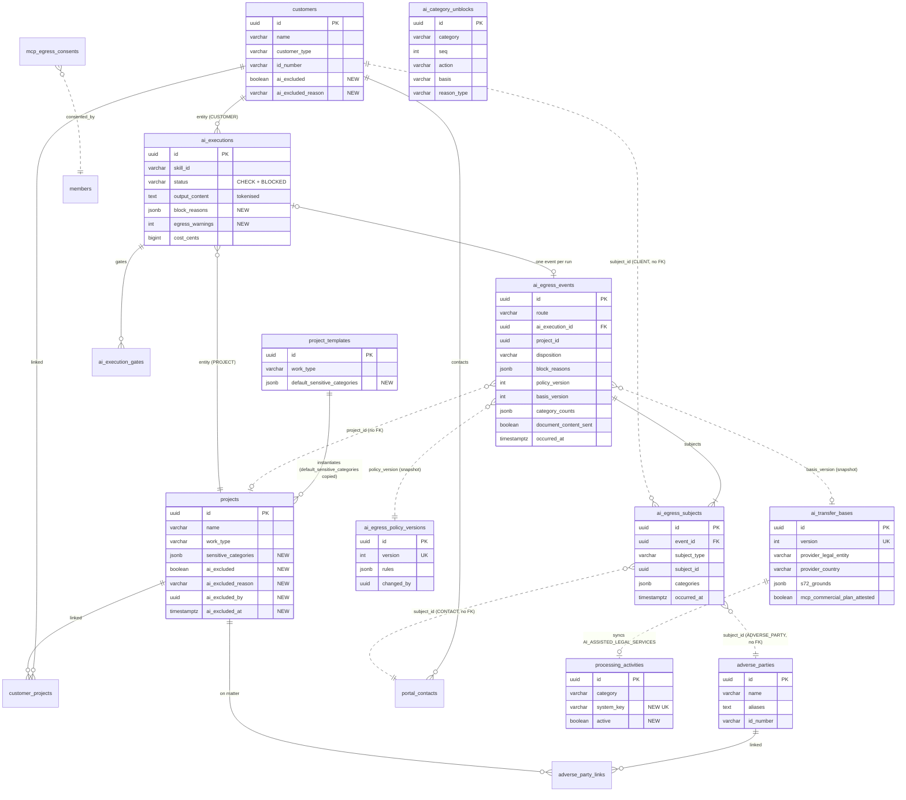
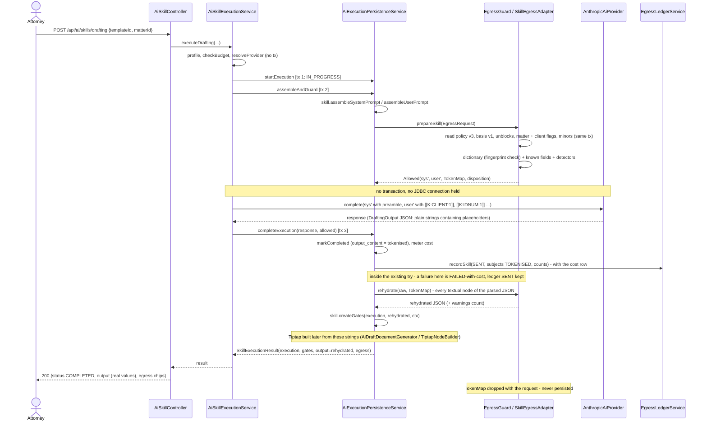
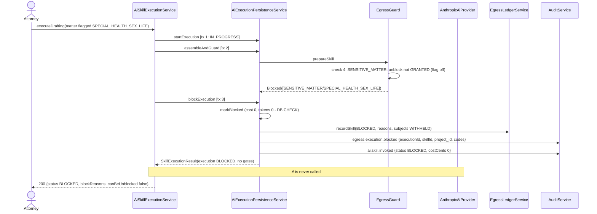
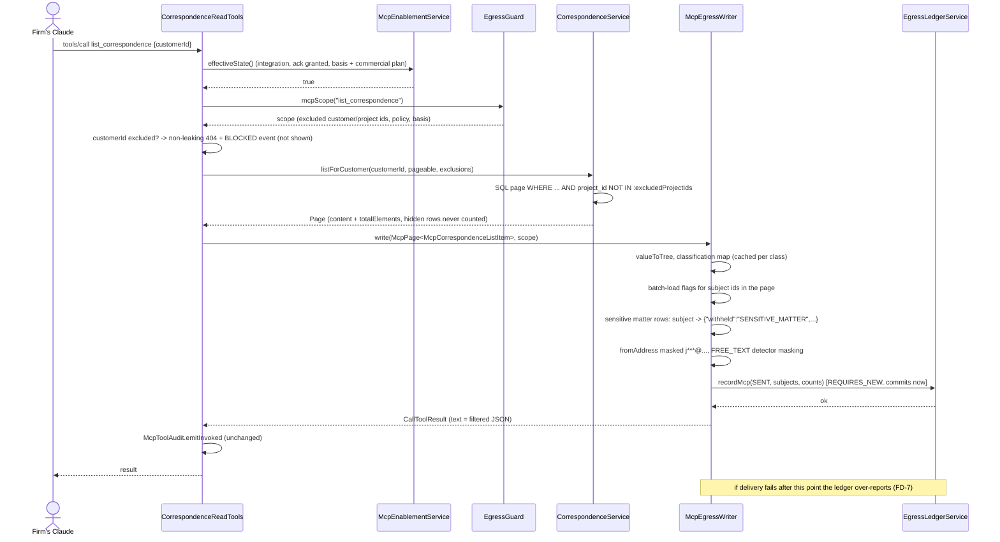
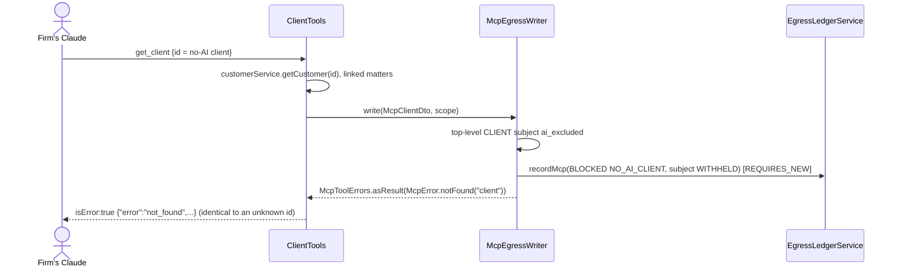

> Merge into ARCHITECTURE.md as **Section 19**.

# Phase 94 — AI Egress Guard: Client Personal Information Leaves Kazi Only Masked, Tokenised, Lawful and On the Record

> Linked from the note lines at the top of ARCHITECTURE.md like Phases 86–93.

> Inputs: `requirements/claude-code-prompt-phase94.md` (founder decisions 1–7, legal basis Q1–Q6, release gates RG-1..RG-9, assumptions A1–A5, constraints, epics E1–E8, ADR topics 1–7), `.arch-rulings-phase94.md` (orchestrator rulings R1–R11, binding), the orchestrator's ruling corrections of 2026-11-28 (R3.2, R3.3, R2.3/R2.6, R4.2 — folded in below and listed in §19.1.4) and the independent architecture review's "Corrections 2" of the same day (folded in; FD-20, FD-21), `.arch-context.md` (inventory at `main` `290547586`), `backend/CLAUDE.md`, `frontend/CLAUDE.md`, and ADR-397..403 (written in parallel, read before finishing). Code verified at `main` HEAD `382f9f694` (2026-11-28). Line numbers are HEAD and shift when a slice lands — re-grep, never trust the number. Tenancy is schema-per-tenant only (dedicated schema per tenant since Phase 13): no tenant column, no RLS, no Hibernate filter anywhere in this design. ADRs 397–403 are new (§19.12).

## 19.1 Overview

Kazi sends client personal information (PI) to Anthropic by two routes. **Route A** is the seven in-product skills (drafting, matter intake, contract review, FICA verification, compliance audit, collection reminder, cash digest), called with the firm's own key through `AiSkillExecutionService.executeSkill`. **Route B** is the MCP server, which the firm's own Claude reads. Neither route minimises anything today: drafting sends the client's ID, tax and registration numbers and full address (`DraftingSkill.java:196-222`), intake sends up to 500 other matters with their client names (`MatterIntakeSkill.java:116-126`), and MCP returns correspondence bodies verbatim (`McpCorrespondenceDto`). Nothing records what left, and no POPIA surface mentions an AI provider or the United States.

This phase puts one **egress guard** in front of both routes. It does three things, always in the same order: it **blocks** (a missing transfer basis, a "no AI" client or matter, special personal information, children's personal information, images), it **minimises** (identifiers masked; on route A, names and identifiers replaced by placeholders that Kazi swaps back before a human sees the result), and it **records** (one ledger event per skill run or MCP call, with the subjects and the per-category disposition, never a raw value). The record then feeds the firm's DSAR answer, its processing register, its PAIA manual and an optional engagement-letter clause.

The design has one centre of gravity: **no byte bound for an AI provider can avoid the guard**. Route A already has a single choke point (`AiSkillExecutionService.executeSkill`, `:83-156`), so it needs two calls and an architecture test. Route B has no interceptor (Spring AI 2.0.0-M6), so the choke point is serialisation: every tool and resource success path returns `McpEgressWriter.write(dto, scope)`, and the build fails on an unclassified DTO field or a handler that returns without writing one ledger event ([ADR-397](../adr/ADR-397-one-egress-guard-two-route-adapters.md), [ADR-399](../adr/ADR-399-mcp-dto-egress-classification-single-writer.md)).

Masking here is a POPIA s19 safeguard and s10 minimisation. Kazi holds the token map, so a tokenised payload is **pseudonymised personal information, not de-identified** (legal basis Q6). Nothing in this phase is described as "anonymised", "de-identified" or "POPIA-exempt", and a lint enforces that (§19.6.4).

### 19.1.1 What's new

| Concern | Today (HEAD `382f9f694`) | After Phase 94 |
|---|---|---|
| Policy engine | None; each skill and tool sends what it assembles | One horizontal `egress/` package: categories, detectors, policy, transfer basis, unblocks, tokeniser, ledger ([ADR-397](../adr/ADR-397-one-egress-guard-two-route-adapters.md)) |
| Route A identifiers and names | Sent raw | Replaced with `[[K:<TYPE>:<n>]]` placeholders per call; parsed output rehydrated before any gate, parse or response; token map in memory only ([ADR-398](../adr/ADR-398-reversible-ephemeral-tokenisation-route-a.md)) |
| Route A refusal | Only budget and "requires images" checks | `BLOCKED` execution with typed reasons, **no provider call and zero spend** (DB CHECK), ledger row, `egress.execution.blocked` |
| Route B payloads | DTOs returned verbatim (`return dto`) | Every success path through `McpEgressWriter`: identifiers masked irreversibly, free text pattern-masked, sensitive/child matters withheld with a typed marker, "no AI" subjects omitted before pagination or 404 ([ADR-399](../adr/ADR-399-mcp-dto-egress-classification-single-writer.md)) |
| Sensitivity | No field | `projects.sensitive_categories` (s26 codes + a manual `CHILD`), template defaults, `ai_excluded` on matters and clients; CHILD also derived from SA ID numbers at egress time ([ADR-400](../adr/ADR-400-special-pi-children-biometric-blocking.md)) |
| Images | `completeWithVision` path exists, unused (every `requiresVision()` returns false) | Classified `SPECIAL_BIOMETRIC`: blocked unless unblocked on a recorded basis, then a per-run confirmation |
| Legal basis for the transfer | None on route A; MCP has an owner acknowledgement (`popia-egress-v1`) | Append-only `ai_transfer_bases` (s72 grounds, DPA, zero data retention, MCP commercial-plan attestation, provider + country as data) — prerequisite for both routes ([ADR-401](../adr/ADR-401-ai-transfer-basis-record.md)) |
| Special/child unblock | n/a | Append-only `ai_category_unblocks` with a structured basis (Q1) and reason (Q3), owner-only, behind `heykazi.egress.special-unblock-enabled=false` until RG-1 |
| Record of what left | None | `ai_egress_events` + `ai_egress_subjects`, ids, categories and counts only ([ADR-402](../adr/ADR-402-ai-egress-ledger.md)) |
| DSAR export | No recipients section | "AI providers and disclosures" section (s23(1)(b)) |
| Processing register | 7 ZA rows, no AI row | Kazi-managed `AI_ASSISTED_LEGAL_SERVICES` row synced from basis and policy; `system_key`, `active` ([ADR-403](../adr/ADR-403-popia-document-integration-ai-egress.md)) |
| PAIA manual | compliance-za v1, no transborder part | v2 adds "Transborder flows of personal information" fed from the basis |
| Engagement letters | legal-za v16; clause pack v3 | Clause pack v4 adds `ai-use-disclosure`, `ai-privacy-notice`; legal-za v17 references the clause as optional in the three engagement letters |
| MCP enablement | integration on ∧ latest acknowledgement GRANTED | … ∧ current basis with `mcp_commercial_plan_attested`; acknowledgement copy and version constant move to `popia-egress-v2` (FD-1: no live tenants, so no migration or re-acknowledgement handling) |
| Capability | AI_MANAGE / AI_EXECUTE / AI_REVIEW / MCP_ACCESS | + `AI_EGRESS_GOVERN`, OWNER_ONLY (basis, unblocks, revocations) |
| Audit | No `egress.*` family | 8 `egress.*` events, ids and categories only through `SafeAuditDetails`; registry pin 102 → 110 |
| Settings | Connections family: Integrations, MCP, AI, Notifications, Packs, Automations | + "AI data protection" tab (`?tab=ai-data-protection`) holding basis, policy, unblocks, egress log, detection limits |

### 19.1.2 The seven route A skills at HEAD

| Skill id | Entity type in `SkillContext` | PI it sends today | Phase 94 handling |
|---|---|---|---|
| `drafting` | `PROJECT` | Matter name/description/reference; client email, phone, ID, registration, address, tax number; contact person | Generic guard; identifiers and names tokenised; the parsed `DraftingOutput` strings are rehydrated before `AiDraftDocumentGenerator` builds Tiptap server-side (`TiptapNodeBuilder`) |
| `matter-intake` | `CUSTOMER` | Free-text description; client name; up to 500 recent matters with client names | Generic guard; list kept and tokenised (FD-3); "no AI" clients' matters and flagged matters left out of the list at assembly (FD-12) |
| `contract-review` | `DOCUMENT` (+ optional `projectId`) | Full extracted contract text; matter name/description/work type | Generic guard; contract text is FREE_TEXT (detectors + dictionary) |
| `fica-verification` | `CUSTOMER` | Client name, checklist items, extracted text of every uploaded document (ID documents included); "[Image document: name]" placeholders (`FicaDocumentReader.java:165`) | Generic guard + a locally computed facts block (§19.3.5) |
| `compliance-audit` | `FIRM` (sentinel id) | Counts; flagged client and matter names | Generic guard; subjects come from dictionary hits |
| `collection-reminder` | `collection_activity` | Client name, amounts, billing and chase history, annotations | Generic guard; amounts pass (not PI alone) |
| `cash-digest` | org settings id | Top-debtor names and amounts (JSON in `additionalContext.digest_data`) | Generic guard; `CashDigestService` reads the rehydrated output (§19.3.3) |

The only other Anthropic calls are `IntegrationService.testAiConnection → validateKey` (`IntegrationService.java:279-296`, via `integration/ai/provider/anthropic/AnthropicLlmProvider.java:137`) and `AnthropicApiClient.testConnection` (`:90`), which send no client PI and are exempt. `LlmChatProvider.chat()` and `AiProvider.generateText/summarize/suggestCategories` have no callers; the architecture test keeps it that way (§19.3.15).

### 19.1.3 Route B at HEAD

21 `@McpTool`s (`kazi_ping`, `list_clients`, `get_client`, `resolve_matter_by_email`, `list_matters`, `get_matter`, `get_matter_activity`, `list_correspondence`, `get_correspondence`, `file_correspondence`, `attach_document`, `propose_task`, `search_documents`, `get_document_url`, `list_invoices`, `get_invoice`, `get_unbilled_time`, `get_trust_balance`, `list_trust_transactions`, `list_compliance_gaps`, `get_audit_events`) and 3 `@McpResource`s (`ClientResource`, `MatterResource`, `FirmProfileResource`) over 23 records in `mcp/dto`. Errors go through `McpToolErrors.asResult(McpError, ObjectMapper)` (`McpToolErrors.java:24`); successes `return dto` / `return pageResult` and Spring AI serialises them (`ClientTools.java:132,153,220`); resources serialise themselves (`ClientResource.java:83`, `MatterResource.java:80`, `FirmProfileResource.java:75`). Every handler guards itself inline (`enablement.effectiveState()`, `McpCapabilityGuard`, `McpToolAudit`).

### 19.1.4 Corrections to the requirements and rulings (code wins; flagged, not silently diverged)

| # | Source says | HEAD says | Consequence here |
|---|---|---|---|
| C1 | R3.2: `McpEgressWriter.write` "replaces the success path of `McpToolErrors.asResult(...)`" | `asResult` is the **error** path only (`McpToolErrors.java:24`); successes are `return dto` (`ClientTools.java:132,153,220`) and resources call `objectMapper.writeValueAsString` (`ClientResource.java:83`) | Every success return becomes `return writer.write(dto, scope)`. Enforcement is "every tool/resource invocation writes exactly one ledger event" (runtime coverage test) plus the DTO classification scanner and an `ObjectMapper` ban — an `ObjectMapper` ban alone cannot see `return dto`. **Corrected by the orchestrator 2026-11-28; matches ADR-399.** |
| C2 | R3.3: the writer omits NO_AI elements from lists | Omission after `McpPagination.paginate` would leave `McpPage.total` (`McpPage.java:18`) counting hidden rows | List tools filter excluded subject ids **before** paginating; the writer's omission is a backstop that logs a warning. **Corrected by the orchestrator.** |
| C3 | R2.6: "gate payloads hold rehydrated real values" (only gates named) | The skill-run response parses `execution.getOutputContent()` (`AiSkillController.java:135`) and the cash digest re-parses it (`CashDigestService.java:320`) | `SkillExecutionResult` gains a **transient** rehydrated output (never persisted) and both consumers read it. **Corrected by the orchestrator.** |
| C4 | R4.1/R4.2: `sensitive_categories` holds s26 codes; CHILD is derived, never stored | A minor with no SA ID on record (passport holder, child named only in documents) is invisible to ID derivation | `CHILD` is **also** allowed as a manually ticked matter category; template defaults never prefill it (A3). ID derivation still runs. **Corrected by the orchestrator; ADR-400 amended 2026-11-28 to match.** FD-18 records the residual. |
| C5 | R8: "the ai_executions status CHECK + BLOCKED" (extend) | There is **no** status CHECK on `ai_executions` (`V1__baseline.sql:95-115`); values are string literals in `AiExecution.java:91,110,115,126,138` | V38 adds a new CHECK over all five values plus a zero-spend CHECK for `BLOCKED` (§19.7) |
| C6 | R2.7 / ADR-398: dictionary "invalidated on the relevant domain events" | No customer, adverse-party or portal-contact update events exist (`event/` has only `CustomerStatusChangedEvent`) | Invalidation by a per-tenant **fingerprint** (`count`, `max(updated_at)` over the four source tables) checked on each build request, plus the 10-minute TTL (§19.3.4). ADR-398 amended 2026-11-28 |
| C7 | Requirements: "19 `@McpTool`s"; ADR-399: "22 handlers" | 21 tools + 3 resources = 24 handlers (`kazi_ping` returns no tenant data) | ADR-397/ADR-399 amended to 24. `tool-contract.json` pins tool names, input schemas and output record schemas, **not** call arguments, so the coverage test needs a hand-maintained per-tool fixture; it fails for any `McpToolRegistry` tool or resource without one (§19.3.15) |
| C8 | R8 names the column `block_reason` | A run can have several reasons (`Blocked(List<BlockReason>)`, R2.1) | Column `block_reasons jsonb` on `ai_executions`, same shape as the ledger's `block_reasons` |
| C9 | R7/ADR-403: processing-register "legal basis from the s72 grounds" | `processing_activities.legal_basis` is `varchar(50)` holding s11 lawful-basis codes (`contractual_necessity`, `legal_obligation`, …; `ProcessingActivityService.java:71-130`); s72 is a *transfer* ground, not a processing basis | Open question FD-13 (recommend: keep an s11 code in `legal_basis`, put the s72 grounds in `description` and the provider in `recipients`); ADR-403 amended 2026-11-28 to the recommendation |
| C10 | Requirements: FICA placeholder at `FicaDocumentReader.java:163` | `:165` | Citation corrected |
| C11 | R6.1 lists the event columns | The skill-run chips ("3 identifiers replaced · 2 names replaced") need counts that subjects do not hold, and unattributed detector hits have no subject row | One addition: `ai_egress_events.category_counts jsonb` (counts per category, no values) |
| C12 | (not mentioned) | `POST /api/integrations/mcp/enable` is gated `TEAM_OVERSIGHT` (`McpEnablementController.java:30`) while the MCP tab is gated `INTEGRATION_MANAGE` (`settings-nav.ts:303`) | Pre-existing; unchanged and noted. Enablement additionally needs the owner's basis record (§19.3.9) |

### 19.1.5 Out of scope

From the requirements, unchanged: ML/NER detection, keyword scanning for special PI, address detection in free text; local OCR and scanning inside attachments beyond FICA's extracted text; per-matter overrides of the identifier matrix; self-hosted or SA-region models and provider switching (A1 keeps it a data change); verifying Anthropic's contract terms; tokenising firm staff names (A5); the Kazi–firm operator agreement text (RG-7); changes in `../claude-for-legal-sa` beyond the marker doc note; a POPIA s22 breach register. Added by this design: retroactive tokenisation of `ai_executions.output_content` written before deploy (§19.10 X4); a "withdraw transfer basis" action (a firm stops egress by disabling AI or MCP, [ADR-401](../adr/ADR-401-ai-transfer-basis-record.md)); per-matter unblocks (R4); surname-only or initial-based name matching (residual risk, §19.6.3).

## 19.2 Domain Model

Conventions (inventory §7, Phase 93 §17.2): plain `@Entity`, no Lombok, no base class, no tenant column; `UUID` ids via `GenerationType.UUID`; references as bare `UUID` columns; instants `Instant` set in the constructor or `@PrePersist`; enum-valued columns as a Java enum with `@Enumerated(EnumType.STRING)` **plus** a DDL CHECK; append-only records built by static factories with no setters (the `McpEgressConsent` shape, `mcp/consent/McpEgressConsent.java`); `jsonb` via `@JdbcTypeCode(SqlTypes.JSON)` (the `AiFirmProfile.practiceAreas` shape). Member references (`changed_by`, `recorded_by`, `member_id`) have **no** FK: a removed member must not take history with it. Ledger subject and project ids have no FK for the same reason (an adverse party or a matter can be deleted; the record of disclosure survives).

| | Table | Entity (package) | Slice |
|---|---|---|---|
| new | `ai_egress_policy_versions` | `AiEgressPolicyVersion` (`egress/policy/`) | 94A |
| new | `ai_transfer_bases` | `AiTransferBasis` (`egress/policy/`) | 94A |
| new | `ai_category_unblocks` | `AiCategoryUnblock` (`egress/policy/`) | 94A |
| new | `ai_egress_events` | `AiEgressEvent` (`egress/ledger/`) | 94A (written from 94C/94D) |
| new | `ai_egress_subjects` | `AiEgressSubject` (`egress/ledger/`) | 94A (written from 94C/94D) |
| changed | `projects` | `Project` (+`sensitive_categories`, `ai_excluded*`) | 94B |
| changed | `customers` | `Customer` (+`ai_excluded*`) | 94B |
| changed | `project_templates` | `ProjectTemplate` (+`default_sensitive_categories`) | 94B |
| changed | `ai_executions` | `AiExecution` (+`BLOCKED` status, `block_reasons`, `egress_warnings`; status CHECK) | 94A (column), 94C (written) |
| changed | `processing_activities` | `ProcessingActivity` (+`system_key`, `active`) | 94A (column), 94F (written) |
| value types | — | `EgressCategory`, `SubjectType`, `BlockReason`, `TokenMap`, `EgressDisposition`, `PolicySnapshot`, `BasisSnapshot` (`egress/…`) | 94A/94C |

**Unchanged** (a reader might expect a change): `mcp_egress_consents` (rows and table name kept; only the version string a new grant carries changes to `popia-egress-v2`); `ai_execution_gates` (gate payloads already hold Kazi-internal data, now rehydrated); `org_secrets` (no token map is persisted, FD-2); `adverse_parties`, `adverse_party_links`, `portal_contacts` (read as dictionary sources only); `audit_events` (new event types, no schema change); `retention_policies` (the ledger follows `AUDIT_EVENT`, no new record type); every global/portal table (no global migration).

### 19.2.1 `EgressCategory` and the per-category rules

| Category | Kind | Policy action (configurable?) | Default | Route A effect | Route B effect |
|---|---|---|---|---|---|
| `NATIONAL_ID`, `PASSPORT`, `COMPANY_REG`, `TAX_NUMBER`, `BANK_ACCOUNT`, `EMAIL`, `PHONE`, `ADDRESS` | identifier | `ALLOW` \| `MASK` (yes; relaxing needs a reason; FD-8: no per-identifier BLOCK) | `MASK` | `MASK` = reversible placeholder | `MASK` = irreversible mask |
| `PERSON_NAME`, `PARTY_NAME` | name | `ALLOW` \| `TOKENISE` (yes, route A only) | `TOKENISE` | placeholder (`CLIENT`/`CONTACT` → PERSON_NAME, `PARTY` → PARTY_NAME) | always pass through, recorded |
| `FREE_TEXT` | flag | not configurable | identifier masking always on | detectors + dictionary over the text | detector masking inside the text |
| `SPECIAL_RELIGION`, `SPECIAL_RACE_ETHNIC`, `SPECIAL_TRADE_UNION`, `SPECIAL_POLITICAL`, `SPECIAL_HEALTH_SEX_LIFE`, `SPECIAL_BIOMETRIC`, `SPECIAL_CRIMINAL` | s26 | not in the matrix; `ai_category_unblocks` only | BLOCK | blocked unless unblocked; then sent with names/identifiers still tokenised (FD-10) | withheld with a marker unless unblocked; then sent with identifiers masked |
| `CHILD` | s34 | `ai_category_unblocks` only | BLOCK | as s26 | as s26 |
| `NO_AI` | flag | never unblockable | BLOCK | blocked | omitted from lists / 404 / marker |
| `NONE` | classification only | — | — | — | MCP field carries no PI (status, enum, id, amount); never a ledger category |

Design decisions:
- **One policy, two effects.** "MASK" means "not sent raw". Route A implements it reversibly (the lawyer sees the real value in the approved draft); route B irreversibly (the lawyer's Claude sees `****4821`). The policy row does not need two settings.
- **Identifiers have no BLOCK** (FD-8): blocking a run because a phone number appears would make most skills unusable; masking removes the value without losing the run.
- **Special and child categories are not in the matrix.** Their only off-switch is a legal record (§19.2.4), so the matrix cannot relax them by accident.

### 19.2.2 `ai_egress_policy_versions` — new ([ADR-401](../adr/ADR-401-ai-transfer-basis-record.md))

Append-only. The current policy is the highest `version`. No row means the code defaults, reported as **version 0**; the first save creates version 1.

| Field | Type | Constraints | Notes |
|---|---|---|---|
| `id` | `uuid` | PK | |
| `version` | `integer` | NOT NULL, UNIQUE, CHECK ≥ 1 | Next = current + 1, computed in the saving transaction; the unique constraint turns a concurrent save into a 409 (X5) |
| `rules` | `jsonb` | NOT NULL, CHECK object | `{"NATIONAL_ID":{"action":"MASK"}, "EMAIL":{"action":"ALLOW","reason":"…"}, "PERSON_NAME":{"action":"TOKENISE"}, …}` — exactly the 10 configurable keys; validated in Java (`EgressPolicyRules`) |
| `changed_by` | `uuid` | NOT NULL | member |
| `changed_at` | `timestamptz` | NOT NULL default now() | |

Design decisions: rules as one `jsonb` document rather than a row per category, because a version is the unit that ledger events snapshot (`policy_version`); a per-category reason is required in Java when the action is `ALLOW`, and is free text the firm wrote (it never enters an audit row — the audit carries the category and the old/new actions only).

### 19.2.3 `ai_transfer_bases` — new ([ADR-401](../adr/ADR-401-ai-transfer-basis-record.md))

Append-only; the current basis is the highest `version`. It is the prerequisite for any route A call and for MCP enablement.

| Field | Type | Constraints | Notes |
|---|---|---|---|
| `id` | `uuid` | PK | |
| `version` | `integer` | NOT NULL, UNIQUE, CHECK ≥ 1 | |
| `provider_legal_entity` | `varchar(200)` | NOT NULL, default `'Anthropic PBC'` | A1: provider is data, not code |
| `provider_country` | `varchar(100)` | NOT NULL, default `'United States'` | A1 |
| `s72_grounds` | `jsonb` | NOT NULL, CHECK non-empty array ⊆ `["BINDING_AGREEMENT","CONSENT","OTHER"]` | `S72Ground` enum set; s72(1)(a) primary, (b) via the engagement-letter clause (Q2) |
| `other_ground_text` | `varchar(1000)` | required iff `OTHER` (CHECK) | |
| `commercial_terms_dpa_attested` | `boolean` | NOT NULL; must be true when `BINDING_AGREEMENT` (CHECK) | The firm's statement that it holds Anthropic's Commercial Terms + DPA |
| `dpa_attested_date` | `date` | required iff attested (CHECK) | Date of the firm's contract, as stated |
| `zero_data_retention` | `varchar(10)` | NOT NULL, CHECK in (`YES`,`NO`,`UNKNOWN`) | `ZeroDataRetention` enum |
| `mcp_commercial_plan_attested` | `boolean` | NOT NULL default false | Staff use Claude Team, Enterprise or the API, not consumer plans (Q2). Kazi cannot verify it; the UI says so |
| `statement_version` | `varchar(40)` | NOT NULL | Copy version of the attestation text shown (`ai-transfer-basis-v1`); RG-3 copy changes bump it, never the model |
| `recorded_by` | `uuid` | NOT NULL | owner (`AI_EGRESS_GOVERN`) |
| `recorded_at` | `timestamptz` | NOT NULL default now() | |

Design decisions: versions, not an updatable row, because each ledger event snapshots `basis_version` and a DSAR answer must name the basis in force at the time. There is no revoke row: switching AI or MCP off stops egress; a firm whose staff move to consumer plans records a new version with `mcp_commercial_plan_attested = false`, which switches MCP off at the next call.

### 19.2.4 `ai_category_unblocks` — new ([ADR-400](../adr/ADR-400-special-pi-children-biometric-blocking.md))

Append-only per category. A category is unblocked when its latest row (highest `seq`) is `GRANTED`. Tenant-wide per category; per-matter unblocks are out of scope.

| Field | Type | Constraints | Notes |
|---|---|---|---|
| `id` | `uuid` | PK | |
| `category` | `varchar(40)` | NOT NULL, CHECK in the 7 `SPECIAL_*` codes + `CHILD` | `NO_AI` is never unblockable |
| `seq` | `integer` | NOT NULL, CHECK ≥ 1, UNIQUE (`category`, `seq`) | Per-category sequence; a concurrent second grant/revoke collides → 409 (X5) |
| `action` | `varchar(10)` | NOT NULL, CHECK in (`GRANTED`,`REVOKED`) | |
| `basis` | `varchar(40)` | required iff `GRANTED`; CHECK in (`PRIOR_AUTHORISATION`,`ADEQUACY_BINDING_AGREEMENT`) | Q1: s57(1)(d)/s58 |
| `regulator_reference` | `varchar(200)` | required iff `PRIOR_AUTHORISATION` | |
| `authorisation_date` | `date` | required iff `PRIOR_AUTHORISATION` | Date obtained or deemed (s58(3)-(7)) |
| `attestation_text` | `text` | required iff `ADEQUACY_BINDING_AGREEMENT` | The owner's attestation of the legal basis |
| `reason_type` | `varchar(30)` | required iff `GRANTED`; CHECK in (`DATA_SUBJECT_CONSENT`,`RIGHT_IN_LAW`,`OTHER`) | Q3: s27(1)(b)/s33/s35(1)(b) |
| `reason_text` | `varchar(2000)` | required iff `reason_type = OTHER` | |
| `document_reference` | `varchar(500)` | nullable | Where the authorisation/opinion is filed |
| `recorded_by` | `uuid` | NOT NULL | owner |
| `recorded_at` | `timestamptz` | NOT NULL default now() | |

Design decisions: grant and revoke are rows, never updates (the McpEgressConsent pattern), so the record shows when a category was open. Revoke needs no basis (restricting is always allowed, even with the config flag off). The basis and reason are both required: the reason lifts s26/s34; only the basis answers s72/s57(1)(d) (Q3).

### 19.2.5 `ai_egress_events` — new ([ADR-402](../adr/ADR-402-ai-egress-ledger.md))

One row per skill execution (SENT or BLOCKED) and per MCP tool/resource call.

| Field | Type | Constraints | Notes |
|---|---|---|---|
| `id` | `uuid` | PK | |
| `route` | `varchar(10)` | NOT NULL, CHECK in (`SKILL`,`MCP`) | |
| `skill_id` | `varchar(40)` | required iff `SKILL` | |
| `tool_name` | `varchar(80)` | required iff `MCP` | tool or resource name (`get_client`, `kazi://client`) |
| `ai_execution_id` | `uuid` | FK `ai_executions` ON DELETE SET NULL; null when `MCP` (CHECK) | |
| `member_id` | `uuid` | nullable | null = system (collections scan, cash digest) |
| `project_id` | `uuid` | nullable, no FK | the run's matter, or the single matter an MCP call is about |
| `provider_legal_entity` | `varchar(200)` | NOT NULL | copied from the basis at write time (defaults when the basis is missing) |
| `provider_country` | `varchar(100)` | NOT NULL | |
| `purpose` | `varchar(60)` | NOT NULL | fixed code per skill / `MCP_READ` / `MCP_WRITE_RESPONSE`; labels in X3 |
| `disposition` | `varchar(10)` | NOT NULL, CHECK in (`SENT`,`BLOCKED`) | |
| `block_reasons` | `jsonb` | NOT NULL default `[]`; non-empty iff `BLOCKED` (CHECK) | `[{"code":"SENSITIVE_MATTER","category":"SPECIAL_HEALTH_SEX_LIFE","subjectType":"MATTER","subjectId":"…"}]` — ids and codes only |
| `policy_version` | `integer` | NOT NULL, CHECK ≥ 0 | 0 = code defaults |
| `basis_version` | `integer` | nullable; NOT NULL when `SENT` (CHECK) | null only for `TRANSFER_BASIS_MISSING` |
| `category_counts` | `jsonb` | NOT NULL default `{}` | `{"NATIONAL_ID":2,"PERSON_NAME":3}`: occurrences replaced/masked/sent; counts only (C11) |
| `free_text_sent` | `boolean` | NOT NULL default false | unstructured content left |
| `image_sent` | `boolean` | NOT NULL default false | |
| `document_content_sent` | `boolean` | NOT NULL default false; true only when `MCP` and `SENT` (CHECK) | `get_document_url` issued a presigned link: the whole document, **unmasked**, was made available (FD-20, §19.3.8) |
| `occurred_at` | `timestamptz` | NOT NULL default now() | |

### 19.2.6 `ai_egress_subjects` — new

One row per data subject per event.

| Field | Type | Constraints | Notes |
|---|---|---|---|
| `id` | `uuid` | PK | |
| `event_id` | `uuid` | NOT NULL, FK `ai_egress_events` ON DELETE CASCADE | retention purges events; subjects follow |
| `subject_type` | `varchar(20)` | NOT NULL, CHECK in (`CLIENT`,`ADVERSE_PARTY`,`CONTACT`) | matters are not data subjects: an MCP matter id resolves to its clients |
| `subject_id` | `uuid` | NOT NULL, no FK | `customers.id`, `adverse_parties.id`, `portal_contacts.id`; a client's flat contact fields are recorded on the CLIENT subject |
| `categories` | `jsonb` | NOT NULL, CHECK object | `{"PERSON_NAME":"TOKENISED","NATIONAL_ID":"TOKENISED","FREE_TEXT":"SENT"}`; values in (`SENT`,`MASKED`,`TOKENISED`,`WITHHELD`) validated in Java |
| `occurred_at` | `timestamptz` | NOT NULL | denormalised from the event for the DSAR index |
| — | — | UNIQUE (`event_id`, `subject_type`, `subject_id`) | one row per subject per event |

Design decisions (both ledger tables): **no raw value is ever stored** — every column is an id, enum, count, boolean or a fixed code (invariant test, §19.8.5). Detector hits that match no known subject (an ID number in a contract that belongs to nobody in the tenant) are counted in `category_counts` but have no subject row. The ledger is append-only: no update path exists in the repository.

### 19.2.7 Changed tables

**`projects`** (`Project`, which already has `@Version` at `Project.java:43`):

| Field | Type | Constraints | Notes |
|---|---|---|---|
| `sensitive_categories` | `jsonb` | NOT NULL default `[]`, CHECK array ⊆ the 7 `SPECIAL_*` codes + `CHILD` | Attorney-ticked. `CHILD` here is the manual tick (C4); ID-derived CHILD is never stored |
| `ai_excluded` | `boolean` | NOT NULL default false | "No AI" mandate; hard-blocks both routes |
| `ai_excluded_reason` | `varchar(1000)` | required when `ai_excluded` is set (Java, at set time only) | e.g. "Client mandate excludes AI". Free text that can hold PI: nulled on DSAR anonymisation (§19.3.14) |
| `ai_excluded_by` / `ai_excluded_at` | `uuid` / `timestamptz` | NOT NULL when `ai_excluded` (CHECK) | |

**`customers`** (`Customer`, no `@Version`): the same four `ai_excluded*` columns and CHECK.

**`project_templates`** (`ProjectTemplate`): `default_sensitive_categories jsonb NOT NULL default []`, CHECK ⊆ the 7 `SPECIAL_*` codes (**not** `CHILD`: A3, no template prefills it). Copied to the matter at `ProjectTemplateService.instantiateTemplate` (`:490`) and `instantiateFromTemplate` (`:709`), and template-to-template at the duplicate path (`:326`). Pack v4 ships every template with `[]` (LITIGATION and ESTATES prefill nothing; the attorney ticks).

**`ai_executions`** (`AiExecution`): status values become `IN_PROGRESS`, `COMPLETED`, `FAILED`, `EXTERNALLY_EXECUTED`, `BLOCKED` with a new CHECK (C5) and a zero-spend CHECK (`BLOCKED` ⇒ `cost_cents = 0` and all token counts 0). New `block_reasons jsonb NOT NULL default []` (C8) and `egress_warnings integer NOT NULL default 0` (unknown or broken placeholders seen during rehydration). `output_content` now holds the **tokenised** output for executions after deploy (FD-2). New method `markBlocked(List<BlockReason>)` (from `IN_PROGRESS` only) and `recordEgressWarnings(int)`.

**`processing_activities`** (`ProcessingActivity`): `system_key varchar(60)` nullable UNIQUE (`AI_ASSISTED_LEGAL_SERVICES`); `active boolean NOT NULL default true` (no status field exists, R7). Rows with a `system_key` are Kazi-managed: user edits are overwritten on the next sync and delete is refused (§19.3.12).

### 19.2.8 Entity relationships

The diagram shows the tables this phase adds or changes and their direct neighbours. Every other tenant table (trust, invoices, time, documents, take-on, …) is unchanged and omitted; the full model is in the earlier sections.



## 19.3 Core Flows and Backend Behaviour

### 19.3.1 Package layout and the façade

Per R1 and [ADR-397](../adr/ADR-397-one-egress-guard-two-route-adapters.md): a horizontal `egress/` package (not under `integration/ai/`, because `mcp/` and `datarequest/` read it and must not depend on the AI provider package).

```
egress/
  EgressGuard.java                 façade: prepareSkill, mcpScope, exclusions, status
  classify/  EgressCategory, SubjectType, EgressField, EgressSubject (annotations),
             SaIdNumber, IdentifierDetectors (pure functions), DetectorHit
  policy/    AiEgressPolicyVersion(+Repository), EgressPolicyService, EgressPolicyRules,
             AiTransferBasis(+Repository), TransferBasisService,
             AiCategoryUnblock(+Repository), CategoryUnblockService, EgressSettingsController
  token/     NameDictionary, NameDictionaryCache, AhoCorasickMatcher, Tokeniser, TokenMap,
             Rehydrator, PlaceholderGrammar
  ledger/    AiEgressEvent(+Repository), AiEgressSubject(+Repository), EgressLedgerService,
             EgressLogController, EgressLogQuery
  subject/   EgressSubjectResolver (SkillContext → subjects + flags), MinorDerivation
integration/ai/skill/SkillEgressAdapter.java     route A adapter
mcp/egress/McpEgressWriter.java, McpEgressScope.java, McpClassificationMap.java   route B adapter
```

Conceptual signatures (illustrative, not implementation):

```java
public sealed interface PreparedEgress permits PreparedEgress.Blocked, PreparedEgress.Allowed {
  record Blocked(List<BlockReason> reasons, EgressDisposition disposition) implements PreparedEgress {}
  record Allowed(String systemPrompt, String userPrompt, TokenMap tokens,
                 EgressDisposition disposition) implements PreparedEgress {}
}

public record EgressRequest(String skillId, SkillContext context, String systemPrompt,
    String userPrompt, boolean vision, boolean confirmImageEgress, UUID invokedBy) {}

public record BlockReason(BlockCode code, EgressCategory category,
    SubjectType subjectType, UUID subjectId) {}          // ids and codes only

public enum BlockCode { TRANSFER_BASIS_MISSING, NO_AI_CLIENT, NO_AI_MATTER,
    NO_AI_SUBJECT_MENTIONED, SENSITIVE_MATTER, CHILD_SUBJECT,
    IMAGE_BIOMETRIC_BLOCKED, IMAGE_CONFIRMATION_REQUIRED }

/** What left (or would have): subjects, per-category dispositions, counts, snapshots. */
public record EgressDisposition(PolicySnapshot policy, BasisSnapshot basis,
    Map<SubjectRef, Map<EgressCategory, SubjectDisposition>> subjects,
    Map<EgressCategory, Integer> categoryCounts, boolean freeTextSent, boolean imageSent) {}

@Service public class EgressGuard {
  /** Must run inside a transaction (reads policy, basis, unblocks, flags, dictionary fingerprint). */
  public PreparedEgress prepareSkill(EgressRequest request);
  public McpEgressScope mcpScope(String toolName);       // per call; caches flags it loads
  public EgressExclusions exclusions();                  // excluded customer/project ids
  public EgressStatus status();                          // banner booleans
}

public final class TokenMap {                            // in memory only; never serialised
  public String placeholderFor(TokenType type, String surfaceForm, SubjectRef subject);
  public Optional<String> realValue(String placeholder);
}
```

### 19.3.2 Route A — pre-call guard

The hook is inside the existing three-phase orchestration (`AiSkillExecutionService.executeSkill`, `:83-156`; AIVERIFY-002 keeps the HTTP call outside any transaction). New order (changes in bold):

1. Pre-flight unchanged: profile, `costService.checkBudget`, `resolveProvider()`, the vision check (`:89-94`).
2. `persistenceService.startExecution` — IN_PROGRESS row (`:97`), unchanged.
3. **`persistenceService.assembleAndGuard(request, profile)`** replaces `assemblePrompts` (`:106`): in the same short read/write transaction it assembles the prompts (as today, `AiExecutionPersistenceService.java:~108-112`) and then calls `SkillEgressAdapter.prepare(request, prompts)` → `EgressGuard.prepareSkill(...)`. A skill pre-flight exception still becomes `failExecution` (`:113`) and writes **no** ledger row (nothing was assembled for sending).
4. **If `Blocked`:** `persistenceService.blockExecution(executionId, blocked)` in one write transaction: `execution.markBlocked(reasons)`, ledger event `BLOCKED` with the subjects that *would* have been sent (dispositions `WITHHELD`), `egress.execution.blocked` audit, the existing `ai.skill.invoked` audit with `status=BLOCKED` and `costCents=0`, the existing `AiSkillInvokedEvent`. Return `SkillExecutionResult(execution, List.of(), null, disposition)`. **No provider call, no cost row** — the DB CHECK makes a non-zero cost on a BLOCKED row impossible.
5. **If `Allowed`:** the provider call uses `allowed.systemPrompt()` / `allowed.userPrompt()` (`:122`, `:133`). A provider exception → **`failExecution(executionId, message, durationMs, allowed.disposition())`**, which now also writes the ledger event as **SENT**: the request body left Kazi even though no answer came back ([ADR-402](../adr/ADR-402-ai-egress-ledger.md)). A failure before the request was sent (key retrieval) is indistinguishable at this layer, so it over-reports, consistent with FD-7.
6. **`persistenceService.completeExecution(executionId, response, request, allowed)`** — §19.3.3.

`prepareSkill` decides in this fixed order (all reasons are collected, not just the first, so the UI can list every unblock step):

| # | Check | Block code | Source |
|---|---|---|---|
| 1 | No `ai_transfer_bases` row | `TRANSFER_BASIS_MISSING` | `TransferBasisService.current()` |
| 2 | Primary client `ai_excluded` | `NO_AI_CLIENT` | resolved subjects |
| 3 | Primary matter `ai_excluded` | `NO_AI_MATTER` | |
| 4 | Primary matter has a `sensitive_categories` code whose latest unblock is not `GRANTED` | `SENSITIVE_MATTER` (+category) | `CategoryUnblockService.isUnblocked(cat)` |
| 5 | Any resolved subject is a minor (§19.3.6) or the matter carries manual `CHILD`, and CHILD is not unblocked | `CHILD_SUBJECT` | `MinorDerivation` |
| 6 | `vision` and `SPECIAL_BIOMETRIC` not unblocked | `IMAGE_BIOMETRIC_BLOCKED` | |
| 7 | `vision`, unblocked, and `confirmImageEgress == false` | `IMAGE_CONFIRMATION_REQUIRED` | |
| 8 | After tokenisation: a dictionary hit is an `ai_excluded` client that is not the primary subject | `NO_AI_SUBJECT_MENTIONED` | backstop (FD-12) |

Subject resolution (`EgressSubjectResolver`, one read per entity type):

| `SkillContext.entityType` | Primary client(s) | Primary matter | Adverse parties |
|---|---|---|---|
| `CUSTOMER` | the customer | none | none |
| `PROJECT` | the matter's clients (`customer_projects`) | the project | `adverse_party_links.project_id = matter` |
| `DOCUMENT` | via the document's matter (or `additionalContext.projectId`) or its customer scope | the document's matter | as PROJECT |
| `collection_activity` | the fee note's client | none | none |
| `FIRM`, cash-digest entity | none | none | none |

Dictionary hits add **incidental** subjects (compliance audit names, cash-digest debtors, the intake list, a name inside contract text). Incidental subjects are tokenised and recorded; only primary subjects trigger checks 2–5 (FD-16: a client-level run such as FICA is not blocked because one of the client's *other* matters is flagged). Check 8 is the only incidental block.

Tokenisation (`Tokeniser`, CPU only, inside the same transaction so it sees the same snapshot):
1. Prepend the **egress preamble** (static text, §19.6.2) to the system prompt.
2. **Known-field values** of every resolved subject are replaced by exact (case-insensitive, whitespace-normalised) match: `Customer.idNumber` (→ `IDNUM` if `SaIdNumber.isValid`, else `PASSPORT`), `registrationNumber` (`COMPANYREG`), `taxNumber` (`TAXNUM`), `email`, `contactEmail` (`EMAIL`), `phone`, `contactPhone` (`PHONE`), `addressLine1`, `addressLine2` (`ADDRESS`; city, province, postal code and country pass — FD-14), and the adverse parties' `idNumber`/`registrationNumber`. This is "classified by field": the category comes from the field the value was read from.
3. **Dictionary names** (§19.3.4) are replaced longest-first.
4. **Detectors** (§19.3.5) run over what remains and replace any further identifier.
5. Numbering: first occurrence order, system prompt before user prompt; the same surface form always gets the same placeholder within a call; an alias maps to its party's placeholder. The system prompt is tokenised first so its numbering never depends on the user prompt (prompt caching, §19.6.2).
6. Policy `ALLOW` for a category skips **replacement only** for it and records `SENT`. **Matching always runs**: for an `ALLOW` category, steps 2–4 run in record-only mode (as route B's dictionary, §19.3.8 step 7), so every subject is still attributed in the ledger, incidental subjects never vanish from it, and check 8 (`NO_AI_SUBJECT_MENTIONED`, not configurable) still fires when names are `ALLOW`.

### 19.3.3 Route A — post-call rehydration

`completeExecution(executionId, response, request, allowed)` — one short write transaction, as today (`AiExecutionPersistenceService.java:~124-164`):

1. `execution.markCompleted(response, costCents)` — `output_content` = the **tokenised** `response.content()` (FD-2) — and save (`:128-130`), as today.
2. `EgressLedgerService.recordSkill(execution, allowed.disposition(), SENT)` — **immediately after the cost row, before anything that can throw on model output**. "Sent is sent": once the provider answered, the bytes left, so the SENT event belongs with the billed row whatever happens next.
3. **Inside the existing `try`** (`:139-153`, the never-roll-back-a-billed-call rule), in this order:
   - `String rehydrated = SkillEgressAdapter.rehydrate(response.content(), allowed.tokens())`: `LlmJsonParser.parse(mapper, raw, JsonNode.class)` (strips fences/preamble as today); `Rehydrator` walks every **textual value node** of the parsed JSON (never object keys), replacing well-formed placeholders from the map. Model output is **plain JSON strings, not Tiptap** (`DraftingOutput` is records of strings; Tiptap is built server-side from those strings by `AiDraftDocumentGenerator` / `AiReviewReportGenerator` via `TiptapNodeBuilder`, after this step), so a placeholder cannot be split across marks; the only malformed case is the model mangling the grammar itself;
   - well-formed placeholders not in the map are left verbatim and counted, and a residual `[[K:` fragment that is not well-formed is also counted — both go to `execution.recordEgressWarnings(n)`; nothing is guessed (R2.4);
   - the tree is re-serialised; that string is the "raw output" from here on (re-parsing it in `createGates` is idempotent; the `AiSkill` interface is unchanged); if the output is not JSON at all, plain-string substitution is applied and `createGates` then fails exactly as it would today;
   - `skill.createGates(execution, rehydrated, context)` (`:140`) — gates hold real values.
4. A `RuntimeException` from rehydration or `createGates` takes the existing catch (`:141-153`): `markFailedAfterCompletion`, FAILED **with cost**, the SENT ledger event from step 2 kept, `ai.specialist.failed` emitted — never a rollback.
5. Return `new SkillExecutionResult(execution, gates, rehydrated, disposition)` (on the FAILED path `output` is null). The record gains two **transient** components (C3): `String output` (rehydrated, never persisted) and `EgressDisposition egress`.

**Ledger-write failure semantics.** The cost row and the SENT event commit in one transaction. `recordSkill` inserts values already computed in memory (ids, enums, counts), independent of model output, and validates the event in Java against the same rules as its CHECKs **before** inserting, so a ledger constraint violation cannot abort the transaction and take the cost row with it. The only remaining failure is a DB fault, which would equally fail the cost update; the transaction then rolls back exactly as a DB fault in `completeExecution` does today (the row stays `IN_PROGRESS`) — no new loss path. Rehydration and gate failures can never lose the cost row or the ledger event, because both are written before the `try`. A test forces a rehydration exception and asserts FAILED + `cost_cents > 0` + one SENT event.

Consumers of the output, after the change:

| Consumer | Today | After |
|---|---|---|
| `AiSkillController.SkillExecutionResponse.from` (`:126-140`) | parses `execution.getOutputContent()` | parses `result.output()`; adds `blockReasons`, `egress` (§19.4.6) |
| `CashDigestService.narrate` (`:320`) | re-parses `getOutputContent()`; `dropUngroundedRisks` matches debtor names | parses `result.output()`; grounding runs on real names. A `BLOCKED` status falls back to numbers-only like any non-COMPLETED status (`:313-317`) |
| `AiReminderComposer` (`:~100`) | uses the gate | unchanged (gates are rehydrated) |
| `AiExecutionController` history (`:103`) | returns `getOutputContent()` | unchanged: shows placeholders plus the label "Names and identifiers were replaced with placeholders before sending…" when an egress event exists for the execution (FD-2, X3) |
| Skill result components (`fica-result-display.tsx`, `intake-result-display.tsx`, `contract-review-results.tsx`, `drafting-dialog.tsx`) | render `output` from the response | unchanged code path; now real values |

### 19.3.4 Name dictionary: build, cache, match

Sources (R2.7), per tenant, ANONYMIZED customers excluded:

| Source | Token type | Subject |
|---|---|---|
| `customers.name` | `CLIENT` | CLIENT |
| `customers.contact_name` | `CONTACT` | CLIENT (flat contact fields) |
| `portal_contacts.display_name` | `CONTACT` | CONTACT |
| `adverse_parties.name`, each comma-separated alias in `aliases` (the UI says "comma separated", `adverse-party-dialog.tsx:216`) | `PARTY` | ADVERSE_PARTY |
| `projects.custom_fields->>'opposing_party'`, `->>'opposing_attorney'` (`field-packs/legal-za-project.json:39,47`) | `PARTY` | none (no subject id; counted in `category_counts` only) |

Matching rules: Unicode-aware word boundaries (`Character.isLetterOrDigit` on both sides); case-insensitive after NFC normalisation and whitespace collapse; longest match first (Aho-Corasick over all surface forms, leftmost-longest); entries shorter than 3 characters after trimming are skipped; an entry made only of stop-list words is skipped (stop-list: `trust`, `holdings`, `pty`, `ltd`, `limited`, `inc`, `cc`, `estate`, `late`, `family`, `group`, `the`, `and`, `of`, `attorneys`, `inc.` — extended by corpus tests). Two subjects with the same surface form share one placeholder; the ledger records **both** subjects (over-report). Rehydration restores the exact substring first seen in the prompt, so casing is preserved.

Cache (`NameDictionaryCache`): one immutable dictionary per tenant schema, keyed by the bound `RequestScopes.TENANT_ID`, never a static or shared structure. On each `prepareSkill` the cache reads a **fingerprint** — one query returning `count(*)` and `max(updated_at)` for `customers`, `portal_contacts`, `adverse_parties` and `projects` (C6) — and rebuilds if it changed or the entry is older than 10 minutes. Build is a single pass per source (`SELECT id, name, contact_name …`), O(total characters); a 10 000-entry tenant builds in well under 100 ms (to be measured in 94C, §19.6.5). Route B uses the same dictionary in record-only mode (§19.3.8).

### 19.3.5 Identifier detectors and FICA facts

Each detector is a pure function `List<DetectorHit> detect(String text)` in `egress/classify/IdentifierDetectors`, with an exhaustive corpus (valid and invalid IDs, Luhn edge cases, embedded-in-text cases, and false-positive traps: fee-note numbers `INV-0001`, matter references, case numbers `1234/2024`, amounts `R 1 234 567,89`, dates, trust account numbers).

| Category | Rule |
|---|---|
| `NATIONAL_ID` | 13 digits not adjacent to digits (also the `YYMMDD SSSS CAZ` spaced form); Luhn-valid; YYMMDD a real date under the century rule; citizenship digit 0–2 |
| `PASSPORT` | known field only (an `idNumber` that is not a valid SA ID), or label-adjacent (`passport` within 30 chars) letter+8 digits / 9 digits |
| `COMPANY_REG` | `\b\d{4}/\d{6}/\d{2}\b` with year 1900..current (R2.8) — case numbers `NNNN/YYYY` never match |
| `TAX_NUMBER` | 10 digits; leading 0–3 or 9 (income tax), 4 (VAT); label-adjacent (`tax`, `income tax`, `VAT`, `IT ref`), or the check digit where the corpus confirms the SARS modulus-10 rule; a 10-digit run starting `0[1-8]` with no tax label is classified `PHONE` |
| `BANK_ACCOUNT` | 6–11 digits within 30 characters after an account label (`account`, `acc no`, `a/c`, `rekening`), or a known field |
| `EMAIL` | RFC-5322-lite pattern |
| `PHONE` | `+27` or `0` prefix + 9 digits, separators allowed, ZA area/mobile prefixes |
| `ADDRESS` | known fields only (no free-text address detection — out of scope) |

`SaIdNumber` (value type): `parse(String) → Optional<SaIdNumber>`, `isValid()`, `dateOfBirth(Clock)` with the century rule "YY > current YY ⇒ 19YY, else 20YY", `ageOn(LocalDate)`, `isMinorOn(LocalDate)`. Business "today" comes from the injected `Clock` / `KaziTime.ZONE` (`ZoneAwareTimeArchTest`).

**FICA facts** (R2.9). `FicaVerificationSkill.assembleUserPrompt` already holds the raw extracted text; it calls `SaIdNumber` and appends a `<kazi-local-facts>` block **before** the guard runs:

```
<kazi-local-facts computed-by="Kazi, not sent as raw data">
ID number found on document: yes
ID number passes the check digit: yes
ID number matches the client record: yes
Date of birth in the document's ID number matches the client record: yes
</kazi-local-facts>
```

The block contains no number. The guard then tokenises the document text, so Claude sees `[[K:IDNUM:1]]` and the facts. The FICA prompt gains one sentence telling the model to rely on the facts block for ID matching.

### 19.3.6 CHILD derivation

`MinorDerivation.minorSubjects(subjects, today)`: a subject is CHILD when its SA ID number parses and `isMinorOn(today)` — for INDIVIDUAL clients (`customers.customer_type`) and for every adverse party linked to the matter (`adverse_party_links.project_id`), at egress time; nothing stored, so it stays correct as people age (R4.2). The manual `CHILD` matter category (C4) is an OR. Limits are explicit (RG-4): passport holders, people without an ID on record, and children named only in documents are not detected — the detection-limits copy (X3) and FD-18 say so.

The matter detail response gains `minorInvolved` (derived, same rule) for the badge; it reveals only that a linked person is under 18, never who.

### 19.3.7 Vision gate

No skill sets `requiresVision()` today (all seven return false). The rule governs any future vision call: `EgressRequest.vision = request.skill().requiresVision() && request.hasImages()`. Blocked unless `SPECIAL_BIOMETRIC` is unblocked (§19.3.10), then `SkillExecutionRequest` gains `boolean confirmImageEgress` (default false through the existing constructor) and the UI's per-run confirmation sets it. Text around images is still tokenised; the ledger sets `image_sent = true`. FICA's "[Image document: name]" placeholder is text, not an image (the file name is tokenised like any text).

### 19.3.8 Route B — the writer

Every tool and resource success path changes from `return dto;` to `return writer.write(dto, scope);` (tools receive a `CallToolResult`, passed through verbatim by Spring AI as errors already are; resources receive the JSON string). `scope = egressGuard.mcpScope(toolName)` is created at the start of the handler, after the enablement check.

```java
public record McpEgressScope(String toolName, UUID memberId, Set<UUID> excludedCustomerIds,
    Set<UUID> excludedProjectIds, FlagLookup flags, PolicySnapshot policy, BasisSnapshot basis) {}

@Component public class McpEgressWriter {
  public CallToolResult write(Object dto, McpEgressScope scope);        // tools
  public String writeResource(Object dto, McpEgressScope scope);       // resources
}
```

Algorithm (one pass, [ADR-399](../adr/ADR-399-mcp-dto-egress-classification-single-writer.md)):
1. `JsonNode tree = objectMapper.valueToTree(dto)`; the per-class classification map (`McpClassificationMap`, built reflectively once per record class and cached; recurses into nested records, collections and `McpPage.items`) tells, for each JSON path, the `EgressCategory` and which components are `@EgressSubject` ids. **Unclassified at runtime fails closed**: a record class with no classification, or a JSON path the map does not cover (a `Map`/`Object`/`JsonNode` component, a subclass the scanner did not see), is never passed through — its value is replaced by `{"withheld":"UNCLASSIFIED","category":"NONE"}`, counted, and logged at ERROR with the class and path (no value). The scanner (§19.3.15) makes this unreachable for `mcp/dto`; fail-closed covers anything it cannot see.
2. Collect subject ids from the tree; load in **one** batch query the flags for those customers and projects (`ai_excluded`, `sensitive_categories`, `customer_type`, `id_number`) and the adverse-party ID numbers linked to those projects; resolve matter ids to their clients (`customer_projects`) for the ledger.
3. **Top-level subject excluded** (a direct get of a NO_AI client/matter, or a correspondence/document/fee note whose client or matter is NO_AI): return `McpToolErrors.asResult(McpError.notFound(noun))`, byte-identical to no-such-id; record a `BLOCKED` event (`NO_AI_CLIENT`/`NO_AI_MATTER`) with the subject `WITHHELD`.
4. **List elements** whose subject is excluded: removed (backstop; logged at WARN because list tools filter first, C2).
5. **SPECIAL/CHILD matter not unblocked**: id, reference, status, dates and amounts stay; name, description, every FREE_TEXT, correspondence subject/body, document names become `{"withheld":"SENSITIVE_MATTER","category":"SPECIAL_HEALTH_SEX_LIFE"}` / `{"withheld":"CHILD","category":"CHILD"}` (FD-6: the matter name too). Nested scalar references to NO_AI content inside a visible object become `{"withheld":"NO_AI","category":"NO_AI"}`.
6. **Identifier fields** (policy `MASK`): irreversible — `NATIONAL_ID`, `BANK_ACCOUNT`, `TAX_NUMBER` last 4 visible (`*********4821`); `PASSPORT` last 3; `COMPANY_REG` `****/******/07`; `EMAIL` `j***@domain.co.za`; `PHONE` `*** *** 1234`; `ADDRESS` `[address withheld]`.
7. **FREE_TEXT fields**: detectors (§19.3.5) mask identifiers inside the text (same mask shapes); the dictionary runs record-only to attribute mentioned subjects, except that a mention of an excluded client is replaced by `[name withheld]` (FD-12).
8. **Names**: pass through; each subject's `PERSON_NAME`/`PARTY_NAME` recorded `SENT`.
9. `EgressLedgerService.recordMcp(scope, disposition)` — `REQUIRES_NEW`, before returning (FD-7). Then serialise and return.

**List filtering before pagination** (C2). Two shapes at HEAD, two mechanisms; either way `McpPage.total` and `truncated` never count hidden rows:

| Shape | Tools | Mechanism |
|---|---|---|
| Materialise, then paginate in memory | `list_clients` (`ClientTools.java:120-124`), `list_matters` (`MatterTools.java:100-103`), `list_invoices` (`BillingTools.java:115-119`), `get_unbilled_time` (`BillingTools.java:221-225`), `search_documents` (`DocumentTools.java:111-115`); unpaged lists: `resolve_matter_by_email` (`matters`), `list_compliance_gaps` (one client) | apply `scope.excludedCustomerIds()` / `excludedProjectIds()` to the materialised list **before** `McpPagination.exceedsResponseCeiling` and `paginate` |
| Paged in SQL (`total` from `Page.getTotalElements()`) | `list_correspondence` (`CorrespondenceReadTools.java:116-123,143` → `CorrespondenceService.listForProject/listForCustomer`), `get_matter_activity` (`ActivityTools.java:80-89` → `ActivityService.getProjectActivity`), `get_audit_events` (`AuditTools.java:104` → `AuditService.findEventsEnriched`), `list_trust_transactions` (`TrustTools.java:204` → `ClientLedgerService.getClientTransactionHistory`) | the exclusion is **pushed into the service query** — `… AND project_id NOT IN :excludedProjectIds` (correspondence, trust transactions), customer/project entity refs `NOT IN :excludedSubjectIds` (audit events, including `details->>'project_id'`); a matter-scoped call on an excluded matter (`get_matter_activity`, `list_correspondence?matterId=`) or a client-scoped call on an excluded client returns the non-leaking 404 before querying. New overloads take an `EgressExclusions` argument; the REST callers keep the existing signatures (empty exclusions), so tenant UI behaviour is unchanged. In-memory filtering after an SQL page is **forbidden** (it would leave `total` counting hidden rows) |

The runtime coverage test asserts, **per list tool**, both absence of the NO_AI row and that `total` excludes it.

**Document tools** (FD-20). `McpDownloadUrl(String url, long expiresInSeconds)` carries no subject id, so the writer cannot withhold it after the fact, and a presigned link hands out the **whole document, unmasked**, bypassing every field rule. The handlers therefore resolve document → matter → client through the scope **before** issuing anything:
- `get_document_url`: before `documentService.getPresignedDownloadUrl` (`DocumentTools.java:159`), resolve the document's matter and client. NO_AI client or matter → the existing non-leaking `McpError.notFound("document")` + a `BLOCKED` event (`NO_AI_CLIENT`/`NO_AI_MATTER`, subject `WITHHELD`); SPECIAL/CHILD matter not unblocked → no link is issued, the tool returns `{"withheld":"SENSITIVE_MATTER"|"CHILD","category":…}` in place of the DTO and records `SENT` with the subject `WITHHELD`; otherwise the link is issued and the event is `SENT` with `document_content_sent = true`, `free_text_sent = true` and the subject's `FREE_TEXT` disposition `SENT`. The writer still serialises the DTO (the scope carries the resolved subject).
- `search_documents`: document names on SPECIAL/CHILD matters are withheld (FD-6) — `McpDocumentDto.name` is FREE_TEXT with `projectId`/`customerId` as `@EgressSubject`, so the writer applies the marker; NO_AI rows are filtered before pagination (table above).
- `attach_document`: both phases resolve correspondence → matter → client first; NO_AI → non-leaking 404 + `BLOCKED` event, nothing initiated or confirmed. The responses carry ids, a status and an upload (PUT) URL only, so there is nothing to withhold on sensitive matters; the event records the subject `SENT` with no categories beyond ids.

DTO classification (illustrative; the scanner forces every component):

| DTO | Subject ids | Notable classifications |
|---|---|---|
| `McpClientDto` (+`Contact`, `LinkedMatter`) | `id` CLIENT; `LinkedMatter.id` MATTER | `name` PERSON_NAME; `Contact.email` EMAIL, `.phone` PHONE, `.name` PERSON_NAME; `type`, `lifecycleStatus` NONE |
| `McpClientListItem` | `id` CLIENT | `name` PERSON_NAME |
| `McpMatterDto`, `McpMatterListItem` | `id` MATTER, `customerId` CLIENT | `name` FREE_TEXT, `description` FREE_TEXT, `referenceNumber`, `status`, `workType` NONE |
| `McpCorrespondenceDto`, `McpCorrespondenceListItem` | `customerId` CLIENT, `projectId` MATTER | `subject`, `bodyText`, `bodyHtml` FREE_TEXT; `fromAddress`, `toAddresses`, `ccAddresses` EMAIL; `threadKey`, `messageId` NONE |
| `McpInvoiceDto` (+`Line`, `Payment`) | `customerId` CLIENT, `Line.projectId` MATTER | `customerName` PERSON_NAME; `Line.description` FREE_TEXT; `Payment.reference` FREE_TEXT |
| `McpDocumentDto` | `projectId` MATTER, `customerId` CLIENT | `name` FREE_TEXT (withheld on SPECIAL/CHILD matters, FD-6); `scope`, `contentType` NONE |
| `McpDownloadUrl` | **none on the record** — the handler resolves document → matter → client into the scope before issuing (Document tools above, FD-20) | `url` NONE as a field, but issuing it is a whole-document disclosure: `document_content_sent` |
| `AttachDocumentInitResponse`, `AttachDocumentConfirmResponse` | `documentId`, `correspondenceId` resolved by the handler | `presignedUrl` (upload), `status` NONE |
| `McpActivityItem`, `McpAuditEventItem` | project/customer refs | `message` FREE_TEXT; actor name NONE (staff, A5) |
| `McpFirmProfileDto` | none | firm data NONE |
| `McpTrustBalanceDto`, `McpTrustTransactionItem`, `McpUnbilledSummaryItem`, `McpComplianceGapDto` | client/matter refs | names PERSON_NAME, descriptions FREE_TEXT |
| `McpError`, `McpPage` | — | `McpError` NONE (non-PI); `McpPage` envelope |

Tool descriptions that can return markers gain one sentence ("Content withheld for data protection appears as `{"withheld": …}`; it exists but is not shown.") — this re-pins `McpToolContractTest` (ADR-343) in 94D.

### 19.3.9 Enablement and the switch-on prerequisite

**Route A.** There is no separate "AI on" switch beyond the AI integration (`OrgIntegration` domain AI, `IntegrationService`). The guard's check 1 (`TRANSFER_BASIS_MISSING`) is the prerequisite: a tenant that has not recorded a basis gets BLOCKED executions and the setup prompt until an owner records it. System-invoked runs (collections scan, cash digest) check `EgressGuard.status().basisRecorded()` in their existing pre-flights (`AiReminderComposer.java:76-87`, `CashDigestService.java:~290-300`) and treat a missing basis like a `noop` provider — skip, no BLOCKED row — so a nightly scan does not write hundreds of identical BLOCKED rows (FD-11). The same reasoning applies to "no AI" debtors: the collections scan **pre-filters** them — `CollectionsScanService` checks `customer.isAiExcluded()` before calling `reminderComposer.compose` (`CollectionsScanService.java:315`) and takes the existing AI-unavailable skip (`:323-331`) — so no execution, ledger event or `egress.*` audit is written for them on any run. The cash digest leaves NO_AI debtors out at assembly (FD-12). A user-invoked run on a NO_AI client is still BLOCKED and recorded.

**Route B.** `McpEnablementService.effectiveState()` (`McpEnablementService.java:~52-59`) becomes:

```java
return integrationEnabled
    && consentService.isCurrentlyGranted()                               // unchanged: latest decision GRANTED
    && transferBasisService.current().map(AiTransferBasis::isMcpCommercialPlanAttested).orElse(false);
```

`status()` adds `transferBasisRecorded`, `commercialPlanAttested`, `acknowledgementCurrent` so the card can say which step is missing. `enable(consentVersion)` refuses before the basis exists (409 ProblemDetail, X3), still recording the acknowledgement first and enabling atomically as today. New grants carry `popia-egress-v2`. **FD-1 (RULED 2026-11-28): there are no live tenants**, so there is no grace period, no deploy-time switch-off logic, no version check in `effectiveState()` and no re-acknowledgement flow; only the copy and the version constant change. The tool error stays the non-leaking `not_enabled`.

### 19.3.10 Unblock flow (special, children, biometric)

`POST /api/ai/egress/unblocks` (`AI_EGRESS_GOVERN`): if `heykazi.egress.special-unblock-enabled` is false → 403 ProblemDetail `SPECIAL_UNBLOCK_DISABLED` (X3) and nothing is written (FD-5). Otherwise validate the structured basis (§19.2.4), compute `seq = max(seq)+1` for the category, insert `GRANTED`, emit `egress.category.unblocked` (category, basis code, reason code — no text), commit; a unique violation on (`category`, `seq`) → 409. Revoke (`POST …/unblocks/{category}/revoke`) is always allowed, inserts `REVOKED`, emits `egress.category.unblock_revoked`. A revoke when the latest row is already `REVOKED` is a no-op 200 (idempotent).

Effect, both routes (one policy, founder decision 1; [ADR-400](../adr/ADR-400-special-pi-children-biometric-blocking.md)): route A stops blocking that category and sends the content with names and identifiers still tokenised (FD-10), recording the category `SENT`; **route B stops withholding** matters flagged with that category, identifiers still masked. Unblock state is read in the same transaction as the policy and basis (X2).

### 19.3.11 Ledger writes

| Route / outcome | Where | Transaction | Event disposition | Subject dispositions |
|---|---|---|---|---|
| A, blocked | `blockExecution` | with the BLOCKED persist | `BLOCKED` + reasons | `WITHHELD` for every category that would have gone |
| A, sent, completed (incl. rehydration/parse failure after billing) | `completeExecution`, right after the cost row and before rehydration (§19.3.3) | with the COMPLETED persist; kept when the row becomes FAILED-after-completion | `SENT` | per category: `TOKENISED` / `SENT` (ALLOW or unblocked) |
| A, provider threw | `failExecution` (with disposition) | with the FAILED persist | `SENT` (bytes left) | as sent |
| A, prompt assembly threw | `failExecution` (no disposition) | — | none (nothing assembled) | — |
| B, success | `McpEgressWriter` → `recordMcp` | `REQUIRES_NEW`, before return | `SENT` | `SENT` (names), `MASKED`, `WITHHELD` |
| B, NO_AI direct get (incl. `get_document_url`, `attach_document` on a NO_AI matter/client) | writer / document handler | `REQUIRES_NEW` | `BLOCKED` (`NO_AI_*`) | `WITHHELD` |
| B, `get_document_url` link issued | writer | `REQUIRES_NEW` | `SENT`, `document_content_sent = true` | `FREE_TEXT: SENT` (whole document, unmasked) |
| B, `get_document_url` on SPECIAL/CHILD matter | writer | `REQUIRES_NEW` | `SENT` (marker only, no link) | `WITHHELD` |
| B, `kazi_ping` | — | — | none (exempt: carries no client data, §19.3.15) | — |
| B, capability denied / not enabled / not found | existing error paths | — | none (no tenant data) | — |

`EgressLedgerService` is the only writer of both tables (no update or delete method; the retention purge uses a dedicated `deleteOlderThan(Instant)` query). Route B's `REQUIRES_NEW` means a failure to deliver the response over-reports (FD-7); the DSAR copy therefore says "made available to", not "read by".

### 19.3.12 Processing-register sync

`AiProcessingActivitySync.sync()` (in `datarequest/`, called after commit of: basis recorded, policy saved, unblock granted/revoked, AI integration enabled/disabled, MCP enabled/revoked):
- AI or MCP effectively on and a basis exists → upsert the row with `system_key = 'AI_ASSISTED_LEGAL_SERVICES'`: category "AI-assisted legal services"; description naming the purpose, the categories actually sent under the current policy (identifiers "masked or replaced with placeholders"; names; free text; any unblocked special category), and the s72 grounds; `legal_basis` per FD-13; data subjects "Clients, client contacts, opposing and other parties"; retention "As the firm's audit records"; recipients "{provider_legal_entity} ({provider_country})", e.g. "Anthropic PBC (United States)"; `active = true`.
- Both off → `active = false` (never deleted).
- `ProcessingActivityService.update/delete` refuse a row with a `system_key` for delete (409); an update is allowed but overwritten at the next sync, and the UI marks the row "Kept up to date by Kazi from your AI data protection settings" ([ADR-403](../adr/ADR-403-popia-document-integration-ai-egress.md)). `seedJurisdictionDefaults` is unchanged (the row is not a jurisdiction default).
- `PaiaManualContextBuilder` lists `findByActiveTrue()` instead of `findAll()` (`:~59`).

### 19.3.13 PAIA manual and clauses

- `PaiaManualContextBuilder.buildContext()` gains `transborderFlows` (null when no basis): `{providerLegalEntity, providerCountry, s72Grounds:[labels], categories:[labels], safeguards:[…], zeroDataRetention}`. compliance-za `paia-section-51-manual.json` v1 → v2 adds the part "Transborder flows of personal information" (s51(1)), rendered only when `transborderFlows` is present, plus the sha256 reconcile entry (ADR-356).
- Clause pack `legal-za-clauses` v3 → v4 adds `ai-use-disclosure` (what is sent, to whom and where, the safeguards, no training under the commercial terms, s18 notice, s72(1)(b) consent, and the client's right to exclude AI — which staff record as the client's `ai_excluded`) and `ai-privacy-notice`; `templateAssociations` add `ai-use-disclosure` to the three engagement letters as **not required**; reconcile entries per `ClausePackReconcileGuardTest`.
- Template pack `legal-za` v16 → v17: the three engagement-letter bodies gain the optional clause block, with reconcile entries so pristine tenants move and edited letters are left alone ([ADR-403](../adr/ADR-403-popia-document-integration-ai-egress.md)).
- All clause, notice and PAIA copy is draft until RG-8.

### 19.3.14 DSAR export, anonymisation, retention

- `DataExportService.collectData` (`:330`) adds `aiDisclosures` (both export paths call it: `:129`, `:178`); `generateStructuredZip` (`:466`) writes `ai-disclosures.json` before the audit trail (`:513`) so existing entries keep their positions; `generateSummaryCsv` adds one count row. Shape in §19.4.8. One query: `ai_egress_subjects` (subject = the customer and its portal contacts) join `ai_egress_events`, ordered by `occurred_at`; providers are the distinct `(provider_legal_entity, provider_country)` of those events (X2).
- `DataAnonymizationService.anonymizeCustomer` (`:258`) does **not** touch the ledger: `subject_id` keeps pointing at the anonymised customer, which holds no PI (A4, FD-9). A test asserts the row count before and after. It **does** null the free-text `ai_excluded_reason` — on the customer (inside `Customer.anonymize`, `Customer.java:242`) and on every matter linked to it through `customer_projects` — because that reason is the firm's own words and can name the client or its circumstances. `ai_excluded`, `ai_excluded_by` and `ai_excluded_at` stay (the CHECK needs only by/at, and an anonymised client must stay excluded); the "reason required" rule is a set-time Java rule, so a null reason after anonymisation is valid. Over-clearing on a multi-client matter is accepted. A test asserts both reasons are null after anonymisation.
- Retention: `RetentionService`'s `AUDIT_EVENT` case (`:77`, `:143`, `:359`) also purges `ai_egress_events` older than the same cutoff (subjects cascade). No new record type.

### 19.3.15 Bypass prevention (architecture tests)

| Test | Kind | Rule |
|---|---|---|
| `EgressBypassArchTest` | ArchUnit (pattern of `takeon/TakeOnEntryPointsArchTest`) | only `integration/ai/anthropic` may depend on `AnthropicApiClient`; only `AiSkillExecutionService` may call `AiProvider.complete` / `completeWithVision`; nobody may call `AiProvider.generateText/summarize/suggestCategories` or `LlmChatProvider.chat` (no callers today); `LlmChatProvider.validateKey` only from `IntegrationService`. Imports production classes only (`ImportOption.DoNotIncludeTests`), so test stubs and fixtures are not scanned. **Plus a source scan** for the Anthropic base URL (`api.anthropic.com`, `/v1/messages`) and for any new HTTP client (`RestClient`, `WebClient`, `java.net.http.HttpClient`, `RestTemplate`) whose target is Anthropic, outside `integration/ai/anthropic`. Known exempt caller: `integration/ai/provider/anthropic/AnthropicLlmProvider` (its own `DEFAULT_BASE_URL`, `:39`; `validateKey` `:137` and the uncalled `chat` `:81`), allow-listed by class name; `AnthropicProperties` (`:19`) and `application.yml` (`:159`) hold the configured URL and are allow-listed as configuration |
| `SkillEgressHookTest` | integration | with the stub provider (ADR-285) capturing requests, every skill id in the `AiSkill` bean list produces a request whose prompts contain no fixture identifier or dictionary name |
| `McpDtoEgressClassificationTest` | reflection scan (Tier-2) | every `String` / String collection / String array record component in `mcp/dto` (nested records included) has `@EgressField`; a DTO with any PI field has an `@EgressSubject` |
| `McpObjectMapperUseScanTest` | source scan | no `ObjectMapper.writeValue*` / `valueToTree` in `mcp/tool`, `mcp/resource` except serialising an `McpError` |
| `McpEgressWriterCoverageTest` | integration | iterates `McpToolRegistry.registeredToolBeans()` / `registeredResourceBeans()` and, for each tool or resource, a **hand-maintained per-tool fixture** (`src/test/resources/mcp/egress-fixtures/<tool>.json`: call arguments against the fixture tenant). `tool-contract.json` holds names, input schemas and output record schemas, not arguments, so it cannot drive calls. The test **fails for any registered tool or resource without a fixture**, so a new tool cannot skip it. Each success writes **exactly one** ledger event — **except `kazi_ping`**, explicitly exempt (no client data; asserts zero events); NO_AI subject absent from lists **and `total` excludes it, per list tool**; sensitive matter shows the marker; `get_document_url` on a NO_AI / sensitive matter issues no link; an unclassified path yields the `UNCLASSIFIED` marker, never the value |
| `EgressWordingGuardTest` (BE) + `no-egress-anonymised-wording.test.ts` (FE) | source scan | `/anonymi[sz]ed|de-identified|POPIA-exempt/i` absent from frontend AI/egress/MCP directories and backend egress messages; DSAR anonymisation surfaces excluded |

### 19.3.16 Tenant boundary

All five new tables live in the tenant's dedicated schema (V38 is a tenant migration); repositories are ordinary Spring Data repositories resolved against the bound schema (`RequestScopes.TENANT_ID`), with no tenant column. The only in-memory state is the name dictionary, keyed by tenant schema and rebuilt from that schema's tables; it is never static, never merged, and `TokenMap` lives for one execution. MCP calls run under the authenticated tenant binding (ADR-304). Tenant-isolation tests (§19.8.5) prove policy, basis, unblocks, ledger, dictionary and the egress log are invisible across tenants.

### 19.3.17 RBAC per operation

| Operation | Gate | Where enforced |
|---|---|---|
| Read policy, basis, unblocks, egress log, CSV | `AI_MANAGE` | `@RequiresCapability` |
| Save policy | `AI_MANAGE` | |
| Record transfer basis; grant/revoke unblock | `AI_EGRESS_GOVERN` (OWNER_ONLY) | `@RequiresCapability`; `Capability.OWNER_ONLY` + frontend mirror |
| Egress status (banner booleans) | authenticated member | returns booleans and dates only |
| Run a skill (incl. `confirmImageEgress`) | `AI_EXECUTE` | existing `AiSkillController` gate; matter access inside assembly (`DraftingSkill.java:100`, `ContractReviewSkill.java:133`) |
| Preflight | `AI_EXECUTE` **+ the same subject access the run would apply, checked first** | service: `ProjectAccessService.requireViewAccess` for a matter/document (§19.4.10) |
| Matter sensitivity / "no AI" set or clear | matter edit access (`ProjectAccessService` → `ProjectAccess.canEdit()`) | service |
| Client "no AI" set or clear; client AI disclosures | `CUSTOMER_MANAGEMENT` | `@RequiresCapability` |
| Template default categories | `PROJECT_MANAGEMENT` (existing template gate, `ProjectTemplateController.java:53`) | |
| DSAR export (incl. new section) | `MANAGE_COMPLIANCE` (existing, `DataExportController.java:27-40`) | |
| Processing register, PAIA generation | `MANAGE_COMPLIANCE` (existing) | |
| MCP enable/revoke | `TEAM_OVERSIGHT` (existing, C12) + owner's basis must exist | |
| MCP tools | unchanged per tool (`MCP_ACCESS` etc.) + writer | |

## 19.4 API Surface

All new endpoints are under the tenant API, JSON, wire names `clientId` / `matterId` (ADR-337). Errors are ProblemDetail.

### 19.4.1 Endpoint table

| Method | Path | Gate | Purpose |
|---|---|---|---|
| GET | `/api/ai/egress/status` | authenticated | banner state |
| GET | `/api/ai/egress/policy` | `AI_MANAGE` | current policy (version 0 = defaults) |
| PUT | `/api/ai/egress/policy` | `AI_MANAGE` | save a new version (`expectedVersion` required) |
| GET | `/api/ai/egress/transfer-basis` | `AI_MANAGE` | current + history |
| POST | `/api/ai/egress/transfer-basis` | `AI_EGRESS_GOVERN` | record a new version |
| GET | `/api/ai/egress/unblocks` | `AI_MANAGE` | state per category + history + `unblockEnabled` |
| POST | `/api/ai/egress/unblocks` | `AI_EGRESS_GOVERN` + config flag | grant |
| POST | `/api/ai/egress/unblocks/{category}/revoke` | `AI_EGRESS_GOVERN` | revoke |
| GET | `/api/ai/egress/events` | `AI_MANAGE` | egress log (filters, paged VIA_DTO) |
| GET | `/api/ai/egress/events/{id}` | `AI_MANAGE` | one event with subjects |
| GET | `/api/ai/egress/events/export` | `AI_MANAGE` | CSV of the filtered log |
| GET | `/api/ai/egress/preflight` | `AI_EXECUTE` | would this run be blocked? |
| GET | `/api/clients/{id}/ai-disclosures` | `CUSTOMER_MANAGEMENT` | that client's ledger |
| PUT | `/api/clients/{id}/ai-exclusion` | `CUSTOMER_MANAGEMENT` | set/clear "no AI" |
| PUT | `/api/matters/{id}/ai-protection` | matter edit | sensitive categories + "no AI" |
| (changed) | `GET /api/matters/{id}`, `GET /api/clients/{id}` | unchanged | + flags, `minorInvolved` (matters) |
| (changed) | `POST /api/ai/skills/*` | `AI_EXECUTE` | response + `blockReasons`, `egress`; FICA/others accept `confirmImageEgress` |
| (changed) | `GET /api/ai/executions`, `/{id}` | `AI_MANAGE` | + `blockReasons`, `tokenised`, `egress` |
| (changed) | `/api/integrations/mcp/status`, `/enable` | `TEAM_OVERSIGHT` | + basis/attestation/acknowledgement state; 409 before basis |
| (changed) | project-template create/update | `PROJECT_MANAGEMENT` | + `defaultSensitiveCategories` |
| (changed) | `/api/settings/processing-activities` | `MANAGE_COMPLIANCE` | + `systemKey`, `active`; delete of a system row 409 |

### 19.4.2 Status

```json
GET /api/ai/egress/status
{ "basisRecorded": false, "basisRecordedAt": null, "aiConfigured": true,
  "mcpIntegrationEnabled": true, "mcpEffectivelyEnabled": false,
  "mcpCommercialPlanAttested": false, "mcpAcknowledgementCurrent": false,
  "needsAttention": true }
```

### 19.4.3 Policy

```json
GET /api/ai/egress/policy
{ "version": 3, "changedAt": "2026-12-02T09:14:00Z", "changedByName": "Thandi Mokoena",
  "rules": [
    { "category": "NATIONAL_ID", "action": "MASK", "reason": null, "default": "MASK" },
    { "category": "EMAIL", "action": "ALLOW", "reason": "Firm emails clients' own addresses back to them", "default": "MASK" },
    { "category": "PERSON_NAME", "action": "TOKENISE", "reason": null, "default": "TOKENISE" } ],
  "fixed": [ { "category": "FREE_TEXT", "rule": "IDENTIFIERS_ALWAYS_MASKED" },
             { "category": "NO_AI", "rule": "ALWAYS_BLOCKED" } ] }

PUT /api/ai/egress/policy
{ "expectedVersion": 3, "rules": [ { "category": "EMAIL", "action": "MASK" }, … ] }
→ 200 { "version": 4, … }   | 409 POLICY_VERSION_CONFLICT | 400 REASON_REQUIRED (ALLOW without reason)
```

### 19.4.4 Transfer basis

```json
POST /api/ai/egress/transfer-basis
{ "providerLegalEntity": "Anthropic PBC", "providerCountry": "United States",
  "s72Grounds": ["BINDING_AGREEMENT", "CONSENT"], "otherGroundText": null,
  "commercialTermsDpaAttested": true, "dpaAttestedDate": "2026-09-01",
  "zeroDataRetention": "UNKNOWN", "mcpCommercialPlanAttested": true,
  "statementVersion": "ai-transfer-basis-v1" }
→ 201 { "version": 1, "recordedAt": "…", "recordedByName": "…", … }
   400 (grounds empty / OTHER without text / BINDING_AGREEMENT without DPA attestation)
   409 BASIS_VERSION_CONFLICT
```

### 19.4.5 Unblock

```json
POST /api/ai/egress/unblocks
{ "category": "SPECIAL_HEALTH_SEX_LIFE",
  "basis": "PRIOR_AUTHORISATION", "regulatorReference": "IR/PA/2027/0142",
  "authorisationDate": "2027-02-14", "attestationText": null,
  "reasonType": "RIGHT_IN_LAW", "reasonText": null,
  "documentReference": "Compliance file 2027-PA-01" }
→ 201 { "category": "SPECIAL_HEALTH_SEX_LIFE", "state": "UNBLOCKED", "seq": 1, … }
   403 { "type": ".../special-unblock-disabled", "title": "Allowing special information is switched off",
         "detail": "<X3 text>", "code": "SPECIAL_UNBLOCK_DISABLED" }
   409 UNBLOCK_CONFLICT
```

### 19.4.6 Skill execution response (additions)

```json
POST /api/ai/skills/drafting  (allowed)
{ "executionId": "…", "status": "COMPLETED", "output": { … real values … }, "gates": [ … ],
  "costCents": 41, "model": "claude-sonnet-4-6", "durationMs": 18234,
  "blockReasons": [],
  "egress": { "disposition": "SENT", "identifiersReplaced": 3, "namesReplaced": 2,
              "freeTextSent": true, "providerLegalEntity": "Anthropic PBC",
              "providerCountry": "United States", "warnings": 0 } }

POST /api/ai/skills/drafting  (blocked)
{ "executionId": "…", "status": "BLOCKED", "output": null, "gates": [], "costCents": 0,
  "blockReasons": [ { "code": "SENSITIVE_MATTER", "category": "SPECIAL_HEALTH_SEX_LIFE",
                      "subjectType": "MATTER", "subjectId": "…", "canBeUnblocked": false } ],
  "egress": { "disposition": "BLOCKED", "identifiersReplaced": 0, "namesReplaced": 0, … } }
```

`canBeUnblocked` is false while the config flag is off; the UI renders the X3 message per code. HTTP status is 200 for BLOCKED (it is a recorded outcome, like FAILED today).

### 19.4.7 Egress log

```json
GET /api/ai/egress/events?clientId=&matterId=&route=SKILL&disposition=BLOCKED&from=2026-12-01&to=2026-12-31&page=0&size=25
{ "content": [ { "id": "…", "occurredAt": "…", "route": "SKILL", "skillId": "drafting",
    "toolName": null, "purpose": "SKILL_DRAFTING", "memberName": "Thandi Mokoena",
    "matterId": "…", "matterName": "Dlamini v RAF", "disposition": "SENT", "blockReasons": [],
    "providerLegalEntity": "Anthropic PBC", "providerCountry": "United States",
    "categoryCounts": { "NATIONAL_ID": 1, "PERSON_NAME": 2 }, "subjectCount": 2,
    "policyVersion": 3, "basisVersion": 1 } ],
  "page": { "totalElements": 42, "totalPages": 2, "size": 25, "number": 0 } }
```

`matterName` and `memberName` are joined at read time for the viewer (Kazi-internal, `AI_MANAGE`); they are never stored on the event. The CSV has the same columns with X3 labels.

### 19.4.8 Client AI disclosures (also the DSAR section shape)

```json
GET /api/clients/{id}/ai-disclosures
{ "providers": [ { "legalEntity": "Anthropic PBC", "country": "United States" } ],
  "recordingStartedOn": "2026-12-01",
  "events": [ { "occurredAt": "…", "route": "SKILL", "purpose": "SKILL_DRAFTING",
                "disposition": "SENT",
                "categories": { "PERSON_NAME": "TOKENISED", "NATIONAL_ID": "TOKENISED", "FREE_TEXT": "SENT" } } ] }
```

The DSAR `ai-disclosures.json` is the same document with labels instead of codes (it is read by the data subject).

### 19.4.9 Matter and client flags

```json
PUT /api/matters/{id}/ai-protection
{ "sensitiveCategories": ["SPECIAL_HEALTH_SEX_LIFE"], "aiExcluded": false,
  "aiExcludedReason": null, "clearReason": "FLAGGED_IN_ERROR", "expectedVersion": 7 }
→ 200 { "sensitiveCategories": [...], "aiExcluded": false, "minorInvolved": true, "version": 8 }
   400 CLEAR_REASON_REQUIRED | 409 (stale version) | 403 (no edit access)

PUT /api/clients/{id}/ai-exclusion
{ "aiExcluded": true, "reason": "Client mandate excludes AI (engagement letter 2026-11)" }
```

`clearReason` is a code (`CLIENT_INSTRUCTION`, `FLAGGED_IN_ERROR`, `MATTER_FACTS_CHANGED`, `OTHER`) so it can go into the audit as a SAFE_TOKEN (FD-4); the free-text exclusion reason is stored on the row, never in audit.

### 19.4.10 Preflight

```json
GET /api/ai/egress/preflight?skillId=drafting&matterId=…
{ "wouldBlock": true, "reasons": [ { "code": "CHILD_SUBJECT", "category": "CHILD", … } ],
  "imageConfirmationRequired": false,
  "note": "MENTIONS_CHECKED_AT_RUN" }
```

Preflight resolves subjects and flags only; it cannot predict check 8 (a mention inside text not yet assembled), which the note states.

**Access before flags.** A run enforces matter access inside prompt assembly (`DraftingSkill.java:100`, `ContractReviewSkill.java:133` call `ProjectAccessService.requireViewAccess`), which preflight does not perform. Without its own check, any `AI_EXECUTE` holder could probe any matter's sensitive category or minor status. Preflight therefore calls `ProjectAccessService.requireViewAccess(matterId, actor)` (for a document: on the document's matter) **before** reading any flag; a refusal is the same non-leaking 404 the run would produce. For a client-level preflight (`clientId`, FICA / intake) it applies exactly what the client-level run applies: there is no per-client access service at HEAD (FICA resolves the customer by id, `FicaVerificationSkill.java:106`), so the gate is `AI_EXECUTE` + existence, and preflight never reveals more than running the skill would (the BLOCKED response lists the same reasons).

## 19.5 Sequence Diagrams

### 19.5.1 Route A — allowed drafting run with rehydration



### 19.5.2 Route A — blocked run, zero spend



### 19.5.3 Route B — list with withholding and the REQUIRES_NEW ledger write



### 19.5.4 Route B — "no AI" client, direct get



## 19.6 Additional Concerns

### 19.6.1 Security

- **No raw values in the ledger or `egress.*` audit.** Ledger columns are ids, enums, counts and booleans (§19.2.5); audit params go only through `SafeAuditDetails` (`put(key, UUID|Enum|int|long|boolean)`, `token(key, SAFE_TOKEN)`), so a free-text reason cannot reach an audit row. The unblock `attestation_text` / `reason_text`, the policy reasons and the exclusion reasons are the firm's own words, stored on their rows and shown only to the same gates.
- **Token map is ephemeral** (FD-2, [ADR-398](../adr/ADR-398-reversible-ephemeral-tokenisation-route-a.md)): held in a local of `executeSkill` for one execution, never logged (`TokenMap.toString()` returns the count only), never serialised, never written to `org_secrets` or a column. Retry re-runs the skill. This removes token-map-at-rest risk and shrinks RG-7.
- **`output_content` holds the tokenised output**, so the most common at-rest copy of an AI answer no longer carries client identifiers that came from the prompt (anything the model invents from facts is still there — residual).
- **Outbound bodies are logged only in a test profile.** `AnthropicApiClient` (`:36-52`) builds its own `RestClient`; a new optional constructor argument takes a `ClientHttpRequestInterceptor` qualified `anthropicCaptureInterceptor`, which exists only under the Spring profile `egress-capture` (`EgressCaptureConfiguration`, writes each request body to `${heykazi.egress.capture.dir}/<executionId>.json`). A startup guard refuses to boot when `egress-capture` is active together with any production profile, and the e2e compose file enables it only for the 94G capstone run. Nothing else in the codebase logs request bodies (`AnthropicApiClient` logs only at debug, without bodies, `:118`).
- **Marker objects are not PI.** `{"withheld":…}` carries a reason and a category code only.
- **Non-leaking 404** for NO_AI subjects reuses `McpError.notFound` byte-for-byte.

### 19.6.2 Prompt caching and the egress preamble

`AnthropicApiClient.buildTextRequest` sends the system prompt as one block with `cache_control: ephemeral` (`:123-129`). The preamble is static text **prepended** to the system prompt string, so the cached prefix is byte-identical across calls:

> "Some names and identifiers in this request have been replaced with placeholders of the form `[[K:TYPE:n]]`. Reproduce a placeholder exactly as written wherever you would use the real value. Never alter, split, translate or invent placeholders."

The system prompt is firm-profile text (ADR-283) and is tokenised before the user prompt, so its placeholder numbering depends only on itself: while the profile is unchanged the whole system block stays cache-stable. The preamble adds roughly 60 tokens to the cached prefix.

### 19.6.3 Residual risk and detection limits (RG-4, RG-5)

- **Names not in the dictionary pass**: witnesses, people named only in documents or correspondence, surname-only or initial references ("Ms Mokoena"), misspellings.
- **Children**: ID derivation misses passport holders, people with no ID on record and children named only in free text; the manual `CHILD` tick is the attorney's tool (C4, FD-18).
- **Special PI inside an ordinary matter** is not detected (no keyword scanning, by decision).
- **Free text** is pattern-masked only: an identifier written in words, split across HTML tags in `bodyHtml`, or in an unusual format passes; addresses in free text pass.
- **Matter facts can identify a client** even with names tokenised (Q4).
- **Route B names pass through** by design; they are recorded.
- **Documents over MCP are unmasked content** (FD-20). `get_document_url` hands the firm's Claude a presigned link to the whole file; nothing inside it is masked or tokenised. Kazi withholds the link for NO_AI and sensitive/child matters and records every issued link (`document_content_sent`), but an issued document carries every identifier and name it contains. RG-5 acceptance wording must cover this.
- The UI never presents BLOCK as a guarantee. Copy is in X3 and is RG-4/RG-5 draft text.

### 19.6.4 Wording rules

Never "anonymised", "anonymized", "de-identified" or "POPIA-exempt" in AI, egress or MCP copy (Q6). Use "replaced with placeholders" (route A), "masked" (route B), "withheld", "excluded from AI", "sent to Anthropic PBC (United States)". The MCP "consent" is renamed "Firm acknowledgement: AI data egress" and states it is the firm's acknowledgement, not client consent. Guards: `EgressWordingGuardTest` / `no-egress-anonymised-wording.test.ts` (§19.3.15); DSAR anonymisation surfaces excluded ([ADR-403](../adr/ADR-403-popia-document-integration-ai-egress.md), ADR-193).

### 19.6.5 Performance

- **Dictionary**: build per tenant only on fingerprint change or TTL; matching is O(prompt length). The fingerprint query runs once per skill call (four aggregates). Measured in 94C on a 10 000-client fixture: build time, match time on the 500-matter intake prompt.
- **MCP**: one extra batch flag query and one `REQUIRES_NEW` insert per call, plus a JSON walk. The **baseline is captured in 94D before the writer merges** (first commit of the slice, on the unchanged handlers): `list_clients` and `list_correspondence` p95 on a fixed fixture at the 200-item ceiling (`McpPagination.RESPONSE_ITEM_CEILING`), recorded in the PR body; the "after" is measured in 94D on the same fixture and re-observed over the real transport in 94G. A baseline taken in 94G would already include the writer. Target: p95 regression ≤ 25 % or ≤ 20 ms, whichever is larger; a miss is profiled before release, not a build blocker.
- **Route A**: guard work is milliseconds against a multi-second LLM call; it runs inside the existing assembly transaction, so no extra connection.

### 19.6.6 Sibling-repo follow-up

A follow-up PR in `../claude-for-legal-sa` (not this repo): document the withheld-marker contract for the `kazi-legal-za` skills (a `{"withheld": …}` value means "exists, not shown — do not treat as no data"); update `connect-kazi`, which "checks that POPIA data-egress consent is granted", to the new wording (firm acknowledgement v2, transfer basis and commercial-plan attestation); apply the same wording grep to the skill-pack docs.

## 19.7 Database Migration

One tenant migration, **`V38__phase94_ai_egress_guard.sql`** (next free at HEAD: tenant V37 is `V37__phase93_brought_forward_fee_notes.sql`; take the next free number at build). No global migration. Dedicated schema per tenant: no tenant column, no RLS, no policies.

```sql
-- V38__phase94_ai_egress_guard.sql  (Phase 94, §19.7, ADR-397..403)

-- 1. Policy versions (append-only) -------------------------------------------
CREATE TABLE IF NOT EXISTS ai_egress_policy_versions (
    id          uuid        NOT NULL,
    version     integer     NOT NULL,
    rules       jsonb       NOT NULL,
    changed_by  uuid        NOT NULL,
    changed_at  timestamptz NOT NULL DEFAULT now(),
    CONSTRAINT ai_egress_policy_versions_pkey PRIMARY KEY (id),
    CONSTRAINT uq_ai_egress_policy_versions_version UNIQUE (version),
    CONSTRAINT chk_ai_egress_policy_versions_version CHECK (version >= 1),
    CONSTRAINT chk_ai_egress_policy_versions_rules CHECK (jsonb_typeof(rules) = 'object')
);

-- 2. Transfer basis (append-only versions) -----------------------------------
CREATE TABLE IF NOT EXISTS ai_transfer_bases (
    id                            uuid         NOT NULL,
    version                       integer      NOT NULL,
    provider_legal_entity         varchar(200) NOT NULL DEFAULT 'Anthropic PBC',
    provider_country              varchar(100) NOT NULL DEFAULT 'United States',
    s72_grounds                   jsonb        NOT NULL,
    other_ground_text             varchar(1000),
    commercial_terms_dpa_attested boolean      NOT NULL,
    dpa_attested_date             date,
    zero_data_retention           varchar(10)  NOT NULL,
    mcp_commercial_plan_attested  boolean      NOT NULL DEFAULT false,
    statement_version             varchar(40)  NOT NULL,
    recorded_by                   uuid         NOT NULL,
    recorded_at                   timestamptz  NOT NULL DEFAULT now(),
    CONSTRAINT ai_transfer_bases_pkey PRIMARY KEY (id),
    CONSTRAINT uq_ai_transfer_bases_version UNIQUE (version),
    CONSTRAINT chk_ai_transfer_bases_version CHECK (version >= 1),
    CONSTRAINT chk_ai_transfer_bases_grounds CHECK (
        jsonb_typeof(s72_grounds) = 'array'
        AND jsonb_array_length(s72_grounds) >= 1
        AND s72_grounds <@ '["BINDING_AGREEMENT","CONSENT","OTHER"]'::jsonb),
    CONSTRAINT chk_ai_transfer_bases_other CHECK (
        NOT (s72_grounds ? 'OTHER') OR other_ground_text IS NOT NULL),
    CONSTRAINT chk_ai_transfer_bases_binding_needs_dpa CHECK (
        NOT (s72_grounds ? 'BINDING_AGREEMENT') OR commercial_terms_dpa_attested),
    CONSTRAINT chk_ai_transfer_bases_dpa_date CHECK (
        NOT commercial_terms_dpa_attested OR dpa_attested_date IS NOT NULL),
    CONSTRAINT chk_ai_transfer_bases_zdr CHECK (zero_data_retention IN ('YES','NO','UNKNOWN'))
);

-- 3. Category unblocks (append-only per category) ----------------------------
CREATE TABLE IF NOT EXISTS ai_category_unblocks (
    id                  uuid          NOT NULL,
    category            varchar(40)   NOT NULL,
    seq                 integer       NOT NULL,
    action              varchar(10)   NOT NULL,
    basis               varchar(40),
    regulator_reference varchar(200),
    authorisation_date  date,
    attestation_text    text,
    reason_type         varchar(30),
    reason_text         varchar(2000),
    document_reference  varchar(500),
    recorded_by         uuid          NOT NULL,
    recorded_at         timestamptz   NOT NULL DEFAULT now(),
    CONSTRAINT ai_category_unblocks_pkey PRIMARY KEY (id),
    CONSTRAINT uq_ai_category_unblocks_seq UNIQUE (category, seq),
    CONSTRAINT chk_ai_category_unblocks_seq CHECK (seq >= 1),
    CONSTRAINT chk_ai_category_unblocks_category CHECK (category IN (
        'SPECIAL_RELIGION','SPECIAL_RACE_ETHNIC','SPECIAL_TRADE_UNION','SPECIAL_POLITICAL',
        'SPECIAL_HEALTH_SEX_LIFE','SPECIAL_BIOMETRIC','SPECIAL_CRIMINAL','CHILD')),
    CONSTRAINT chk_ai_category_unblocks_action CHECK (action IN ('GRANTED','REVOKED')),
    CONSTRAINT chk_ai_category_unblocks_basis CHECK (
        (action = 'REVOKED' AND basis IS NULL AND reason_type IS NULL)
        OR (action = 'GRANTED'
            AND basis IN ('PRIOR_AUTHORISATION','ADEQUACY_BINDING_AGREEMENT')
            AND reason_type IN ('DATA_SUBJECT_CONSENT','RIGHT_IN_LAW','OTHER'))),
    CONSTRAINT chk_ai_category_unblocks_prior_auth CHECK (
        basis IS DISTINCT FROM 'PRIOR_AUTHORISATION'
        OR (regulator_reference IS NOT NULL AND authorisation_date IS NOT NULL)),
    CONSTRAINT chk_ai_category_unblocks_adequacy CHECK (
        basis IS DISTINCT FROM 'ADEQUACY_BINDING_AGREEMENT' OR attestation_text IS NOT NULL),
    CONSTRAINT chk_ai_category_unblocks_other_reason CHECK (
        reason_type IS DISTINCT FROM 'OTHER' OR reason_text IS NOT NULL)
);

-- 4. Ledger -------------------------------------------------------------------
CREATE TABLE IF NOT EXISTS ai_egress_events (
    id                    uuid         NOT NULL,
    route                 varchar(10)  NOT NULL,
    skill_id              varchar(40),
    tool_name             varchar(80),
    ai_execution_id       uuid,
    member_id             uuid,
    project_id            uuid,
    provider_legal_entity varchar(200) NOT NULL,
    provider_country      varchar(100) NOT NULL,
    purpose               varchar(60)  NOT NULL,
    disposition           varchar(10)  NOT NULL,
    block_reasons         jsonb        NOT NULL DEFAULT '[]'::jsonb,
    policy_version        integer      NOT NULL,
    basis_version         integer,
    category_counts       jsonb        NOT NULL DEFAULT '{}'::jsonb,
    free_text_sent        boolean      NOT NULL DEFAULT false,
    image_sent            boolean      NOT NULL DEFAULT false,
    document_content_sent boolean      NOT NULL DEFAULT false,
    occurred_at           timestamptz  NOT NULL DEFAULT now(),
    CONSTRAINT ai_egress_events_pkey PRIMARY KEY (id),
    CONSTRAINT ai_egress_events_execution_fkey FOREIGN KEY (ai_execution_id)
        REFERENCES ai_executions(id) ON DELETE SET NULL,
    CONSTRAINT chk_ai_egress_events_route CHECK (route IN ('SKILL','MCP')),
    CONSTRAINT chk_ai_egress_events_source CHECK (
        (route = 'SKILL' AND skill_id IS NOT NULL AND tool_name IS NULL)
        OR (route = 'MCP' AND tool_name IS NOT NULL AND skill_id IS NULL AND ai_execution_id IS NULL)),
    CONSTRAINT chk_ai_egress_events_disposition CHECK (disposition IN ('SENT','BLOCKED')),
    CONSTRAINT chk_ai_egress_events_reasons CHECK (
        jsonb_typeof(block_reasons) = 'array'
        AND ((disposition = 'BLOCKED') = (jsonb_array_length(block_reasons) > 0))),
    CONSTRAINT chk_ai_egress_events_policy_version CHECK (policy_version >= 0),
    CONSTRAINT chk_ai_egress_events_basis CHECK (disposition = 'BLOCKED' OR basis_version IS NOT NULL),
    CONSTRAINT chk_ai_egress_events_counts CHECK (jsonb_typeof(category_counts) = 'object'),
    CONSTRAINT chk_ai_egress_events_document CHECK (
        NOT document_content_sent OR (route = 'MCP' AND disposition = 'SENT'))
);

CREATE TABLE IF NOT EXISTS ai_egress_subjects (
    id           uuid        NOT NULL,
    event_id     uuid        NOT NULL,
    subject_type varchar(20) NOT NULL,
    subject_id   uuid        NOT NULL,
    categories   jsonb       NOT NULL,
    occurred_at  timestamptz NOT NULL,
    CONSTRAINT ai_egress_subjects_pkey PRIMARY KEY (id),
    CONSTRAINT ai_egress_subjects_event_fkey FOREIGN KEY (event_id)
        REFERENCES ai_egress_events(id) ON DELETE CASCADE,
    CONSTRAINT uq_ai_egress_subjects_event_subject UNIQUE (event_id, subject_type, subject_id),
    CONSTRAINT chk_ai_egress_subjects_type CHECK (subject_type IN ('CLIENT','ADVERSE_PARTY','CONTACT')),
    CONSTRAINT chk_ai_egress_subjects_categories CHECK (jsonb_typeof(categories) = 'object')
);

-- Egress log default sort and date filter.
CREATE INDEX IF NOT EXISTS idx_ai_egress_events_occurred ON ai_egress_events (occurred_at DESC);
-- Egress log "matter" filter; partial because most MCP list calls have no single matter.
CREATE INDEX IF NOT EXISTS idx_ai_egress_events_project
    ON ai_egress_events (project_id, occurred_at DESC) WHERE project_id IS NOT NULL;
-- Execution detail / history label: "does this execution have an event?"
CREATE INDEX IF NOT EXISTS idx_ai_egress_events_execution
    ON ai_egress_events (ai_execution_id) WHERE ai_execution_id IS NOT NULL;
-- DSAR section, client AI-disclosures panel, egress log "client" filter (R6.2).
CREATE INDEX IF NOT EXISTS idx_ai_egress_subjects_subject
    ON ai_egress_subjects (subject_type, subject_id, occurred_at DESC);
-- Event → subjects (event detail, CSV, ON DELETE CASCADE) is served by the leading column of
-- uq_ai_egress_subjects_event_subject; no separate index.

-- 5. Sensitivity and "no AI" -------------------------------------------------
ALTER TABLE projects
    ADD COLUMN IF NOT EXISTS sensitive_categories jsonb NOT NULL DEFAULT '[]'::jsonb,
    ADD COLUMN IF NOT EXISTS ai_excluded          boolean NOT NULL DEFAULT false,
    ADD COLUMN IF NOT EXISTS ai_excluded_reason   varchar(1000),
    ADD COLUMN IF NOT EXISTS ai_excluded_by       uuid,
    ADD COLUMN IF NOT EXISTS ai_excluded_at       timestamptz;
ALTER TABLE projects
    ADD CONSTRAINT chk_projects_sensitive_categories CHECK (
        jsonb_typeof(sensitive_categories) = 'array'
        AND sensitive_categories <@ '["SPECIAL_RELIGION","SPECIAL_RACE_ETHNIC","SPECIAL_TRADE_UNION",
            "SPECIAL_POLITICAL","SPECIAL_HEALTH_SEX_LIFE","SPECIAL_BIOMETRIC","SPECIAL_CRIMINAL",
            "CHILD"]'::jsonb),
    ADD CONSTRAINT chk_projects_ai_excluded CHECK (
        NOT ai_excluded OR (ai_excluded_by IS NOT NULL AND ai_excluded_at IS NOT NULL));

ALTER TABLE customers
    ADD COLUMN IF NOT EXISTS ai_excluded        boolean NOT NULL DEFAULT false,
    ADD COLUMN IF NOT EXISTS ai_excluded_reason varchar(1000),
    ADD COLUMN IF NOT EXISTS ai_excluded_by     uuid,
    ADD COLUMN IF NOT EXISTS ai_excluded_at     timestamptz;
ALTER TABLE customers
    ADD CONSTRAINT chk_customers_ai_excluded CHECK (
        NOT ai_excluded OR (ai_excluded_by IS NOT NULL AND ai_excluded_at IS NOT NULL));

ALTER TABLE project_templates
    ADD COLUMN IF NOT EXISTS default_sensitive_categories jsonb NOT NULL DEFAULT '[]'::jsonb;
ALTER TABLE project_templates
    ADD CONSTRAINT chk_project_templates_default_sensitive CHECK (
        jsonb_typeof(default_sensitive_categories) = 'array'
        AND default_sensitive_categories <@ '["SPECIAL_RELIGION","SPECIAL_RACE_ETHNIC",
            "SPECIAL_TRADE_UNION","SPECIAL_POLITICAL","SPECIAL_HEALTH_SEX_LIFE",
            "SPECIAL_BIOMETRIC","SPECIAL_CRIMINAL"]'::jsonb);   -- never CHILD (A3)

-- Exclusion sets read per MCP call / per skill run; tiny partial indexes.
CREATE INDEX IF NOT EXISTS idx_customers_ai_excluded ON customers (id) WHERE ai_excluded;
CREATE INDEX IF NOT EXISTS idx_projects_ai_excluded ON projects (id) WHERE ai_excluded;

-- 6. ai_executions: BLOCKED, reasons, warnings (no status CHECK existed — C5) ----
ALTER TABLE ai_executions
    ADD COLUMN IF NOT EXISTS block_reasons   jsonb   NOT NULL DEFAULT '[]'::jsonb,
    ADD COLUMN IF NOT EXISTS egress_warnings integer NOT NULL DEFAULT 0;
ALTER TABLE ai_executions
    ADD CONSTRAINT chk_ai_executions_status CHECK (status IN (
        'IN_PROGRESS','COMPLETED','FAILED','EXTERNALLY_EXECUTED','BLOCKED')),
    ADD CONSTRAINT chk_ai_executions_blocked_zero_spend CHECK (
        status <> 'BLOCKED'
        OR (cost_cents = 0 AND input_tokens = 0 AND output_tokens = 0
            AND cache_read_input_tokens = 0 AND cache_creation_input_tokens = 0)),
    ADD CONSTRAINT chk_ai_executions_block_reasons CHECK (
        jsonb_typeof(block_reasons) = 'array'
        AND ((status = 'BLOCKED') = (jsonb_array_length(block_reasons) > 0))),
    ADD CONSTRAINT chk_ai_executions_egress_warnings CHECK (egress_warnings >= 0);

-- 7. Processing register: Kazi-managed rows ------------------------------------
ALTER TABLE processing_activities
    ADD COLUMN IF NOT EXISTS system_key varchar(60),
    ADD COLUMN IF NOT EXISTS active     boolean NOT NULL DEFAULT true;
ALTER TABLE processing_activities
    ADD CONSTRAINT uq_processing_activities_system_key UNIQUE (system_key);
```

Notes:
- The status CHECK validates existing rows; the five values are the only literals ever written (`AiExecution.java:91,110,115,126,138`) and tenant data was wiped at the Phase 86 squash, so validation cannot fail. If a pre-release environment holds a stray value, `NOT VALID` + a cleanup is the fallback — decided at build, not designed in.
- No backfill: no tenant has a basis at deploy, so no processing-register row is created and the policy is version 0 (defaults) everywhere. MCP switch-off is computed, not migrated (FD-1).
- `ON DELETE SET NULL` from events to executions: an execution purged by a future retention rule must not delete the record of disclosure.
- `IF NOT EXISTS` on columns and indexes matches the Phase 93 migrations; constraints are added once.

## 19.8 Implementation Guidance

### 19.8.1 Backend changes (file → change)

Paths relative to `backend/src/main/java/io/b2mash/b2b/b2bstrawman/`.

| File | Change | Slice |
|---|---|---|
| `egress/**` (new) | package per §19.3.1: categories, annotations, `SaIdNumber`, detectors, policy/basis/unblock entities + services + `EgressSettingsController`, ledger entities + `EgressLedgerService` + `EgressLogController` (+CSV), `EgressSubjectResolver`, `MinorDerivation`, `NameDictionary(Cache)`, `AhoCorasickMatcher`, `Tokeniser`, `TokenMap`, `Rehydrator`, `EgressGuard` | 94A (classify, policy, ledger), 94C (token, subject, guard) |
| `orgrole/Capability.java` | `AI_EGRESS_GOVERN` + add to `OWNER_ONLY` (`:81-86`) | 94A |
| `audit/AuditEventTypeRegistry.java` | 8 `egress.*` rows in group `DATA`, comment "DATA — AI egress (Phase 94 94A, ADR-397..403). Additive keys (pin 102 → 110). Details only through SafeAuditDetails."; severities in §19.9.2 | 94A |
| `integration/ai/execution/AiExecution.java` | `BLOCKED`, `markBlocked`, `blockReasons`, `egressWarnings`, `recordEgressWarnings` | 94A (fields), 94C |
| `integration/ai/skill/AiSkillExecutionService.java` | `assembleAndGuard`, Blocked branch, prompts from `Allowed` (`:106-155`) | 94C |
| `integration/ai/skill/AiExecutionPersistenceService.java` | `assembleAndGuard`, `blockExecution`, `completeExecution(…, allowed)` with rehydrate before `createGates`, `failExecution(…, disposition)`, ledger writes | 94C |
| `integration/ai/skill/SkillEgressAdapter.java` (new) | `prepare`, `rehydrate` | 94C |
| `integration/ai/skill/SkillExecutionResult.java` | + transient `String output`, `EgressDisposition egress` | 94C |
| `integration/ai/skill/SkillExecutionRequest.java` | + `boolean confirmImageEgress` (old constructor kept) | 94C |
| `integration/ai/skill/AiSkillController.java` | response from `result.output()`; `blockReasons`, `egress` (`:113-140`) | 94C |
| `integration/ai/skill/fica/FicaVerificationSkill.java` | facts block via `SaIdNumber`; one prompt sentence | 94C |
| `integration/ai/skill/intake/MatterIntakeSkill.java` | 500-list excludes `EgressExclusions` (`:116-126`) | 94C |
| `integration/ai/skill/collections/CashDigestSkill.java`, `complianceaudit/ComplianceAuditSkill.java` | debtor / flagged-name lists exclude NO_AI clients (FD-12) | 94C |
| `collections/CashDigestService.java` | `result.output()` (`:320`); basis pre-flight (FD-11) | 94C |
| `collections/AiReminderComposer.java` | basis pre-flight (`:76-87`, FD-11) | 94C |
| `collections/CollectionsScanService.java` | skip composing for `ai_excluded` customers before `:315` via the AI-unavailable path (FD-11); no execution/ledger/audit | 94C |
| preflight endpoint (in `egress/`, beside `EgressSettingsController`) | `GET /api/ai/egress/preflight`; `ProjectAccessService.requireViewAccess` before any flag read (§19.4.10) | 94C |
| `integration/ai/execution/AiExecutionController.java` | + `blockReasons`, `tokenised`, `egress` (from the event) | 94C |
| `integration/ai/anthropic/AnthropicApiClient.java` | optional capture interceptor (profile `egress-capture` only) | 94G |
| `config/EgressCaptureConfiguration.java` (new) | interceptor + startup guard | 94G |
| `project/Project.java`, `customer/Customer.java`, `projecttemplate/ProjectTemplate.java` | columns + guarded methods `setAiProtection(...)`, `setAiExcluded(...)`, `setDefaultSensitiveCategories(...)` | 94B |
| `project/ProjectController.java` + service | `PUT /api/matters/{id}/ai-protection`; matter response + flags, `minorInvolved` | 94B |
| `customer/CustomerController.java` + service | `PUT /api/clients/{id}/ai-exclusion`; response + flag; `GET …/ai-disclosures` | 94B, 94E |
| `projecttemplate/ProjectTemplateService.java` | copy defaults at `:490`, `:709`, `:326` | 94B |
| `seeder/ProjectTemplatePackSeeder.java`, `project-template-packs/legal-za.json` | optional `defaultSensitiveCategories` key read by the seeder (absent = `[]`). Every shipped template stays `[]` (A3), so **no pack bump** in this phase; the first template that prefills a category bumps v4 → v5 | 94B |
| `mcp/egress/McpEgressWriter.java`, `McpEgressScope.java`, `McpClassificationMap.java` (new) | §19.3.8 | 94D |
| `mcp/dto/*.java` (23) | `@EgressField` / `@EgressSubject` on every component | 94D |
| `mcp/tool/*.java` (11 classes), `mcp/resource/*.java` (3) | `return writer.write(...)`; in-memory list filters before paginate; document tools resolve document → matter → client before issuing a link (FD-20) | 94D |
| `correspondence/CorrespondenceService.java`, `activity/ActivityService.java`, `audit/AuditService.java` + `DatabaseAuditService.java`, `verticals/legal/trustaccounting/ledger/ClientLedgerService.java` | overloads taking `EgressExclusions`; exclusion pushed into the paged SQL (`NOT IN :excludedProjectIds` / excluded subject ids) so `getTotalElements()` excludes hidden rows; REST callers unchanged (§19.3.8) | 94D |
| `mcp/McpEnablementService.java`, `mcp/consent/McpConsentService.java` | `effectiveState` per §19.3.9; `isCurrentlyGrantedAt(version)`; `status()` additions | 94D |
| `mcp/McpEnablementController.java` | 409 before basis | 94D |
| `datarequest/DataExportService.java` | `aiDisclosures` in `collectData` (`:330`), `ai-disclosures.json` (`:466-513`), summary CSV | 94E |
| `datarequest/DataAnonymizationService.java`, `customer/Customer.java` (`anonymize`, `:242`) | null `ai_excluded_reason` on the customer and its linked matters; ledger untouched (§19.3.14) | 94E |
| `retention/RetentionService.java` | AUDIT_EVENT purge also deletes old ledger events (`:77`, `:143`, `:359`) | 94E |
| `datarequest/ProcessingActivity.java`, `ProcessingActivityService.java`, `ProcessingActivityController.java`, `ProcessingActivityRepository.java` | `systemKey`, `active`; system-row delete 409; `findByActiveTrue` | 94A (columns), 94F |
| `datarequest/AiProcessingActivitySync.java` (new) | §19.3.12 | 94F |
| `datarequest/PaiaManualContextBuilder.java` | `transborderFlows`; active rows only | 94F |
| `template-packs/compliance-za/*`, `clause-packs/legal-za-clauses/pack.json`, `template-packs/legal-za/*` | v2, v4, v17 + reconcile entries | 94F |

### 19.8.2 Frontend changes (file → change)

Paths relative to `frontend/`. App routes under `app/(app)/org/[slug]/`.

| File | Change | Slice |
|---|---|---|
| `lib/settings-nav.ts` (connections family, `:285-330`) | new tab `{ id: "ai-data-protection", label: "AI data protection", description: …, requiredCapability: "AI_MANAGE", keywords: ["popia","egress","transfer basis"] }` after `ai` | 94A |
| `settings/connections/_tabs/index.ts` | register `ai-data-protection` loader in `CONNECTIONS_TAB_LOADERS` (compile error otherwise) | 94A |
| `settings/connections/_tabs/ai-data-protection.tsx` + `ai-data-protection-actions.ts` (new) | `SettingsSection` cards: Transfer basis (form; read-only without `AI_EGRESS_GOVERN`), What is sent (policy matrix, reason field on relax), Special information, children and images (unblock dialogs, disabled with the X3 note while `unblockEnabled` is false), Egress log (94E), Detection limits (static copy) | 94A, 94E |
| `components/ai/egress/transfer-basis-form.tsx`, `policy-matrix.tsx`, `unblock-dialog.tsx` (new) | dialog owns its trigger button (CLAUDE.md "Dialog Trigger Composition"); Zod schemas in `lib/schemas/ai-egress.ts` | 94A |
| `components/ai/egress/egress-log-table.tsx`, `egress-log-filters.tsx` (new) | server-paged `DataTable` (ADR-395), filters client/matter/route/disposition/date (pattern `settings/connections/xero/sync-log/`), CSV export action | 94E |
| `components/ai/egress/ai-transfer-basis-banner.tsx` (new) | banner in the AI tab, MCP tab and the new tab when `needsAttention` | 94A |
| `lib/api/ai-egress.ts`, `lib/types/ai-egress.ts` (new) | client + types; `EGRESS_CATEGORY_LABELS`, `BLOCK_REASON_MESSAGES`, `DISPOSITION_LABELS`, `PURPOSE_LABELS` (X3) — the only place labels live | 94A |
| `lib/capabilities.tsx` | `AI_EGRESS_GOVERN` catalogue entry (label "Govern AI data egress", the `:~83` list) + `OWNER_ONLY_CAPABILITIES` (`:115-120`) | 94A |
| `components/projects/matter-details-tab.tsx` (+ `matters/[id]/actions.ts`) | "AI data protection" section: sensitive-category checkboxes, "Exclude from AI" switch + reason, clear-reason select; disabled without edit access | 94B |
| `components/projects/matter-header-card.tsx` | derived "Minor involved" and "Excluded from AI" badges | 94B |
| `components/customers/client-details-tab.tsx` + `clients/[id]/data-protection-actions.ts` | "Exclude from AI" switch + reason | 94B |
| `components/customers/customer-grouped-tabs.tsx` + `components/customers/ai-disclosures-panel.tsx` (new) | "AI disclosures" panel under the client's data-protection area | 94E |
| `settings/matters` project-template editor | default sensitive categories (no CHILD option) | 94B |
| `lib/api/ai.ts` | response types + `blockReasons`, `egress`; `confirmImageEgress` param | 94C |
| `components/ai/skill-egress-chips.tsx`, `skill-blocked-notice.tsx` (new) | chips after a run; blocked notice listing each reason's message and what would unblock it | 94C |
| `components/ai/drafting-dialog.tsx`, `matter-intake-panel.tsx`, `contract-review-button.tsx`, `fica-verification-panel.tsx` | preflight on open (pre-run notice), chips/blocked notice on result | 94C |
| `components/ai/fica-result-display.tsx`, `intake-result-display.tsx`, `contract-review-results.tsx`, `execution-gate-card.tsx` | render the BLOCKED state; no change to the success path (output is already real values) | 94C |
| `settings/connections/ai/history/history-client.tsx` | status labels via a map (`getStatusVariant` `:24-35` + label; BLOCKED → warning variant, X3 text) and the tokenised label on detail | 94C |
| `settings/connections/_tabs/mcp-connector-card.tsx` (`:280-310`) | dialog retitled "Firm acknowledgement: AI data egress" with v2 copy (RG-6); commercial-plan step links to the basis form; shows which setup step is missing (no migration banner, FD-1) | 94D |
| `lib/types/settings.ts` (`:297`) | `MCP_CONSENT_VERSION = "popia-egress-v2"`; status type additions | 94D |
| `settings/firm/_tabs/data-protection.tsx` (processing register) | "Kept up to date by Kazi" marker, no delete on system rows, inactive rows shown greyed | 94F |
| `lib/types/data-protection.ts` | `systemKey`, `active` (wire pin twin, ADR-365) | 94F |
| `__tests__/capabilities.test.tsx` | parity picks up the new OWNER_ONLY name | 94A |
| `__tests__/no-egress-anonymised-wording.test.ts` (new) | wording guard | 94F |

### 19.8.3 Entity pattern (annotated)

Follows `McpEgressConsent` (append-only, static factories, no setters) and `ClientFicaAttestation` (enum columns + CHECK, constructor mirrors the CHECKs):

```java
package io.b2mash.b2b.b2bstrawman.egress.policy;

/**
 * One version of the firm's AI transfer basis (Phase 94 94A, §19.2.3, ADR-401). Append-only:
 * a change is a new version; the current basis is the highest version. Every ledger event
 * snapshots {@code version}. Mirrors the {@code McpEgressConsent} convention: hand-rolled UUID
 * id, protected no-arg constructor, a domain factory, no setters, no Lombok.
 */
@Entity
@Table(name = "ai_transfer_bases")
public class AiTransferBasis {

  @Id
  @GeneratedValue(strategy = GenerationType.UUID)
  private UUID id;

  @Column(name = "version", nullable = false, updatable = false)
  private int version;

  @Column(name = "provider_legal_entity", nullable = false, updatable = false, length = 200)
  private String providerLegalEntity;                       // A1: data, not code

  @JdbcTypeCode(SqlTypes.JSON)                               // the AiFirmProfile.practiceAreas shape
  @Column(name = "s72_grounds", columnDefinition = "jsonb", nullable = false, updatable = false)
  private Set<S72Ground> s72Grounds = EnumSet.noneOf(S72Ground.class);

  @Enumerated(EnumType.STRING)                               // enum + DDL CHECK, never a raw String
  @Column(name = "zero_data_retention", nullable = false, updatable = false, length = 10)
  private ZeroDataRetention zeroDataRetention;

  @Column(name = "mcp_commercial_plan_attested", nullable = false, updatable = false)
  private boolean mcpCommercialPlanAttested;

  @Column(name = "recorded_by", nullable = false, updatable = false)
  private UUID recordedBy;                                   // member; no FK (history survives)

  @Column(name = "recorded_at", nullable = false, updatable = false)
  private Instant recordedAt;
  // … provider_country, other_ground_text, commercial_terms_dpa_attested, dpa_attested_date,
  //   statement_version

  protected AiTransferBasis() {}

  /** Validates exactly what the table CHECKs enforce, so a bad shape fails before the insert. */
  public static AiTransferBasis record(int version, TransferBasisInput in, UUID ownerId, Clock clock) {
    if (in.s72Grounds().isEmpty()) throw new InvalidStateException("Ground required", "…");
    if (in.s72Grounds().contains(S72Ground.OTHER) && isBlank(in.otherGroundText())) { … }
    if (in.s72Grounds().contains(S72Ground.BINDING_AGREEMENT) && !in.dpaAttested()) { … }
    var b = new AiTransferBasis();
    b.version = version; /* … copy fields … */
    b.recordedBy = ownerId;
    b.recordedAt = clock.instant();
    return b;
  }

  public BasisSnapshot snapshot() { return new BasisSnapshot(version, providerLegalEntity, …); }
  // getters only
}
```

`AiEgressEvent` follows the same shape with factories `AiEgressEvent.skill(...)`, `.mcp(...)`, `.blocked(...)`; subjects are created only through the event's service (`EgressLedgerService`), never by callers.

### 19.8.4 Repository pattern

```java
public interface AiTransferBasisRepository extends JpaRepository<AiTransferBasis, UUID> {
  Optional<AiTransferBasis> findTopByOrderByVersionDesc();
  List<AiTransferBasis> findAllByOrderByVersionDesc();
}

public interface AiCategoryUnblockRepository extends JpaRepository<AiCategoryUnblock, UUID> {
  Optional<AiCategoryUnblock> findTopByCategoryOrderBySeqDesc(EgressCategory category);
  @Query("select max(u.seq) from AiCategoryUnblock u where u.category = :category")
  Optional<Integer> maxSeq(EgressCategory category);
}

public interface AiEgressSubjectRepository extends JpaRepository<AiEgressSubject, UUID> {
  // DSAR + client panel: one indexed query (idx_ai_egress_subjects_subject)
  @Query("""
      select s, e from AiEgressSubject s join AiEgressEvent e on e.id = s.eventId
      where s.subjectType = :type and s.subjectId in :ids order by s.occurredAt desc""")
  List<Object[]> disclosuresFor(SubjectType type, Collection<UUID> ids);
}
```

The ledger repositories expose no update/delete methods except the retention query `@Modifying deleteEventsOlderThan(Instant cutoff)`, used only by `RetentionService`.

### 19.8.5 Testing strategy

| Area | Tests | Slice |
|---|---|---|
| Detector corpus | `IdentifierDetectorsTest` per category: valid/invalid SA IDs (Luhn edges, 29 Feb, century rule both sides, citizenship digit), passports, CIPC, tax/VAT vs phone collisions, bank accounts with and without labels, emails, phones; false-positive traps (fee-note numbers, matter refs, case numbers, amounts, dates); embedded-in-text; `SaIdNumberTest` (age on a fixed `Clock`) | 94A |
| Policy/basis/unblock | defaults = version 0; first save v1; relax without reason 400; concurrent save 409; basis CHECKs mirrored; unblock 403 with flag off, grant/revoke rows, `seq` conflict 409, revoke idempotent; `AI_EGRESS_GOVERN` 403 for admin | 94A |
| Capability parity | `capabilities.test.tsx` (FE reads `Capability.java`, ADR-355) + `OrgRoleServiceTest` (admin lacks `AI_EGRESS_GOVERN`; cannot grant it unless owner) | 94A |
| Audit | `AuditEventTypeRegistryTest` 102 → **110** (`:297`, `:419`, `:420` + the comment ledger); `MatterScopedPublisherGuardTest` covers the matter-scoped `egress.*` publishers; no-PII test over every `egress.*` details map | 94A |
| Ledger no-raw-values | `EgressLedgerNoRawValuesTest`: fixture client with known ID/tax/email/phone/name; run route A (stub) and route B; `SELECT` every text/jsonb column of both tables and assert none contains any fixture value | 94C, 94D |
| Tokenisation + rehydration | `TokeniserTest` (numbering order, same value same placeholder, aliases, stop-list, min length, longest-first, word boundaries, Unicode names); `RehydratorTest` (every textual node of the parsed `DraftingOutput` / contract-review / FICA JSON, nested arrays and records, keys untouched, unknown placeholder kept + counted, malformed `[[K:` fragment counted, non-JSON fallback); a generator test that the Tiptap built by `AiDraftDocumentGenerator` from rehydrated strings holds real values; ALLOW names still attribute subjects and still fire `NO_AI_SUBJECT_MENTIONED`; rehydration exception → FAILED with cost and one SENT event; round-trip property test: tokenise → stub echoes → rehydrate = original | 94C |
| Route A integration | `SkillEgressIntegrationTest` per skill with the stub provider capturing the request: no raw identifier/name in the captured body; gate payloads and `result.output()` hold real values; `output_content` holds placeholders; CashDigest grounding keeps real debtors | 94C |
| Zero-spend blocked | each block code yields `BLOCKED`, provider stub **never invoked** (verify zero interactions), `cost_cents = 0`, ledger `BLOCKED`, audit `egress.execution.blocked`; DB CHECK rejects a BLOCKED row with cost (direct JDBC) | 94C |
| FICA facts / vision | facts block correct for match / mismatch / no ID / bad Luhn; vision blocked; unblocked without confirmation → `IMAGE_CONFIRMATION_REQUIRED`; with confirmation → SENT, `image_sent` | 94C |
| Architecture | `EgressBypassArchTest`, `SkillEgressHookTest`, `McpDtoEgressClassificationTest`, `McpObjectMapperUseScanTest`, `McpEgressWriterCoverageTest` (§19.3.15); **Tier-2 scoping**: these and `WireVocabularyContractTest`, `architecture/**` run in every slice touching `mcp/` or `integration/ai/` | 94C, 94D |
| MCP behaviour | masks per field; free-text masking in `bodyText`/`bodyHtml`; sensitive and CHILD markers (incl. FD-6 name, document names in `search_documents`); NO_AI omitted **and `total` excludes it, asserted per list tool** — including the four SQL-paged tools (`list_correspondence`, `get_matter_activity`, `get_audit_events`, `list_trust_transactions`); `get_document_url`: NO_AI → 404 + BLOCKED, sensitive → marker and no link, otherwise link + `document_content_sent`; `attach_document` on a NO_AI matter → 404; unclassified path → `UNCLASSIFIED` marker + ERROR log; preflight on a matter without view access → 404; NO_AI get 404 byte-identical to unknown id + BLOCKED event; unblock lifts withholding; enablement false without basis / attestation / v2; `McpToolContractTest` re-pinned for description changes | 94D |
| Tenant isolation | `EgressTenantIsolationTest`: two tenants; policy, basis, unblocks, ledger, egress log, client disclosures invisible across; dictionary built in tenant A never contains tenant B names (run A then B in one JVM, assert B's tokenised prompt does not tokenise A's names and vice versa) | 94A, 94C |
| CHILD | `MinorDerivationTest` (client individual vs company, adverse parties linked to the matter, birthday boundary, century rule); manual CHILD tick blocks | 94B |
| DSAR / anonymisation / retention | export contains `ai-disclosures.json` + JSON section; `DataProtectionWireContractTest` re-pin; anonymise keeps ledger rows (count equal, subject id unchanged) and nulls `ai_excluded_reason` on the customer and its matters; retention purge deletes events past cutoff and cascades subjects | 94E |
| Processing register / PAIA / packs | sync upsert, inactive on disable, delete 409; PAIA renders the transborder part only with a basis; pack-version tests: `TemplatePackSeederReconcileTest` (`:196` 16 → 17), `LegalZaTemplateReconcileIntegrationTest` (`:75`), `TemplatePackReconcileIntegrationTest`, `PackReconciliationRunnerTest` / `PackInstallBackfillTest` (clauses 3 → 4), `ClausePackReconcileGuardTest`, compliance-za v2 render test | 94F |
| Wording | `EgressWordingGuardTest` + FE twin | 94F |
| Frontend | vitest for the tab (form validation, read-only for non-owner, disabled unblock dialog), policy matrix, banner, chips, blocked notice, history labels, matter/client controls, disclosures panel, settings-nav pin | 94A–94F |
| Playwright | the three legal suites green per UI slice (from a worktree, never overlapping a Maven verify); 94G adds `ai-egress.spec.ts` | every UI slice, 94G |
| Capstone (observed) | requirements E8 in full, §19.11 94G | 94G |

## 19.9 Permission Model Summary

### 19.9.1 Capabilities by role

| Capability | Owner | Admin | Member (system role) | Custom role |
|---|---|---|---|---|
| `AI_EGRESS_GOVERN` (new, OWNER_ONLY) | ✓ | ✗ | ✗ | only if an owner grants it (FR-4 "Only the owner can grant this", `OrgRoleService` `:~475-501`) |
| `AI_MANAGE` (policy, log, read basis/unblocks, history) | ✓ | ✓ | explicit | explicit |
| `AI_EXECUTE` (run skills, preflight, image confirmation) | ✓ | ✓ | explicit | explicit |
| `CUSTOMER_MANAGEMENT` (client "no AI", disclosures panel) | ✓ | ✓ | per role | per role |
| Matter edit access (sensitivity, matter "no AI") | ✓ | ✓ | project role | project role |
| `MANAGE_COMPLIANCE` (DSAR, register, PAIA) | ✓ | ✓ | per role | per role |
| `TEAM_OVERSIGHT` (MCP enable/revoke) | ✓ | ✓ | per role | per role |

Backend `Capability.OWNER_ONLY` and frontend `OWNER_ONLY_CAPABILITIES` change in the same PR (parity test, ADR-355).

### 19.9.2 Audit events (`egress.*`, group DATA)

| Event | Severity | Details (SafeAuditDetails only) |
|---|---|---|
| `egress.policy.changed` | NOTICE | `fromVersion`, `toVersion`, per changed category `cat.<CATEGORY>` = `MASK→ALLOW` tokens |
| `egress.basis.recorded` | NOTICE | `version`, grounds tokens, `dpaAttested`, `zeroDataRetention`, `mcpCommercialPlanAttested` |
| `egress.category.unblocked` | WARNING | `category`, `basis`, `reasonType` |
| `egress.category.unblock_revoked` | NOTICE | `category` |
| `egress.execution.blocked` | INFO | `executionId`, `skillId`, `project_id` (when a matter), reason codes |
| `egress.matter.sensitivity_changed` | NOTICE | `project_id`, added/removed category tokens, `clearReason` code |
| `egress.matter.ai_excluded_changed` | NOTICE | `project_id`, `aiExcluded`, `clearReason` code |
| `egress.client.ai_excluded_changed` | NOTICE | `customerId`, `aiExcluded`, `clearReason` code |

No `egress.*` prefix key (mixed severities would break `validatePrefixSeverityInvariant`); pin 102 → 110. MCP calls keep `mcp.tool.invoked` (uncatalogued, unchanged).

## 19.10 Cross-cutting Decisions

### X1 — Authorization: every new or changed read surface

| Surface | Gate | Status |
|---|---|---|
| Settings → Connections → "AI data protection" tab | `AI_MANAGE` (`requiredCapability` in `settings-nav.ts`; an unknown or forbidden `?tab=` falls back, never 404). Basis form and unblock dialogs editable only with `AI_EGRESS_GOVERN`, read-only otherwise | RULED |
| Transfer basis / unblocks / policy reads | `AI_MANAGE` — admins see what the owner recorded; only the owner writes (R4.5) | RULED |
| Egress log and CSV export | `AI_MANAGE`, firm-wide (R4.5). Matter and member names joined at read time, not stored. **The log shows matter names regardless of the viewer's matter access** (no `ProjectAccessService` filter): accepted because `AI_MANAGE` is an admin-level capability and the log is the firm's disclosure record (FD-21) | RULED (FD-21) |
| Client "AI disclosures" panel | `CUSTOMER_MANAGEMENT`, same as the client detail (R4.5) — it shows no more than the client page already does | RULED |
| DSAR "AI providers and disclosures" section | existing DSAR gate `MANAGE_COMPLIANCE` (`DataExportController.java:27-40`) | RULED |
| PAIA transborder part | existing PAIA generation gate `MANAGE_COMPLIANCE` (`DataProtectionController.java:23`); the published manual is public by law | RULED |
| Processing-register AI row | existing register gate `MANAGE_COMPLIANCE` (`ProcessingActivityController.java:31`) | RULED |
| MCP tools after the writer | unchanged per-tool gates (`MCP_ACCESS`, `VIEW_TRUST` …) + enablement; the writer narrows, never widens | RULED |
| MCP document links (`get_document_url`, `attach_document`) and `search_documents` names | existing per-tool gates + project access, **plus** the handler resolves document → matter → client before issuing: NO_AI → non-leaking 404 + BLOCKED event; SPECIAL/CHILD not unblocked → withheld marker, no link; otherwise link + `document_content_sent` event. Names of documents on sensitive matters withheld in search results (FD-6, FD-20) | RULED (FD-20) |
| AI history page label and `egress` summary | existing `AI_MANAGE` (`AiExecutionController.java:28,39`) | RULED |
| Skill execution response (`blockReasons`, `egress`) | existing `AI_EXECUTE`. Block reasons carry subject ids the caller already addressed; no names | RULED |
| Preflight | `AI_EXECUTE` **and** `ProjectAccessService.requireViewAccess` on the matter (or the document's matter) **before** any flag is read — otherwise an `AI_EXECUTE` holder could probe any matter's sensitive category or minor status; refusal is the non-leaking 404. Client-level preflight applies what the client-level run applies (no per-client access service at HEAD) (§19.4.10) | RULED |
| Matter flags and "Minor involved" badge | read: matter view access (badge says only that someone is under 18); write: matter edit access | RULED |
| Client "no AI" flag | read: client detail; write: `CUSTOMER_MANAGEMENT` | RULED |
| Egress status (banner) | any authenticated member; booleans and dates only | RULED |
| Template default categories | existing template gate `PROJECT_MANAGEMENT` | RULED |

### X2 — Read consistency

| Figure / decision | How it is made consistent | What it prevents |
|---|---|---|
| Guard snapshot (policy, basis, unblocks, subject flags, minors, dictionary fingerprint) | all read inside the single `assembleAndGuard` transaction, the same one that assembled the prompts | a run tokenised under policy v3 but recorded as v4, or a prompt assembled before a flag was set but checked after |
| Ledger event snapshot | `policy_version`, `basis_version`, provider and country copied from that snapshot at write time | an event whose provider changes when the basis is re-recorded |
| MCP writer | one `McpEgressScope` per call: exclusions loaded once and used for both pre-pagination filtering and the backstop; flags batch-loaded once per response | a list filtered with one exclusion set and backstopped with another |
| Egress log totals vs rows | one paged query with its `count` over the same predicate; append-only table, so a concurrent insert can only add a newer row | — (harmless) |
| DSAR section composed with the existing export | one query (subjects ⋈ events) inside the existing `@Transactional` export method; providers derived from the same rows, not from the current basis | a provider list that disagrees with the events listed |
| Client disclosures panel | same query as DSAR | panel and DSAR differing |

RULED.

### X3 — Wording: exact text

Terms: "AI data protection" (tab); "transfer basis"; "replaced with placeholders" (route A); "masked" (route B); "withheld"; "Excluded from AI"; "special personal information"; "children's personal information"; provider written as `{provider_legal_entity} ({provider_country})`, e.g. "Anthropic PBC (United States)". Never "anonymised", "de-identified", "POPIA-exempt", "consent" for the firm acknowledgement, or "guarantee".

| Where | Text |
|---|---|
| Tab label / description | "AI data protection" / "Control what client information is sent to AI providers, and keep the record" |
| Section headings | "Transfer basis" · "What is sent" · "Special information, children and images" · "Egress log" · "Detection limits" |
| Category labels | NATIONAL_ID "SA ID number" · PASSPORT "Passport number" · COMPANY_REG "Company registration number" · TAX_NUMBER "Tax or VAT number" · BANK_ACCOUNT "Bank account number" · EMAIL "Email address" · PHONE "Phone number" · ADDRESS "Street address" · PERSON_NAME "Client and contact names" · PARTY_NAME "Opposing and other party names" · FREE_TEXT "Free text (descriptions, documents, correspondence)" · SPECIAL_RELIGION "Religious or philosophical beliefs" · SPECIAL_RACE_ETHNIC "Race or ethnic origin" · SPECIAL_TRADE_UNION "Trade union membership" · SPECIAL_POLITICAL "Political persuasion" · SPECIAL_HEALTH_SEX_LIFE "Health or sex life" · SPECIAL_BIOMETRIC "Biometric information (including images)" · SPECIAL_CRIMINAL "Criminal behaviour" · CHILD "Child (under 18)" · NO_AI "Excluded from AI" |
| Policy options | identifiers "Masked" (default) / "Sent unmasked"; names "Replaced with placeholders" (default) / "Sent unchanged"; relax prompt "Why should this be sent unmasked? This reason is kept with the policy." Fixed rows: "Identifiers in free text are always masked" · "Clients and matters excluded from AI are never sent" |
| AI execution statuses | IN_PROGRESS "In progress" · COMPLETED "Completed" · FAILED "Failed" · EXTERNALLY_EXECUTED "Done in your firm's Claude" · **BLOCKED "Blocked — not sent to AI"** |
| Ledger dispositions | event SENT "Sent" · BLOCKED "Blocked — not sent"; subject SENT "Sent" · MASKED "Masked" · TOKENISED "Replaced with a placeholder" · WITHHELD "Withheld" |
| Routes | SKILL "Kazi AI feature" · MCP "Your firm's Claude (MCP)" |
| Purposes | SKILL_DRAFTING "Drafting a document" · SKILL_MATTER_INTAKE "Matter intake" · SKILL_CONTRACT_REVIEW "Contract review" · SKILL_FICA "FICA document check" · SKILL_COMPLIANCE_AUDIT "Compliance audit" · SKILL_COLLECTION_REMINDER "Fee-note reminder draft" · SKILL_CASH_DIGEST "Weekly cash digest" · MCP_READ "Read by your firm's Claude" · MCP_WRITE_RESPONSE "Reply to a filing request from your firm's Claude" |
| Result chips | "{n} identifiers replaced" · "{n} names replaced" · "Sent to {provider}"; zero counts omitted; e.g. "3 identifiers replaced · 2 names replaced · Sent to Anthropic PBC (United States)" |
| Blocked: TRANSFER_BASIS_MISSING | "Not sent to AI. Your firm has not recorded its AI transfer basis. An owner can record it in Settings → Connections → AI data protection." |
| Blocked: NO_AI_CLIENT / NO_AI_MATTER | "Not sent to AI. This client is excluded from AI." / "Not sent to AI. This matter is excluded from AI." + "Someone who can edit the {client|matter} can change this." |
| Blocked: NO_AI_SUBJECT_MENTIONED | "Not sent to AI. The request mentions a client who is excluded from AI." |
| Blocked: SENSITIVE_MATTER | "Not sent to AI. This matter is marked as involving {category label}. Special personal information is sent to AI only if an owner has recorded a legal basis for it." |
| Blocked: CHILD_SUBJECT | "Not sent to AI. Someone on this matter is under 18 (worked out from an SA ID number, or marked on the matter). Children's personal information is sent to AI only if an owner has recorded a legal basis for it." |
| Blocked: IMAGE_BIOMETRIC_BLOCKED / IMAGE_CONFIRMATION_REQUIRED | "Not sent to AI. Images are treated as biometric information and are not sent to AI." / "Not sent to AI. Confirm that the image may be sent to {provider}, then run again." |
| Unblock not available (flag off; 403 detail) | "Allowing special personal information or children's information is switched off until a legal review is complete." |
| Vision confirmation | checkbox "Send this image to {provider}. Images can be biometric information." |
| Pre-run notice | "This run will be blocked:" + the reason messages |
| Transfer-basis banner | "Record your firm's AI transfer basis. Kazi's AI features and the MCP connector stay off until an owner records it." Button: "Record transfer basis" (owner) / text "Ask an owner to record it." |
| MCP switched off | "The MCP connector is off until your firm records its transfer basis, confirms its staff use a Claude business plan, and accepts the updated firm acknowledgement." |
| Commercial-plan attestation (draft, RG-3) | "Everyone at the firm who connects Claude to Kazi uses Claude Team, Claude Enterprise or the Anthropic API under commercial terms — not Claude Free, Pro or Max. Kazi cannot check this." |
| Firm acknowledgement (draft, RG-6) | Title "Firm acknowledgement: AI data egress". Body: "Your firm's own Claude will read client information held in Kazi, including names. Kazi masks identifiers and withholds matters excluded from AI or marked sensitive, and records what was made available. This is your firm's acknowledgement as the responsible party under POPIA. It is not your clients' consent." |
| Matter controls | "AI data protection" · "Sensitive information on this matter" · "Exclude from AI" · "Reason" · clear reasons "Client instruction", "Marked in error", "Matter facts changed", "Other" |
| Badges | "Minor involved" (tooltip: "Worked out from an SA ID number on this matter. Passport holders and children named only in documents are not detected.") · "Excluded from AI" |
| Client panel | "AI disclosures"; empty: "No AI disclosures recorded for this client. Recording started on {date}." |
| History label | "Names and identifiers were replaced with placeholders before sending. This record shows the placeholders; the result you approved shows the real values." |
| Detection limits (draft, RG-4/RG-5) | "Kazi finds identifiers by their format and names from your client, contact and party records. It does not find every name or every piece of special personal information: people named only in documents, the ages of passport holders, and sensitive facts in the free text of ordinary matters can still be sent. Documents your firm's Claude downloads through the MCP connector are sent as they are, without masking; Kazi withholds them only for matters excluded from AI or marked sensitive. Mark sensitive matters and exclude clients or matters from AI where needed. Blocking reduces what is sent; it is not a guarantee." |
| DSAR / PAIA / register | "AI providers and disclosures" (DSAR, with the note "Information made available to the provider"); "Transborder flows of personal information" (PAIA); "AI-assisted legal services" (register row) + "Kept up to date by Kazi from your AI data protection settings" |
| Error: policy conflict | "Someone else changed the policy. Reload to see the current version." (409) |
| Error: MCP enable before basis | "Record the AI transfer basis first. An owner can do this in Settings → Connections → AI data protection." (409) |

RULED as product copy; the attestation, acknowledgement, detection-limits, clause, notice and PAIA texts are **legal** drafts pending RG-3/RG-4/RG-5/RG-6/RG-8, versioned (`statement_version`, consent version, pack versions) so a change is copy, not model.

### X4 — Fate of retired data

| Data | Fate |
|---|---|
| `mcp_egress_consents` rows at `popia-egress-v1` | None exist in production (no live tenants, FD-1); any dev/test rows stay as history. No version-based handling is built |
| Old acknowledgement copy "Acknowledge POPIA responsibility" | Replaced in the frontend (no data held); the version constant moves to v2 |
| `ai_executions.output_content` written before deploy | Left as written (raw). No retroactive tokenisation; the history label shows only for executions with an egress event |
| Pre-deploy disclosures | Not reconstructed: the ledger starts at deploy, and the client panel and DSAR section say "Recording started on {date}" |
| `customers.ai_excluded_reason`, `projects.ai_excluded_reason` on DSAR anonymisation | **Nulled** by `DataAnonymizationService` (customer + its linked matters): free text that can hold PI. The `ai_excluded` flag, `ai_excluded_by` and `ai_excluded_at` stay, so the anonymised client stays excluded (§19.3.14) |
| Anything else | **Nothing else is retired**: no table, column or row is dropped or rewritten (apart from the anonymisation nulling above); `processing_activities` rows are only added; pack bumps reconcile pristine content only (ADR-356) |

RULED.

### X5 — Concurrency

| Race | Enforced by | Result |
|---|---|---|
| Two policy saves | `expectedVersion` check + `UNIQUE (version)` | second 409 "Someone else changed the policy" |
| Two basis records | `UNIQUE (version)` | second 409; the owner reloads |
| Double unblock / unblock vs revoke | `UNIQUE (category, seq)` | second 409; revoke of an already-revoked category is a no-op |
| Matter flag toggles | `Project` `@Version` (`Project.java:43`) + `expectedVersion` in the request | stale write 409 |
| Client "no AI" toggles | no `@Version` on `Customer`; request carries the desired state; same state = no-op (no audit) | last write wins; every change audited |
| Skill run vs policy/basis/flag/unblock change | the snapshot read in `assembleAndGuard` (X2) wins for that run; the change applies from the next run | the in-flight run's ledger names the versions it used; window = LLM call duration |
| MCP call vs a flag change | exclusions read once per call in the scope | next call sees the change |
| Dictionary rebuild vs concurrent runs | immutable dictionary swapped atomically per tenant (`ConcurrentHashMap.compute`) | a run uses the old or the new dictionary, never a mix |
| MCP ledger write vs response failure | `REQUIRES_NEW` before return | over-report (FD-7) |
| Processing-register sync from two triggers | upsert keyed by `UNIQUE (system_key)`; sync recomputes from current state, so order does not matter | idempotent |

RULED.

### Founder decisions

`FD-n` are this document's decisions (FD-1..FD-10 from R11). The requirements' founder decisions are cited by number ("founder decision 3").

**Founder ruling 2026-11-28: all recommendations accepted (FD-1..FD-21 RULED)**, FD-1 amended as shown (no live tenants — don't build code for already-enabled tenants). Nothing in this table blocks `/breakdown`.

| # | Question | Recommendation | Type | Blocks |
|---|---|---|---|---|
| FD-1 | MCP grace period for already-enabled tenants | **Moot — no live tenants.** Build no migration, grace, switch-off or re-acknowledgement code; only the copy/version constant change | product | 94D |
| FD-2 | Token-map lifetime | Ephemeral; `output_content` tokenised; history shows placeholders with the label | product + security | 94C |
| FD-3 | Intake's 500-matter list | Keep 500, tokenised (and FD-12 exclusions) | product | 94C |
| FD-4 | Clearing a sensitive or "no AI" flag | Matter edit access + a reason **code**, audited | product | 94B |
| FD-5 | Special/child/biometric unblock | Ships behind `heykazi.egress.special-unblock-enabled=false` until RG-1 | legal | 94A |
| FD-6 | SPECIAL/CHILD matters over MCP | Withhold the matter name too, not just content (also document names in `search_documents`; no document link, FD-20) | product | 94D |
| FD-7 | MCP ledger write vs response failure | Over-report accepted (`REQUIRES_NEW` before return) | product | 94D |
| FD-8 | Per-identifier BLOCK | No: identifiers are ALLOW \| MASK only | product | 94A |
| FD-9 | Ledger vs DSAR anonymisation | Rows survive, keyed to the anonymised subject (A4) | legal | 94E |
| FD-10 | Route A content for an unblocked category | Sent, names and identifiers still tokenised; route B withholding lifted by the same unblock | legal + product | 94C, 94D |
| FD-11 | System-invoked skills (collections scan, cash digest) with no transfer basis, or on "no AI" debtors | Missing basis: skip in the existing pre-flight like a `noop` provider (no BLOCKED row each night). "No AI" debtors: the scan pre-filters them before composing and records nothing for them (no execution, ledger or audit row each night); the digest leaves them out at assembly. User-invoked runs are still BLOCKED and recorded | product | 94C |
| FD-12 | A "no AI" client mentioned incidentally (intake list, cash-digest debtors, compliance-audit names, contract text) | List-building skills leave them out at assembly; any remaining mention blocks the run (`NO_AI_SUBJECT_MENTIONED`); over MCP free text the mention is replaced by "[name withheld]" | product + legal (Q4) | 94C, 94D |
| FD-13 | Processing-register `legal_basis` (C9) | Keep an s11 code (`contractual_necessity`) in `legal_basis`; name the s72 grounds in `description` and the provider in `recipients`. If the founder prefers R7 literally, `legal_basis` holds an s72 code — a copy change, and ADR-403's 2026-11-28 amendment is reversed | legal | 94F |
| FD-14 | Which address fields are tokenised/masked | `addressLine1`, `addressLine2` only; city, province, postal code and country pass (coarse location) | product + legal | 94C |
| FD-15 | Kazi-managed register row | Edits overwritten on the next sync; delete refused (409) | product | 94F |
| FD-16 | Do flags on a client's *other* matters block client-level runs (FICA, intake)? | No: matter flags apply to runs on that matter; client-level runs check the client's own "no AI" and age | product + legal | 94C |
| FD-17 | Capturing outbound bodies for the RG/E8 evidence | Test-only `egress-capture` profile interceptor with a production-profile startup guard; never a prod log | security | 94G |
| FD-18 | Minors without an SA ID (C4, RG-4) | Accept for v1: ID derivation + the manual `CHILD` matter category + the detection-limits copy; no passport-age or free-text detection | legal | 94B |
| FD-19 | Dictionary invalidation (C6) | Fingerprint query + 10-minute TTL instead of domain events that do not exist | engineering | 94C |
| FD-20 | MCP document links: `McpDownloadUrl` has no subject id, and a presigned link hands out the whole unmasked document | Handler resolves document → matter → client **before** issuing: NO_AI → non-leaking 404 + BLOCKED event; SPECIAL/CHILD matter not unblocked → withheld marker, no link; otherwise link + SENT event with `document_content_sent = true`. Same resolution for `attach_document`; `search_documents` withholds names on sensitive matters (FD-6). Unmasked document content is a stated residual risk (§19.6.3, RG-5) | product + legal | 94D |
| FD-21 | Firm-wide egress log shows matter names regardless of the viewer's matter access | Accept: `AI_MANAGE` is admin-level and the log is the firm's disclosure record. (Alternative not taken: mask names of matters the viewer cannot access) | product | 94E |

### Release gates (attorney — release gate, not build blocker)

| # | Gate | Affects |
|---|---|---|
| RG-1 | s57(1)(d) reading: does the DPA amount to adequacy? The unblock flow stays disabled by config until cleared | 94A (FD-5) |
| RG-2 | Are ID-document images and text biometric (s26)? The per-run staff confirmation is not data-subject consent | 94C (vision, FICA) |
| RG-3 | Wording of the MCP commercial-plan attestation and the block copy | 94A, 94C, 94D |
| RG-4 | Detection limits (ID-derived age, matter flags) and disclaimer copy; BLOCK never a guarantee | 94A–94C |
| RG-5 | Free-text residual risk (pattern masking only) and whole documents handed out unmasked via `get_document_url` (FD-20); explicit acceptance wording | 94C, 94D |
| RG-6 | Renamed MCP acknowledgement copy | 94D |
| RG-7 | Kazi–firm operator terms (s20/s21) for AI egress and breach notification (s22) — a contract, not code | release |
| RG-8 | Engagement-letter AI clause and privacy-notice text | 94F |
| RG-9 | Opposing and third parties in payloads never receive the firm's notice; reliance on s72(1)(a) and s18(4) | release |

## 19.11 Capability Slices

Seven slices per R10, one PR each, backend and frontend together where they close one gap (slice by verify cost). `/breakdown 94` may cut further (the requirements estimate 16–20 slices); split points are marked.

**Build order:** `94A → 94B → 94C → 94D → 94E → 94F → 94G`. 94E and 94F may run in parallel after 94D if their code is disjoint (94E: ledger reads, DSAR, retention; 94F: register, PAIA, packs, wording lint) — under the heavy-jobs lock for verifies and Playwright.

Gates for every slice: `backend/scripts/verify.sh` clean (full `./mvnw verify`); frontend `pnpm lint && pnpm build && pnpm test && pnpm format:check` (full vitest); a review pass on the diff; verify markers; observed PASS evidence in the PR body. **PW** = the three legal Playwright suites re-run from a worktree, never overlapping a Maven verify. **Tier-2** = whole-codebase scanners (`architecture/**`, `WireVocabularyContractTest`, `McpToolContractTest`, the new egress scanners) run in the slice.

| Slice | Epic (req.) | Title | Scope | Deliverables | Depends on | Tests | PW | Mig |
|---|---|---|---|---|---|---|---|---|
| **94A** | E1 (+E7 minimal) | Egress foundation | BE + FE | V38 (all tables and columns, so later slices need no migration); `egress/classify` (categories, annotations, `SaIdNumber`, detectors + corpus), `egress/policy` (policy versions, transfer basis, unblocks behind the flag, controller), `egress/ledger` (entities, `EgressLedgerService`, no writers yet); `AiExecution` fields; `ProcessingActivity` columns; `AI_EGRESS_GOVERN` + OWNER_ONLY parity; 8 `egress.*` audit rows; settings tab with basis form, policy matrix, unblock dialogs (disabled), detection limits; banner; types and labels. *Split point: classify + corpus / policy + ledger + FE* | FD-5, FD-8 | detector corpus, `SaIdNumber`, policy/basis/unblock, capability parity FE+BE, registry 110, tenant isolation (policy/basis/unblocks), settings-nav pin, tab vitest | ✓ | **V38** |
| **94B** | E4 | Sensitivity, children, "no AI" | BE + FE | entity methods + endpoints for matter `ai-protection` and client `ai-exclusion`; template defaults copy; `MinorDerivation`; matter response `minorInvolved`; audit publishers (`project_id`); matter details section, header badges, client toggle, template editor field | 94A; FD-4, FD-18 | `MinorDerivationTest`, flag endpoints (edit access, clear-reason, `@Version` 409), template copy at both instantiate paths, `MatterScopedPublisherGuardTest`, vitest | ✓ | — |
| **94C** | E2 (+E7 skill UX) | Route A adapter | BE + FE | dictionary + cache (fingerprint), Aho-Corasick, tokeniser, `TokenMap`, rehydrator; `EgressSubjectResolver`; `EgressGuard.prepareSkill`; `SkillEgressAdapter`; `assembleAndGuard` / `blockExecution` / `completeExecution` / `failExecution` changes; transient `output` on `SkillExecutionResult` + both consumers; FICA facts; intake/digest/audit exclusions; vision gate + `confirmImageEgress`; system pre-flights incl. the collections scan's NO_AI pre-filter (FD-11); `EgressBypassArchTest`, `SkillEgressHookTest`; preflight endpoint; response additions; chips, blocked notice, pre-run notice, vision confirmation, history labels. *Split point: token/ + rehydration / guard + skills + FE* | 94A, 94B; FD-2, FD-3, FD-10, FD-11, FD-12, FD-14, FD-16, FD-19 | tokeniser/rehydrator over parsed output strings (Tiptap built afterwards by the generators), ALLOW record-only matching, rehydration failure → FAILED-with-cost + SENT, preflight access 404, per-skill integration with captured stub request, zero-spend blocked per code, ledger no-raw-values (route A), dictionary tenant isolation, FICA facts, vision, CashDigest grounding, architecture tests (Tier-2) | ✓ | — |
| **94D** | E3 (+E7 MCP card) | Route B adapter | BE + FE | **first: MCP p95 baseline on the unchanged handlers** (§19.6.5); annotations on all 23 DTOs; `McpClassificationMap`, `McpEgressWriter` (fail-closed `UNCLASSIFIED`), `McpEgressScope`; every tool/resource success path through the writer; in-memory list filtering before paginate and exclusion pushed into the four SQL-paged service queries; document tools resolve document → matter → client before issuing (FD-20); per-tool egress fixtures; masking, markers, NO_AI 404 + BLOCKED event; `REQUIRES_NEW` ledger; enablement change, v2 acknowledgement, 409 before basis; tool-description marker sentence; MCP card attestation step, renamed dialog, missing-step guidance (no migration banner, FD-1). *Split point: annotations + scanner / writer + tools / enablement + FE* | 94A, 94B; FD-1, FD-6, FD-7, FD-10, FD-12, FD-20 | `McpDtoEgressClassificationTest`, `McpObjectMapperUseScanTest`, `McpEgressWriterCoverageTest` (every registered tool/resource has a fixture; one event each, `kazi_ping` exempt; NO_AI absent incl. `total` per list tool; markers; document links), MCP p95 before/after, masking unit tests, enablement matrix, ledger no-raw-values (route B), `McpToolContractTest` re-pin, vitest | ✓ | — |
| **94E** | E5 | Egress log and DSAR | BE + FE | log query + endpoints + CSV; client disclosures endpoint and panel; tab log section with filters; DSAR `aiDisclosures` + `ai-disclosures.json` + summary row; anonymisation keeps the ledger and nulls `ai_excluded_reason`; retention purge | 94C, 94D; FD-9, FD-21 | log filters/paging/CSV, disclosures, DSAR export content, `DataProtectionWireContractTest` re-pin, anonymisation keeps rows, retention purge + cascade, tenant isolation (log), vitest | ✓ | — |
| **94F** | E6 | POPIA documents and wording | BE + FE | `AiProcessingActivitySync` + triggers; system-row 409; `findByActiveTrue` in PAIA builder; `transborderFlows`; compliance-za v2; clause pack v4 (`ai-use-disclosure`, `ai-privacy-notice`); legal-za v17 optional clause in three letters; reconcile entries; register UI marker; wording guards BE + FE | 94D (enablement triggers); FD-13, FD-15 | sync, PAIA render with/without basis, pack-version tests (legal-za 17, clauses 4, compliance-za 2), `ClausePackReconcileGuardTest`, wording guards, vitest | ✓ | — |
| **94G** | E8 | QA capstone — observed end to end | QA + e2e | fixture firm (client with ID, tax, registration, address, email, phone; a minor adverse party; a LITIGATION matter flagged `SPECIAL_HEALTH_SEX_LIFE`; a "no AI" client; correspondence with an ID number and a bank account in the body); `egress-capture` profile; `ai-egress.spec.ts`; live Claude key; gap report in the house format | all above; FD-17 | observed: captured route A body has no raw identifier or real name while the approved draft shows real values; FICA ID-match fact; sensitive / no-AI / minor runs BLOCKED with zero spend and reasons shown; AI refused with the banner before the basis; MCP over the real transport with attestation: masked identifiers, marker on the sensitive matter, no-AI client absent from `list_clients` and 404 on `get_client`; egress log shows every event; DSAR export lists them; register shows the AI row; PAIA renders the transborder part; engagement letter renders the clause; an unclassified DTO field fails the build (then reverted); MCP p95 on `list_clients` / `list_correspondence` over the real transport, compared with the 94D baseline; the three legal suites green on a fresh stack | ✓ fresh | — |

Full backend verifies: 6 (94A–94F); 94G needs none unless the capstone finds a defect (then one per fix PR, reproduce-first). Slices gated on founder decisions all have defaults, so none blocks the *build*; FD-5/RG-1, RG-2 and RG-3..RG-9 block *release to a real firm* until an attorney signs off.

## 19.12 ADR Index

### 19.12.1 New

| ADR | Title | Decision in one line |
|---|---|---|
| [ADR-397](../adr/ADR-397-one-egress-guard-two-route-adapters.md) | One egress guard, two route adapters | Horizontal `egress/` engine; route A via `SkillEgressAdapter` in `executeSkill`, route B via `McpEgressWriter`; architecture tests forbid bypass |
| [ADR-398](../adr/ADR-398-reversible-ephemeral-tokenisation-route-a.md) | Reversible ephemeral tokenisation for in-product skills | `[[K:TYPE:n]]` placeholders from a per-tenant dictionary and detectors; rehydrate every textual node before any parse; token map never persisted (amended 2026-11-28: fingerprint invalidation, parsed-string rehydration, ALLOW record-only) |
| [ADR-399](../adr/ADR-399-mcp-dto-egress-classification-single-writer.md) | MCP DTO egress classification and single writer | `@EgressField`/`@EgressSubject` on every DTO component; every success path returns `McpEgressWriter.write`; NO_AI filtered before pagination (SQL push-down for SQL-paged tools); document links resolved before issue (FD-20); fail-closed on unclassified paths; one ledger event per call (`kazi_ping` exempt) (amended 2026-11-28) |
| [ADR-400](../adr/ADR-400-special-pi-children-biometric-blocking.md) | Special personal information, children and biometric blocking | Matter flags + template defaults; CHILD ID-derived **or** manually ticked (amended 2026-11-28, C4); images biometric; owner-only structured unblock behind a config flag; unblock lifts both routes |
| [ADR-401](../adr/ADR-401-ai-transfer-basis-record.md) | AI transfer basis record as the AI-on prerequisite | Append-only versions with s72 grounds, DPA, ZDR, MCP commercial-plan attestation, provider + country as data; required for both routes |
| [ADR-402](../adr/ADR-402-ai-egress-ledger.md) | AI egress ledger | Event + subject rows, ids/categories/counts only; same transaction as the route A persist, `REQUIRES_NEW` on route B; a failed-after-send call is SENT; survives anonymisation; follows audit retention |
| [ADR-403](../adr/ADR-403-popia-document-integration-ai-egress.md) | POPIA document integration for AI egress | Kazi-managed register row, PAIA transborder part (compliance-za v2), optional AI clauses (clause pack v4, legal-za v17), wording lint (see FD-13 on `legal_basis`) |

### 19.12.2 Referenced

| ADR | Why |
|---|---|
| [ADR-090](../adr/ADR-090-secret-storage-strategy.md), [ADR-177](../adr/ADR-177-api-key-encryption.md), [ADR-201](../adr/ADR-201-secret-store-reuse-for-ai-keys.md) | The encrypted secret store a persisted token map would have used; not used (FD-2) |
| [ADR-193](../adr/ADR-193-anonymization-vs-deletion.md), [ADR-196](../adr/ADR-196-pre-anonymization-export-storage.md), [ADR-262](../adr/ADR-262-dsar-audit-trail-unsanitised.md) | DSAR anonymisation and export the ledger section joins; why the wording lint excludes anonymisation surfaces |
| [ADR-261](../adr/ADR-261-audit-severity-derived-read-time.md) | Catalogue entries and severities for `egress.*` |
| [ADR-268](../adr/ADR-268-ocr-via-claude-vision-byoak-no-separate-vendor.md), [ADR-284](../adr/ADR-284-document-reading-s3-vision-no-vector-store.md) | The vision path the biometric gate governs |
| [ADR-280](../adr/ADR-280-evolve-ai-provider-port-for-skills.md), [ADR-281](../adr/ADR-281-execution-gate-pattern-attorney-liability.md), [ADR-282](../adr/ADR-282-per-invocation-cost-metering-byoak.md), [ADR-283](../adr/ADR-283-prompt-architecture-firm-profile-cache.md), [ADR-285](../adr/ADR-285-stub-ai-provider-for-ci-testing.md) | Provider port, gates (rehydrated), cost metering (zero on BLOCKED), prompt cache (preamble placement), stub provider (captured-request tests) |
| [ADR-300](../adr/ADR-300-mcp-transport-and-sdk.md), [ADR-302](../adr/ADR-302-mcp-read-scope-model.md), [ADR-304](../adr/ADR-304-mcp-tenant-isolation-capability-gating.md), [ADR-305](../adr/ADR-305-mcp-popia-consent-audit.md), [ADR-306](../adr/ADR-306-mcp-tool-contract-design.md) | MCP transport (no interceptor), read scope, per-handler gating precedent, the acknowledgement renamed here, tool contract and pagination |
| [ADR-321](../adr/ADR-321-mcp-write-tool-category.md), [ADR-322](../adr/ADR-322-tiered-write-safety-and-gate-over-mcp.md), [ADR-324](../adr/ADR-324-correspondence-readback-over-mcp.md) | Write tools (responses only go through the writer); `EXTERNALLY_EXECUTED` status kept in the new CHECK; correspondence bodies now masked |
| [ADR-327](../adr/ADR-327-ai-reminder-drafting-debtor-triage.md), [ADR-328](../adr/ADR-328-weekly-cash-digest.md) | System-invoked skills and their pre-flights (FD-11); digest grounding on rehydrated output |
| [ADR-337](../adr/ADR-337-wire-rename-two-nouns-entities-stay.md), [ADR-343](../adr/ADR-343-mcp-contract-pinning-test.md) | Wire names `matterId`/`clientId`; MCP contract pin re-pinned for description changes, unaffected by annotations |
| [ADR-341](../adr/ADR-341-settings-taxonomy-five-families-controls-stay-pages-go.md) | New tab inside the Connections family, no new route |
| [ADR-349](../adr/ADR-349-activity-feed-correlation-key.md) | `project_id` in matter-scoped `egress.*` details |
| [ADR-355](../adr/ADR-355-owner-only-capabilities-client-side.md) | OWNER_ONLY mirrored client-side; parity test |
| [ADR-356](../adr/ADR-356-pack-content-reconciliation.md), [ADR-357](../adr/ADR-357-terminology-guard-extension.md), [ADR-365](../adr/ADR-365-wire-shape-contract-pins-compliance.md) | Pack reconcile entries; guard-test pattern for the wording lint; data-protection wire pin |
