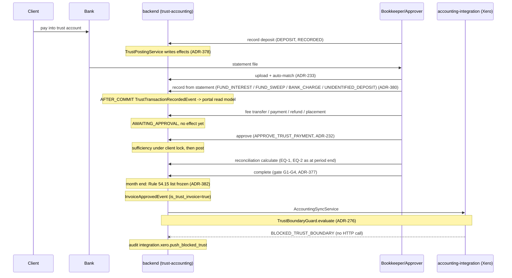

# Payment Receipt to Trust Allocation

**Vertical:** legal-za only. Module-gated `trust_accounting`. The entire flow is unreachable on a non-legal tenant — see the nine-layer defence in [`20-cross-cutting/multi-vertical.md`](../20-cross-cutting/multi-vertical.md) and [`30-modules/trust-accounting.md`](../30-modules/trust-accounting.md) §6.

> **Updated for Phase 92 (2026-11, slice 651D).** The cashbook mirrors the bank statement: interest, Fund sweeps, bank charges and unidentified deposits are recorded from statement lines the firm classifies, never calculated. Every balance is derived from per-row posting effects (ADR-375, ADR-378, ADR-380).

## 1. What this flow shows {#what}

This is the money lifecycle of funds held in trust:
1. A client pays into the firm's trust banking account, and the firm records the deposit on the client's ledger for a matter.
2. The bank statement is imported. Each line is matched to a posting, recorded from the statement, or excluded.
3. Money leaves trust only through firm-initiated outflows under the maker-checker rule (ADR-232): fees to the business account (`FEE_TRANSFER`), payments (`PAYMENT`, which a trust-paid disbursement links to), refunds and investment placements.
4. Interest on the account and the Fund's sweep of it are recorded as they appear on the statement, on the account's Fund ledger. Kazi calculates nothing.
5. The month's reconciliation completes only when the trust equation holds, and completing a month end freezes the Rule 54.15 list.

The boundary with the firm's general ledger is enforced by a fail-closed `TrustBoundaryGuard` (ADR-276) at the integration push, **not** when a trust fee note is created.

The load-bearing properties are auditability and provable balance. Every step writes an `AuditEvent` in-tx; notifications and the portal read model update `AFTER_COMMIT` (`30-modules/trust-accounting.md` §5).

## 2. Cast {#cast}

- **Customer** — payer `→ backend/src/main/java/io/b2mash/b2b/b2bstrawman/customer/Customer.java:23`
- **Project (Matter)** — `Project` in code, "Matter" in the UI `→ backend/src/main/java/io/b2mash/b2b/b2bstrawman/project/Project.java:26`
- **TrustAccount** — a trust bank account `→ backend/src/main/java/io/b2mash/b2b/b2bstrawman/verticals/legal/trustaccounting/TrustAccount.java:20`
- **TrustTransaction** — one posting with its effects `→ verticals/legal/trustaccounting/transaction/TrustTransaction.java:19`; type rules from the registry `→ transaction/TrustTransactionType.java:16` (25 types)
- **TrustPostingService** — the only writer of posting effects `→ transaction/TrustPostingService.java:70`
- **ClientLedgerCard** — per-(account, client) lock anchor; no stored balance `→ ledger/ClientLedgerCard.java:23`
- **BankStatement / BankStatementLine** — `→ reconciliation/BankStatement.java:18`, `reconciliation/BankStatementLine.java:17`
- **StatementLinePostingService** — record from statement `→ reconciliation/StatementLinePostingService.java:61`
- **TrustCreditorAccount / UnidentifiedDeposit** — the Fund interest-and-charges ledger and unidentified deposits `→ creditor/TrustCreditorAccount.java:23`, `creditor/UnidentifiedDeposit.java:29`
- **TrustReconciliation / TrustMonthlyList** — `→ reconciliation/TrustReconciliation.java:25`, `books/TrustMonthlyList.java:31`
- **TrustBooksService / TrustIntegrityService** — the equation as at a date and its flags `→ books/TrustBooksService.java:38`, `books/TrustIntegrityService.java:57`
- **Invoice + InvoiceLine** — fee note flagged `is_trust_invoice` `→ backend/.../invoice/Invoice.java:28`
- **LegalDisbursement + DisbursementPaymentSource** — sibling-aggregate (ADR-247) with `OFFICE_ACCOUNT | TRUST_ACCOUNT` source `→ verticals/legal/disbursement/DisbursementPaymentSource.java:14`
- **Integration ports** — `PaymentGateway` (PSP, foundational always-on), `AccountingProvider` + `AccountingPaymentSource` (sibling port, ADR-279) — see [`30-modules/integration-ports.md`](../30-modules/integration-ports.md)
- **TrustBoundaryGuard** — fail-closed export gate (ADR-276) `→ backend/.../integration/accounting/sync/TrustBoundaryGuard.java`
- **Members** — bookkeeper (`MANAGE_TRUST`, initiator), approver (`APPROVE_TRUST_PAYMENT` — the approving member, `OWNER_ONLY` by default)

## 3. Step-by-step sequence {#steps}

1. **Client pays.** For trust money the firm directs clients to pay into the trust banking account directly. PSP-routed payments (`→ ADR-098`) land in the operating bank. Either way, the canonical evidence is a bank-statement line.
2. **Deposit recorded.** `POST /api/trust-accounts/{accountId}/transactions/deposit` (`transaction/TrustTransactionController.java:62`) posts a `DEPOSIT` for a client and matter, with no approval (`RECORDED`). `TrustPostingService` writes the cashbook and client-ledger effects on the row. The client's balance is the sum of its rows (ADR-378); nothing is cached.
3. **Statement imported.** `POST /api/trust-accounts/{accountId}/bank-statements` (`reconciliation/TrustReconciliationController.java:40`) parses the CSV (FNB, ABSA, Standard Bank, Nedbank or generic). Each line gets a keyword suggestion (`suggestedClassification`). Auto-match (ADR-233, `:65`) sets `AUTO_MATCHED`. A manual `match` (`:71`) links an existing posting and sets `MANUALLY_MATCHED`. Neither creates a posting.
4. **Bank-originated lines recorded from the statement.** `POST /api/bank-statement-lines/{lineId}/record` (`:79`; ADR-380) posts the classified type, dated the line's date, linked to the line (which becomes `RECORDED`), with no approval because the bank already moved the money:
   - interest credited (`FUND_INTEREST`) or swept to the Fund (`FUND_SWEEP`) on the account's Fund ledger;
   - a bank charge (`BANK_CHARGE`, with a recoverable flag and VAT) or its refund from the business account (`CHARGE_REFUND`) (ADR-381);
   - a credit whose owner is unknown (`UNIDENTIFIED_DEPOSIT`, which opens an item; ADR-376);
   - section 86(4) interest on a named investment (`INV_INTEREST`, with `FUND_INV_SHARE` for a gross credit; ADR-379).

   Where the bank sweeps interest to the Fund at source, nothing reaches the account. The firm records the month's figures as a memo instead (`PUT /api/trust-accounts/{accountId}/interest-memos/{month}`; ADR-384).
5. **Events.** Each new posting fires `TrustTransactionRecordedEvent` (`event/TrustTransactionRecordedEvent.java:25`). `AFTER_COMMIT`, the portal read model is updated (`TrustLedgerPortalSyncService`).
6. **Held until decided.** A deposit may sit on the client's ledger indefinitely; it is the client's money. An unidentified deposit sits on the unidentified-deposits ledger until it is allocated to a client and matter (`POST /api/unidentified-deposits/{depositId}/allocate`) or paid to the Fund (`…/pay-to-fund`). Both need approval.
7. **Outflows (firm-initiated, maker-checker).** Every firm-initiated outflow is saved `AWAITING_APPROVAL` with no effect, and `TrustTransactionApprovalEvent.awaitingApproval` notifies approvers. Approval (`POST /api/trust-transactions/{id}/approve`, `APPROVE_TRUST_PAYMENT`, ADR-232) checks the client's derived balance under the client's lock anchor (`ClientLedgerCard` `FOR UPDATE`, ADR-231 as amended), then posts. The outflows:
   - **Fees to the business account.** `…/transactions/fee-transfer` (`:86`) against the matter's trust fee note, with an optional `transactionDate`.
   - **Payment.** `…/transactions/payment` (`:70`). A trust-paid `LegalDisbursement` links an existing `APPROVED` `PAYMENT` on the same matter (`DisbursementService.java:662`); it never writes a posting itself.
   - **Refund to client.** `…/transactions/refund` (`:94`).
   - **Investment placement.** Section 86(4) `INV_PLACE` → `INV_RECEIVE` moves the money to the client's investment ledger on an `INVESTMENT` account, so the client's total is unchanged. Section 86(3) uses `FIRM_INV_*` through the inter-account term (`POST /api/trust-accounts/{accountId}/investments`, ADR-379).
8. **Reconciliation and the month end.** `POST /api/trust-accounts/{accountId}/reconciliations` opens a `TrustReconciliation(DRAFT)` for a statement and period end. `calculate` computes both comparisons as at the period end: bank against cashbook (EQ-1), and cashbook against all trust creditors (EQ-2) — client ledgers, client investment creditors, Fund ledger, unidentified deposits, other non-client creditors and the inter-account term (`TrustBooksService`, ADR-377). `complete` runs the gate G1–G4 from the integrity check's blocking flags: bank difference, books out of balance, unidentified or investment mismatch, unresolved lines. When the period end is a month end, completion freezes the Rule 54.15 list in the same transaction (`TrustMonthlyListService.lock`, ADR-382). Warnings (Fund ledger or client ledger in debit, items over a year old, charges to refund) never block. No event is published on completion.
9. **Statements.** `GET /api/trust-accounts/{accountId}/client-ledgers/{clientId}/statement` (`ledger/ClientLedgerController.java:60`) and the portal endpoint render on demand from `ClientLedgerStatementQuery`. The statement of account and client trust statement templates are in `legal-za` template pack v16. Clients see interest only from their own section 86(4) investments. The portal hardens download URLs to `https:` only (`A3 §269`).
10. **Hard guard at integration push.** `→ ADR-276`. When the matter's fee `Invoice` is approved and `AccountingSyncService` consumes `InvoiceApprovedEvent`, `TrustBoundaryGuard.evaluate(invoice)` runs **before** any HTTP call. It refuses on any of three conditions (`phase71-xero-accounting-integration.md:793-795`):
    1. `customFields.is_trust_invoice == true`;
    2. any line is linked to a `LegalDisbursement` with non-null `trust_account_id`;
    3. the customer has a non-zero derived general trust balance (`TrustBoundaryGuard.java:120-126`).

    A refusal sets `state=BLOCKED_TRUST_BOUNDARY` and writes audit event `integration.xero.push_blocked_trust`. The guard fails closed on a lookup error. No bypass, no override (ADR-276:51).

## 4. Sequence diagram {#sequence}

## 5. Failure modes {#failure-modes}

- **Allocation undecided.** Default state: a deposit sits on the client's ledger as the client's money. There is no automatic sweep or reaper. The `OVERDUE_RECONCILIATION` `TrustAlert` surfaces stale state but does **not** block new transactions — advisory only ([`30-modules/trust-accounting.md`](../30-modules/trust-accounting.md) §10.3).
- **Books out of balance.** `calculate` shows the bank difference and the creditor difference separately. `complete` refuses with one sentence per failing gate condition, and the dashboard `TrustIntegrityCard` shows the same flags. Typical causes are an unrecorded statement line, a duplicate match, or a posting in the wrong period. The fix is to record or match the missing line, or reverse the wrong posting. Kazi has no manual adjustment line.
- **Trust hard-guard blocks Xero push.** The sync entry gets `state=BLOCKED_TRUST_BOUNDARY`, and the accounting team is notified via the sync-log UI (Phase 71 §11.5). Do **not** bypass the guard. The invoice is statutorily forbidden from leaving the trust boundary: reconcile it manually in the firm's external books, or clear the trust flag if it was set in error (which itself requires audit). The guard refuses re-attempts identically.
- **Fund ledger in debit.** A sweep or charge can take the Fund ledger below zero before the matching credit is recorded. It is recorded as the bank shows it and flagged `FUND_LEDGER_IN_DEBIT`; it never blocks (founder decision 9, ADR-381).
- **Approval never lands.** `TrustTransaction.status=AWAITING_APPROVAL` until `approve` or `reject`; the row has no effect meanwhile. Aging surfaces via the `AGING_APPROVAL` `TrustAlert`. There is no automatic timeout.
- **Insufficient client balance.** Approval of a client outflow re-checks the derived balance under the client's lock anchor and refuses ("Insufficient trust balance"). Nothing posts. A client ledger that goes into debit by another path (e.g. a reversed deposit) is flagged `CLIENT_LEDGER_IN_DEBIT`, not blocked (OL-7).
- **Reversal.** `POST /api/trust-transactions/{id}/reverse` writes a contra `REVERSAL` row that carries the negated effects on its own date (optional `reversalDate`). The original keeps its effects and is marked `REVERSED`, so a balance as at an earlier date never changes (ADR-378). Whether a reversal needs approval is the type's registry rule. Unmatching a `RECORDED` line reverses what it created.
- **Back-dated posting into a locked month.** It is recorded normally and never changes the frozen Rule 54.15 list. It is shown against the list and flagged `BACKDATED_AFTER_LOCK` (ADR-382). The posting dialogs warn first (650D).
- **Profile-switch orphan.** Switching tenant from `legal-za` to `consulting-generic` does not uninstall trust tables ([`30-modules/trust-accounting.md`](../30-modules/trust-accounting.md) §10.1). Open question: trapdoor vs guided uninstall.

## 6. Vertical overlays {#verticals}

This flow is **legal-za only**. The nine-layer defence ([`20-cross-cutting/multi-vertical.md`](../20-cross-cutting/multi-vertical.md), and [`30-modules/trust-accounting.md`](../30-modules/trust-accounting.md) §6) ensures no leak:
- **(1) Profile registry:** only legal-za enables `trust_accounting`.
- **(2) Backend service gates:** they self-refuse with HTTP 403.
- **(3) Export hard guard:** refuses cross-vertical.
- **(4)–(6) Frontend nav, page server gate and capability:** all hide the module.
- **(7)–(9) Portal nav, portal redirect and portal data endpoints:** the data endpoints return **404**, hiding the module's existence from portal callers (`customerbackend/service/PortalTrustLedgerService.java:37`).

Layers 2 and 3 are load-bearing; the rest are belt-and-braces UX.

The UI names `Project`, `Invoice` and `Expense` as Matter, Fee Note and Disbursement directly; the terminology map was deleted in 611E (#1616). The trust-accounting module uses the Act's and the Rules' terms.

## 7. Cross-links {#cross-links}

- [`30-modules/trust-accounting.md`](../30-modules/trust-accounting.md) — entities, REST surface, ADRs, open questions.
- [`30-modules/invoicing.md`](../30-modules/invoicing.md) — `is_trust_invoice` flag, fee-note approval.
- [`30-modules/expenses.md`](../30-modules/expenses.md) — `LegalDisbursement` sibling aggregate (ADR-247).
- [`30-modules/integration-ports.md`](../30-modules/integration-ports.md) — `PaymentGateway`, `AccountingProvider`, `AccountingPaymentSource` (ADR-279), `TrustBoundaryGuard` placement.
- [`20-cross-cutting/multi-vertical.md`](../20-cross-cutting/multi-vertical.md) — full nine-layer mechanism.
- [`50-flows/matter-to-cash.md`](matter-to-cash.md) — generic fee-billing path; this flow is its legal-vertical specialisation downstream of the `PAID` transition.
- [`adr/ADR-247`](../../adr/ADR-247-legal-disbursement-sibling-entity.md), [`ADR-276`](../../adr/ADR-276-trust-accounting-hard-guard-export.md), [`ADR-277`](../../adr/ADR-277-poll-over-webhooks-payment-reconciliation-v1.md), [`ADR-279`](../../adr/ADR-279-sibling-payment-source-port.md), [`ADR-375`](../../adr/ADR-375-statement-driven-trust-interest.md), [`ADR-377`](../../adr/ADR-377-trust-equation-and-where-it-is-enforced.md), [`ADR-378`](../../adr/ADR-378-ledger-balances-derived-from-posting-effects.md), [`ADR-380`](../../adr/ADR-380-statement-line-classification-and-posting.md), [`ADR-382`](../../adr/ADR-382-monthly-trust-creditor-list-locking.md).
- `architecture/phase60-trust-accounting.md`, `architecture/phase71-xero-accounting-integration.md` §11.6, `architecture/phase92-trust-books-provably-right.md`.
