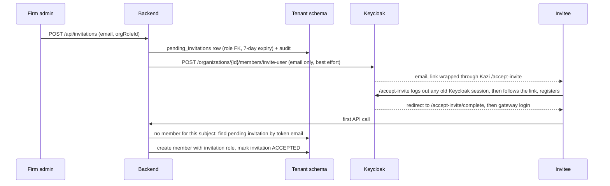

# Keycloak upgrade and Organizations features: should newer Keycloak replace Kazi's custom code?

Date: 2026-11-24. Research and analysis only: no code, config or service was changed.

Evidence labels used throughout:

- **[C]** confirmed by reading the code or config at the cited file:line.
- **[H]** hypothesis: inferred, not observed running.
- **[OFFICIAL]** read on keycloak.org or in the Keycloak GitHub repository during this research.
- **[THIRD-PARTY]** reported by a non-Keycloak source.
- **[NOT CONFIRMED]** looked for and could not establish.

Paths are relative to `/Users/rakheendama/Projects/2026/b2b-strawman` unless they start with `../keycloak-saas`.

## 1. Executive summary

**Recommendation: upgrade Keycloak to the latest version for security, and keep roles and permissions in Kazi. Do not move them into Keycloak's new organization groups.**

**What we run.** Every environment is pinned to Keycloak 26.5.0, released in January 2026. Keycloak only fixes security problems in its newest release line, so ours has had no fixes since April. The latest is 26.8.2 (5 November 2026).

**What is new.** Your recollection is right: organization groups arrived in 26.6.0, and in 26.7.0 those groups gained the ability to carry roles. Each firm can now have its own private set of groups inside Keycloak. But the roles are still Keycloak-wide roles attached to a firm's group. There is still no way to send an invitation with a role, and no per-firm role of the kind Kazi has.

**What our custom code really is.** About 2,900 lines work around Keycloak. The part that keeps breaking is not the permission model; it is the invitation and first-sign-in path. Roughly 500 lines of it are dead: an early attempt to copy roles into Keycloak that nothing reads. Kazi's own role and permission model (custom roles, 29 permissions, per-person adjustments, owner-only rules) is solid and is a product feature, not a workaround.

**Why not move roles into Keycloak.** Keycloak's model cannot express Kazi's custom roles and per-person adjustments, so we would keep our tables anyway and add a second copy to keep in step. Role changes would take minutes to apply instead of instantly, which matters for trust-account approvals. The firm's audit trail would be weaker. Our fast test stack does not run Keycloak, so permissions would become harder to test. And the feature is four months old with an open bug in exactly the part we would rely on.

**What we should take from newer Keycloak.**

- The security fixes.
- A narrower permission for our server when it talks to Keycloak (new in 26.7). Today it uses the all-powerful administrator account.
- Invitation cancel and resend, which our current version already supports and we never wired up.

**Two gaps found on the way, neither of which needs an upgrade.**

- A firm cannot remove a departed colleague's access itself.
- Nothing stops one person being invited into two firms, which the product does not support.

**Effort and risk.**

| Work | Effort | Risk |
|---|---|---|
| Clean-up and small fixes, no upgrade needed | 11 to 14 hours | Low |
| Upgrade to 26.8.2, with a rehearsal on a copy of the data | 23 to 28 hours | Medium: one change in 26.8.2 to how administrative calls are authorised could break firm provisioning and invitations, and must be tested first. The Claude (MCP) connection and the branded login pages also need re-checking |
| Narrower server permission, plus "remove a team member" | 12 to 18 hours | Low |
| Moving roles into Keycloak | 60+ hours and a permanent sync burden | Not recommended |

The customer portal does not use Keycloak and is unaffected. Six decisions for you are listed in section 7.3.

## 2. Current state: how Kazi does it today

### 2.1 Keycloak versions pinned

| Where | Pin | Evidence |
|---|---|---|
| Local dev stack | `quay.io/keycloak/keycloak:26.5.0`, `start-dev --import-realm --features=scripts` | `compose/docker-compose.yml:59,62` |
| VPS "dev" deployment (auth-dev.heykazi.com) | `26.5.0`, `start --import-realm` (no `scripts` feature) | `compose/docker-compose.prod.yml:62,64` |
| ECS image built from the monorepo | `FROM quay.io/keycloak/keycloak:26.5.0` | `compose/keycloak/Dockerfile.production:20` |
| Production Keycloak repo | `FROM quay.io/keycloak/keycloak:26.5.0` | `../keycloak-saas/docker/Dockerfile:21` |
| Login theme toolchain | Keycloakify `^11.15.3`, React 19 | `compose/keycloak/theme/package.json`, `../keycloak-saas/theme/package.json` |
| Admin client library | None. Kazi does not use `keycloak-admin-client`; it calls the Admin REST API with hand-written `RestClient` code | `backend/pom.xml` and `gateway/pom.xml` have no Keycloak dependency; `backend/.../security/keycloak/KeycloakAdminClient.java:53-71` |
| Mock-auth E2E stack | No Keycloak at all; a small mock IdP issues tokens | `compose/mock-idp/src/index.ts:47-56` |

Version drift: **none**. Every pin is 26.5.0, with no image digest.

Configuration drift (this matters more than version drift):

- The monorepo realm is `docteams`; the production repo realm is `b2mash` (`compose/keycloak/realm-export.json:2-3` against `../keycloak-saas/realms/b2mash.json:2-3`).
- The production realm file has **no `mcp-claude` client** and its bootstrap script has **no dynamic client registration step** (`compose/keycloak/realm-export.json:104-122` and `compose/scripts/keycloak-bootstrap.sh:317-376` have no counterpart in `../keycloak-saas/scripts/bootstrap-realm.sh`). The MCP sign-in would not work against a realm built only from `keycloak-saas` [C config, H effect].
- The production realm file sets no token or session lifetimes; the monorepo sets 5 min access token, 30 min idle, 10 h max (`compose/keycloak/realm-export.json:7-9`).
- `--features=scripts` is enabled in local dev only, and nothing uses it: neither realm file contains a script mapper [C]. It is a leftover from ADR-139.
- `keycloak-saas` has four commits, the last ones CI fixes. Whether it has ever been deployed to ECS is **not confirmed** from the repos; the only environment with evidence of running is the VPS one.

### 2.2 Realm setup

- **Realm import**: JSON imported on first boot only (`compose/keycloak/Dockerfile.production:53-65`), then a shell script applies everything the import cannot carry (`compose/scripts/keycloak-bootstrap.sh`, 435 lines; `../keycloak-saas/scripts/bootstrap-realm.sh`, 378 lines).
- **Organizations**: enabled by `"organizationsEnabled": true` (`realm-export.json:20`). No build-time feature flag is set, so Kazi relies on Organizations being a default-on supported feature in 26.5.
- **Clients**: `gateway-bff` (confidential, authorization code), `mcp-claude` (public, PKCE; monorepo only), `admin-cli` (`realm-export.json:50-130`).
- **Roles and groups in Keycloak**: only the default realm roles and one realm group, `platform-admins` (`realm-export.json:21-48`). No client roles, no organization roles, no organization groups.
- **Protocol mappers**: two, both on `gateway-bff`: `groups` (group membership) and `org-role` (user attribute `org_role` to claim `org_role`) (`realm-export.json:74-102`).
- **Organization claim**: comes from Keycloak's built-in `organization` client scope, which the gateway requests explicitly (`gateway/src/main/resources/application.yml:35`). In 26.5 it arrives as a list of organization aliases (`gateway/.../BffUserInfoExtractor.java:33-37`).
- **Custom SPI / event listener code**: none. The `providers/` directory holds only the Keycloakify theme JAR (`compose/keycloak/providers/keycloak-theme.jar`, `../keycloak-saas/providers/keycloak-theme.jar`).
- **Themes**: a Keycloakify login theme (11 pages, about 1,150 lines of TSX, `compose/keycloak/theme/src/login/pages/`) and FreeMarker email templates including a customised `org-invite.ftl` (`compose/keycloak/themes/docteams/email/html/`). The login theme has **no organization-selection page**.
- **User profile**: `org_role` is registered as an admin-only attribute by the bootstrap script, because 26.x silently strips undeclared attributes (`keycloak-bootstrap.sh:72-100`).
- **Dynamic client registration for MCP**: trusted hosts limited to localhost and claude.ai, allowed scopes widened, and the built-in `service_account` scope deleted (`keycloak-bootstrap.sh:317-376`).

### 2.3 Tenant separation end to end

```mermaid
sequenceDiagram
    participant U as Browser
    participant G as Gateway (BFF, session cookie)
    participant K as Keycloak 26.5 (realm, Organizations)
    participant B as Backend
    participant DB as Postgres (schema per tenant)
    U->>G: any page
    G->>K: OIDC code flow, scope "openid profile email organization"
    K-->>G: tokens; access token has organization: ["firm-alias"]
    U->>G: /api/** (cookie)
    G->>B: same request + Bearer access token (TokenRelay)
    B->>B: JwtUtils.extractOrgId = first alias in the claim
    B->>DB: org_schema_mapping lookup (cached 1 h)
    B->>B: bind TENANT_ID + ORG_ID as ScopedValues
    B->>DB: MemberFilter: member by token subject, role and capabilities from tenant schema
    B->>DB: request runs with search_path = tenant_<hash>
```

- **Organization to tenant**: the Keycloak organization **alias** (the slug) is the tenant key. Provisioning stores `alias -> tenant_<hash>` in the global `org_schema_mapping` table (`backend/.../accessrequest/AccessRequestApprovalService.java:97-103`).
- **Claim to tenant**: `TenantFilter` reads the org from the validated JWT only, never from a header (`backend/.../multitenancy/TenantFilter.java:56-64`). `JwtUtils.extractOrgId` accepts three shapes: the retired Clerk `o.id`, a Keycloak list of aliases, or a Keycloak map keyed by alias (`backend/.../security/JwtUtils.java:25-31, 99-110`). It takes the **first** entry in each case.
- **Context**: `TENANT_ID`, `ORG_ID`, optional `SHARD_ID`, then `MEMBER_ID`, `ORG_ROLE`, `CAPABILITIES` are bound as Java `ScopedValue`s for the request (`TenantFilter.java:98-106`; `backend/.../member/MemberFilter.java:63-82`). Isolation is the schema boundary; there are no `tenant_id` columns (`backend/CLAUDE.md:166-174`).
- **Gateway**: authentication and token relay only. `/bff/me` returns identity, org id/slug and `groups`, no role (`gateway/.../BffController.java:33-41, 72-97`). Authorization was removed from the gateway by ADR-180.
- **Provisioning (admin-gated, no self-serve signup)**: a platform admin approves an access request; the backend creates the Keycloak organization, provisions the schema, sends the Keycloak invitation to the requester and records them as creator (`AccessRequestApprovalService.java:80-115`). `POST /api/orgs` exists but is restricted to platform admins (`backend/.../provisioning/OrgController.java:15`). Realm self-registration is off (`realm-export.json:11`).
- **Fallback provisioning**: in the Keycloak profile, a valid token for an organization with no schema triggers just-in-time provisioning (`backend/src/main/resources/application-keycloak.yml:13-15`; `TenantFilter.java:67-74`).
- **A user in more than one organization**: not supported and not prevented.
  - The design assumes one organization per user (`architecture/phase36-keycloak-gateway-bff.md:31`, citing Keycloak issues #33556 and #41127; `frontend/components/auth-header-controls.tsx:94`).
  - Nothing in the realm or in Kazi enforces it. `InvitationService.createInvitation` checks only the current tenant's members (`backend/.../invitation/InvitationService.java:61-65`), then asks Keycloak to invite the email whether or not that user already belongs to another firm (`:119-126`).
  - What happens then has not been observed [H]. Keycloak's 26.5 documentation says that with the plain `organization` scope a member of several organizations "will be prompted to select an organization when authenticating to the realm" [OFFICIAL], so the token should carry the one selected firm. Kazi's custom login theme has no page for that prompt (section 2.2), so the user would see either an unbranded fallback page or an error. If more than one alias ever does arrive, every layer silently takes the first (`JwtUtils.java:102-104`; `BffUserInfoExtractor.java:34-37`; `frontend/lib/auth/middleware.ts:218-221`), and there is no way to switch firm without signing out.
  - Because such a user is a genuine member of both firms, this is a wrong-firm routing and usability defect, not a leak to a stranger. For a law-firm product (a candidate attorney moving firms, a bookkeeper serving two firms) it is still a real gap.

### 2.4 Roles and capabilities

- **Where roles live**: entirely in Kazi's tenant schema. `OrgRole` rows (system roles Owner/Admin/Member plus firm-defined custom roles) carry a set of capabilities from a fixed enum of 29 (`backend/.../orgrole/Capability.java:7-78`). A member has one role plus optional per-member `+CAP` / `-CAP` overrides (`backend/.../orgrole/OrgRoleService.java:69-98`).
- **Owner-only rules**: a subset of capabilities can only be granted by the owner, and only the owner can grant Owner/Admin (`OrgRoleService.java:429-470`, added in PR #1856).
- **Per request**: `MemberFilter` loads the member by token subject (1 h cache, evicted on role change) and resolves capabilities from the database on every request (`MemberFilter.java:68-80, 118-132`). Controllers use `@RequiresCapability`.
- **The token carries no trusted role**. `ClerkJwtAuthenticationConverter` grants no authorities, `JwtUtils.extractOrgRole` has no callers, and the only token claim used for authorization is `groups` for platform admins (`tasks/custom-role-invite-fix-plan.md` section 2.3, re-checked). This was a deliberate decision: ADR-178 (database is the only authority), ADR-179 (invitation role in the database), ADR-180 (no authorization in the gateway), ADR-T003.
- **Sync back to Keycloak**: effectively none.
  - `updateMemberRole` writes a realm-wide user attribute `org_role=owner` for an organization's creator in two provisioning paths only (`backend/.../provisioning/OrgProvisioningService.java:84-85`; `backend/.../demo/DemoProvisionService.java:177-178`).
  - The same method then calls `/organizations/{id}/roles` and `/members/{id}/organization-roles/grant`, endpoints that its own comment expects to fail on 26.x (`KeycloakAdminClient.java:189-203`). See section 4 for whether they exist upstream.
  - Role changes in Kazi never reach Keycloak (`OrgRoleService.assignRole` makes no Keycloak call). The `org_role` claim is therefore stale for most users and is read by nothing.

### 2.5 Invitations and member lifecycle



- **Send**: Kazi stores the invitation and its role in the tenant schema, then asks Keycloak only to send the email. The role is never sent to Keycloak; the `role` parameter of `inviteMember` is unused (`InvitationService.java:96-130`; `KeycloakAdminClient.java:153-166`). The Keycloak call is best effort: if it fails, the Kazi invitation exists and no email went out (`InvitationService.java:127-129`).
- **Accept**: the email link is rewritten to pass through Kazi's `/accept-invite` page, which logs out any existing Keycloak session first so a signed-in colleague's session does not consume the single-use link (`compose/keycloak/themes/docteams/email/html/org-invite.ftl:3-19`; `frontend/app/accept-invite/page.tsx:46-52`). After registration Keycloak redirects to `/accept-invite/complete`, set as the organization's `redirectUrl` (`backend/.../accessrequest/KeycloakProvisioningClient.java:90-97`).
- **Stale-session guard**: the gateway drops a `KC_LAST_LOGIN_SUB` cookie at login and the Next.js middleware compares it with `/bff/me` to detect a session that belongs to a different user (`gateway/.../GatewaySecurityConfig.java:222-257`; `frontend/lib/auth/middleware.ts:75-97`).
- **Role on first sign-in**: `MemberFilter.lazyCreateMember` matches a pending invitation by the token's email and applies its role (`MemberFilter.java:157-169`). The first member of an empty tenant becomes Owner (`:171-176`).
- **Known live defect**: an invitation into a **custom** role fails at first sign-in, because the role is re-resolved by slug among system roles only (`MemberFilter.java:183-189`). The committed plan `tasks/custom-role-invite-fix-plan.md` (commit `6fa02cd97`) recommends resolving by the stored role id, with no Keycloak change. This report agrees with that plan; nothing in newer Keycloak changes its conclusion (section 5).
- **Revoke**: marks the Kazi row REVOKED but does not cancel the Keycloak invitation; `KeycloakAdminClient.revokeInvitation` has no callers (`InvitationService.java:147-174`; `KeycloakAdminClient.java:177-184`). The emailed link stays live and the person would join as a plain Member [C code, H Keycloak link validity].
- **Expiry**: Kazi's invitation expires after 7 days (`InvitationService.java:35`); Keycloak's link has its own, separately configured lifetime. The two are not aligned.
- **Removal / deactivation**: there is no firm-facing way to remove or deactivate a member in Keycloak mode. `/api/members` offers list, capabilities and role assignment only (`backend/.../member/OrgMemberController.java:30-43`). The only delete is an internal API-key endpoint left from the Clerk webhook design (`backend/.../member/MemberSyncController.java:62-66`), and it does not touch Keycloak. `removeOrgMember` is called only by demo cleanup (`backend/.../demo/DemoCleanupService.java:163-187`). A departed fee earner therefore keeps a working login and their Kazi role until someone edits Keycloak by hand [C].

### 2.6 Portal and MCP

- **Customer portal**: does not use Keycloak. Portal contacts sign in with Kazi-issued magic links and portal JWTs through `CustomerAuthFilter`, on a separate filter chain with no `MemberFilter` (`backend/.../security/SecurityConfig.java:104-129`; ADR-030, ADR-T005). **Not affected** by any Keycloak upgrade, apart from sharing the box.
- **MCP server**: an OAuth 2.1 protected resource that validates ordinary Keycloak access tokens through the same filter chain as the web API (ADR-303). It depends on Keycloak for: the authorization-code + PKCE flow, anonymous dynamic client registration with the customised policies (`keycloak-bootstrap.sh:317-376`), the `organization` scope being requestable by dynamically registered clients (`:357`), and protected-resource metadata published by the backend (`SecurityConfig.java:62-70`). **Affected** by an upgrade: this is the surface most sensitive to Keycloak behaviour changes and must be regression-tested (section 6).

## 3. Inventory of compensating code

"Fix share" is the number of commits touching the file whose subject mentions a fix, gap, bug or regression, out of all commits to that file (`git log`). It over-counts a little, because large QA-cycle commits mention fixes generally, but the ranking is reliable.

| # | What Kazi does itself | Why (the Keycloak limitation at 26.5) | Where | Rough size | Fragility |
|---|---|---|---|---|---|
| 1 | Roles, custom roles, capabilities, per-member overrides, owner-only rules in the tenant database | Keycloak had no organization-scoped roles; also a product decision (ADR-178, ADR-T003) | `backend/.../orgrole/` (9 files) | about 1,040 lines + tests | Low. Recent changes are features and the PR #1856 security hardening, not Keycloak breakage |
| 2 | Invitation record with role, expiry, status, audit; role applied at first sign-in | Keycloak invitations cannot carry a role (ADR-156 cites upstream issue #45238) | `backend/.../invitation/` (5 files), `MemberFilter.java:142-230`, `frontend/.../team/invitation-actions.ts` | about 410 + 90 + 190 lines | Medium. Custom-role invitations have never worked; revoke does not reach Keycloak; overrides dropped |
| 3 | Lazy member creation and founder-becomes-owner rule | Keycloak membership has no role and no "joined" callback without a custom event listener | `MemberFilter.java` | 231 lines | High. 16 of 21 commits are fixes |
| 4 | `org_role` user attribute, user-profile registration, mapper, backfill | "KC 26.x not including org roles in the built-in organization claim" (`keycloak-bootstrap.sh:128`) | `KeycloakAdminClient.java:186-324`, `keycloak-bootstrap.sh:72-150, 203-268`, `bootstrap-realm.sh:113-215`, `JwtUtils.java:66-75` | about 140 + 220 + 100 lines | Dead weight. Written, drifting, read by nothing; realm-wide so wrong for multi-firm users |
| 5 | Calls to `/organizations/{id}/roles` and `.../organization-roles/grant` wrapped in try/catch | Speculative: written for an API the author expected Keycloak to have | `KeycloakAdminClient.java:189-203, 285-324` | about 55 lines | Dead. Fails silently at debug level on every use |
| 6 | Hand-written Admin REST client, twice | No library used; two classes each with their own token cache and error mapping | `KeycloakAdminClient.java` (506), `KeycloakProvisioningClient.java` (335) | 841 lines | Medium. 11 fix commits between them (body format for add-member, 409 handling, alias search, full-replace PUT) |
| 7 | Find organization by alias: search by name then list 200 and filter | Admin API `search` matched name, not alias (GAP-D0-01) | `KeycloakProvisioningClient.java:174-226`; a different approach (`q=alias:`) at `KeycloakAdminClient.java:338-350` | about 60 lines | Medium. Two inconsistent implementations; the fallback caps at 200 organizations |
| 8 | Read-modify-write for organization updates | `PUT /organizations/{id}` replaces the whole representation (upstream #41885) | `KeycloakProvisioningClient.java:130-172` | about 45 lines | Medium. `setOrgCreator` at `:274-289` still sends attributes only, which by the neighbouring comment's own logic risks wiping other fields [H] |
| 9 | Invitation link bounce through `/accept-invite` (forced Keycloak logout first) | An existing Keycloak session collides with the invite link and burns the single-use token (GAP-L-01) | `org-invite.ftl`, `frontend/app/accept-invite/` (5 files + tests), `KC_INVITE_BOUNCE_BASE_URL` | about 250 lines + 105 test | High. Three fix PRs (#1065, #1125/#1130, #1469) |
| 10 | Stale gateway session detection (`KC_LAST_LOGIN_SUB`) | Session handoff after Keycloak registration keeps the previous user's gateway session (GAP-L-22) | `GatewaySecurityConfig.java:222-257`, `frontend/lib/auth/middleware.ts:75-200` | about 170 lines | High. `middleware.ts` 11 of 12 commits are fixes; `GatewaySecurityConfig` 12 of 14 |
| 11 | Single-organization assumption: take the first alias everywhere | Multi-organization claim bugs (#33556, #41127) and no organization selection in the flow | `JwtUtils.java:99-110`, `BffUserInfoExtractor.java:33-49`, `middleware.ts:218-221` | about 40 lines | Latent. Assumed, not enforced (section 2.3) |
| 12 | Three token shapes tolerated (Clerk map, Keycloak list, Keycloak map) | Claim shape varied across Keycloak versions and settings; Clerk legacy | `JwtUtils.java`, `BffUserInfoExtractor.java` | about 180 lines | Low, but the Clerk branch is what the test JWT factory exercises, so tests do not cover the real Keycloak shape by default |
| 13 | Post-import bootstrap scripts | Realm import cannot carry user-profile changes or registration policies; "kcadm array config is unreliable" (`keycloak-bootstrap.sh:328`) | `keycloak-bootstrap.sh` (435), `bootstrap-realm.sh` (378) | 813 lines of shell | Medium. Two diverging copies; the production copy lacks the MCP step |
| 14 | Dynamic client registration hardening for MCP | Default anonymous registration policies block Claude; `service_account` scope breaks the PKCE flow | `keycloak-bootstrap.sh:317-376` | about 60 lines | Medium. Found by live failure (#1473); depends on Keycloak defaults that can change between releases |
| 15 | Backend authenticates to Keycloak as the **master-realm admin user** with a password grant | Not a Keycloak limitation; the simplest thing that worked | `KeycloakAdminClient.java:73, 477-505`; `KeycloakProvisioningClient.java:75, 305-334` | n/a | Security debt: the application server holds full control of the identity provider |
| 16 | Member removal / deactivation | Not built on either side | none | 0 lines | Gap, not compensation (section 2.5) |

Total genuinely compensating code (rows 2 to 14, excluding the product-level role model in row 1): roughly **2,900 lines** across backend, gateway, frontend and shell, plus about 2,500 lines of tests around the filters, invitations and gateway. The founder's recollection is right in spirit, with one correction: the heaviest and most fragile code is not the role model. It is the **invitation / first-sign-in / session handoff path** (rows 2, 3, 9, 10), and the largest block of removable code is the **dead `org_role` machinery** (rows 4, 5), which can go today without any upgrade.

## 4. What is new in Keycloak, from 26.5.0 to 26.8.2

Method: the official release notes and upgrading guide were read both as rendered pages on keycloak.org and as their source files at git tag `26.8.2`; Admin API endpoints were taken from the resource classes at that tag; bugs from the GitHub issues API. Everything in this section is **[OFFICIAL]** unless marked otherwise. No third-party source was relied on.

### 4.1 Releases and support policy

- **Latest stable: 26.8.2**, published 5 November 2026. There is no 27.x release yet.
- Minor releases since ours: 26.6.0 (8 April), 26.7.0 (9 July), 26.8.0 (1 October). The release pages show day and month only; the year is inferred.
- **Support policy**: "The latest minor release receives patch releases for critical bugs and security vulnerabilities. When a new minor release is published, the previous minor release is no longer supported." (`RELEASES.md`)
- Consequence: the 26.5 line stopped receiving fixes on 8 April 2026. Kazi runs **26.5.0**, which also lacks the seven 26.5 patch releases (26.5.1 to 26.5.7). The upgrade notes for 26.6 to 26.8 reference several 2026 security advisories fixed along the way.

### 4.2 Organization-related changes by release

| Release | Change | Status | Relevance to Kazi |
|---|---|---|---|
| 26.5.0 (ours) | Invitation management: invitations stored in the database; list, resend, delete, filter by Pending/Expired, in the console and the Admin API | Supported | Already available and unused. Kazi's revoke could call delete today |
| 26.5.0 | Organization selection prompt for users in several organizations (plain `organization` scope); `organization:<alias>` and `organization:*` scope variants | Supported | Already available; Kazi requests the plain scope and has no themed page for the prompt |
| 26.5.0 | Guide for using Keycloak as the authorization server for MCP servers | Supported | Kazi already does this |
| 26.6.0 | **Organization groups**: each organization gets its own isolated group hierarchy; identity-provider mappers can place federated users into them; membership can be put into the `organization` claim | No preview label, no separate feature flag; ships inside the default-on Organizations feature | The feature the founder noticed. Groups only: **no roles in this release** |
| 26.6.0 | Workflows promoted to supported; OAuth Client ID Metadata Document (experimental); Java 25 runtime supported | Mixed | Not needed now |
| 26.6.1 | Fix: migrating to 26.6.0 could wrongly add an `Organization` sub-flow to custom browser flows | Patch | Never stop at 26.6.0 |
| 26.7.0 | **Roles on organization groups**: "Organization groups now support realm and client role assignments"; roles can be included inside the `organization` claim | Supported | The nearest Keycloak comes to "organization roles". See 4.3 |
| 26.7.0 | **Delegated organization administration**: new admin roles `manage-organizations`, `view-organizations`, `query-organizations`; organizations become a resource type in fine-grained admin permissions v2 | Supported | Useful: lets Kazi's backend stop using a full realm administrator |
| 26.7.0 | Member listing returns a brief representation by default; invitation filters become exact-match | Supported (behaviour change) | Minor; check the bootstrap script's member loop |
| 26.7.0 | SCIM API (preview); MCP improvements built on Client ID Metadata Documents | Preview / experimental | Not now |
| 26.7.3 | `inviteLink` no longer returned by the invitations API | Patch | Kazi does not read it |
| 26.8.0 | Identity providers can be linked to several organizations; domain routing reworked | Supported | Only matters once a firm wants single sign-on with its own directory |
| 26.8.0 | Workflow step `invite-user`; SCIM supported and on by default | Supported | Not an organization invitation; not needed |
| 26.8.2 | Domain-based automatic membership requires a verified email | Patch | Kazi does not use organization domains |

Still **not** in Keycloak at 26.8.2:

- A role or group on an invitation. Upstream issue #45238, the one Kazi's ADR-156 cites, is still open with no milestone (checked 2026-11-24). Nothing in the invitation documentation or endpoints carries a role [NOT CONFIRMED as an absolute negative].
- An organization-level role entity, or a direct per-member role assignment scoped to one organization. Roles reach members only through organization groups.
- The endpoints Kazi's code calls for organization roles (`/organizations/{id}/roles`, `.../organization-roles/grant`, inventory row 5). They are not among the organization resources at tag 26.8.2, which are members, invitations, identity providers and groups. They resemble a third-party extension's API [NOT CONFIRMED where they came from].
- A documented way to switch organization inside a session, other than a new authorization request with `organization:<alias>` [NOT CONFIRMED].

### 4.3 Organization groups in detail

| Aspect | What Keycloak does |
|---|---|
| Arrival | Groups in 26.6.0. Role mappings on those groups in 26.7.0 |
| Data model | Groups belonging "exclusively to one organization". Nested hierarchies and group attributes are supported. Paths are relative to the organization |
| Isolation | Two organizations can each have `/Engineering/Backend` "without any conflict" |
| Roles | "Organization groups support realm and client role mappings, just like realm groups." The roles themselves are ordinary realm or client roles, **global to the realm**. Only the group is per organization |
| Token | Not automatic. An "Organization Group Membership" mapper must be added to the same scope as the existing "Organization Membership" mapper; "the Organization Group Membership mapper alone is NOT sufficient" |
| Claim shape | `"organization": {"firm-alias": {"id": "...", "groups": ["/Partners"]}}`. With "Add group role mappings" on, each organization entry also gets `realm_access.roles` and `resource_access.<client>.roles` |
| A catch | "Standard `realm_access` and `resource_access` claims already include roles from all groups (including organization groups) regardless of this mapper setting." For a user in two firms, the flat role claims mix both firms' roles; separation exists only inside the `organization` claim |
| Limits | "Organization groups cannot be used in Keycloak authorization policies." |
| Admin API | Under `/admin/realms/{realm}/organizations/{org-id}/groups`: create, list, get by path, update, delete, children, `role-mappings`, members (list, add, remove); plus `/organizations/{org-id}/members/{member-id}/groups` |
| Admin console | A Groups tab on the organization, with Members, Attributes and Role mapping tabs |
| Who may assign roles | Needs `manage-organizations` (or fine-grained permission on the organization) plus permission to map the role |
| Support status | No preview or experimental label and no separate flag. No explicit "supported" statement either. Treat as supported but young: seven months for groups, four for roles |

Open bugs that touch it (all open on 2026-11-24):

| Issue | Problem | Why it matters |
|---|---|---|
| #54523 | Roles on a parent organization group are not inherited by subgroup members in the organization claim (reported on 26.8.1, marked important) | The role-in-token path is not yet reliable |
| #54090 | With the preview `parameterized-scopes` feature on, `organization:<alias>` and `organization:*` produce no organization claim | Never run with `--features=preview` |
| #52001 | The selected organization is not kept across a page refresh for users in several organizations | Blocks a smooth multi-firm experience |
| #55412 | The invitation registration link fails with `Invalid parameter: redirect_uri` when the target client has more than one redirect URI | Kazi's `gateway-bff` client has several redirect URIs; test before relying on any client-targeted invite |
| #55160, #55134 | Realm import fails or loses data when fine-grained permissions or group descriptions reference organizations | Kazi's setup depends on realm import plus scripts |
| #55123, #55124 | Admin events for organization groups lack the group id; none at all for linking an identity provider | Weak audit trail on the Keycloak side |
| #45553 | `invite-existing-user` accepts users who are already members | Minor |

### 4.4 Other changes in the range that matter to Kazi

- **MCP / OAuth**: Client ID Metadata Documents remain experimental at 26.8.2. Dynamic client registration, which Kazi uses, is still supported but its default policies were tightened (section 6.2). Parameterized scopes and token-exchange delegation are preview. Support for resource indicators (RFC 8707) is [NOT CONFIRMED].
- **Scripts**: the `scripts` feature is still preview and nothing announces its removal. Kazi enables it in dev and does not use it.
- **Themes**: base themes became abstract in 26.6; FreeMarker defaults and button layout changed in 26.7; identity-provider buttons were redesigned in 26.8.
- **Platform**: Infinispan 16 (26.6), Quarkus 3.40 (26.8), automatic database schema changes in every minor, login failures stored in the database from 26.8.
- **Admin client library**: versioned separately from the server (latest tag found 26.0.13) and stated to support all supported server releases. Kazi does not use it.

## 5. Feature-by-feature fit analysis

### 5.1 Verdicts

| Compensating code (section 3 row) | Could newer Keycloak replace it? | Verdict | Reasoning |
|---|---|---|---|
| 1. Roles, custom roles, capabilities, overrides in the tenant database | Partly, with organization groups carrying realm or client roles (26.7+) | **Do not adopt** | See 5.2 |
| 2. Invitation record with role | No. Invitations still cannot carry a role or group (#45238 open) | **Keep**; fix the custom-role defect as already planned | Even if Keycloak gained role-on-invitation, the role would have to be a Keycloak role, and Kazi's roles are per-firm rows |
| 2a. Invitation revoke / resend | Yes, with the invitation management API that is **already in 26.5** | **Adopt now** | Call delete on revoke; add a resend button. No upgrade needed. About 3 to 4 hours |
| 3. Lazy member creation, founder becomes Owner | No. Keycloak has no hook into Kazi's tenant schema | **Keep** | The member row is Kazi's own record of the person (rates, assignments, audit). Something must create it |
| 4, 5. `org_role` attribute, mapper, backfill, speculative role endpoints | Nothing needs replacing; nothing reads it | **Delete now** | About 500 lines across Java and shell, plus two bootstrap steps and one mapper. No upgrade needed |
| 6. Two hand-written admin clients | Not a Keycloak question | **Consolidate later** | Merge into one client with one token cache. Do not introduce `keycloak-admin-client`: for about fifteen calls a typed library is another dependency to keep in step |
| 7. Find organization by alias | Possibly: `KeycloakAdminClient` already uses a `q=alias:` query that `KeycloakProvisioningClient` does not | **Fix when consolidating** | Verify which query form works on the target version, keep one |
| 8. Read-modify-write on organization update | No. Upstream closed #41885 as not planned | **Keep**, and make `setOrgCreator` use it, or delete `creatorUserId` entirely since nothing in Kazi reads it | |
| 9. Invite-link bounce through `/accept-invite` | No evidence of a fix upstream [NOT CONFIRMED] | **Keep**; retest after upgrade | It solves a browser-session collision, which is inherent to single-use links |
| 10. Stale gateway session detection | No. This is gateway session behaviour, not Keycloak's | **Keep** | |
| 11. First-alias assumption (one firm per user) | Yes in principle: organization selection prompt plus `organization:<alias>` | **Adopt later, and only if the founder wants multi-firm users**. Meanwhile **enforce** one firm per user | See 5.3 |
| 12. Three token shapes | Not a Keycloak question | **Simplify later** | Drop the Clerk branch when the test JWT factory moves to the Keycloak shape. Keep list and map shapes: the map shape appears as soon as "Add organization id" is switched on |
| 13. Bootstrap scripts | Partly. Declarative realm config is still limited, and realm import has open organization bugs (#55160, #55134) | **Keep**, but make `keycloak-saas` and the monorepo use one script | |
| 14. Dynamic client registration hardening for MCP | Client ID Metadata Documents would replace it, but they are experimental | **Do not adopt yet**; keep and retest | Revisit when the feature is supported and Claude's client uses it by default |
| 15. Backend as master-realm administrator | Yes: `manage-organizations` role (26.7) on a dedicated service-account client in the product realm, plus the user-management roles it needs | **Adopt after the upgrade** | The one new feature that reduces risk instead of moving it. About 4 to 6 hours |
| 16. Member removal | Keycloak has had remove-member all along | **Build** (product gap) | Deactivate in Kazi first (authoritative), then remove the organization membership and end sessions |

### 5.2 Why organization groups should not carry Kazi's roles

This is the main question, and the answer is no. Reasons, strongest first:

1. **The model does not fit.** Kazi's roles are firm-defined rows with any subset of 29 capabilities, plus per-member additions and removals, plus rules about who may grant what. Keycloak offers realm-global roles attached to per-firm groups. Mapping one onto the other means either 29 client roles and one group per firm per role (with overrides impossible to express), or one realm role per firm per custom role. Both are worse than a table.
2. **Kazi would still need its own tables.** The capability catalogue, owner-only rules, custom role editor and the member record all stay. Keycloak would become a second copy of the role assignment that has to be kept in step, which is exactly the drift already visible with `org_role` (inventory row 4).
3. **Staleness.** A role in a token is wrong for up to the access-token lifetime (5 minutes here) and longer in the gateway session. Today a demotion takes effect on the next request (`OrgRoleService.java:354`). For trust-account approval rights that difference matters. ADR-178 was written to remove precisely this.
4. **Audit.** Role changes are written to the firm's own audit trail in its schema (`OrgRoleService.java:357`). Keycloak's admin events are realm-wide, not firm-visible, and currently omit the group id for organization-group changes (#55123).
5. **Testability.** The mock-auth E2E stack has no Keycloak (`compose/mock-idp/`), and backend tests build tokens with a factory. Roles that live in Keycloak could only be tested on the slow Keycloak stack. Today the whole authorization model is covered by ordinary integration tests.
6. **Tenant isolation.** The current guarantee is simple: the token says which firm, the firm's schema says what the person may do. Putting roles in the token adds a second path, and for a multi-firm user the flat role claims mix both firms' roles (section 4.3).
7. **Maturity.** Roles on organization groups are four months old and have an open, important-priority inheritance bug (#54523).
8. **Lock-in and operations.** Every custom role edit would become a Keycloak Admin API write. Keycloak downtime would then block role administration, not just login. A two-person team should have fewer moving parts in the authorization path, not more.

What organization groups are good for: firms that bring their own identity provider and want their directory's departments mirrored. Kazi has no such customer yet. If one appears, mirror groups into Keycloak for **display or pre-selection only** and keep the decision in Kazi.

### 5.3 Multi-firm users

Keycloak can now do the mechanics: prompt for a firm at sign-in, or issue a token for a named firm. Adopting it is a product project, not a configuration change:

- a themed organization-selection page;
- a firm switcher that restarts sign-in with `organization:<alias>`;
- gateway session handling per firm;
- the MCP client's scope request;
- a known upstream bug where the selection is lost on refresh (#52001).

Until the founder decides this is wanted, the right move is the opposite: **refuse to invite an email that already belongs to another firm**, so the single-firm assumption is enforced and not merely assumed. `getUserOrganizations` already exists for this (`KeycloakAdminClient.java:447-454`).

### 5.4 Explicitly do not adopt

| Feature | Why not |
|---|---|
| Organization groups as the carrier of Kazi roles or capabilities | Section 5.2 |
| Reading any role from the token (`org_role`, `realm_access`, organization claim roles) | Reverses ADR-178; reintroduces staleness and drift |
| Fine-grained admin permissions v2 for firm administrators | It delegates the Keycloak admin console and API. Firm admins should never see Keycloak; Kazi's Team page is their console |
| A custom event listener or protocol mapper JAR | ADR-156 rejected this for good reasons: it must be rebuilt and retested on every Keycloak upgrade, and 26.8 moved to a new Quarkus |
| Client ID Metadata Documents for MCP | Experimental |
| `--features=preview` in any environment | Turns on `parameterized-scopes`, which breaks the organization claim (#54090) |
| SCIM, Workflows, shared identity providers | No current need. Revisit when a firm asks for directory sync or single sign-on |
| The `scripts` feature | Unused, still preview; remove the flag |

## 6. Upgrade path

### 6.1 Target

**26.8.2**, in one step from 26.5.0, skipping the intermediate minors. Keycloak's own note says the 26.6.0 migration problem "does not apply" when upgrading from 26.5.x directly to a later release. A three-minor jump with automatic database migration is normal for Keycloak but must be rehearsed on a copy of the VPS database first [H until rehearsed].

After that, adopt a cadence: because only the latest minor is patched, plan one minor upgrade per quarter and patch releases within two weeks.

### 6.2 Breaking and notable changes that hit Kazi

| # | Change (release) | Where it hits | Action |
|---|---|---|---|
| 1 | **Admin REST API audience check** (26.8.2): tokens must carry the `kc-admin-api` scope and the target realm's Admin API URL as audience. `admin-cli` receives the scope automatically | Both backend admin clients obtain a token from the **master** realm with `admin-cli` and call `/admin/realms/docteams/...` (`KeycloakAdminClient.java:73, 481-487`). The docs do not say how a master-realm token is treated for another realm's Admin API | **Highest-risk item. Test first.** If it fails: move to a service-account client in the product realm with `kc-admin-api` assigned (also the fix for inventory row 15). The opt-out flag `--spi-admin--audience-check-enabled=false` exists but is discouraged |
| 2 | **Dev mode binds to localhost** (26.6.0) | Local stack runs `start-dev` in Docker with a published port (`compose/docker-compose.yml:62, 78-79`) | Add `KC_HTTP_HOST: 0.0.0.0` to the dev service, or the container will be unreachable from the host |
| 3 | **Client registration policies tightened** (26.8.2): new "Default Roles Disabled" policy; protocol mappers on dynamically registered clients need an explicit allow-list | MCP sign-in from Claude via anonymous dynamic registration (`keycloak-bootstrap.sh:317-376`) | Rerun the bootstrap on an upgraded realm, then run the full Claude connect flow. Likely fine because Claude registers no mappers or roles [H] |
| 4 | **Redirect URI hostname wildcards** no longer accepted (26.6.3) | `mcp-claude` has `http://localhost:*/callback` (`realm-export.json:113`), a port wildcard | Test a local MCP client callback. Path wildcards such as `http://localhost:3000/*` are unaffected |
| 5 | **"Full scope allowed" deprecated**, WARN on every token issued (26.8.0) | `gateway-bff` has `"fullScopeAllowed": true` (`realm-export.json:73`; `b2mash.json:68`) | Set it to false. Kazi reads no role from the token, so nothing should change; confirm `groups` and `organization` still arrive |
| 6 | **Refresh token expiry capped by session idle** (26.8.0) | Gateway session alignment from Epic 568 | Re-run the session-lifetime checks |
| 7 | **Theme changes** (26.6 to 26.8) | Keycloakify login theme (11 pages) and four email templates including `org-invite.ftl` | Rebuild the JAR with the latest Keycloakify 11.x, then eyeball every page and send every email. Keycloakify's compatibility with 26.8 specifically is [NOT CONFIRMED] |
| 8 | **Member list brief representation** (26.7.0) | `keycloak-bootstrap.sh:229-265` reads member email from the list, then fetches each user in full | Probably unaffected; check the script output once |
| 9 | **Protocol mapper management needs realm-management permission** (26.8.2) | Bootstrap scripts create mappers as the master admin | Unaffected today; relevant once a narrower service account is used |
| 10 | **Email no longer marked verified by other flows** (26.8.0) | Invitation acceptance | Kazi matches the invitation on the `email` claim, not on `email_verified`, and the realm has Verify Email off. Expect no change; confirm in the invite test |
| 11 | **Platform**: Infinispan 16, Quarkus 3.40, schema migrations, login failures in the database | Keycloak's own database on the shared Postgres | Back up before upgrading; expect a restart, not a rolling update |
| 12 | Organization Admin API: `inviteLink` null (26.7.3), exact-match invitation filters (26.7.0) | Not used by Kazi | None |

Not affected: the customer portal (no Keycloak), script mappers (none exist), custom providers (none exist), identity-provider changes (none configured), SAML changes.

### 6.3 Required code and config changes for the plain upgrade

1. Bump the image in four places: `compose/docker-compose.yml:59`, `compose/docker-compose.prod.yml:62`, `compose/keycloak/Dockerfile.production:20`, `../keycloak-saas/docker/Dockerfile:21`; update the version mentions in both `CLAUDE.md` files and the runbook.
2. Dev compose: add `KC_HTTP_HOST: 0.0.0.0`; drop `--features=scripts`.
3. Both realm files: `fullScopeAllowed: false` on `gateway-bff`, plus the same change applied to existing realms by the bootstrap script (realm import only runs on first boot).
4. Rebuild and copy the theme JAR in both repositories.
5. Only if the audience test fails: a service-account client and a client-credentials token in the two admin clients.
6. Bring `keycloak-saas` level with the monorepo: `mcp-claude` client, registration policies, token lifetimes.

### 6.4 Test strategy

| Step | What | Evidence wanted |
|---|---|---|
| 1 | Fresh local stack on 26.8.2: realm import plus bootstrap script | Script output with no errors; both mappers present |
| 2 | Restore a copy of the VPS Keycloak database, start 26.8.2 against it | Migration log clean; existing users can sign in |
| 3 | Admin API from the backend: approve an access request end to end | Organization created, invitation email in Mailpit, no 401 in the backend log |
| 4 | Invitation flow in the browser: invite, bounce page, register, first sign-in, role applied | Team page shows the role; invitation ACCEPTED in the database |
| 5 | Keycloak Playwright suites `frontend/e2e/tests/keycloak/onboarding.spec.ts` and `member-invite-rbac.spec.ts` | Green run |
| 6 | Every login-theme page and every email template | Screenshots |
| 7 | MCP: connect Claude from scratch (dynamic registration, sign-in, one tool call) | Tool call succeeds; audit event recorded |
| 8 | Session lifetime: idle timeout, refresh, logout to the branded page | Observed behaviour matches Epic 568 |
| 9 | Full backend verify and frontend gates | Unchanged (they do not use Keycloak), run because config files changed |

The mock-auth E2E stack and the portal suites do not exercise Keycloak and need no special attention.

### 6.5 Rollback

- Keycloak database migrations are one-way. Rollback means: stop Keycloak, restore the pre-upgrade dump of the `keycloak` database, start the 26.5.0 image.
- Take the dump immediately before the upgrade, with Keycloak stopped. Anything users changed in Keycloak after the upgrade (passwords, new registrations) is lost on rollback, so decide go or no-go within the same maintenance window.
- Kazi's own database is not touched by the upgrade, so no application rollback is involved unless the service-account change (6.3 item 5) was needed.
- Keep the 26.5.0 image tag and the previous theme JAR available until the new version has run for a week.

### 6.6 Effort

**A. Clean-up that needs no upgrade (do first)**

| Item | Hours |
|---|---|
| Custom-role invitation fix (already planned in `tasks/custom-role-invite-fix-plan.md`) | 2 to 3 |
| Delete the dead `org_role` machinery and speculative role endpoints | 4 |
| Revoke also deletes the Keycloak invitation; add resend | 3 to 4 |
| Refuse invitations for an email that already belongs to another firm | 2 to 3 |
| Subtotal | **11 to 14** |

**B. Plain version upgrade to 26.8.2**

| Item | Hours |
|---|---|
| Pins, dev host binding, remove scripts flag, full-scope switch | 2 |
| Theme rebuild and visual check of pages and emails | 4 |
| Admin API audience check: test, and service-account fallback if needed | 2 to 6 |
| MCP dynamic registration regression | 3 to 4 |
| Database-copy rehearsal, VPS upgrade, rollback rehearsal | 5 |
| Keycloak E2E suites, invite flow, session checks | 4 |
| Align `keycloak-saas` with the monorepo | 3 |
| Subtotal | **23 to 28** |

**C. Adopt new organization features**

| Item | Hours | Recommendation |
|---|---|---|
| Least-privilege service account using `manage-organizations` | 4 to 6 | Yes, straight after B (may already be forced by B) |
| Member removal and deactivation | 8 to 12 | Yes; product gap, independent of version |
| Merge the two admin clients, one alias lookup | 4 to 6 | Yes, opportunistically |
| Multi-firm users with organization selection and a switcher | 24 to 40 | Only on a founder decision |
| Roles or capabilities through organization groups | 60+, plus permanent sync cost | **No** |

## 7. Risks and open questions

### 7.1 Risks

| Risk | Likelihood | Impact | Mitigation |
|---|---|---|---|
| Staying on 26.5.0: unpatched identity provider in front of law-firm trust data | Certain | High | Upgrade (part B) |
| Admin API audience check breaks provisioning and invitations after upgrade | Medium | High (no new firms, no invitations) | Test step 3 before anything else; service-account fallback |
| MCP sign-in breaks because registration defaults changed | Medium | Medium | Test step 7; bootstrap script is idempotent |
| Theme regression on a rarely seen page (password reset, expired link) | Medium | Low to medium | Screenshot every page |
| Database migration fails or is slow on the real data | Low | High | Rehearse on a copy; dump before upgrade |
| A second firm invites an existing user before single-firm enforcement ships | Low today, grows with customers | Medium | Part A item 4 |
| Departed staff keep access because removal does not exist | Present today | High for a law firm | Part C member removal |
| Configuration drift between `keycloak-saas` and the monorepo causes a production-only failure | Medium | Medium | Part B alignment; one bootstrap script |

### 7.2 Could not verify

- How the 26.8.2 audience check treats a master-realm `admin-cli` token used against another realm's Admin API.
- Whether a user in two organizations on 26.5.0 really gets the selection prompt with Kazi's custom theme, or an error. Not run.
- Whether the Keycloak invitation link stays valid after Kazi revokes its own invitation record (expected yes, since Kazi never tells Keycloak).
- The exact Admin API path for invitation management. The official guide prints `/admin/realms/{realm}/orgs/{orgId}/invitations`; Kazi's unused methods call `/organizations/{orgId}/invitations` (`KeycloakAdminClient.java:171, 180`). Confirm against a running server before wiring revoke.
- Which realm setting controls the organization invitation link lifetime, so it can be aligned with Kazi's 7 days.
- Keycloakify 11.x compatibility with Keycloak 26.8, and whether its default pages include organization selection.
- Whether `setOrgCreator`'s attributes-only update damages the organization record (inventory row 8). Code reading suggests it might; not run.
- Whether `keycloak-saas` has been deployed, and what version runs at auth.binarymash.io. Not determinable from the repositories.
- Whether an invitation can carry a role in any 26.8 API field. Nothing found; the representation was not read exhaustively. Issue #45238 remains open.
- Whether the endpoints in inventory row 5 ever existed in stock Keycloak.
- Release years on the GitHub releases page (it shows day and month only).
- Resource indicator (RFC 8707) support, and whether SCIM is organization-aware.

### 7.3 Decisions for the founder

1. **Upgrade now, as a security matter, not a feature matter?** Recommended yes: about three working days including rehearsal (part B).
2. **Keep roles and permissions in Kazi's own database, and not move them into Keycloak's new organization groups?** Recommended yes. This confirms the March decision (ADR-178) with eight months of evidence behind it.
3. **Should one person be able to belong to two firms?** If no, we block it properly (2 to 3 hours). If yes, it is a 3 to 5 day feature (firm picker at sign-in and a switcher).
4. **Build "remove a team member"?** Today a firm cannot remove a departed colleague's access itself. Recommended yes, 1 to 1.5 days.
5. **Which repository is the source of truth for Keycloak configuration: the monorepo or `keycloak-saas`?** They have drifted. Pick one and generate the other, or retire one.
6. **Commit to a quarterly Keycloak upgrade?** The vendor patches only the newest minor release, so falling behind by one quarter means running unpatched.

## 8. Sources

Official Keycloak (read 2026-11-24):

- Release notes: https://www.keycloak.org/docs/latest/release_notes/index.html
- Upgrading guide: https://www.keycloak.org/docs/latest/upgrading/index.html
- Server administration guide, managing organizations (members, invitations, groups, claim mapping): https://www.keycloak.org/docs/latest/server_admin/index.html#_managing_groups_
- Admin REST API reference: https://www.keycloak.org/docs-api/latest/rest-api/index.html (linked for reference; endpoints in this report were taken from the source classes below, the rendered page was not read)
- Downloads (latest version): https://www.keycloak.org/downloads
- Releases: https://github.com/keycloak/keycloak/releases
- Support policy: https://github.com/keycloak/keycloak/blob/main/RELEASES.md
- Documentation sources at tag 26.8.2 (and 26.5.0 for comparison): https://github.com/keycloak/keycloak/tree/26.8.2/docs/documentation (`release_notes/topics/26_5_0.adoc` to `26_8_0.adoc`; `upgrading/topics/changes/changes-26_5_0.adoc` to `changes-26_8_2.adoc`; `server_admin/topics/organizations/*.adoc`)
- Organization group resource classes at tag 26.8.2: `OrganizationGroupsResource.java`, `OrganizationGroupResource.java` in https://github.com/keycloak/keycloak/tree/26.8.2
- Admin client library: https://github.com/keycloak/keycloak-client

Keycloak issues (state checked through the GitHub API on 2026-11-24):

- https://github.com/keycloak/keycloak/issues/45238 role on invitations (open)
- https://github.com/keycloak/keycloak/issues/54523 organization group role inheritance (open)
- https://github.com/keycloak/keycloak/issues/54090 organization claim missing with parameterized scopes (open)
- https://github.com/keycloak/keycloak/issues/52001 selected organization lost on refresh (open)
- https://github.com/keycloak/keycloak/issues/55412 invite link fails with several redirect URIs (open)
- https://github.com/keycloak/keycloak/issues/55160 and https://github.com/keycloak/keycloak/issues/55134 realm import with organizations (open)
- https://github.com/keycloak/keycloak/issues/55123 and https://github.com/keycloak/keycloak/issues/55124 admin events for organization groups (open)
- https://github.com/keycloak/keycloak/issues/45553 invite-existing-user accepts members (open)
- https://github.com/keycloak/keycloak/issues/41885 partial organization update (closed, not planned)
- https://github.com/keycloak/keycloak/issues/33556 and https://github.com/keycloak/keycloak/issues/41127 multi-organization claim (closed, not planned)

Third party (context only, no claim rests on it):

- Keycloakify documentation, supported Keycloak versions: https://docs.keycloakify.dev/features/compiler-options/keycloakversiontargets

Kazi sources:

- Fix plan: `tasks/custom-role-invite-fix-plan.md` (commit `6fa02cd97`)
- Decisions: `adr/ADR-138`, `ADR-139`, `ADR-156`, `ADR-178`, `ADR-179`, `ADR-180`, `ADR-215`, `ADR-303`, `ADR-T003`
- Architecture: `architecture/phase36-keycloak-gateway-bff.md`
- Code and config as cited inline in sections 2 and 3
